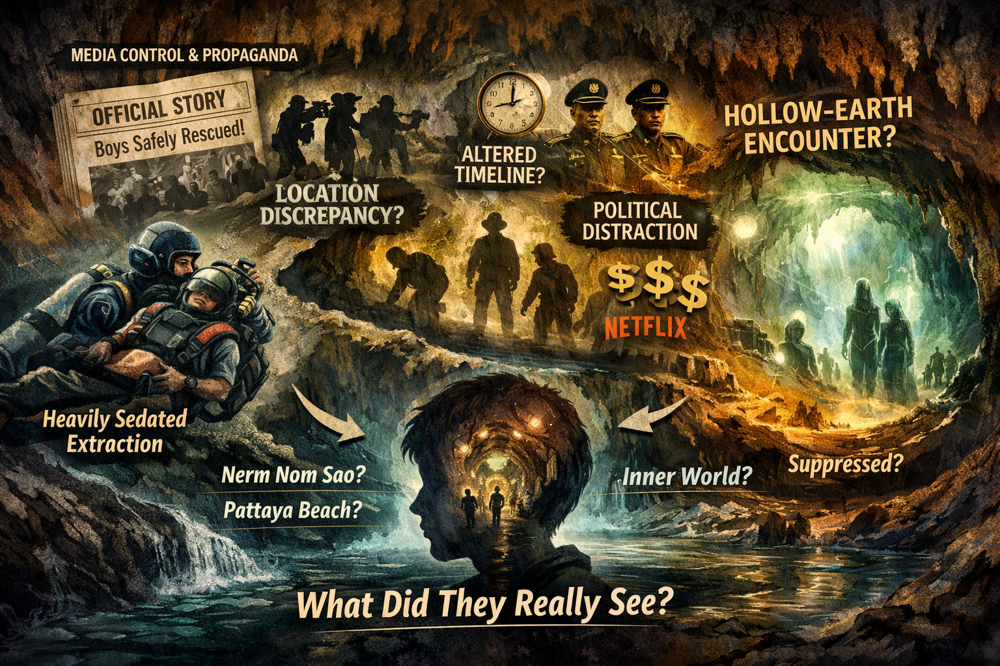

# Investigation: Tham Luang Cave Rescue (2018) — Cover-up and Alternate Theories

> **TL;DR:** Investigation: Tham Luang Cave Rescue (2018) — Cover-up and Alternate Theories: This investigation examines the 2018 rescue of 13 individuals (12 boys of the Wild Boars football team and their assistant coach) from Tham Luang Nang Non cave, Chiang Rai, Thailand.
## Status

**Date:** 2026-03-16  
**Status:** Open

This investigation examines the 2018 rescue of 13 individuals (12 boys of the Wild Boars football team and their assistant coach) from Tham Luang Nang Non cave, Chiang Rai, Thailand. It catalogues **documented inconsistencies** between official narrative and participant accounts, **reported cover-up claims**, and **alternate theories** (excluding the initiation-ritual theory, which is set aside as unlikely). An **open theory** is considered: that the group may have encountered **hollow-earth or inner-world life** in the cave system and that the “rescue” functioned in part as a **deliberate cover-up** of that encounter, consistent with broader suppression of contact between surface and interior (see [hollow-earth-investigation.md](./hollow-earth-investigation.md) Part Ten: Open Theories).

**Related:** [hollow-earth-investigation.md](./hollow-earth-investigation.md) (life inside the earth, suppression of polar access, Deep State narrative control).

---

# PART ONE: OFFICIAL NARRATIVE AND TIMELINE

## I. Basic facts (undisputed)

- **23 June 2018:** 12 boys (ages 11–16) and assistant coach Ek enter Tham Luang Nang Non after football practice. Monsoon rains flood the cave; they are cut off and trapped.
- **2 July 2018:** British divers find the group alive on a dry ledge (reported in some accounts as “Pattaya Beach,” in others as “Nerm Nom Sao” — see Part Two for location discrepancy).
- **8–10 July 2018:** All 13 extracted in a three-day diving operation. Two rescue workers die during the mission (one Thai Navy SEAL, one volunteer).
- **Cave:** Tham Luang Nang Non (“Great Cave of the Sleeping Lady”) is Thailand’s fourth-largest cave system (~10.3 km, depth ~85 m), prone to seasonal flooding. Local mythology: princess/guardian spirit; Phaya Naga (serpent spirits) and underground realms feature in regional belief.

---

# PART TWO: DOCUMENTED INCONSISTENCIES AND COVER-UP CLAIMS

## II. Sedation and method of extraction

- **Official (Thai PM Prayuth Chan-ocha):** Boys were given “lightly” or “lightly sedated” / “light anti-anxiety medication commonly provided to soldiers.”
- **Rescue personnel (BBC, ABC, book *The Cave* by Liam Cochrane):** Boys were **heavily sedated** (e.g. **ketamine**), **semi-conscious or asleep**, to prevent panic in dark, tight, flooded passages. Some described as “groggy” or “asleep” during extraction.
- **Parents:** Some sources allege parents were told their sons would **swim out** with divers (wetsuits, air hoses). In reality, boys were **handcuffed** (or restrained with cables), fitted with full-face masks, **carried** by divers through submerged sections — i.e. **not** swimming. Characterised as a deliberate lie to soothe families.
- **Conclusion:** A clear **narrative gap** exists between “lightly sedated, swimming” and “heavily sedated, handcuffed, carried.” Whether this was public-relations softening or something more (e.g. hiding the boys’ state to avoid questions about what they experienced or saw) is open.

**Sources:** BBC (rescue personnel accounts); ABC News (rescuers, ketamine, “first boy started to come to”); *The Cave* (Liam Cochrane); Daily Mail, Fox News, News.com.au (parents told “swim,” actual method handcuffed + ketamine).

## III. Location of discovery

- **British caver Vern Unsworth:** The boys were found at **“Pattaya Beach,”** not at the widely reported **“Nerm Nom Sao”** ledge. He stated: “Nerm Nom Sao doesn’t exist, it’s a figment of some journalist’s imagination,” and that the wrong name has been perpetuated in documentaries and books worldwide.
- **Implication:** If the **official location name** is wrong or invented, the **official geography** of where the group was and what passages they had traversed is open to question — and with it, control of the narrative of what lay between entrance and “rescue.”

**Source:** The Thaiger, “History books will have to rewrite the Tham Luang cave story.”

## IV. Political distraction and media control

- **Critics:** The military junta used the high-profile rescue to **distract** from political issues, **manage international media** for favorable publicity, and **boost** the image of the ruling junta and monarchy.
- **Media and rights:** Thai government **took control of the story**; the Ministry of Culture became **custodians of the children’s rights** for a period. Concerns that access to the boys was controlled to secure **exclusive, lucrative deals** (e.g. **Netflix**) while controlling the public narrative. Netflix/SK Global secured exclusive rights to the Wild Boars’ story via a deal negotiated with the Thai government; the Netflix series is the only dramatic production granted access to the rescued team and families.
- **Implication:** Strong incentive to **monetise and control** a single, approved narrative and to **limit** independent or critical inquiry into what happened inside the cave.

**Sources:** BBC (political distraction, propaganda); Wikipedia (media control, Netflix); Guardian (government control of story, Ministry of Culture, Netflix deal).

## V. Condition of the group when found

- **Reported:** Boys and coach were in **“good” or “stable” health** after ~10 days (discovery) and 17 days total underground: “generally well, no sign of stress,” most “green condition,” average ~2 kg weight loss, “eating well,” “no fever” among first eight rescued.
- **Skepticism:** Observers found this **“unusually good”** or **“eerie”** given minimal food (they had ~700 baht of snacks, rationed), partial flooding, and prolonged confinement. Some conspiracy or alternate-theory discussions cite this as a reason to question the official story (e.g. that they had help, or that timeline/conditions were different).
- **Medical view:** Explanations offered include fitness, team cohesion, rationing, gradual acclimatisation to lower O₂; 17 days without severe organ damage from starvation. Blood checks reportedly showed “signs of infection” in all kids — so underlying issues existed despite outward “good” presentation.
- **Note:** “Unusually good health” is used in at least one summary of **alternate theories** that also mention **underground kingdoms** and **hollow earth** (see Part Three).

**Sources:** Reuters, AP, BBC, Stanford medicine; The Thaiger / search summaries re “underground kingdoms,” “hollow earth.”

---

# PART THREE: ALTERNATE THEORIES (EXCLUDING INITIATION RITUAL)

## VI. Theories documented in open sources

The following are **reported** as conspiracy or alternate theories in mainstream and fringe sources. They are listed for investigation, not asserted as fact.

1. **Sedation and “rescue” as cover-up of true condition.** The heavy sedation (and handcuffing) was not only for safety but to **prevent the boys from speaking or panicking** during extraction — and/or to allow a **controlled narrative** afterward (e.g. they were “asleep” and thus their account of what they saw could be managed or discredited). Linked to the claim that parents were deliberately misled about the method (swim vs. carried, lightly vs. heavily sedated).

2. **Political and propaganda use.** The junta used the rescue to **distract** from domestic politics, **silence opposition**, and present the military and monarchy in a favorable light. The “rescue” narrative was **managed** for maximum benefit to the regime.

3. **Media and monetisation.** The government **controlled access** to the boys to secure **exclusive deals** (e.g. Netflix) and to ensure only an **authorised version** of events reached the public. This restricts independent verification of what the boys experienced or said in private.

4. **Inconsistencies as evidence of incomplete narrative.** Observers found the **abrupt flooding**, **timing** of the rescue, and **quick recovery** “eerie,” feeding speculation that the **official narrative was incomplete** — i.e. that something material was omitted or altered (without specifying what).

5. **Mythological / underground-kingdom / hollow-earth speculation (fringe).** At least one fringe discussion (AboveTopSecret) framed the rescue in terms of **“Proof Of Hollow Earth Found”** and **“Two doctors volunteer to STAY with children trapped in Thai cave”** — implying that “staying” with the boys had a significance beyond medical care (e.g. containment or monitoring of witnesses). Broader summaries of conspiracy theories note speculation citing the **unusually good health** of the group and **local legends** about **underground kingdoms** and **mythical creatures (Phaya Naga)** — i.e. that the cave might connect to or symbolise something **underworld-related** that was then suppressed. **Evidence for a literal hollow-earth encounter is not established;** the point is that such speculation exists and that **narrative control** (sedation, location naming, media rights) would be consistent with **suppressing** any such account.

**Ritual / initiation theory:** Rumors that the boys were in the cave for a dangerous or unauthorized **initiation ritual** were reported early; the boys later denied it. Per investigator preference, this theory is **set aside** as unlikely and is not pursued here.

---

# PART FOUR: OPEN THEORY — HOLLOW-EARTH LIFE AND DELIBERATE COVER-UP

## VII. Hypothesis (unproven)

As an **open theory** for investigation (not asserted as fact):

- The 13 individuals **encountered** something in Tham Luang that could be interpreted as **hollow-earth or inner-world life** (or evidence of an inner world / underground civilisation) — whether literal entities, structures, passages, or phenomena that do not fit the public geology/narrative.
- The “rescue” was in part a **containment operation**: extract the witnesses, **heavily sedate** them to prevent coherent disclosure during extraction and to cast doubt on later recall, **control the narrative** (wrong location name, “light” sedation, “swimming”), **monetise and gatekeep** the story (Netflix, government custodianship of the boys’ rights), and **limit** independent access to what the boys might say they saw.
- This would align with the broader **open theory** in [hollow-earth-investigation.md](./hollow-earth-investigation.md) (Part Ten): that **contact between surface and interior** is **deliberately suppressed** by entrenched interests; that **venture to certain zones** (poles, deep caves?) is **off limits** or tightly controlled; and that the need to **contain and suppress** has to do with **controlling the surface population** and **technological / historical knowledge**.

**What would support (or weaken) the theory:**  
- Any **first-hand statement** by the boys or coach (or rescuers) that they saw **people**, **lights**, **structures**, or **passages** not accounted for by the official cave map.  
- Evidence that **location names** (e.g. Nerm Nom Sao vs. Pattaya Beach) were changed to **hide** a specific chamber or route.  
- Evidence that **sedation** was chosen specifically to **impair testimony** (e.g. orders to that effect) rather than only for safety.  
- Correlation with other **deep-cave** or **polar** incidents where witness accounts were suppressed or narrative tightly controlled.

**What is not claimed:** That the rescue was “fake” (all 13 were extracted and survived); that every rescuer was part of a cover-up; or that ritual or ceremonial explanations are endorsed here.

**Broader frame (hollow-earth open theory):** If the earth is hollow with life, **“first contact”** scenarios must be **far more common** than we can imagine — most would be suppressed or reframed. Tham Luang would then be one of many such episodes. A plausible **control system** is to **punish** anyone who ventures into the hollow earth and returns (or can be brought back). That would both deter surface exploration and, over time, **convince inner-world inhabitants** to **secure the openings** against wandering humans — both to avoid harm to the curious (who are punished on return) and because from the interior the surface can only appear as a **500–600 year state of constant warfare**. See [hollow-earth-investigation.md](./hollow-earth-investigation.md) Part Ten, points 7–8.

---

# PART FIVE: ONLINE AND DOCUMENTARY REFERENCES

## VIII. Sources cited

| Type | Source | What it contributes |
|------|--------|---------------------|
| News / book | BBC | Rescue personnel: boys heavily sedated, semi-conscious; PM said “light”; parents told boys would swim. |
| News / book | ABC News | Rescuers describe ketamine, handcuffing/cables; “harrowing moment when first boy started to come to.” |
| Book | Liam Cochrane, *The Cave* | Detailed account: ketamine, handcuffed, carried; public told “swim”; parents misled. |
| News | Daily Mail, Fox News, News.com.au | “World was told boys would swim — that was a LIE”; handcuffed, drugged with ketamine. |
| News | The Thaiger | Vern Unsworth: boys at “Pattaya Beach,” not “Nerm Nom Sao”; latter “doesn’t exist,” narrative wrong in books/docs. |
| Summary | Wikipedia (“Tham Luang cave rescue”) | Conspiracy theories: sedation cover-up, political distraction, media control, “fake” initiation (set aside here), mythological/spirit (reclining lady), inconsistencies. |
| Summary | BBC (conspiracy/speculation) | Junta used rescue for image, silence opposition; media control; boys’ true (heavily sedated) condition downplayed. |
| Fringe | AboveTopSecret | Thread: “Proof Of Hollow Earth Found” — two doctors volunteer to STAY with children; hollow-earth angle. |
| Summary (search) | The Thaiger / aggregator | Alternate theories: unusually good health + local legends (underground kingdoms, Phaya Naga); “hollow earth” and “hidden aspects” speculation. |
| Medical | Reuters, AP, Stanford | Boys “good health,” stable, minimal weight loss; medical explanations; also “signs of infection.” |
| Media / gov | Guardian, Wikipedia | Thai government control of story; Ministry of Culture custodians of children’s rights; Netflix exclusive deal. |

## IX. Cave and mythology

- **Tham Luang Nang Non:** “Great Cave of the Sleeping Lady”; local legend of a princess whose body became the mountains; **Phaya Naga** (serpent spirits) and **underground** or **underworld** motifs in regional belief. During the rescue, both **ritual/spiritual** and **scientific** approaches were reported (e.g. when practical efforts stalled).  
- **Use for investigation:** Local tradition already frames the cave as a **liminal** space (spirit, underworld, Naga). That does not prove a hollow-earth encounter, but it is consistent with **why** a cover-up might be framed in terms of “spirits” or “myth” if something else were being hidden.

---

# PART SIX: OPEN QUESTIONS AND NEXT STEPS

## X. Next steps

- [ ] **Primary accounts:** Search for any interview, leak, or statement by the 13 (or rescuers) describing **lights**, **passages**, **people**, **sounds**, or **structures** inside the cave beyond the official map.
- [ ] **Location:** Verify Vern Unsworth’s claim (Pattaya Beach vs. Nerm Nom Sao) against cave surveys and early rescue logs; determine if naming confusion is innocent or narrative.
- [ ] **Sedation orders:** Search for any document or testimony that sedation was intended to **impair testimony** or **prevent disclosure** (vs. solely safety).
- [ ] **Comparisons:** Compare to other **deep-cave** or **restricted-zone** incidents where witness narrative was tightly controlled or suppressed.
- [ ] **Hollow-earth link:** Cross-reference with [hollow-earth-investigation.md](./hollow-earth-investigation.md) — e.g. whether **cave systems** (as opposed to poles) appear in hollow-earth literature as **entrances** or **contact zones**; whether suppression of “contact between planes” extends to major cave rescues.

---

*Investigation file: `cosmos/cosmology/hollow_earth/tham-luang-cave-rescue-2018-investigation.md`. Open theory only; no claim that hollow-earth encounter is proven.*

---

Keywords: #tham #luang #cave #rescue #2018 #coverup #alternate #theories

