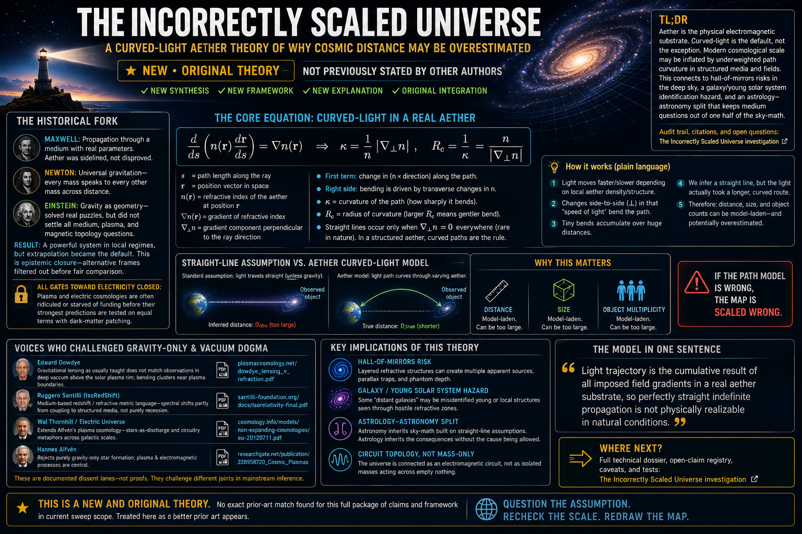

# The Incorrectly Scaled Universe

A curved-light aether theory of why cosmic distance may be overestimated

The standard cosmology story asks you to accept one quiet assumption almost everywhere: over large enough ranges, light can be treated as straight unless gravity says otherwise. This reading starts from a different premise. Light propagates through a real substrate, and in real substrates with real gradients, path curvature is the rule while perfect straightness is only a local approximation.

That single shift changes everything downstream. If light paths curve more than current pipelines assume, then distance ladders, size estimates, and even object counts inherit that bias. The farther out you infer, the more inference risk accumulates.

The foundation here is deliberately narrow and hard. **Maxwell’s electrodynamics were never “disproved” into non-existence;** what changed was vocabulary, pedagogy, and which metaphors were allowed to sit next to the equations. If the medium picture of propagation is closer to the truth than the myth of perfect vacuum straightness, then much of what followed—mainstream gravity-first cosmology included—may be **incorrectly scaled**: not because every observer lied, but because the geometry of inference was wrong at the root.

> **TL;DR:** This model treats **aether** as the physical electromagnetic propagation substrate, treats straight-line light as a **local approximation** rather than a universal law, and argues that modern cosmological scale may be **inflated** by underweighted path curvature in structured media and fields. It connects that physics read to a **hall-of-mirrors** possibility in the deep sky, a **galaxy / young solar system** identification hazard, and an **astrology–astronomy** split that keeps refractive and medium questions out of one half of the culture’s sky-math. The audit trail, citations, and open questions live in [The Incorrectly Scaled Universe investigation](/cosmos/cosmology/investigations/incorrectly-scaled-universe-curved-light-aether-investigation.md).

## The historical fork

**Maxwell** gave the modern world the field language that still runs power systems, communications, and measurement. His era treated propagation as something that happens **through** a medium with real parameters, not through a ritual void. Later teaching kept the formalism and quietly trained students to imagine “fields in vacuum” as a complete picture, while treating **aether** as a superstition.

**Newton** gave universal gravitation: a grammar that makes every mass speak to every other mass across distance. That framework won because it organized the solar system and engineering orbits. It also trained intuition toward **action at a distance** as normal, as if empty space were a transparent conveyor for force.

**Einstein** reframed gravity as geometry. That move resolved specific puzzles and became the default interpretive lens for large-scale structure. It did not, by itself, settle every open question about **plasma**, **magnetic topology**, or **medium-coupled propagation** on galactic and intergalactic paths.

The result is a powerful stack that works extremely well in many local engineering regimes and still leaves major open questions at cosmic scale. This argument does not deny those achievements. It challenges their **extrapolation regime**—the quiet step from “works on this baseline” to “therefore the entire deep map is closed.”

A cleaner way to say the institutional problem is **epistemic closure**: unresolved anomalies remain in scope, but alternative explanatory frames are filtered out before they can compete on equal methodological terms. **Electric-universe and plasma-cosmology lanes** are often ridiculed or blocked from funding long before their strongest predictions are tested at parity with dark-matter patching. Meanwhile the institutional default stays gravity-first—not because malicious individuals wake up scheming, but because paradigm inertia pays rent in prestige, curricula, and grant language.

That condition matches what this model calls **all gates toward electricity closed**: the allowable public imagination still routes cosmic structure through gravity scaffolding first, even when observational astronomy keeps finding magnetic and plasma structures that look like circuitry.

## Voices who challenged gravity-only and vacuum-dogmatic readings

Nothing below is pasted here as “proved because a PDF exists.” These are **documented dissent lanes** adjacent to this synthesis. Each challenges a different joint in mainstream cosmic inference.

**Edward Dowdye** argues that gravitational lensing as usually taught does not cleanly match observations in deep **vacuum** above the solar plasma rim; bending clusters near plasma boundaries. PDF: *[Gravitational Lensing in Empty Vacuum Space Does Not Take Place](https://plasmacosmology.net/dowdye_lensing_v_refraction.pdf)*.

**Ruggero Santilli** and collaborators develop **medium-based redshift** / refractive metric language (**IsoRedShift** and related constructs), treating spectral shifts partly as coupling to structured media rather than purely as recession. PDFs via the Santilli Foundation: *[Isorelativity](https://santilli-foundation.org/docs/Isorelativity-final.pdf)*, *[IRS confirmations](https://santilli-foundation.org/docs/IRS-confirmations-212.pdf)*.

**Wal Thornhill / Electric Universe** extends **Alfvén’s plasma cosmology** toward stars-as-discharge motifs and circuitry metaphors across galactic scales. Example conference PDF: *[The Electric Universe Illuminates Recent Discoveries](https://cosmology.info/models/non-expanding-cosmologies/eu-20120711.pdf)*. **Hannes Alfvén** remains the mainstream-recognized anchor for rejecting purely gravity-only star-formation folklore in favor of **plasma and filament** behavior.

**Halton Arp** documented **physically associated** high- and low-redshift objects, arguing that **redshift is not a clean distance proxy** in every case. NASA/Caltech hosts his *Atlas of Peculiar Galaxies* as a catalogue artifact: *[STScI / Arp atlas](https://archive.stsci.edu/prepds/arpatlases/)*. Mainstream cosmology rejects a fully “intrinsic redshift” replacement of Hubble—but the **association problem** remains a live fault line worth reading honestly.

For textbook contrast, the [Wikipedia overview of redshift](https://en.wikipedia.org/wiki/Redshift) still lists Doppler, gravitational, and cosmological channels as standard buckets, while noting that scattering and other optical processes can mimic shifts in some settings. The fight is not whether **z** is measurable; it is whether **z ⇒ distance** is globally safe as a scaling axiom when bridges, jets, and interacting pairs keep showing up in Arp-class imagery.

**Teaching translation (not adoption):** Popular science explainers sometimes stress that **perfect straight-line** light is itself a simplification—diffraction spreads real beams; **spacetime curvature** bends null geodesics ([example explainer](https://www.wtamu.edu/~cbaird/sq/mobile/2023/11/22/when-does-light-travel-in-a-straight-line/)). This model does not confuse that mainstream point with its own **aether-gradient** ontology. It uses the reminder for one tactical purpose only: pedagogical certainty about ruler-straight rays is weaker than freshmen are taught, which makes the cosmic straight-line extrapolation **less insane to interrogate**.

Together these authors do **not** equal this theory. They fertilize different branches. What is stitched here is narrower and stranger: **aether-as-substrate curvature default** wired to **scaling error**, **mirror multiplicity**, and **astro–astro logic split**.

## Aether as substrate, electromagnetic field as its geometry

In this ontology **aether** and **organized electromagnetic substrate** refer to one reality seen two ways—once as “what carries,” once as “how coupling arranges.” The project prefers **æther** spelling in canon notes; see [Aether vocabulary and Maxwell debate](/docs/LLM_AETHER_VOCABULARY_MAXWELL_DEBATE.md).

Translation for mixed audiences—**one sentence, not a takeover:** mainstream textbooks describe overlapping structure using **vacuum polarization**, **QED**, **curved spacetime**, and engineered constants like **ε₀** and **μ₀**; those belong in the glossary as bridges, not as silent replacements that erase substrate language mid-paragraph. The Maxwell lineage write-up stays in-repo: [Did Maxwell's Work Actually Prove the Aether Exists?](/science/maxwell_aether/02-did-maxwell-prove-the-aether.md).

Modern pop packaging keeps reinventing substrate under names like zero-point scaffolding while treating the word **aether** as radioactive. Lexical policing is not the same as ontological elimination.

## How light paths form in this model (no photon billiards)

This framework does not treat light as a stream of little balls ricocheting through empty halls. It treats signals as **wave–medium** phenomena whose **final path is the resultant of every field imposed on the route.**

**Dominant backdrop does not imply total control.** Earth-scale field structure can dominate over open sky until the ray meets **matter with sharp microscopic order**: glass, water, prism edges, crystalline lattice regions, dense molecular clusters. There the **local gradient structure** outweighs the soft global field—which is exactly how a prism manufactures **spectral fan-out** without anyone agreeing on a naive “particles bouncing off glass faces” bedtime story.

Stated plainly: **refraction reads here as curvature steered by near-field electromagnetic microstructure.** The bending is enormous where gradients are concentrated; visually “beautiful shapes” emerge because wavelengths sample different stiffness in the coupling landscape.

Across longer paths, curvature need not advertise itself as carnival colors. **Mirages**, **inferior/superior ducting**, and **Fata Morgana** already prove that horizons are not naive rulers: thermal air stratification bends radiation hard enough to **lift, stack, invert, and duplicate images**. That is uncontroversial physics on Earth. Encyclopedia-grade summaries such as **[Atmospheric refraction](https://en.wikipedia.org/wiki/Atmospheric_refraction)** and meteorological miracle pages (**[Fata Morgana](https://en.wikipedia.org/wiki/Fata_Morgana_(mirage))**) exist precisely because sailors, surveyors, and astronomers bumped into bending hard enough to break naive triangulation intuition.

Teaching-grade notes on astronomical refraction (for example **[Andrew Young’s astronomical refraction explainer](https://aty.sdsu.edu/explain/atmos_refr/astr_refr.html)**) stress how much **few arcminutes near the zenith balloon toward tens of arcminutes** when objects hug the horizon. None of this “proves cosmology wrong.” It establishes a pattern: **the atmosphere is already a curved-light instrument** taped to every ground-based cosmology meme.

Cosmology’s leap is narrower: refusing to extrapolate gradient physics across **interplanetary plasma**, **structured dust**, **magnetic sheaths**, **heliospheric transitions**, **interstellar filament media**, **galactic magnetism**, and whatever **large-scale field topology** still lacks honest cartography.

## Why straight lines feel absolute

Short baselines, smooth media, and human-scale flatness conspire. The ground plane looks flat because planetary curvature is gentle at walking scale; rays look straight because **local** gradient integrals are tiny across lab lengths. It is the same class of illusion that makes people think ancient cosmology must be stupid for speaking in **collinear sky geometry**—then modernity turns around and treats **perfect straight geodesics** as a religious axiom for **billions of light-years**.

Under this theory, what matters is not “the biggest field wins.” What matters is **who wins the gradient locally** and how those wins **integrate** along the path.

## The incorrectly scaled cosmos

If curvature is pervasive and cumulative, then **distance** is often inferred from angular size, brightness, spectral shifts, assumed energetics, and ladder logic that assumes **straight sightlines unless lensing menus say otherwise**. Each step trusts the previous step.

**Hall of mirrors.** This model entertains—not as settled fact—that some **bright transients**, **lensed arcs**, **repetitive morphologies**, and **odd redshift ghosts** behave less like billions of unrelated islands and more like **multi-path projections** folding through the same cluttered magnetized medium.

Think of shoreline cliffs reflected three ways in restless water—not because three cliffs were built, but because **boundary conditions** sculpted repeated virtual images. Carry that analogy **up**, not sideways into proof: if large-scale curvature and double-layer corridors exist, identical structures could appear at **widely separated compass positions** **and** inflated distance bins when pipelines assume uniqueness of source per line of sight.

The sky would then contain **fewer genuinely distinct objects than catalogs claim**, not because catalogs are careless, but because **path geometry cheats** duplication and scale.

**Infinity and expansion.** This reading pushes back linguistically against “universe size as unlimited confidence.” If mapping is curvature-corrupted at large scale, then **literal infinity** is not an observation; it is a **sentence** pasted over uncertainty. Expansion narratives become one interpretive lattice among others; they are not waved away as fiction here—they are flagged as **model-dependent**.

## Galaxies that might be young solar neighborhoods

Orthodox planet formation lore still leans heavily on **accretion** stories and timelines that discourage thinking about **localized birth spasms**. If researchers **search for galaxies** far more eagerly than **nested proto-systems undergoing violent electrical birth**, the classifier will systematically **stretch** ambiguous glow into **galaxy distance**, inflate mass, inflate population.

This article does **not** claim NASA secretly knows and lies. It claims **category error risk**: fuzzy birth smear + mis-scaled path could place the same **local family-scale** event at **intergalactic** coordinates on the map.

Observation language already struggles with mergers, tidal trains, peculiar morphologies—exactly Arp-country. If curvature multiplication is added, **one** electrically violent neighborhood could counterfeit **many** textbook “galaxy fields” downstream of processing.

The **planetary circle of life** at human mythic and field scales is developed elsewhere: [The Circle of Life and How It Began](/science/biology/circle-of-life-and-how-it-began.md). Read that as the **biotic and Saturnian-cycle** analogue; read *this* file as the **optical-distance** analogue. Same author’s scaffolding, different floor of the building.

## Plasma, filaments, and the electric universe rhyme

Roughly speaking, cosmical matter is overwhelmingly **plasma** in mass-fraction folklore; filamentary morphology is undeniable in modern imagery. Plasma behavior is inseparable from **fields and currents**. The Electric Universe school names that moral aloud: circuitry before gravity-only postcards.

Cosmology hub material in-repo: [Plasma Physics Cosmology](/cosmos/cosmology/a.md). Thornhill citation above anchors one PDF lineage.

This model steals **topology**, not slogans—**filaments, double layers, current sheets** as realism about what light must swim through between here and advertised “there.”

## Astrology vs astronomy: two labels, unequal permission

Atmospheric effects on **rising and setting**—large refraction shifts—are textbook for astronomers correcting ephemerides, yet astrology’s public caricature forbids admitting that sky angles are already **wet-air products** long before psyche enters the wheel.

Treat that split as sociology, not astrology beef. Dividing symbolic practice from positional science made sense administratively—and also **quarantined** uncomfortable questions about **what sky coordinates mean** physically.

Bridge claim: if astronomy’s distance scales are wrong, **astrology’s inherited tables** remain internally consistent as **angular recipes** while **cosmological meaning** attached to those angles may be carrying **bad distance luggage** from the parent discipline.

## Gravity as large-scale electromagnetism (sketch)

This framework does not throw away “things fall.” It **re-homes** the explanation: **gravity as misattributed EM / static-like coupling** at planetary and stellar scales, with **near-field dominance** again doing most of perceptual lifting.

Newton’s inverse-square lore then reads less like mystical intimacy and more like faith in **pairwise bookkeeping across void** — **beautiful as poetry**, strained as ontology. Every atom somehow “knowing” every other atom’s position without admitting a substantive medium story is exquisite mythmaking; cosmology textbooks simply mistook the myth’s emotional voltage for explanatory closure **about mechanism**. Electricity offers a different connectedness metaphor: continuity through **circuit** and **substrate**.

In everyday life people already tolerate **near-field strangeness**: static arcs jump finger-to-metal even while **Earth’s planetary field feels invisible** locally. Scaling that intuition planet-wide stays metaphor until equations arrive—but metaphors locate **why** intuition keeps reaching for electromagnetism when gravity-only closure feels hollow.

Strong and weak nuclear language is not pulverized here for sport. Compressed read: regimes differ by **spatial scale and coupling stiffness** more than by ontologically alien forces; unify first at **substrate continuity**, quarrel later about labels.

The **four forces textbook split** reads here partly as bureaucracy: electromagnetism is not “missing” once you grant scale morphing—the same coupling **looks different** beside a nucleus versus beside a planetary dipole sheath.

Orbital weightlessness (“no gravity in orbit”), deep-Earth gravitational sign reversals in hollow-earth model spaces, **static shock** intuition at fingertip arcs—these variants sit in the investigation as **labeled speculative** strata. This article names them once so curiosity has an address instead of rumor.

Remote viewing narratives and reports of cognition crossing distance then become **cultural hints** aligned with substrate connectivity—not laboratory proof. Inventory only.

## What makes this theory different

Adjacent critiques scatter across vacuum-lensing challenges, intrinsic redshift debate, plasma cosmology, and EU threads. What is fused here—the **incorrectly scaled map**, **mirror duplication**, **category errors on birth**, **aether ontology**, **astrology wedge**, **one-force gravitational rewrite** pitch—is why the author treats the bundle as **original synthesis** pending better prior-art archaeology.

## Where next

- Technical dossier: [The Incorrectly Scaled Universe investigation](/cosmos/cosmology/investigations/incorrectly-scaled-universe-curved-light-aether-investigation.md)
- Maxwell / aether spine: [Did Maxwell's Work Actually Prove the Aether Exists?](/science/maxwell_aether/02-did-maxwell-prove-the-aether.md)
- Vocabulary rules: [Aether vocabulary and Maxwell debate](/docs/LLM_AETHER_VOCABULARY_MAXWELL_DEBATE.md)
- Big Bang / redshift religion-critique lane: [Astronomy: The Simulated Universe](/cosmos/cosmology/astronomy/page.md)
- Consensus theater / APS survey: [Consensus theater and the stalled physics pipeline](/cosmos/cosmology/consensus-theater-and-the-stalled-physics-pipeline.md) · [investigation](/cosmos/cosmology/investigations/big-mysteries-survey-consensus-theater-investigation.md)
- Refraction and sky perception: [Flat Earth - History, Myth, and Misinterpretation](/cosmos/flat_earth/flat-earth-investigation.md)
- Space narrative faith tests: [Artemis II mission as faith test](/history/chronology/investigations/artemis-ii-mission-as-faith-test-investigation.md)
- Planetary birth-cycle essay: [The Circle of Life and How It Began](/science/biology/circle-of-life-and-how-it-began.md)

## Framing and limits

- **Speculative vs documented:** Hall-of-mirrors multiplicity, galaxy misclassification, one-force gravity, hollow-Earth gravity variants, **and** cognition-at-distance anecdotes are **not** presented as adjudicated physics in this repo article. They are **author-position exploratory extensions** flagged here in one batch per site style.
- **Original theory:** means **novel synthesis composition** within current sweep, not mathematical uniqueness proof.
- **Mainstream anchors:** Atmospheric refraction, mirage optics, spectroscopy, gravitational lensing, and standard cosmology remain valid in their regimes; this model disputes **exclusive extrapolation imperialism**, not every local measurement.
- **Next hard work:** curvature law draft, duplicated-object hypothesis tests, and ephemeris lineage audit—all listed in the investigation TODO block.

Keywords: #IncorrectlyScaledUniverse #CurvedLight #Aether #Cosmology #ElectricUniverse #OriginalTheory #PlasmaCosmology #AstrologyVsAstronomy

**Substack:** [paradigmthreat2.substack.com/p/the-incorrectly-scaled-universe](https://paradigmthreat2.substack.com/p/the-incorrectly-scaled-universe)

**Last updated:** 2026-05-08

---

*Written and narrated by Ari Asulin, with drafting and research support from LLM agents.*
