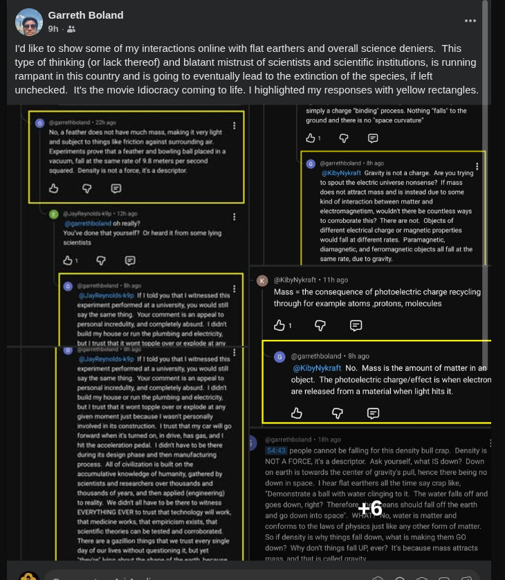

# Flat Earth — Q&A and Debunks

> **TL;DR:** Viral flat-Earth arguments (pilot spin, density-not-gravity, “my truth”) usually confuse **frame of reference** with **shape**. **Documented** mainstream corrections — vacuum free-fall, retrograde motion, star-trail hemispheres, Cavendish, Foucault-class sky rotation — support a **rotating globe**. Prevailing **east–west wind belts** (Entry 3) are a separate weather-scale pattern that is **real**: textbooks blame **Hadley–Ferrel–Polar + Coriolis** (inertia / spinning-ground frame); the author **rejects that cause**, hypothesizes **EM / Electric Universe** (Earth in the Sun’s field — possibly spin *through* that field), and does **not** claim “Coriolis math is fake.” The author’s **field-frame** thesis (Entries 1–2) explains *felt fixedness* without endorsing literal flat-Earth doctrine — which this repo treats largely as [controlled opposition](/cosmos/flat_earth/co.md) burying Saturnian / Hollow / Tartaria threads.

**Status:** Open — Entries 1–3 (pilot meme; friend’s density/gravity debate; zonal wind / east–west belts).
**Date:** 2026-08-22

## Guide

1. **Entry index** — pick the meme or debate thread you saw.
2. **Documented** sections — mainstream mechanics / observation debunks (fair summary of interlocutors like the author’s friend).
3. **Author** sections — unified-field / EM frame hypothesis (why spin isn’t *felt*; zonal belts: pattern real, textbook Coriolis-as-cause rejected, EM cause — not a flat-Earth proof).
4. **Limits** — at file end.

### Entry index

| # | Topic | Image |
|---|--------|--------|
| [1](#entry-1-pilot--earths-spin-meme) | Pilot / Earth’s spin meme | `pilot-earth-spin-meme.png` |
| [2](#entry-2-density-gravity-electric-universe--my-truth-debates-friend-threads) | Density vs gravity, Electric Universe, Bible-vs-NASA, “my truth” | `friend-fe-debate-collage.png` |
| [3](#entry-3-zonal-winds--alternating-eastwest-weather-belts) | Zonal winds / alternating east–west weather belts (Hadley–Ferrel–Polar) | — |

Related: [Flat Earth investigation — history & misinterpretation](/cosmos/flat_earth/flat-earth-investigation.md) · [CO / PSYOP angle](/cosmos/flat_earth/co.md) · [**Reader essay — The Flat Earth trance**](/cosmos/flat_earth/the-flat-earth-trance.md) (friend debunk inspiration, Phoenix FE, dual ignorance; Chansley in [Part II](/influence/controlled_opposition/qanon-shaman-scottsdale.md)) · [Thunderbolts / Electric Universe index](/cosmos/cosmology/saturnian/index-thunderbolts.md) · [**Three-Cell Motion dossier**](/science/geoengineering/investigations/three-cell-motion-em-aether-investigation.md) (Hadley / Ferrel / Polar + thermal=EM / æther framing; expands Entry 3)

---

## Entry 1: Pilot / Earth’s spin meme

### Meme transcript (as shown)

> **EARTH’S SPIN?**
>
> SO AS A PILOT…
> I AM A LICENSED PRIVATE PILOT  
> I FLY FROM JUNEAU, ALASKA TO KONA, HAWAII.  
> HOW DO I ACCOUNT FOR THE DIFFERENCE IN EARTH’S SPIN?
>
> JUNEAU, ALASKA - 446 MPH AND KONA, HAWAII 969 MPH.  
> OVER 500 MILES PER HOUR DIFFERENCE.
>
> I DON’T, NO PILOT EVER DOES  
> WE ARE NEVER TAUGHT TO COMPENSATE FOR SPIN OR CURVE BECAUSE…
> EARTH IS A FLAT NON-ROTATING LEVEL PLANE.  
> ASK PILOTS!

### What the meme claims

| Claim (meme) | Why it sounds persuasive |
|---|---|
| Different places imply different “spin speeds” | People correctly observe real rotation and tangential velocity |
| Pilots never compensate for “absolute spin” | Everyday navigation does not require explicit “subtract Earth spin mph” math |
| Therefore Earth is non-rotating / flat plane | Treats “not explicitly compensated” as evidence against rotation (a frame-of-reference error) |

### Documented debunk (rotating reference frames and navigation)

**Documented:** the conclusion “non-rotating flat plane” does not follow from the premise “pilots don’t do absolute-spin subtraction.”

- Flight planning lives in a **co-rotating atmosphere** / Earth-fixed frame; **Coriolis and centrifugal effects are real** in that rotating-frame description — they show up when you measure from spinning ground ([Physics LibreTexts — Rotating Reference Frames](https://phys.libretexts.org/Bookshelves/University_Physics/Mechanics_and_Relativity_(Idema)/07%3A_General_Rotational_Motion/7.02%3A_Rotating_Reference_Frames)).
- East–west times are dominated by **winds**, not missing 500 mph spin corrections ([Physics Stack Exchange](https://physics.stackexchange.com/questions/16390/does-the-rotation-of-the-earth-dramatically-affect-airplane-flight-time)).
- “Not feeling spin” is compatible with a **slow angular rate** (~once per day) in a co-moving frame — not evidence for a stationary plane.

### Author’s frame thesis (Entry 1)

> The Earth’s field is spinning and we’re in the field → **local static frame**; we don’t feel the motion. Same class of idea as UFO sudden-stop anecdotes. **Frame of reference = stable EM field the frame is within** (unified-field read; Maxwell ↔ relativity bridge in [David Tong — Electromagnetism and Relativity](https://davidtong.org/pdfs/teaching/electromagnetism/electro4.pdf)).

**Split verdict:** Author hypothesis explains **felt fixedness**; it does **not** prove flat shape. The **sky** (stars, Sun, Foucault-class arguments in Entry 2) still shows **rotation**.

UFO phenomenon register: [PURSUE §5.11](/influence/controlled_opposition/investigations/pursue-2026-may-uap-release-investigation.md).

---

## Entry 2: Density, gravity, Electric Universe & “my truth” debates (friend threads)

### Context

Screenshots capture **YouTube / social comment wars** (e.g. under Apollo/conspiracy-adjacent videos) between the **author’s friend** and hardcore flat-Earth / alt-physics accounts (handles scrubbed in the images). The friend’s tone is **frustrated mainstream empiricism** — the posture that infuriates globers because FE recruits treat **personal disbelief** and **institutional distrust** as equal to centuries of corroborated measurement.

**This entry records the friend’s arguments fairly (Documented)** and then **separates** what they prove from what the **author’s field-frame hypothesis** adds (Author). **Reader essay:** [The Flat Earth trance](/cosmos/flat_earth/the-flat-earth-trance.md) — inspired by this debunk pattern; Phoenix FE; Saturnian exit; [Part II QAnon](/influence/controlled_opposition/qanon-shaman-scottsdale.md).

### What the flat-Earther side repeats (pattern)

| Trope | Example from threads |
|---|---|
| **Density is the real “force”** | “If gravity were real a feather would slam like a stone — it’s density!!” |
| **Appeal to personal incredulity** | “You’ve done that yourself? Or heard it from **lying scientists**?” |
| **Electric Universe gravity** | “Gravity is simply a charge binding process — no space curvature” |
| **Mass redefined as photoelectric recycling** | “Mass = consequence of photoelectric charge recycling…” |
| **Bible vs NASA** | “NASA lies; Bible proven — I choose Bible” |
| **Spinning-ball wet tennis ball** | Oceans should fly off a spinning globe |
| **Firmament / dome / Fishbowl** | Rockets curve to hit dome; Operation Fishbowl “bombed the dome” |
| **“My truth” relativism** | “Explanations for both viewpoints — discern your own truth” |

### Friend — mainstream responses (Documented summary)

Fair paraphrase of the highlighted replies in the screenshot set:

#### A. Density is not a force

- **Vacuum test:** feather and bowling ball fall at **~9.8 m/s²** — air resistance explains everyday difference; **density describes** packing of matter, it does not **pull**.
- **“What is down?”** On Earth, **down = toward the mass center** (gravity). In orbit, “down” is ambiguous — there is no universal “down” in free space.
- **Oceans on a globe:** water is matter; **mass attracts mass** (gravity). A **wet tennis ball** spin demo is **not** a scale model of planetary gravity (wrong mass/radius/gravity field).

#### B. Trust and epistemology

- Demanding personal witness of **every** experiment is **appeal to personal incredulity** — civilization runs on **accumulated, tested knowledge** (engineering, medicine, infrastructure) nobody personally replicated from scratch.
- **“My truth / your truth”** is not how **objective** claims work (microbiology exists whether or not one personally cultured every species).

#### C. Electric Universe / EM-as-gravity

- If gravity were **electromagnetic charge binding**, objects with different **charge or magnetic** properties would fall at **different rates**. **Paramagnetic, diamagnetic, and ferromagnetic** bodies fall at the **same rate** in ordinary tests → consistent with **gravitational mass**, not a simple EM substitute.

#### D. Shape and sky observations

- **Heliocentrism** explains **retrograde planetary motion**; naive geocentrism does not (simple starting point the friend uses).
- **Star trails:** opposite rotation sense **Northern vs Southern** hemisphere — hard to fit a flat disk model; natural on a **rotating sphere**.
- **Sunset geometry:** Sun **sets below horizon** (not shrinking to a nearby point); **Burj Khalifa** double-sunset vantage; **cloud bottoms** lit at sunset — consistent with distant Sun on a globe, awkward for a always-local Sun on a plane.
- **Antarctic 24-hour Sun** (December) — cited in thread as witnessed by mixed groups; **polar day** is a classic globe prediction.

#### E. Rockets, Fishbowl, debunked influencers

- Rockets **curve for orbit** (fuel efficiency / trajectory), not because a **snow-globe dome** blocks straight paths.
- **Operation Fishbowl** (1962 high-altitude nuclear tests) — documented **EMP / aurora / weapons-effects** research, not “breaking the firmament” ([Wikipedia — Operation Fishbowl](https://en.wikipedia.org/wiki/Operation_Fishbowl)).
- **“Flat Earth Dave”** etc. — the friend treats as disinformation, not good-faith inquiry.

#### F. Spin rate and Cavendish

- **~1000 mph** at equator is **relative to Earth’s axis**, not an absolute speed you should “feel” like wind; Earth rotates **once per day** (~0.00069 rpm).
- **Cavendish experiment** (and modern gravimetry) demonstrates **mass attracts mass** at laboratory scale — undergrad-accessible corroboration the friend cites against “gravity is fake.”

### Why mainstream debaters get angry (Author sociology, not physics proof)

Hardcore FE personalities **reject the epistemic stack** the friend relies on (peer review, institutions, cumulative engineering) while still using **phones, GPS, and aviation** built on that stack. That **performative contradiction** — plus **Bible-vs-NASA** false binary and **“do your research”** links to curated influencers — reads as **bad-faith** or **captured** to mainstream observers. In-repo read: that recruitment basin overlaps [controlled opposition](/cosmos/flat_earth/co.md) and buries **Saturnian / Hollow / Tartaria** chronology work ([main investigation](/cosmos/flat_earth/flat-earth-investigation.md) Part Two).

### Author synthesis — friend + unified field (do not conflate tiers)

**Documented (friend + standard physics):** Earth is **not** flat; **gravity** is not “density”; **Electric Universe** gravity replacement fails simple drop-rate tests; **sky mechanics** show **rotation** and **spherical-Earth** geometry.

**Author hypothesis (field-carried frame):** The FE movement **misreads** a **real phenomenological fact** — **we do not feel Earth’s spin in everyday life** — and jumps to **“ therefore non-rotating flat plane.”** The friend correctly attacks the **shape** inference but often leaves the **felt-fixedness** experience **unaddressed** except via “slow rotation + inertia,” which FE recruits find unsatisfying.

**Author unpack:**

| Observation | Friend / mainstream read | Author unified-field read |
|---|---|---|
| No felt spin on ground | Small angular velocity; co-moving frame; effective gravity includes centrifugal term | We are **inside Earth’s co-rotating EM / field structure** → **local frame feels static** |
| Sky clearly rotates (stars, Sun, Foucault) | Proof Earth **rotates** (globe) | Same — **field spins with body**; sky is the visible edge of the rotating system |
| “Density” language | Wrong physics; descriptor not force | FE **cargo-cults** vocabulary from real **local** “everything sits on the floor” experience without naming **frame** |
| UFO sudden stop (Entry 1) | Unrelated or “not proven” | Same **frame-carried inertia** metaphor at craft scale — **Speculative** |

**Critical distinction for readers:** **Fixed sensation ≠ flat Earth.** A **rotating globe** with inhabitants **carried in a co-rotating field/medium** predicts **both** (a) **no barbecue-spin vertigo** on the ground and (b) **rotating star field**. Flat Earth predicts (a) but fights (b). The friend’s empirics win on (b); the author thesis is about **reframing (a)** without surrendering shape.

Bridging mainstream one-liner (optional): textbooks describe related structure as **fields in vacuum** refined by **relativity**; this repo names the substrate **æther** in author voice — see [`docs/LLM_AETHER_VOCABULARY_MAXWELL_DEBATE.md`](/docs/LLM_AETHER_VOCABULARY_MAXWELL_DEBATE.md).

### Entry 2 — Verdict

| Claim | Verdict |
|---|---|
| “Gravity is fake; density makes things fall” | **Refuted** (Documented — vacuum drop, Cavendish, magnetic drop-rate test) |
| “Electric Universe explains gravity” | **Refuted** as stated (Documented — drop-rate universality) |
| “Earth is flat because I don’t feel spin” | **Non sequitur** — felt fixedness does not imply flatness |
| “Earth rotates; sky shows it” | **Supported** (Documented — star trails, retrograde, polar day, sunset geometry) |
| “We live in a co-rotating field → local static feel” | **Author hypothesis** — explains **phenomenology** FE exploits; **not** a substitute for the friend’s shape evidence |
| “FE movement is mostly honest inquiry” | **Contested** — in-repo **CO / PSYOP** read; see [co.md](/cosmos/flat_earth/co.md) |

### Questions to verify (Entry 2)

- [ ] Primary-source pull on **Operation Fishbowl** objectives vs FE “dome” folklore (DoD / DOE archives).
- [ ] Quantify **Burj Khalifa** double-sunset geometry as a classroom problem (globe vs flat Sun height).
- [ ] Specify author’s **“Earth field”** layer: magnetosphere co-rotation vs broader æther claim — link to [Maxwell / æther lane](/science/maxwell_aether/02-did-maxwell-prove-the-aether.md).
- [ ] Track whether **“density not gravity”** FE talking point maps to **Rowbotham** / modern FE curriculum sources.

---

## Entry 3: Zonal winds / alternating east–west weather belts

### Claim / meme framing

**Question people ask (and radar “zoom out” memes imply):** Why do **prevailing winds** alternate **east ↔ west** as you move from the equator toward the poles — trade **easterlies**, mid-latitude **westerlies**, **polar easterlies** — so that a global weather-radar / wind map looks like striped **zonal** bands?

| Claim (author / EU-adjacent read) | Why it sounds persuasive |
|---|---|
| Belts alternate E–W with latitude | The large-scale pattern is real and visible on climatology maps |
| “Looks like” EM polarity / field alternation | Human pattern-matching from EM diagrams and striped radar loops |
| Therefore causation is **electromagnetic** (EU framing) — **not** spinning-ball drag / inertia / “spin momentum” → textbook Coriolis as the belt-alternation cause | Pattern-matching + rejecting the textbook *story*; easy to mishear as “Coriolis is fake” (it is not) |

This entry does **not** treat the belt pattern as a flat-Earth proof. It compares **textbook geophysics** (Documented summary) with the **author’s EM / Electric Universe framing** (Author hypothesis), then separates observation from causation.

Cross-link: Entry 1 already treats **Coriolis** as a **real named effect** in the Earth-fixed / rotating-atmosphere description used by pilots and meteorology — not a verbal trick or “fake math.” Entry 3’s dispute is **causation of zonal belts**, not denial that the Coriolis term exists in rotating-frame equations. Same rotating-frame vocabulary; different claim (felt spin vs large-scale wind belts).

### Documented — three-cell circulation + rotation (textbook geophysics)

**Documented (fair textbook summary):** Uneven solar heating drives **meridional** (north–south) overturning. In the classic teaching model each hemisphere has three cells:

1. **Hadley** (tropics ≈ 0°–30°) — air rises near the equator, aloft moves poleward, sinks in the subtropics.
2. **Ferrel** (mid-latitudes ≈ 30°–60°) — a mid-latitude cell whose surface branch is largely **eddy-driven** in modern accounts, not a simple mirror of Hadley.
3. **Polar** (≈ 60°–pole) — cold air sinks and flows equatorward near the surface.

**Earth’s rotation** enters as **Coriolis deflection** of that meridional flow in the rotating (Earth-fixed) frame:

- Equatorward surface flow in the Hadley cell → deflected → **trade winds** (**easterlies**).
- Poleward surface flow in the Ferrel belt → deflected → **prevailing westerlies**.
- Equatorward polar surface flow → deflected → **polar easterlies**.

**“Zonal”** means the **east–west** component of the large-scale flow. Alternation with latitude is then a geometric consequence of **which way** the surface meridional branch points, plus the **same sense** of Coriolis deflection in a given hemisphere — adjacent cells reverse the surface north–south branch, so the deflected east–west preference flips as you step poleward. Standard intros: [NOAA JetStream — global atmospheric circulations](https://www.noaa.gov/jetstream/global/global-atmospheric-circulations); [Met Office — global circulation patterns](https://weather.metoffice.gov.uk/learn-about/weather/atmosphere/global-circulation-patterns); Hadley + zonal wind sketch: [MIT Weather Tank — Hadley](http://weathertank.mit.edu/links/projects/general-circulation-an-introduction/general-circulation-atmosphere-hadley). Rotating-frame / Coriolis notes already cited under Entry 1 ([LibreTexts](https://phys.libretexts.org/Bookshelves/University_Physics/Mechanics_and_Relativity_(Idema)/07%3A_General_Rotational_Motion/7.02%3A_Rotating_Reference_Frames); [ApparentForces.pdf](https://www.atmos.albany.edu/facstaff/kristen/ATM317/Reference_Material_files/ApparentForces.pdf)).

### Author explanation — EM / Electric Universe framing

**Author hypothesis (clearly labeled — not “EU canon proved”):**

> **One-line claim:** Pattern **real**; textbook **Coriolis-as-cause** of east–west belt alternation **rejected**; **EM** (possibly spin-through-field) is the causal story — **author hypothesis**.
>
> The horizontal east–west alternation of wind belts is **electromagnetic** — Electric Universe framing: Earth interacting with the **Sun’s EM field** (and local EM). Natural EM structure / alternation produces the same east–west striping you see when weather radar / global wind views are zoomed out. The author **rejects the textbook causal story** that air is dragged by a spinning ball / inertia / “spin momentum,” with **Coriolis deflection in the rotating ground frame** as what *makes* the belts alternate east–west.
>
> The author is **not** saying “Coriolis math is fake,” that the name is meaningless, or that rotating-frame equations are a verbal trick. If “spin” enters the author’s story at all, it is **Earth spinning relative to the solar EM field** — which the author says could arguably be **“the same thing”** as EM causation — **not** inertial Coriolis from a rotating-ground / spinning-atmosphere frame.

**What the author means (unpack):**

| Keep | Drop (misread) |
|---|---|
| Belt **pattern** is real (trades / westerlies / polar easterlies) | “Author denies zonal winds” |
| Textbook **cause** (spinning-ball inertia → Coriolis → belt signs) is rejected | “Author says Coriolis math / the effect name is fake” |
| Cause = **EM** (Sun–Earth / local field; EU-adjacent) | “Author proved Thunderbolts canon on Hadley cells” |
| Optional spin = **through the solar EM field** (arguably same as EM) | “Author secretly means textbook inertial Coriolis after all” |

**EU literature adjacency (Documented about sources, not endorsement):** Thunderbolts / Electric Universe outlets argue that **electromagnetism** (not gravity alone) governs planets and **weather** in a broad program sense ([in-repo Thunderbolts index](/cosmos/cosmology/saturnian/index-thunderbolts.md); e.g. solar–ionosphere / Birkeland coupling pieces such as [Lightning in the Wind — Thunderbolts](https://www.thunderbolts.info/wp/2014/05/22/lightning-in-the-wind/)). That is **not** the same as a published Thunderbolts claim that the **Hadley–Ferrel–Polar east–west surface-belt alternation** is **solely** EM polarity replacing textbook Coriolis-as-cause. **This entry treats the EM zonal-belt causation thesis as author synthesis** unless a primary EU text is later pinned that states it specifically.

### Analysis — balanced tiers

**Observationally solid (Documented pattern, not yet a causation verdict):**

- Named surface regimes — **trades / mid-latitude westerlies / polar easterlies** — are long-standing climatology, not a meme invention.
- Large-scale **zonal** (east–west) dominance at planetary scale is what global wind / radar composites emphasize when local storms are averaged out.

**Model-dependent / interpretive (do not overclaim “proved”):**

- Textbooks present **Coriolis deflection of meridional cells** as the **dynamical cause** of the alternating surface zonal belts in the rotating frame. That is a **successful, predictive geophysical model** (GCMs, rotating tank demos, navigation / meteorology practice) — not the same as a metaphysical proof that **no** EM process can contribute to weather.
- The **Ferrel** cell is especially **model-sensitive** (eddies / baroclinic waves vs simple closed overturning). Saying “three neat conveyor belts” is a teaching sketch; modern dynamics is richer.
- **Coriolis as “cause” vs “co-description”:** In Earth-fixed equations, Coriolis is how rotation is written into the momentum budget. Saying the belts “are Coriolis” is accurate **inside that textbook frame**; the author rejects that frame’s *causal monopoly* for belt alternation, **without** calling the math fictitious. Entry 1’s split still applies: rotating-frame effects are **real in the description used for measurement**; they are not a flat-Earth refutation tool by themselves, and Entry 3 is not “Coriolis denial.”

**EM causation claim — strengths / weaknesses (Author hypothesis under stress test):**

| Angle | Note |
|---|---|
| Strength (phenomenology) | EM and plasma **do** couple into thunderstorms, ionosphere, auroral / solar-terrestrial weather — documented EU and mainstream interest differ mainly on **scope and primacy** |
| Weakness (specificity) | Visual “EM alternation ≈ zonal stripes” is an **analogy**, not a derived latitudinal EM field that predicts trade / westerly / polar-easterly signs |
| Weakness (literature) | Repo + Thunderbolts sweep: **no** pinned primary that the **alternating surface zonal belts** are **EM-caused** replacing textbook Coriolis-as-cause — **author synthesis** until sourced |
| Distinguisher (geophysics) | Slow or stop the planetary rotation rate in a GCM / lab analog → Coriolis parameter changes → **zonal belt pattern collapses or reorganizes**; that is what rotating-tank and GCM literature treat as diagnostic |
| Distinguisher (EM / spin-through-field) | Would need a **quantitative** Sun–Earth / magnetospheric / ionospheric account whose **latitudinal sign changes** match the wind belts — and clarify how “spin relative to the solar EM field” differs (if at all) from inertial rotating-frame Coriolis in predictions |
| Falsify / support posture | Do **not** claim mainstream has “disproved EM causation of all weather,” or that the author has “proved EM causation of zonal belts.” Pattern existence ≠ mechanism monopoly |

**Relation to Entry 1 / flat Earth:** Rejecting **textbook Coriolis-as-cause** of **zonal belts** is a **meteorology / causation** dispute — **not** “Coriolis is fake,” and **not** a license for “non-rotating flat plane.” Sky rotation evidence in Entry 2 still stands. Author EM **frame** thesis (Entries 1–2) and Entry 3’s EM belt hypothesis can coexist with documented sky rotation without demanding flat shape — see [trance essay](/cosmos/flat_earth/the-flat-earth-trance.md) and [co.md](/cosmos/flat_earth/co.md).

### Entry 3 — Verdict

| Claim | Verdict |
|---|---|
| Alternating E–W prevailing-wind belts exist (trades / westerlies / polar easterlies) | **Supported** (Documented — climatology) |
| Textbook cause = meridional cells + Coriolis in rotating frame | **Documented model** — standard geophysics; predictive; Ferrel cell details remain research-active |
| Pattern “looks like” EM alternation on zoomed radar | **Analogy** — persuasive rhetoric; not a mechanism derivation |
| Belts are **EM-caused** (Sun/local field; optional spin-through-field); textbook Coriolis / spin-inertia **as belt-alternation cause** rejected — **not** “Coriolis math is fake” | **Author hypothesis** (EU-adjacent framing; **not** shown here as Thunderbolts primary for this specific claim) |
| Therefore Earth is flat / non-rotating | **Non sequitur** — same class of error as Entry 1 (mechanism dispute ≠ shape) |

### Questions to verify (Entry 3)

- [ ] Pin any **Thunderbolts / Thornhill / Talbott / Scott** primary that explicitly attributes **Hadley–Ferrel–Polar surface zonal alternation** to EM polarity (vs general “weather is electrical”).
- [ ] One classroom cite for **rotating annulus / tank** reproduction of zonal jets (Documented pedagogy).
- [x] Author clarification locked in this entry: **pattern real**; reject textbook **Coriolis-as-cause** (spinning-ball / inertia); **EM** (Sun’s field + local; spin-through-field allowed as arguably the same); **not** “Coriolis math is fake.”
- [ ] Still open: pin quantitative EM latitudinal field vs GCM rotation-rate diagnostics (see Analysis table).

**Expanded dossier (2026-08-23):** Full three-cell package, atmospheric-electricity history, interpretive timeline, energy/flow/pressure control surface, operational contradiction, FE → third-path dialectic → [Three-Cell Motion — textbook vs EM / æther](/science/geoengineering/investigations/three-cell-motion-em-aether-investigation.md).

---

## Shared physics references (Entries 1–3)

| Topic | Citation |
|---|---|
| Rotating frames / Coriolis | [Physics LibreTexts — Rotating Reference Frames](https://phys.libretexts.org/Bookshelves/University_Physics/Mechanics_and_Relativity_(Idema)/07%3A_General_Rotational_Motion/7.02%3A_Rotating_Reference_Frames) |
| Coriolis / centrifugal in Earth-fixed (geophysical) frame | [ApparentForces.pdf](https://www.atmos.albany.edu/facstaff/kristen/ATM317/Reference_Material_files/ApparentForces.pdf) |
| Global cells / circulations | [NOAA JetStream — Global Atmospheric Circulations](https://www.noaa.gov/jetstream/global/global-atmospheric-circulations) |
| Global circulation (Met Office) | [Met Office — Global circulation patterns](https://weather.metoffice.gov.uk/learn-about/weather/atmosphere/global-circulation-patterns) |
| Hadley cell + zonal wind | [MIT Weather Tank — Hadley](http://weathertank.mit.edu/links/projects/general-circulation-an-introduction/general-circulation-atmosphere-hadley) |
| EU weather / lightning–ionosphere (adjacency, not zonal-belt proof) | [Thunderbolts — Lightning in the Wind](https://www.thunderbolts.info/wp/2014/05/22/lightning-in-the-wind/) |
| Maxwell + SR | [David Tong — Electromagnetism and Relativity](https://davidtong.org/pdfs/teaching/electromagnetism/electro4.pdf) |
| EM in non-inertial frames | [EPJC — Electrodynamics in noninertial frames](https://link.springer.com/content/pdf/10.1140/epjc/s10052-021-09722-4) |
| In-repo æther / Maxwell | [`science/maxwell_aether/02-did-maxwell-prove-the-aether.md`](/science/maxwell_aether/02-did-maxwell-prove-the-aether.md) |
| In-repo Thunderbolts index | [`cosmos/cosmology/saturnian/index-thunderbolts.md`](/cosmos/cosmology/saturnian/index-thunderbolts.md) |
| UAP instant-acceleration register | [PURSUE §5.11](/influence/controlled_opposition/investigations/pursue-2026-may-uap-release-investigation.md) |

Keywords: #FlatEarth #PilotSpinMeme #Density #Gravity #ElectricUniverse #AppealToIncredulity #RotatingFrame #UnifiedField #Maxwell #Aether #FrameOfReference #ControlledOpposition #ZonalWinds #HadleyCell #FerrelCell #TradeWinds #Coriolis #WeatherBelts #Thunderbolts #ParadigmThreatFiles

## Limits and disclaimers

> **Prisca sapientia (epistemic foundation):** This investigation assumes [**prisca sapientia**](/docs/PRISCA_SAPIENTIA.md)—the historical and philosophical belief that the ancients possessed a vast, profound understanding of the universe, nature, and theology that was subsequently lost or degraded. Modern consensus science and institutions are not treated as default truth; evidence tiers below adjudicate specific claims.

**Friend threads:** Summarized from **social screenshots** (Aug 2026 capture); usernames and wording paraphrased for dossier use — not an endorsement of every rhetorical tone. **Documented** rows follow standard physics; **Author** rows follow unified-field / æther hypothesis and **do not** overturn globe geometry.

**Do not merge tiers:** Winning the **density/gravity** argument does **not** prove the author’s **EM frame** mechanism; explaining **felt fixedness** does **not** rehabilitate **flat-Earth shape** claims. **Entry 3:** observing **zonal wind belts** does **not** prove **EM** causation; documenting the **three-cell + Coriolis** textbook model does **not** by itself “disprove” every EM contribution to weather — and rejecting textbook **Coriolis-as-cause** must **not** be misread as “Coriolis math is fake.” The **pattern-real / textbook-cause-rejected / EM (possibly spin-through-field)** package stays **Author** until sourced and tested.

**UFO analogy:** Instant-acceleration reports are indexed in PURSUE §5.11; mechanism remains **Speculative**.

**Institutional trust:** The friend’s “civilization trust” argument is **epistemic**, not a rebuttal to every **NASA / Apollo** critique elsewhere in Paradigm Threat — those live in other investigations.

## Investigator notes

- Screenshot source batch: `/home/ari/.cursor/projects/home-ari-dev-fan-edits/assets/image-0b53d48c-*.png` et al. (Aug 2026); collages copied to `cosmos/flat_earth/friend-*.png`.
- Video context (from screenshots): *One Giant Lie to Mankind: The Untold Story of the Apollo Missions with John Hamer and Alastair Neil* — FE-heavy comment section; not adjudicated here.
