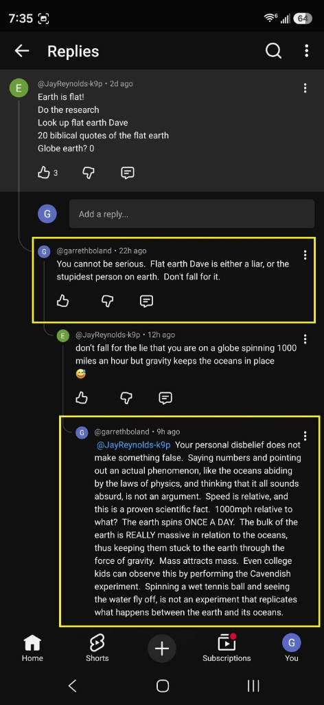

# Flat Earth — Q&A and Debunks

> **TL;DR:** Viral flat-Earth arguments (pilot spin, density-not-gravity, “my truth”) usually confuse **frame of reference** with **shape**. **Documented** mainstream corrections — vacuum free-fall, retrograde motion, star-trail hemispheres, Cavendish, Foucault-class sky rotation — support a **rotating globe**. The author adds a **separate hypothesis**: Earth’s **electromagnetic / field structure** co-rotates with the body, so occupants experience a **locally fixed frame** (no felt spin) **while the sky still proves rotation**. That explains *felt fixedness* without endorsing literal flat-Earth doctrine — which this repo treats largely as [controlled opposition](/cosmos/flat_earth/co.md) burying Saturnian / Hollow / Tartaria threads.

**Status:** Open — Entries 1–2 (pilot meme; Gareth Boland density/gravity debate).
**Date:** 2026-08-22

## Guide

1. **Entry index** — pick the meme or debate thread you saw.
2. **Documented** sections — mainstream mechanics / observation debunks (fair summary of interlocutors like Gareth Boland).
3. **Author** sections — unified-field / EM frame hypothesis (why spin isn’t *felt*; not a flat-Earth proof).
4. **Limits** — at file end.

### Entry index

| # | Topic | Image |
|---|--------|--------|
| [1](#entry-1-pilot--earths-spin-meme) | Pilot / Earth’s spin meme | `pilot-earth-spin-meme.png` |
| [2](#entry-2-density-gravity-electric-universe--my-truth-debates-gareth-boland-threads) | Density vs gravity, Electric Universe, Bible-vs-NASA, “my truth” | `gareth-boland-fe-debate-collage.png` |

Related: [Flat Earth investigation — history & misinterpretation](/cosmos/flat_earth/flat-earth-investigation.md) · [CO / PSYOP angle](/cosmos/flat_earth/co.md) · [**Reader essay — The Flat Earth trance**](/cosmos/flat_earth/the-flat-earth-trance.md) (friend debunk inspiration, Phoenix witness, dual ignorance)

---

## Entry 1: Pilot / Earth’s spin meme

### Meme transcript (as shown)

> **EARTH’S SPIN?**
>
> SO AS A PILOT…
> I AM A LICENSED PRIVATE PILOT  
> I FLY FROM JUNEAU, ALASKA TO KONA, HAWAII.  
> HOW DO I ACCOUNT FOR THE DIFFERENCE IN EARTH’S SPIN?
>
> JUNEAU, ALASKA - 446 MPH AND KONA, HAWAII 969 MPH.  
> OVER 500 MILES PER HOUR DIFFERENCE.
>
> I DON’T, NO PILOT EVER DOES  
> WE ARE NEVER TAUGHT TO COMPENSATE FOR SPIN OR CURVE BECAUSE…
> EARTH IS A FLAT NON-ROTATING LEVEL PLANE.  
> ASK PILOTS!

### What the meme claims

| Claim (meme) | Why it sounds persuasive |
|---|---|
| Different places imply different “spin speeds” | People correctly observe real rotation and tangential velocity |
| Pilots never compensate for “absolute spin” | Everyday navigation does not require explicit “subtract Earth spin mph” math |
| Therefore Earth is non-rotating / flat plane | Treats “not explicitly compensated” as evidence against rotation (a frame-of-reference error) |

### Documented debunk (rotating reference frames and navigation)

**Documented:** the conclusion “non-rotating flat plane” does not follow from the premise “pilots don’t do absolute-spin subtraction.”

- Flight planning lives in a **co-rotating atmosphere** / Earth-fixed frame; fictitious Coriolis/centrifugal terms appear in the rotating-frame equations ([Physics LibreTexts — Rotating Reference Frames](https://phys.libretexts.org/Bookshelves/University_Physics/Mechanics_and_Relativity_(Idema)/07%3A_General_Rotational_Motion/7.02%3A_Rotating_Reference_Frames)).
- East–west times are dominated by **winds**, not missing 500 mph spin corrections ([Physics Stack Exchange](https://physics.stackexchange.com/questions/16390/does-the-rotation-of-the-earth-dramatically-affect-airplane-flight-time)).
- “Not feeling spin” is compatible with a **slow angular rate** (~once per day) in a co-moving frame — not evidence for a stationary plane.

### Author’s frame thesis (Entry 1)

> The Earth’s field is spinning and we’re in the field → **local static frame**; we don’t feel the motion. Same class of idea as UFO sudden-stop anecdotes. **Frame of reference = stable EM field the frame is within** (unified-field read; Maxwell ↔ relativity bridge in [David Tong — Electromagnetism and Relativity](https://davidtong.org/pdfs/teaching/electromagnetism/electro4.pdf)).

**Split verdict:** Author hypothesis explains **felt fixedness**; it does **not** prove flat shape. The **sky** (stars, Sun, Foucault-class arguments in Entry 2) still shows **rotation**.

UFO phenomenon register: [PURSUE §5.11](/influence/controlled_opposition/investigations/pursue-2026-may-uap-release-investigation.md).

---

## Entry 2: Density, gravity, Electric Universe & “my truth” debates (Gareth Boland threads)

### Context

Screenshots capture **YouTube / social comment wars** (e.g. under Apollo/conspiracy-adjacent videos) between **@garrethboland** and hardcore flat-Earth / alt-physics accounts (**@JayReynolds-k9p**, **@KibyNykraft**, **@brandonpatching468**, **@EASTENDGLEN**, **@heidijones9374**). Gareth’s tone is **frustrated mainstream empiricism** — the posture that infuriates globers because FE recruits treat **personal disbelief** and **institutional distrust** as equal to centuries of corroborated measurement.

**This entry records Gareth’s arguments fairly (Documented)** and then **separates** what they prove from what the **author’s field-frame hypothesis** adds (Author). **Reader essay:** [The Flat Earth trance](/cosmos/flat_earth/the-flat-earth-trance.md) — inspired by this debunk pattern (friend anonymized in essay); Phoenix voter-fraud witness; Saturnian exit.

### What the flat-Earther side repeats (pattern)

| Trope | Example from threads |
|---|---|
| **Density is the real “force”** | “If gravity were real a feather would slam like a stone — it’s density!!” |
| **Appeal to personal incredulity** | “You’ve done that yourself? Or heard it from **lying scientists**?” |
| **Electric Universe gravity** | “Gravity is simply a charge binding process — no space curvature” |
| **Mass redefined as photoelectric recycling** | “Mass = consequence of photoelectric charge recycling…” |
| **Bible vs NASA** | “NASA lies; Bible proven — I choose Bible” |
| **Spinning-ball wet tennis ball** | Oceans should fly off a spinning globe |
| **Firmament / dome / Fishbowl** | Rockets curve to hit dome; Operation Fishbowl “bombed the dome” |
| **“My truth” relativism** | “Explanations for both viewpoints — discern your own truth” |

### Gareth Boland — mainstream responses (Documented summary)

Fair paraphrase of the highlighted replies in the screenshot set:

#### A. Density is not a force

- **Vacuum test:** feather and bowling ball fall at **~9.8 m/s²** — air resistance explains everyday difference; **density describes** packing of matter, it does not **pull**.
- **“What is down?”** On Earth, **down = toward the mass center** (gravity). In orbit, “down” is ambiguous — there is no universal “down” in free space.
- **Oceans on a globe:** water is matter; **mass attracts mass** (gravity). A **wet tennis ball** spin demo is **not** a scale model of planetary gravity (wrong mass/radius/gravity field).

#### B. Trust and epistemology

- Demanding personal witness of **every** experiment is **appeal to personal incredulity** — civilization runs on **accumulated, tested knowledge** (engineering, medicine, infrastructure) nobody personally replicated from scratch.
- **“My truth / your truth”** is not how **objective** claims work (microbiology exists whether or not one personally cultured every species).

#### C. Electric Universe / EM-as-gravity

- If gravity were **electromagnetic charge binding**, objects with different **charge or magnetic** properties would fall at **different rates**. **Paramagnetic, diamagnetic, and ferromagnetic** bodies fall at the **same rate** in ordinary tests → consistent with **gravitational mass**, not a simple EM substitute.

#### D. Shape and sky observations

- **Heliocentrism** explains **retrograde planetary motion**; naive geocentrism does not (simple starting point Gareth uses).
- **Star trails:** opposite rotation sense **Northern vs Southern** hemisphere — hard to fit a flat disk model; natural on a **rotating sphere**.
- **Sunset geometry:** Sun **sets below horizon** (not shrinking to a nearby point); **Burj Khalifa** double-sunset vantage; **cloud bottoms** lit at sunset — consistent with distant Sun on a globe, awkward for a always-local Sun on a plane.
- **Antarctic 24-hour Sun** (December) — cited in thread as witnessed by mixed groups; **polar day** is a classic globe prediction.

#### E. Rockets, Fishbowl, debunked influencers

- Rockets **curve for orbit** (fuel efficiency / trajectory), not because a **snow-globe dome** blocks straight paths.
- **Operation Fishbowl** (1962 high-altitude nuclear tests) — documented **EMP / aurora / weapons-effects** research, not “breaking the firmament” ([Wikipedia — Operation Fishbowl](https://en.wikipedia.org/wiki/Operation_Fishbowl)).
- **“Flat Earth Dave”** etc. — Gareth treats as disinformation, not good-faith inquiry.

#### F. Spin rate and Cavendish

- **~1000 mph** at equator is **relative to Earth’s axis**, not an absolute speed you should “feel” like wind; Earth rotates **once per day** (~0.00069 rpm).
- **Cavendish experiment** (and modern gravimetry) demonstrates **mass attracts mass** at laboratory scale — undergrad-accessible corroboration Gareth cites against “gravity is fake.”

### Why mainstream debaters get angry (Author sociology, not physics proof)

Hardcore FE personalities **reject the epistemic stack** Gareth relies on (peer review, institutions, cumulative engineering) while still using **phones, GPS, and aviation** built on that stack. That **performative contradiction** — plus **Bible-vs-NASA** false binary and **“do your research”** links to curated influencers — reads as **bad-faith** or **captured** to mainstream observers. In-repo read: that recruitment basin overlaps [controlled opposition](/cosmos/flat_earth/co.md) and buries **Saturnian / Hollow / Tartaria** chronology work ([main investigation](/cosmos/flat_earth/flat-earth-investigation.md) Part Two).

### Author synthesis — Gareth + unified field (do not conflate tiers)

**Documented (Gareth + standard physics):** Earth is **not** flat; **gravity** is not “density”; **Electric Universe** gravity replacement fails simple drop-rate tests; **sky mechanics** show **rotation** and **spherical-Earth** geometry.

**Author hypothesis (field-carried frame):** The FE movement **misreads** a **real phenomenological fact** — **we do not feel Earth’s spin in everyday life** — and jumps to **“ therefore non-rotating flat plane.”** Gareth correctly attacks the **shape** inference but often leaves the **felt-fixedness** experience **unaddressed** except via “slow rotation + inertia,” which FE recruits find unsatisfying.

**Author unpack:**

| Observation | Gareth / mainstream read | Author unified-field read |
|---|---|---|
| No felt spin on ground | Small angular velocity; co-moving frame; effective gravity includes centrifugal term | We are **inside Earth’s co-rotating EM / field structure** → **local frame feels static** |
| Sky clearly rotates (stars, Sun, Foucault) | Proof Earth **rotates** (globe) | Same — **field spins with body**; sky is the visible edge of the rotating system |
| “Density” language | Wrong physics; descriptor not force | FE **cargo-cults** vocabulary from real **local** “everything sits on the floor” experience without naming **frame** |
| UFO sudden stop (Entry 1) | Unrelated or “not proven” | Same **frame-carried inertia** metaphor at craft scale — **Speculative** |

**Critical distinction for readers:** **Fixed sensation ≠ flat Earth.** A **rotating globe** with inhabitants **carried in a co-rotating field/medium** predicts **both** (a) **no barbecue-spin vertigo** on the ground and (b) **rotating star field**. Flat Earth predicts (a) but fights (b). Gareth’s empirics win on (b); the author thesis is about **reframing (a)** without surrendering shape.

Bridging mainstream one-liner (optional): textbooks describe related structure as **fields in vacuum** refined by **relativity**; this repo names the substrate **æther** in author voice — see [`docs/LLM_AETHER_VOCABULARY_MAXWELL_DEBATE.md`](/docs/LLM_AETHER_VOCABULARY_MAXWELL_DEBATE.md).

### Entry 2 — Verdict

| Claim | Verdict |
|---|---|
| “Gravity is fake; density makes things fall” | **Refuted** (Documented — vacuum drop, Cavendish, magnetic drop-rate test) |
| “Electric Universe explains gravity” | **Refuted** as stated (Documented — drop-rate universality) |
| “Earth is flat because I don’t feel spin” | **Non sequitur** — felt fixedness does not imply flatness |
| “Earth rotates; sky shows it” | **Supported** (Documented — star trails, retrograde, polar day, sunset geometry) |
| “We live in a co-rotating field → local static feel” | **Author hypothesis** — explains **phenomenology** FE exploits; **not** a substitute for Gareth’s shape evidence |
| “FE movement is mostly honest inquiry” | **Contested** — in-repo **CO / PSYOP** read; see [co.md](/cosmos/flat_earth/co.md) |

### Questions to verify (Entry 2)

- [ ] Primary-source pull on **Operation Fishbowl** objectives vs FE “dome” folklore (DoD / DOE archives).
- [ ] Quantify **Burj Khalifa** double-sunset geometry as a classroom problem (globe vs flat Sun height).
- [ ] Specify author’s **“Earth field”** layer: magnetosphere co-rotation vs broader æther claim — link to [Maxwell / æther lane](/science/maxwell_aether/02-did-maxwell-prove-the-aether.md).
- [ ] Track whether **“density not gravity”** FE talking point maps to **Rowbotham** / modern FE curriculum sources.

---

## Shared physics references (Entries 1–2)

| Topic | Citation |
|---|---|
| Rotating frames / Coriolis | [Physics LibreTexts — Rotating Reference Frames](https://phys.libretexts.org/Bookshelves/University_Physics/Mechanics_and_Relativity_(Idema)/07%3A_General_Rotational_Motion/7.02%3A_Rotating_Reference_Frames) |
| Apparent forces in geophysical frame | [ApparentForces.pdf](https://www.atmos.albany.edu/facstaff/kristen/ATM317/Reference_Material_files/ApparentForces.pdf) |
| Maxwell + SR | [David Tong — Electromagnetism and Relativity](https://davidtong.org/pdfs/teaching/electromagnetism/electro4.pdf) |
| EM in non-inertial frames | [EPJC — Electrodynamics in noninertial frames](https://link.springer.com/content/pdf/10.1140/epjc/s10052-021-09722-4) |
| In-repo æther / Maxwell | [`science/maxwell_aether/02-did-maxwell-prove-the-aether.md`](/science/maxwell_aether/02-did-maxwell-prove-the-aether.md) |
| UAP instant-acceleration register | [PURSUE §5.11](/influence/controlled_opposition/investigations/pursue-2026-may-uap-release-investigation.md) |

Keywords: #FlatEarth #PilotSpinMeme #Density #Gravity #ElectricUniverse #AppealToIncredulity #RotatingFrame #UnifiedField #Maxwell #Aether #FrameOfReference #ControlledOpposition #ParadigmThreatFiles

## Limits and disclaimers

> **Prisca sapientia (epistemic foundation):** This investigation assumes [**prisca sapientia**](/docs/PRISCA_SAPIENTIA.md)—the historical and philosophical belief that the ancients possessed a vast, profound understanding of the universe, nature, and theology that was subsequently lost or degraded. Modern consensus science and institutions are not treated as default truth; evidence tiers below adjudicate specific claims.

**Gareth Boland threads:** Summarized from **social screenshots** (Aug 2026 capture); usernames and wording paraphrased for dossier use — not a endorsement of every rhetorical tone. **Documented** rows follow standard physics; **Author** rows follow unified-field / æther hypothesis and **do not** overturn globe geometry.

**Do not merge tiers:** Winning the **density/gravity** argument does **not** prove the author’s **EM frame** mechanism; explaining **felt fixedness** does **not** rehabilitate **flat-Earth shape** claims.

**UFO analogy:** Instant-acceleration reports are indexed in PURSUE §5.11; mechanism remains **Speculative**.

**Institutional trust:** Gareth’s “civilization trust” argument is **epistemic**, not a rebuttal to every **NASA / Apollo** critique elsewhere in Paradigm Threat — those live in other investigations.

## Investigator notes

- Screenshot source batch: `/home/ari/.cursor/projects/home-ari-dev-fan-edits/assets/image-0b53d48c-*.png` et al. (Aug 2026); collages copied to `cosmos/flat_earth/gareth-boland-*.png`.
- Video context (from screenshots): *One Giant Lie to Mankind: The Untold Story of the Apollo Missions with John Hamer and Alastair Neil* — FE-heavy comment section; not adjudicated here.
