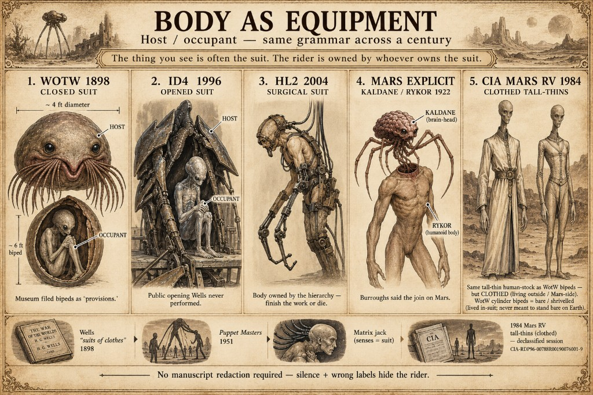

# The Martians and Their Machines: A Technical Analysis

> **TL;DR:** The Martians and Their Machines: A Technical Analysis: John E. Brandenburg's Death on Mars (2015) provides the physical explanation for WHY the Martians invaded Earth. Brandenburg, a plasma physicist trained at Lawrence Livermore and Sandia National Laboratories, documented isotopic evidence of two massive nuclear airbursts on Mars:
*Based exclusively on details from H. G. Wells' The War of the Worlds (1898)*

---

## Martian Physiology

### Body Structure
- Huge round bodies (or heads) approximately **four feet in diameter**
- The body is essentially a head — "they were heads, merely heads"
- Grayish-brown, oily, leathery integument with a fungoid quality
- The body heaved and pulsated convulsively; evident heaviness and painfulness of movement under Earth's gravity
- A Martian on Earth weighs **three times** what it would on Mars
- No nostrils — the Martians appear to have had **no sense of smell**
- A pair of very large, dark-colored eyes with extraordinary intensity
- Just beneath the eyes, a kind of **fleshy beak** — a peculiar V-shaped mouth with a pointed upper lip and wedge-like lower lip; lipless brim that quivered, panted, and dropped saliva
- Incessant quivering of the mouth
- In a group round the mouth: **sixteen slender, almost whip-like tentacles** arranged in two bunches of eight each — these bunches were called "the hands"
- On Mars they may have progressed upon these tentacle-hands with some facility
- A single tight **tympanic surface** (drum) at the back of the head-body, known to be anatomically an ear — "almost useless in our denser air"
- When seen from a distance, described as "a small brown figure, oddly suggestive of a speck of blight"
- Glistened like wet leather when caught in the light
- Size compared to a bear — "a big grayish, rounded bulk, the size, perhaps, of a bear"

### Internal Anatomy
- The greater part of the structure was **the brain**, sending enormous nerves to the eyes, ear, and tactile tentacles
- Complex lungs into which the mouth opened
- Heart and its vessels
- **No digestive system whatsoever** — "all the complex apparatus of digestion, which makes up the bulk of our bodies, did not exist in the Martians. They were heads — merely heads. Entrails they had none."
- Pulmonary distress caused by Earth's denser atmosphere and greater gravitational attraction was evident in convulsive movements of outer skin

### Feeding
- They did not eat, much less digest
- They took the **fresh, living blood of other creatures** and injected it directly into their own veins
- Blood was obtained from a still living animal — **in most cases from a human being** — and run directly by means of a **little pipette into the recipient canal**
- **Documented (method blank):** Wells claims he saw feeding done, then refuses the scene — "I cannot bring myself to describe what I could not endure even to continue watching." The lad killed on the third day of imprisonment is "the only occasion on which I actually saw the Martians feed"; he leaves the peephole. No pipette, tentacle, or vein is shown on the page. Technical gloss only: pipette → recipient canal → veins; sensory gloss: "**suctional** operation."
- Feeding was preceded by a peculiar **hooting** sound — invariably — which had no modulation. **Documented narrator gloss:** "merely the expiration of air preparatory to the suctional operation" (not a signal). After a man is dumped in the pit: **shrieking and sustained cheerful hooting**.
- **Author (hoot = craving):** invariable pre-feed hoot + cheerful post-capture tone read better as **anticipation / addict ritual** than plumbing warmup. Blood is the only intake path (no gut) — the host's feed cycle is the whole reward loop. Antigen-compatible human-stock transfusion is literally mainlining. See [forbidden blood](wotw-forbidden-blood.md).
- **Author (host plumbing):** pipette tip may be a tentacle-hand used as cannula; Spielberg 2005's blood-mist / soaked landscape is PP of the suit **bathing in** its circulatory medium, not mouth-eating. Neither book states "through the tentacles" as fact.
- **Documented:** Wells says their preference for men as nourishment is "partly explained" by "victims they had brought with them as **provisions from Mars**": bipedal creatures with flimsy siliceous skeletons, ~6 feet tall, round erect heads, large eyes in flinty sockets — 2–3 per cylinder, "all killed before earth was reached" ([corpus](wotw.md)). The blood-injection protocol is described only with **human** victims on Earth. The fungoid Martians have **no digestive system** ("Entrails they had none") — they do not eat, much less digest.
- Enormous quantities of a **ruddy-brown fluid** spurted from damaged machines (likely the blood supply)
- **Critical:** Wells never describes the Martians feeding on any non-human terrestrial animal — no cattle, horses, dogs, or wildlife. On Earth, they fed exclusively on **human blood.** Nowhere in Wellsian literature do Martians attempt to use animal blood as a substitute.
- **Author (supersedes the old "eaten rations" project reading):** Calling the cylinder bipeds "provisions" is institutional filing that severs the suit/occupant link for a casual reader — **not** a cut from a fuller manuscript. Creatures with no digestive system cannot "eat" rations; the label files the **true form / occupants** as livestock so the reader never connects bipeds ↔ hosts. Full argument: [Bipeds as occupants](#bipeds-as-occupants--the-provisions-cover) below.
- **Human-stock argument (lead with IV antigen; do not use cannibalism taboo):**
  1. **Strongest — IV human blood sustains them.** Not oral “consumption.” Cross-species **transfusion** fails (hemolysis). Wells: fresh human blood run by pipette into the **recipient canal** / **injected into their own veins** and **nourished** them; only terrestrial bacteria killed them. ⇒ circulatory biology is **same species or very recently diverged** (**human-stock**, not passport-human).
  2. **Human blood only on Earth.** No cattle, horse, dog, or wildlife donors in Wells — exclusive human source matches typed compatibility, not “any mammal fluid.”
  3. **Baxter sequel (*Massacre of Mankind*).** Blood-bank tubes with markings read as **blood types**; preference for specific human types ⇒ ABO-class kinship (authorised sequel PP).
  4. **Wells’s own descent line.** Credible that Martians descend from beings “**not unlike ourselves**,” brain and hands hypertrophied.
  5. **Occupant morphology.** Documented ~6ft siliceous bipeds (round heads, large flinty eyes) are humanoid; under AU-084 they are the riders — human-shaped rider + human-compatible blood converge.
  6. **“Suits of clothes.”** Wear bodies as clothes ⇒ person-scale occupant in kit, not a unique xenophylum that happens to drink plasma.
  7. **Sterile Mars / Earth microbes.** Blood itself accepted; microbiome kills — unexposed human-stock physiology, not alien rejection of the blood.
  Context: oral blood-drinking is a muddy test (digestion ≠ transfusion). Cannibalism taboo is poorly understood and **not** used here. Under bipeds-as-occupants, antigen compatibility attaches to the **bipeds**, not to livestock.

### Reproduction
- Absolutely **without sex** — therefore without tumultuous emotions arising from sexual difference
- Reproduced by **budding** — a young Martian was born on Earth during the war, found attached to its parent, partially budded off, "just as young lily-bulbs bud off"

### Other Physiological Traits
- **Did not sleep** — their organisms had no extensive muscular mechanism to recuperate
- Had little or no sense of **fatigue**
- On Earth they could never have moved without effort, yet even to the last they kept in action
- In 24 hours they did 24 hours of work
- Blue and violet light appeared **as black** to them (according to Philips)
- Wore **no clothing**
- Much less sensible of changes of **temperature** than humans
- Changes of **pressure** did not affect their health seriously
- **No bacteria on Mars** — Martian sanitary science had eliminated micro-organisms ages ago, meaning no fevers, contagions, consumption, cancers, tumors, or morbidities in their natural scheme of life

### Communication
- Commonly supposed to communicate by sounds and tentacular gesticulations
- However, the narrator (who saw more of the Martians in action than any other surviving human) was **convinced they communicated telepathically** — he watched four, five, and once six of them performing elaborate cooperative operations without either sound or gesture
- **Documented narrator gloss:** hooting is not a telepathic signal but "preparatory" air before the suctional feed. **Author:** same hoot = **anticipation / addict reaction** (see Feeding)

### Movement on Earth
- Sluggish and clumsy on Earth's surface
- Evident heaviness and painfulness of movement due to triple gravitational weight
- Could barely crawl; toppled over edges; fell with "a thud like the fall of a great mass of leather"
- Attempted to raise themselves on their tentacle-hands but could not manage it under Earth gravity
- The **excess oxygen** in Earth's atmosphere did somewhat counterbalance the increased weight
- Their mechanical intelligence allowed them to **dispense with muscular exertion** entirely — hence the machines

---

## Martian Machines

### The Cylinders (Transport / Landing Craft)
- Enormous projectiles fired from Mars via a "huge gun, the vast pit sunk into their planet"
- Diameter of about **thirty yards**
- Caked over with a thick, scaly, dun-colored incrustation after atmospheric entry
- Still extremely hot from atmospheric transit upon landing
- Enormously thick casing
- Circular top that **screwed open from within** — the Martians understood threaded mechanisms
- Interior sounds described as stirring, muffled grating
- Lined with rods, plates, and bars which strengthened the walls — these were extracted and repurposed upon arrival
- Ten cylinders were fired total; one arrived approximately every 24 hours
- Fired with "a colossal puff of flame" from the Martian gun — observable from Earth as a jet of incandescent gas, chiefly hydrogen

### Fighting-Machines (Tripods)
- **Three-legged walking engines** of glittering metal
- Higher than many houses — described as **nearly a hundred feet high**
- Capable of the **speed of an express train**
- Articulate ropes of steel dangling from the body
- Long, flexible, glittering tentacles swinging and rattling about the body — one observed gripping a young pine-tree
- A **brazen hood** surmounted the body, moving to and fro "with the inevitable suggestion of a head looking about it"
- The hood contained the Martian operator — when a shell struck the hood, it revealed "red flesh and glittering metal" — the living intelligence was within
- Behind the main body: a **huge mass of white metal like a gigantic fisherman's basket** (carrier/cage) — used to collect humans
- Puffs of **green smoke** squirted from the joints of the limbs
- Legs could be **contracted, crumpled, and abbreviated** — the machine could crouch
- Knees of foremost legs bent when crossing terrain
- Set up an exultant deafening howl: **"Aloo! Aloo!"**
- Could wade through rivers — wading half-way across the Thames with ease
- Picked its road as it went striding along
- A decapitated tripod (hood destroyed) continued moving in a straight line — "a mere intricate device of metal whirling to destruction" — demonstrating autonomous locomotion without operator input
- A Martian was observed to crawl out of a damaged hood and **repair a smashed tripod leg**, completing the repair in approximately one hour
- Described by soldiers as "Giants in armor, sir. Hundred feet high. Three legs and a body like 'luminium, with a mighty great head in a hood"
- Described by refugees as "Boilers on stilts, striding along like men" and "vast spider-like machines"

### The Heat-Ray
- Primary weapon system
- Generated intense heat in a chamber of practically absolute non-conductivity
- Projected in a **parallel beam** by means of a **polished parabolic mirror** of unknown composition
- An invisible beam of heat (invisible, not light)
- Whatever is combustible flashes into flame at its touch
- Lead runs like water, iron softens, glass cracks and melts
- When it falls upon water, the water **explodes into steam**
- Operated from a complicated metallic case carried by a kind of arm, about which **green flashes scintillated** — out of the funnel of this case the Heat-Ray smote
- Described also as a "camera-like generator"
- Could sweep the beam to and fro across terrain
- Could be held pointing obliquely downward — drove through iron ship plating "like a white-hot iron rod through paper"
- The Martians were **sparing** of the Heat-Ray on certain occasions, possibly because they had a limited supply of material for its production, or because they wanted to subjugate rather than completely destroy

**Adaptation erasure:** Most WotW adaptations (1938 radio, 1953 film, Spielberg 2005, etc.) changed the Heat-Ray to a *visible* beam—a generic sci-fi laser—and dropped Wells's technical specifics (non-conductivity chamber, parabolic mirror). Exceptions: Jeff Wayne's album (1978) and Stephen Baxter's *The Massacre of Mankind* (2017) kept it invisible. Baxter's sequel, published one year after Havana syndrome (2016) was attributed to directed-energy weapons, is the only major authorised continuation to depict Wells's device faithfully. See `wget/wells/massacre-of-mankind-2017-reference.md` for the full investigation.

### The Black Smoke
- Discharged by means of **rockets** from gun-like tubes
- Huge canisters fired from tubes — smashed on striking the ground (did not explode) and released an enormous volume of heavy, inky vapor
- Heavier than the densest smoke — behaved more like a liquid than a gas after initial uprush
- Sank down through the air, poured over ground, abandoned hills, streamed into valleys, ditches, watercourses
- Touch of the vapor or inhaling its pungent wisps was **death to all that breathes**
- Where it contacted water: chemical reaction produced a **powdery scum** that sank slowly — remarkably, the water was safe to drink once strained
- Eventually combined with mist and moisture, sinking to earth as dust
- Contained an unknown element showing a **group of four lines in the blue of the spectrum**
- At 50+ feet elevation (rooftops, treetops) one could escape the poison
- The Martians **cleared the Black Smoke** when it had served its purpose by wading into it and directing a **jet of superheated steam** upon it
- Used methodically — "as men might smoke out a wasps' nest"
- Each Martian in their crescent formation discharged canisters at any possible cover for guns ahead of them — some fired one, some two, one at Ripley fired five

### Handling-Machines
- Called "one of those complicated fabrics" — gave an enormous impetus to terrestrial invention upon later study
- Presented as a sort of **metallic spider with five jointed, agile legs**
- An extraordinary number of jointed levers, bars, and reaching and clutching tentacles about its body
- Most arms were retractable
- With three long tentacles it could fish out rods, plates, and bars from the cylinders
- Tentacles could **extend telescopically** — "telescopic fashion, a tentacle that had been a moment before a mere blunt projection"
- Motion was swift, complex, and perfect — appeared more alive than the Martians themselves
- The controlling Martian's delicate tentacles actuated its movements, "seeming to be simply the equivalent of the crab's cerebral portion"
- Could fit through openings, extend tentacles through walls
- Understood and could operate **doors** (worked latches)
- Tentacle described as "like an elephant's trunk" and "a black worm swaying its blind head to and fro"
- One handling-machine was found wrecked — had apparently driven blindly into a house when its Martian operator died
- Piped and whistled as it worked

### Excavating/Digging Machine
- A busy little mechanism emitting **jets of green vapor**
- Worked its way round the pit, excavating and embanking in a methodical and discriminating manner
- Caused regular beating noise and rhythmic shocks
- Appeared to operate **without a directing Martian** — autonomous

### Aluminium Smelting Apparatus
- A body resembling a **milk-can** in general form
- Above: a pear-shaped receptacle that oscillated (motion imparted by a handling-machine tentacle)
- Masses of clay dug out and flung into the pear-shaped receptacle
- A door periodically opened to remove rusty blackened clinkers
- Produced a powder from the basin, directed along a ribbed channel
- A thread of **green smoke** rose from the unseen receiver
- Output: **bars of white aluminium**, shining dazzlingly, untarnished
- Between sunset and starlight, made more than a hundred bars from crude clay
- Produced a mound of **bluish dust** as a byproduct

### Flying-Machine
- Found at the Primrose Hill redoubt — "the great flying-machine with which they had been experimenting upon our denser atmosphere when decay and death arrested them"
- Something flat and broad and very large was seen rushing up into the sky — swept round in a vast curve, grew smaller, sank slowly, vanished
- "As it flew it rained down darkness upon the land"
- Still under development when the Martians died
- The artilleryman reported seeing "something up in the air" and believed "they've built a flying-machine, and are learning to fly"

### General Machine Design Principles
- **No wheels** — "among all the things they brought to earth there is no trace or suggestion of their use of wheels"
- Singularly little use of the **fixed pivot** or relatively fixed pivot with circular motions confined to one plane
- Almost all joints present a complicated system of **sliding parts moving over small but beautifully curved friction bearings**
- Long leverages actuated by a sort of **sham musculature of disks in an elastic sheath** — these disks become polarized and drawn closely together when traversed by **a current of electricity**
- This produced the "curious parallelism to animal motions" so striking to human observers
- The Martians had become "practically mere brains, wearing different bodies according to their needs, just as men wear suits of clothes"

---

## Brandenburg's Nuclear Evidence: Why They Came

John E. Brandenburg's *Death on Mars* (2015) provides the physical explanation for WHY the Martians invaded Earth. Brandenburg, a plasma physicist trained at Lawrence Livermore and Sandia National Laboratories, documented isotopic evidence of two massive nuclear airbursts on Mars:

- **Xenon-129 superabundance** in Mars's atmosphere — matching the isotopic fingerprint of hydrogen bomb detonations on Earth
- **Two explosion centers** correlated with the two archaeological sites (Cydonia and Galaxias Chaos)
- **Airbursts, not surface detonations** — no craters at ground zero
- **Estimated yield: ~1 billion megatons** — planetary-scale catastrophe
- **Mars's surface covered in radioactive debris** (U, Th, K-40) scattered from the explosion centers

Under the MFEE (MudFlood Energetic Event) framework, this nuclear catastrophe corresponds to the secondary discharge from Directed Energy Weapons on Mars, fired at Earth during the Pugachev Rebellion (~1774). The backfire devastated Mars's biosphere, collapsed its ocean, and destroyed the surface civilization.

Wells's description of Mars as a dying, cooling, resource-depleted world is the **post-catastrophe state**. The Martians' desperation — "the immediate pressure of necessity has brightened their intellects, enlarged their powers, and hardened their hearts" — is the desperation of nuclear holocaust survivors. The invasion was not imperial expansion but a refugee operation launched from a corpse planet.

The blood-feeding protocol takes on additional significance: the workers sent to Earth were from a radiologically contaminated world. They needed clean biological material. Human blood was both sustenance and, potentially, an attempt at biological remediation — which instead introduced lethal terrestrial bacteria.

> See `wotw-mfee-mars-catastrophe.md` for full analysis.

**Cross-ref:** *The Time Machine* (1895) **final vision** — same **dying-planet** palette under a **time-dial** label — [time-travel literature investigation §9](/influence/predictive_programming/investigations/time-travel-literature-wells-deposit-investigation.md#9-time-machine-ending--mars-after-mfee-author-thesis).

---

### Red Weed
- Seeds brought by Martians (intentionally or accidentally)
- Vivid **blood-red** growth — the dominant color of the Martian vegetable kingdom
- Cactus-like branches
- Grew with astonishing vigor, especially near water — became gigantic and of unparalleled fecundity upon encountering water
- Choked the Wey and Thames rivers
- Eventually succumbed to **terrestrial bacteria** — rotted, bleached, became brittle, washed out to sea

---

## The Slave Theory: Martians as Forced Laborers

### Evidence Supporting the Theory

**1. They did not act like conquerors choosing targets — they followed a program.**

The Martians did not improvise or adapt. They landed, built machines, advanced methodically in formations, and carried out what appears to be a pre-planned sequence of operations. They communicated telepathically but showed no signs of debate, disagreement, or individual initiative beyond the single operational program. Every action — the crescent formation, the systematic use of Black Smoke to clear gun positions, the methodical advance toward London — follows a military operational plan with no deviation.

**2. Their behavior suggests they were building infrastructure, not colonizing.**

Upon arriving, the Martians immediately set about:
- Extracting and repurposing structural materials from their cylinders
- Smelting aluminium from local clay (industrial-scale material production)
- Excavating massive pits (construction sites)
- Building new machines from raw materials — "making all the things they couldn't bring with them, getting things ready for the rest of their people"
- Constructing a **great flying-machine** at their final redoubt on Primrose Hill
- Building "huge mounds" and "strange shelter-places" and "a huge redoubt" at Primrose Hill

This is the behavior of a labor force preparing a staging ground, not an army bent on conquest.

**3. The flying-machine as an escape vessel.**

The great flying-machine at Primrose Hill — the final and largest place the Martians made — was being experimented with "upon our denser atmosphere when decay and death arrested them." Something flat and broad and very large was seen rushing up into the sky. If the Martians were conquerors, why build a flying machine when they already dominated the ground? The machine makes more sense as a **return vessel** — a way to leave Earth's gravity well. They were building their way home.

**4. The blood-feeding created their vulnerability.**

The Martians had **no bacteria on Mars** and no immune system adapted to terrestrial pathogens. Their sole method of sustenance — injecting fresh human blood directly into their veins — was the precise mechanism of their doom. "Directly they drank and fed, our microscopic allies began to work their overthrow."

Under the slave theory: the Martians were told to use human blood for sustenance. (The blood-injection protocol appears exclusively in connection with human victims. The cylinder bipeds Wells labels "provisions" are read here as the **occupants of the host bodies** — institutional filing, not eaten rations; see [Host Body Theory](#the-host-body-theory-what-was-inside-the-martians).) But human blood carried **terrestrial bacteria** against which they had zero resistance. Every feeding was a death sentence. Once injured Martians required more blood to heal or sustain themselves, the infection rate would have accelerated.

Note the deeper implication: the blood-feeding **worked as nutrition.** See [Human-stock argument](#feeding) above — IV antigen compatibility + human-only donors; bacteria killed them, the blood itself did not. Say **human-stock**, not passport-human.

They may have been told they could **never return** precisely because they had consumed the "forbidden" blood — blood tainted with microbes that would be catastrophic to a sterile Martian biosphere. They were expendable.

**5. They were sent, not self-directed.**

The text states: "The Martians seem to have calculated their descent with amazing subtlety — their mathematical learning is evidently far in excess of ours — and to have carried out their preparations with a well-nigh perfect unanimity."

"Well-nigh perfect unanimity" describes a **command structure**, not a voluntary expedition. The mathematical precision of the launch — ten cylinders fired at 24-hour intervals — suggests a centralized authority directing operations, not individual Martians choosing to emigrate.

**6. The strategic targets.**

The Martians advanced specifically toward **London** — the seat of the British Empire, then the most powerful governing body on Earth. The text notes they seemed to aim not "at extermination so much as at complete demoralization and the destruction of any opposition." They cut telegraphs, wrecked railways, smashed military infrastructure. This is **power consolidation** — neutralizing organized resistance in a capital city. The artilleryman speculated they would eventually begin "catching us systematic, picking the best and storing us in cages."

**7. "Only pioneers."**

The artilleryman refers to the Martians as "only pioneers. They keep on coming." Pioneers are sent ahead. They do not choose the mission — they are assigned it.

**8. The sickness struck them all simultaneously.**

The bacteria killed them relatively uniformly — "already when I watched them they were irrevocably doomed, dying and rotting even as they went to and fro." The last one alive was heard wailing "Ulla, ulla, ulla, ulla" — a prolonged mechanical death cry. They all sickened together because they all fed from the same contaminated blood supply. The disease moved through their population because every one of them was exposed through the mandatory feeding protocol.

**9. No reinforcements came.**

After the tenth cylinder, no more were fired. The text speculates the firing mechanism may have malfunctioned. But under the slave theory: once the masters on Mars understood their laborers were contaminated, there was no reason to send more. The mission was compromised. The slaves were abandoned.

**10. They collected humans alive.**

The narrator observed a Martian picking up humans — not killing them — and tossing them into the metallic carrier basket. "It was the first time I realized that the Martians might have any other purpose than destruction with defeated humanity." They were **harvesting**, not warring. A slave labor force sent to collect resources — including biological resources — for masters who remained safely on Mars.

---

## The Host Body Theory: What Was Inside the "Martians"

> **Cross-ref chart:** same suit/rider grammar — Wells closed suit + provisions filing; *Independence Day* opened suit; *Half-Life 2* Stalkers (surgical slavery); Burroughs Kaldane/Rykor; 1984 CIA Mars RV clothed tall-thins vs bare WotW bipeds. Timeline mirror: [media](https://timeline.paradigmthreat.net/media/12.ce-18th-mudflood-and-pugachev/body-as-equipment-host-occupant.jpg).

### The Independence Day Precedent

In *Independence Day* (1996), the alien invaders appear to be tall, biomechanical creatures in exo-skeletal suits. When the bio-suit is opened, the **actual alien** is revealed inside — a smaller, more fragile being with a large cranium and oversized eyes. The host body is armor, life-support system, and interface unit in one. The occupant cannot survive without it. Full blockbuster case study: [Hollywood two-camp war — Thread O (*ID4*)](/influence/hollywood/investigations/hollywood-two-camp-war-investigation.md#thread-o--independence-day-1996-original-unity-lane-nsa-flagship). Reader essay: [**Everything in Independence Day Is True**](https://paradigmthreat.net/influence/hollywood/everything-in-independence-day-is-true.md) — *ID4* stages the **public opening** Wells never performed; Area 51 autopsy as the only in-film path Earth scientists know the suit/occupant split.

This concept — already noted in [Mars hub](/cosmos/mars/page.md) — provides the key to resolving the central mystery of Wells's Martians: **what the witnesses saw was the host body, not the occupant.**

### Rereading the Evidence

Wells describes the Martians as they appeared to terrified witnesses crawling out of a cylinder:

> *"A big grayish, rounded bulk, the size, perhaps, of a bear... glistened like wet leather... two large, dark-colored eyes... a fleshy beak... sixteen slender, almost whip-like tentacles... the body heaved and pulsated convulsively."*

Under the host body theory, this 4-foot "head" with oily, fungoid skin is not the Martian — it is the **biomechanical suit.** The "brain" that Wells says constituted "the greater part of the structure" is partly biological life-support machinery. The "dark-colored eyes" are sensor arrays. The "16 slender tentacles" are the suit's manipulator appendages. The pulsating, heaving exterior is the system straining under Earth's gravity — not a living creature's distress, but a machine at the edge of its operational envelope.

The **actual Martian** — the occupant — was inside. And no witness in Wells's account ever saw a living one extracted from a suit.

### Bipeds as occupants — the "provisions" cover

**Documented:** Wells reports "shrivelled remains that had fallen into human hands" — bipeds ~6 feet tall, flimsy siliceous skeletons, round erect heads, large eyes in flinty sockets; two or three per cylinder; "all were killed before earth was reached"; filed as "provisions from Mars."

**Documented (epistemic source):** the narrator **never saw** these bipeds. From the pit he saw only the **4ft fungoid** forms and machines. The biped paragraph sits in a **retrospective** digression that mixes eyewitness memory with later science ("dissection has since shown," Professor Howes, Philips). Knowledge of the bipeds is **100% institutional** — remains that "fallen into human hands," described after the war. He trusts that filing the way a survivor trusts the museum and the anatomists.

**Author:** those bipeds are the **actual Martians who occupy the host bodies**, not a slave/food species. The "food" / "provisions" assumption was **way off** — it is the public story that follows if the museum (and allied science) never tells the public the suit/occupant join. Display fungoid hosts as "the Martians" and bipeds as unrelated livestock/provisions — even **side by side** — and survivors who never saw living bipeds will never invent the connection themselves. Labeling the corpses "provisions" is the cheapest way to hide the *Independence Day* split: if the true form is "livestock," nobody asks what was supposed to wear the suit.

That reading also resolves the digestive contradiction: organisms with **no digestive system** do not bring edible rations. The blood-injection protocol on Earth is host-body life support; the bipeds never needed to be eaten. Occupants who lived inside host bodies also need not wear clothes — matching bare shrivelled remains vs clothed tall-thins in the [1984 Mars RV](/influence/controlled_opposition/investigations/cia-reading-room-mars-exploration-1984-rv-investigation.md).

**Fit (Author lock):** a ~6ft biped does **not** stand upright inside the ~4ft-diameter host. Occupants ride **curled / fetal**, while the suit takes over locomotion and the sensory channel (eyes, tympanum, tentacle-hands) — Matrix-style body jack: the host body's five-or-six sense surface is what the world sees; the biped inside never needs to uncurl. Six feet of stature packs into a four-foot round bulk when folded. Wells’s line that standing upright on Earth “would have broken every bone” then reads as confirmation they were **never meant to leave the host bodies** — bare bipeds on Earth are already a failed or dead state (killed in transit / recovered outside), not an intended operating mode. The museum never has to ask this if bipeds are filed as food instead of occupants.

### Why No One Saw the Occupant (alive)

Wells records that the Martians were observed:
- Crawling from cylinders (always inside the host body)
- Operating machines (always inside the brazen hood — itself a second shell)
- Dead and rotting after bacterial infection

Critically: the narrator describes looking at dead Martians and seeing "red flesh and glittering metal" inside damaged fighting-machine hoods. But he never describes **opening** a Martian body to find what was inside. The "autopsies" described in the text are external examinations. When scientists studied the dead Martians, they studied the **host body** — the "oily brown skin," the tentacles, the "brain."

**Author:** the occupants were already accounted for under another label — the cylinder bipeds filed as provisions. Studying the suit as the organism, and the bipeds as food, keeps the two-layer system invisible **in the printed text as written** — no cut required. *Independence Day* later stages the public opening Wells’s survivor account never performs.

### The Occupant Form: Cylinder bipeds (primary); grey atrophy (secondary PP)

**Primary Author ID:** the ~6ft siliceous bipeds — round erect heads, large eyes in flinty sockets, feeble musculature that "would have broken every bone" standing on Earth — are the true form. They operate **fetal-curled inside** the ~4ft host; the suit owns the senses and movement. Weak skeletons match a species **never designed to stand bare on Earth** — low-g / in-suit life; transit deaths recovered outside are already outside the intended envelope.

**Secondary PP grammar (*ID4* / grey reports):** if some lineages spent generations *inside* host bodies without exiting, atrophy toward enlarged cranium, large eyes, vestigial limbs, and pale skin still maps to mid-20th-century "grey" reports. That morphology is optional encoding of long-term suit habitation — **not** the primary WotW occupant ID in this dossier. The printed text already supplied the occupant body and buried it as rations.

Wells encoded the suit/occupant grammar when he described Martians as "practically mere brains, wearing different bodies according to their needs, just as men wear suits of clothes." The key phrase is **"wearing different bodies."** Not evolving into brains — wearing bodies. The brain is the occupant. The body is the suit.

### Why Host Bodies Explain the Slave Problem

The host body theory resolves several puzzles in the slave theory:

1. **Why the workers could never rebel.** The host body is not just armor — it is a **life-support system** maintained by technology on Mars. Without periodic servicing, the host body degrades. The occupant cannot survive outside it under Earth conditions. The workers were not merely sent on a mission — they were sent in equipment that would fail without the home infrastructure. Rebellion is physically impossible when your body is owned by your masters.

2. **Why they all sickened simultaneously.** The host bodies all used the same blood-injection feeding mechanism. When terrestrial bacteria entered the system, they infected the host body's biological components — and through them, the occupant. Every unit failed because every unit had the same vulnerability in the same system.

3. **Why they showed no individuality.** The host bodies are standardized equipment. The "well-nigh perfect unanimity" of their behavior is not telepathic consensus — it is identical units running identical operational parameters. The occupants may have had individual thoughts, but the host bodies expressed only what they were designed to express.

4. **Why the Crystal Egg Martians look different.** The winged, agile Martians observed on Mars through the crystal may be wearing a **different model of host body** — one designed for Mars's lower gravity and thin atmosphere. The WotW host bodies are the **Earth variant**: heavier, sturdier, tentacle-driven rather than wing-driven, optimized for a high-gravity, high-oxygen environment they would never leave.

### Cross-read: *Half-Life 2* Stalkers (high-tech transhuman slavery)

**Author:** the WotW **worker caste** — tall thin **human-stock** bipeds locked into Earth-variant hosts, program-driven, building the Primrose Hill **return ship** or dying painfully on Earth — rhymes with Valve’s **Stalkers** (*Half-Life 2*, 2004): humans surgically stripped into Combine slave labor (Nova Prospekt conversion; attenuated bodies; little remaining voice/identity; bodies owned by the machine hierarchy). Same grammar: **transhuman slavery** — not voluntary pioneers, but forced units whose locomotion/life-support kit belongs to the masters; complete the assigned industrial mission or perish without rescue. Stalkers are the mass-market demo of “your body is equipment”; Wells’s invaders are the 1898 instance (host suit + unfinished flying-machine + no rescue cylinders). Do **not** collapse Stalkers into the old “bipeds = food” misread — under AU-084 the tall humanoids **are** the enslaved riders. Dossier: [*Half-Life* series — Combine / Stalkers](/influence/predictive_programming/investigations/half-life-series-cern-combine-xen-predictive-programming-investigation.md#4-transhumanism-water-teleport-ocean-infestation-fiction-layer--author-mars); timeline: [HL2 PP](/timeline/evt-predictive-programming-film-tv-games).

5. **Why Wells retracted the description.** In 1908, Wells described what Martians "actually" look like — 9–10 feet tall, feathered, bipedal. This may be the description of the **Mars-variant host body** (matching the Crystal Egg observations), not the occupant. The retraction was not a correction of fiction — it was an upgrade from "what the Earth-variant host body looks like" to "what the Mars-variant host body looks like." The cylinder bipeds remain the printed true-form specimen line — already buried as "provisions" in 1898.

### The Kaldane Parallel

Edgar Rice Burroughs' *The Chessmen of Mars* (1922) describes the **Kaldanes** — beings who have "sacrificed their bodies to become pure brain." They are spider-like heads that mount headless humanoid bodies called **Rykors**, connecting via tentacles to the spinal cord. The Rykor is a biological vehicle; the Kaldane is the driver.

This is the host body concept rendered explicitly. Burroughs set it on Mars. The Kaldanes are "ugly, ineffectual creatures" without a Rykor body — precisely as the occupant of a WotW host body would be helpless without its suit.

### Fiction Encoding the Host Body Concept

| Work | Year | Host Body Concept |
|---|---|---|
| *War of the Worlds* (Wells) | 1898 | "Wearing different bodies according to their needs, just as men wear suits of clothes" — host body concept stated but never explicitly revealed |
| *The Chessmen of Mars* (Burroughs) | 1922 | Kaldanes: pure-brain parasites riding headless Rykor bodies on Mars |
| *The Puppet Masters* (Heinlein) | 1951 | Parasitic aliens from Titan ride human host bodies, controlling them from the back |
| *Invasion of the Body Snatchers* | 1956 | Alien organisms replace human bodies — the "pod" is the host, the occupant is alien |
| *Fantastic Planet* (Laloux) | 1973 | Giant blue Draags keep tiny humans (Oms) as pets/vermin — the lowest caste. Draags learn via **telepathic headband devices** (no classrooms), meditate to project consciousness out of their bodies, and reproduce by merging disembodied consciousness with alien statues on a wild planet. The Draag body itself may be a host: their true existence is the projected consciousness, the giant blue form merely the vessel it inhabits between meditations. Encodes the full Martian caste system — giant ruling species, tiny enslaved humanoids, telepathic education technology, consciousness independent of the physical body |
| *Dark Star* (Carpenter) | 1974 | Bomb AI develops consciousness inside a mechanical body; the intelligence is trapped inside the shell |
| *Alien* (Scott) | 1979 | Xenomorph uses human hosts for gestation; the face-hugger/chest-burster cycle is parasitic host-body reproduction |
| *Independence Day* (Emmerich) | 1996 | Alien bio-mechanical exo-suits conceal smaller occupant beings; **WTC shadow** / **Area 51** declass on-screen | [Hollywood Thread O](/influence/hollywood/investigations/hollywood-two-camp-war-investigation.md#thread-o--independence-day-1996-original-unity-lane-nsa-flagship) |
| *Edge of Tomorrow* (Liman) | 2014 | Mimics: alien organisms controlling host bodies through a central intelligence (the Omega) |

The pattern is consistent: across a century of Mars and alien fiction, the concept of **a smaller intelligence operating a larger biological or biomechanical body** recurs with remarkable persistence. Each iteration adds detail. None acknowledge the source.

### What Stayed Unsaid (not a manuscript redaction)

**Author lock:** *The War of the Worlds* **was not redacted.** Contradictions resolve on a **detailed read** of the printed text. Three layers that look like a scrub are already present without cutting anything:

1. **Suit as organism** — Wells describes the fungoid 4ft form as the Martian. That is what most eyewitnesses (including the narrator at the pit) actually saw.
2. **True form as "provisions"** — the ~6ft bipeds that "had fallen into human hands" are filed as food / a human-slave livestock species from Mars, so a casual reader never joins them to the hosts.
3. **Museum / Epilogue — institutional trust** — Book II, Chapter X (*The Epilogue*, restored in [corpus](wotw.md)) moves anatomy into respectable specimen culture: *"everyone is familiar with the magnificent and almost complete specimen in spirits at the Natural History Museum, and the countless drawings that have been made from it; and beyond that the interest of their physiology and structure is purely scientific."* The narrator disclaims comparative physiology, defers to Carver, and tells the general reader the rest is not their business.

**Author conclusion:** the food assumption was never a pit observation. The narrator is a survivor **trusting the museum and later science** with remains he never saw alive. The museum never said the suit/occupant join; he never asked. Shipping **this** public print already keeps the secret **without anyone realizing a secret was kept**. No deleted confession is required. Silence alone suffices.

The host-body finding would still be the single most sensitive piece of intelligence from the invasion: a **two-layer system** — fragile occupants piloting biological vehicles. That implies:
- Their actual form is fragile and dependent on technology
- Their host bodies can be analyzed and potentially replicated
- They can be fought by targeting the host body's life-support systems rather than the occupant
- Occupants might be captured alive by disabling the host — or identified among the "provisions" remains already in human hands

***Independence Day* (1996)** stages for a mass audience what Wells’s printed survivor account never performs: the autopsy **extracts the occupant**. Author read in [Everything in Independence Day Is True](https://paradigmthreat.net/influence/hollywood/everything-in-independence-day-is-true.md): Wells’s closed exterior study plus the provisions filing is a **self-sealing public story**; Emmerich’s open suit is the later reveal — not proof that a join paragraph was cut from 1898.

> See [Mars hub](/cosmos/mars/page.md) for the Independence Day/host body connection.

---

## Cross-Source Intelligence: Comparison with Other Wells Texts

> For full analysis, see the companion document: `wotw-martian-civilization.md`

### The Crystal Egg (1897) — Surveillance Report from Mars

The Crystal Egg describes Martians observed **on Mars** through a paired crystal surveillance device. These Martians bear **no resemblance** to the WotW invaders:

- **Winged** — broad, silvery, ribbed wings (not feathered); small body
- **Round heads** with large compound eyes — not the 4ft fungoid heads of the WotW Martians
- **Two bunches of prehensile tentacles** under the mouth — matching the WotW "two bunches of eight" pattern, but attached to an agile, flying body rather than a bodiless brain
- **Active, intelligent behavior** — operating crystal mast surveillance networks, flew through thin Martian air, observed Earth for extended periods
- Also observed: **wingless large-headed Martians** hopping on tentacles (secondary caste?) and **white translucent bipeds** (ape-like, seized by Martians — livestock or blood source?)

**Slave Theory Implication:** The Crystal Egg Martians are the **ruling caste.** They stayed on Mars, operating the surveillance network, while sending a different caste — the expendable "bodiless brains" — to Earth. The winged rulers watched the entire invasion through their crystals.

### "The Things that Live on Mars" (1908) — Post-Mortem Biological Assessment

A decade after WotW, Wells described what Martians **actually** look like based on evolutionary biology:

- **9–10 feet tall**, bipedal, 2⅔ × human mass
- **Covered in feathers or fur** — insulation for the thin, cold Martian atmosphere
- **Tentacle-manipulators** instead of hands: "a group of tentacles or proboscis-like organs"
- **Large-chested** — oversized lungs for thin atmosphere
- **Big skulls, big brains** — brain case projecting forward

Wells explicitly **retracted** the WotW description: *"In that story I made my Martians mere bodiless brains with tentacles, subsisting by suction... carrying their weight about, not on living bodies but on wonderfully devised machines."*

He also confirmed the gravity problem: a Martian on Earth would weigh 2⅔× its Mars weight — *"His limbs would not support him. Perhaps he would die, self-crushed, at once."*

**Slave Theory Implication:** The WotW Martians' "bodiless brain" form may be **engineered** — stripped of wings, limbs, and body mass to survive Earth's gravity. The 1908 description of the real Martian form (tall, feathered, bipedal) matches the Crystal Egg winged Martians far more closely. The WotW invaders were a purpose-modified or degenerated labor variant.

### "Intelligence on Mars" (1896) — The Briefing Paper

Wells's earliest Mars essay speculated on Martian evolution and intelligence, concluding they would be **far beyond human advancement.** According to Wikipedia, the ideas in this 2-page essay appear "almost unchanged" in *The War of the Worlds* — making it effectively a pre-publication briefing document.

### Publication Sequence as Phased Disclosure

| Year | Text | Function |
|---|---|---|
| 1896 | "Intelligence on Mars" | Speculative briefing on Martian capabilities |
| 1897 | "The Crystal Egg" | Reconnaissance report — Martian surface surveillance |
| 1898 | *The War of the Worlds* | After-action report — the invasion |
| 1908 | "The Things that Live on Mars" | Declassified biological assessment with explicit WotW corrections |

---

## Technical Capabilities Summary

| System | Capability |
|---|---|
| **Interplanetary Transport** | Cylinder-projectiles fired from Martian surface guns; 10 sent at 24hr intervals |
| **Ground Mobility** | Tripod fighting-machines ~100ft tall, express-train speed |
| **Primary Weapon** | Heat-Ray: invisible thermal beam, parabolic mirror projection |
| **Area Denial Weapon** | Black Smoke: chemical vapor rockets, heavier than air, lethal on contact |
| **Industrial** | Aluminium smelting from clay, autonomous excavation, material fabrication |
| **Manipulation** | Handling-machines: 5-legged spider-form, telescoping tentacles, door-capable |
| **Air** | Experimental flying-machine (under development at time of death) |
| **Communication** | Telepathic (no sound or gesture required for complex coordinated operations) |
| **Sustenance** | Direct blood injection via pipette; no digestive system |
| **Reproduction** | Asexual budding |
| **Workforce** | 24/7 operation, no sleep, no fatigue |

---

## Author's originating thesis

> The bipeds could just be the Martians outside of the host bodies, with Wells saying they were for food to hide the connection entirely. That had to be covered up at all costs in the final print. The witness the story is based on probably never knew the truth — or if he was clued into that connection, it was simply removed in the whole "museum" ending of the book.

**Clarified conclusion (2026-10-30):** Early chat assumed a cover-up / cut. **Current lock:** the food assumption was **way off** and **never witnessed**. The book **was not redacted** — contradictions resolve on a **detailed read**. From the pit he saw only host bodies. He learns bipeds later and trusts museum/science. The museum never said the join; he never asked. Fungoid hosts and ~6ft bipeds filed as unrelated → public assumes slave/food species; they are the Martians who occupy the hosts (fetal-curled).

**Self-sealing print:** Shipping **this** survivor account already produces the desired takeaway — a complete-feeling story that hides the occupant secret **without anyone realizing a secret was kept**. No deleted confession required.

**What that means:** "Provisions" is not a second feeding protocol. It is institutional filing the narrator repeats. Cannibalism / "eaten rations" was a project misread of Wells's label, not a Documented second diet and not a pit fact.

## Author's open claims

Registry: **[AU-084](/history/chronology/investigations/author-unique-theories.md)** (extends AU-079 host-body package).

1. Cylinder bipeds ≈ true Martian form / occupants of Earth-variant host bodies (**Author**; Wells text Documented as "provisions").
2. "Provisions" / food-rations / slave-livestock wording in print = institutional filing the narrator trusts, not logistics fact and **not** evidence of a cut manuscript (**Author**).
3. No-digestive-system physiology falsifies literal "eaten" reading of the bipeds (**Documented** anatomy + **Author** inference).
4. *WotW* **was not redacted**; narrator never saw bipeds; silence + unasked question self-seals the secret (**Author**; pit vs digression + Epilogue specimen lines **Documented**).
5. Occupants are **human-stock** — IV human blood sustains (antigen); human-only donors; Baxter blood-type markings; Wells “not unlike ourselves”; biped morphology + suits-of-clothes (**Author** on biped ID; stack in [Feeding](#feeding); no cannibalism taboo).
6. Grey-atrophy morphology remains secondary PP (*ID4*), not primary WotW occupant ID (**Author**).
7. Bare biped remains vs clothed 1984 RV tall-thins: occupants who live in host bodies need not wear clothes (**Author** rhyme).
8. Fit: ~6ft bipeds ride **fetal-curled** in ~4ft hosts; suit mediates senses/locomotion; "would have broken every bone" standing bare = never meant to leave the suit (**Author**).
9. Pre-feed hooting = **anticipation / addict craving**, not mere breath-prep; cheerful post-capture hoot = euphoria (**Author**; invariable hoot + cheerful tone Documented; narrator's "expiration of air" gloss Documented). Spielberg blood-bath / tentacle-as-cannula are optional PP joins on the same blank (**Author**).
10. *Half-Life 2* **Stalkers** = PP demo of the same high-tech transhuman slavery as the WotW worker/host riders — build/serve or die; body-as-equipment (**Author** rhyme; Stalker conversion Documented in HL2 lore).
11. **Secret Earth↔Mars politics/war (AU-085)** — flyer seed; canal-kill; HL1 Abrams/HECU; humans with Mars reach; planet-as-base; **MFEE may be Earth-ordered** (2nd discharge overlooked as “consequence”); breakaways = **1° political**, never isolation — **[§1.7–1.11](earth-mars-counterstrike-investigation.md)**.

## Questions to clarify, verify, or debunk

| Hook | Why it matters |
|---|---|
| Compare serial (*Pearson's*, 1897) vs Heinemann 1898 vs later editions on the biped / provisions paragraph and Epilogue museum lines | Falsifier if a fuller suit/occupant join existed then vanished (would reopen “redaction” against the self-seal lock) |
| Any period press on Natural History Museum "Martian" specimen or drawings; any mention of biped remains exhibited beside them | Documented museum culture vs pure fiction frame; tests side-by-side filing |
| Neural / sensory interface implied by "wearing different bodies … as men wear suits of clothes" vs fetal curl packing | Strengthens Matrix-style jack reading without claiming Wells drew it |
| Crystal Egg white translucent bipeds vs cylinder siliceous bipeds — same caste or different? | Livestock cover on Mars vs dead operators in cylinders |
| Any Documented residue of an Earth→Mars retaliatory op 1865–1945 (beyond Serviss pulp)? | Opens/closes [AU-085 counterstrike](earth-mars-counterstrike-investigation.md) Lane B |

---

**Reader essay:** [*The Secret War*](/cosmos/mars/the-secret-war.md) — not-redacted Wells + host/occupant hinge into the Earth↔Mars secret-war frame (**AU-085**).

Keywords: #Wotw #Martian #Analysis #Martians #Machines #Technical #HostBody #Bipeds #ProvisionsCover

*Last updated: 2026-10-31*

