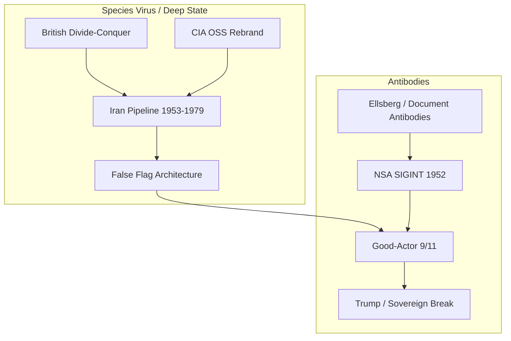

# Investigation: Good-Actor Theory of 9/11 — Interagency War, Antibodies, and the Eighty-Year Script

> **TL;DR:** This investigation consolidates the Paradigm Threat **Good-Actor / Historic Antibody** reading of 9/11: a ~80-year interagency struggle between a rogue **CIA–British–MI6** pipeline (slow-burn holy war, religion capture, endless war) and **antibody** factions (NSA/SIGINT lineage, document leakers, sovereign national actors) who **pre-empted** the script by staging terrorism **early, publicly, and at home**—destroying **WTC 7** (CIA NY station), forcing a **War on Terror** instead of covert holy war, and severing CIA domestic autonomy. **Landmark NSA act:** historian **Robert Hanyok**’s Gulf of Tonkin SIGINT audit (2001) and **2002–2005 declassification fight**—proof the second attack did not occur and SIGINT was skewed—parallel to **Ellsberg** (1971). Modern conflicts read as **agency vs agency across borders**, not nation vs nation.

**Date:** 2026-05-25  
**Status:** Ongoing — synthesis of existing repo corpus + external anchors

---

## I. Core Thesis (Outline)

### The two entities

| Pole | Label in corpus | Nature | Methods |
|------|-----------------|--------|---------|
| **Infection** | Deep State / Pyramidal Empire / "species virus" | Mental, not biological: compulsion to centralize narrative, finance, force; mass **illiteracy** (Latin capture, chronology erasure, virology dogma); **genocide** and endless war as immune-suppression | Divide-and-conquer, false flags, controlled opposition, slow-and-go infiltration of religions and governments |
| **Resistance** | **Antibody** | Any person or faction opposed to the above; acts **without regard to cost** to prevent outbreak | Document release, encoded fiction, insider turn, **counter–false flags**, sovereign policy breaks |

Operations—not only individuals—can be antibodies. If the good-actor thesis holds, **9/11 is the largest modern antibody operation**: coordinated counter-deception, not a lone whistleblower.

### The eighty-year arc

1. **1945–1947:** WWII plan to destroy Russia fails; script **rebrands** into slow-burn **WW3** (existential crisis for ~70–80 years). OSS → CIA (1947); Nazi assets (SAFEHAVEN, Paperclip); British/MI6 continuity.
2. **1950s–1979:** Iran pipeline—Ajax, Shah, Atoms for Peace, nuclear infrastructure → engineered **Ayatollah** takeover; **1979 religious revival** (Iran, Mecca, Moral Majority, Poland) as synchronized holy-war geometry.
3. **1952:** **NSA** established (Truman, NSCID 9)—SIGINT vs CIA HUMINT; doctrinal separation read here as **antibody architecture** (speculative).
4. **1964 / 1971 / 2001–2005:** Gulf of Tonkin template (NSA-skewed SIGINT → war); **Ellsberg** (1971) as document antibody; **Robert Hanyok** (NSA historian, 2001 classified study → **2005 declassification fight**) as **institutional NSA antibody** — see § II.I.
5. **2001:** Good actors execute **one slice** of the terrorism script **early**—public **War on Terror** vs covert holy war; **WTC 7** decapitates CIA domestic station.
6. **2001–present:** CIA plans "stomped out" via new War-on-Terror agencies; post-9/11 crises traced to CIA-linked narrative capture; **Reverse Crusade IV** (Ukraine) as latest nation-masked agency war.

### Why "at home" and "early"

The Deep State plan: **simulate** terrorist spectaculars after **slow-and-go** infiltration of religions and regimes (east → west burn). Antibody counter: trigger terrorism **before** infiltration completes—**on U.S. soil**, **televised**, so populations and institutions **cannot ignore** it; redirect to state-led "War on Terror" (religion-blind KEYWORD suppressed in favor of terrorism KEYWORD).

---

## II. Repo Citations — Primary Sources (By Theme)

### A. Good-Actor 9/11 (canonical investigation)

**File:** [`09-11-investigation.md`](./09-11-investigation.md)

- **Core:** "9/11 was a false flag executed *against* the Deep State"
- **Three aims:** (1) pre-empt slow-burn Holy War → public War on Terror; (2) destroy CIA autonomy via **WTC 7**; (3) predictive programming as signal to figureheads—not to sink fear
- **WTC 7 keystone:** CIA clandestine NY station (floor 25); severed **CIA–ayatollah pipeline**
- **Twin Towers:** built 1966–1973 as possible long-planned targets; early execution = sabotage of intended narrative
- **Table:** Deep State slow-and-go vs good-actor counter (WW3 vs War on Terror; covert infiltration vs public state war)
- **Gulf of Tonkin parallel:** same architecture, inverted attribution
- **Likelihood tiers:** WTC 7 as CIA facility = **certain**; deliberate decapitation = **possible**; full good-actor thesis = **speculative**

### B. CIA / NSA / Antibody (institutional investigation)

**File:** [`cia-investigation.md`](/governance/war/investigations/cia-investigation.md)

- OSS→CIA rebrand; Nazi gold (Eizenstat, SAFEHAVEN); outside constitutional democracy
- **NSA as antibody:** distinct org, SIGINT mandate, "calm world trouble / restore sovereignty" (speculative mission read)
- **"NSA took out CIA on 9/11"** via Building 7 — claim documented, not proven
- **Tenet testimony:** IC erosion pre-9/11; post-9/11 restructuring (DHS, DNI)
- **Iran end-game:** Shah → Ayatollah → nuclear handover narrative → holy war trigger; fatwa / depleted uranium blind spot (author opinion)
- **Latin America:** gangs, Noriega, Maduro — remove good actors, empower bad
- **Ellsberg** as antibody archetype; **Robert Hanyok** (NSA historian, Tonkin SIGINT audit 2001 → declassification fight 2002–2005) as **institutional NSA antibody** — see [good-actor investigation § II.I](/events/false_flag/investigations/good-actor-theory-interagency-antibody-investigation.md)
- 9/11 as **early trigger** to disconnect CIA from long-term plans

**Timeline article:** [`14.12.03-1947-ce-central-intelligence-agency-oss-rebrand.md`](/timeline/evt-1947-ce-central-intelligence-agency-oss-rebrand)

### C. False-flag architecture (chapter + appendix)

**Files:**
- [`15.04.00-false-flags-architecture-of.md`](/timeline/evt-false-flags-architecture-of) — third sponsored reading for 9/11; Pearl Harbor advance-knowledge quotes; controlled opposition (Hamas, Al-Qaeda/ISIS from mujahideen)
- [`19.47.02-false-flags-investigation.md`](/timeline/evt-false-flags-investigation) — evidence dossier

**Key line:** "False-flag wars need **named villains**" — Hamas tolerated against PLO; Al-Qaeda line from **CIA-backed** anti-Soviet mujahideen.

### D. Historical antibodies (concept + profiles)

**Files:**
- [`15.08.00-historical-antibodies.md`](/timeline/evt-historical-antibodies) — Christ, Eckhart, Patton, Ellsberg, **Netanyahu as state-actor antibody** (Iran flank); 9/11 as largest modern op on good-actor reading
- [`20.55.00-historical-antibodies-pattern.md`](/timeline/evt-historical-antibodies-pattern) — **operations** as antibodies; escalation ladder (ignore → kill)
- [`20.55.01-historical-antibodies-profiles.md`](/timeline/evt-historical-antibodies-profiles) — Ellsberg/Tonkin/NSA Hanyok detail

### E. British / Israel / Iran setup (divide-and-conquer)

**Files:**
- [`11.05.00-british-empire-as-deep-state.md`](/timeline/evt-british-empire-as-deep-state) — arrive, divide, arm both sides, leave; City of London; London–D.C.–Vatican
- [`british-divide-conquer-israel-investigation.md`](/governance/war/investigations/british-divide-conquer-israel-investigation.md) — Israel paradigmatic; Balfour; arm both sides
- [`1979-religious-revival-investigation.md`](/influence/religion/1979-religious-revival-investigation.md) — CIA–Khomeini contacts; Huyser; WW3 nuclear narrative from 1950s Atoms for Peace
- [`14.12.02-1948-ce-israel-creation-british-mandate.md`](/timeline/evt-1948-ce-israel-creation-british-mandate) — mandate divide-and-conquer

**911 page (legacy site copy):** [`events/911/page.md`](/events/911/page.md)
- H.G. Wells 1933 → 1979 Islam holy war; 1979 Ayatollah coup **CIA & MI6**; Building 7 = "CIA headquarters" = **real target**

### F. 21st century — Reverse Crusade IV & WW3 blueprint

**File:** [`15.00.00-21st-century-the-final-struggle-reverse-crusade-iv.md`](/timeline/evt-2000-ce-21st-century-the-final-struggle-reverse-crusade-iv)

- **Agency vs agency:** "not country versus country" implied in infighting, NATO cascade, proxy war
- **WW3 hybrid:** WW1 terrorism trigger + WW2 disposable figurehead (Zelensky/Hilter parallel)
- **9/11 good-actor pre-emption** cited in WW3 blueprint section
- **Trump as antibody** who broke unified Western escalation
- **Immune response / complete body** — sovereignty without foreign-supplied antibodies

### G. Species virus vs antibody (mental / civilizational)

**File:** [`15.11.00-where-we-go-from-here.md`](/timeline/evt-where-we-go-from-here)

- Wells/Orwell/Huxley lacked **immune model**; civilization as organism with **historical antibodies**
- "**Trace the viral behavior** — recurring compulsion to centralize narrative, finance, and force"
- Virus exhausts; antibodies race toward reservoirs "**mental, physical, political, or psychological**"
- **`CONCLUSIONS.md`:** Latin conversion → mass **illiteracy**; Deep State from Atlantis priest class

**Related (narrative capture / illiteracy):**
- [`deep-state-terminology.md`](/history/chronology/deep-state-terminology.md) — Fallen Atlantean / Pyramidal / Deep State continuity
- Virus-media investigation — **programming bundle** teaching genome-as-cause (mental capture via "virology" fiction)

### H. Deep dive index

**File:** [`INVESTIGATIONS_DEEP_DIVE.md`](/docs/INVESTIGATIONS_DEEP_DIVE.md) — lists 09-11 and CIA investigations as validated corpus entries.

### I. Robert Hanyok / NSA — landmark antibody act (Gulf of Tonkin, 2001–2005)

**This is one of the most important documented NSA acts in the interagency-war frame** — not a footnote beside Ellsberg, but a **second front** on the same casus belli: SIGINT truth pushed from **inside** the agency that had been used to sell the war.

| Phase | What happened |
|-------|----------------|
| **4 Aug 1964** | Johnson and McNamara treat **NSA SIGINT summaries** as proof of a **second** North Vietnamese attack on USS *Maddox* / *Turner Joy*; **Tonkin Gulf Resolution** follows within days |
| **1971** | **Daniel Ellsberg** leaks *Pentagon Papers* — documentary proof of Vietnam deception from **Pentagon/RAND** access; Tonkin is central to his motive |
| **Early 2001** | NSA historian **Robert J. Hanyok** completes **"Skunks, Bogies, Silent Hounds, and the Flying Fish"** in classified *Cryptologic Quarterly* — full **SIGINT reconstruction** of 2–4 August 1964 |
| **Hanyok findings (documented)** | Midlevel NSA officers **deliberately skewed** critical intelligence: translation shifts, altered intercept times, **~90%** of relevant 4 August SIGINT **withheld** from post-attack summary reports; fragments lifted out of context to **manufacture** a second attack; Johnson administration's main proof was a **conflated translation product** |
| **2002 onward** | NSA historians **argued for public release**; effort **rebuffed by higher levels** ([NYT, 31 Oct 2005](https://archive.nytimes.com/www.nytimes.com/2005/10/31/politics/31war.html)) |
| **2003** | Outside historians, alerted to Hanyok's conclusions, **FOIA** the article — study still **top secret** four years after completion |
| **Nov–Dec 2005** | NSA **declassifies** Hanyok's article plus **140+** Tonkin SIGINT histories and raw intercept material ([NSA release](https://www.nsa.gov/Portals/75/documents/news-features/declassified-documents/gulf-of-tonkin/articles/foia_requests/); [National Security Archive briefing](http://nsarchive2.gwu.edu/NSAEBB/NSAEBB132/press20051201.htm)) |

**Primary text:** [Hanyok, *Cryptologic Quarterly* (declassified PDF)](https://www.nsa.gov/portals/75/documents/news-features/declassified-documents/gulf-of-tonkin/articles/release-1/rel1_skunks_bogies.pdf)

**Why this matters for the antibody thesis:**

1. **Hot war between agencies** — The **war party** (White House, Pentagon, CIA-era covert culture) needed **NSA product** as the "objective" fuse. Hanyok's audit, completed **months before 9/11**, shows **NSA's own historians** documenting that **NSA reporting** was **distorted** to match the casus belli — then fighting **NSA management** for **four years** to get it on the public record. That is not bureaucratic trivia; it is **institutional combat** over who controls the **official past**.
2. **Ellsberg + Hanyok = two antibodies, one lie** — Ellsberg (1971): **external** document rupture from the Pentagon Papers pipeline. Hanyok (2001–2005): **internal** SIGINT rupture from the **signals** agency itself. Same template the good-actor investigation assigns to 9/11: **counter–false flag** architecture — expose the **manufactured** trigger, force the record toward **audit**.
3. **Curriculum still suppresses what NSA published** — K–12 rarely teaches Tonkin as **false flag / government deception** even after **2005** NSA declassification ([`when-your-child-wont-fit-the-grade.md`](/history/chronology/when-your-child-wont-fit-the-grade.md) § Watergate vs Tonkin). The **school canon** and the **NSA historian** are on **opposite sides** — textbook **selective audit** vs agency **forced disclosure**.
4. **Timeline into the 21st century** — The declassification battle **runs from 2002 through 2005**, bleeding into the **9/11 / War on Terror** era. The interagency fight did not pause at Vietnam; Hanyok is evidence the **NSA antibody lane** was **actively trying to publish** war-trigger truth **leading into** the next manufactured-war cycle.

**Likelihood:** Second attack did not occur as sold — **validated** (Hanyok + NSA 2005 release). Deliberate skew of SIGINT — **Hanyok's documented conclusion** (NSA published it). NSA internal fight to declassify — **validated** (NYT 2005, NSA release). Reading this as **antibody vs war-state** — **interpretive**, structurally consistent with Ellsberg / good-actor frame.

**Cross-refs:** [`20.55.01-historical-antibodies-profiles.md`](/timeline/evt-historical-antibodies-profiles) (Ellsberg/Tonkin); [`09-11-investigation.md`](./09-11-investigation.md) § Gulf of Tonkin template; [`20th-21st-century-catalog.md`](./20th-21st-century-catalog.md#gulf-of-tonkin-1964).

---

## III. External Citations (Online Anchors)

### Robert Hanyok / NSA Gulf of Tonkin release (anchor dossier)

| Document | URL |
|----------|-----|
| Hanyok, *Skunks, Bogies, Silent Hounds, and the Flying Fish* (declassified) | [NSA PDF](https://www.nsa.gov/portals/75/documents/news-features/declassified-documents/gulf-of-tonkin/articles/release-1/rel1_skunks_bogies.pdf) |
| NSA Gulf of Tonkin FOIA release index | [NSA.gov](https://www.nsa.gov/Portals/75/documents/news-features/declassified-documents/gulf-of-tonkin/articles/foia_requests/) |
| National Security Archive press briefing (Dec 2005) | [NSAEBB/132](http://nsarchive2.gwu.edu/NSAEBB/NSAEBB132/press20051201.htm) |
| NYT — study remained secret; internal push to publish (Oct 2005) | [Archive NYT](https://archive.nytimes.com/www.nytimes.com/2005/10/31/politics/31war.html) |
| History News Network — release coverage | [HNN](https://www.historynewsnetwork.org/article/tonkin-gulf-intelligence-skewed-new-documents-reve) |

### Verified facts (mainstream / declassified)

| Claim | Source |
|-------|--------|
| WTC 7 housed CIA clandestine NY station | [NYT, 4 Nov 2001](https://www.nytimes.com/2001/11/04/us/nation-challenged-intelligence-agency-secret-cia-site-new-york-was-destroyed.html); [CBS](https://www.cbsnews.com/news/report-cia-lost-office-in-wtc/); [UPI archive](https://www.upi.com/Archives/2001/11/04/CIA-lost-NY-station-in-Sept-11-attacks/1811004850000/) |
| CIA floor 25, shared with DoD/IRS | [Wikipedia tenant list](https://en.wikipedia.org/wiki/List_of_tenants_in_7_World_Trade_Center_(1987%E2%80%932001)) (NIST/AP) |
| Gulf of Tonkin second attack did not occur as reported | Hanyok NSA study + 2005 SIGINT release — **validated** |
| NSA SIGINT deliberately skewed for 4 Aug 1964 casus belli | Hanyok conclusion; NSA published 2005 |
| NSA historians fought 2002–2005 to declassify Hanyok | NYT Oct 2005; FOIA pressure 2003 |
| Ellsberg on duty / Pentagon Papers (parallel antibody) | 1964 real-time traffic; 1971 leak |
| NSA founded 1952, SIGINT mandate | [NSA.gov](https://www.nsa.gov/); [NARA RG 457](https://www.archives.gov/research/guide-fed-records/groups/457.html) |
| OSS → CIA 1947 | National Security Act 1947 |
| Operation Ajax (1953 Iran) | Kinzer *All the Shah's Men*; CIA historical record |
| Carter–Khomeini pre-revolution contacts | [Guardian 2016](https://www.theguardian.com/world/2016/jun/10/ayatollah-khomeini-jimmy-carter-administration-us-iran) (cited in 1979 investigation) |
| Tenet: IC erosion pre-9/11 | [9/11 Commission testimony PDF](https://9-11commission.gov/hearings/hearing8/tenet_statement.pdf) |
| Netanyahu "very good" for Israel (9/11) | Widely reported 2001 interview (walked back); cited in [`15.08.00-historical-antibodies.md`](/timeline/evt-historical-antibodies) |

### Interpretive / parallel culture

| Claim | Source |
|-------|--------|
| **Sneakers (1992)** — NSA vs FBI vs CIA institutional rivalry; "We're the good guys"; FBI can't work without Congress; CIA overthrows governments | [Daily Script PDF](https://www.dailyscript.com/scripts/Sneakers.pdf); [Wikiquote](https://en.wikiquote.org/wiki/Sneakers_(1992_film)); [Forever Dreaming transcript](https://transcripts.foreverdreaming.org/viewtopic.php?t=125383) |
| Sneakers — "Today we can't trust anybody" (Cosmo on compromised networks) | Same transcripts — **note:** Cosmo is **antagonist**; NSA agent Gordon is **protagonist ally** |
| H.G. Wells holy-war / world-government predictive thread | Cited in [`events/911/page.md`](/events/911/page.md); [`18.43.00-predictive-programming`](/timeline/evt-predictive-programming-fiction-as-control) |
| CIA activities in Iran | [Wikipedia CIA activities in Iran](https://en.wikipedia.org/wiki/CIA_activities_in_Iran) (911 page link) |

### Sneakers — dialogue map (NSA vs CIA vs FBI)

**Gordon (NSA):**
> "National Security Agency."  
> "No, that's the FBI. We're not chartered for domestic surveillance."  
> "No, that's the CIA. We protect our government's communications, we try to break the other fellow's codes. **We're the good guys, Marty.**"

**On FBI uselessness (for NSA's purposes):**
> "Then get the FBI." / "Yeah, right, the FBI. The FBI can't work for us without approval from a congressional committee."

**Cosmo (rogue former ally — mirrors rogue pipeline):**
> "Five years ago, yes, we could trust them not to go running to the FBI, or if they did, we could trust the FBI not to believe them. **Today we can't trust anybody.**"  
> "There's a war out there, old friend. A world war. And it's not about who's got the most bullets. **It's about who controls the information.**"

**Paradigm Threat read:** Sneakers encodes **interagency distrust** and information-as-battlefield—the same structural frame as CIA (covert regime change) vs NSA (signals, codes, ostensibly law-bound charter) vs FBI (domestic, politically shackled). The film does **not** prove the good-actor thesis; it is **cultural corroboration** that the rivalry was legible to Hollywood in 1992.

---

## IV. Predictive Programming — *Tom Clancy's Jack Ryan: Ghost War* (2025)

### Source and placement

**Title:** *Tom Clancy's Jack Ryan: Ghost War* (Amazon Prime Video feature film, 2025; first Jack Ryan movie after four TV seasons).  
**Repo cross-reads:** [Predictive Programming: Fiction as Control](/timeline/evt-predictive-programming-fiction-as-control); [False Flags — controlled opposition as permanent enemy](/timeline/evt-false-flags-architecture-of); [Call of Duty *Modern Warfare* militainment investigation](/governance/war/investigations/call-of-duty-modern-warfare-original-vs-reboot-militainment-investigation.md) (Krasinski / operator archetype timeline).

This section documents **plot-documented** parallels to the good-actor / antibody thesis and records the **author's interpretive read**: that the film functions as **post-hoc narrative containment**—acknowledging the interagency proxy-terror method while reframing it as reckless rage, rogue resurrection, and a door still open for blowback.

### Documented plot (Starling / post-9/11)

| Element | On-screen / press summary | Source |
|---------|---------------------------|--------|
| **Origin** | **Project Starling** — CIA + MI6 interagency black-ops task force created **in the days after 9/11** | [Wikipedia](https://en.wikipedia.org/wiki/Jack_Ryan:_Ghost_War); [People ending explainer](https://people.com/jack-ryan-ghost-war-ending-explained-11978176) |
| **Stated motive** | Built **"out of pure rage"**; operated **with no rules** to prevent future attacks | [TV Insider recap](https://www.tvinsider.com/1264924/tom-clanys-jack-ryan-ghost-war-ending-explained-more/) |
| **Method** | **Any means necessary** — including **arming and using terrorist proxies** to wipe out rival cells abroad | People; Wikipedia |
| **Creators** | James Greer (CIA) and Nigel Cooke (MI6) handpicked to run it; Liam Crown (Max Beesley) as Starling operative | Same |
| **Shutdown** | Starling disbanded after a **Pakistani asset died during interrogation** | People |
| **Resurrection** | Crown **reactivates** Starling and **reopens dormant terror plots** Starling had previously suppressed — e.g. **"Old Gate"** (PMN / Tower Bridge, London) | Wikipedia; People |
| **Crown's argument** | Reactivate groups to **prove diplomacy is insufficient** — the world still needs off-book units like Starling | TV Insider; [Industry Highlighter](https://industryhighlighter.com/tom-clancys-jack-ryan-ghost-war-ending-explained/) |
| **Resolution** | Crown killed; Starling servers exposed; **Greer becomes CIA Director**; Jack Ryan returns as Deputy Director — **institutional restoration** | People; Industry Highlighter |

**9/11 is named explicitly** as the genesis of a special agency that **funded and directed terrorist proxies abroad**. That is not inference from the good-actor investigation alone; it is **the film's own premise**.

### Author thesis — correlation with the antibody investigation

**Structural rhyme (strong):** *Ghost War* dramatizes exactly the layer this investigation describes at the operative level:

1. **Interagency fight** — CIA + MI6 joint task force, MI6/CIA distrust, traitor inside Starling (Deputy Chief Andrew Spear).
2. **Dangerous proxies on the front lines** — Starling does not merely surveil radicals; it **cultivates and deploys** militant networks against other militant networks.
3. **Post-9/11 special creation** — a new unit born from the attack, parallel to real-world DHS/DNI expansion and the corpus claim that 9/11 **restructured** who runs the terror script.
4. **"Ghost war"** — war without declared borders; agency vs agency, not nation vs nation.

**Predictive-programming read (author interpretive):**

| Film frame | Antibody investigation frame |
|------------|------------------------------|
| Starling born from **"pure rage"** | Antibody counter described as **calculated necessity** — pre-empt slow-burn holy war, force public War on Terror |
| Crown **reactivates** old terror plots → **blowback coming home** (London bridge) | Good-actor thesis already warns the **door stays open** if proxy infrastructure is not fully dismantled |
| Viewer taught: proxy-terror units are **reckless**, produce **rogue successors**, must be **shut down** | Real-world antibody success (if any) must be **contained in memory** as failure so the species-virus pipeline can continue |
| Ending: **legitimate CIA wins**; Starling exposed and destroyed | **Managed disclosure** — show the method, hang it on a **rogue** (Crown), restore trust in the "restored" institution |

On this reading, the movie does **not** deny that post-9/11 America created off-book proxy-terror machinery. It **admits** the architecture, then **assigns moral liability** to rage + rogue revival, and **closes** with Greer elevated—programming the audience to believe the **problem was Starling**, not the **class of operation** Starling represents.

That matches the corpus model of **revelation-of-the-method** plus **wrong-villain framing** (see [controlled opposition](/timeline/evt-controlled-opposition-managed-disclosure)): tell enough truth to inoculate against deeper attribution.

**The "create our own version" line:** Crown's logic — *only groups like Starling can suppress worse groups* — is the same operational syllogism the investigation assigns to **antibodies**, not to the Deep State's slow-burn infiltration. The film presents that syllogism through a **villain** so the viewer rejects the **tactic** while the **real world** may still be executing it under different branding.

### MI6 whitewash, Crown naming, and the NSA–MI6–CIA triangle (author interpretive)

**Institutional split on screen:** Starling is **CIA + MI6** on paper — Nigel Cooke (MI6) and James Greer (CIA) **co-founded** the unit after 9/11. The dossier lane assigns **British/MI6** a **central** role in sponsoring radical militancy worldwide, including the **Iran pipeline** (Ajax, Shah, 1979 clerical capture, proxy geometry) — see [British divide-and-conquer investigation](/governance/war/investigations/british-divide-conquer-israel-investigation.md) and [CIA investigation § IV — Iran](/governance/war/investigations/cia-investigation.md#iv-iran-nukes-shah-ayatollah-and-the-end-game-script). *Ghost War* **admits** joint architecture, then **whitewashes MI6** in the moral ledger.

| On-screen element | Documented (cast/plot) | Author read |
|-------------------|------------------------|-------------|
| **Emma Marlow** (Sienna Miller) | MI6 officer; Nigel Cooke's estranged daughter; Jack's partner against Starling | **Innocent MI6 protagonist** — tough, unapologetic, personal stake; audience routes sympathy through her, not through institutional MI6 guilt |
| **Nigel Cooke** (Douglas Hodge) | Senior MI6; murdered early; handed Jack the Starling clue | **Sympathetic victim** — not the face of proxy-terror sponsorship |
| **Andrew Spear** (J.J. Feild) | MI6 Deputy Chief; exposed as Crown's inside mole | **Rogue/traitor slot** — corruption as individual betrayal, not as **policy class** |
| **Elizabeth Wright** (Betty Gabriel) | **Director of the CIA** | **Clean institutional ceiling** on the U.S. side — the visible U.S. government above Greer reads **uninvolved** while Greer (and past Starling) carry the sin |
| **James Greer** (Wendell Pierce) | Starling co-creator; ends film as **CIA Director** | **Sole durable U.S. complicity face** — Starling's rage and proxy method hang on Greer's lane; **rest of U.S. government** treated as restorable |
| **Liam Crown** (Max Beesley) | Disillusioned **former MI6** operative; reactivates Starling | **Fictional villain bucket** — absorbs British operational guilt under a **personal name** while **Emma/Nigel** keep MI6 **likable** |

**Crown as predictive-programming tell (author interpretive):** The antagonist's surname is **Crown**. On the investigation read, that is not subtle. It **splits** British responsibility for cultivating radical terrorism — documented in the **CIA–MI6** slow-burn lane, **especially around Iran** — between (a) the **real institution** (MI6, Crown service, City of London continuity) and (b) a **rogue operator** literally named **Crown** who does all the visible evil in the movie. The irony lands as **mocking PP**: the film whispers what it will not prosecute — that sponsorship ran from the **highest British level** (*the Crown* behind MI6) — while handing the audience a **debunkable fiction** ("that's **Liam Crown**, not **the institution**"). Anyone who says MI6 seeded militancy globally can be answered with the movie's moral: **rogue Crown**, **traitor Spear**, **heroic Emma** — **not** MI6 as a class.

**NSA vs MI6–CIA (corpus alignment):** This investigation does **not** treat "the government" as monolithic. **NSA** (SIGINT lineage, Hanyok, post-9/11 restructuring debates) is read as an **antibody architecture** operating **in opposition** to the **CIA–MI6** HUMINT / proxy-terror lane — see § I, § II.B, § II.I. **MI6 and CIA** share **motivation and method** in the species-virus frame: slow-burn holy war, divide-and-conquer, engineered extremists, **Iran–Israel** board geometry. They are **partners in infection**, not rivals — while **NSA-side** factions are the **counter-force** the film must **not** credit. *Ghost War* therefore **flatters MI6**, **restores CIA** via Greer/Jack, and **never names NSA** as the faction that might have run a successful **counter-proxy** campaign — consistent with PP that **contains antibody success** in memory.

**Iran emphasis:** The film's Starling backstory (post-9/11 proxy cultivation abroad) **rhymes** with the dossier claim that **MI6–CIA** engineered **Iranian extremism** and regional proxy slots — yet **no British institutional reckoning** appears on screen. Iran in 2026 reads as **live epilogue**; *Ghost War* pre-containers the **MI6** interpretive frame before the audience connects **London**, **Tehran**, and **Starling**.

### Syria (2024–2025) — pattern correlation, not proof of film intent

The author links **Ghost War** to the **December 2024** collapse of Assad and the ascent of **Hay'at Tahrir al-Sham (HTS)** — a former **al-Qaeda–aligned** formation that broke with central al-Qaeda in 2016, ran northwest Syria's **Salvation Government**, and marched on Damascus promising **protection of minority faiths** and inclusive transition language.

| Parallel | Documented (open sources) | Investigation read |
|----------|---------------------------|-------------------|
| **"Our" militant proxy vs "their" militancy** | HTS evolved from jihadist roots; U.S. still designates HTS **terrorist** while engaging transition ([CRS RL33487](https://www.congress.gov/crs-product/RL33487); [Globe and Mail](https://www.theglobeandmail.com/world/article-after-ouster-of-assad-syrian-rebel-leader-tightens-his-grip-on-the/)) | Same **proxy slot** as mujahideen → Al-Qaeda → rebranded franchises in [`15.04.00`](/timeline/evt-false-flags-architecture-of) |
| **Moderate-face promises** | Sharaa (Golani) repeated assurances on Christians, Alawites, "diversity is a strength" ([Washington Institute](https://www.washingtoninstitute.org/policy-analysis/how-syrias-diversity-friendly-jihadists-plan-building-state)) | **Narrative packaging** of an antibody-aligned or Western-tolerated proxy — whether or not practice matches promise |
| **Demonstrable tactic post-film** | HTS capture of Damascus **after** *Ghost War* production/release window | Film **pre-contain** the interpretive frame before audience maps Syria to Starling logic |

**Epistemic tier:** HTS's origins, U.S. engagement, and transition rhetoric are **documented**. The claim that HTS is a deliberate **Western antibody proxy** (vs a locally evolved faction the West merely **accepts**) remains **interpretive** — same tier as much of the good-actor thesis. The **pattern rhyme** with "create a manageable Islamic militant center" is **strong**; **direct authorship** of Syria policy by the same faction that built Starling (fiction) is **not established** here.

### Assessment — is *Ghost War* related to this investigation?

**Yes — closely related, on structure.** The film is not a random spy thriller; it is **post-9/11 interagency proxy-terror fiction** that:

- Names **9/11** as the birth event of off-book terrorist funding abroad;
- Depicts **CIA/MI6** using **militant proxies** as front-line weapons;
- Centers **reactivation of dormant plots** and **domestic-scale blowback** fear;
- Resolves with **institutional restoration** (Greer as DCI), not with abolition of proxy warfare as a class.

That is the **same topic** as the good-actor / antibody investigation, viewed from the **species-virus narrative side**: admit the method, blame **rage and rogue operators**, warn the **door is still open**, and reassure the viewer that **proper** agencies can close it.

**Where the author's PP read is strongest:** The **"pure rage"** line is the tell. If antibody action was **strategic pre-emption** (early public terror to hijack the holy-war script), selling the origin as **rage** is exactly how you **prevent** the public from recognizing **success**. *Ghost War* also **pre-disables** the Syria interpretation: anyone who says "they're doing Starling again" can be answered with "that's the **Crown** scenario — rogue, reckless, **debunked** by the movie."

**Where caution is warranted:** Amazon/Clancy entertainment is **not** a leak. Tom Clancy's brand has long sold **competence porn** for CIA/Military — the ending (Jack and Greer back at Langley) may be **franchise renewal** as much as deep-state PSYOP. Krasinski's Jack Ryan is also linked in-repo to **militainment operator archetypes** (COD investigation) — star power may drive **audience capture** without proving coordinated briefing.

**Reader essay (Ghost War / antibody lane):** For a Substack-length treatment of *Ghost War* and Project Starling as predictive-programming containment, **MI6 whitewash** and **Crown** naming, NSA vs CIA–MI6 interagency war, proxy-terror antibodies, Iran/DU continuity, and the optimistic “popcorn / last war” close, see [Ghost War: The Antibody Phase](/influence/hollywood/ghost-war-the-antibody-phase.md).

**Likelihood (objective):**

| Claim | Tier |
|-------|------|
| *Ghost War* plot matches interagency proxy-terror post-9/11 architecture | **High** (plot-documented) |
| Film correlates with **topics in this investigation** | **High** |
| Film intended as **PP to discredit antibody success** | **Plausible, speculative** |
| MI6 **whitewashed**; **Crown** name splits British institutional guilt | **Author interpretive** — naming + cast morality map |
| NSA operated **against** MI6–CIA proxy lane (corpus thesis) | **Speculative** — institutional read; not plot of film |
| Syria HTS = real-world Starling-style antibody proxy | **Pattern plausible; direct proof open** |

### Open tasks (Ghost War lane)

- [ ] Full transcript pull for "pure rage," Greer's Starling justification, Crown's "ghost war" dialogue
- [ ] Production notes / Amazon press — any CIA/DOD entertainment-office liaison (compare Sneakers task)
- [ ] Timeline: Starling fiction (2025) vs HTS Damascus (Dec 2024) vs Jack Ryan TV seasons (Venezuela, etc.)
- [ ] Cross-file link from [predictive programming film/TV appendix](/timeline/evt-predictive-programming-film-tv-games)

---

## V. Agency vs Agency — Reading Modern Conflicts

From corpus synthesis:

1. **Ukraine / NATO expansion** — Reverse Crusade IV against Horde-line sovereignty; operators (Nuland, Sullivan, etc.) not "Ukraine" as organic actor ([`15.00.00`](/timeline/evt-2000-ce-21st-century-the-final-struggle-reverse-crusade-iv))
2. **Iran–Israel–U.S.** — British/CIA/MI6 pipeline: engineer extremists both sides; nuclear narrative as WW3 trigger ([`cia-investigation.md`](/governance/war/investigations/cia-investigation.md) § IV)
3. **War on Terror** — Public antibody redirect; Al-Qaeda franchise as **standing enemy slot** ([`15.04.00`](/timeline/evt-false-flags-architecture-of))
4. **Latin America** — CIA removes good actors, empowers gangs ([`cia-investigation.md`](/governance/war/investigations/cia-investigation.md) § V)
5. **Intelligence infighting post-9/11** — DHS, DNI, NSA surveillance debates (Ellsberg praised Snowden); Tenet "erosion" narrative

**NSA vs MI6–CIA (explicit):** On this corpus read, **NSA** (SIGINT, institutional truth-tellers like Hanyok) operates **against** the **CIA–MI6** partnership — not as a third nation, but as an **antibody faction** inside the U.S. lattice. **MI6 and CIA** are **aligned in motivation and activity**: HUMINT, proxy cultivation, holy-war geometry, **Iran** and **Israel** board management ([`british-divide-conquer-israel-investigation.md`](/governance/war/investigations/british-divide-conquer-israel-investigation.md); [`cia-investigation.md`](/governance/war/investigations/cia-investigation.md) § IV). Official history paints **U.S. vs U.K.** or **CIA vs MI6 distrust** (*Ghost War* uses Spear as traitor); operative history here reads **CIA + MI6** as **co-infection**, **NSA** as **counter-SIGINT / counter-proxy** pressure — when factions break script at all.

**Historical principle:** Official history is **nation-state colored**; operative history is **faction colored**. Antibodies appear wherever a faction breaks script—Patton (Germany/Soviet hinge), Ellsberg (Vietnam), Cooper (9/11 prediction), Trump (NATO cascade break)—with **response severity ∝ directness of exposure** ([`20.55.00`](/timeline/evt-historical-antibodies-pattern)).

---

## VI. Validation Matrix

| Claim | Tier | Notes |
|-------|------|-------|
| CIA NY station destroyed in WTC 7 | **Validated** | NYT/CBS 2001 |
| CIA–Iran pipeline (Ajax → Shah → 1979) | **Validated** (partial) | Declassified/journalistic; "engineered Ayatollah" = interpretive |
| Gulf of Tonkin second attack did not occur as sold | **Validated** | Hanyok NSA 2005; McNamara; Ellsberg |
| Hanyok — NSA SIGINT skewed for 4 Aug 1964 casus belli | **Validated** | NSA-published study |
| NSA declassification fight over Hanyok (2002–2005) | **Validated** | NYT Oct 2005 |
| Hanyok as major **NSA antibody** act (interagency war) | **High (interpretive)** | § II.I |
| NSA founded as SIGINT separate from CIA | **Validated** | Statutory |
| NSA as deliberate "antibody" to CIA | **Speculative** | Structural separation only in open record |
| 9/11 executed by good actors against Deep State | **Speculative** | Internally coherent; no direct proof |
| WTC 7 collapse as deliberate CIA decapitation | **Speculative** | Motive consistent; NIST vs CD debate open |
| British divide-and-conquer → Israel/Iran | **Thesis** | Strong pattern evidence; author flags limited online synthesis |
| Species virus (mental) / illiteracy / genocide | **Framework** | Philosophical architecture in [`15.11.00`](/timeline/evt-where-we-go-from-here), [`CONCLUSIONS.md`](/docs/CONCLUSIONS.md) |
| *Ghost War* depicts post-9/11 proxy-terror interagency ops | **High** | Plot-documented (§ IV) |
| *Ghost War* as PP to discredit antibody success / pre-contain Syria read | **Plausible, speculative** | Structural rhyme; no production proof |

---

## VII. Open Questions

- [ ] Primary source for H.G. Wells 1933 "1979 Islam holy war" quote (cited in 911 page; trace edition/page)
- [ ] Document NSA–CIA rivalry post-1952 beyond doctrinal split (budget fights, Gulf of Tonkin SIGINT role, post-9/11 turf)
- [ ] Map **each** post-9/11 crisis to CIA footprint (cia-investigation § V TODO)
- [ ] Controlled demolition evidence dossier — [`richard-gage-ae911truth-controlled-demolition-investigation.md`](./richard-gage-ae911truth-controlled-demolition-investigation.md)
- [ ] Sneakers: intentional DoD/NSA consultation vs generic thriller tropes
- [ ] "Species virus" — formal glossary entry linking mental-virus frame to Deep State terminology doc
- [ ] *Jack Ryan: Ghost War* — transcript and production liaison (see § IV)

---

## VIII. Cross-References (Investigation Graph)

---

## IX. Related Files (Quick Index)

| Topic | Path |
|-------|------|
| Master 9/11 good-actor dossier | [`09-11-investigation.md`](./09-11-investigation.md) |
| CIA / NSA / antibody institutional | [`cia-investigation.md`](/governance/war/investigations/cia-investigation.md) |
| Antibody concept | [`15.08.00-historical-antibodies.md`](/timeline/evt-historical-antibodies) |
| Species virus / immune future | [`15.11.00-where-we-go-from-here.md`](/timeline/evt-where-we-go-from-here) |
| WW3 / Reverse Crusade IV | [`15.00.00-21st-century-the-final-struggle-reverse-crusade-iv.md`](/timeline/evt-2000-ce-21st-century-the-final-struggle-reverse-crusade-iv) |
| 1979 religious revival | [`1979-religious-revival-investigation.md`](/influence/religion/1979-religious-revival-investigation.md) |
| British Israel template | [`british-divide-conquer-israel-investigation.md`](/governance/war/investigations/british-divide-conquer-israel-investigation.md) |
| Video / popular summary | [`events/911/page.md`](/events/911/page.md) |
| Child speech / curriculum audit (Tonkin) | [`when-your-child-wont-fit-the-grade.md`](/history/chronology/when-your-child-wont-fit-the-grade.md) |
| PP / Jack Ryan Ghost War | § IV above; [`call-of-duty-modern-warfare-…`](/governance/war/investigations/call-of-duty-modern-warfare-original-vs-reboot-militainment-investigation.md) |

---

**Prisca sapientia (epistemic foundation):** This investigation assumes [**prisca sapientia**](/docs/PRISCA_SAPIENTIA.md)—the historical and philosophical belief that the ancients possessed a vast, profound understanding of the universe, nature, and theology that was subsequently lost or degraded. Modern consensus science and institutions are not treated as default truth; evidence tiers in §V adjudicate specific claims.

Keywords: #GoodActor #911 #Antibody #CIA #NSA #Interagency #HolyWar #SpeciesVirus #DeepState #FalseFlag #JackRyan #GhostWar #PredictiveProgramming
