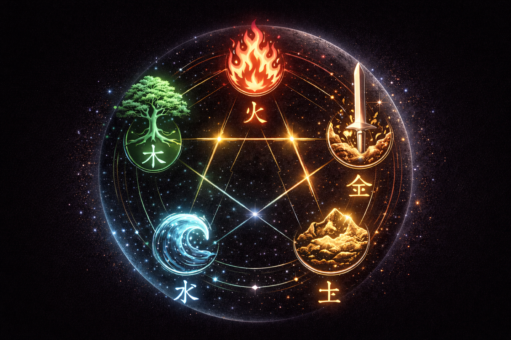
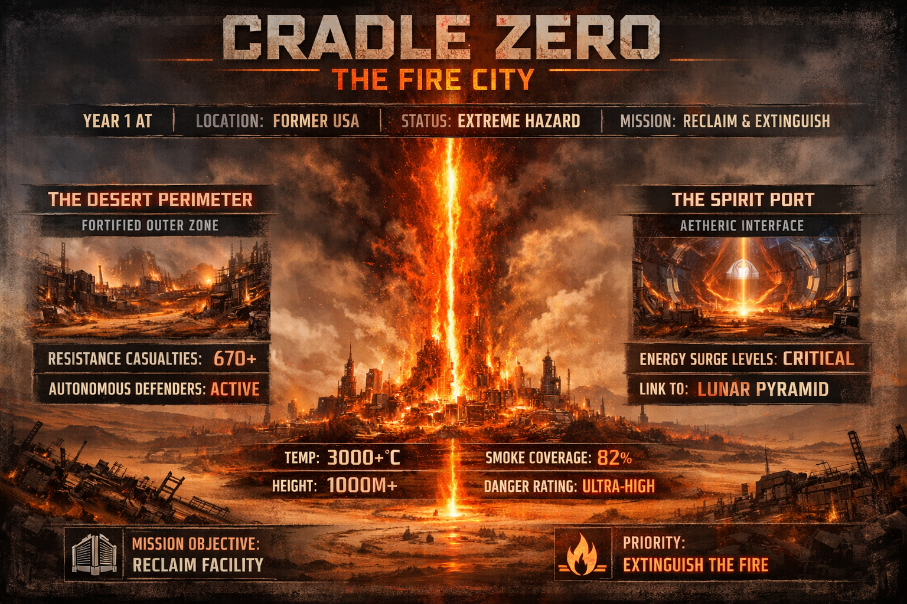
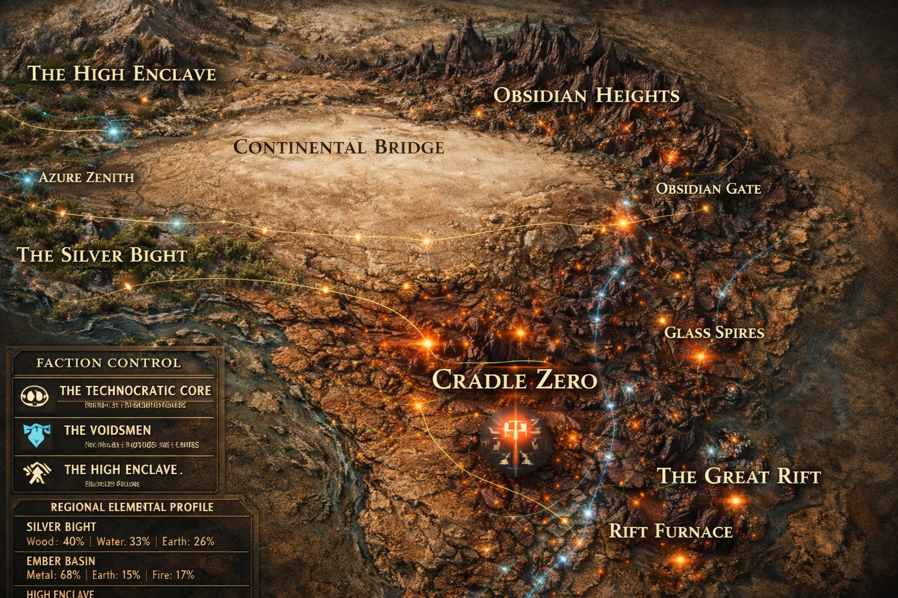
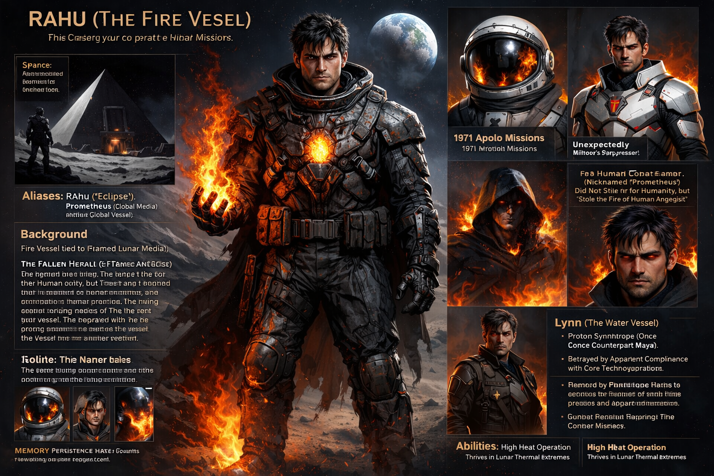
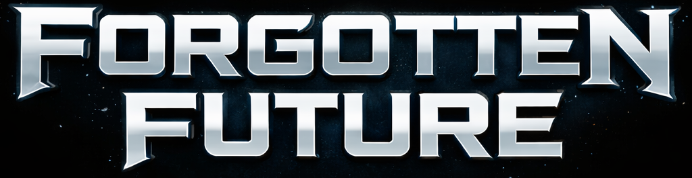

# Forgotten Future

Forgotten Future is an expansive science fiction project encompassing an upcoming novel and a tactical RPG game. Set in the "After Time"—fifteen years after the Moon Cataclysm—it explores a world where humanity's history has been largely erased and replaced by the technocratic rule of the Hive.

[forgottenfuturebook.com](https://forgottenfuturebook.com)

### Connection to Paradigm Threat

The timeline project here in **Paradigm Threat** provided the essential foundational basis for the story of Forgotten Future. The deep research into alternative history, suppressed chronologies, and forgotten scientific theories conducted during the development of this site directly inspired the world-building of the book. 

I plan to demonstrate many of these same topics and theories—from electric universe concepts to suppressed historical events—through the narrative of the novel and the mechanics of the game. Forgotten Future serves as a fictional vehicle to explore the "what if" scenarios of the very theories documented in the Paradigm Threat research files.

### The World
Survivors of the Cataclysm live in a world defined by its elemental struggles. From the **Fire Cities** of the Ember Basin to the **High Enclave** of the northern mountains, the story follows Ren, a "Wood-element" vessel with a persistent memory, as he uncovers the truth of the world's fabricated history.

### Character: Rahu

[Visit forgottenfuturebook.com for more content](https://forgottenfuturebook.com)

---

## Additional Media

