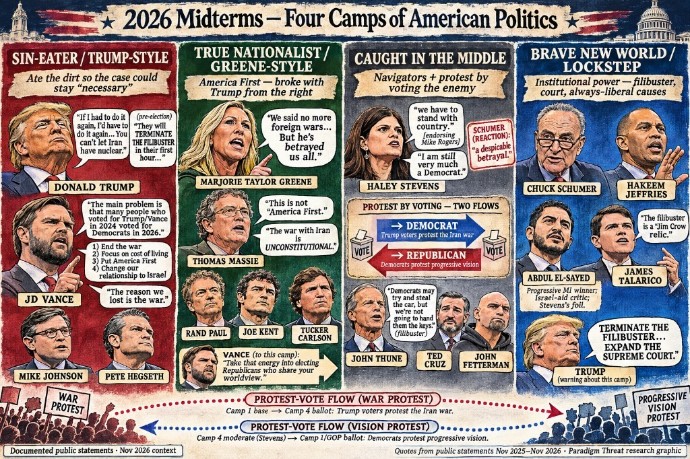

# Investigation: 2026 Midterms — Four Camps, Protest Votes, and the Big Surprise

> **TL;DR:** After Democrats took the House and Senate in the **3 Nov 2026** midterms, **JD Vance** said **2024 Trump voters crossed to Democrats** over the **Iran war**, costs, **America First**, and **Israel**. Mirror protest: **Haley Stevens** → Republican **Mike Rogers**. This file maps **four camps** and a validated **Big Surprise** claims registry: Trump teased an undefined midterm surprise; he did **not** say they knew they would lose; **$5,000** conditional dividend is Documented (Author = late taunt); Vance’s “I told you so… share your worldview” is Documented (sin-eater / hats packaging = Author extension). Sin-eater rule: bury the cost; no confession. Reader essay: [*The Big Surprise*](/governance/constitution/the-big-surprise.md). Companions: [*Voting for insecticide*](/governance/constitution/voting-for-insecticide.md) · [*The Sin Eater*](/governance/war/the-sin-eater.md) · [AU-046](/governance/war/investigations/presidential-alignment-globalist-vs-nationalist-investigation.md) · [RINO](/governance/war/investigations/rino-effect-graham-mcconnell-trump-controlled-opposition-investigation.md).

**Status:** Open — camps + Big Surprise claims registry validated 2026-11-05; Massie / Hegseth §5; **RFK Jr. / MAHA midterm-unleash** — GOP Senate confirmation hostage leverage gone after Dem Senate (§8.1).  
**Date:** 2026-11-05 (RFK midterm-unleash 2026-11-11)

---

## Guide (read order)

1. **Author thesis** → [§1](#1-authors-originating-thesis)
2. **Outcome sketch (documented)** → [§2](#2-2026-outcome-sketch--documented-layer)
3. **Four camps defined** → [§3](#3-four-camps--definitions)
4. **Camp 1 quote bank** → [§4](#4-camp-1--sin-eater--trump-style)
5. **Camp 2** + **Massie Author arc** + **both leave / Gallrein** + **Hegseth absences / unity-protest conclusion** → [§5](#5-camp-2--true-nationalist--greene-style) · [§5.2](#52-thomas-massie--author-arc-gut-co--dual-sin-eater--divorce-dance-conjecture) · [§5.3](#53-greene-and-massie-leave-congress-gallrein-holds-the-seat-author) · [§5.4](#54-hegseth-refer-vote--traffic-absences-author-conclusion)
6. **Two directions of protest** + Camp 3 → [§6](#6-two-directions-of-protest-voting--camp-3)
7. **Camp 4 lockstep vs variation** → [§7](#7-camp-4--brave-new-world--lockstep-and-fracture)
8. **Filibuster warning lane** + **RFK / MAHA midterm-unleash** → [§8](#8-filibuster--pre-election-warnings-and-post-election-asks) · [§8.1](#81-midterm-loss-unlocks-executive-lanes--rfk-jr--maha-documented--author)
9. **Big Surprise claims registry** → [§9](#9-big-surprise--validated-claims-registry)
10. **Open claims / questions** → [§10](#10-authors-open-claims)–[§11](#11-questions-to-clarify-verify-or-debunk)
11. **Related** → [§12](#12-related-investigations)

---

## 1. Author’s originating thesis

> **Author (session 2026-11-05, condensed from midterm research brief):**
>
> Republicans lost the vote because a lot of people were trying to find a protest party — to protest Republican actions — and they only had the Democrats. The biggest thing felt in this election was that people wanted a way to protest. The Republicans that ventured away from the pro-national message and too far into an Israel war left voters without a nationalist protest vehicle other than voting Democrat. On the other side of the coin, by enabling Iran to become too powerful to stop, Democrats push the opposite international plan. In confusion and anger, people are willing to protest NSA-style action in order to promote the CIA-style default as a matter of protest. By electing Democrats to take over the Senate and the House, they basically voted for the other plan — pro-Iranian nuclear proliferation and worldwide terrorism. The main lesson they still have to learn: if you want to protest pro-war and internationally biased entities like Reagan-style Republicans or neocons, you need to do better than vote Democrat, because Democrat is not just a protest — it goes against those same pro-nationalist values. The election looked pre-predicted; everyone knew Democrats were going to sweep. Republicans blamed narrative (war / Israel / America First failure), not voter fraud — and they are right that the narrative cost them. Voters had to choose between two major evils. Trump is the biggest senator / sin-eater figure; when he goes down he wants to leave a Republican party untainted by foreign influences, Israel off the table. The real strategy may not have been winning but documenting as much fraud as possible and eating the major sin of destroying CIA-backed plans while going down forever as an unpopular MAGA party that itself ventured into foreign interests. Prediction held open: Marjorie Taylor Greene shows up as the next / first female president lane. *(Earlier drafts floated “or someone like Thomas Massie”; Author gut first called him controlled opposition; preferred landing is dual **Sin Eater** / divorce-dance conjecture — [§5.2](#52-thomas-massie--author-arc-gut-co--dual-sin-eater--divorce-dance-conjecture); not closed as Camp 2 successor or as CO; no plan evidence.)*
>
> Four camps for the map: (1) **sin-eater Trump style**; (2) **true nationalist Greene style**, including libertarians who protested the same things (surveillance, forever war) for decades; (3) **caught in the middle** — everyone not aligned, not fully informed, but not willing to vote Democrat anymore, considering that party largely choreographed and remote-controlled, not representing the people — including spectacular switches that protest by “voting for the enemy,” in reverse of Trump voters crossing to Democrats over the war; (4) **Brave New World** perfect global citizens who always vote liberal causes, do not think outside the bubble, punish deviation, and are opposed to pro-nationalist camps.

> **Author (session 2026-11-05, Big Surprise / sin-eater silence — later):**
>
> Trump teased a midterm “big surprise” and never defined it. That does **not** mean he said “we knew we would lose.” Sin-eater lesson one (*Bourne Legacy*): bury the excrement; if it is named, the gig unravels and adjacent people burn. Take the sin to the grave — or at least the grave of MAGA as a zombie brand. The $5,000 conditional dividend can be read as a late taunt: you can vote for what you want instead of a protest ballot. Vance told the “I told you so” people they were right and to elect Republicans who share their worldview — a handoff of energy to the Greene-style camp, not a spoken “we are sin eaters / put it on hats.” Prediction: Democrats end the filibuster and lock gains; that camp rises; Marjorie Taylor Greene as next / first woman president. Hope: poison out of the equation so the uninterested finally vote — voting as what makes us human.

**What this means (unpack):** The author is not saying every Democrat voter is a conscious CIA agent. The claim is **mechanism**: protest without a nationalist third pole dumps angry voters into the only major alternative brand, which the author reads as the **globalist / Brave New World** program. Vance’s postmortem is treated as the **documented** half of that mechanism (crossover protest). Stevens→Rogers is the **documented** reverse. Sin-eater grammar for Trump’s camp is already in [*The Sin Eater*](/governance/war/the-sin-eater.md) and AU-046 Nationalist∩NSA. Camp labels are **Author**. “Democrat = Iranian proliferation plan” and “document fraud while going down” are **Author** stakes, not Vance’s wording. Official GOP blame for the loss was **narrative** (war / prices / Israel relationship), not a new Stop-the-Steal — that match to author expectation is noted in [§2](#2-2026-outcome-sketch--documented-layer). **Critical validation:** “senators knew they would lose” is **Author inference**, **not** a Documented Trump admission — see [§9](#9-big-surprise--validated-claims-registry).

---

## 2. 2026 outcome sketch — documented layer

Press consensus after **3 Nov 2026**: Democrats took the **House** and **Senate** in a wide rebuke of Trump-era governance. Drivers named in AP / Reuters / NBC exit work include **high prices**, the **Iran war**, corruption anxiety, and Trump disapproval. NBC exit polling put roughly **43–44%** of House voters saying one reason for their vote was to **oppose Trump** (about **16%** to support him). About **63%** called the Iran war the wrong decision in that exit package.

**JD Vance (X, 4 Nov 2026)** — longest elite Republican admission that crossover, not abstention, decided it: Trump/Vance **2024** voters showed up and voted **Democrat** in **2026**; pollster recovery list = end the war, cost of living, America First, change relationship to Israel; “The reason we lost is the war”; cost framed as “losing the Senate for the next 6 years.” Trump agreed the war (via gas) was a major factor but said he would do it again to stop an Iranian nuclear weapon. Trump also accepted the results; fraud claims largely failed to become the official party explanation ([AP fact focus](https://apnews.com/article/election-voting-results-rigged-facts-trump-f8e70e3d60186ae969629644e64a2df6); NPR).

**Tier:** outcome and Vance/Trump quotes = **Documented** (press + public posts). Causal weight of each issue among all voters = **Documented in exit polls**, still contested in interpretation. Author four-camp map = **Author**.

Sources (secondary press): [AP Democrats win House and Senate](https://apnews.com/article/midterm-election-house-senate-democrats-republicans-trump-f126e12e05b579a327b98481c0ae2226); [NBC exit poll rebuke](https://www.nbcnews.com/politics/2026-election/exit-poll-trump-midterms-voters-economy-disapproval-rcna607045); [Vance / Jerusalem Post](https://www.jpost.com/american-politics/article-913846); [Vance / Times of Israel](https://www.timesofisrael.com/vance-gop-lost-midterms-due-to-iran-war-voters-want-change-in-israel-relationship/); Vance post archive mirrors ([XPut](https://xput.app/S3wQss), [bird.makeup](https://bird.makeup/users/jdvance/statuses/2118004988433641835)).

---

## 3. Four camps — definitions

| Camp | Short name | Definition (Author) | Not the same as |
|------|------------|---------------------|-----------------|
| **1** | Sin-eater / Trump-style | MAGA brand that took the political dirt of the Iran war and midterm rout while claiming long-term necessity; overlaps Nationalist∩NSA / antibody grammar in [*The Sin Eater*](/governance/war/the-sin-eater.md) | Camp 2 (broke *from* Trump on war/Israel) |
| **2** | True nationalist / Greene-style | America First / anti-forever-war / anti-surveillance continuity; includes libertarian restrainers; broke with Trump from the right | Thune-style institutionalists (Camp 3) |
| **3** | Caught in the middle | Navigating constitution, party, and voters; not Greene-aligned; not Camp 4 dogma; includes **mirror protest** (vote/endorse the enemy) | Full conversion to Camp 2 or Camp 4 |
| **4** | Brave New World / lockstep | Liberal–global institutional power agenda; always-liberal cultural lockstep; punishes exit; foreign-policy **intensity** can still fracture inside the brand | Every Democrat voter as identical ideologue |

**NSA / CIA overlay (Author, already in corpus):** Camp 1–2 fights often read as **NSA-aligned nationalist antibody** vs **CIA-camp international default**. Camp 4 is the author’s **Brave New World / choreographed** pole. Overlay is **Author**; do not treat party registration as agency membership.

---

## 4. Camp 1 — Sin-eater / Trump-style

**Roster (Author placement):** Donald Trump · JD Vance · Mike Johnson · Pete Hegseth · Donald Trump Jr. · Karoline Leavitt / WH messengers · loyal pro-war MAGA hawks who stayed with the Iran smash.

### 4.1 Quote bank — Vance (4 Nov 2026)

| Quote | Source | Tier |
|-------|--------|------|
| “Our voters are turning out, but they may not vote for us.” | Vance X post (data guy, pre-election) | Documented |
| “The main problem is not turnout. The main problem is that many people who voted for Trump/Vance in 2024 voted for Democrats in 2026.” | Vance X | Documented |
| Recovery list: “1) End the war 2) Focus on cost of living/inflation 3) Put America First 4) Change our relationship to Israel” | Vance X (pollster of switchers) | Documented |
| “Our voters showed up. And the above four reasons are why many of them voted for Democrats.” | Vance X | Documented |
| “The reason we lost is the war. The president himself said so last night.” | Vance X | Documented |
| “If you'd like to argue it was worth it, that losing the Senate for the next 6 years was worth it, then do so.” | Vance X | Documented |
| “To the people who are pissed off and want to say, ‘I told you so’: you’re right, you did tell us so. Take that energy into electing Republicans who share your worldview.” | Vance X | Documented |

Donald Trump Jr. publicly amplified the post as fully agreed ([The Hill](https://thehill.com/homenews/campaign/6197976-vance-midterms-iran-war-trump/)).

### 4.2 Quote bank — Trump

| Quote | Context | Tier |
|-------|---------|------|
| War “largely” / partly why they lost via gas prices; “If I had to do it again, I’d have to do it again… You can’t let Iran have nuclear.” | Post-election remarks (JPost / CBS / National) | Documented |
| “If I was on the ballot, we would have won.” | Post-election | Documented |
| Pre-election: Democrats will “TERMINATE THE FILIBUSTER in their first hour”; expand Court; DC/PR statehood → “last Republican President” / “END OF AMERICA” | Truth Social 2026 (e.g. [June caucus post](https://truthsocial.com/@realDonaldTrump/posts/116859014229427354); [21 Sep 2026](https://truthsocial.com/@realDonaldTrump/posts/117310166479352147)) | Documented |
| “I believe strongly in terminating the filibuster… SAVE America Act… and about 400 other things” — and Democrats “gonna do it very quickly” if they get in | Punchbowl / Aug 2026 interview | Documented |
| Midterms: “they'll find a reason to impeach me” | Jan 2026 House retreat ([Reuters](https://www.reuters.com/world/us/trump-house-republicans-if-we-dont-win-midterms-i-will-get-impeached-2026-01-06/)) | Documented |

**Author note:** Trump’s filibuster pitch was **nuke it first for Republican bills**, not a principled retirement of an “evil tool” only Democrats abuse. That distinguishes Camp 1 from Camp 3 Thune (keep the keys).

---

## 5. Camp 2 — True nationalist / Greene-style

**Roster (Author placement):** Marjorie Taylor Greene · Rand Paul · Joe Kent · Tucker Carlson · Ron Paul (ancestor) · Warren Davidson (thinner — war-powers partial). **Thomas Massie** — **Camp 2–adjacent** ([§5.2](#52-thomas-massie--author-arc-gut-co--dual-sin-eater--divorce-dance-conjecture)): Author started at CO gut; preferred landing = second **Sin Eater** inside a **gobble-then-split / divorce dance** (conjecture — not plan evidence).

**Not Camp 2:** John Thune (institutional filibuster fight → Camp 3).

### 5.1 Quote bank

| Speaker | Quote / act | Tier |
|---------|-------------|------|
| Greene | “We said no more foreign wars… But he’s betrayed us all.” / “The movement has begun.” (Carlson Maine huddle, Aug 2026) | Documented ([POLITICO](https://www.politico.com/news/2026/08/05/tucker-carlson-mtg-thomas-massie-joe-kent-trump-01025860)) |
| Greene | Pre-election: Democrats win because Trump prefers “Epstein friends and Netanyahu” (with Massie) | Documented (press paraphrases / X) |
| Massie *(Author arc)* | “This is not ‘America First.’” / Iran war unauthorized; war powers with Khanna | Documented — see §5.2 gut CO → dual Sin Eater / divorce-dance |
| Massie *(Author arc)* | “The war with Iran is UNCONSTITUTIONAL… ILLEGAL under the 1973 WPA.” | Documented ([Newsweek](https://www.newsweek.com/full-list-of-republicans-whove-opposed-donald-trumps-iran-war-heres-why-12223730)) |
| Massie | Primary loss May 2026 to Trump-backed **Ed Gallrein**; heavy pro-Israel outside spend; concession dig at opponent “in Tel Aviv” | Documented — Author: hardline → MAGA successor math (§5.3) |
| Massie | Nov 2026: privileged articles of impeachment vs Defense Secretary **Pete Hegseth** (Iran war powers + other counts); forces House vote — Author re-read: **intelligent / planned**, not dumb / under-orders (see §5.2) | Documented ([Massie House release](https://massie.house.gov/news/documentsingle.aspx?DocumentID=395863); [NBC](https://www.nbcnews.com/politics/trump-administration/thomas-massie-pete-hegseth-impeachment-house-defense-rcna597989); [NPR](https://www.npr.org/2026/11/09/nx-s1-6034483/thomas-massie-impeachment-pete-hegseth)) |
| House (10 Nov 2026) | Motion to **refer** Hegseth articles to Judiciary: **211–204** pass (kill); Massie sole R nay; **11 D + 7 R** not voting — Dem absences > margin | Documented ([Clerk vote 317](https://clerk.house.gov/Votes/2026317); §5.4) |
| Strickland / Stansbury / Gillen / Jackson | Traffic / motorcade / police-escorted bus excuses; missed by ~1 minute; Record “would have voted no” does **not** change tally | Documented ([Seattle Times](https://www.seattletimes.com/seattle-news/politics/house-blocks-hegseth-impeachment-effort-strickland-absent/); [Washington Sun](https://www.washingtonsun.com/congress/house-democrats-traffic-key-hegseth-impeachment-vote); [Newsweek](https://www.newsweek.com/11-democrats-missed-hegseth-impeachment-vote-12697693)) |
| Paul | Opposes presidential war without Congress; career anti–regime-change lane | Documented |
| Kent | Resigned NCTC; Iran “no imminent threat”; pressure from Israel / lobby (Author-weight contested by WH) | Documented resignation + contested claim |
| Carlson | America First ≠ tens of billions to ethnostate war (Semafor text exchange, Oct 2026) | Documented as attributed quote |

**Author join:** Vance’s closer — take anger into electing Republicans who share the worldview — points **toward** Camp 2 (Greene lane) without Vance leaving Camp 1’s administration. Massie sits inside the Author’s **divorce-dance conjecture** in [§5.2](#52-thomas-massie--author-arc-gut-co--dual-sin-eater--divorce-dance-conjecture) — preferred dual Sin Eater, not closed as CO.

### 5.2 Thomas Massie — Author arc (gut CO → dual Sin Eater / divorce-dance conjecture)

> **Transcription note:** speech-to-text and rough notes often render **Sin Eater** as “senator” or “city.” This section means **Sin Eater** — the method in [*The Sin Eater*](/governance/war/the-sin-eater.md) — not a Senate seat and not a municipality.

**Epistemology:** There is **no evidence** of a shared choreographed plan — no cable, no meeting minutes, no confession. What follows is **Author conjecture** and **deductive logic** from Documented outcomes (primary loss, Gallrein hold, Greene resignation, Hegseth articles, **10 Nov 2026 refer vote**, alliance optics) plus Sin Eater grammar. Outcome-rhymes can support a read; they do not prove a script. This file does **not** close Massie as controlled opposition. It records where the Author **started**, what the **Sin Eater** method forced him to rethink, and where he **landed**.

#### Start — gut feeling: controlled opposition agent

Initial Author gut: Massie as a **controlled opposition agent** (or unconscious useful idiot pinned that way) — costume America First / libertarian purity while the product is MAGA infighting, never-surrender hill while seats fall, party looking unserious. Under that gut, the Nov 2026 privileged articles of impeachment against Defense Secretary **Pete Hegseth** read as the tell: dumb smash-the-party theater, or a move **under orders**. Documented RINO pressure and GOP friction feed that first read ([Fox](https://www.foxnews.com/politics/rep-thomas-massie-responds-after-trump-calls-him-moron-national-prayer-breakfast-speech); [CNN](https://www.cnn.com/2025/06/24/politics/thomas-massie-trump-oust-incumbent); [The Hill](https://thehill.com/homenews/state-watch/5882724-donald0-trump-targets-thomas-massie-primary/); Hegseth articles [Massie House](https://massie.house.gov/news/documentsingle.aspx?DocumentID=395863)). That gut stays on file as a **thin rival** — optics can still match CO even when the preferred read is dual Sin Eater.

#### What the Sin Eater does — force the thought you would skip

The more the Author sat with the grammar of the **Sin Eater**, the clearer the method became: one of its main tools is to **force discussions and thoughts people otherwise would not have**. Revelation of the method is not a closed label handed down; it is a shove into the argument. If Massie forces the Author to think about Massie — past the first insult — that *is* the Sin Eater working. Starting at one point and ending at another is exactly how that strategy is supposed to work. Companion: [*The Sin Eater*](/governance/war/the-sin-eater.md).

#### Land — Author preferred conjecture: dual Sin Eater inside a divorce dance

Forced past the gut, the Author’s preferred conclusion: Massie is a **different version of the Sin Eater** than Trump’s Camp 1 lane — not the opposite of MAGA, but an antibody against a **false dichotomy**: MAGA = only the Trump loyalty brand, and any America First competition against that brand = traitor / RINO / controlled op. Someone has to eat the dirt of saying no to Trump *from inside America First*.

Under that re-read, impeaching **Pete Hegseth** is **not** a dumb move and **not** a move “under orders” in the CO sense. It is **extremely intelligent** — and **probably well planned** as institutional pressure on war powers after a war-cost midterm rout. Camp 1 will still hate the optics. That does not make the move stupid.

| | **Trump-lane Sin Eater (Camp 1)** | **Massie-lane Sin Eater (preferred)** |
|---|---|---|
| **Dirt eaten** | Iran war / midterm loss / Israel cost | Defiance of Trump / lone nos / party rage / Hegseth fight |
| **So that…** | Long-term smash / bury the cost | America First ≠ one man’s loyalty test |
| **Looks like** | “I’d do it again” | “Principles over party” — gut first reads as sabotage |
| **Risk** | Base feels sold out | Base feels sabotaged; Dems still exploit the optics |
| **Hegseth articles** | Insult / fratricide | Intelligent pressure on war-powers accountability |

##### Gobble-then-split / divorce dance (Author conjecture)

Deduction, not a memo: max GOP **unity** would not have stopped fraudulent elections and other tricks from stripping power anyway. The party was already deeply compromised. People have said a **divorce** was required — including Marjorie Taylor Greene’s national-divorce lane ([The Hill](https://thehill.com/homenews/house/5504117-marjorie-taylor-greene-national-divorce/); [*The Big Surprise*](/governance/constitution/the-big-surprise.md); [*Echos*](/governance/war/echos-of-jade-helm.md#six-years-divorce-and-hollywoods-next-meal)). The deductible long strategy is **gobble-then-split**: absorb as much of the establishment as possible, then split **old guard** vs a **true American emerging party inside the GOP**. Two entities look like they are wrecking the unity Trump “needed” for momentum. Under Sin Eater grammar that wreckage is the point: keep America’s attention on **what is in America’s interests**, even when those interests contradict — foreign-influence wars vs necessary rule-break that is “morally indefensible, and absolutely necessary.”

Author join (still conjecture): Trump-lane **sunsets** excess it set in motion; Massie **strategically sabotages** initiatives that would have gone too far (powers, foreign capture, monopoly of the brand). The dance looks like sabotage of MAGA. The deductible product is a fiercer America-interest fight Dems cannot narrate against — and a handoff to a less-vulnerable MAGA successor ([§5.3](#53-greene-and-massie-leave-congress-gallrein-holds-the-seat-author)).

##### Standing order: don’t compromise — both leave Congress

Author conjecture: once the long dance was set in motion — Author dates the set-and-forget window roughly to the **early 2000s**, with sci-fi collapse-year seasoning as cultural echo, not proof — no one has to be told the plan again. People like Greene and Massie need only one standing instruction: **do not compromise**, even knowing non-compromise means **leaving Congress**. Both now have. Greene resigned effective **5 Jan 2026**. Massie lost the **May 2026** primary and exited the seat. Different doors; same price of the hardline.

##### Hardline as narrative shield; Gallrein as deductible successor

A soft Massie would not have owned the brightest underwriter of fierce pro-American principle. Soft play is the path toward a Democrat-viable general. Hardline means a Democrat **wouldn’t** know how to run an effective counter-narrative against that position — and only a Trump-endorsed pro-MAGA Republican could primary him and still contest the America First frame. Documented: **Ed Gallrein** did that and held KY-04. Author deduction: the successor is **less vulnerable** to Dem narrative defeat and does not need Massie’s compromised-looking risks. Outcome good for America on that seat. Spotty surface wins elsewhere do not erase the Author join that critical virtues (sovereignty, anti-foreign-capture, rules after excess) were what NSA-aligned tracking cared about — and that the US **danced out of** the Europe-style chaos fire at the last minute rather than collapsing into it.

**Adjudication rule:** Friendship with Greene, similar voting records, and America First branding prove neither a shared script nor CO. Prefer **A (dual Sin Eater / divorce dance)** as Author conjecture; keep gut CO as thin rival because sabotage optics can still match B. Companion RINO grammar for the *lane* that still shadows the gut: [RINO dossier](/governance/war/investigations/rino-effect-graham-mcconnell-trump-controlled-opposition-investigation.md).

### 5.3 Greene and Massie leave Congress; Gallrein holds the seat (Author)

**Documented timeline:** Greene announced resignation **Nov 2025**, effective **5 Jan 2026** — long before Election Night’s blue wave and long before Massie’s post-midterm Hegseth articles ([AP](https://apnews.com/article/marjorie-taylor-green-congress-resigns-trump-maga-5f42d4893343babc8e87da1491a0de2b); [Congress.gov resignation letters](https://www.congress.gov/119/crec/2026/01/03/171/220/modified/CREC-2026-01-03-pt1-PgH6137-6.htm)). Surface: Trump feud / Epstein / “battered wife” / refuse a hurtful primary while midterms look lost. Massie lost the **May 2026** KY-04 GOP primary to Trump-backed **Ed Gallrein** (~55–45) and Gallrein held the seat in November ([AP](https://apnews.com/article/massie-gallrein-trump-kentucky-republican-primary-03a658b1a45593ad04ebf6283a3fdb47); [Cincinnati Enquirer](https://www.cincinnati.com/story/news/northern-kentucky/2026/11/03/ed-gallrein-wins-kentucky-4th-district-seat/92600687007/)). **Fact guardrail:** Massie did **not** lose KY-04 to a Democrat; he lost a **Republican primary**. The deductible claim is that hardline blocked a Dem-viable path.

**Author read — both leave via non-compromise:** Greene exited early to keep an **uncompromised** outside lane (family protected; theory of the House: one seat can’t stop the machine). Massie stayed on the institutional hardline until the primary took the seat — theory of the House: one principled no still matters; leaving early = they keep the others in line. Documented alliance continues (she platformed his Hegseth articles); **friendship ≠ identical door**. Under the divorce-dance conjecture, both paid the standing-order price: don’t compromise → leave Congress.

**Gallrein / successor math (Author deduction):** Hardline Massie made only a MAGA/Trump chassis able to take the seat; Gallrein held it; Dems lost the narrative contest on KY-04. The successor does not need Massie’s compromised optics or risk profile. Thin CO rival still available as “NSA containing a pinned agent” — not the lead. Seat not softening into a Democrat pickup is Documented either way.

### 5.4 Hegseth refer vote — traffic absences (Author conclusion)

**Documented outcome (10 Nov 2026):** Massie’s privileged articles forced a House floor fight. The majority answered with a **motion to refer** the articles to Judiciary — the procedural kill, not a merits impeachment. Clerk: **211 yea – 204 nay**; **18 not voting** (**11 Democrats**, **7 Republicans**). Party split: **210 R yea / Massie alone R nay**; **0 D yea / 203 D nay**. ([Clerk vote 317](https://clerk.house.gov/Votes/2026317); [BBC](https://www.bbc.com/news/articles/cxly4y5jzl0qo); [USA Today](https://www.usatoday.com/story/news/politics/2026/11/10/pete-hegseth-avoids-impeachment-vote/92714806007/)).

**Absences decided it.** Margin was **7**. House ties fail; ~**8 more Nays** flips the motion. The **11** missing Democrats were larger than that margin. Several — **Marilyn Strickland** (motorcade, “one minute late”), **Melanie Stansbury**, **Laura Gillen**, **Jonathan Jackson** (traffic / police-escorted bus) — gave the same late-arrival story and filed Congressional Record statements that they would have voted **no**. Those statements **do not** change the tally ([Seattle Times](https://www.seattletimes.com/seattle-news/politics/house-blocks-hegseth-impeachment-effort-strickland-absent/); [Washington Sun](https://www.washingtonsun.com/congress/house-democrats-traffic-key-hegseth-impeachment-vote); [Newsweek](https://www.newsweek.com/11-democrats-missed-hegseth-impeachment-vote-12697693)). Rep. Sydney Kamlager-Dove publicly scolded colleagues for losing on attendance. Baseline: House members miss ~2% of roll calls routinely; absences deciding thin-majority votes is common; a **same-excuse cluster** on a **known high-stakes** vote is rarer and is what makes the traffic story look contrived.

#### How both sides dance (Author conjecture — NSA∩Camp 1 / CIA∩Camp 4)

No cable proves a joint script. The **outcome** still rhymes with dual-establishment management under this site’s overlay ([*The Sin Eater*](/governance/war/the-sin-eater.md); §3 NSA/CIA note):

| Side | Camp overlay | Documented act | Deductible product |
|------|--------------|----------------|-------------------|
| **NSA-aligned / Camp 1 MAGA** | Nationalist∩NSA that still owns the Iran smash | **210–1** procedural kill — almost every Republican stacks to refer / bury | No live floor climax that treats the war-powers protest as bipartisan legitimacy; Hegseth / smash lane protected for now |
| **CIA-default / Camp 4 Dem establishment** | Brave New World / international-default brand that wants war accountability *as theater* after the midterm | **11** absences + traffic/motorcade cluster; Record “we would have voted no”; future-majority impeachment talk | Claim moral credit for accountability **without** standing present for a **Massie + Democrat** anti-war protest that embarrasses both parties’ war entitlements |
| **Massie / Camp 2–adjacent** | Dual Sin Eater — force the thought | Privileged articles; sole R nay | Forces both establishments into the open; the kill itself becomes revelation-of-the-method material |

#### Author conclusion — the absences killed a unity protest vote

**Author conclusion (preferred on the missed votes):** The absences and the traffic story are **not** mainly about one late motorcade. Their function was to stop a **unity protest vote** — both parties’ ranks, on the same floor, protesting the **establishment’s war entitlements** and **Israel / foreign-influence ties** — **without** that protest being packaged as a red-vs-blue campaign asset or conquered afterward as a government-owned narrative.

What Massie’s articles threatened was not “Democrats beat Republicans” or “Republicans discipline a RINO.” It was a rare cross-brand indictment: war powers, forever-war habits, and foreign-capture cost, led by an America First Republican and available for Democrats to join **as Americans**, not as a team jersey. That moment is hard for either establishment to own later. It does not feed clean red-vs-blue fundraising. It does not sit inside a managed “our party vs their party” conquer story. It names the shared entitlement.

So the dance kills the unmanaged climax:

- **NSA∩Camp 1** stacks the procedural bury so the Iran smash / Hegseth lane never takes a bipartisan legitimacy hit.
- **CIA∩Camp 4** stays mostly off the floor, then files Record statements and future-majority talk — moral credit for accountability **without** co-signing a present, bipartisan protest that escapes party packaging.
- America is denied the sight of **both brands protesting the same war entitlements together**.

Old-guard unity on **both** party brands prefers managed conflict over that unmanaged unity protest. A clean floor win for the articles — or even a clean loss with every Democrat present — would have been the protest signal. Traffic / coincidence / “we’ll do it later” is the laundering language. That is how choreography is accomplished **without** a memo: NSA-backed loyalty stack + CIA-backed absence theater = same managed fate. **Documented:** absences decided the tally. **Author:** that is why the absences mattered. Rival reads stay live (majority closed early as hardball; real DC traffic; incompetence). Outcome can still match the dance. The American people deserve better than a country’s war fate decided by who got stuck behind a bus.

---

## 6. Two directions of protest voting — Camp 3

### 6.1 The mirror (Author thesis + Documented anchors)

| Direction | Who moves | Against what | Into what | Elite receipt |
|-----------|-----------|--------------|-----------|---------------|
| **A — Main 2026 GOP loss** | 2024 Trump voters | Iran war / Israel alignment / cost / America First failure | Democrat ballot | Vance four reasons |
| **B — Reverse protest** | Dem / Dem-adjacent actors who refuse progressive vision | Progressive Dem foreign policy / party dogma (Israel fight as hinge) | Republican endorsement or ballot | Stevens→Rogers |

Same **mechanism** (protest by choosing the enemy brand). Opposite **parties**. Neither move equals joining Camp 2’s full nationalist program.

### 6.2 Haley Stevens (anchor)

| Beat | Detail | Tier |
|------|--------|------|
| Aug 2026 | Narrow primary loss to **Abdul El-Sayed** (~1%); Israel / party-direction fracture; AIPAC-backed Stevens lane in press | Documented |
| ~1–2 days before Election Day | Revokes El-Sayed endorsement; endorses GOP **Mike Rogers**; church appearance; “stand with country”; still “very much a Democrat” | Documented ([NPR](https://www.npr.org/2026/11/01/nx-s1-6020993/michigan-senate-race-abdul-el-sayed-haley-stevens-mike-rogers); [Guardian](https://www.theguardian.com/us-news/2026/nov/02/democrats-reaction-haley-steven-mike-rogers)) |
| Party lockstep | MI Dem chair: not a member / will not be; Schumer “despicable betrayal”; majority of staff resign | Documented |
| Parallel she named | Compared herself to **John Fetterman** | Documented |
| Outcome note | El-Sayed still won MI Senate in the blue wave ([BBC](https://www.bbc.com/news/articles/c893z55pxrewo)); Stevens’s move is a **signal**, not a claim it flipped the state | Documented |

### 6.3 Related Camp 3 signals

| Signal | Role | Tier |
|--------|------|------|
| **John Fetterman** | Party-break / Israel hard line; GOP courtship without full Camp 2 join; Stevens’s cited parallel | Documented as parallel + press courtship stories |
| **Blank-ballot / refuse-both** | Detroit News–lane advice to leave Senate line blank vs El-Sayed *or* Rogers; some (e.g. David Kramer) then to Rogers | Documented soft spectrum ([Slate / local reporting](https://slate.com/news-and-politics/2026/11/haley-stevens-mike-rogers-abdul-el-sayed-michigan.html)) |
| **John Thune** | Keep filibuster; “not going to hand them the keys”; clash with Trump over SAVE Act nuke | Documented — **not** America First revolt |
| **Ted Cruz** | “Watergate-level repudiation”; war too long; economic pain; rebuild without Greene break | Documented |
| **Tim Scott / Collins / Murkowski / Fitzpatrick** | Institutional or war-powers navigators | Documented placement as Camp 3, not Camp 2 |

### 6.4 Camp 3 roster (Author)

Haley Stevens · John Fetterman (partial) · blank-ballot Dems · John Thune · Ted Cruz · Tim Scott · Susan Collins · Lisa Murkowski · Brian Fitzpatrick · other “not Greene / not lockstep” navigators.

---

## 7. Camp 4 — Brave New World: lockstep and fracture

**Roster (Author placement):** Chuck Schumer · Hakeem Jeffries · progressive caucus structural push (e.g. Greg Casar June 2026 resolution: eliminate 60-vote threshold / Court structural reforms) · James Talarico · **Abdul El-Sayed** (progressive winner; filibuster termination as top message in Trump’s attacks; Israel-aid critic — the pole Stevens protested) · broader oversight / cost-of-living Dem messaging bloc.

### 7.1 Where the lockstep is strong (Documented pattern)

| Domain | Behavior | Example |
|--------|----------|---------|
| **Punishing exit** | Unified betrayal rhetoric when a Democrat endorses a Republican | Schumer on Stevens; MI party expulsion |
| **Institutional power asks** | End filibuster / Court reform / statehood threats in progressive resolutions and candidate messaging | Casar caucus resolution; Talarico “Jim Crow relic”; El-Sayed filibuster priority (per Trump / press) |
| **Campaign contrast** | Paint MAGA / Trump as the existential other | Standard midterm messaging; Jeffries oversight / Hegseth-out lines |

### 7.2 Where the brand fractures (Documented)

| Fracture | Evidence |
|----------|----------|
| **Israel / Middle East** | Stevens vs El-Sayed primary; AIPAC money vs progressive Israel-aid criticism; same party brand, opposite foreign-policy poles |
| **Filibuster timing** | Schumer post-win ducked an immediate “nuke” pledge while winners like Talarico endorsed abolition ([Daily Wire / Hill reporting](https://www.dailywire.com/news/jim-crow-relic-talarico-calls-for-ending-senate-filibuster)) |
| **How to use power** | Progressive structural maximalism vs moderate “death by a thousand cuts” oversight ([Independent](https://www.independent.co.uk/news/world/americas/us-politics/congress-trump-democrats-majority-midterms-filibuster-b3034568.html)) |

**Author conclusion for Camp 4:** There is **one major lockstep** on **procedure, institutions, and enforcing party loyalty**. There is **not** one identical foreign-policy mind. The author’s “choreographed / remote-controlled” claim targets the **institutional and cultural** machine more than every Israel vote. El-Sayed’s win inside Camp 4’s brand is still Camp 4 for **domestic Brave New World** placement; his Israel break is **variation**, not Camp 2 nationalism.

---

## 8. Filibuster — pre-election warnings and post-election asks

Trump’s repeated pre-election claim: if Democrats take power they end the filibuster fast, then flood structural wins (Court, DC/PR, election rules). He urged Republicans to terminate it first for SAVE America and “400 other things.” Thune (Camp 3) refused. Post-election, some Democratic winners (Talarico) urge abolition; Schumer has not locked a nuke calendar in early statements.

**Author read (ties to insecticide essay):** The filibuster fight is the procedural face of “vote insecticide / don’t sit out” stakes in [*Voting for insecticide*](/governance/constitution/voting-for-insecticide.md). Camp 1 wanted the nuclear option for its bills; Camp 4 wants it for theirs; Camp 3 institutionalists fear handing keys.

### 8.1 Midterm loss unlocks executive lanes — RFK Jr. / MAHA (Documented + Author)

**Documented (MAHA Action remarks, ~10 Nov 2026):** HHS Secretary **Robert F. Kennedy Jr.** told supporters that **Senate Republicans** had held his agenda hostage through confirmation leverage — and that the midterm loss of the Senate **ends that leverage**. Local clip transcription (cleaned against press paraphrase of the same talk):

> Every time I try to do something robust, I would get calls saying, if you do that, we’re not going to confirm your appointees. … I said to the group at HHS, … the Democrats, no matter how great the appointee is, not one vote will go to them. … The Senate no longer has any leverage over me. And that’s a big deal. And then we have Stephen Miller … a friend of our movement. And I don’t think anything is going to get in our way now. … release the Kraken. Because that’s what we’re about to do. … stand by.

Press match: [WaPo](https://www.washingtonpost.com/health/2026/11/10/rfk-jr-says-senate-gop-blocked-his-agenda-has-lost-leverage-post-midterms/) (GOP blocked “robust” moves via nominee threats; Senate “no longer has any leverage”); [Politico](https://www.politico.com/news/2026/11/11/stephen-miller-chief-maha-rfk-wiles-01159518) (Miller as CoS / MAHA ally; Kennedy “unleash the Kraken”). He did not name the senators.

**What the Documented claim does *not* say:** Unlimited HHS power. A Democratic Senate still means oversight, hearings, and confirmation freezes the other way. Kennedy’s point is narrower and sharper: the **internal Republican** confirmation-hostage tool is gone, so robust MAHA action is freer *even while* Congress turns hostile.

**Author join:** The strategic GOP midterm defeat — the same Congress cost already framed as the weapon falling into enemy hands in [*The Big Surprise*](/governance/constitution/the-big-surprise.md) — also **loosened** a series of executive possibilities that did not exist under GOP Senate hostage rules. RFK spelled that unlock out explicitly. It rhymes with the divorce-dance / Camp-split ledger: old-guard Senate Republicans used appointees as a brake on America-health disruption; losing the chamber burns that brake. Sin-eater silence still forbids a public “we lost on purpose”; Kennedy’s speech is not a confession of planned defeat — it is a **post-loss map** of what the loss unlocked. Pair with Miller as CoS ally (Documented celebration) as a second unlock on the same board.

---

## 9. Big Surprise — validated claims registry

Author mistakes get checked here. Article [*The Big Surprise*](/governance/constitution/the-big-surprise.md) stays declarative; this table holds tiers.

| # | Claim | Tier | Receipt / note |
|---|-------|------|----------------|
| B1 | Trump teased a midterm “big surprise” / “Midterm Surprise” | **Documented** | [Ohio 3 Oct 2026](https://www.nbcnews.com/politics/2026-election/trump-campaigning-ohio-says-midterms-will-bring-big-surprise-rcna601150); Truth Social “Watch for the ‘Midterm Surprise!’” ([Just the News](https://justthenews.com/politics-policy/trump-predicts-midterm-surprise-he-touts-rally-crowds)) |
| B2 | Trump publicly **defined** what the surprise was | **Invalidated** | No WH definition; Klink = turnout spin ([Newsweek](https://www.newsweek.com/donald-trump-midterm-october-surprise-history-elections-12529904)); Vought “big surprises” separate/unclear |
| B3 | Trump publicly said they **knew they would lose** | **Invalidated as public statement** | Post-election: “a little bit surprised” / “thought we would do better” ([ABC](https://abcnews.com/Politics/trump-bit-surprised-after-democrats-big-win-midterms/story?id=137835787)). Author: senators **bury** planned-cost knowledge (*Bourne* / [*Sin Eater*](/governance/war/the-sin-eater.md)) — never confess |
| B4 | Historians may infer senator camp **understood** deeper board / accepted Congress cost | **Author** | Inference only; not a Trump quote |
| B5 | $5,000 to every adult **if** GOP holds House and Senate | **Documented** | Dallas midterm convention **9 Sep 2026** ([AP](https://apnews.com/article/trump-dividend-5k-5000-check-republicans-cc80644e3168acd31c892129fb849436)); reiterated Oct ([CNBC](https://www.cnbc.com/2026/10/04/trump-5000-checks-cash-payments-midterms.html)); condition unmet after Dem sweep |
| B6 | $5k pledge = late **taunt** against protest-voting | **Author** | Timing + “vote for what you want” read; mainstream: bribe / unfunded / absurd |
| B7 | Vance: “I told you so… you’re right… electing Republicans who share your worldview” | **Documented** | X post 4 Nov 2026 ([Politico](https://www.politico.com/news/2026/11/04/jd-vance-iran-war-midterms-01148838); [XPut](https://xput.app/S3wQss)) |
| B8 | Vance admitted “sin eater,” permanent non-opposition, hats/shirts campaign | **Author extension** | Not in post; he remains VP; Trump still “I’d do it again” |
| B9 | Stevens→Rogers reverse protest | **Documented** | [NPR](https://www.npr.org/2026/11/01/nx-s1-6020993/michigan-senate-race-abdul-el-sayed-haley-stevens-mike-rogers) |
| B10 | *Children of Men* set in **2027** | **Documented** | Film/synopsis record |
| B11 | Dems will end filibuster and lock Trump-era gains for next ~6 years | **Author prediction** | Some winners (e.g. Talarico) endorse nuke; Schumer not locked post-win |
| B12 | MTG next president / first woman president | **Author prediction** | Open |
| B13 | Globalist containment of US self-communication smashed → restrainers more hearable | **Author / partial** | Pattern stake; do not overclaim as measured “smash” metric |
| B14 | Warp Speed / anti-mandate blocked Biden-era depopulation attempt | **Author stakes** | Link vaccine companions; not court-adjudicated “foiled genocide” finding |
| B15 | Trump + Netanyahu as armored “senators” for impeachment / jail pressure next 2 years | **Author** camp label + **Documented** risk theater where press supports | Fear/chill as leftover globalist tool = Author |
| B16 | RFK Jr.: Senate GOP held MAHA/HHS via confirmation threats; post-midterm “Senate no longer has any leverage”; Miller ally; “Kraken” / nothing in the way | **Documented** speech | MAHA Action remarks ~10 Nov 2026; [WaPo](https://www.washingtonpost.com/health/2026/11/10/rfk-jr-says-senate-gop-blocked-his-agenda-has-lost-leverage-post-midterms/); [Politico](https://www.politico.com/news/2026/11/11/stephen-miller-chief-maha-rfk-wiles-01159518); local clip transcript §8.1 |
| B17 | Midterm GOP defeat *deliberately* staged to unlock MAHA / executive lanes | **Author join** on B16 | Kennedy maps the unlock; does **not** confess planned loss; see §8.1 |

**Sin-eater silence rule (Author, corpus-locked):** Whatever cost was eaten is taken to the grave (or MAGA’s grave as zombie-prevention). Public bravado (“big surprise,” “win big,” “a little bit surprised”) is the **surface**. Do not collapse surface into confession.

---

## 10. Author’s open claims

1. **Four-camp map** correctly sorts 2026 elite behavior better than binary R/D. (**Author**)
2. **Protest-without-nationalist-pole** dumps voters into Camp 4’s brand even when they hate Camp 4’s foreign-policy outcomes. (**Author**; Vance supplies crossover half)
3. **Stevens→Rogers** is the structural reverse of Vance’s crossover, same protest mechanism. (**Author** join on **Documented** acts)
4. **Camp 1** is sin-eater / Nationalist∩NSA midterm loser that still owns the Iran smash as necessary. (**Author** + corpus grammar)
5. **Camp 2** (Greene / Paul / Kent / Carlson; Massie **Camp 2–adjacent** — dual Sin Eater / divorce-dance conjecture) is the lane voters should have used instead of Democrat protest ballots. (**Author** prescription)
6. **Camp 4** is choreographed Brave New World on institutions and culture; foreign policy varies. (**Author** with Documented fracture)
7. **Narrative > fraud** as the *official* GOP loss explanation matches the author’s “they named narrative” observation; separate fraud-documentation strategy remains **Author**, not proven White House memo. (**Split**)
8. **Greene 2028** presidential possibility rises after early resignation (message purity / family / uncompromised lane) + midterm validation of the warning. (**Author** prediction; open). **Massie Author arc (conjecture, not plan evidence):** gut CO → dual Sin Eater inside **gobble-then-split / divorce dance**; Hegseth articles = intelligent / planned; standing order don’t-compromise → both Greene and Massie leave Congress; Gallrein = less-vulnerable MAGA successor math; thin CO rival retained ([§5.2](#52-thomas-massie--author-arc-gut-co--dual-sin-eater--divorce-dance-conjecture)–[§5.3](#53-greene-and-massie-leave-congress-gallrein-holds-the-seat-author)).
8a. **Hegseth refer absences — Author conclusion:** 10 Nov 2026 motion to refer **211–204**; Dem traffic/absence cluster > margin (**Documented**). **Conclusion:** absences killed a **unity protest vote** — both parties against establishment **war entitlements** and **Israel / foreign-influence ties** — that could not be owned as red-vs-blue campaign fuel or conquered as a government narrative. Camp 1 / NSA∩loyalty stacks the kill; Camp 4 / CIA-default brand takes accountability credit without standing present ([§5.4](#54-hegseth-refer-vote--traffic-absences-author-conclusion)). **Not** plan evidence.
9. **Undefined “big surprise” + $5k taunt + buried cost** form one sin-eater midterm package without requiring a spoken “we knew we’d lose.” (**Author**; B1–B6)
9a. **Divorce dance / dance-out-of-fire (Author conjecture):** unity would not have stopped fraud/tricks; early-2000s set-and-forget; US danced out of Europe-style collapse fire at the last minute; spotty surface ≠ losing NSA-aligned virtues fight. **Not** Documented plan evidence.
10. **Vance I-told-you-so** is a Documented energy handoff to Camp 2 worldview; merchandise / permanent non-opposition is Author packaging. (**Split** B7–B8)
11. **Silence on fraud in the public loss story** is deliberate (avoid faith/treason backfire); local vote still required; optional Flock-trap / switcharoo join stays **Author speculative** ([§13](#13-common-objection--rigged-so-dont-vote)).
12. **Midterm defeat unleashes executive possibilities (Author join on Documented RFK):** Losing the Senate removed GOP confirmation-hostage leverage over HHS/MAHA; Kennedy spelled the unlock (“no leverage,” Miller ally, Kraken). Same Congress cost as “weapon to the enemy” also frees lanes that did not exist under Republican Senate brakes ([§8.1](#81-midterm-loss-unlocks-executive-lanes--rfk-jr--maha-documented--author); B16–B17).

---

## 11. Questions to clarify, verify, or debunk

| # | Question | How to adjudicate |
|---|----------|-------------------|
| Q1 | Exact full text of Stevens’s endorsement remarks beyond “stand with country” / “still a Democrat” | Primary video / transcript |
| Q2 | Share of 2024 Trump→2026 Dem voters who cite Israel vs gas vs inflation first | Named pollster crosstabs Vance referenced |
| Q3 | How many House/Senate Democrats publicly commit to ending legislative filibuster in 2027 | Whip count / recorded statements |
| Q4 | Blank-ballot volume in MI Senate vs Rogers share attributable to Stevens | County canvasses + surveys |
| Q5 | Whether Camp 2 third-party Maine huddle produces a named 2028 vehicle | FEC / ballot access / primary filings |
| Q6 | Continuity of fraud-documentation claims inside Camp 1 after Trump accepted results | Admin dockets / AFL / DHS work vs public messaging |
| Q7 | Any primary (speech/video) where Trump defines “midterm surprise” beyond crowds/turnout | Full rally transcripts Oct 2026 |
| Q8 | Internal polling shared with WH showing expected blowout before Election Day | Leaks / books / sworn testimony — open |
| Q9 | Exact traffic / motorcade / bus path for 10 Nov 2026 Hegseth refer absences; whether majority closed knowing Dems were en route | Capitol Police / traffic cams / whip clocks / floor video vs member statements |
| Q10 | Whether Dem caucus whip expected full attendance on the refer motion | Whip notes / aide on-record / Kamlager-Dove follow-up |

---

## 12. Related investigations

| File | Role |
|------|------|
| [*The Big Surprise*](/governance/constitution/the-big-surprise.md) | Reader essay — undefined surprise, bury-it rule, MTG path |
| [*Voting for insecticide*](/governance/constitution/voting-for-insecticide.md) | Pre-election midterm reader: insecticide / hatred test |
| [*The Sin Eater*](/governance/war/the-sin-eater.md) | Sin-eater / antibody grammar for Camp 1 |
| [Presidential alignment AU-046](/governance/war/investigations/presidential-alignment-globalist-vs-nationalist-investigation.md) | Globalist vs Nationalist scorecard; Nationalist∩NSA |
| [RINO effect](/governance/war/investigations/rino-effect-graham-mcconnell-trump-controlled-opposition-investigation.md) | Controlled-opposition / filibuster-brake RINO lane |
| [Democrat funding / midterm bet AU-069](/influence/controlled_opposition/investigations/democrat-funding-pipeline-paid-protest-foundation-pattern-investigation.md) | Democrat ↔ Ayatollah / 2026 midterm bet hinge |
| [2020 selective fraud / midterm legitimacy](/governance/constitution/investigations/2020-election-fraud-selective-battleground-audit-timing-investigation.md) | All-or-nothing legitimacy grammar |
| [Voter fraud catalog AU-073+](/governance/constitution/investigations/voter-fraud-evidence-polls-and-prediction-markets-investigation.md) | Fraud specimens vs pollster faith |
| [*Mission Accomplished again — Iran 2026*](/governance/war/mission-accomplished-again-iran-2026.md) | Iran war reader ledger |
| [Managed democracy, puppets, and redemption](/governance/war/managed-democracy-puppets-and-redemption.md) | Puppet / redemption grammar |
| [*Children of Men* PP](/influence/predictive_programming/investigations/children-of-men-nsa-warning-predictive-programming-investigation.md) | 2027 setting / holy-war grammar companion |
| [NSA 2001–2005 AU-058](/governance/war/investigations/nsa-2001-2005-declassification-offensive-investigation.md) | Patriot-era exception for “sweep” expectation |
| [Q1 — Why vote if rigged?](/governance/constitution/qa/q01-why-vote-in-rigged-elections.md) | Common Nonwo / stay-home objection |
| [2026 county anomalies / late changes](/governance/constitution/investigations/2026-midterm-county-anomalies-late-changes-investigation.md) | USB/card/late-flip specimen harvest |
| [*Echos of Jade HELM*](/governance/war/echos-of-jade-helm.md) | Helm → TX bloc machine; Surprise observe/foreign-influence layers |

---

## 13. Common objection — “rigged, so don’t vote”

**Specimen:** [Nonwo (@nonwo) note, 5 Nov 2026](https://substack.com/@nonwo/note/c-379643369) on [*The Big Surprise*](/governance/constitution/the-big-surprise.md) — “Not once did they mention election rigging… They rig elections all over the world and they will not rig… the U.S.?” City-of-London / Rothschild–Rockefeller HQ rhetoric. Linked stay-home essay form: [Health Impact News / Medical Kidnap (2023)](https://medicalkidnap.com/2023/09/19/since-national-u-s-elections-are-rigged-by-the-globalists-why-are-you-voting-for-their-candidates/) ([HNewsWire mirror](https://hnewswire.com/watchman-since-national-u-s-elections-are-rigged-by-the-globalists-why-are-you-voting-for-their-candidates/)).

**Documented match to the complaint:** Official GOP / Vance / Trump postmortem named **war / gas / America First / Israel relationship** — not a new Stop-the-Steal ([Politico](https://www.politico.com/news/2026/11/04/jd-vance-iran-war-midterms-01148838); [AP](https://apnews.com/article/election-voting-results-rigged-facts-trump-f8e70e3d60186ae969629644e64a2df6)). Vance’s “I told you so… you’re right… share your worldview” **does not mention fraud once**.

**Author answer (brief):** Local / legislative vote still matters more than the presidential faith fight. Sit-out still dies ([*Voting for insecticide*](/governance/constitution/voting-for-insecticide.md)). Public fraud headlines would backfire into faith wars and jail over treason accusations — so the handoff language stays on Iran cost and Camp 2 energy. **Author speculative:** one reading of the undefined Big Surprise is a switcharoo — trap a massive fraud bout where Flock-class cameras / logs can hold it, never say so in public, name the Iran war, hand MAGA to true America First candidates, smash Iran — mission accomplished; next cycle Democrats must explain a post-Trump field and may split as the right already did; parties must split or die. Full write-up: [constitution Q1](/governance/constitution/qa/q01-why-vote-in-rigged-elections.md).

Keywords: #Midterms2026 #FourCamps #BigSurprise #ProtestVote #JDVance #DonaldTrump #MarjorieTaylorGreene #ThomasMassie #DualSinEater #DivorceDance #GobbleThenSplit #EdGallrein #ControlledOpposition #RINO #PeteHegseth #MarilynStrickland #MelanieStansbury #HaleyStevens #AbdulElSayed #RFKJr #MAHA #StephenMiller #Filibuster #TrumpDividend #AmericaFirst #IranWar #Israel #SinEater #BraveNewWorld #Nationalist #Globalist #NSA #CIA #Constitution #ElectionIntegrity #ParadigmThreatFiles

*Last updated: 2026-11-11 (RFK Jr. §8.1: midterm loss ends GOP Senate confirmation hostage leverage; MAHA unleash Documented)*

---

## Limits and disclaimers

> **Prisca sapientia (epistemic foundation):** This investigation assumes [**prisca sapientia**](/docs/PRISCA_SAPIENTIA.md)—the historical and philosophical belief that the ancients possessed a vast, profound understanding of the universe, nature, and theology that was subsequently lost or degraded. Modern consensus science and institutions are not treated as default truth; evidence tiers below adjudicate specific claims.

- **Camp labels** (sin-eater, Greene-style nationalist, caught in the middle, Brave New World) are **Author** taxonomy for pattern work. They are **not** self-IDs and **not** agency memberships.
- **Documented** means public quotes, election outcomes, and mainstream reporting cited above. **Author** means pattern stakes from §1, §9, and §10. **Speculative** covers future 2028 presidential lanes and any “document fraud as the real strategy” claim without a primary memo. **Invalidated** rows in §9 mean the *public-statement* form of the claim failed check — not that Author inference is forbidden.
- Cross-links to [*The Sin Eater*](/governance/war/the-sin-eater.md), AU-046, RINO, and AU-069 are **thematic**. They do not prove identical conspiracies or that every Camp 4 voter is CIA-directed.
- “Democrat ballot = pro-Iranian nuclear proliferation / worldwide terrorism plan” is **Author** geopolitical reading of institutional consequences, **not** Vance’s quote and **not** a claim about every individual Democrat’s intent.
- Exit polls and Vance’s unnamed pollsters are **secondary**; exact crosstabs may refine weights without retiring the crossover mechanism.
- Assistant bias default is bipartisan “both sides” flattening; this file keeps the author’s four-camp stakes visible beside receipts.
- Author thesis sections are **first-class** for this project and **not** automatically factual.
- Renamed from `2026-midterm-four-camps-big-surprise-investigation.md` on **2026-11-05** to match Big Surprise scope.

## Investigator notes

- Plan: Big Surprise article (Cursor); do not edit plan file. One investigation + one article; article last.
- Former path: `…/2026-midterm-four-camps-big-surprise-investigation.md` → `…/2026-midterm-four-camps-big-surprise-investigation.md`
- Vance full post mirrors: `https://xput.app/S3wQss` · `https://bird.makeup/users/jdvance/statuses/2118004988433641835`
- Eastern stamp: `TZ=America/New_York date` → **2026-11-05**
- Index targets: constitution hub, `page-sections/investigations.md`, `investigations.md`, Related rows — all must use new filename
