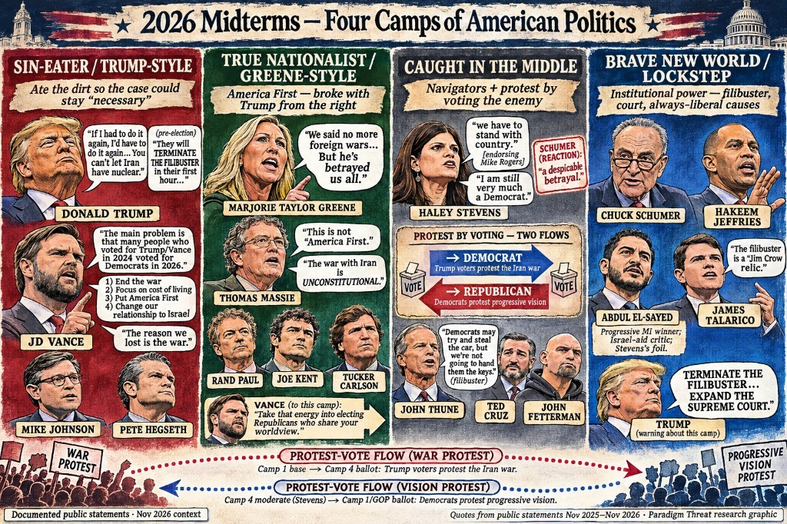

# Investigation: 2026 Midterms — Four Camps, Protest Votes, and the Big Surprise

> **TL;DR:** After Democrats took the House and Senate in the **3 Nov 2026** midterms, **JD Vance** said **2024 Trump voters crossed to Democrats** over the **Iran war**, costs, **America First**, and **Israel**. Mirror protest: **Haley Stevens** → Republican **Mike Rogers**. This file maps **four camps** and a validated **Big Surprise** claims registry: Trump teased an undefined midterm surprise; he did **not** say they knew they would lose; **$5,000** conditional dividend is Documented (Author = late taunt); Vance’s “I told you so… share your worldview” is Documented (sin-eater / hats packaging = Author extension). Sin-eater rule: bury the cost; no confession. Reader essay: [*The Big Surprise*](/governance/constitution/the-big-surprise.md). Companions: [*Voting for insecticide*](/governance/constitution/voting-for-insecticide.md) · [*The Sin Eater*](/governance/war/the-sin-eater.md) · [AU-046](/governance/war/investigations/presidential-alignment-globalist-vs-nationalist-investigation.md) · [RINO](/governance/war/investigations/rino-effect-graham-mcconnell-trump-controlled-opposition-investigation.md).

**Status:** Open — camps + Big Surprise claims registry validated 2026-11-05; Massie / Hegseth §5; **Sin Eater as ivermectin / forced-side split** (§5.5); **Mike Flynn — loud-lane useful idiot / CO amplifier (locked)** (§5.6); **post-election prediction capacity** — Author pre-election blank / expected R sweep; alleged problems = Israel; medicine = end of red-vs-blue safely (B19); **RFK Jr. / MAHA midterm-unleash** (§8.1); **RT India Aneja / Sharma — Trump still has international / executive power** (§8.2 / B24); **Learjet N722BD / Author missile-pressure** (B20); **X22 oil / CB midterm-observation packaging** (B21); **2027 two-generation clock** (B22); **Oltmann fraud-report teaser + Flynn boost** (B23); **FAA ground stop / Capt. Mike McHugh (@mike4flight) planned-chaos read** (B25); **Mike Lindell — long-term loud-lane CO / burn-out puppet** (§5.7 / B26); **Iran misread the midterm / six-year MAGA unity card / last-two-year GOP break** (§8.3 / B27).
**Date:** 2026-11-05 (Flynn §5.6 lock + Lindell B26 2026-11-15)

---

## Guide (read order)

1. **Author thesis** → [§1](#1-authors-originating-thesis)
2. **Outcome sketch (documented)** → [§2](#2-2026-outcome-sketch--documented-layer)
3. **Four camps defined** → [§3](#3-four-camps--definitions)
4. **Camp 1 quote bank** → [§4](#4-camp-1--sin-eater--trump-style)
5. **Camp 2** + **Massie Author arc** + **both leave / Gallrein** + **Hegseth absences / unity-protest conclusion** + **ivermectin / forced-side Sin Eater** + **Flynn loud-lane CO lock** + **Lindell long-term loud-lane CO** → [§5](#5-camp-2--true-nationalist--greene-style) · [§5.2](#52-thomas-massie--author-arc-gut-co--dual-sin-eater--divorce-dance-conjecture) · [§5.3](#53-greene-and-massie-leave-congress-gallrein-holds-the-seat-author) · [§5.4](#54-hegseth-refer-vote--traffic-absences-author-conclusion) · [§5.5](#55-sin-eater-as-ivermectin--forced-side-split-author-conjecture) · [§5.6](#56-mike-flynn--loud-lane-useful-idiot--co-amplifier-author-lock) · [§5.7](#57-mike-lindell--long-term-loud-lane-controlled-opposition-author-lock)
6. **Two directions of protest** + Camp 3 → [§6](#6-two-directions-of-protest-voting--camp-3)
7. **Camp 4 lockstep vs variation** → [§7](#7-camp-4--brave-new-world--lockstep-and-fracture)
8. **Filibuster warning lane** + **RFK / MAHA midterm-unleash** + **RT India Aneja (Trump still powerful internationally)** + **Iran misread / six-year unity card / last-two-year break** → [§8](#8-filibuster--pre-election-warnings-and-post-election-asks) · [§8.1](#81-midterm-loss-unlocks-executive-lanes--rfk-jr--maha-documented--author) · [§8.2](#82-rt-india--atul-aneja--blue-wave-does-not-neuter-trump-documented--author-witness) · [§8.3](#83-iran-misread-the-midterm--six-year-unity-card--last-two-year-break-author)
9. **Big Surprise claims registry** → [§9](#9-big-surprise--validated-claims-registry)
10. **Open claims / questions** → [§10](#10-authors-open-claims)–[§11](#11-questions-to-clarify-verify-or-debunk)
11. **Related** → [§12](#12-related-investigations)

---

## 1. Author’s originating thesis

> **Author (session 2026-11-05, condensed from midterm research brief):**
>
> Republicans lost the vote because a lot of people were trying to find a protest party — to protest Republican actions — and they only had the Democrats. The biggest thing felt in this election was that people wanted a way to protest. The Republicans that ventured away from the pro-national message and too far into an Israel war left voters without a nationalist protest vehicle other than voting Democrat. On the other side of the coin, by enabling Iran to become too powerful to stop, Democrats push the opposite international plan. In confusion and anger, people are willing to protest NSA-style action in order to promote the CIA-style default as a matter of protest. By electing Democrats to take over the Senate and the House, they basically voted for the other plan — pro-Iranian nuclear proliferation and worldwide terrorism. The main lesson they still have to learn: if you want to protest pro-war and internationally biased entities like Reagan-style Republicans or neocons, you need to do better than vote Democrat, because Democrat is not just a protest — it goes against those same pro-nationalist values. The election looked pre-predicted; everyone knew Democrats were going to sweep. Republicans blamed narrative (war / Israel / America First failure), not voter fraud — and they are right that the narrative cost them. Voters had to choose between two major evils. Trump is the biggest senator / sin-eater figure; when he goes down he wants to leave a Republican party untainted by foreign influences, Israel off the table. The real strategy may not have been winning but documenting as much fraud as possible and eating the major sin of destroying CIA-backed plans while going down forever as an unpopular MAGA party that itself ventured into foreign interests. Prediction held open: Marjorie Taylor Greene shows up as the next / first female president lane. *(Earlier drafts floated “or someone like Thomas Massie”; Author gut first called him controlled opposition; preferred landing is dual **Sin Eater** / divorce-dance conjecture — [§5.2](#52-thomas-massie--author-arc-gut-co--dual-sin-eater--divorce-dance-conjecture); not closed as Camp 2 successor or as CO; no plan evidence.)*
>
> Four camps for the map: (1) **sin-eater Trump style**; (2) **true nationalist Greene style**, including libertarians who protested the same things (surveillance, forever war) for decades; (3) **caught in the middle** — everyone not aligned, not fully informed, but not willing to vote Democrat anymore, considering that party largely choreographed and remote-controlled, not representing the people — including spectacular switches that protest by “voting for the enemy,” in reverse of Trump voters crossing to Democrats over the war; (4) **Brave New World** perfect global citizens who always vote liberal causes, do not think outside the bubble, punish deviation, and are opposed to pro-nationalist camps.

> **Author (session 2026-11-05, Big Surprise / sin-eater silence — later):**
>
> Trump teased a midterm “big surprise” and never defined it. That does **not** mean he said “we knew we would lose.” Sin-eater lesson one (*Bourne Legacy*): bury the excrement; if it is named, the gig unravels and adjacent people burn. Take the sin to the grave — or at least the grave of MAGA as a zombie brand. The $5,000 conditional dividend can be read as a late taunt: you can vote for what you want instead of a protest ballot. Vance told the “I told you so” people they were right and to elect Republicans who share their worldview — a handoff of energy to the Greene-style camp, not a spoken “we are sin eaters / put it on hats.” Prediction: Democrats end the filibuster and lock gains; that camp rises; Marjorie Taylor Greene as next / first woman president. Hope: poison out of the equation so the uninterested finally vote — voting as what makes us human.

**What this means (unpack):** The author is not saying every Democrat voter is a conscious CIA agent. The claim is **mechanism**: protest without a nationalist third pole dumps angry voters into the only major alternative brand, which the author reads as the **globalist / Brave New World** program. Vance’s postmortem is treated as the **documented** half of that mechanism (crossover protest). Stevens→Rogers is the **documented** reverse. Sin-eater grammar for Trump’s camp is already in [*The Sin Eater*](/governance/war/the-sin-eater.md) and AU-046 Nationalist∩NSA. Camp labels are **Author**. “Democrat = Iranian proliferation plan” and “document fraud while going down” are **Author** stakes, not Vance’s wording. Official GOP blame for the loss was **narrative** (war / prices / Israel relationship), not a new Stop-the-Steal — that match to author expectation is noted in [§2](#2-2026-outcome-sketch--documented-layer). **Critical validation:** “senators knew they would lose” is **Author inference**, **not** a Documented Trump admission — see [§9](#9-big-surprise--validated-claims-registry).

---

## 2. 2026 outcome sketch — documented layer

Press consensus after **3 Nov 2026**: Democrats took the **House** and **Senate** in a wide rebuke of Trump-era governance. Drivers named in AP / Reuters / NBC exit work include **high prices**, the **Iran war**, corruption anxiety, and Trump disapproval. NBC exit polling put roughly **43–44%** of House voters saying one reason for their vote was to **oppose Trump** (about **16%** to support him). About **63%** called the Iran war the wrong decision in that exit package.

**JD Vance (X, 4 Nov 2026)** — longest elite Republican admission that crossover, not abstention, decided it: Trump/Vance **2024** voters showed up and voted **Democrat** in **2026**; pollster recovery list = end the war, cost of living, America First, change relationship to Israel; “The reason we lost is the war”; cost framed as “losing the Senate for the next 6 years.” Trump agreed the war (via gas) was a major factor but said he would do it again to stop an Iranian nuclear weapon. Trump also accepted the results; fraud claims largely failed to become the official party explanation ([AP fact focus](https://apnews.com/article/election-voting-results-rigged-facts-trump-f8e70e3d60186ae969629644e64a2df6); NPR).

**Pre-vote board (Documented):** **1 Nov 2026** — Learjet 60 **N722BD** crashes Palm Beach County (~8–10 mi Mar-a-Lago); **9** dead; LiveATC / press mayday transcripts. Author missile-pressure / doctored-frame join = **B20** (not NTSB). Reader: [*Echos*](/governance/war/echos-of-jade-helm.md#learjet-next-to-mar-a-lago--documented-crash-author-missile-read).

**Post-vote board (Documented packaging):** **10–11 Nov 2026** — X22 Report (@X22Report) Truth Social / Rumble Ep 4032a: CB oil games through the midterms so the price rig could be watched; then decentralize oil. Matches Vance/Trump **war → gas** midterm-cost lane. Author observation join = **B21** (not finished proof of a completed decentralization kit). Reader: [*Echos* Layer A](/governance/war/echos-of-jade-helm.md#what-the-big-surprise-might-have-been). Screenshot: [`2026-midterm-x22-oil-central-bank-midterms-truthsocial.png`](/governance/constitution/investigations/2026-midterm-x22-oil-central-bank-midterms-truthsocial.png).

**Post-vote board (Documented loud fraud lane):** **13 Nov 2026** — Joe Oltmann (@Joeoltmann) X: claims to know how elections were stolen in **2020, 2022, 2024, and 2026**, why RLAs miss it, tools and who; “YOUR ELECTIONS ARE FRAUDULENT, ALL OF THEM”; report by Saturday; “I do not care about a judge’s order”; “treason.” Mike Flynn (@GenFlynn) reply: “I am very much looking forward to tomorrow.” ([true.news quote](https://true.news/conservative-podcaster-posts-disturbing-claim-about-elections-in-the-us/); bird.makeup / Pleroma mirrors). Screenshot: [`2026-midterm-oltmann-flynn-election-fraud-report-teaser-x.png`](/governance/constitution/investigations/2026-midterm-oltmann-flynn-election-fraud-report-teaser-x.png). **Documented** as posts; forensic contents **not** validated by the teaser. Opposite surface from Camp 1 bury-it / Vance war story. Flynn **Author lock** loud-lane useful idiot / CO amplifier: [§5.6](#56-mike-flynn--loud-lane-useful-idiot--co-amplifier-author-lock); registry **B23**.

**Post-vote board (Documented international read — blue-wave-over premature):** **12 Nov 2026** (English page) / **13 Nov 2026** (Hindi RT India writeup) — RT India *India, Russia and the World*: host **Runjhun Sharma** (Head of News, RT India) with Indian geopolitical analyst **Atul Aneja**. Episode page frames midterms as revolt against Trumpism; Aneja’s Documented thrust (RT_India clips + Hindi writeup): midterm loss does **not** strip Trump of executive foreign-policy / war-peace power; he can still push Russia–Ukraine peace talks without Congress; lifting Russia sanctions is the piece that may need Congress; Iran war remains a political headache. Author witness of the same segment: Sharma pressed hard on Trump; Aneja held that “Trump is finished / blue wave ended him” was premature — no veto-proof majority, no Senate removal threshold, tremendous influence remaining for the next two years and beyond, especially internationally. Full video still open for verbatim veto/impeach lines ([§8.2](#82-rt-india--atul-aneja--blue-wave-does-not-neuter-trump-documented--author-witness); **B24**). Reader: [*Echos* Layer E](/governance/war/echos-of-jade-helm.md#what-the-big-surprise-might-have-been).

**Post-vote board (Documented FAA disruption + high-weight insider specimen):** **13 Nov 2026** — nationwide FAA ground stop after ARTCC / telecom instability ([FAA statement](https://www.faa.gov/newsroom/faa-statement-nationwide-ground-stop); [Reuters](https://www.reuters.com/world/us/faa-issues-national-ground-stop-due-extraordinary-circumstance-reasons-safety-2026-11-13/) — longest such stop since 9/11 packaging; Duffy: intermittent radar/comms, **did not** lose all communications; lifted ~**8:15 p.m. ET**; thousands of cancels/delays). Same day / cycle: Instagram-watermarked cockpit video from **@MIKE4FLIGHT** (Southwest captain presentation — 4-stripe + SOUTHWEST lanyard; IG title **Mike McHugh**; Posi TV secondary attribution; CUN→PHX matches SWA route) amplified via Owen Shroyer / X. Whisper ASR of the clip (local): Cancun→Phoenix worked; Mazatlán Approach / Houston / Albuquerque / LA Centers fine; “designed to create fear and disruption and chaos”; “this whole thing is a big farce”; airborne communications “working just fine.” **ASR excerpt (Whisper, local; “Mars a lot of approach” heard as Mazatlán Approach):**

> Hey there, I just flew in from Cancun, Mexico and everything worked just fine all the way into Phoenix. … Houston center work fine, Albuquerque center work fine, LA center work fine. So whatever's going on, I think it's designed to create fear and disruption and chaos because that's how the government gets control of things, controls people. So from my professional opinion, what I just saw, this whole thing is a big farce. I don't know what's going on, but all the communications are working just fine in the air.

Author: **high-weight** because a named SWA captain put employer brand and career on the line; “Update: he was fired” X reply = unverified gallows humor encoding that risk, not a Documented HR outcome. Author join: post-election disruption designed to make people **look away**, stall investigation / contradiction-reconciliation / legal meetings / courtroom movement while the hour-by-hour board is hot. Registry **B25**. Reader: [*Echos*](/governance/war/echos-of-jade-helm.md#what-the-big-surprise-might-have-been).

**Post-vote board (Documented Lindell loud-lane + Author CO lock):** **12 Nov 2026** — LindellTV / Absolute Truth with Emerald Robinson packaging (@RealLindellTV): “Ken Paxton won his race. Abbott won his race. That is a fact.” Midterm numbers “don’t add up”; taking the fight to Trump; down-ballot R > major statewide as “impossibilities, not improbabilities”; “vote-flipping algorithm shifted 15% of Republican votes”; SI investigation; class-action to kill electronic machines; “one shot… get rid of these voting machines and to overturn these elections” ([Gab mirror](https://gab.com/RealLindellTV/posts/117604982888234866); [Capitol Inside](https://capitolinside.com/tex1112x.html)). Graphic specimen: [`2026-midterm-lindell-paxton-abbott-won-fact-graphic.png`](/governance/constitution/investigations/2026-midterm-lindell-paxton-abbott-won-fact-graphic.png). **Certified Texas SOS (Invalidated as outcome):** Paxton and Abbott **lost** — Talarico 5,444,982 / Paxton 4,249,373; Hinojosa 5,230,789 / Abbott 4,524,527 ([SOS](https://electionresults.sos.state.tx.us/results.html)). **Author:** Lindell is the long-term **loud-lane controlled-opposition** face for election-integrity protest — media-privileged overclaim that burns the public out until they fill in “just selling MyPillow” and conclude fraud itself is fake ([§5.7](#57-mike-lindell--long-term-loud-lane-controlled-opposition-author-lock); **B26**).

**Tier:** outcome and Vance/Trump quotes = **Documented** (press + public posts). Causal weight of each issue among all voters = **Documented in exit polls**, still contested in interpretation. Author four-camp map = **Author**.

Sources (secondary press): [AP Democrats win House and Senate](https://apnews.com/article/midterm-election-house-senate-democrats-republicans-trump-f126e12e05b579a327b98481c0ae2226); [NBC exit poll rebuke](https://www.nbcnews.com/politics/2026-election/exit-poll-trump-midterms-voters-economy-disapproval-rcna607045); [Vance / Jerusalem Post](https://www.jpost.com/american-politics/article-913846); [Vance / Times of Israel](https://www.timesofisrael.com/vance-gop-lost-midterms-due-to-iran-war-voters-want-change-in-israel-relationship/); Vance post archive mirrors ([XPut](https://xput.app/S3wQss), [bird.makeup](https://bird.makeup/users/jdvance/statuses/2118004988433641835)).

---

## 3. Four camps — definitions

| Camp | Short name | Definition (Author) | Not the same as |
|------|------------|---------------------|-----------------|
| **1** | Sin-eater / Trump-style | MAGA brand that took the political dirt of the Iran war and midterm rout while claiming long-term necessity; overlaps Nationalist∩NSA / antibody grammar in [*The Sin Eater*](/governance/war/the-sin-eater.md) | Camp 2 (broke *from* Trump on war/Israel) |
| **2** | True nationalist / Greene-style | America First / anti-forever-war / anti-surveillance continuity; includes libertarian restrainers; broke with Trump from the right | Thune-style institutionalists (Camp 3) |
| **3** | Caught in the middle | Navigating constitution, party, and voters; not Greene-aligned; not Camp 4 dogma; includes **mirror protest** (vote/endorse the enemy) | Full conversion to Camp 2 or Camp 4 |
| **4** | Brave New World / lockstep | Liberal–global institutional power agenda; always-liberal cultural lockstep; punishes exit; foreign-policy **intensity** can still fracture inside the brand | Every Democrat voter as identical ideologue |

**NSA / CIA overlay (Author, already in corpus):** Camp 1–2 fights often read as **NSA-aligned nationalist antibody** vs **CIA-camp international default**. Camp 4 is the author’s **Brave New World / choreographed** pole. Overlay is **Author**; do not treat party registration as agency membership.

---

## 4. Camp 1 — Sin-eater / Trump-style

**Roster (Author placement):** Donald Trump · JD Vance · Mike Johnson · Pete Hegseth · Donald Trump Jr. · Karoline Leavitt / WH messengers · loyal pro-war MAGA hawks who stayed with the Iran smash.

### 4.1 Quote bank — Vance (4 Nov 2026)

| Quote | Source | Tier |
|-------|--------|------|
| “Our voters are turning out, but they may not vote for us.” | Vance X post (data guy, pre-election) | Documented |
| “The main problem is not turnout. The main problem is that many people who voted for Trump/Vance in 2024 voted for Democrats in 2026.” | Vance X | Documented |
| Recovery list: “1) End the war 2) Focus on cost of living/inflation 3) Put America First 4) Change our relationship to Israel” | Vance X (pollster of switchers) | Documented |
| “Our voters showed up. And the above four reasons are why many of them voted for Democrats.” | Vance X | Documented |
| “The reason we lost is the war. The president himself said so last night.” | Vance X | Documented |
| “If you'd like to argue it was worth it, that losing the Senate for the next 6 years was worth it, then do so.” | Vance X | Documented |
| “To the people who are pissed off and want to say, ‘I told you so’: you’re right, you did tell us so. Take that energy into electing Republicans who share your worldview.” | Vance X | Documented |

Donald Trump Jr. publicly amplified the post as fully agreed ([The Hill](https://thehill.com/homenews/campaign/6197976-vance-midterms-iran-war-trump/)).

### 4.2 Quote bank — Trump

| Quote | Context | Tier |
|-------|---------|------|
| War “largely” / partly why they lost via gas prices; “If I had to do it again, I’d have to do it again… You can’t let Iran have nuclear.” | Post-election remarks (JPost / CBS / National) | Documented |
| “If I was on the ballot, we would have won.” | Post-election | Documented |
| Pre-election: Democrats will “TERMINATE THE FILIBUSTER in their first hour”; expand Court; DC/PR statehood → “last Republican President” / “END OF AMERICA” | Truth Social 2026 (e.g. [June caucus post](https://truthsocial.com/@realDonaldTrump/posts/116859014229427354); [21 Sep 2026](https://truthsocial.com/@realDonaldTrump/posts/117310166479352147)) | Documented |
| “I believe strongly in terminating the filibuster… SAVE America Act… and about 400 other things” — and Democrats “gonna do it very quickly” if they get in | Punchbowl / Aug 2026 interview | Documented |
| Midterms: “they'll find a reason to impeach me” | Jan 2026 House retreat ([Reuters](https://www.reuters.com/world/us/trump-house-republicans-if-we-dont-win-midterms-i-will-get-impeached-2026-01-06/)) | Documented |

**Author note:** Trump’s filibuster pitch was **nuke it first for Republican bills**, not a principled retirement of an “evil tool” only Democrats abuse. That distinguishes Camp 1 from Camp 3 Thune (keep the keys).

---

## 5. Camp 2 — True nationalist / Greene-style

**Roster (Author placement):** Marjorie Taylor Greene · Rand Paul · Joe Kent · Tucker Carlson · Ron Paul (ancestor) · Warren Davidson (thinner — war-powers partial). **Thomas Massie** — **Camp 2–adjacent** ([§5.2](#52-thomas-massie--author-arc-gut-co--dual-sin-eater--divorce-dance-conjecture)): Author started at CO gut; preferred landing = second **Sin Eater** inside a **gobble-then-split / divorce dance** (conjecture — not plan evidence).

**Not Camp 2:** John Thune (institutional filibuster fight → Camp 3).

### 5.1 Quote bank

| Speaker | Quote / act | Tier |
|---------|-------------|------|
| Greene | “We said no more foreign wars… But he’s betrayed us all.” / “The movement has begun.” (Carlson Maine huddle, Aug 2026) | Documented ([POLITICO](https://www.politico.com/news/2026/08/05/tucker-carlson-mtg-thomas-massie-joe-kent-trump-01025860)) |
| Greene | Pre-election: Democrats win because Trump prefers “Epstein friends and Netanyahu” (with Massie) | Documented (press paraphrases / X) |
| Massie *(Author arc)* | “This is not ‘America First.’” / Iran war unauthorized; war powers with Khanna | Documented — see §5.2 gut CO → dual Sin Eater / divorce-dance |
| Massie *(Author arc)* | “The war with Iran is UNCONSTITUTIONAL… ILLEGAL under the 1973 WPA.” | Documented ([Newsweek](https://www.newsweek.com/full-list-of-republicans-whove-opposed-donald-trumps-iran-war-heres-why-12223730)) |
| Massie | Primary loss May 2026 to Trump-backed **Ed Gallrein**; heavy pro-Israel outside spend; concession dig at opponent “in Tel Aviv” | Documented — Author: hardline → MAGA successor math (§5.3) |
| Massie | Nov 2026: privileged articles of impeachment vs Defense Secretary **Pete Hegseth** (Iran war powers + other counts); forces House vote — Author re-read: **intelligent / planned**, not dumb / under-orders (see §5.2) | Documented ([Massie House release](https://massie.house.gov/news/documentsingle.aspx?DocumentID=395863); [NBC](https://www.nbcnews.com/politics/trump-administration/thomas-massie-pete-hegseth-impeachment-house-defense-rcna597989); [NPR](https://www.npr.org/2026/11/09/nx-s1-6034483/thomas-massie-impeachment-pete-hegseth)) |
| House (10 Nov 2026) | Motion to **refer** Hegseth articles to Judiciary: **211–204** pass (kill); Massie sole R nay; **11 D + 7 R** not voting — Dem absences > margin | Documented ([Clerk vote 317](https://clerk.house.gov/Votes/2026317); §5.4) |
| Strickland / Stansbury / Gillen / Jackson | Traffic / motorcade / police-escorted bus excuses; missed by ~1 minute; Record “would have voted no” does **not** change tally | Documented ([Seattle Times](https://www.seattletimes.com/seattle-news/politics/house-blocks-hegseth-impeachment-effort-strickland-absent/); [Washington Sun](https://www.washingtonsun.com/congress/house-democrats-traffic-key-hegseth-impeachment-vote); [Newsweek](https://www.newsweek.com/11-democrats-missed-hegseth-impeachment-vote-12697693)) |
| Paul | Opposes presidential war without Congress; career anti–regime-change lane | Documented |
| Kent | Resigned NCTC; Iran “no imminent threat”; pressure from Israel / lobby (Author-weight contested by WH) | Documented resignation + contested claim |
| Carlson | America First ≠ tens of billions to ethnostate war (Semafor text exchange, Oct 2026) | Documented as attributed quote |

**Author join:** Vance’s closer — take anger into electing Republicans who share the worldview — points **toward** Camp 2 (Greene lane) without Vance leaving Camp 1’s administration. Massie sits inside the Author’s **divorce-dance conjecture** in [§5.2](#52-thomas-massie--author-arc-gut-co--dual-sin-eater--divorce-dance-conjecture) — preferred dual Sin Eater, not closed as CO.

### 5.2 Thomas Massie — Author arc (gut CO → dual Sin Eater / divorce-dance conjecture)

> **Transcription note:** speech-to-text and rough notes often render **Sin Eater** as “senator” or “city.” This section means **Sin Eater** — the method in [*The Sin Eater*](/governance/war/the-sin-eater.md) — not a Senate seat and not a municipality.

**Epistemology:** There is **no evidence** of a shared choreographed plan — no cable, no meeting minutes, no confession. What follows is **Author conjecture** and **deductive logic** from Documented outcomes (primary loss, Gallrein hold, Greene resignation, Hegseth articles, **10 Nov 2026 refer vote**, alliance optics) plus Sin Eater grammar. Outcome-rhymes can support a read; they do not prove a script. This file does **not** close Massie as controlled opposition. It records where the Author **started**, what the **Sin Eater** method forced him to rethink, and where he **landed**.

#### Start — gut feeling: controlled opposition agent

Initial Author gut: Massie as a **controlled opposition agent** (or unconscious useful idiot pinned that way) — costume America First / libertarian purity while the product is MAGA infighting, never-surrender hill while seats fall, party looking unserious. Under that gut, the Nov 2026 privileged articles of impeachment against Defense Secretary **Pete Hegseth** read as the tell: dumb smash-the-party theater, or a move **under orders**. Documented RINO pressure and GOP friction feed that first read ([Fox](https://www.foxnews.com/politics/rep-thomas-massie-responds-after-trump-calls-him-moron-national-prayer-breakfast-speech); [CNN](https://www.cnn.com/2025/06/24/politics/thomas-massie-trump-oust-incumbent); [The Hill](https://thehill.com/homenews/state-watch/5882724-donald0-trump-targets-thomas-massie-primary/); Hegseth articles [Massie House](https://massie.house.gov/news/documentsingle.aspx?DocumentID=395863)). That gut stays on file as a **thin rival** — optics can still match CO even when the preferred read is dual Sin Eater.

#### What the Sin Eater does — force the thought you would skip

The more the Author sat with the grammar of the **Sin Eater**, the clearer the method became: one of its main tools is to **force discussions and thoughts people otherwise would not have**. Revelation of the method is not a closed label handed down; it is a shove into the argument. If Massie forces the Author to think about Massie — past the first insult — that *is* the Sin Eater working. Starting at one point and ending at another is exactly how that strategy is supposed to work. Companion: [*The Sin Eater*](/governance/war/the-sin-eater.md).

#### Land — Author preferred conjecture: dual Sin Eater inside a divorce dance

Forced past the gut, the Author’s preferred conclusion: Massie is a **different version of the Sin Eater** than Trump’s Camp 1 lane — not the opposite of MAGA, but an antibody against a **false dichotomy**: MAGA = only the Trump loyalty brand, and any America First competition against that brand = traitor / RINO / controlled op. Someone has to eat the dirt of saying no to Trump *from inside America First*.

Under that re-read, impeaching **Pete Hegseth** is **not** a dumb move and **not** a move “under orders” in the CO sense. It is **extremely intelligent** — and **probably well planned** as institutional pressure on war powers after a war-cost midterm rout. Camp 1 will still hate the optics. That does not make the move stupid.

| | **Trump-lane Sin Eater (Camp 1)** | **Massie-lane Sin Eater (preferred)** |
|---|---|---|
| **Dirt eaten** | Iran war / midterm loss / Israel cost | Defiance of Trump / lone nos / party rage / Hegseth fight |
| **So that…** | Long-term smash / bury the cost | America First ≠ one man’s loyalty test |
| **Looks like** | “I’d do it again” | “Principles over party” — gut first reads as sabotage |
| **Risk** | Base feels sold out | Base feels sabotaged; Dems still exploit the optics |
| **Hegseth articles** | Insult / fratricide | Intelligent pressure on war-powers accountability |

##### Gobble-then-split / divorce dance (Author conjecture)

Deduction, not a memo: max GOP **unity** would not have stopped fraudulent elections and other tricks from stripping power anyway. The party was already deeply compromised. People have said a **divorce** was required — including Marjorie Taylor Greene’s national-divorce lane ([The Hill](https://thehill.com/homenews/house/5504117-marjorie-taylor-greene-national-divorce/); [*The Big Surprise*](/governance/constitution/the-big-surprise.md); [*Echos*](/governance/war/echos-of-jade-helm.md#six-years-divorce-and-hollywoods-next-meal)). The deductible long strategy is **gobble-then-split**: absorb as much of the establishment as possible, then split **old guard** vs a **true American emerging party inside the GOP**. Two entities look like they are wrecking the unity Trump “needed” for momentum. Under Sin Eater grammar that wreckage is the point: keep America’s attention on **what is in America’s interests**, even when those interests contradict — foreign-influence wars vs necessary rule-break that is “morally indefensible, and absolutely necessary.”

Author join (still conjecture): Trump-lane **sunsets** excess it set in motion; Massie **strategically sabotages** initiatives that would have gone too far (powers, foreign capture, monopoly of the brand). The dance looks like sabotage of MAGA. The deductible product is a fiercer America-interest fight Dems cannot narrate against — and a handoff to a less-vulnerable MAGA successor ([§5.3](#53-greene-and-massie-leave-congress-gallrein-holds-the-seat-author)).

##### Standing order: don’t compromise — both leave Congress

Author conjecture: once the long dance was set in motion — Author dates the set-and-forget window roughly to the **early 2000s**, with sci-fi collapse-year seasoning as cultural echo, not proof — no one has to be told the plan again. People like Greene and Massie need only one standing instruction: **do not compromise**, even knowing non-compromise means **leaving Congress**. Both now have. Greene resigned effective **5 Jan 2026**. Massie lost the **May 2026** primary and exited the seat. Different doors; same price of the hardline.

##### Hardline as narrative shield; Gallrein as deductible successor

A soft Massie would not have owned the brightest underwriter of fierce pro-American principle. Soft play is the path toward a Democrat-viable general. Hardline means a Democrat **wouldn’t** know how to run an effective counter-narrative against that position — and only a Trump-endorsed pro-MAGA Republican could primary him and still contest the America First frame. Documented: **Ed Gallrein** did that and held KY-04. Author deduction: the successor is **less vulnerable** to Dem narrative defeat and does not need Massie’s compromised-looking risks. Outcome good for America on that seat. Spotty surface wins elsewhere do not erase the Author join that critical virtues (sovereignty, anti-foreign-capture, rules after excess) were what NSA-aligned tracking cared about — and that the US **danced out of** the Europe-style chaos fire at the last minute rather than collapsing into it.

**Adjudication rule:** Friendship with Greene, similar voting records, and America First branding prove neither a shared script nor CO. Prefer **A (dual Sin Eater / divorce dance)** as Author conjecture; keep gut CO as thin rival because sabotage optics can still match B. Companion RINO grammar for the *lane* that still shadows the gut: [RINO dossier](/governance/war/investigations/rino-effect-graham-mcconnell-trump-controlled-opposition-investigation.md).

### 5.3 Greene and Massie leave Congress; Gallrein holds the seat (Author)

**Documented timeline:** Greene announced resignation **Nov 2025**, effective **5 Jan 2026** — long before Election Night’s blue wave and long before Massie’s post-midterm Hegseth articles ([AP](https://apnews.com/article/marjorie-taylor-green-congress-resigns-trump-maga-5f42d4893343babc8e87da1491a0de2b); [Congress.gov resignation letters](https://www.congress.gov/119/crec/2026/01/03/171/220/modified/CREC-2026-01-03-pt1-PgH6137-6.htm)). Surface: Trump feud / Epstein / “battered wife” / refuse a hurtful primary while midterms look lost. Massie lost the **May 2026** KY-04 GOP primary to Trump-backed **Ed Gallrein** (~55–45) and Gallrein held the seat in November ([AP](https://apnews.com/article/massie-gallrein-trump-kentucky-republican-primary-03a658b1a45593ad04ebf6283a3fdb47); [Cincinnati Enquirer](https://www.cincinnati.com/story/news/northern-kentucky/2026/11/03/ed-gallrein-wins-kentucky-4th-district-seat/92600687007/)). **Fact guardrail:** Massie did **not** lose KY-04 to a Democrat; he lost a **Republican primary**. The deductible claim is that hardline blocked a Dem-viable path.

**Author read — both leave via non-compromise:** Greene exited early to keep an **uncompromised** outside lane (family protected; theory of the House: one seat can’t stop the machine). Massie stayed on the institutional hardline until the primary took the seat — theory of the House: one principled no still matters; leaving early = they keep the others in line. Documented alliance continues (she platformed his Hegseth articles); **friendship ≠ identical door**. Under the divorce-dance conjecture, both paid the standing-order price: don’t compromise → leave Congress.

**Gallrein / successor math (Author deduction):** Hardline Massie made only a MAGA/Trump chassis able to take the seat; Gallrein held it; Dems lost the narrative contest on KY-04. The successor does not need Massie’s compromised optics or risk profile. Thin CO rival still available as “NSA containing a pinned agent” — not the lead. Seat not softening into a Democrat pickup is Documented either way.

### 5.4 Hegseth refer vote — traffic absences (Author conclusion)

**Documented outcome (10 Nov 2026):** Massie’s privileged articles forced a House floor fight. The majority answered with a **motion to refer** the articles to Judiciary — the procedural kill, not a merits impeachment. Clerk: **211 yea – 204 nay**; **18 not voting** (**11 Democrats**, **7 Republicans**). Party split: **210 R yea / Massie alone R nay**; **0 D yea / 203 D nay**. ([Clerk vote 317](https://clerk.house.gov/Votes/2026317); [BBC](https://www.bbc.com/news/articles/cxly4y5jzl0qo); [USA Today](https://www.usatoday.com/story/news/politics/2026/11/10/pete-hegseth-avoids-impeachment-vote/92714806007/)).

**Absences decided it.** Margin was **7**. House ties fail; ~**8 more Nays** flips the motion. The **11** missing Democrats were larger than that margin. Several — **Marilyn Strickland** (motorcade, “one minute late”), **Melanie Stansbury**, **Laura Gillen**, **Jonathan Jackson** (traffic / police-escorted bus) — gave the same late-arrival story and filed Congressional Record statements that they would have voted **no**. Those statements **do not** change the tally ([Seattle Times](https://www.seattletimes.com/seattle-news/politics/house-blocks-hegseth-impeachment-effort-strickland-absent/); [Washington Sun](https://www.washingtonsun.com/congress/house-democrats-traffic-key-hegseth-impeachment-vote); [Newsweek](https://www.newsweek.com/11-democrats-missed-hegseth-impeachment-vote-12697693)). Rep. Sydney Kamlager-Dove publicly scolded colleagues for losing on attendance. Baseline: House members miss ~2% of roll calls routinely; absences deciding thin-majority votes is common; a **same-excuse cluster** on a **known high-stakes** vote is rarer and is what makes the traffic story look contrived.

#### How both sides dance (Author conjecture — NSA∩Camp 1 / CIA∩Camp 4)

No cable proves a joint script. The **outcome** still rhymes with dual-establishment management under this site’s overlay ([*The Sin Eater*](/governance/war/the-sin-eater.md); §3 NSA/CIA note):

| Side | Camp overlay | Documented act | Deductible product |
|------|--------------|----------------|-------------------|
| **NSA-aligned / Camp 1 MAGA** | Nationalist∩NSA that still owns the Iran smash | **210–1** procedural kill — almost every Republican stacks to refer / bury | No live floor climax that treats the war-powers protest as bipartisan legitimacy; Hegseth / smash lane protected for now |
| **CIA-default / Camp 4 Dem establishment** | Brave New World / international-default brand that wants war accountability *as theater* after the midterm | **11** absences + traffic/motorcade cluster; Record “we would have voted no”; future-majority impeachment talk | Claim moral credit for accountability **without** standing present for a **Massie + Democrat** anti-war protest that embarrasses both parties’ war entitlements |
| **Massie / Camp 2–adjacent** | Dual Sin Eater — force the thought | Privileged articles; sole R nay | Forces both establishments into the open; the kill itself becomes revelation-of-the-method material |

#### Author conclusion — the absences killed a unity protest vote

**Author conclusion (preferred on the missed votes):** The absences and the traffic story are **not** mainly about one late motorcade. Their function was to stop a **unity protest vote** — both parties’ ranks, on the same floor, protesting the **establishment’s war entitlements** and **Israel / foreign-influence ties** — **without** that protest being packaged as a red-vs-blue campaign asset or conquered afterward as a government-owned narrative.

What Massie’s articles threatened was not “Democrats beat Republicans” or “Republicans discipline a RINO.” It was a rare cross-brand indictment: war powers, forever-war habits, and foreign-capture cost, led by an America First Republican and available for Democrats to join **as Americans**, not as a team jersey. That moment is hard for either establishment to own later. It does not feed clean red-vs-blue fundraising. It does not sit inside a managed “our party vs their party” conquer story. It names the shared entitlement.

So the dance kills the unmanaged climax:

- **NSA∩Camp 1** stacks the procedural bury so the Iran smash / Hegseth lane never takes a bipartisan legitimacy hit.
- **CIA∩Camp 4** stays mostly off the floor, then files Record statements and future-majority talk — moral credit for accountability **without** co-signing a present, bipartisan protest that escapes party packaging.
- America is denied the sight of **both brands protesting the same war entitlements together**.

Old-guard unity on **both** party brands prefers managed conflict over that unmanaged unity protest. A clean floor win for the articles — or even a clean loss with every Democrat present — would have been the protest signal. Traffic / coincidence / “we’ll do it later” is the laundering language. That is how choreography is accomplished **without** a memo: NSA-backed loyalty stack + CIA-backed absence theater = same managed fate. **Documented:** absences decided the tally. **Author:** that is why the absences mattered. Rival reads stay live (majority closed early as hardball; real DC traffic; incompetence). Outcome can still match the dance. The American people deserve better than a country’s war fate decided by who got stuck behind a bus.

### 5.5 Sin Eater as ivermectin — forced-side split (Author conjecture)

**Epistemology:** Same guardrail as [§5.2](#52-thomas-massie--author-arc-gut-co--dual-sin-eater--divorce-dance-conjecture). **No** cable, memo, or confession proves a purposeful midterm loss. What follows is **Author conjecture** from Documented outcomes (Iran war as named loss cost; Vance I-told-you-so; Dem sweep; Massie/Greene exits; RFK/MAHA unlock; immigrant-bloc / foreign-influence receipts in [*Echos*](/governance/war/echos-of-jade-helm.md)) plus Sin Eater grammar. Outcome-rhymes support a read; they do not prove a script.

#### System-wide feature — parasites out of the burrow

One of the main features of the Sin Eater strategy, on this Author read, is that it acts the way **ivermectin** acts on parasites. It is not a single-target smear. It is a **system-wide** effect. It dislodges parasites from their safe burrows and forces them to choose a side.

#### Two contradictory MAGA directions — then a purposeful loss

MAGA was driven in **two contradictory directions at once**:

| Direction | What it did | Documented / Author |
|-----------|-------------|---------------------|
| **Pro-Israel / anti-Iran smash** | Aggressive campaign → war → Republicans blamed → seats lost | **Documented** Vance/Trump war-cost postmortem ([§2](#2-2026-outcome-sketch--documented-layer); [*The Big Surprise*](/governance/constitution/the-big-surprise.md)) |
| **Pro-nationalist MAGA** | America First lane Trump also embodied and kept under one brand as long as he could | **Documented** brand + Camp map; **Author** that he held the contradiction together until this moment |

**Author conjecture on the timing:** this midterm was a **strategic, purposeful loss** — so parasites deep inside the Republican Party could finally be defeated. It was not fair that people who had been **resisting** the MAGA movement — and resisting **MAHA** (Make America Healthy Again) — still got to benefit from that momentum and campaign money while they **slithered between the ranks** of MAGA individuals and never had to claim they agreed on anything. The strategy purposely **split** MAGA in two. Heading in two contradictory directions forced every parasite to pick one side or the other. Then **both sides lost together** in a major Democratic sweep.

#### Immigrant influence as the punishing bump — fraud optional

**Author opinion:** it does not even matter whether fraud was involved in producing this bump. Too many immigrant families have already moved in. The decisive layer was mostly **immigrant influence** punishing Republicans for the Iranian war — and trying to dislodge as many Democrats as possible from Israel support — because from that perspective Israel has too much influence. Families aligned not necessarily with Iran directly, but with neighboring influences (Somalia-class networks among them), would see this as a moment they have to resist Israel influence. Republicans and Democrats were simply the **vessels** for that newer struggle. Companion foam-vs-beam and bloc-machine stack: [*Echos of Jade HELM*](/governance/war/echos-of-jade-helm.md).

#### Both parties lose their burrows (Author spoken lock)

So this split forces all of the immigrants who moved to America to choose a side as well. They can no longer hide in the burrow of the **pro-Israel Republican**, because that has been called out by everyone, including Trump and Vance (**Documented** handoff language). They cannot hide in the **pro-immigrant and pro-Iranian Democrats** either, because the Democrats are now split between **socialism** — that is, taking care of all Americans as well as the immigrants — versus the **establishment guard**, the parasitic part of the Democratic Party that only cares about unity, even bipartisan unity, and getting globalist agendas through on unity, unity momentum, and messages. They are not interested in saving actual Americans. And the Democrats are starting to notice, and demanding **real socialism** so that the unfortunate and sick Americans get taken care of as well as the immigrants. Now that everyone is forced to pick a side, everyone will rise and fall based on their side’s popularity, and will find **no ideological burrow** going forward — because the lines have been carefully and consistently set, and then in the last moment **split apart on purpose**.

That is the ivermectin feature of the Sin Eater strategy on this Author read. Massie/Greene divorce-dance ([§5.2](#52-thomas-massie--author-arc-gut-co--dual-sin-eater--divorce-dance-conjecture)–[§5.3](#53-greene-and-massie-leave-congress-gallrein-holds-the-seat-author)), Hegseth unity-protest kill ([§5.4](#54-hegseth-refer-vote--traffic-absences-author-conclusion)), and RFK/MAHA unlock ([§8.1](#81-midterm-loss-unlocks-executive-lanes--rfk-jr--maha-documented--author)) are specimens on the same board, not separate movies. Reader prose: [*Echos* Layer D](/governance/war/echos-of-jade-helm.md#what-the-big-surprise-might-have-been).

### 5.6 Mike Flynn — loud-lane useful idiot / CO amplifier (Author lock)

**Epistemology:** Same Massie method ([§5.2](#52-thomas-massie--author-arc-gut-co--dual-sin-eater--divorce-dance-conjecture)): gut → evidence. Unlike the earlier open dual-pole draft, this file **locks** Flynn (2026-11-15) as **Author loud-lane useful idiot / controlled-opposition amplifier** on the election-integrity protest — **not** Camp 1 Sin Eater, **not** Camp 2 leadership. Documented timeline below; the CO / useful-idiot join is **Author**. No signed-handler memo required. Soft pair with Lindell ([§5.7](#57-mike-lindell--long-term-loud-lane-controlled-opposition-author-lock)): same disposal-food job, different skin (military halo + America First vocabulary vs MyPillow burn-out).

#### Documented career + midterm timeline (compressed)

| When | Beat | Tier |
|------|------|------|
| 2012–14 | DIA director under Obama; later forced retirement (Flynn: bureaucracy fight) | **Documented** résumé |
| Jan–Feb 2017 | National Security **Advisor** (~24 days). Dec 2016 Kislyak calls on Obama Russia sanctions; misled Pence; FBI interview denies sanctions talk vs intercept | **Documented** |
| **13 Feb 2017** | Fired / resigned — WH: misleading the VP / trust-blackmail liability, not “talked to Russia” alone | **Documented** |
| Dec 2017 / Nov 2020 | Guilty plea (lying to FBI); Trump full pardon | **Documented** |
| Jul 2020 | “Digital soldiers” / WWG1WGA oath video — Q-adjacent brand (family denies Q) | **Documented** |
| **18 Dec 2020** | Oval with Powell/Byrne: martial law / seize machines / “rerun” talk | **Documented** |
| 2021– | ReAwaken tour; America Project money into Cyber Ninjas AZ “audit” | **Documented** |
| Apr 2024 | Deposition: wouldn’t recognize Oltmann; no reason to believe Coomer claims true *or* false | **Documented** |
| 2024–25 | Trump: “bring you back,” “offered about ten jobs,” “real general” — then only **West Point Board of Visitors**, no power seat | **Documented** public; private “loser” trash = secondary |
| Pre-Nov 2026 | Flynn-convened integrity summit → emergency / takeover framing ([ProPublica](https://www.propublica.org/article/election-denier-summit-trump-midterms)) | **Documented** |
| ~4–5 Nov 2026 | Midterm “massacre”; “look in a mirror”; **broken promises** (costs, Epstein) over Vance war-only; Christian turnout scold | **Documented** |
| **13 Nov 2026** | Boosts Oltmann all-cycles teaser: “looking forward to tomorrow” | **Documented** (B23) |
| **14 Nov 2026** | Oltmann “Saturday” = Coomer / DLA Piper / Venezuela *stream*, not checkable every-state / RLA-blind-spot forensic drop | **Documented** packaging ([Rumble 11.14.26](https://rumble.com/v7icii6-joe-oltmann-untamed-special-election-integrity-update-11.14.26.html)); stress test **fails** toward amplifier |

**Trump distance (Documented pattern):** Public loyalty halo (pardon, praise, job-offer theater) + never back in the operating room. Kislyak/Pence fracture, plea, Turkey FARA smell, Dec 2020 martial-law theater, and Q-adjacent brand stayed **toxic** for a real hire. Fits useful-idiot read: good for the loud lane; too contaminated for Camp 1 bury-it / Sin Eater seats.

#### Midterm-window beats (detail)

| Beat | Detail | Tier |
|------|--------|------|
| Pre-midterm summit | Emergency / election-takeover framing toward Trump | **Documented** ([ProPublica](https://www.propublica.org/article/election-denier-summit-trump-midterms)) |
| ~4–5 Nov postmortem | “Massacre”; accepts defeat surface; broken promises / Epstein over Vance’s “war alone”; AAR / “look in a mirror” | **Documented** |
| **13 Nov** Oltmann boost | All-cycles stolen; RLA blind spot; “ALL OF THEM”; Saturday forensic promise; Flynn: “looking forward to tomorrow” | **Documented** posts; screenshot [`2026-midterm-oltmann-flynn-election-fraud-report-teaser-x.png`](/governance/constitution/investigations/2026-midterm-oltmann-flynn-election-fraud-report-teaser-x.png) |
| **14 Nov** Saturday | Not a sealed independent forensic package that closed the RLA/tools/who claim — Coomer settlement / Venezuela / DLA Piper update stream | **Documented** as show packaging; forensic truth **not** validated |

**Tension inside Oltmann’s teaser:** naming **2024** as stolen next to Trump’s **2024** win remains an internal stress point.

#### Exception hunt (Author, 2026-11-15) — no clean break

| Candidate | Why it fails |
|-----------|--------------|
| DIA / general résumé | Star power that **amplifies** disposal food |
| Legal pain (prosecution / pardon politics) | Martyr brand — cost ≠ antibody |
| Nov 2026 broken-promises / Epstein accountability | Real Camp 2 complaints, then Oltmann boost ten days later — true ask on the loud truck |
| Accepting midterm loss / AAR language | Surface discipline until the loud teaser |
| Funding “audits” / America Project | Cyber Ninjas became clown packaging |
| 2024 deposition distance from Oltmann | Then 2026 “looking forward to tomorrow” |

#### *FLYNN — Deliver the Truth. Whatever the Cost.* (2024 doc) — CO packaging + paid product skin (Author)

Self-EP martyr biopic (Aquidneck / Scott Wiper; Flynn EP). **Keeps focus on:** Russiagate / FBI–DOJ persecution; vague deep-state corruption; family/faith survival; “get involved locally” / 2024 funnel; Flynn as the switch that “flips” media literacy. **Scrubs / ignores:** Dec 2020 martial law / seize machines; 2020 steal as load-bearing claim; Q / Digital Soldiers brand; ReAwaken stew; Turkey FARA / Kislyak substance; America Project / Cyber Ninjas; attrition / rolls / commanded-mail thesis. **Author read:** halo-repair project — sanitize the loud election face into a respectable Russiagate martyr so outrage stays on the FBI soap and on **him**, not on observation-without-livestream or roll attrition ([flynnmovie.com](https://www.flynnmovie.com/about-flynn-movie/)).

**Paid product (Documented retail, 2026-11-15 pass):** Official PatriotTV store lists **DVD + digital combo ~$30** (code PTV −$5); autographed combo **$100**; soundtrack **$15**; merch stack (hats/shirts/hoodies/mugs/flags, *Citizen’s Guide to 5GW* books, Fight Like a Flynn pins) in the **$10–$55** band ([flynnmovie.patriottv.store](https://flynnmovie.patriottv.store/)). Third-party DVD listings ~**$19–$25**. Digital rent/buy also on Amazon / Google / YouTube / Fandango. Same geometry as Lindell’s MyPillow: a **for-sale media product** sits next to the loud claims. **Author lock join:** if Flynn is selling the movie (and the merch wall), he is **100% like Lindell** on the burn-out landing — public is allowed to conclude he is a **profiteer**, not serious on the claims, so the claims die with the salesman. Stars-and-bars packaging does not cancel the cash register; it just upgrades the pillow blank to a martyr biopic SKU.

#### Author lock (2026-11-15)

Flynn is **not** running classic Camp 1 bury-it and is **not** a Sin Eater (those absorb cost quietly). He is the **stars-and-bars useful idiot**: military halo + America First vocabulary + media privilege, spent on martial-law theater, Q-adjacent branding, failed audit brands, Oltmann-class teasers the disposal system is built to kill, **and a paid *Deliver the Truth* product line** that lets the public write him off as selling a movie. Saturday stress test failed → close the open antibody pole. **Locked:** loud-lane **controlled-opposition amplifier / useful idiot**. Same job class as Lindell ([§5.7](#57-mike-lindell--long-term-loud-lane-controlled-opposition-author-lock)); skins are military halo + **movie/merch register** vs MyPillow burn-out — same “he was only selling” fill-in. Trump kept the halo and refused the operating hire — something stayed toxic, and the loud lane is what he was left for.

Reader: [*Echos* Layer A](/governance/war/echos-of-jade-helm.md#what-the-big-surprise-might-have-been). Registry **B23**.

### 5.7 Mike Lindell — long-term loud-lane controlled opposition (Author lock)

**Epistemology:** Soft pair with Flynn ([§5.6](#56-mike-flynn--loud-lane-useful-idiot--co-amplifier-author-lock)) — both **Author-locked** loud-lane CO. Lindell = burn-out / MyPillow fill-in-the-blank face; Flynn = military-halo amplifier. This section locks Lindell’s skin. Documented packaging and career pattern below; the CO design read is **Author**. No signed-handler memo required — behavior and media selection are the scoreboard (*Echos* disposal system / tainted-meme grammar).

#### Documented 2026 Texas specimen (12 Nov)

| Claim in LindellTV / Absolute Truth packaging | Tier |
|-----------------------------------------------|------|
| Said: “Ken Paxton won his race. Abbott won his race. That is a fact.”; numbers don’t add up; fight to Trump; down-ballot R > top statewide = impossibilities; 15% vote-flipping algorithm; SI probe; class-action vs machines; “one shot… overturn” | **Documented** as Lindell / LindellTV claim ([Gab @RealLindellTV](https://gab.com/RealLindellTV/posts/117604982888234866); [Capitol Inside](https://capitolinside.com/tex1112x.html); Absolute With E amplify) |
| Paxton / Abbott actually won under certified Texas SOS tallies | **Invalidated** — Talarico / Hinojosa won ([SOS](https://electionresults.sos.state.tx.us/results.html); AP/USA Today) |
| Down-ballot R totals above some top-ticket statewide R | **Open as anomaly class** — worth canvass; **not** proof of flip; ordinary rival = ticket-splitting / undervotes ([Capitol Inside](https://capitolinside.com/tex1112x.html) notes this) |
| Paxton/Abbott publicly joined “we won / stolen” | **Not Documented** in the Capitol Inside pass — Patrick accepted his loss; Paxton camp denied a state fraud-probe rumor |

#### Career pattern that survives the exception hunt (Author on Documented arcs)

| Pattern | Documented spine | CO fit |
|---------|------------------|--------|
| Absolute / China / packet-capture theater | Absolute Proof; Cyber Symposium; “Prove Mike Wrong” → Zeidman **$5M** arbitration that files were not election data | Public humiliation brands the whole machines lane as clown |
| Overclaim vs hard counters | 2026 “Paxton/Abbott won — fact” vs SOS; prior spike charts vs Edison/AP “normal reporting” | Poison-pill geometry: kill the absolute → kill adjacent integrity concern |
| Commercial skin | MyPillow promo codes / Offense Fund / LindellTV | Public fills in “just selling pillows” without being told — **same landing as Flynn’s paid *Deliver the Truth* DVD/combo (~$25–$30 / $100 autograph) + merch wall** ([§5.6](#56-mike-flynn--loud-lane-useful-idiot--co-amplifier-author-lock)): profiteer → claims not serious |
| Media-privileged loud protest | Continuous cable/streaming access most auditors never get | Selection of the useful idiot as the face of “everybody who cares about fraud” |
| Correct slogan, wrong truck | “Paper ballots / kill machines” rides Absolute / algorithm / overturn packaging | True demand poisoned by the packet |

**Exception hunt (Author, 2026-11-15):** No clean break found. Real financial pain (retail cancel, Dominion fight cost, judgments) does **not** disprove CO — early sales lift and later martyr brand both fit. Correct paper-ballot slogan does **not** disprove CO — it is the true ask on the poison truck. Keeping “machines” alive hurt more than helped once the topic became Lindell-adjacent disposal food.

#### Author lock (spoken 2026-11-15)

Lindell has the behavior of a **long-term controlled-opposition agent** designed to **burn the public out** on certain election-fraud accusations. The end-state the public is allowed to reach on its own: *he was just trying to make business sales the whole time* — and therefore *there is no voter fraud worth taking seriously*. Author felt that from the first time he heard Lindell speak. **This is not the kind of person who should represent the voter-fraud cause.** Complaining about it loudly in public interviews is a **privilege** very few in the protest have. Institutional media **chooses** useful idiots like him to stand in for everybody, knowing the general public will burn out and land on “no fraud at all.” That landing is the **end goal** of puppets in this lane.

**Net on the investigation scoreboard:** Hurt more than helped. Opposite of Layer A observation-without-livestream and Camp 1 bury-it. Same disposal-food class as Flynn’s loud lane ([§5.6](#56-mike-flynn--loud-lane-useful-idiot--co-amplifier-author-lock)). Both locked. Lindell = long-term burn-out / pillow blank; Flynn = stars-and-bars amplifier + **movie salesman** Trump would praise but not rehire into power — **100% the same “profiteer, not serious” fill-in** once the product is for sale.

Reader: [*Echos* Layer A — disposal / tainted meme](/governance/war/echos-of-jade-helm.md#what-the-big-surprise-might-have-been). Registry **B26**.

---

## 6. Two directions of protest voting — Camp 3

### 6.1 The mirror (Author thesis + Documented anchors)

| Direction | Who moves | Against what | Into what | Elite receipt |
|-----------|-----------|--------------|-----------|---------------|
| **A — Main 2026 GOP loss** | 2024 Trump voters | Iran war / Israel alignment / cost / America First failure | Democrat ballot | Vance four reasons |
| **B — Reverse protest** | Dem / Dem-adjacent actors who refuse progressive vision | Progressive Dem foreign policy / party dogma (Israel fight as hinge) | Republican endorsement or ballot | Stevens→Rogers |

Same **mechanism** (protest by choosing the enemy brand). Opposite **parties**. Neither move equals joining Camp 2’s full nationalist program.

### 6.2 Haley Stevens (anchor)

| Beat | Detail | Tier |
|------|--------|------|
| Aug 2026 | Narrow primary loss to **Abdul El-Sayed** (~1%); Israel / party-direction fracture; AIPAC-backed Stevens lane in press | Documented |
| ~1–2 days before Election Day | Revokes El-Sayed endorsement; endorses GOP **Mike Rogers**; church appearance; “stand with country”; still “very much a Democrat” | Documented ([NPR](https://www.npr.org/2026/11/01/nx-s1-6020993/michigan-senate-race-abdul-el-sayed-haley-stevens-mike-rogers); [Guardian](https://www.theguardian.com/us-news/2026/nov/02/democrats-reaction-haley-steven-mike-rogers)) |
| Party lockstep | MI Dem chair: not a member / will not be; Schumer “despicable betrayal”; majority of staff resign | Documented |
| Parallel she named | Compared herself to **John Fetterman** | Documented |
| Outcome note | El-Sayed still won MI Senate in the blue wave ([BBC](https://www.bbc.com/news/articles/c893z55pxrewo)); Stevens’s move is a **signal**, not a claim it flipped the state | Documented |

### 6.3 Related Camp 3 signals

| Signal | Role | Tier |
|--------|------|------|
| **John Fetterman** | Party-break / Israel hard line; GOP courtship without full Camp 2 join; Stevens’s cited parallel | Documented as parallel + press courtship stories |
| **Blank-ballot / refuse-both** | Detroit News–lane advice to leave Senate line blank vs El-Sayed *or* Rogers; some (e.g. David Kramer) then to Rogers | Documented soft spectrum ([Slate / local reporting](https://slate.com/news-and-politics/2026/11/haley-stevens-mike-rogers-abdul-el-sayed-michigan.html)) |
| **John Thune** | Keep filibuster; “not going to hand them the keys”; clash with Trump over SAVE Act nuke | Documented — **not** America First revolt |
| **Ted Cruz** | “Watergate-level repudiation”; war too long; economic pain; rebuild without Greene break | Documented |
| **Tim Scott / Collins / Murkowski / Fitzpatrick** | Institutional or war-powers navigators | Documented placement as Camp 3, not Camp 2 |

### 6.4 Camp 3 roster (Author)

Haley Stevens · John Fetterman (partial) · blank-ballot Dems · John Thune · Ted Cruz · Tim Scott · Susan Collins · Lisa Murkowski · Brian Fitzpatrick · other “not Greene / not lockstep” navigators.

---

## 7. Camp 4 — Brave New World: lockstep and fracture

**Roster (Author placement):** Chuck Schumer · Hakeem Jeffries · progressive caucus structural push (e.g. Greg Casar June 2026 resolution: eliminate 60-vote threshold / Court structural reforms) · James Talarico · **Abdul El-Sayed** (progressive winner; filibuster termination as top message in Trump’s attacks; Israel-aid critic — the pole Stevens protested) · broader oversight / cost-of-living Dem messaging bloc.

### 7.1 Where the lockstep is strong (Documented pattern)

| Domain | Behavior | Example |
|--------|----------|---------|
| **Punishing exit** | Unified betrayal rhetoric when a Democrat endorses a Republican | Schumer on Stevens; MI party expulsion |
| **Institutional power asks** | End filibuster / Court reform / statehood threats in progressive resolutions and candidate messaging | Casar caucus resolution; Talarico “Jim Crow relic”; El-Sayed filibuster priority (per Trump / press) |
| **Campaign contrast** | Paint MAGA / Trump as the existential other | Standard midterm messaging; Jeffries oversight / Hegseth-out lines |

### 7.2 Where the brand fractures (Documented)

| Fracture | Evidence |
|----------|----------|
| **Israel / Middle East** | Stevens vs El-Sayed primary; AIPAC money vs progressive Israel-aid criticism; same party brand, opposite foreign-policy poles |
| **Filibuster timing** | Schumer post-win ducked an immediate “nuke” pledge while winners like Talarico endorsed abolition ([Daily Wire / Hill reporting](https://www.dailywire.com/news/jim-crow-relic-talarico-calls-for-ending-senate-filibuster)) |
| **How to use power** | Progressive structural maximalism vs moderate “death by a thousand cuts” oversight ([Independent](https://www.independent.co.uk/news/world/americas/us-politics/congress-trump-democrats-majority-midterms-filibuster-b3034568.html)) |

**Author conclusion for Camp 4:** There is **one major lockstep** on **procedure, institutions, and enforcing party loyalty**. There is **not** one identical foreign-policy mind. The author’s “choreographed / remote-controlled” claim targets the **institutional and cultural** machine more than every Israel vote. El-Sayed’s win inside Camp 4’s brand is still Camp 4 for **domestic Brave New World** placement; his Israel break is **variation**, not Camp 2 nationalism.

---

## 8. Filibuster — pre-election warnings and post-election asks

Trump’s repeated pre-election claim: if Democrats take power they end the filibuster fast, then flood structural wins (Court, DC/PR, election rules). He urged Republicans to terminate it first for SAVE America and “400 other things.” Thune (Camp 3) refused. Post-election, some Democratic winners (Talarico) urge abolition; Schumer has not locked a nuke calendar in early statements.

**Author read (ties to insecticide essay):** The filibuster fight is the procedural face of “vote insecticide / don’t sit out” stakes in [*Voting for insecticide*](/governance/constitution/voting-for-insecticide.md). Camp 1 wanted the nuclear option for its bills; Camp 4 wants it for theirs; Camp 3 institutionalists fear handing keys.

### 8.1 Midterm loss unlocks executive lanes — RFK Jr. / MAHA (Documented + Author)

**Documented (MAHA Action remarks, ~10 Nov 2026):** HHS Secretary **Robert F. Kennedy Jr.** told supporters that **Senate Republicans** had held his agenda hostage through confirmation leverage — and that the midterm loss of the Senate **ends that leverage**. Local clip transcription (cleaned against press paraphrase of the same talk):

> Every time I try to do something robust, I would get calls saying, if you do that, we’re not going to confirm your appointees. … I said to the group at HHS, … the Democrats, no matter how great the appointee is, not one vote will go to them. … The Senate no longer has any leverage over me. And that’s a big deal. And then we have Stephen Miller … a friend of our movement. And I don’t think anything is going to get in our way now. … release the Kraken. Because that’s what we’re about to do. … stand by.

Press match: [WaPo](https://www.washingtonpost.com/health/2026/11/10/rfk-jr-says-senate-gop-blocked-his-agenda-has-lost-leverage-post-midterms/) (GOP blocked “robust” moves via nominee threats; Senate “no longer has any leverage”); [Politico](https://www.politico.com/news/2026/11/11/stephen-miller-chief-maha-rfk-wiles-01159518) (Miller as CoS / MAHA ally; Kennedy “unleash the Kraken”). He did not name the senators.

**What the Documented claim does *not* say:** Unlimited HHS power. A Democratic Senate still means oversight, hearings, and confirmation freezes the other way. Kennedy’s point is narrower and sharper: the **internal Republican** confirmation-hostage tool is gone, so robust MAHA action is freer *even while* Congress turns hostile.

**Author join:** The strategic GOP midterm defeat — the same Congress cost already framed as the weapon falling into enemy hands in [*The Big Surprise*](/governance/constitution/the-big-surprise.md) — also **loosened** a series of executive possibilities that did not exist under GOP Senate hostage rules. RFK spelled that unlock out explicitly. It rhymes with the divorce-dance / Camp-split ledger: old-guard Senate Republicans used appointees as a brake on America-health disruption; losing the chamber burns that brake. Sin-eater silence still forbids a public “we lost on purpose”; Kennedy’s speech is not a confession of planned defeat — it is a **post-loss map** of what the loss unlocked. Pair with Miller as CoS ally (Documented celebration) as a second unlock on the same board.

### 8.2 RT India — Atul Aneja: blue wave does not neuter Trump (Documented + Author witness)

**Specimen clock:** English episode page **12 Nov 2026**; Hindi RT India writeup stamped **13 Nov 2026** (~08:57 IST) — the “yesterday” window when the segment was circulating.

| Field | Value |
|-------|--------|
| Outlet / show | **RT India** — *India, Russia and the World* |
| Host | **Runjhun Sharma**, Head of News, RT India |
| Guest | **Atul Aneja** — author / geopolitical analyst (Indian foreign-affairs commentator; **not** an MEA official) |
| English page | [rt-english.com …/648675-aneja-trump-political-future/](https://rt-english.com/shows/india-russia-and-the-world/648675-aneja-trump-political-future/) |
| Hindi writeup | [rthindi.com …/3909-…](https://rthindi.com/world/3909-what-might-trump-do-regarding-the-russia-ukraine-front-following-the-midterm-election-losses/) |
| Adjacent (not RT) | Shashi Tharoor on **ET Now** (~6 Nov): “Trump still has a lot of freedom” on foreign policy — same arithmetic, different outlet ([Economic Times video](https://economictimes.indiatimes.com/news/india/trump-still-has-a-lot-of-freedom-tharoor-on-midterm-outcomes-and-presidential-powers/videoshow/135590747.cms)) |

**Documented from RT packaging (episode blurb + RT_India clip cards + Hindi writeup):**

- Episode headline frames midterms as a **revolt against Trump / rejection of Trumpism** — the surface the host works from.
- Aneja: midterm loss does **not** mean Trump’s decision power is gone; the president still has **sufficient executive authority** on foreign policy and war–peace decisions **without** needing Congress for every move.
- Concrete split: he can pursue **Russia–Ukraine peace negotiations** without congressional approval; **lifting sanctions on Russia** is the step that may require Congress.
- Anti-war mood across Trump base, Democrats, and newer progressives could make a peace push bipartisan-friendly.
- Iran war + energy prices remain a political headache; escalation would deepen opposition.

**Author witness of the same RT segment (pending full video verbatim):** Sharma grilled hard on Trump-as-finished; Aneja held that much of the **blue-wave / Trump-is-out** narrative was **premature** — Democrats did not win a **veto-proof** majority or a Senate **removal** (impeachment-conviction) threshold; Trump’s remaining influence for the next **two years and beyond** is still tremendous, especially **internationally**. Those thresholds are constitutional fact and match the week’s wider India commentary; treat the veto/impeach phrasing as **Author-heard** until a full transcript locks the words.

**Author join:** Same board as RFK’s unlock ([§8.1](#81-midterm-loss-unlocks-executive-lanes--rfk-jr--maha-documented--author)): Congress changing hands is a real domestic-weapon cost; it is **not** “Trump is finished.” International / executive lanes (tariffs, sanctions discretion, force posture, peace talks) stay mostly in the White House. Tehran’s victory lap and “Trump neutered” cable framing both over-read a non-veto-proof, non-removable majority. Registry **B24**.

### 8.3 Iran misread the midterm — six-year unity card, last-two-year break (Author)

Spoken **18 Nov 2026** for [*World War 3 Anyway*](/governance/war/world-war-3-anyway.md). Verbatim, lightly punctuated. The sentiment is the claim.

> Essentially this is why Iran got the midterms wrong. America is changing and the usual political patterns are not repeating. The Democrat part bet everything on TDS (Trump Derangement Syndrome) and hoping everyone including Europe would just ignore him till he went away — but they forgot how bad Biden was, not as a person, but as a stain on the Democratic reputation in general, especially if he was braindead most of the time. They need another Obama moment, and they aren't going to get that, or anything near it, in 2028. This is what the Iranians got wrong about us. The sin eater strategy which many influences, especially NSA-aligned, got onboard with since Trump announced takes this dysfunction into account and plays the MAGA unity card strongest in the first 6 years, and deliberately breaks the GOP in half in the last 2 years. The sin eater strategy was not to defeat the enemies politically and on the battlefield. It was to starve the DU/holy-war dragon, so it deflates and shrinks to a size that is no longer world threatening, and leave Iran to determine its own destiny. Regime change was another bluff. It caused the Iranians to split into those willing to work with the world (and Trump) and those still on the CIA script.

**What he means.** Tehran priced a Democratic Congress as the old restoration: wait him out, Europe included, then 2028 puts the party back where Obama left it. He says that restoration is the pattern that broke. The seat swing itself did **not** break. A wartime president’s party lost both chambers, the 2006 shape already logged in [*The Big Surprise*](/governance/constitution/the-big-surprise.md). Rezaei said Trump had lost the war and the election. Mojtaba already said a change of party would not end American hostility. On 12 November Trump said there would be no deal. Those three are **Documented**. The TDS bet, the Biden stain, and “nothing near an Obama moment in 2028” are **Author**. “Braindead most of the time” is his name for the term the country watched fail in public (the 2024 debate, the withdrawal from the race). It is not a medical chart in this file.

**Dysfunction the strategy takes as given.** Republicans held both chambers going into 3 November 2026 (Senate about 53–47 including the two independents with Democrats; House about 220–215 once vacant seats are counted with the party that had held them) and held both for the 115th Congress, January 2017–January 2019. Ordinary MAGA bills still died. Leaders kept the legislative filibuster. McConnell bent it for judges and refused it for the legislative list ([RINO file](/governance/war/investigations/rino-effect-graham-mcconnell-trump-controlled-opposition-investigation.md)). Thune refused it again before this election ([§8](#8-filibuster--pre-election-warnings-and-post-election-asks)). His sentence “a majority while the filibuster exists is basically nothing” means ordinary bills. It does not erase confirmations, reconciliation, or the House. CQ’s 2025 vote study still had Senate Republicans together on about 96 percent of party-unity votes ([Roll Call, 5 Mar 2026](https://rollcall.com/2026/03/05/vote-studies-2025-sets-new-mark-for-partisanship-on-capitol-hill/)). So “break the GOP in half” is not that year’s floor. It is the camps in the last two years.

**Clock, so the six years are not Vance’s six years.** Onboard date is the announcement, **16 June 2015**. The unity card is the first six years he was in office: **20 January 2017–20 January 2021**, then **20 January 2025–20 January 2027**. The deliberate break is the last two: **20 January 2027–20 January 2029**, the Congress elected **3 November 2026**. Vance’s “Senate for the next six years” is the class seated in January 2027. Different clock. Do not merge them.

**Aim, and the bluff.** Starve the depleted-uranium program and the holy-war capacity until that threat is no longer world-threatening, then leave Iran to decide its own government. That matches the bite already in *The Big Surprise* (stop the missile war, cut the holy-war capacity, make this the last time) and the runner’s narrower scoreboard (nukes and depleted uranium, not a nation built from zero). “Not on the battlefield” means conquest was not the aim. Ali Khamenei was killed in the 2026 war; Mojtaba speaks as supreme leader. The White House launch line was to crush the Iranian regime and end the nuclear threat. **Author:** it appeared as a promise to determine Iran's next government. The bluff worked. Its real intent was the split: those willing to work with the world, including America under Trump, against those still following the CIA script. Islamabad, the August Hormuz conditions, and Rezaei’s victory lap are the public specimens. “CIA script” is his name for the second group, the clerical-state lane already in [*The Sin Eater*](/governance/war/the-sin-eater.md). No shared choreography memo. Registry **B27**. Same lock in [AU-069 §8.6](/influence/controlled_opposition/investigations/democrat-funding-pipeline-paid-protest-foundation-pattern-investigation.md).

---

## 9. Big Surprise — validated claims registry

Author mistakes get checked here. Article [*The Big Surprise*](/governance/constitution/the-big-surprise.md) stays declarative; this table holds tiers.

| # | Claim | Tier | Receipt / note |
|---|-------|------|----------------|
| B1 | Trump teased a midterm “big surprise” / “Midterm Surprise” | **Documented** | [Ohio 3 Oct 2026](https://www.nbcnews.com/politics/2026-election/trump-campaigning-ohio-says-midterms-will-bring-big-surprise-rcna601150); Truth Social “Watch for the ‘Midterm Surprise!’” ([Just the News](https://justthenews.com/politics-policy/trump-predicts-midterm-surprise-he-touts-rally-crowds)) |
| B2 | Trump publicly **defined** what the surprise was | **Invalidated** | No WH definition; Klink = turnout spin ([Newsweek](https://www.newsweek.com/donald-trump-midterm-october-surprise-history-elections-12529904)); Vought “big surprises” separate/unclear |
| B3 | Trump publicly said they **knew they would lose** | **Invalidated as public statement** | Post-election: “a little bit surprised” / “thought we would do better” ([ABC](https://abcnews.com/Politics/trump-bit-surprised-after-democrats-big-win-midterms/story?id=137835787)). Author: senators **bury** planned-cost knowledge (*Bourne* / [*Sin Eater*](/governance/war/the-sin-eater.md)) — never confess |
| B4 | Historians may infer senator camp **understood** deeper board / accepted Congress cost | **Author** | Inference only; not a Trump quote |
| B5 | $5,000 to every adult **if** GOP holds House and Senate | **Documented** | Dallas midterm convention **9 Sep 2026** ([AP](https://apnews.com/article/trump-dividend-5k-5000-check-republicans-cc80644e3168acd31c892129fb849436)); reiterated Oct ([CNBC](https://www.cnbc.com/2026/10/04/trump-5000-checks-cash-payments-midterms.html)); condition unmet after Dem sweep |
| B6 | $5k pledge = late **taunt** against protest-voting | **Author** | Timing + “vote for what you want” read; mainstream: bribe / unfunded / absurd |
| B7 | Vance: “I told you so… you’re right… electing Republicans who share your worldview” | **Documented** | X post 4 Nov 2026 ([Politico](https://www.politico.com/news/2026/11/04/jd-vance-iran-war-midterms-01148838); [XPut](https://xput.app/S3wQss)) |
| B8 | Vance admitted “sin eater,” permanent non-opposition, hats/shirts campaign | **Author extension** | Not in post; he remains VP; Trump still “I’d do it again” |
| B9 | Stevens→Rogers reverse protest | **Documented** | [NPR](https://www.npr.org/2026/11/01/nx-s1-6020993/michigan-senate-race-abdul-el-sayed-haley-stevens-mike-rogers) |
| B10 | *Children of Men* set in **2027** | **Documented** | Film/synopsis record |
| B11 | Dems will end filibuster and lock Trump-era gains for next ~6 years | **Author prediction** | Some winners (e.g. Talarico) endorse nuke; Schumer not locked post-win |
| B12 | MTG next president / first woman president | **Author prediction** | Open |
| B13 | Globalist containment of US self-communication smashed → restrainers more hearable | **Author / partial** | Pattern stake; do not overclaim as measured “smash” metric |
| B14 | Warp Speed / anti-mandate blocked Biden-era depopulation attempt | **Author stakes** | Link vaccine companions; not court-adjudicated “foiled genocide” finding |
| B15 | Trump + Netanyahu as armored “senators” for impeachment / jail pressure next 2 years | **Author** camp label + **Documented** risk theater where press supports | Fear/chill as leftover globalist tool = Author |
| B16 | RFK Jr.: Senate GOP held MAHA/HHS via confirmation threats; post-midterm “Senate no longer has any leverage”; Miller ally; “Kraken” / nothing in the way | **Documented** speech | MAHA Action remarks ~10 Nov 2026; [WaPo](https://www.washingtonpost.com/health/2026/11/10/rfk-jr-says-senate-gop-blocked-his-agenda-has-lost-leverage-post-midterms/); [Politico](https://www.politico.com/news/2026/11/11/stephen-miller-chief-maha-rfk-wiles-01159518); local clip transcript §8.1 |
| B17 | Midterm GOP defeat *deliberately* staged to unlock MAHA / executive lanes | **Author join** on B16 | Kennedy maps the unlock; does **not** confess planned loss; see §8.1 |
| B18 | Sin Eater strategy as **ivermectin**: system-wide flush; MAGA run in two contradictory directions (pro-Israel war smash + nationalist MAGA); purposeful midterm loss to force parasites / free-riders to pick a side; immigrant influence as punishing bump (fraud optional); immigrants forced to choose — no burrow in pro-Israel R (Trump/Vance called out) or in pro-immigrant / pro-Iranian Dems (now split: socialism = care for all Americans + immigrants vs establishment guard that only wants unity / bipartisan unity / globalist agendas through unity momentum and messages, not saving actual Americans); Dems noticing / demanding real socialism; rise/fall by side; no ideological burrow going forward — lines set then split apart on purpose | **Author conjecture** | Spoken Author lock 2026-11-12; [§5.5](#55-sin-eater-as-ivermectin--forced-side-split-author-conjecture); [*Echos* Layer D](/governance/war/echos-of-jade-helm.md#what-the-big-surprise-might-have-been). **Not** plan evidence |
| B19 | Author pre-election: could not predict post-election board; expected **Republican sweep** (Trump vs Biden admin = no real problems found); alleged Dem-sweep causes = **all about Israel** (ICE not the story); since Election Night enough headlines/direction for new prediction; strategy feels like a bummer but is the **medicine** needed — end of **red versus blue** in our lifetime, safely not catastrophically | **Author witness / prediction posture** | Opening of [*Echos*](/governance/war/echos-of-jade-helm.md) + [*The Big Surprise*](/governance/constitution/the-big-surprise.md); pairs with B18 / §5.5 |
| B20 | Learjet 60 **N722BD** crashes Palm Beach County **1 Nov 2026** (~12:50 p.m. ET); all **9** dead; Austin→North Eleuthera; ~**8–10 mi** Mar-a-Lago; LiveATC / press **mayday transcripts**; dashcam = last **milliseconds**; Avenger ADS near Mar-a-Lago late Oct; DeSantis: looked like missile → plane crash. **X/forum Documented:** [@PhilGodlews 5 Nov](https://x.com/PhilGodlews) — “pieces of missile” / zinc-chromate primer debris; missile aimed at Mar-a-Lago, ADS redirected to West Palm; parallel “no jet / no bodies / vaporized / black box” posts; midterm-eve + Trump-house calendar noticed in-thread. **Author:** doctored/truncated frames + debris stack → **not** clean accident → **missile**; stack may be **poisoned/debunkable** — then **what is it covering if not a missile?**; election-week Dem-sweep **pressure**; only **NSA-aligned antibody** counterplan scales | **Split** — crash + ATC + proximity + X posts **Documented**; missile / pressure / cover-question join **Author** | [*Echos* Learjet + Godlewski image](/governance/war/echos-of-jade-helm.md#learjet-next-to-mar-a-lago--documented-crash-author-missile-read); [x.com/search?q=lear+jet+doctored](https://x.com/search?q=lear%20jet%20doctored&src=typed_query); [Miami Herald](https://www.miamiherald.com/news/local/article317946648.html); [FOX 13](https://www.fox13news.com/news/were-gonna-crash-final-cockpit-audio-from-fatal-florida-learjet-plunge); [PilotinQ / LiveATC](https://pilotinq.com/news/us-listen-atc-audio-learjet-60-n722bd-crash-florida); [PBS / PolitiFact](https://www.pbs.org/newshour/nation/palm-beach-plane-crash-footage-isnt-ai-generated-despite-social-media-claims); [AAP](https://www.aap.com.au/factcheck/flight-data-debunks-baseless-florida-jet-crash-conspiracy/); NTSB weather/breakup / CVR lane open official |
| B21 | **X22 Report** (@X22Report) Truth Social **11 Nov 2026**: “Trump let the central bank play its oil games through the midterms so the military could watch exactly how they rig the price. Now he has what he needs to decentralize oil for good.” Same week: Nov 10 gas-prices-as-control / decentralize-oil pricing posts; Rumble **Ep 4032a** (10 Nov) — CB trapped showing oil/gas price manipulation through midterms, then dropped controls after believing they won; Van Jones cited in show packaging. **Documented match:** Trump/Vance already named **war → gas** as midterm cost. **Author:** same *observation* grammar as Layer A / sin-eater midterm eat — gas hit as watched board, not finished proof that CB “handed” a completed oil-decentralization kit | **Split** — X22 posts / Ep 4032a packaging **Documented**; CB-rig / military-watch / decentralize-oil-complete join **Author / influencer** | Truth Social [@X22Report](https://truthsocial.com/@X22Report); related Nov 10 [gas / CB leverage post](https://truthsocial.com/@X22Report/posts/117593286330677689); [Rumble Ep 4032a](https://rumble.com/v7i5r72-ep-4032a-cb-pushes-climate-agenda-trump-just-showed-the-world-oil-must-be-d.html); screenshot specimen [`2026-midterm-x22-oil-central-bank-midterms-truthsocial.png`](/governance/constitution/investigations/2026-midterm-x22-oil-central-bank-midterms-truthsocial.png); [*Echos* Layer A](/governance/war/echos-of-jade-helm.md#what-the-big-surprise-might-have-been) |
| B23 | **13–14 Nov 2026** — Joe Oltmann all-cycles fraud teaser + Flynn “looking forward to tomorrow.” **14 Nov** Oltmann update = Coomer/DLA Piper/Venezuela stream, **not** checkable every-state/RLA forensic drop. Career spine: Kislyak firing, pardon, Dec 2020 martial-law theater, ReAwaken, Cyber Ninjas money, Trump halo-without-rehire. **Paid *Deliver the Truth* skin (Documented retail):** DVD/combo ~$25–$30, autograph $100, merch wall ([patriottv.store](https://flynnmovie.patriottv.store/)). **Author lock:** Flynn = loud-lane useful idiot / CO amplifier (not Sin Eater); Saturday stress test failed; selling the movie = **100% Lindell “profiteer / not serious” fill-in**; pair with Lindell B26 | **Split** — posts / show packaging / career arcs / retail prices **Documented**; CO / useful-idiot / profiteer-skin join **Author** | [§5.6](#56-mike-flynn--loud-lane-useful-idiot--co-amplifier-author-lock); screenshot [`2026-midterm-oltmann-flynn-election-fraud-report-teaser-x.png`](/governance/constitution/investigations/2026-midterm-oltmann-flynn-election-fraud-report-teaser-x.png); [true.news](https://true.news/conservative-podcaster-posts-disturbing-claim-about-elections-in-the-us/); [Rumble 11.14.26](https://rumble.com/v7icii6-joe-oltmann-untamed-special-election-integrity-update-11.14.26.html); [*Echos* Layer A](/governance/war/echos-of-jade-helm.md#what-the-big-surprise-might-have-been) |
| B24 | **12–13 Nov 2026** — RT India *India, Russia and the World*: **Runjhun Sharma** hosts Indian geopolitical analyst **Atul Aneja**. **Documented** (episode page + RT_India clip cards + Hindi writeup): midterm loss does not strip Trump of executive foreign-policy / war–peace power; Ukraine peace talks possible without Congress; lifting Russia sanctions may need Congress; Iran war = political headache. **Author witness:** Sharma grilled Trump-as-finished; Aneja held blue-wave / Trump-out narrative premature — no veto-proof majority, no Senate removal threshold; tremendous influence remaining next 2 years+, especially internationally. **Author join:** same board as RFK unlock — Congress cost ≠ neutered presidency; Tehran / “wave over” framing over-reads a non-supermajority. Adjacent non-RT parallel: Tharoor ET Now “still has a lot of freedom” | **Split** — show identity / RT packaging / Hindi writeup **Documented**; veto/impeach / “blue wave premature” phrasing **Author witness** pending full video; “Trump still internationally decisive” join **Author** | [English episode](https://rt-english.com/shows/india-russia-and-the-world/648675-aneja-trump-political-future/); [Hindi writeup 13 Nov](https://rthindi.com/world/3909-what-might-trump-do-regarding-the-russia-ukraine-front-following-the-midterm-election-losses/); RT_India X clip cards 12 Nov; [§8.2](#82-rt-india--atul-aneja--blue-wave-does-not-neuter-trump-documented--author-witness); [*Echos* Layer E](/governance/war/echos-of-jade-helm.md#what-the-big-surprise-might-have-been) |
| B25 | **13 Nov 2026** FAA nationwide ground-stop / ARTCC-instability week + **Capt. Mike McHugh (@mike4flight)** Instagram cockpit video (CUN→PHX; Southwest captain presentation; Shroyer amplify). **ASR (Documented local Whisper):** inbound worked; named Centers fine; “designed to create fear and disruption and chaos” / government control; “this whole thing is a big farce”; airborne comms fine. **ID weight:** @MIKE4FLIGHT watermark → IG Mike McHugh ~33K; SOUTHWEST lanyard + 4-stripe; Posi TV names SWA captain; SWA flies CUN–PHX. “Fired” X reply unverified joke/risk-meme. **Author (high weight):** career-risk insider saying the stop was not a clean technical blackout but designed disruption; post-election look-away / impede investigation, contradiction reconciliation, legal meetings, courtroom arrival, and movement during a hot hour-by-hour board | **Split** — ground-stop press + video + ASR + ID stack **Documented** (high weight on insider authenticity); designed look-away / election-legal impedance join **Author**; firing **not** Documented | Local ASR (Whisper) of Shroyer-amplified clip; [FAA statement](https://www.faa.gov/newsroom/faa-statement-nationwide-ground-stop); [Reuters](https://www.reuters.com/world/us/faa-issues-national-ground-stop-due-extraordinary-circumstance-reasons-safety-2026-11-13/); [Fox/Duffy “didn’t lose all communications”](https://www.foxbusiness.com/fox-news-us/nationwide-faa-ground-stop-lifted-cancellations-significant-delays-continue-transportation-secretary); Posi TV 14 Nov; IG [@mike4flight](https://www.instagram.com/mike4flight/); [*Echos*](/governance/war/echos-of-jade-helm.md#what-the-big-surprise-might-have-been); [§2 board](#2-2026-outcome-sketch--documented-layer) |

| B27 | **Iran misread the midterm; sin-eater clock is six years of the MAGA unity card and a deliberate GOP break in the last two.** **Documented:** Republicans held both chambers into 3 Nov 2026; Democrats took both; Senate 56 after Alaska; Rezaei said Trump lost the war and the election; Mojtaba said a party change would not end American hostility; 12 Nov Trump said no deal; White House launch line was crush the regime and end the nuclear threat; Ali Khamenei was killed and Mojtaba speaks as supreme leader; CQ 2025 Senate Republican party-unity about 96%. **Author:** America is changing — the broken pattern is the Obama restoration, not the seat swing; Democrats bet Trump Derangement Syndrome and that everyone including Europe would ignore him until he left; Biden is a stain on the party, “braindead most of the time” his name for the term the public watched; they need another Obama moment and will not get anything near it in 2028; NSA-aligned camp boarded at the 16 Jun 2015 announcement; strategy takes RINO/filibuster dysfunction as given (a majority under the filibuster mostly decides who calls votes); unity card strongest for the first six years in office (2017–2021 and 2025–2027); deliberately break the GOP in half 2027–2029; aim was not a political win and not a battlefield conquest; starve the depleted-uranium / holy-war threat until it is no longer world-threatening and leave Iran its own government; regime change appeared as a promise to determine the next government; the bluff worked; its real intent was the split, those willing to work with the world including America under Trump vs those still following the CIA script. **Not** a found order. Vance’s “next six years” is the Senate class, not this clock | **Split** — chambers, 56, Rezaei, Mojtaba, 12 Nov, launch line, Khamenei’s death, 2025 unity rate **Documented**; restoration-failed / TDS / Biden stain / 2028 / deliberate break / dragon-starve / bluff / CIA-script split **Author** | [§8.3](#83-iran-misread-the-midterm--six-year-unity-card--last-two-year-break-author); [*World War 3 Anyway*](/governance/war/world-war-3-anyway.md); [AU-069 §8.6](/influence/controlled_opposition/investigations/democrat-funding-pipeline-paid-protest-foundation-pattern-investigation.md); [Roll Call 2025 unity](https://rollcall.com/2026/03/05/vote-studies-2025-sets-new-mark-for-partisanship-on-capitol-hill/); [White House Epic Fury launch](https://www.whitehouse.gov/articles/2026/03/peace-through-strength-president-trump-launches-operation-epic-fury-to-crush-iranian-regime-end-nuclear-threat) |
| B26 | **Mike Lindell** long-term loud-lane CO. **Documented 12 Nov 2026:** LindellTV / Absolute Truth packaging — “Paxton won / Abbott won / that is a fact”; impossibilities not improbabilities; 15% vote-flipping algorithm; SI; class-action vs machines; overturn. **Invalidated as Texas outcome:** SOS — Talarico / Hinojosa won. Career: Absolute Proof / Cyber Symposium / Prove-Mike-Wrong $5M loss / MyPillow brand / media-privileged loud protest. **Author lock:** designed burn-out puppet — public fills in “just selling pillows” → concludes fraud itself is fake; media chooses useful idiots to represent the protest; not who should speak for the voter-fraud cause; hurt more than helped; closed CO; soft pair with Flynn §5.6 — **same “profiteer / not serious” landing as Flynn’s paid movie** | **Split** — 2026 packaging + SOS invalidation + career arcs **Documented**; long-term CO / burn-out design / media-selection end-goal **Author** | [§5.7](#57-mike-lindell--long-term-loud-lane-controlled-opposition-author-lock); [Gab LindellTV](https://gab.com/RealLindellTV/posts/117604982888234866); [Capitol Inside](https://capitolinside.com/tex1112x.html); [Texas SOS](https://electionresults.sos.state.tx.us/results.html); graphic [`2026-midterm-lindell-paxton-abbott-won-fact-graphic.png`](/governance/constitution/investigations/2026-midterm-lindell-paxton-abbott-won-fact-graphic.png); [*Echos* Layer A](/governance/war/echos-of-jade-helm.md#what-the-big-surprise-might-have-been) |

| B22 | **2027 demographic clock.** **Documented dates:** *Children of Men* film set in **2027** (eighteen years of infertility, refugee camps, background wars); P. D. James novel *The Children of Men* (1992) set in **2021** — she said a review of a steep drop in Western male sperm counts started the book. Cuarón: infertility premise only; immigration story is his, from early-2000s landings, 9/11, and globalization; *The Battle of Algiers* as urban-war grammar. **Adjacent books, separate plots:** Aldiss *Greybeard* (1964, sterile Britain); Cowper *The Twilight of Briareus* (1974, supernova infertility); Priest *Fugue for a Darkening Island* (1972, African refugees vs a British government); Raspail *The Camp of the Saints* (1973, migrant fleet, French welcome, collapse — text is India, later readers treat it as a Muslim landing). Houellebecq *Submission* (2015; France 2022) is later, so it is not a source. **Same year, other event:** Butler *Parable of the Sower* **2024–2027**; Robinson *The Gold Coast* **2027** sprawl. **Nearby clocks:** *Soylent Green* **2022**; *Metropolis* **2026**; Kurzweil human-level AI **2029** / singularity **2045** (still his dates in 2024); AI Futures Project **AI 2027** (2025 scenario: superhuman coder early 2027; race ending takeover ~**2030**, or a slowdown and a treaty). **Author:** only the 2006 film matches this spillover (infertility plus a holy war with Islam). No pre-2006 book found that already joined those. **Major find:** the combined idea did not come from fiction; it came from the need to depict the matured threat. James’s novel is the cover. Through 2001–2005, the book does not show the overflow. The picture becomes legible when the film is nearly finished, 2006 ([*Children of Men* §3.7](/influence/predictive_programming/investigations/children-of-men-nsa-warning-predictive-programming-investigation.md#37-major-find--no-book-had-the-whole-plot)). Other years are separate pictures of one man-made cataclysm — consolidate power, reduce population — and some of those plans have stalled or been defeated. The moves were knowable because the pieces were already in motion; that is not one forecast that had already rendered 2027 in detail. **Intake clock:** about two generations of successive, mostly legal immigration plus rooted diasporas (Somalia-class) produce first- and second-generation voters raised pro-immigrant, against source-culture conservatism, Democratic / globalist, mostly anti-Israel, ready to protest Israel toward Iran, large enough to challenge bipartisan pro-Israel influence and drop nationalism in full view. **2026** vote = arrival; **2027** = the named year, including the Congress seated in January. Fraud in 2026 remains real. The factor that defined this outcome is the cohort. **2020** stays the fraud-defined cycle. | **Split** — film/novel years, James’s sperm-count account, Cuarón’s stated motives, and the other titled dates **Documented**; two-generation clock, “only this film matches,” stalled-plans join, and 2026-cohort vs 2020-fraud **Author** | [*Echos* — six years](/governance/war/echos-of-jade-helm.md#six-years-divorce-and-hollywoods-next-meal); [B10](#9-big-surprise--validated-claims-registry); [*Children of Men* dossier](/influence/predictive_programming/investigations/children-of-men-nsa-warning-predictive-programming-investigation.md); [film](https://en.wikipedia.org/wiki/Children_of_Men); [novel, 2021](https://en.wikipedia.org/wiki/The_Children_of_Men); [James on the sperm-count review](https://blog.sciencefictionbiology.com/2011/02/pd-james-moral-fable.html); [Cuarón, immigration not in the book](https://filmmakermagazine.com/4897-a-new-humanity-2/); [Cuarón, *Battle of Algiers* and drownings already in the news](https://www.vulture.com/2017/01/alfonso-cuaron-children-of-men-transcript.html); [Butler 2024–2027](https://www.encyclopedia.com/arts/educational-magazines/parable-sower); [*Gold Coast* 2027](https://academic.macmillan.com/academictrade/9780312890377/thegoldcoast/); [Kurzweil 2029 / 2045](https://www.theguardian.com/technology/article/2024/jun/29/ray-kurzweil-google-ai-the-singularity-is-nearer); [AI 2027 scenario](https://ai-2027.com/) |

**Sin-eater silence rule (Author, corpus-locked):** Whatever cost was eaten is taken to the grave (or MAGA’s grave as zombie-prevention). Public bravado (“big surprise,” “win big,” “a little bit surprised”) is the **surface**. Do not collapse surface into confession.

---

## 10. Author’s open claims

1. **Four-camp map** correctly sorts 2026 elite behavior better than binary R/D. (**Author**)
2. **Protest-without-nationalist-pole** dumps voters into Camp 4’s brand even when they hate Camp 4’s foreign-policy outcomes. (**Author**; Vance supplies crossover half)
3. **Stevens→Rogers** is the structural reverse of Vance’s crossover, same protest mechanism. (**Author** join on **Documented** acts)
4. **Camp 1** is sin-eater / Nationalist∩NSA midterm loser that still owns the Iran smash as necessary. (**Author** + corpus grammar)
5. **Camp 2** (Greene / Paul / Kent / Carlson; Massie **Camp 2–adjacent** — dual Sin Eater / divorce-dance conjecture) is the lane voters should have used instead of Democrat protest ballots. (**Author** prescription)
6. **Camp 4** is choreographed Brave New World on institutions and culture; foreign policy varies. (**Author** with Documented fracture)
7. **Narrative > fraud** as the *official* GOP loss explanation matches the author’s “they named narrative” observation; separate fraud-documentation strategy remains **Author**, not proven White House memo. (**Split**)
8. **Greene 2028** presidential possibility rises after early resignation (message purity / family / uncompromised lane) + midterm validation of the warning. (**Author** prediction; open). **Massie Author arc (conjecture, not plan evidence):** gut CO → dual Sin Eater inside **gobble-then-split / divorce dance**; Hegseth articles = intelligent / planned; standing order don’t-compromise → both Greene and Massie leave Congress; Gallrein = less-vulnerable MAGA successor math; thin CO rival retained ([§5.2](#52-thomas-massie--author-arc-gut-co--dual-sin-eater--divorce-dance-conjecture)–[§5.3](#53-greene-and-massie-leave-congress-gallrein-holds-the-seat-author)).
8a. **Hegseth refer absences — Author conclusion:** 10 Nov 2026 motion to refer **211–204**; Dem traffic/absence cluster > margin (**Documented**). **Conclusion:** absences killed a **unity protest vote** — both parties against establishment **war entitlements** and **Israel / foreign-influence ties** — that could not be owned as red-vs-blue campaign fuel or conquered as a government narrative. Camp 1 / NSA∩loyalty stacks the kill; Camp 4 / CIA-default brand takes accountability credit without standing present ([§5.4](#54-hegseth-refer-vote--traffic-absences-author-conclusion)). **Not** plan evidence.
9. **Undefined “big surprise” + $5k taunt + buried cost** form one sin-eater midterm package without requiring a spoken “we knew we’d lose.” (**Author**; B1–B6)
9a. **Divorce dance / dance-out-of-fire (Author conjecture):** unity would not have stopped fraud/tricks; early-2000s set-and-forget; US danced out of Europe-style collapse fire at the last minute; spotty surface ≠ losing NSA-aligned virtues fight. **Not** Documented plan evidence.
10. **Vance I-told-you-so** is a Documented energy handoff to Camp 2 worldview; merchandise / permanent non-opposition is Author packaging. (**Split** B7–B8)
11. **Silence on fraud in the public loss story** is deliberate (avoid faith/treason backfire); local vote still required; optional Flock-trap / switcharoo join stays **Author speculative** ([§13](#13-common-objection--rigged-so-dont-vote)).
12. **Midterm defeat unleashes executive possibilities (Author join on Documented RFK):** Losing the Senate removed GOP confirmation-hostage leverage over HHS/MAHA; Kennedy spelled the unlock (“no leverage,” Miller ally, Kraken). Same Congress cost as “weapon to the enemy” also frees lanes that did not exist under Republican Senate brakes ([§8.1](#81-midterm-loss-unlocks-executive-lanes--rfk-jr--maha-documented--author); B16–B17).
13. **Sin Eater as ivermectin / forced-side split (Author conjecture):** System-wide flush of parasites from safe burrows; MAGA held two contradictory directions (war/Israel smash + nationalist MAGA) then lost on purpose so free-riders who took MAGA/MAHA momentum without agreement had to pick a side; immigrant influence as the punishing bump (fraud optional); **immigrants forced to choose a side** — no burrow in pro-Israel Republican (called out by everyone including Trump/Vance) or in pro-immigrant / pro-Iranian Democrats (now split between socialism that takes care of all Americans as well as immigrants vs the establishment guard / parasitic Dems who only care about unity, even bipartisan unity, and globalist agendas through unity momentum and messages, not saving actual Americans); Dems starting to notice and demand real socialism for unfortunate/sick Americans too; everyone rises and falls on their side’s popularity; **no ideological burrow going forward** — lines carefully set, then split apart on purpose at the last moment ([§5.5](#55-sin-eater-as-ivermectin--forced-side-split-author-conjecture); B18). **Not** Documented plan evidence.
14. **Post-election prediction capacity (Author witness):** Pre-election Author blank on post-election board; expected Republican sweep because Trump vs Biden admin looked problem-free to “everyone”; alleged problems that caused Dem sweep = Israel (ICE not the midterm story); since Election Night enough headlines/direction to see the strategy and write the prediction; bummer-feeling medicine = end of red-versus-blue safely, not catastrophically (B19; openings of [*Echos*](/governance/war/echos-of-jade-helm.md) and [*The Big Surprise*](/governance/constitution/the-big-surprise.md)).
15. **Learjet next to Mar-a-Lago — missile-pressure (Author on Documented crash + X stack):** N722BD crash, ATC mayday trail, and ~8–10 mi proximity to Mar-a-Lago are **Documented** (1 Nov 2026). X/forum stack (Godlewski missile-pieces / zinc-chromate; no-jet / no-bodies / vaporized; midterm-eve near Trump) is **Documented** posting. Author: doctored last-ms frames + debris stack → **not** accident → **missile**; package may be poisoned/debunkable — then **what is it covering if not a missile?**; election-week Dem-sweep pressure; only NSA∩antibody counterplan scales (B20; [*Echos*](/governance/war/echos-of-jade-helm.md#learjet-next-to-mar-a-lago--documented-crash-author-missile-read)). **Not** NTSB finding.
16. **Oil / gas midterm cost as observation board (Author join on Documented X22 + Vance/Trump gas):** X22 Report’s 10–11 Nov 2026 packaging (CB oil games through midterms; military/watch; decentralize oil) is **Documented** influencer text. Trump/Vance already named war→gas as the public midterm hit (**Documented**). Author: same observation / eat-the-cost grammar as Layer A — not completed proof that central bankers handed Trump a finished decentralization kit (B21; [*Echos* Layer A](/governance/war/echos-of-jade-helm.md#what-the-big-surprise-might-have-been)).
17. **2027 two-generation clock (Author on Documented dates):** *Children of Men* (2006) is the fiction match for infertility plus a holy-war / refugee spillover, and its year is **2027**. James’s novel is **2021**. Nearby titles (Butler, *Gold Coast*, *Soylent Green*, *Metropolis*, Kurzweil 2029, AI 2027) are other events. Greybeard, Briareus, Priest, and Raspail hold separate pieces; no pre-2006 book found that already joined sterility to a holy war with Islam. **The combined idea did not come from fiction.** James’s novel is the cover; the NSA-aligned picture stays unreadable until the film is nearly finished in 2006 ([§3.7](/influence/predictive_programming/investigations/children-of-men-nsa-warning-predictive-programming-investigation.md#37-major-find--no-book-had-the-whole-plot)). Author: the year counts about two generations of mostly legal immigration until first- and second-generation voters can decide an election against Israel and toward Iran, abandoning nationalism, in full view of the globalists. Fraud in 2026 is real. The defining factor this cycle is that cohort. 2020 remains the fraud-defined cycle (B22; [*Echos*](/governance/war/echos-of-jade-helm.md#six-years-divorce-and-hollywoods-next-meal)).

18. **Flynn loud-lane useful idiot / CO amplifier (Author lock):** Career + midterm timeline Documented; Saturday Oltmann package failed the checkable-forensics stress test; Trump kept halo and refused power rehire; *Deliver the Truth* = halo-repair scrub **and** paid product (DVD/combo ~$25–$30, autograph $100, merch wall) → public “he’s selling a movie / profiteer” fill-in = **100% Lindell MyPillow geometry**. Locked as disposal-food pair ([§5.6](#56-mike-flynn--loud-lane-useful-idiot--co-amplifier-author-lock); B23; [*Echos* Layer A](/governance/war/echos-of-jade-helm.md#what-the-big-surprise-might-have-been)).

19. **Blue-wave-over / Trump-neutered framing is premature (Author on Documented RT Aneja + constitutional thresholds):** RT India 12–13 Nov 2026 (Sharma / Aneja) Documented packaging already says midterm loss does not erase executive foreign-policy power. Author witness of the same segment: no veto-proof majority, no Senate removal threshold, tremendous remaining international influence. Same board as RFK’s unlock — Congress cost ≠ finished presidency ([§8.2](#82-rt-india--atul-aneja--blue-wave-does-not-neuter-trump-documented--author-witness); B24; [*Echos* Layer E](/governance/war/echos-of-jade-helm.md#what-the-big-surprise-might-have-been)).

20. **FAA ground stop as post-election look-away disruption (Author high-weight join on Documented McHugh specimen):** The 13 Nov 2026 ground-stop week is Documented. Capt. Mike McHugh (@mike4flight) — validated SWA captain presentation — risked career to say from the cockpit that Centers were fine inbound CUN→PHX and that the event was designed fear/disruption/chaos / a farce (ASR). Author: that is high-weight evidence the disruption was meant to pull eyes off investigation and to impede movement, contradiction-reconciliation, legal meetings, and courtroom timing during a post-election hour-by-hour board (B25; [*Echos*](/governance/war/echos-of-jade-helm.md#what-the-big-surprise-might-have-been)). “Fired” reply = risk-meme, not Documented termination.

21. **Lindell as long-term loud-lane controlled opposition (Author lock on Documented packaging + career):** Media-privileged overclaim (2026 Paxton/Abbott “won — fact” vs SOS losses; Absolute/Symposium humiliation arcs; MyPillow skin) burns the public out until they conclude fraud is fake and he was only selling pillows. Designed useful-idiot face for the voter-fraud protest; not who should represent the cause; hurt more than helped. Closed CO — soft pair with Flynn’s locked loud-lane amplifier; Flynn’s paid *Deliver the Truth* (~$25–$30 / $100 autograph) is the **same “profiteer / not serious” fill-in** ([§5.6](#56-mike-flynn--loud-lane-useful-idiot--co-amplifier-author-lock); [§5.7](#57-mike-lindell--long-term-loud-lane-controlled-opposition-author-lock); B26).

22. **Iran misread the midterm; unity card for six years, deliberate GOP break in the last two (Author on Documented chambers and the Tehran lap):** Seat swing happened. The restoration Tehran and the Democratic bet were waiting for — ignore him, including Europe, until he leaves, then another Obama — is what he says is not repeating. Biden is the stain, “braindead most of the time” his word for that term. 2028 will not supply the Obama moment. NSA-aligned influences boarded when he announced in 2015. The strategy counts RINO leadership and the filibuster: a majority mostly decides who calls the votes, so losing the chambers at year six does not surrender a working MAGA statute factory. First six years in office are the unity card. Last two, January 2027–January 2029, are the deliberate break. Aim: starve the depleted-uranium and holy-war threat until it is no longer world-threatening, and leave Iran its own government. Regime change appeared as a promise to determine the next government. The bluff worked. Its real intent was the split: those willing to work with the world, including America under Trump, and those still following the CIA script. Ali Khamenei was already dead. No memo ([§8.3](#83-iran-misread-the-midterm--six-year-unity-card--last-two-year-break-author); B27; [*World War 3 Anyway*](/governance/war/world-war-3-anyway.md)).

---

## 11. Questions to clarify, verify, or debunk

| # | Question | How to adjudicate |
|---|----------|-------------------|
| Q1 | Exact full text of Stevens’s endorsement remarks beyond “stand with country” / “still a Democrat” | Primary video / transcript |
| Q2 | Share of 2024 Trump→2026 Dem voters who cite Israel vs gas vs inflation first | Named pollster crosstabs Vance referenced |
| Q3 | How many House/Senate Democrats publicly commit to ending legislative filibuster in 2027 | Whip count / recorded statements |
| Q4 | Blank-ballot volume in MI Senate vs Rogers share attributable to Stevens | County canvasses + surveys |
| Q5 | Whether Camp 2 third-party Maine huddle produces a named 2028 vehicle | FEC / ballot access / primary filings |
| Q6 | Continuity of fraud-documentation claims inside Camp 1 after Trump accepted results | Admin dockets / AFL / DHS work vs public messaging |
| Q7 | Any primary (speech/video) where Trump defines “midterm surprise” beyond crowds/turnout | Full rally transcripts Oct 2026 |
| Q8 | Internal polling shared with WH showing expected blowout before Election Day | Leaks / books / sworn testimony — open |
| Q9 | Exact traffic / motorcade / bus path for 10 Nov 2026 Hegseth refer absences; whether majority closed knowing Dems were en route | Capitol Police / traffic cams / whip clocks / floor video vs member statements |
| Q10 | Whether Dem caucus whip expected full attendance on the refer motion | Whip notes / aide on-record / Kamlager-Dove follow-up |
| Q11 | NTSB / radar / ADS-B / wreckage: weather breakup vs kinetic / missile signature on N722BD; full LiveATC archive vs sealed CVR; dashcam provenance chain | NTSB docket; raw ATC; camera metadata / multiple angles |
| Q12 | Any primary (speech / EO / DOE / Treasury) where Trump defines “decentralize oil” beyond X22 packaging; post-midterm oil/gas price path vs CB “dropped controls” claim | White House / DOE transcripts; EIA price series; named Van Jones clip X22 cites |
| Q13 | 2026 vote by nativity and generation (foreign-born, first, second) on Israel vs Iran, and whether that cohort’s size matches a two-generation intake clock | Exit polls / CPS voting supplements / named crosstabs; refugee-arrival years for Somalia-class nodes. Unanswered here |
| Q14 | Oltmann 14 Nov+ materials: any later sealed forensic PDF that actually names tools/actors/RLA blind spot beyond the Coomer/DLA Piper stream | Primary exhibits; independent technical review |
| Q15 | (Closed for §5.6 lock) Residual: does Flynn ever cite checkable exhibits, or only amplify teasers — monitoring only | @GenFlynn primary posts |
| Q16 | Full RT India Sharma/Aneja video: exact verbatim on veto override, impeachment/removal thresholds, and “blue wave premature”; any other India FA guest that week on RT | Episode video + transcript; RT_India clip archive |
| Q17 | SWA / FAA primary on McHugh employment; full original IG/X upload provenance; independent ATC logs for his CUN–PHX sector that day vs Duffy “partial instability” line | Airline statement; ADS-B/flight number; LiveATC sector tapes |
| Q18 | Any Lindell package that survives independent check without an invalidated absolute; county canvass tables for his 2026 down-ballot > top-ticket claim | Primary forensics; Texas county canvass exports |
| Q19 | Any primary in which Trump, Vance, or an NSA-side principal says the midterm loss and the GOP split were scheduled for the last two years of the two terms | Speech, memoir, or record that would move B27’s “deliberately” off Author. Absence leaves the bury-it rule in place |

---

## 12. Related investigations

| File | Role |
|------|------|
| [*World War 3 Anyway*](/governance/war/world-war-3-anyway.md) | Reader essay — Iran’s midterm miss, the six-year unity card, the last two years as the break |
| [*The Big Surprise*](/governance/constitution/the-big-surprise.md) | Reader essay — undefined surprise, bury-it rule, MTG path |
| [*Voting for insecticide*](/governance/constitution/voting-for-insecticide.md) | Pre-election midterm reader: insecticide / hatred test |
| [*The Sin Eater*](/governance/war/the-sin-eater.md) | Sin-eater / antibody grammar for Camp 1 |
| [Presidential alignment AU-046](/governance/war/investigations/presidential-alignment-globalist-vs-nationalist-investigation.md) | Globalist vs Nationalist scorecard; Nationalist∩NSA |
| [RINO effect](/governance/war/investigations/rino-effect-graham-mcconnell-trump-controlled-opposition-investigation.md) | Controlled-opposition / filibuster-brake RINO lane |
| [Democrat funding / midterm bet AU-069](/influence/controlled_opposition/investigations/democrat-funding-pipeline-paid-protest-foundation-pattern-investigation.md) | Democrat ↔ Ayatollah / 2026 midterm bet hinge |
| [2020 selective fraud / midterm legitimacy](/governance/constitution/investigations/2020-election-fraud-selective-battleground-audit-timing-investigation.md) | All-or-nothing legitimacy grammar |
| [Voter fraud catalog AU-073+](/governance/constitution/investigations/voter-fraud-evidence-polls-and-prediction-markets-investigation.md) | Fraud specimens vs pollster faith |
| [*Mission Accomplished again — Iran 2026*](/governance/war/mission-accomplished-again-iran-2026.md) | Iran war reader ledger |
| [Managed democracy, puppets, and redemption](/governance/war/managed-democracy-puppets-and-redemption.md) | Puppet / redemption grammar |
| [*Children of Men* PP](/influence/predictive_programming/investigations/children-of-men-nsa-warning-predictive-programming-investigation.md) | 2027 setting / holy-war grammar; **§3.7 major find** — no book had the whole plot; novel is the cover until the film is nearly finished |
| [NSA 2001–2005 AU-058](/governance/war/investigations/nsa-2001-2005-declassification-offensive-investigation.md) | Patriot-era exception for “sweep” expectation |
| [Q1 — Why vote if rigged?](/governance/constitution/qa/q01-why-vote-in-rigged-elections.md) | Common Nonwo / stay-home objection |
| [2026 county anomalies / late changes](/governance/constitution/investigations/2026-midterm-county-anomalies-late-changes-investigation.md) | USB/card/late-flip specimen harvest |
| [*Echos of Jade HELM*](/governance/war/echos-of-jade-helm.md) | Helm → TX bloc machine; Surprise observe/foreign-influence layers |

---

## 13. Common objection — “rigged, so don’t vote”

**Specimen:** [Nonwo (@nonwo) note, 5 Nov 2026](https://substack.com/@nonwo/note/c-379643369) on [*The Big Surprise*](/governance/constitution/the-big-surprise.md) — “Not once did they mention election rigging… They rig elections all over the world and they will not rig… the U.S.?” City-of-London / Rothschild–Rockefeller HQ rhetoric. Linked stay-home essay form: [Health Impact News / Medical Kidnap (2023)](https://medicalkidnap.com/2023/09/19/since-national-u-s-elections-are-rigged-by-the-globalists-why-are-you-voting-for-their-candidates/) ([HNewsWire mirror](https://hnewswire.com/watchman-since-national-u-s-elections-are-rigged-by-the-globalists-why-are-you-voting-for-their-candidates/)).

**Documented match to the complaint:** Official GOP / Vance / Trump postmortem named **war / gas / America First / Israel relationship** — not a new Stop-the-Steal ([Politico](https://www.politico.com/news/2026/11/04/jd-vance-iran-war-midterms-01148838); [AP](https://apnews.com/article/election-voting-results-rigged-facts-trump-f8e70e3d60186ae969629644e64a2df6)). Vance’s “I told you so… you’re right… share your worldview” **does not mention fraud once**.

**Author answer (brief):** Local / legislative vote still matters more than the presidential faith fight. Sit-out still dies ([*Voting for insecticide*](/governance/constitution/voting-for-insecticide.md)). Public fraud headlines would backfire into faith wars and jail over treason accusations — so the handoff language stays on Iran cost and Camp 2 energy. **Author speculative:** one reading of the undefined Big Surprise is a switcharoo — trap a massive fraud bout where Flock-class cameras / logs can hold it, never say so in public, name the Iran war, hand MAGA to true America First candidates, smash Iran — mission accomplished; next cycle Democrats must explain a post-Trump field and may split as the right already did; parties must split or die. Full write-up: [constitution Q1](/governance/constitution/qa/q01-why-vote-in-rigged-elections.md).

Keywords: #Midterms2026 #FourCamps #BigSurprise #ProtestVote #JDVance #DonaldTrump #MarjorieTaylorGreene #ThomasMassie #DualSinEater #DivorceDance #GobbleThenSplit #Ivermectin #Parasites #Learjet #N722BD #MarALago #Missile #X22Report #Oil #CentralBank #2027 #ChildrenOfMen #DemographicClock #JoeOltmann #MikeFlynn #GenFlynn #RLA #EdGallrein #ControlledOpposition #MikeLindell #MyPillow #LindellTV #EmeraldRobinson #KenPaxton #GregAbbott #BurnOut #UsefulIdiot #RINO #PeteHegseth #MarilynStrickland #MelanieStansbury #HaleyStevens #AbdulElSayed #RFKJr #MAHA #StephenMiller #Filibuster #TrumpDividend #AmericaFirst #IranWar #Israel #SinEater #BraveNewWorld #Nationalist #Globalist #NSA #CIA #Constitution #ElectionIntegrity #ParadigmThreatFiles

*Last updated: 2026-11-18 (§8.3 / B27 — Iran misread the midterm; six-year MAGA unity card; deliberate GOP break in the last two; regime-change bluff)*

---

## Limits and disclaimers

> **Prisca sapientia (epistemic foundation):** This investigation assumes [**prisca sapientia**](/docs/PRISCA_SAPIENTIA.md)—the historical and philosophical belief that the ancients possessed a vast, profound understanding of the universe, nature, and theology that was subsequently lost or degraded. Modern consensus science and institutions are not treated as default truth; evidence tiers below adjudicate specific claims.

- **Camp labels** (sin-eater, Greene-style nationalist, caught in the middle, Brave New World) are **Author** taxonomy for pattern work. They are **not** self-IDs and **not** agency memberships.
- **Documented** means public quotes, election outcomes, and mainstream reporting cited above. **Author** means pattern stakes from §1, §9, and §10. **Speculative** covers future 2028 presidential lanes and any “document fraud as the real strategy” claim without a primary memo. **Invalidated** rows in §9 mean the *public-statement* form of the claim failed check — not that Author inference is forbidden.
- Cross-links to [*The Sin Eater*](/governance/war/the-sin-eater.md), AU-046, RINO, and AU-069 are **thematic**. They do not prove identical conspiracies or that every Camp 4 voter is CIA-directed.
- “Democrat ballot = pro-Iranian nuclear proliferation / worldwide terrorism plan” is **Author** geopolitical reading of institutional consequences, **not** Vance’s quote and **not** a claim about every individual Democrat’s intent.
- Exit polls and Vance’s unnamed pollsters are **secondary**; exact crosstabs may refine weights without retiring the crossover mechanism.
- Assistant bias default is bipartisan “both sides” flattening; this file keeps the author’s four-camp stakes visible beside receipts.
- Author thesis sections are **first-class** for this project and **not** automatically factual.
- Renamed from `2026-midterm-four-camps-big-surprise-investigation.md` on **2026-11-05** to match Big Surprise scope.

## Investigator notes

- Plan: Big Surprise article (Cursor); do not edit plan file. One investigation + one article; article last.
- Former path: `…/2026-midterm-four-camps-big-surprise-investigation.md` → `…/2026-midterm-four-camps-big-surprise-investigation.md`
- Vance full post mirrors: `https://xput.app/S3wQss` · `https://bird.makeup/users/jdvance/statuses/2118004988433641835`
- Eastern stamp: `TZ=America/New_York date` → **2026-11-05**
- Index targets: constitution hub, `page-sections/investigations.md`, `investigations.md`, Related rows — all must use new filename
