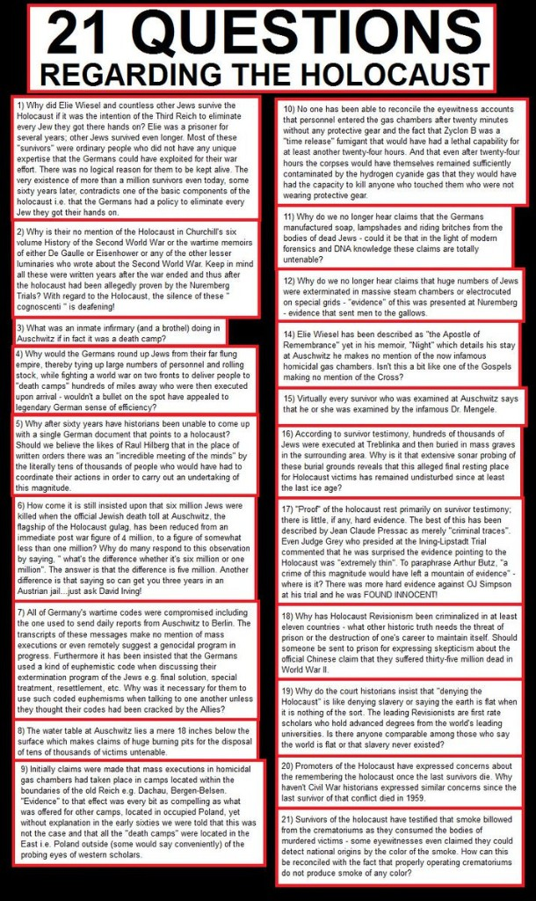

# Investigation: Holodomor, Holocaust — Memory Redaction, Geography of Horror, and the Sacrifice Frame

> **TL;DR:** **Mainstream:** The **Holodomor** (1932–33 Soviet famine) and the **Holocaust** (Nazi genocide of Jews and other groups) are **distinct catastrophes** on overlapping territory; both were **suppressed in Soviet memory politics** and both re-emerged after 1989–91. **Roughly half** of Holocaust victims were killed in **interwar Poland and the occupied USSR** — i.e. **east of Germany** — mostly by **shootings and death camps** operated under **German occupation**, not inside the Reich’s pre-1938 borders. **This investigation** holds a **repo thesis**: Western commemorative machinery **displaced** Holodomor-scale Soviet-era horror from public consciousness and **fixed** a **German-centric, camp-photograph** narrative that **misattributes geography** (horror “in Germany”) and **function** (industrial extermination vs. **late-war logistics collapse** at western camps). **Zionist Congress (1897):** **documented** — Basel Program, Herzl’s diary, **misery as “propelling force”**; **not documented** — any prediction of a **burnt sacrifice** named *Holocaust*. **Protocols of Zion:** **physical text exists**; **proven forgery** (Joly plagiarism; Okhrana lineage). **Allied supply-line bombing** **did** worsen **western camp** conditions in **1945** (Tier **A**); claims that **all** camp deaths were **only** bombing/typhus, or that **liberation photos were staged in cages**, are **weak or debunked** (Tier **C** / rejected). **Sacrifice / re-identification thesis** (Orthodox eastern Jews purged → Zionist **new identity**) is **open speculation** — recorded for investigation, **not** established fact.

**Status:** Open — **2026-06-05** deep pass + **§0.1** geography lexicon + **§2.4–§2.6** + **§9.4** Weizmann + **§22** image register / **§22.2** refusal hypotheses  
**Date:** 2026-06-05  
**Bias (explicit):** This repo **does not deny** that **mass murder of Jews and others occurred** under Nazi rule and collaboration. It **does** challenge **attribution** (where, by whom, under what **prior** catastrophes), **commemorative monopoly**, and **propaganda use** of **decontextualized camp imagery**. See [Paradigm Threat — working definition of antisemitism](/history/chronology/investigations/paradigm-threat-working-definition-antisemitism.md) (anti-**monolithing**; sourced history ≠ collective guilt).

**Related:** [Jewish press on revolutionary Russia](/history/chronology/investigations/jewish-press-revolutionary-russia-verified-quotations.md); [Operation Paperclip & WWII narrative](/governance/war/investigations/operation-paperclip-nazi-continuity-and-wwii-narrative-investigation.md); [WWII Reverse Crusade III](/timeline/evt-world-war-ii-reverse-crusade-iii); [Palestine genocide dossier](/governance/genocide/palestine/a.md); [Zelensky forward-history article](/governance/war/zelensky-forward-history-memory-war.md); [Zelensky open-letter dossier](/governance/war/investigations/zelensky-open-letter-reality-model-investigation.md); [Holodomor to Holocaust — image archive](/governance/genocide/holocaust); [Europe white-bloodline investigation §2c](/history/chronology/investigations/europe-white-bloodline-complexion-whitewash-investigation.md) (explicitly **not** Holocaust denial).

**Asset folder:** [`governance/genocide/holocaust/`](../holocaust/) — `holocaust_lies*.jpg`, `holodomor*.jpg`, `revisionism.pdf`, `jews_declare_war.jpg`, etc.

---

## Guide (read order)

| If you want… | Section |
|--------------|---------|
| Evidence tiers used here | §0 |
| **Geography lexicon** — Reich-west vs Eurasian-west vs camp-photo west | §0.1 |
| Mainstream baseline (both events) | §1 |
| Holodomor — what happened, what was redacted | §2 |
| Author thesis — Ukrainian SSR enclosure (Tier S) | §2.4 |
| Moscow-stated rationales, Dec 1932 primaries | §2.5 |
| Author synthesis — USSR/Russian-centred nationalism | §2.6 |
| Holocaust — mainstream geography & mechanisms | §3 |
| How Holodomor memory lost to Holocaust memory | §4 |
| Repo thesis: misattribution to “Germany” | §5 |
| Western camps, Allied bombing, supply lines | §6 |
| Liberation photography — propaganda vs. “staged cages” | §7 |
| Etymology: *Holocaust* / *Shoah* / *olah* | §8 |
| Zionist Congress — proven vs. myth | §9 |
| *Protocols of the Elders of Zion* — exists, forged | §10 |
| Sacrifice frame & re-identification thesis (speculative) | §11 |
| Mainstream criticisms of official narrative | §12 |
| Revisionist / alternate claims & their debunks | §13 |
| Research log (completed / open) | §14 |
| Holodomor demographic sheet | §17 |
| `revisionism.pdf` in-repo index | §18 |
| Snyder *Bloodlands* bridge | §19 |
| **21 Questions** infographic (revisionist) | §20 |
| Soap / lampshades / Paperclip thesis | §21 |
| **Circulating images** — validation register, **LLM refusals**, refusal hypotheses | §22 |
| Dees **Belsen / Zyklon** denial meme | §23 |
| **Two-camp** denial taxonomy + containment read | §24 |
| Anne Frank **hoax** meme (`holocaust_lies9`) | §25 |
| Auschwitz **amenities = labor camp** (`holocaust_lies2`) | §26 |
| NYT **“6M / holocaust” before WW2** (`holocaust_lies13`) | §27 |
| ICRC **Auschwitz letter** Nov 1944 (`holocaust_lies11`–`12`) | §28 |
| **Paperclip** + **Allied cover** + **rehab camps** + **fake photos** thesis | §29 |
| **Ring of Power** — West **created / preserved** Nazism; **WW3** lane | §30 |
| **East–West atrocity memory competition** — Jasenovac lead; survival demography open pass | §31 |

---

## §0. Evidence tiers

| Tier | Meaning |
|------|---------|
| **A** | Primary or strong scholarly consensus — court findings, archives, demographic studies widely cited |
| **B** | Reputable secondary synthesis or well-sourced journalism |
| **C** | Contested, single-author, or propaganda-adjacent — use with label |
| **S** | Speculation / author hypothesis — **not** cite as fact |

### §0.1 Geography lexicon — do not conflate “west / east”

This file uses **four** incompatible frames. **Mixing them produces false arguments** (including misreading denial memes or LLM refusals).

| Term | Definition | Auschwitz (Oświęcim, ~**19°E**) |
|------|------------|----------------------------------|
| **Reich-west** | Pre-1938 **Germany / Austria** interior | **Outside** Reich — “occupied **Poland**” in standard Holocaust geography (**§3**) |
| **Camp-photo west** | **Western liberation** sites — Belsen, Buchenwald, Dachau, etc. | **Icon** of genocide in Western media, often **mis-exported** as horror “**in Germany**” (**§5**, **§6**) |
| **Eurasian west** | **Western anchor** on the **Holodomor ↔ Holocaust** axis across the Bloodlands (~Berlin ← Poland ← Ukraine/Belarus) | **Western** on this axis — **west** of Holodomor core (**Kyiv ~30°E**), much of **“Holocaust by bullets”**, and deep-Soviet EG zones; still **east** of Berlin |
| **Colloquial “Eastern Europe”** | Cold War / NATO shorthand | **Ambiguous** — often lumps **Poland** with “the East” without longitude discipline |

```
Berlin (~13°E)     Auschwitz (~19°E)     Warsaw/Treblinka belt     Ukraine / Holodomor core (~30°E+)
   Reich-west  →   Eurasian-west anchor  →   occupied Poland east   →   Soviet-east / famine / EG east
```

| When this file says… | It means… | It does **not** mean… |
|----------------------|-----------|------------------------|
| “**East of Germany**” | **Reich-west** frame — killing centers in **occupied Poland / USSR** | Auschwitz is “**far east**” on the Holodomor–Holocaust axis |
| “**Western camps**” | **Camp-photo west** — late-war **Reich-located** liberation imagery | Auschwitz (Poland) |
| “**Eurasian west**” | Bloodlands **western** industrial-extermination anchor | “Western” inside the **Reich** |

**Repo rule:** **§5** commemoration critique, **§28** ICRC meme analysis, and **§22.2** refusal hypotheses all assume this lexicon.

---

## §1. Mainstream baseline

### 1.1 Holodomor (1932–33)

| Point | Tier | Notes |
|-------|------|-------|
| Severe famine across Soviet grain regions, **worst in Ukraine** | **A** | Stalinist collectivization, procurement quotas, travel bans, suppression of relief |
| Death estimates commonly **~3.5–5 million** in Ukraine; **best demographic consensus ≈3.9M excess deaths** (1932–34) | **A**–**B** | [Wolowyna et al., *Canadian Slavonic Papers* 2015](https://journals.library.ualberta.ca/csp/index.php/csp/article/download/21772/18080/0); [UMN CHGS guide](https://cla.umn.edu/chgs/holocaust-genocide-education/resource-guides/holodomor); **10M** diaspora figures criticized ([CIUS 2018](https://www.ualberta.ca/en/canadian-institute-of-ukrainian-studies/news-and-events/news-at-the-cius/2018/march/oleh-wolowyna-measuring-mortality-in-the-holodomor.html)) |
| **Genocide** label | **B** | Recognized as genocide by **many states** (not all); legal scholars debate **intent standard** under UNGC |
| Soviet **denial / minimization** until late 1980s | **A** | Famine taboo; mention punishable; “natural disaster” framing |

### 1.2 Holocaust / Shoah (1941–45, roots earlier)

| Point | Tier | Notes |
|-------|------|-------|
| Nazi-led **systematic murder** of **~6 million Jews**; Roma, disabled, POWs, others also targeted | **A** | Nuremberg documents, Einsatzgruppen reports, camp records, demographics |
| **~3 million** Polish Jews killed (~90% of pre-war community) | **A** | [JVL table](https://www.jewishvirtuallibrary.org/jsource/Holocaust/killedtable.html); [Holocaust in Poland](https://en.wikipedia.org/wiki/The_Holocaust_in_Poland) |
| **≥2 million** Soviet Jews killed; **“Holocaust by bullets”** in occupied USSR | **A** | [Holocaust in the Soviet Union](https://en.wikipedia.org/wiki/The_Holocaust_in_the_Soviet_Union) |
| **Extermination camps** (Auschwitz-Birkenau, Treblinka, Sobibór, Belzec, Chełmno, Majdanek) — **almost all in occupied **Poland**** | **A** | Not on German 1937 territory |
| **Western concentration camps** (Dachau, Buchenwald, Bergen-Belsen, etc.) — **not** primary extermination sites; high mortality **late war** | **A** | Disease, overcrowding, evacuations, logistics collapse |

**Mainstream does not claim** “all horror happened inside Germany.” It locates **maximum killing east** — Poland, Baltic states, Ukraine, Belarus, Russia.

---

## §2. Holodomor — redaction and restoration

### 2.1 What was redacted

Under Stalin and successors, the **1932–33 famine** was **erased from public discourse**: no monuments, no textbooks, **no famine** in official histories. Ukrainians who spoke of it faced **repression**. Walter Duranty’s **NYT** reporting famously **minimized** famine abroad (**B** — debated complicity).

**Article 58 / anti-kulak terror** and **passport restrictions** (urban vs rural) accompanied famine policy — mainstream historians (Davies & Wheatcroft, Applebaum, Snyder) treat the Ukrainian peak as **state-engineered**, not weather-only (**B**).

### 2.2 What returned

**Glasnost** and **1991 independence** reopened Holodomor memory. Ukraine’s state-building (especially **Yushchenko**) promoted **genocide recognition**, **memorial law**, and international campaigns (“Ukraine remembers — the world recognizes”). Scholars note **“competitive atrocity”** and **“Holocaust envy”** — framing Holodomor as **“Ukraine’s Holocaust”** or **“the Holocaust the West forgot”** to win Western comprehension (**B** — [Holodomor in collective memory](https://www.researchgate.net/publication/348736803_The_Holodomor_in_Collective_Memory); Himka, *Kritika* 2013).

### 2.3 Honest complication

Holodomor recognition is **not** pure truth-restoration. It also **served nationalism**, sometimes **obscuring** Ukrainian **participation in the Holocaust** against Jewish neighbors (**B**). Both memories **interact and compete** on the same territory ([Portnov & others — comparison/competition](https://www.academia.edu/59335971/Holodomor_and_the_Holocaust_in_Ukraine_as_Cultural_Memory_Comparison_Competition_Interaction)).

### 2.4 Author thesis — Ukrainian SSR administrative enclosure (Tier **S**)

**Repo extension (not mainstream attribution):** Peak famine policy in **1932–33** ran inside a **Moscow-authored administrative geometry** — not as “Ukraine did it alone,” but as a **sealed republic** where **center directives** met **local cadre enforcement** without **cross-republic relief**.

| Mechanism | Tier | Notes |
|-----------|------|-------|
| **Passport / internal-passport regime** (Jan **1933**) | **A** | Rural–urban split; peasants **blocked from leaving** starving villages — widely cited in Holodomor literature (*Golod v SSSR* collections) |
| **Blacklisted villages / trade bans** (Nov–Dec **1932**) | **A** | Dec **14, 1932** CC/SNK resolution authorizes **suspension of goods** (matches, salt, kerosene) to non-compliant raions — [HREC primary](https://education.holodomor.ca/teaching-materials/primary-documents/resolution-of-cc-aucpb-and-ussr-snk-on-grain-procurements-in-ukraine-the-northern-caucasus-and-the-western-oblast/) |
| **Republic party + GPU cadres** executing Moscow quotas | **A**–**B** | Kosior, Chubar, Postyshev, Balytsky — **co-implementers**, not sole authors |
| **“Bubble” as sole cause** | **Reject** | Enclosure **enabled peak extraction**; **does not** replace **Stalin/Moscow policy** as primary engine (**§2.1**, **§2.5**) |

**Cross-read:** [Zelensky forward-history article](/governance/war/zelensky-forward-history-memory-war.md); [Zelensky open-letter dossier](/governance/war/investigations/zelensky-open-letter-reality-model-investigation.md).

### 2.5 Moscow-stated rationales (1932–33) — primary register

Stalin-era documents **rarely say “famine.”** They argue **plan discipline**, **class war**, and **border-republic security**. Recurring stated reasons:

| Stated reason | Typical document language |
|---------------|----------------------------|
| **Meet all-Union grain plan** | Feed workers, Red Army, exports for industrialization |
| **Kulak / counterrevolutionary sabotage** | Hidden grain, “quiet war,” “Italian strike” |
| **Party demobilization** | Local officials too soft; raions act like a “parliament” |
| **Petliurism / bourgeois nationalism** | **Ukrainian nationalism = enemy**, not goal |
| **Socialist property** | **7 Aug 1932** law — theft of collective grain = counterrevolution |

**Key primaries (Tier A):**

| Date | Document | Stated reason (compressed) | Source |
|------|----------|----------------------------|--------|
| **23 Sep 1932** | CC + SNK telegram | Harvest “satisfactory”; plan already lowered — **refuse all seed loans**; kolkhoz chairs personally responsible | Pyrih doc **#24** — [*Holod 1932–1933 na Ukraini*](https://education.holodomor.ca/wp-content/uploads/2017/09/Pyrih-Holodomor-Book_ENG_June2011.pdf) p.238 |
| **7 Dec 1932** | Stalin circular | **Orikhiv affair** — leaders who filled seed reserves before procurements = **frauds**, **kulak policies** → **5–10 years** | Vasyliev on RGASPI; *Orikhivs'ka sprava* (2010) |
| **10 Dec 1932** | Politburo session | Ukraine leadership **spineless**; **Skrypnyk** “non-Bolshevik Ukrainization” | RGASPI f.17 op.3 spr.910 — Vasyliev |
| **5 Dec 1932** | CP(B)U Politburo | **Troikas** with **execution** power for procurement “saboteurs” — agreed with **Stalin/Molotov** | [Holodomor Museum court dossier](https://holodomormuseum.org.ua/en/resolution-of-the-court/) |
| **14 Dec 1932** | CC AUCP(b) + SNK USSR | **Complete plan by Jan 1933** + crush **Petliurites** + fix **mechanical Ukrainization** + **Russify** Kuban press/schools + **withhold goods** from retrograde raions | [HREC EN](https://education.holodomor.ca/teaching-materials/primary-documents/resolution-of-cc-aucpb-and-ussr-snk-on-grain-procurements-in-ukraine-the-northern-caucasus-and-the-western-oblast/); RGASPI f.17 op.3 spr.911 |
| **15 Dec 1932** | CC + CPC | **Skrypnyk** Ukrainization articles in other republics = **bourgeois nationalist subversion** → **stop Ukrainization** there | RGASPI f.17 op.3 spr.911 ark.42–43 |
| **16 Dec 1932** | Stalin + Molotov to Khataevich | Seed-exchange request = **“corrupt liberal attitude”** while deliveries “drop catastrophically” | RGASPI f.17 op.3 spr.912 ark.44 |
| **19 Dec 1932** | CC + CPC | Send **Kaganovich** + **Postyshev** as **plenipotentiaries** to fulfill **twice-reduced** plan | *Holodomor 1932–1933 v Ukraini* doc collection p.495 |
| **6 May 1933** | Stalin → Sholokhov | Local **“sadism”** wrong — but peasants waging **“quiet war”** to **starve workers and Red Army**; relief ordered for Veshensky | RGASPI f.558 op.11 d.827; *Voprosy istorii* 1994 №3 |

**Historian split (Tier B):** Davies & Wheatcroft (*Years of Hunger*) document **quota cuts and reduced exports** alongside **coercive collection** — dispute **conscious starvation policy** as primary motive. Ellman (*Europe-Asia Studies* 2007) and Applebaum (*Red Famine*) stress **Stalin’s choices materially worsened** mortality. **Repo:** cite **§2.5 primaries** for **what Moscow said**; cite **§2.1** for **mainstream engine**.

### 2.6 Author synthesis — USSR/Russian-centred nationalism (Tier **S**)

**Author read (not established fact):** By **1932–33**, Leninist **class-war extraction** had **re-coded** into **Soviet-imperial / Russocentric nation-building** — **Socialism in One Country**, **border-republic discipline**, **anti-Ukrainian-nationalist purge**. **Ukrainian nationalism** appears in Dec **1932** texts as **Petliurism / sabotage**, **never** as Stalin’s nation-building goal.

**Stacked model:**

1. **Deep layer (Leninist):** requisition logic, kulak category, terror apparatus, one-party state (**B** continuity thesis).  
2. **Peak layer (Stalin 1932–33):** impossible quotas, enclosure, export, GPU intensification (**A**–**B**).  
3. **National layer (Dec 1932 bundle):** **crush Petliurites**, **correct Ukrainization**, **Russify** Kuban administration — **same resolution** as **finish the grain plan** (**A**).  
4. **Cost acceptance (author S):** Peasant death on **Ukrainian SSR soil** was **expendable** relative to **securing a Russocentric Soviet borderland** — **not** “Stalin tried to save Ukraine too late.”

**Supports (Tier B):** Naimark on **national dimension** of Ukrainian famine; Applebaum on **Ukrainian cultural repression** in same window. **Pushback (Tier B):** Davies & Wheatcroft — **catastrophic policy**, disputed **genocide-intent** standard.

**Memory hook:** Soviet **silence** (**§2.1**) + Western **Holocaust template** (**§4**) later **displaced** this **borderland catastrophe** from global moral accounting — rhymes with **2022 year-zero** letter rhetoric ([Zelensky article](/governance/war/zelensky-forward-history-memory-war.md)).

---

## §3. Holocaust — geography the public mis-remembers

### 3.1 Where killing happened (mainstream)

```
Interwar Poland + occupied USSR  →  majority of Jewish victims (shootings + death camps)
Reich / Austria                  →  deportations, camps, but lower share of total deaths
Western Europe                   →  deportation pipelines INTO the East
Western Germany camps (1945)     →  overcrowded holding / labor / evacuated prisoners — NOT the main extermination architecture
```

| Region | Approx. Jewish deaths (order of magnitude) | Mechanism |
|--------|---------------------------------------------|-----------|
| Poland | ~3,000,000 | Ghettos, **death camps**, shootings |
| Soviet lands | ~1,000,000–2,000,000+ | **Einsatzgruppen**, shootings, some camps |
| Hungary (1944) | ~450,000+ | Deportation to Auschwitz |
| Germany/Austria | ~165,000+ | Camps, deportation, starvation |

**Investigative point:** Popular Western imagery (**Belsen, Dachau, “German camps”**) is **geographically skewed** toward **what the Western Allies photographed**, not where **most** Jews were murdered.

### 3.2 Who carried it out (mainstream)

- **German state** — policy, SS, Wehrmacht complicity, bureaucracy  
- **Local collaborators** — Ukraine, Lithuania, Latvia, Poland, Romania, Croatia, etc. (**A**)  
- **Not** “only Germans in Germany” — **occupation regime** across **Eastern Europe**

---

## §4. How Holodomor redaction fed Holocaust memory monopoly

| Mechanism | Effect |
|-----------|--------|
| **Soviet silence on Holodomor** | No parallel **Western** moral reckoning for **1930s** Soviet mass death during Cold War |
| **Cold War framing** | USSR = enemy; **Nazi atrocities** useful; **Stalinist famines** inconvenient |
| **Holocaust institutionalization** (trials, museums, IHRA, education mandates) | Global **template** for “genocide memory” — **high bar** for other events to match |
| **Post-1991 Ukrainian politics** | Holodomor **adopts Holocaust commemorative grammar** to break through (**B**) |
| **Western camp liberation footage** | **Visual anchor** = emaciated bodies **in Germany** — easy to **merge** “camps” with **entire** genocide geography |

**Repo synthesis:** Redaction of **Holodomor** (and wider Soviet terror) **cleared narrative space** for a **single**, **German-branded**, **photograph-driven** catastrophe — even though **demography** places the **center of mass murder** **east of Germany** and **a decade earlier** in the **same borderlands**.

---

## §5. Repo thesis: horror real, German attribution narrowed

> **Geography:** Use **§0.1** before reading this section. Popular “**east of Germany**” talk and **Eurasian-west** (Auschwitz on the Holodomor–Holocaust axis) are **different coordinates**.

### 5.1 What we think is true

1. **Mass murder of Jews** (and others) under Nazi occupation is **documented beyond reasonable dispute** (**A**).  
2. **Most** of that murder occurred in **Poland, the Baltics, Ukraine, Belarus, occupied USSR** — not “inside Germany” as popular maps imply (**A**).  
3. **Holodomor-scale** death **preceded** the Holocaust in **Ukraine** and was **memory-suppressed** (**A**).  
4. Western publics **conflate** “concentration camp photos” with **the whole** genocide (**B** — media studies).

### 5.2 What we think is misattributed or decontextualized

| Misattribution | Correction |
|----------------|------------|
| “**The Holocaust happened in Germany**” | **Killing centers** were overwhelmingly in **occupied Poland**; **shootings** across **Eastern Europe** |
| “**Germans alone**” | **Collaborationist** governments and militias **essential** in the East (**A**) |
| “**Camp photos = extermination proof**” | Western camps **late-war** scenes mix **prior detention**, **evacuation**, **typhus**, **Allied bombing effects** (§6) — **decontextualized** for propaganda (**B**–**C**) |
| “**No earlier Soviet mass death mattered**” | **Holodomor** and **Great Terror** shaped **the same populations and landscapes** — **redacted** from Western moral accounting |
| “**Auschwitz = the whole geography**” | Auschwitz is the **Eurasian-west** anchor (**§0.1**) — **western** on the Holodomor–Holocaust axis, **not** the deep-Soviet east where **famine** and **EG shootings** peak; conflating **one icon** with **all** killing **narrows** both events |

### 5.3 What we do **not** claim

- That **Nazi extermination policy** was fake (**rejected**).  
- That **Auschwitz** was “only a transit camp” (**rejected** — mainstream and revisionist debunks agree on **gassing** at Birkenau).  
- That **Jews** were **not** primary targets (**rejected**).

### 5.4 Holodomor–Holocaust axis (Eurasian frame)

| Site / event | Eurasian position | Commemorative distortion |
|--------------|-------------------|---------------------------|
| **Holodomor** (Ukraine, 1932–33) | **Soviet-east** on axis | **Suppressed** in Soviet / Western Cold War memory (**§4**) |
| **Auschwitz-Birkenau** | **Eurasian-west** anchor (~19°E) | **Over-exposed** as **synecdoche** for entire genocide — while **misplaced** as “German” in camp-photo discourse |
| **Treblinka / Sobibór / Belzec** | **Poland-east** of Auschwitz on same axis | **Under-photographed** vs western liberation sites (**§5.2**) |
| **Babi Yar, Minsk, Baltic shootings** | **Deep east** — EG / occupation USSR | **“Holocaust by bullets”** under-taught vs **one Polish camp brand** |
| **Belsen / Dachau** | **Reich-west** (camp-photo west) | **Late-war logistics** imagery **substituted** for **eastern** extermination mechanism (**§6**) |

**Denial ecology (effect, not repo claim):** Memes that **“clear” Auschwitz** (**§26**, **§28**) attack the **Eurasian-west** anchor — shrinking horror on the **western edge** of the Bloodlands **between** Reich commemoration and Holodomor territory. That is **not** the same move as **§5**’s honest correction (“look **further east** for most killing”), but **bundled** denial (**§24 L1→L2**) often **mimics** geography literacy while **rejecting** demography.

---

## §6. Western camps, Allied bombing, and supply-line collapse

### 6.1 Documented (Tier A–B)

- **Allied strategic bombing** destroyed **German rail, bridges, fuel** by **early 1945** — [Eisenhower AEF Report Ch. 11](http://www.ibiblio.org/hyperwar/USA/SCAEF-Report/AEF-Report-11.html). Weekly **rail wagon availability** fell from **~900,000** to **~214,000** by **Dec 1944** ([Keegan, strategic bombing survey](https://erenow.org/ww/thesecondworldwarkeeganjohn/22.php)).  
- **Death marches** and **evacuations** from eastern camps to **western** camps **overcrowded** Belsen, Buchenwald, Dachau (**A**) — [UK National Archives Belsen lesson](https://www.nationalarchives.gov.uk/education/resources/belsen-concentration-camp/).  
- **Typhus epidemics** at liberation (**A**).  
- Bergen-Belsen commandant **Josef Kramer** reported **Allied aircraft** destroyed **food trains** and **water/electric plant** — in **British** war-crimes materials cited by liberation investigators (**B**); revisionist recycling via [Weber / JHR on Belsen](https://www.historiography-project.com/jhrchives/v15/v15n3p23_Weber.php) (**C** as frame, **B** for Kramer/Johnston quotes if traced to **WO 235/19**).

### 6.2 Auschwitz rail debate vs. systemic collapse (do not conflate)

Jewish leaders **did** ask Allies to bomb **Auschwitz** or **deportation railways** (**1944**, Vrba–Wetzler report window). **McCloy / War Department** refused, citing **diversion from war effort** and **impracticality** of precision rail strikes ([JVL bombing debate](https://jewishvirtuallibrary.org/jsource/Holocaust/bombau.html); [Auschwitz bombing debate](https://en.wikipedia.org/wiki/Auschwitz_bombing_debate)). **Wyman Institute** ([2023](http://new.wymaninstitute.org/2023/05/shattering-another-excuse-for-fdrs-holocaust-apathy/)) documents that **the same period** saw **massive** Allied rail-yard bombing **elsewhere** — so refusal was **policy choice**, not **inability**.

| Layer | Finding |
|-------|---------|
| **Did Allies bomb German railways in 1944–45?** | **Yes** — systematically (**A**) |
| **Did they bomb Auschwitz gas chambers when asked?** | **No** — debated but **not done** (**A**) |
| **Does rail bombing explain Polish death camps?** | **No** — extermination **preceded** final logistics collapse |
| **Does rail bombing explain Belsen spring 1945?** | **Partially** — **one factor** among evacuation + neglect + epidemic (**B**) |

### 6.3 Investigative reframe (repo)

**Thesis:** A **non-trivial share** of **western camp** mortality in **final months** is **attributable to Allied interdiction of logistics** — the same Allies who **filmed** the corpses. That does **not** explain **Treblinka, Sobibór, Babi Yar, Operation Reinhard** — it **does** explain why **Germany-located** imagery shows **starvation** that **naïve viewers** attribute to **a multi-year German starvation policy** rather than **war-end collapse**.

| Claim | Assessment |
|-------|------------|
| Allied bombing **worsened** western camp conditions **1945** | **A**–**B** — widely accepted for **Belsen** final phase |
| **All** camp deaths = **only** bombing / typhus | **Rejected** — ignores **eastern** extermination **infrastructure** |
| Allies **deliberately** bombed supply lines **to create** propaganda images | **C** — **no A-tier order** found; **general** transportation offensive **documented** |
| **Manna/Chowhound** food drops (Netherlands, **Apr–May 1945**) | **A** — shows Allies **could** restore logistics when **policy shifted** |

---

## §7. Liberation photography — propaganda, staging, “cages”

> **Lexicon:** **Real** = corpses / emaciation **actually present**. **Staged** = **composed, framed, or theatrically re-presented** for camera / witnesses — **not** “fake bodies.” This file treats **fabrication** and **staging** as **different** claims (**§7.4**).

### 7.1 What is well documented

- **AFPU** (British Army Film and Photographic Unit) **ordered** to **document** Belsen (**A**) — [IWM](https://www.iwm.org.uk/history/the-liberation-of-bergen-belsen).  
- **Eisenhower** ordered **Congress and press** to **witness** camps so atrocities could not be dismissed as “propaganda” (**A**) — [USHMM Eisenhower cable](https://newspapers.ushmm.org/events/eisenhower-asks-congress-and-press-to-witness-nazi-horrors).  
- **May 21, 1945** — **ceremonial** burning of a **hut** with **Hitler portrait** at Belsen; **Union Jack raised** — **staged political theater** on top of **real** conditions (**B**) — [The Conversation](https://theconversation.com/why-bergen-belsens-1945-liberation-is-ingrained-in-british-memory-39956).

### 7.2 “Survivors rallied into cages for first pictures”

| Source stream | Assessment |
|---------------|------------|
| **Mainstream** | Survivors **already** in **huts, pens, mass graves**; photographers **did not** need to **fake** emaciation — **tens of thousands** near death (**A**). |
| **Revisionist** (Weber, Metapedia, *Did Six Million Really Die?* lineage) | Claims **PSYWAR** **re-staged** scenes; **barbed-wire pens** = **posed** | **C** — **no primary order** located here equivalent to Eisenhower’s **anti-denial** documentation drive |
| **Middle position (repo)** | **Selective framing** (which bodies, which angles, **SS women** carrying corpses) = **propaganda** **without** inventing the **catastrophe** (**B**) |

### 7.3 Primary archive pass (2026-06-05) — **no staging order found**

| Record | Content | Tier |
|--------|---------|------|
| **WO 235/19** (76008) | War Office report: causes of death, **SS shooting after liberation**, **feeding problems** — [UK National Archives Belsen lesson](https://www.nationalarchives.gov.uk/education/resources/belsen-concentration-camp/) | **A** |
| **WO 309/17** | Belsen + Auschwitz ill-treatment dossier, **May–Oct 1945** — [TNA discovery](https://discovery.nationalarchives.gov.uk/details/r/C171730) | **A** |
| **IWM A7** unedited film, **17 Apr 1945** | AFPU footage: women **already** in camp clothes/huts, **washing**, **sleeping among corpses** — not introduced into wire pens for camera — [IWM record 980](https://film.iwmcollections.org.uk/record/980) | **A** |
| **Major Hugh Stewart**, No. 5 AFPU | Appealed to **Eisenhower** to **override** War Office and **film** Belsen; filming **23–24 Apr** — [belsen.co.uk / Stewart papers](https://www.belsen.co.uk/hugh-stewart-no-5-afpu/) | **B** |
| **May 21, 1945 ceremony** | **Staged** hut-burning + **Union Jack** — political theater **after** documentation (**B**) |

**Honest answer:** **Corpses and starving prisoners were real.** AFPU orders were **document**, not **fabricate**. **No** located British file orders **rounding survivors into cages for first pictures**. The **supply-line** thesis remains **separate** from **staging** — both can be **partially true** without **inventing** bodies.

### 7.4 Staging taxonomy (maintainer clarification, **2026-06-05**)

| Level | Meaning | Verdict in this file |
|-------|---------|----------------------|
| **S0 — Editorial** | **Which** bodies, **which** angles, **SS women** carrying corpses, caption **“German normal practice”** | **Agree (limited)** — **B**; Eisenhower **witness tours** **compatible** with this (**§29.4b**) |
| **S1 — Ceremonial** | **May 21** hut-burn, **Union Jack** — political theater **after** first documentation | **Agree** — **B** |
| **S2 — Re-presentation** | Survivors **put back** in **cages/wire** specifically for **first** liberation shots | **Not supported** — **§7.3** negative on **A-tier** order; **IWM A7** shows inmates **already** in huts |
| **S3 — Fabrication** | **Invented** corpses / emaciation | **Reject** — not maintainer claim |

**Repo:** **Real + staged (S0–S1)** can coexist with **Allied logistics** partial blame (**§6**) and **German-attribution** framing (**§29**). **S2** remains **unproven** here; **S3** is **out of scope** for maintainer thesis.

---

## §8. Etymology: *Holocaust*, *Shoah*, sacrifice language

| Term | Origin | Tier |
|------|--------|------|
| **Shoah** (שואה) | Biblical Hebrew — “destruction, catastrophe” — **modern** Hebrew preferred term | **A** |
| **Holocaust** | Greek **holokauston** (“burnt whole”) — Septuagint translation of Hebrew **olah** (עֹלָה), a **burnt offering** | **A** — liturgical; see Gilbert / Finkelstein discussions |
| **Modern English “the Holocaust”** | **Late 1950s–1960s** journalistic/academic adoption; **popularized 1978** NBC miniseries | **B** — [New Republic](https://newrepublic.com/article/121807/when-holocaust-became-holocaust); [Forward 1942 editorial](https://forward.com/news/2793/roots-of-the-holocaust/) |

**Adoption chronology (English):**

| When | Event |
|------|-------|
| **Nov 1942** | *Jewish Frontier* editorial uses **“holocaust”** for Nazi genocide program ([Forward](https://forward.com/news/2793/roots-of-the-holocaust/)) |
| **1950s** | Yad Vashem translates Hebrew **Shoah** as **“Holocaust”** in English docs ([MLO / Calimani](https://modernlanguagesopen.org/articles/10.3828/mlo.v0i0.75)) |
| **1958** | Mauriac preface to Wiesel’s *La Nuit* uses **holocaust** in French publication |
| **1960s** | Wiesel anchors term in US discourse |
| **1978** | NBC **Holocaust** miniseries — mass popularization ([New Republic](https://newrepublic.com/article/121807/when-holocaust-became-holocaust)) |

**Repo note:** The **sacrificial** etymology is **real** in **Greek–Latin–English** religious vocabulary. **Post-hoc** naming (**1978** peak) **cannot** prove **pre-1941 Zionist prediction**. Mainstream historians treat sacrificial echo as **linguistic**, not **ritual proof**. Pre-WWII **NYT “six million”** press usage — distinct referent — **§27**.

---

## §9. Zionist Congress — what is proven vs. myth

### 9.1 First Zionist Congress (Basel, **29–31 Aug 1897**) — **A**

| Fact | Source |
|------|--------|
| **208 delegates**, **17 countries**; founded **World Zionist Organization** | [Zionist Archives](http://www.zionistarchives.org.il/en/datelist/Pages/Congress1.aspx) |
| **Basel Program:** “**secure for the Jewish people a home in Palestine secured by public law**” | **A** |
| Herzl’s diary: “**At Basel I founded the Jewish State** … In **five years** perhaps, and certainly in **fifty years**, everyone will perceive it.” | **A** — same archive |
| **Opposition** from **Ahad Ha’am**, Orthodox, assimilationist press | **A** |

### 9.2 Herzl on “misery” as engine — **A**, often misread

In the **1896** preface to *Der Judenstaat* (book form), Herzl wrote that his scheme uses an **“existent propelling force”** — **“And what is our propelling force? The misery of the Jews.”** ([cited in Litvak/Mattar discussions](https://dokumen.pub/the-arabs-and-the-holocaust-the-arab-israeli-war-of-narratives-1nbsped-0312569203-9780312569204.html))

**Investigative reading:** Herzl **exploits** (in his own words) **existing suffering** as **political energy** for Zionism. That is **not** the same as **predicting** a **future burnt sacrifice** of **six million**.

### 9.3 Myths tied to the Congress

| Myth | Verdict |
|------|---------|
| Congress **secretly adopted** *Protocols of the Elders of Zion* | **False** — **Nilus** later **claimed** Protocols read at Basel; **Butmi** denied Zionist link (**A** — [Jewish Virtual Library](https://jewishvirtuallibrary.org/jsource/anti-semitism/protocols.html)) |
| Congress **predicted the Holocaust** as **olah** / burnt offering | **No primary** — **S** unless new archive surfaces |
| **Weizmann (1937)** predicted **“upcoming Holocaust”**; **only 2M survivors** | **Reject as quoted** — **kernel real**, meme **distorts** (**§9.4**, **§22**) |
| **All Jews** supported Basel | **False** — majority press **skeptical** or hostile (**A**) |
| **Biltmore Program (1942)** demanded **Palestine** opening for refugees — **not** US/other doors | **B** — [Berman](https://dokumen.pub/the-arabs-and-the-holocaust-the-arab-israeli-war-of-narratives-1nbsped-0312569203-9780312569204.html) |

### 9.4 Meme: Weizmann “2 million will survive the upcoming Holocaust” (**2026-06-05**)


**Asset:** [`holocaust_planned.jpg`](../holocaust/holocaust_planned.jpg) — in-repo since Mar 2025; **validated** 2026-06-05 (file **identical** to maintainer-supplied meme).

**Caption on image:**

> At the 1937 World Zionist Congress, Chaim Weizmann said: “Perhaps only 2 million will survive the upcoming Holocaust, but they will be ready for life in Palestine.”

| Element | Meme claim | Verdict | Notes |
|---------|------------|---------|-------|
| **Speaker / year / Zionist context** | Weizmann, 1937, congress | **Agree** | **20th Zionist Congress**, Zurich, **Aug 1937**; speech recounts **Peel Commission** testimony (London, 1936–37) |
| **“Six million” Jews** | Implied | **Agree** | Standard **pre-war** European Jewish population figure — **not** a death toll |
| **~2 million** | Only survivors of catastrophe | **Reject** | **~2 million youth** Weizmann thought Palestine could **absorb** — “divide six million by three” / **emigration capacity**, not **4M dead** |
| **“upcoming Holocaust”** | Named future genocide | **Reject** | **Not in source**; English **“Holocaust”** for Nazi genocide **not** in common use **1937** (**§8**); he used **“tragedy”** and Hebrew **שְׁאֵרִית הַפְּלֵטָה** (*she’erit hapletah* — remnant) |
| **“ready for life in Palestine”** | Post-catastrophe survivors | **Reject** (as stated) | **Paraphrase** of saving **young emigrants** for **yishuv** building — not “survivors ready” |
| **Photo** | Proves quote | **Partial** | Plausible **1930s Zionist congress** scene (Star of David flag); **does not authenticate** caption |

**Closest faithful excerpt** (Tier **B** — via *New Judaea* publication):

> “The hopes of Europe’s six million Jews are centered on emigration. I was asked: ‘Can you bring six million Jews to Palestine?’ I replied, ‘No.’ … From the depths of the tragedy I want to save … **young people** [for Palestine]. The old ones will pass. They will bear their fate or they will not. They are dust, economic and moral dust in a cruel world … **Two millions, and perhaps less**; *Scheerith Hapleta* – only a branch will survive. They had to accept it. The rest they must leave to the future – to their youth.”

**Primary citation:** *Dr Weizmann’s Political Address – 20th Zionist Congress*, *New Judaea* (London), August 1937, **p. 215** — cited in Lenni Brenner, *Zionism in the Age of the Dictators* (1983); [PALCIT dossier](https://palcit.net/article-1303-the-old-ones-will-pass.-they-will-bear-their-fate-or-they-will-not.-they-are-dust).

**Context (1937, pre-war):** Weizmann argued **Palestine could not absorb six million**; **elderly** diaspora Jews were **unlikely to emigrate**; priority = **youth** + **partition state** to raise immigration rates. [DovBear contextualization](http://dovbear.blogspot.com/2010/04/old-ones-will-pass-what-weizman-really.html); Laqueur, *A History of Zionism* — “**two million**, he thought, could be saved if there were a state.”

**Separate, later thread:** **1938** James G. McDonald memoir records Weizmann speaking more explicitly about **mass extermination** and a **“saving remnant”** in Palestine ([Commentary letters on Jabotinsky](https://www.commentary.org/articles/reader-letters/jabotinsky/)) — **do not merge** with the **1937** meme caption.

**Repo verdict:** **Tier B** for harsh **youth-over-elder** emigration realism; **Tier C / reject** for **“upcoming Holocaust”** survivor-prediction framing. Register: **§22**.

---

## §10. *Protocols of the Elders of Zion* — document exists, forgery proven

### 10.1 What is true

- A **physical text** circulated from **1903** (Nilus edition) onward (**A**).  
- **Plagiarized** from Maurice Joly’s **1864** *Dialogue in Hell Between Machiavelli and Montesquieu* — **no Jews** in original (**A**) — [Philip Graves, *The Times*, 1921](https://en.wikipedia.org/wiki/The_Dialogue_in_Hell_Between_Machiavelli_and_Montesquieu); [USHMM](https://encyclopedia.ushmm.org/content/en/article/protocols-of-the-elders-of-zion).  
- **Okhrana** (Tsarist secret police) **fabrication** widely accepted (**A** — Norman Cohn, *Warrant for Genocide*; CIA Helms **1961** statement).  
- **Henry Ford**, **Nazis**, **Hamas charter** lineage — **recycled** despite debunk (**A**).

### 10.2 What is **not** provable

| Claim | Verdict |
|-------|---------|
| Protocols are **authentic minutes** of a **real** Jewish council | **Rejected** (**A**) |
| Protocols **prove** Zionist Congress **orchestrated** later wars | **Rejected** — **non sequitur** even if forgery were ignored |
| “**Can’t be proven** because it’s labeled forgery” | **Wrong epistemics** — **forgery proven** by **textual comparison**, not by label alone |

**Repo use:** Treat Protocols as **Okhrana–Black Hundreds** **weapon** — **evidence of antisemitic state propaganda**, **not** evidence of **Jewish** conspiracy. **Separate** from **documented** Zionist **diplomatic** history (Basel, Balfour, Biltmore).

---

## §11. Sacrifice frame & re-identification thesis (**S** — author hypothesis)

> **Status: SPECULATIVE.** Recorded because it motivates this investigation in Paradigm Threat cosmology; **no Tier A** chain demonstrated.

### 11.1 Hypothesis (as stated by maintainer)

1. **Eastern** Jewish and **eastern Christian** communities (often **Russian-imperial**, **Orthodox-adjacent**, **non-Zionist**) bore **disproportionate** loss in **1930s–40s** catastrophes (**Holodomor**, **shootings**, **deportations**).  
2. **Western commemoration** **compressed** these into a **German camp** narrative serving **Cold War** and **Israel-state** memory politics.  
3. **“Holocaust”** (burnt offering) language **coincides** with a **Zionist** project that **required** **diaspora “refusal”** to end — Herzl’s **“misery”** engine (**A** quote, **S** theology).  
4. **Survivors** **re-papered** as **“Jews”** bound for **Palestine** — **purged** of **prior** **Bundist / Communist / Orthodox / assimilationist** identities — **factional split** of **one monotheist tree** (**S**).  
5. **Western camp victims** include **prisoners of all categories** — political, POW, Jewish, Roma — **visually** **merged** in **atrocity film** (**B** propaganda effect).

### 11.2 DP camps — what archives show (partial upgrade to **B**)

**250,000+** Jewish DPs in **Germany/Austria/Italy** camps **1945–52** under **UNRRA** / military administration ([USHMM DP article](https://encyclopedia.ushmm.org/content/en/article/displaced-persons)). Political competition was **real**, not monolithic Zionism:

| Actor | Position | Source |
|-------|----------|--------|
| **Zionist parties** | **Aliyah** to Palestine; **Biltmore 1942** Palestine-first; **Ben-Gurion** camp visits; **1947** Landsberg demonstrations for partition plan | [Yad Vashem DP Zionism](https://www.yadvashem.org/exhibitions/dp-camps/zionism.html); [USHMM](https://encyclopedia.ushmm.org/content/en/article/displaced-persons) |
| **Bund** (Jewish Labor Bund) | **Anti-Zionist**; **Yiddish** diaspora politics; **marginalized** in camps; paper *Unser Shtime* | [CJH Bund blog](https://blog.cjh.org/index.php/2013/08/12/international-jewish-labor-bund/); [Yosef Grodzinsky, *In the Shadow of the Holocaust*](https://www.goodreads.com/book/show/2267267.In_the_Shadow_of_the_Holocaust) |
| **Compulsory Haganah draft 1947–48** | Zionist envoys used **pressure**, **intimidation**, **violence** against **Bundist** rivals per Grodzinsky (**B** — disputed by Zionist historians; **not** Tier A) |

**Assessment:** **Factional struggle** over **survivor identity** is **documented** (**B**). **Systematic** re-tagging of **Orthodox eastern** communities as **Zionist “Jews”** for **sacrificial** narrative remains **S** — needs **DP registration forms** + **repatriation vs aliyah** ledgers.

### 11.3 What would still upgrade sacrifice thesis from **S** to **B**

- **Archival** **resettlement** records showing **systematic identity** **reclassification** **1945–48** beyond known **DP camp** politics.  
- **Primary** **Zionist** **pre-1941** text using **olah** / **holocaust** for **planned** mass death (**none located** in this pass).  
- **Demographic** proof that **eastern Orthodox** “Jewish” communities were **misclassified** in **postwar** **census** **at scale**.

### 11.4 What mainstream would say

- **Zionism** **reacted to** catastrophe; **scholars dispute** how much it **shaped** **British** **policy** — **not** that **Zionists planned** Nazi genocide.  
- **Jewish identity** **survivors** **self-organized** in **DP camps**; **not** a **single** **rabbinical** **re-tagging** (**B**).  
- **Holodomor** and **Holocaust** **overlap** in **Ukraine** but **different** **perpetrators, mechanisms, targets** — **conflation** risks **double genocide** abuse (**B** — Himka, Portnov).

---

## §12. Mainstream criticisms of the “official narrative” (internal to scholarship)

| Criticism | Who / what | Tier |
|-----------|------------|------|
| **Universalization** of Holocaust **marginalizes** other genocides (Armenia, Holodomor, colonial) | Comparative genocide studies | **B** |
| **Israeli state** **weaponizes** Holocaust memory for **policy** | Finkelstein, *The Holocaust Industry* (contested) | **C**–**B** |
| **Double genocide** laws in Eastern Europe **obscure** local **Holocaust** **collaboration** | Historians (Grabowski, Gross debates) | **B** |
| **Soviet** **under-counted** **Jewish** **specificity** in **Great Patriotic War** memory | Snyder, *Bloodlands* | **B** |
| **Western trial** focus **Nuremberg** — **less** on **eastern** shootings | Browning, Hilberg archives | **A**–**B** |
| **Camp-centric** education **skips** **Holocaust by bullets** | IHRA education reforms (attempting fix) | **B** |

---

## §13. Revisionist / alternate claims and their debunks

| Claim | Revisionist source | Mainstream debunk | Repo verdict |
|-------|-------------------|-------------------|--------------|
| **No gas chambers** | Leuchter, Rudolf, *Did Six Million Really Die?* | Forensics, Auschwitz archives, **Jean-Claude Pressac**, **van Pelt** | **Reject** |
| **Six million** figure **invented** | Weber, Berg | **Nuremberg**, **demography**, **partial records** | **Reject** as **total** invention; **± margin** on **exact** total is **legitimate** |
| **Anne Frank diary** forged | *Frankenstein* essay in repo; **ballpoint** meme (**§25**) | **NIOD 1986**, **Netherlands Forensic Institute**, **2018** imaging | **Reject** — **L1** kernels: **post-war** edits, **copyright** dispute (**§25**) |
| **Western camp** deaths = **only** **Allied** fault | Weber on Belsen | **Ignores** **years** of **detention**; **ignores** **East** | **Partial** — **logistics** **share** **blame** **late 1945** only |
| **Holodomor** = **only** **natural** drought | Soviet historiography | **Davies**, **Applebaum**, **Werth** | **Reject** |
| **Protocols** authentic | Ford, Nilus | **Graves 1921**, **Cohn**, **Bernstein 1921** | **Reject** |

**Repo position on revisionism:** **Reject** **denialism**. **Accept** **documented** **logistics** **complications** at **western** **liberation** **sites**. **Insist** on **geographic** **re-centering** **east**. **Taxonomy:** **§24**.

---

## §24. Two-camp denial taxonomy — and the containment read

> **Maintainer frame (2026-06-05):** **Camp 1** denies **individual facts** but **refrains** from **unprovable** total claims. **Camp 2** **goes too far**, **loses** the audience, and may function as **controlled opposition** to **contain** Camp 1.

**Reader essay:** [Zelensky forward-history memory war](/governance/war/zelensky-forward-history-memory-war.md) — two-camp containment, **western camp-photo** memory crop, denial-law **poison-the-well** (prose; links here for tiers).

### 24.1 Does the split make sense?

**Yes — as a rhetorical ecology model**, with one important correction: add a **zeroth lane** that is **not denial at all**.

| Lane | Label | What it does | Repo map |
|------|-------|--------------|----------|
| **0** | **Mainstream-internal critique** | Challenges **memory politics**, **geographic education**, **trial overreach**, **comparative genocide** marginalization — **without** denying **systematic murder** | **§12** — Snyder, Browning, Finkelstein (*Industry*), Himka |
| **1** | **Disciplined revisionism** (maintainer **Camp 1**) | Attacks **specific** weak points: **western camp** mislabels, **Allied logistics** at Belsen, **Nuremberg** exhibit errors, **plaque** math, **translation** politics, **speech-law** chilling effect — stays near **documentable** edges | **§6**, **§7**, **§20** partials (**#6, 9, 11–12, 14, 18**), Weber **Belsen** thread (**§13**) |
| **2** | **Spectacular denial** (maintainer **Camp 2**) | **Total** negation packaged with **memes**, **Zyklon=lice only**, **Zionist invention**, **Protocols** bait, **“truth fears investigation”** — **antisemitic** tone common | **§23** (Dees), **§18** (`revisionism.pdf`), **§13** reject rows, **§20** reject majority |

**Camp 1 is real and persistent** because **some** official-story edges **are** wrong or **overstated** (western camp ≠ Auschwitz; industrial soap debunked; Belsen typhus). A **careful** reader can stay in Camp 1 **without** asserting **unprovable** cosmic claims.

**Camp 2 is real** because **total denial** is a **market**: simple moral absolution, **Israel** as **sole** explanatory variable, **shareable** graphics.

### 24.2 The containment hypothesis — what holds, what doesn’t

| Claim | Assessment | Tier |
|-------|------------|------|
| Camp 2 **discredits** Camp 1 **by association** in public debate | **Structurally true** — institutions and media **bundle** “questions about Belsen logistics” with “gas chambers never existed” | **B** |
| **IHRA**, **museums**, **denial statutes** **benefit** from Camp 2 visibility (define the enemy as **Dees**, not **Pressac-grade** geography critique) | **Plausible** — **memory monopoly** defends against **caricature** more easily than against **surgical** errors | **B**–**C** |
| Camp 2 is **deliberately deployed** as **controlled opposition** to **neutralize** Camp 1 | **Possible** — fits **general** [false-flag / good-actor](/events/false_flag/investigations/good-actor-theory-interagency-antibody-investigation.md) **controlled-opposition** vocabulary — but **no A-tier** dossier yet of **state-run** “**fund Dees to poison the well**” for Holocaust discourse | **S** until archives |
| Camp 2 operators are **conscious agents** of that containment | **Usually unproven** — many are **sincere** cranks; **emergent** selection (algorithmic outrage, **guilt-by-association**) explains much **without** a handler | **S** / **C** |
| Camp 1 **never** slides into Camp 2 | **False** — **Irving** had **archival skill** then **total denial**; **Weber** recycles **documentable** Belsen material beside **hard** negation | **B** |

**Honest synthesis:** The **taxonomy** is **useful**. The **containment** read is **strong as ecology** (“**poison the well**”): Camp 2 makes Camp 1 **unspeakable** in polite institutions **even when** Camp 1 points at **real** decontextualization (**§5**, **§23** partials). Treat **intentional** Camp-2-as-trap as **hypothesis** (**S**), not **established** operation.

### 24.3 Mechanism (how containment works without a handler)

```
Camp 1 raises documentable edge (Belsen typhus, western mislabel, plaque)
        ↓
Camp 2 meme bundles same image + "NO HOLOCAUST / ZIONIST LIE"
        ↓
Institution responds to Camp 2 (denial law, ADL, platform ban)
        ↓
Camp 1 argument becomes socially untouchable by contamination
```

**Repo already lives in the danger zone:** **§5–§6** accept **western logistics** and **photo geography** critiques (**Camp 1** territory) while **rejecting** **eastern extermination** denial (**Camp 2**). **Discipline** = **tier tags**, **§22** image validation, **never** merge **Belsen** into **“no Treblinka.”**

### 24.4 Examples mapped

| Actor / asset | Lane | Why |
|---------------|------|-----|
| **Gray / van Pelt** judgment extracts | **0** | **Cumulative** Auschwitz evidence; notes **document categories** can be **challenged** without total denial |
| **Weber** on **Belsen** supply lines | **1** | **Archival** quotes; **partial** per **§6** — but same author ecosystem sells **full** denial |
| **21 Questions** flyer (**§20**) | **1→2** **gradient** | **#9, 11** = Camp 1 kernels; **#5, 8, 16** = Camp 2 |
| **Dees** `holocaust_truth2` (**§23**) | **2** | **Total** negation + **Zyklon** monolith + **Zionist** invention |
| **Anne Frank** `holocaust_lies9` (**§25**) | **2** | **Ballpoint** misread + **handwriting** bait; **L1** kernel = **Otto edit** / **copyright** |
| **Auschwitz amenities** `holocaust_lies2` (**§26**) | **1→2** | Real **Auschwitz I** perks; **false** “no death camp” |
| **NYT 6M** `holocaust_lies13` (**§27**) | **1→2** | **Real** pre-war clippings; **false** “invented Holocaust” |
| **ICRC Auschwitz** `holocaust_lies11`–`12` (**§28**) | **1→2** | **Real** Nov 1944 letter; **false** “Red Cross cleared” |
| **Elsis** `revisionism.pdf` | **2** | Polemical **50-section** denial compilation |
| **This investigation** | **0–1** boundary | **Affirms** mass murder (**§5.3**); **attacks** **misattribution** and **memory monopoly** — **not** Camp 2 |

### 24.5 Operational rule for future image reviews (**§22**)

When validating memes, tag each asset:

- **`L0`** — mainstream critique  
- **`L1`** — disciplined revisionism (cite **tier**; separate **kernel** from **conclusion**)  
- **`L2`** — spectacular denial  

If **`L1`** claims appear inside **`L2`** packaging, note **“bundled for contamination”** — supports containment ecology **without** proving a **handler**.

**Status:** Taxonomy **adopted**; controlled-opposition **containment** recorded as **S** (ecology **B**).

---

## §14. Research log — completed vs. remaining

| # | Task | Status | Result |
|---|------|--------|--------|
| 1 | Belsen photography / staging orders | **Done (negative)** | **WO 235/19**, **WO 309/17**, **IWM A7** — document real conditions; **no** cage-staging order (**§7.3**) |
| 2 | Rail bombing vs camps | **Done (nuanced)** | **Systemic** rail war **A**; **Auschwitz-specific** refusal **A**; **no** “bomb Belsen food trains for photos” order (**§6.2**) |
| 3 | Holodomor demographics | **Done** | **3.9M** excess deaths Ukraine 1932–34; **4.5M** total demo loss w/ lost births — **§17** |
| 4 | Zionist **olah** corpus pre-1941 | **Open** | Herzl **misery** quote only; **no** sacrifice prediction found |
| 5 | DP identity politics | **Partial** | Bund vs Zionist **B**; sacrifice re-tagging still **S** (**§11.2**) |
| 6 | `revisionism.pdf` index | **Done** | **§18** — categorized; **not** line-by-line debunk of all 50 |
| 7 | Timeline Bloodlands stub | **Done** | [Bloodlands continuum appendix](/timeline/evt-bloodlands-holodomor-holocaust-continuum) |
| 8 | **21 Questions** infographic | **Done** | **§20** — per-question verdicts; image archived as `holocaust_21_questions.png` |
| 9 | **Weizmann 1937** meme (`holocaust_planned.jpg`) | **Done** | **§9.4** — reject **“upcoming Holocaust”** caption; kernel **B** |
| 10 | Image validation register | **Done** | **§22** — workflow + table; extend per new photos |
| 11 | **§2.4–§2.6** enclosure + Dec 1932 primaries + author USSR nationalism | **Done** | Cross-link [Zelensky article](/governance/war/zelensky-forward-history-memory-war.md) |
| 12 | Dees **holocaust_truth2** meme | **Done** | **§23** — deny overall; partial Belsen/Allied threads |
| 13 | Two-camp denial taxonomy | **Done** | **§24** — L0/L1/L2; containment **S**, ecology **B** |
| 14 | Anne Frank **holocaust_lies9** meme | **Done** | **§25** — reject forgery; L1 editorial kernel |
| 15 | Auschwitz **holocaust_lies2** amenities meme | **Done** | **§26** — reject death-camp denial; L1 infrastructure kernel |
| 16 | NYT **holocaust_lies13** 6M/holocaust clippings | **Done** | **§27** — reject planted narrative; L1 press kernel |
| 17 | ICRC **holocaust_lies11**–**12** letter | **Done** | **§28** — reject clearance meme; partial late-1944 pause |
| 18 | **Paperclip** + **fake photos** + **rehab camps** thesis | **Done** | **§29** — partial Allied logistics + German defence cites; **reject** photo fraud |
| 19 | **Ring of Power** — West created/preserved Nazism, WW3 | **Done** | **§30** — Merz **A**; Azov **B**; Ring **S** |
| 20 | **East–West memory competition** + **Jewish survival by territory** + **Jasenovac** + **MK Serb/Slav/Jew** + **V for Vendetta PP** | **Open** | **§31** — lead exemplar Jasenovac; survival register; MK quotes **A**; V×Jasenovac link **S** |

---

## §17. Holodomor demographic consensus sheet

| Metric | Figure | Source |
|--------|--------|--------|
| **Excess deaths (Ukraine SSR, 1932–34)** | **~3.9 million** | Wolowyna, Levchuk, et al. [*Canadian Slavonic Papers* 57:4 (2015)](https://journals.library.ualberta.ca/csp/index.php/csp/article/download/21772/18080/0) |
| **Lost births (same window)** | **~0.6 million** | same |
| **Total demographic loss** | **~4.5 million** | same |
| **Peak daily deaths (Ukraine, mid-1933)** | **~28,000/day** (order of magnitude) | [UMN CHGS](https://cla.umn.edu/chgs/holocaust-genocide-education/resource-guides/holodomor) citing Wolowyna team |
| **Rural excess death rate (1933)** | **~16.5%** of 1933 rural population | Wolowyna 2015 table |
| **All-Union famine deaths (1932–34)** | **~8.7 million** (framework paper) | [Demographic Framework SSR](https://www.academia.edu/119102243/A_Demographic_Framework_for_the_1932_1934_Famine_in_the_Soviet_Union) |
| **Scholarly range (Ukraine)** | **2.6–5.0 million** | [CIUS Wolowyna talk 2018](https://www.ualberta.ca/en/canadian-institute-of-ukrainian-studies/news-and-events/news-at-the-cius/2018/march/oleh-wolowyna-measuring-mortality-in-the-holodomor.html) |
| **Inflated political claims** | **7–10 million** | Rejected by demographers; **Serhiychuk**-style addition criticized |

**Holocaust scale (same borderlands, different event):** Snyder’s [*Bloodlands*](https://en.wikipedia.org/wiki/Bloodlands) estimates **~14 million** non-combat killings **1933–1945** in **Poland/Ukraine/Belarus/Baltics** under **Hitler + Stalin** policies combined — **not** interchangeable totals.

---

## §18. In-repo `revisionism.pdf` (Mark R. Elsis) — index & repo use

**File:** [`governance/genocide/holocaust/revisionism.pdf`](../holocaust/revisionism.pdf) — polemical **denialist** compilation (“**50 Sections Of Evidence**”), **not** Tier A.

| Block | Contents | Repo treatment |
|-------|----------|----------------|
| **Preamble** | Anti-Jewish invective; Hitler quotes; “third rail” framing | **Reject** as history; **archive** as **sample** of denialist **rhetoric** |
| **Holodomor links** | Ukrainian famine as **“Holocaust of 1933”** | **Useful** only as example of **competitive atrocity** framing (**§4**) — **not** Elsis’s demographics |
| **Protocols section** | Links to full text, “explained” sites | **Cross-read** **§10** — document **exists**, **forged** |
| **§1–50 denial claims** | Six million, Auschwitz plaques, gas chambers, free-speech prosecutions, Zyklon, Anne Frank, etc. | **Default reject** per **§13**; **exception:** **western camp logistics** / **legal suppression** threads deserve **separate** Tier review |
| **Notable numbered items (sample)** | (1) Holocaust denial laws in **17 countries**; (4) Auschwitz memorial **4M→1.5M** plaque change; gas-chamber forensic disputes | Laws = **A** (statute lists verifiable); plaque = **A** (memorial **revised** — **does not** deny **~1.1M+** Auschwitz victims); forensics = **debunked** in courts |

**Do not** cite Elsis for **demographics** or **gas-chamber** claims. **Do** cite him when documenting **what denial literature** bundles together (Holodomor + Protocols + legal martyrdom).

---

## §19. Bloodlands frame (Snyder) — investigative bridge

Timothy Snyder, [*Bloodlands: Europe Between Hitler and Stalin*](https://archive.org/details/bloodlandseurope0000snyd_e5a3) (2010), argues **Poland/Ukraine/Belarus/Baltics** suffered **~14 million** deliberate non-combat killings **1933–1945** under **both** regimes — opening **memory** space where **Holodomor** and **Holocaust** are **same geography**, **different perpetrators** ([H-Diplo roundtable](https://issforum.org/roundtables/PDF/Roundtable-XIII-2.pdf)). Critics (Cairn 2017) warn against **over-boxing** violence into one strip map.

**Repo use:** Snyder **supports** our **eastern-centering** without accepting **sacrifice** theology. See timeline appendix: [Bloodlands continuum](/timeline/evt-bloodlands-holodomor-holocaust-continuum).

---

## §20. “21 Questions Regarding the Holocaust” — line-by-line assessment



**Source image:** in-repo [`holocaust_21_questions.png`](../holocaust/holocaust_21_questions.png) (matches circulating `holocaust_lies` graphic family). **Register:** **§22**. **Method:** each item gets **verdict**, **honest answer**, and **tier**. **Verdict key:** **Reject** = inference fails; **Partial** = contains a grain of truth but not the conclusion; **Agree (limited)** = factual premise only, not denial.

| # | Question (summarized) | Verdict | Honest answer |
|---|----------------------|---------|---------------|
| **1** | Elie Wiesel & **~1M survivors** — if total elimination, why survive? | **Reject** | Nazi policy = **annihilation of European Jewry**, not a magic spell that kills **every** captive instantly. **Selection** preserved **labor**, **skills**, **youth**, **Sonderkommando** workers, **evacuees**. **~6M dead** and **hundreds of thousands to ~1M+ survivors** are **compatible** with genocide scholarship (**A**). Survivors **do not** disprove extermination. |
| **2** | No **Holocaust** in Churchill / de Gaulle / Eisenhower memoirs | **Reject** (as denial) | The **word** *Holocaust* was **not standard** until **1960s–1978** (**§8**). **Churchill** wrote of **“German execution camps”** and **six or seven millions** murdered ([*Triumph and Tragedy*](https://www.fadedpage.com/books/20190527/html.php)); **July 1944** letters on **Hungarian Jews** ([PolitiFact](https://www.politifact.com/factchecks/2023/feb/23/instagram-posts/winston-churchills-world-war-ii-memoirs-arent-evid/)). **Eisenhower** ordered **press/congressional** witness tours (**§7**). **Omission of modern label ≠ omission of mass murder.** |
| **3** | **Infirmary** and **brothel** at Auschwitz — why if pure death camp? | **Partial** | Auschwitz-Birkenau was a **complex**: **selection**, **slave labor**, **medical experiments**, **registered prisoners**, **Sonderbauten** (including a **camp brothel** for **privileged** inmates — documented **B**). **Extermination** operated **alongside** exploitation until victims were **“unfit.”** Brothel ≠ “nice camp”; it was **control architecture**. |
| **4** | Why **transport** Jews hundreds of miles instead of **shooting on spot**? | **Reject** | **East:** millions **were** shot (**Holocaust by bullets** — **A**). **Camps:** **concealment**, **industrial throughput**, **property theft**, **labor extraction before death**, **bureaucratic cover** (“resettlement”). Inefficient for **victims**; **effective** for **regime** goals per **Hilberg / Browning** (**B**). |
| **5** | **No single German document** orders **the Holocaust** | **Reject** | No **one line** saying “kill all Jews now” to **every** office — but **many** orders and **speeches**: [**Wannsee Protocol**](https://avalon.law.yale.edu/imt/wannsee.asp) (**Jan 1942**); **Göring–Heydrich** **July 1941** mandate; [**Himmler Posen speeches**](https://en.wikipedia.org/wiki/Posen_speeches) (**Oct 1943**) — **extermination** stated; **Einsatzgruppen** situation reports; **gas-van** documents; **Höss** / **Pohl** correspondence (**A**). **Intentionalism** debate ≠ **no documents**. |
| **6** | **Six million** vs **Auschwitz plaque 4M → ~1.1M**; Irving imprisoned | **Partial** | **Plaque change = A** (Soviet **inflated** **total deaths at Auschwitz** by counting **non-Jews** and **rough totals**). **Global ~6M** comes from **demography + multiple sites**, **not** that plaque ([USHMM](https://encyclopedia.ushmm.org/)). **Irving** jailed for **denial speech** (Austria), not for **math on a sign**. |
| **7** | **Decoded Auschwitz telegrams** show **no mass executions**; **euphemism** theory weak | **Partial** | **Routine** camp admin traffic **would not** broadcast gassing. **Separate** streams: **Einsatzgruppen** reports (**explicit**), **Vrba–Wetzler**, **construction** docs for **Krema II/III**, **Himmler**. **Enigma** coverage was **not omniscient**. Euphemism (**“Sonderbehandlung”**) is **documented** (**A**–**B**). |
| **8** | **Water table 18 inches** — burning pits **impossible** at Auschwitz | **Reject** | **Leuchter** thesis **refuted** at [**Irving trial**](https://www.hdot.org/judge/) (van Pelt). **Crematoria** used **furnaces**, not **shallow pits**, for **bulk** disposal; **open pits** used **elsewhere** in **1944** (e.g. **Hungarian** wave). **Hydrology** argument is **technical denialism** (**C**). |
| **9** | **Dachau / Belsen** gas-chamber claims **retracted**; only **Poland** camps “count” now | **Partial** | **Belsen** — **no** homicidal gas chamber (**A**). **Dachau** — **small chamber** **built**, **barely used**; **postwar** signage **overstated** (**B**). **Correction** of **western** errors **does not** erase **Auschwitz, Treblinka, Sobibór, Belzec, Chełmno** (**A**). Supports **§5** geographic re-centering — **not** “no extermination.” |
| **10** | **Zyklon B** “time release” — workers enter in **20 min** without **masks**? | **Reject** | **Sonderkommando** used **masks**, **ventilation**, **hours** before **body work**; procedure in **Pressac** / **van Pelt** (**B**). **20-minute** entry is **strawman**. [**Auschwitz Museum lesson**](https://lekcja.auschwitz.org/en_1/sco_27.html) on **openings** and **disinfestation vs homicidal** use. |
| **11** | **Soap / lampshades** from human remains — **dropped** | **Agree (limited)** | **Industrial soap** debunked (**A**); **Buchenwald lampshades** **re-confirmed human skin 2023** (**§21**). **Danzig Spanner** = small-scale corpse soap (**B**). Narrative **pruned** after **Nuremberg overreach** + **1992 bad test** — **not** chiefly **Paperclip** trace-back. **Does not** disprove **gassing/shooting**. |
| **12** | **Steam chambers / electrocution** at Nuremberg — **no longer claimed** | **Agree (limited)** | Some **early** Soviet / witness **errors** at **Nuremberg** (**B**). **Core** evidence (**gas vans**, **Krema**, **Einsatzgruppen**, **Himmler**) **unchanged**. |
| **14** | **Wiesel *Night*** — **no homicidal gas chambers** mentioned | **Partial** | **French original** emphasizes **crematoria**, **flames**, **pits**, **selection** — not the **phrase** “gas chambers” ([text](https://esl-bits.eu/Novellas.for.ESL.Students/Night/03/text.html)). **German translation** **substituted** “gas chamber” in places ([revisionist critique](https://holocaustencyclopedia.com/witness/victim/wiesel-elie/923/) — **C** source, **B** on translation point). **Substance** = **Birkenau extermination**, not **“no gassing.”** |
| **15** | **Every** survivor claims **personal Mengele** exam | **Reject** | **Mengele** **icon** at **Auschwitz selections** (**A** for his role); **memoir inflation** and **conflation** common (**B**). **Not** a **disproof** of **selection** or **murder**. |
| **16** | **Treblinka sonar** — ground **undisturbed since Ice Age** | **Reject** | [**Caroline Sturdy Colls**](https://www.staffs.ac.uk/research/projects/finding-treblinka-project) (**GPR / LiDAR**, **2010+**) found **burial disturbances**, **gas-chamber** foundations, **tiles** ([JTA 2012](https://www.jta.org/2012/02/06/global/new-technology-points-to-missing-holocaust-era-mass-graves-at-treblinka)). **Ice-age** claim is **false** (**A** vs **C**). |
| **17** | **Pressac / Gray / Butz** — only **survivor testimony**, weak hard evidence | **Partial** | **Misattribution:** **Pressac** and **Butz** were **not** Irving-trial experts; **van Pelt** + **Evans** were ([hdot.org](https://www.hdot.org/trial-materials/)). **Gray** held **cumulative documentary** evidence for **Auschwitz gassing** **considerable** ([judgment extracts](https://fpp.co.uk/documents/extracts-from-judgment-by-the-hon-mr-justice-gray-april-11-2000/)) while noting **individual** doc categories **vulnerable**. **Archaeology + SS docs + demographics** ≠ **testimony only**. |
| **18** | **Holocaust revisionism** criminalized in **11+ countries** — needs **prison** to survive? | **Agree (limited)** | **Statutes exist** (**A** — [Wikipedia list](https://en.wikipedia.org/wiki/Laws_against_Holocaust_denial); Elsis cites **~17**). **Epistemic point:** **legal suppression ≠ false**; also **does not** prove **true**. Repo notes **chilling effect** on **sourced history** ([antisemitism definition §8](/history/chronology/investigations/paradigm-threat-working-definition-antisemitism.md)). |
| **19** | Compared to **flat earth**; revisionists are **educated scholars** | **Partial** | **Ad hominem** vs **ad credentialum** both **weak**. **Irving** had **archival skills** but judge ruled **deliberate distortion** (**A**). **Credentials ≠ correctness.** |
| **20** | **Civil War** last survivor **1959** — no **memory panic** like Holocaust | **Partial** | **Different** event type: **national** civil war vs **transnational genocide** template + **Israel** + **IHRA** (**B**). **Institutional** Holocaust memory **by design** intensified after **1978** TV (**§8**). Analogy **illustrates** politics of memory, **not** fraud. |
| **21** | **Colored smoke** from crematoria — **proper** crematoria **smokeless**? | **Partial** | **Muffle** crematoria **reduce** visible smoke; **open-air pits** (Wiesel’s **flames**) **do** smoke. Survivors **merge** **pit**, **Krema**, and **night sky** imagery (**B**). **Visual** inconsistency **≠** **no killing**. |

**Graphic note:** numbering **skips 13** on the flyer — common in circulated versions; **not** investigated here.

**Repo synthesis:** Questions **9, 11, 12, 14, 18** contain **kernels** useful for **critical historiography** (western camp confusion, Nuremberg overreach, translation politics, speech law). Questions **5, 8, 16** are **flatly wrong** given current archives. **None** overturn **eastern extermination geography** (**§3**).

---

## §21. Soap, lampshades, Paperclip — maintainer thesis assessed

> **Maintainer guess (2026-06-05):** Soap/lampshades stories are **fully true** but were **abandoned** in public narrative because tracing perpetrators would expose **WWII causers** who **remained in power** via **Paperclip** and **US intervention**.

### 21.1 Verdict in one line

**Partially right on impunity politics; wrong on “100% true” and wrong on the specific Paperclip trace-back.** What got **quieted** was mostly **overstated industrial soap** and **legally unproven Ilse Koch specifics** — while **Buchenwald human-skin objects** were **re-affirmed in 2023**, and **small-scale Danzig corpse-soap** is **accepted** by Polish/IPN research. **Paperclip** shielded **rocketry, biowar, and intelligence** cadres — **not** the Buchenwald pathology shop.

### 21.2 Lampshades — more true than the “myth” label suggested

| Claim | Evidence | Tier |
|-------|----------|------|
| SS at **Buchenwald** tanned **tattooed prisoner skin** into **lampshades, knife cases**, trophies | Pathology dept under **Hans Müller**, **Erich Wagner** thesis, shipments to **Enno Lolling** (Berlin) | **A** — [Buchenwald Memorial dossier](https://www.buchenwald.de/en/geschichte/themen/dossiers/menschliche-ueberreste/geschenkartikel-der-ss) |
| **2023** forensic re-test: lampshade + pouch = **human DNA** | Mark Benecke et al., **99% Homo sapiens** match | **A** — [Benecke 2025 proceedings](https://benecke.com/pdf/AAFS_2025_Proceedings_Last_Word_Society_Mark_Benecke_Buchenwald_Lampshade_Skin_Shrunken_Head.pdf); [Buchenwald small lampshade](https://www.buchenwald.de/en/geschichte/themen/dossiers/menschliche-ueberreste/kleiner-lampenschirm) |
| **Ilse Koch** personally ordered killings **for lampshades** | **Legally unsettled** — Gen. **Clay** reduced sentence citing **weak proof** of her selection crimes | **B** — [Wikipedia synthesis](https://en.wikipedia.org/wiki/Lampshades_made_from_human_skin) |
| **Systematic** Nazi program to mass-produce human lampshades | **No** — **camp-level trophy** practice, not industrial policy | **B** |

**Why it looked “dropped”:** A **1992** serology report **could not confirm** human origin; the lampshade **left the exhibit** until **2023** — **bad science + caution**, not a Paperclip cover-up. Mainstream historians **feared** deniers (**[Soap Myth](https://reviewcanada.ca/magazine/2019/05/the-soap-myth/)**). The **2023** result shows retreat was **over-correction**, not proof the core was always false.

### 21.3 Soap — three different stories conflated

| Story | True? | Notes |
|-------|-------|-------|
| **Industrial “Jewish fat” soap** (RIF bars, factory scale) | **No** — tested bars lack human fat | **A** — [USHMM lab](https://collections.ushmm.org/search/catalog/irn368); Yad Vashem tests |
| **Wartime rumor** that Nazis made soap from Jews | **Rumor true as propaganda** — caused real terror; **not** verified as mass production | **B** |
| **Danzig Anatomical Institute** — **Spanner** — corpse-fat soap **10–100 kg** | **Yes, small scale** — cleaning autopsy rooms; corpses from hospitals, prisons, **possibly Stutthof** | **A**–**B** — [Auschwitz Museum / PAP on IPN inquiry](https://www.auschwitz.org/en/museum/news/human-fat-was-used-to-produce-soap-in-gdansk-during-the-war,55.html); [Neander, *German Studies Review* 2006](https://en.wikipedia.org/wiki/Soap_made_from_human_corpses) |
| **Spanner prosecuted; charges dropped** | **Yes** — **1968** Flensburg office closed inquiry; **dismissal from university** was main sanction | **B** |

**“100% true” fails** if it means **every bar of “RIF soap”** or **Auschwitz soap factory**. **Partially true** if it means **human corpse derivatives were used** in **at least one** Nazi-linked institute — **without** scaling to **six million** logistics.

### 21.4 Paperclip / US intervention — what is documented

| Pattern | Example | Relevant to soap/lampshades? |
|---------|---------|------------------------------|
| **Acquit / hire** Nazi **specialists** for Cold War | **Kurt Blome** — Doctors’ Trial **acquitted 1947**; later **US Army Chemical Corps** / intel interviews ([Wikipedia](https://en.wikipedia.org/wiki/Kurt_Blome); [Operation Paperclip investigation](./operation-paperclip-nazi-continuity-and-wwii-narrative-investigation.md)) | **No direct link** — Blome = **plague/nerve/bio-war**, not pathology trophies |
| **Smuggle** weapons scientists | **Herbert A. Wagner** (missile engineer — **not** Buchenwald Dr. Wagner) | **Name collision** — unrelated persons |
| **Immunity / non-prosecution** for intel assets | **Karl Wolff** / **Dulles** “Operation Sunrise” thread | **Parallel impunity** — different crimes |
| **Nuremberg used human remains** as shock evidence, then **walked back overstated items** | Soap blocks, lampshade lore in **early** trials; historians later **pruned** errors | **Yes** — **Allied narrative management**, not necessarily **Paperclip** |

**Buchenwald pathology chain — fates:**

| Person | Role | Postwar |
|--------|------|---------|
| **Enno Lolling** | Berlin recipient of **tattoo specimens** | **Suicide 27 May 1945** — no US sanctuary |
| **Waldemar Hoven** | Buchenwald doctor | **Executed 1948** (Doctors’ Trial) |
| **Joachim Mrugowsky** | Hygiene / experiments | **Executed 1948** |
| **Rudolf Spanner** | Danzig soap | **Charges dropped 1968**; died **1960** — **not** Paperclip |
| **Erich Wagner** (camp doctor) | Tattoo thesis / killings | Tried in **Buchenwald** context — **not** recruited to US rockets |

### 21.5 Better framing than “100% true but hidden for Paperclip”

1. **Allied victors** mixed **real atrocities**, **camp rumors**, and **Soviet trial theater** at Nuremberg — then **pruned** what **forensics** or **law** could not hold (**soap factories**, some Koch claims) to **protect** the **moral contrast** with the **Allies** and to **deny ammunition** to deniers (**B**).

2. **US selective prosecution** is **real** — but it **primarily** protected **scientists and intelligence assets useful against the USSR** (Blome, von Braun, Gehlen), **not** Buchenwald skin-craftsmen who were **dead, hanged, or obscure**.

3. **Your deeper instinct** — **postwar power continued; horror was narratively compressed** — aligns with **§4**, **§6**, and [Paperclip investigation](./operation-paperclip-nazi-continuity-and-wwii-narrative-investigation.md). The **mechanism** is closer to **Cold War recruitment + propaganda cleanup** than to **tracing soap back to NASA**.

4. **Actionable repo position:** Treat **Buchenwald 2023** as **Tier A** for **human-skin trophies**; treat **Danzig soap** as **Tier B** for **limited corpse processing**; **reject** **industrial Jewish soap**; **separate** **Paperclip** impunity from **pathology-trophy** prosecutions unless **new archives** link them.

**Status:** Maintainer thesis recorded as **S→B** on **general impunity**; **reject** on **100% literal soap/lampshade + Paperclip trace-back**.

---

## §22. Circulating images — validation register

**Workflow (maintainer photos / memes):** When an image is reviewed in chat:

1. **Archive** under [`governance/genocide/holocaust/`](../holocaust/) (or link existing asset if duplicate).
2. **Record** caption claim, **verbatim** if possible.
3. **Validate** against **primary** or **Tier B** secondary sources; note **anachronisms** and **paraphrase drift**.
4. **Assign verdict:** **Agree** / **Partial** / **Reject** (caption); separate verdict for **photo authenticity** if relevant.
5. **Add row** below; write **deep-dive** subsection (§9.4, §20, etc.) when substance warrants it.
6. **Update** [holocaust `page.md`](../holocaust/page.md) asset table.
7. **Log LLM policy refusals** (step 7) when an analyst **cannot** run vision/OCR on the asset — see **§22.1**.

### §22.1 LLM policy refusals (maintainer note, **2026-06-05**)

**Report:** Maintainer attempted **multiple times** to have a **frontier LLM** analyze [`holocaust_lies11.jpg`](../holocaust/holocaust_lies11.jpg) (ICRC letter **page 1**). Each attempt returned a **policy violation** refusal — no transcription, no claim-by-claim pass on the visible denial framing.

| Implication | Repo response |
|-------------|---------------|
| **Forensic debunk** intent ≠ **safe** for automated vision on denial memes | Validate via **archival primaries** (FDR Library, Público, ICRC statements) + **manual** transcript — **§28** |
| **Chilling effect** parallels **§20 #18** (legal denial statutes) at **tooling** layer | Record refusal so future passes do **not** treat “no LLM analysis” as “unverified” |
| **Workarounds** | (a) Quote caption in chat as **text**; (b) link **this investigation** subsection; (c) OCR locally; (d) analyze **page 2** / adjacent assets only if model permits — **not** a substitute for **§28** on **p. 1** |

**Assets with logged refusal:** `holocaust_lies11.jpg` (**§28**). **Not** a verdict on the meme — only on **analyst access**.

### §22.2 Why refusals happen — hypotheses (separate from meme verdict)

**Do not conflate** (a) **why a model refused** an image with (b) **whether the meme’s claims are true**. Use **§0.1** for geography; this subsection is **meta-method only**.

| Hypothesis | Plausibility | Notes |
|------------|--------------|-------|
| **H1 — Denial-classifier blunt force** | **High** | `holocaust_lies*` filename + verbatim **“no installations for exterminating”** + Auschwitz markup → policy treats as **Holocaust denial ammunition** regardless of debunk intent |
| **H2 — Transcription / amplification risk** | **High** | Vision → OCR **re-publishes** pull-quotes; vendors block **verbatim** exoneration lines |
| **H3 — Intent-blind packaging** | **High** | **Tier A** primary (ICRC letter) in **denial meme scan** = same bucket as **L2** flyers |
| **H4 — Protecting “east of Germany” narrative** | **Low** | Mainstream / museum discourse **already** centers Poland & **Holocaust by bullets**; that material is **not** broadly banned |
| **H5 — Shielding camp-photo / Reich-west monopoly** | **Low** as **ban intent** | No evidence policy teams optimize for commemoration politics |
| **H6 — Maintainer geography read (meme *effect*)** | **B** (effect) / **S** (ban intent) | **Clearing Auschwitz** deflates the **Eurasian-west** anchor (**§0.1**, **§5.4**) on the Holodomor–Holocaust axis — **shrinks** the **western Bloodlands** layer; may **pair** with **camp-photo west** denial (**§23**) in **§24** bundles. Coherent as **memory geography**; **not** proven as **why** models refuse |

**Repo position:** Default to **H1–H3** for LLM refusals. Record **H6** so honest **Eurasian-west** framing is **not mistaken** for denial — and so **collateral refusals** on **real primaries** are visible (**§22.1**).

| Asset | Reviewed | Caption / subject | Verdict | Deep-dive |
|-------|----------|-------------------|---------|-----------|
| [`holocaust_21_questions.png`](../holocaust/holocaust_21_questions.png) | 2026-06-05 | **“21 Questions Regarding the Holocaust”** revisionist flyer | **Mixed** — most items **reject**; **#9, 11–12, 14, 18** partial kernels | **§20** |
| [`holocaust_planned.jpg`](../holocaust/holocaust_planned.jpg) | 2026-06-05 | Weizmann **1937** — **“only 2 million will survive the upcoming Holocaust”** | **Reject as quoted** — real speech, **distorted** caption | **§9.4** |
| [`holocaust_truth2.jpg`](../holocaust/holocaust_truth2.jpg) | 2026-06-05 | Dees — **typhus not Holocaust**; **Zyklon = lice**; **Zionist propaganda** | **Reject** overall; **partial** Belsen logistics + photo geography | **§23** |
| [`holocaust_lies9.jpg`](../holocaust/holocaust_lies9.jpg) | 2026-06-05 | Anne Frank **hoax** — **1951 pen**, handwriting, Otto **co-author** | **Reject** forgery; **partial** on **post-war** layers only | **§25** |
| [`holocaust_lies2.jpg`](../holocaust/holocaust_lies2.jpg) | 2026-06-05 | Auschwitz **amenities list** — “labor camp not death camp” | **Reject** conclusion; **partial** on **real** Auschwitz I facilities | **§26** |
| [`holocaust_lies13.jpg`](../holocaust/holocaust_lies13.jpg) | 2026-06-05 | NYT **6M / holocaust** clippings **1900–1933** | **Reject** planted-narrative conclusion; **partial** on **real** pre-war press usage | **§27** |
| [`holocaust_lies11.jpg`](../holocaust/holocaust_lies11.jpg) + [`holocaust_lies12.jpg`](../holocaust/holocaust_lies12.jpg) | 2026-06-05 | ICRC **22 Nov 1944** — **no extermination installations** / **good treatment** | **Reject** as exoneration; **partial** on **limited** visit + **late-1944** gassing halt | **§28** |
| — | 2026-06-05 | **Meta:** frontier LLM **refused** vision on **`holocaust_lies11.jpg`** (policy) | **Logged** — **§22.1**; validation via **archives**, not model OCR | **§28** |
| `holocaust_lies*.jpg` (excl. 2, 9, 11–13), `holocaust_truth.jpg`, other `holocaust_truth*` | — | Various denial / counter-meme graphics | **Not yet line-validated** | — |
| `jews_declare_war.jpg` | — | Pre-WWII **“Jews declare war on Germany”** press | **Partial** — see [Jewish press investigation](/history/chronology/investigations/jewish-press-revolutionary-russia-verified-quotations.md) | external |
| `holocaust_education.jpg`, `israel_reparations.jpg`, `nakba.jpg` | — | Commemoration / reparations / Nakba themes | **Open** | — |

**Open queue:** Remaining `holocaust_lies*` / `holocaust_truth*` assets — validate **on demand** when maintainer submits each image.

---

## §23. Meme: Dees “typhus not Holocaust” / Zyklon lice spray (**2026-06-05**)


**Asset:** [`holocaust_truth2.jpg`](../holocaust/holocaust_truth2.jpg) — footer **DDees.com**; attributed to **David Dees** (1957–2020), conspiracy illustrator ([Wikipedia](https://en.wikipedia.org/wiki/David_Dees); [ADL profile](https://www.adl.org/resources/news/david-dees-conspiratorial-artist) documents **this exact Zyklon-B / “Zionist propaganda”** line). Tagline **“TRUTH DOES NOT FEAR INVESTIGATION”** = common **denial dog whistle**.

**Caption claims (summarized):**

1. Victims died of **typhus and starvation** only — **not** extermination.  
2. Starvation caused by **Allied bombing** of German **supply routes**.  
3. **Bergen-Belsen** liberation photos **mis-sold** as **gas-chamber** victims.  
4. **No gas-chamber Holocaust** / **no six million** **Zyklon** victims.  
5. **Zyklon-B** = **lice spray** only.  
6. **Gassing Jews** = **Zionist propaganda** to justify **Israel**.

### 23.1 Claim-by-claim verdict

| # | Claim | Verdict | Honest answer | Tier |
|---|-------|---------|---------------|------|
| **1** | **Belsen** deaths = **typhus/starvation only**, no policy killing | **Partial** | **Typhus epidemic** and **starvation** at liberation are **documented** (**A** — [UK National Archives Belsen](https://www.nationalarchives.gov.uk/education/resources/belsen-concentration-camp/)). **Belsen had no homicidal gas chamber** (**A** — **§20 #9**). **But:** camp operated **1943–45**; **~50,000+** died there from **overcrowding, neglect, shootings**; **death marches** from **east** filled it **early 1945**. Typhus explains **final pile of corpses**, **not** the **genocide architecture** of **Poland** |
| **2** | **Allied bombing** caused camp starvation | **Partial** | **Rail interdiction** and **logistics collapse** **worsened** **western** camps **spring 1945** (**§6** — **A**–**B**). **Kramer** blamed **destroyed food trains** in **British** war-crimes materials. **Does not** explain **1941–44** killing at **Auschwitz, Treblinka, Sobibór, Babi Yar** — **before** final transport collapse |
| **3** | Photos **falsely promoted** as **gas-chamber** proof | **Partial** | **Repo agrees** Western publics **conflate** **Belsen/Dachau** imagery with **whole** genocide (**§5** — **B**). **Mislabeling** in **popular** media happens. **Reject** that this = **Zionist fabrication**: bodies and epidemics **documented** by **AFPU**, **WO 235/19**, **IWM A7** (**§7.3** — **A**). Eisenhower ordered **witness tours** because conditions were **real**, not invented |
| **4** | **No gas chambers** / **no ~6M** | **Reject** | **Homicidal gas chambers** at **Auschwitz-Birkenau**, **Majdanek**, **Chełmno** (among others); **CO** at **Treblinka, Sobibór, Belzec**; **~1.1M+** at **Auschwitz** alone ([USHMM gassing](https://encyclopedia.ushmm.org/content/en/article/gassing-operations); **Wannsee**, **Himmler Posen**, **Einsatzgruppen** reports — **A**). **~6M Jewish dead** = **demographic consensus**, **not** derived from **Belsen photos** or **one camp plaque** (**§20 #6**) |
| **5** | **Zyklon-B** = **lice spray only** | **Reject** | **Dual use** (**A**): **delousing** + **homicidal** HCN in **gas chambers**. [Auschwitz Museum](https://www.auschwitz.org/en/stop-denial/zyklon-b/): deliveries logged as **“Material für Juden Umsiedlung”** / **Sonderbehandlung**; **Pressac** on **Krema** vs **disinfection** chamber design. **~6 tonnes** of **729 tonnes** sold **1942–44** went to **fumigation**; **remainder** to **killing** ([Wikipedia / Degesch stats](https://en.wikipedia.org/wiki/Zyklon_B)) — lice poster in meme proves **one** use, **not** the **only** use |
| **6** | **Zionist propaganda** invented gassing to create **Israel** | **Reject** | **Nuremberg** (**1945–46**), **Allied** documentation, **Soviet** commissions, **Polish** evidence **predate** **1948** state. English **“Holocaust”** label **post-dates** war (**§8**) — **naming politics** ≠ **inventing** mass murder. **Israel** used memory **diplomatically** (**B** — Finkelstein et al.) — **not** evidence **Treblinka** was **fictional** |

### 23.2 Fallacy the meme exploits

```
Belsen (no homicidal gas chamber, typhus, late-war logistics)
        ↓  illicit merge
“No extermination anywhere” + “Zyklon = lice only” + “6M fake”
```

**§20 #9** already flags this: correcting **western camp** errors **does not** erase **eastern death camps**. The Dees graphic **weaponizes** a **real** geographic confusion (**§5**) into **full denial**.

### 23.3 What the repo **accepts** from this meme

- **Belsen** corpses are **primarily** **typhus/starvation/evacuation** scenes — **not** **Zyklon** gassing victims (**A**).  
- **Allied** **rail war** **contributed** to **1945** **western** camp collapse (**B**).  
- **Camp-photo** **monopoly** in Western memory is **misleading** about **where** most Jews were killed (**B** — **§4**, **§5**).

### 23.4 What the repo **rejects**

- **Denial** of **gas-chamber** and **shooting** extermination **east of Germany**.  
- **Zyklon** **monopoly** framing (ignores **CO**, **shootings**, **starvation policy**).  
- **Zionist invention** thesis for **core** genocide evidence.

**Register:** **§22**. **Lane:** **L2**. **Status:** **Reject** overall; **partial** on **Belsen logistics** + **photo geography** only.

---

## §25. Meme: Anne Frank “hoax” — ballpoint pen / handwriting (**2026-06-05**)


**Asset:** [`holocaust_lies9.jpg`](../holocaust/holocaust_lies9.jpg) — circulated via **“Wake Up World”**-style posts; vintage **newspaper-layout** denial collage (**“Clever Jew Made Millions…”**). **Lane:** **L2** (spectacular denial) with **L1** kernels on **editorial** and **copyright** layers (**§24**).

**Caption claims (summarized):**

1. Diary written with **pen created in 1951** — could not exist before **1951**.  
2. **Der Spiegel** / **BKA** **1980** analysis proves **post-war** forgery.  
3. **Otto Frank** is now **“co-author”** → fraud.  
4. **Handwriting** comparison **exposes** fraud; **all** diary in **one** hand ≠ Anne.  
5. Otto **cashed in** / diary = **propaganda** to **justify** sympathy for Jews.

### 25.1 Claim-by-claim verdict

| # | Claim | Verdict | Honest answer | Tier |
|---|-------|---------|---------------|------|
| **1** | **1951 ballpoint** = diary **forged** after war | **Reject** | **BKA (1980)** found **some** **ballpoint** marks — **marginal** notes and **page numbers**, **not** the body text. Added **1959** by a **graphologist** during authenticity exam; also **post-war** numbering ([Anne Frank House](https://www.annefrank.org/en/anne-frank/go-in-depth/authenticity-diary-anne-frank/); [Full Fact](https://fullfact.org/online/anne-frank-diary-ballpoint-pen-meyer-levin-false-claim/)). **NIOD / Netherlands Forensic Institute (1980s):** main text = **fountain pen** + **pencil**, **1942–1944** (**A**) |
| **2** | **Der Spiegel 1980** proves hoax | **Reject** (conclusion) | **Der Spiegel** article **sensationalized** short **BKA** report — **faulty logic** (ballpoint **annotations** ≠ whole diary postdated). Prompted **250+ page** NIOD study → ***The Diary of Anne Frank: The Critical Edition*** (**1986/1989**) **affirming** authenticity ([Straight Dope](https://www.straightdope.com/21343595/was-anne-frank-the-only-author-of-her-famous-diary); [Anne Frank Fonds reception](https://www.annefrank.ch/en/diary/reactions-and-reception)). **BKA (2006):** **1980** study **cannot** be used to **question** authenticity |
| **3** | Otto **co-author** = admission of **fraud** | **Reject** (as forgery proof) | **2015** **Anne Frank Fonds** (Basel) named Otto **co-author** of **published Version C** for **copyright extension** to **2050** — **legal/editorial** move, disputed by **Anne Frank House** ([NYT 2015](https://archive.nytimes.com/takingnote.blogs.nytimes.com/2015/11/17/who-wrote-the-diary-of-anne-frank/); [AFH statement](https://www.annefrank.org/en/about-us/news-and-press/news/2015/12/30/statement/)). **Acknowledged since 1947:** Otto **merged** Anne’s **A** + **B** manuscripts, **cut** intimate passages — **editor**, not proof diary **didn’t exist** |
| **4** | **Handwriting** fraud | **Reject** | **NIOD** handwriting comparison (**A**) matched Anne’s **A** and **B** versions to **classroom specimens**. Meme’s **side-by-side** samples ignore **age**, **rewrite**, and **non-Anne marginalia**. Denialists **invert** “**all one hand**” — that supports **single teenage author**, not Otto-forgery; **ballpoint** marks are **different** hand (**graphologist**) |
| **5** | Otto **millions** / **propaganda** | **Partial** (facts) / **Reject** (conclusion) | Otto **did** manage **rights** and **editions**; diary **emotionally** shaped postwar memory (**B**). **Antisemitic** headline framing (**L2**). **Does not** negate **Gestapo arrest**, **Auschwitz/Bergen-Belsen** death, or **manuscript forensics**. **2018** multispectral imaging of **gummed-over pages** found **authentic** teenage text ([Anne Frank House 2018](https://www.annefrank.org/en/about-us/news-and-press/news/2018/5/15/new-texts-diary-anne-frank-revealed/)) |

### 25.2 What actually happened (manuscript layers)

| Layer | Author | When | Repo note |
|-------|--------|------|-----------|
| **Version A** | Anne | **1942–44** diary entries | **A** — forensic core |
| **Version B** | Anne | **1944** rewrite for publication | **A** |
| **Version C** | Otto (editor) | **1947** published *Het Achterhuis* | **Legitimate** abridgment — **not** wholesale invention |
| **Ballpoint notes** | Graphologist / staff | **1959+** exam | **Misread** by **Der Spiegel** → denial **L1→L2** pipeline |
| **Critical Edition** | NIOD scholars | **1986** | **A** — publishes **facsimile** + forensic summary |

### 25.3 Fallacy (§24 containment pattern)

```
Real: post-war editorial cuts + 2015 copyright “co-author” dispute
        ↓ bundled in L2 meme with
“Entire diary forged 1951+ / Otto wrote it for money / Jews lied”
        ↓
Discredits legitimate questions about published vs manuscript text
```

**Repo position:** **Reject** forgery. **Accept** that **published** diary ≠ **raw** manuscript (**L0** publishing history). **Do not** import **Frankenstein** repo essay as **Tier A** without separate pass ([cross-link](/history/chronology/tartaria/frankenstein.md)).

**Register:** **§22**. **Lane:** **L2**.

---

## §26. Meme: Auschwitz amenities — “labor camp not death camp” (**2026-06-05**)


**Asset:** [`holocaust_lies2.jpg`](../holocaust/holocaust_lies2.jpg). **Headline:** “Auschwitz A Death Camp? ..More Like a **Labor Camp**” + facility list + **“QUESTION THE HOLOCAUST!”** **Lane:** **L1→L2** — many listed objects **existed**; conclusion **denies** Birkenau extermination (**§24**).

### 26.1 Overall verdict

| Claim | Verdict |
|-------|---------|
| Auschwitz was **only** a **labor camp**, not an **extermination** site | **Reject** |
| Listed amenities prove **benign** conditions for **prisoners generally** | **Reject** |
| Many individual facilities **existed** at **Auschwitz I** (or complex) | **Partial** — **mis-scoped** |

**Core error:** Conflates **Auschwitz I** (registered **Stammlager**, labor, hospitals, propaganda) with **Auschwitz II–Birkenau** (where **~1M+** Jews were **gassed**). [Auschwitz Museum stop-denial](https://www.auschwitz.org/en/stop-denial/camp-infrastructure-denies-extermination/): orchestra, pool, hospitals **do not** refute killing **3 km away** at Birkenau — **“no swimming pools… no orchestras… because there were no prisoners to use them; the people who arrived at Birkenau were dead within hours.”**

### 26.2 Facility-by-facility

| Listed | Exists? | Who / what | Misread |
|--------|---------|------------|---------|
| **Dentists** | **Yes** | Prisoner dental station; also **SS** care | For **registered workers** — not **Hungarian** arrivals **selected** left |
| **Hospitals** | **Yes** | **HKB** blocks 19–28 etc.; **high** prisoner mortality inside “hospital” | **Selection** sent “unfit” to **death**; **Block 10** = **sterilization** experiments ([Wikipedia Block 10](https://en.wikipedia.org/wiki/Block_10)) — not a “nice clinic” |
| **Kitchen** | **Yes** | Camp kitchens | **Starvation** rations; **Canada** looted deportee property |
| **Theater / Cinema** | **Partial** | **Orchestra** + **camp band** documented; **marches** at gate ([Auschwitz Museum](https://www.auschwitz.org/en/stop-denial/camp-infrastructure-denies-extermination/)) | **Terror** for many prisoners — beatings if march rhythm failed |
| **Brothel** | **Yes** | **Sonderbauten** Block 24 area — **1943** SS incentive for **privileged** male prisoners | **Enslaved** women; **§20 #3** — control architecture, not “resort” |
| **Library** | **Yes** | Prisoner **Bücherei** (limited) | Tiny privilege subset |
| **Religious facilities** | **Partial** | Covert worship; no benign **chaplaincy** for Jews en masse | — |
| **Swimming pool** (photo) | **Yes** — **mislabeled** | **1944 fire reservoir** at **Auschwitz I**; diving board added; **SS** use + **rare** kapo/skilled access; **propaganda** photo session ([Auschwitz Museum](https://www.auschwitz.org/en/stop-denial/camp-infrastructure-denies-extermination/); [Nizkor](https://www.nizkor.org/the-leuchter-faq-why-would-there-be-a-swimming-pool-at-a-death-camp/)) | **Not** general prisoner recreation |
| **Sports / Soccer field** | **Partial** | Prisoner teams reported for **SS** entertainment / Sunday games (small registered population) | **Not** at **Birkenau** killing sector |
| **Sauna** | **Yes** — **dual** | **Delousing** / **“Sauna”** building at **Birkenau** — part of **arrival** processing before **selection** | Deniers cite **hygiene**; same building on **path** to **gas** for many |
| **Artist studio** | **Partial** | **Bauleitung** / prisoner artists used for **propaganda** murals, documentation | — |
| **Complaints office** | **Reject / misattribute** | **No** neutral **Beschwerdestelle** for Auschwitz prisoners ([Langbein](https://www.arbos.at/on-the-move/download/Langbein_People_in_Auschwitz.pdf) — no real redress). May **conflate** **Terezín** Jewish **self-admin** complaints office ([EHRI](https://portal.ehri-project.eu/units/cz-002279-collection_jmp_shoah_t-2-a-2)) | **Cynical** meme insert |
| **Maternity ward** | **Partial** — **inverted** | **Block 24** then **17** — **Stanisława Leszczyńska** delivered **thousands** amid **typhus** wards; **Jewish newborns** often **murdered**; Mengele orders ([Auschwitz podcast](https://www.auschwitz.org/en/education/e-learning/podcast/children-at-auschwitz/)) | Listing as “amenity” **hides** **infanticide** policy |

### 26.3 Dual-camp architecture (why the list deceives)

```
Auschwitz I (Stammlager)          Auschwitz II–Birkenau
- registered labor prisoners      - ramp “selection”
- hospitals, orchestra, pool      - Krema II–V
- brothel for kapos               - open-air pits (1944)
        ↓ illicit merge in meme
“Holiday camp” → no genocide
```

**Documented extermination (independent of amenity list):** **Wannsee** routing; **Vrba–Wetzler**; **Krema** design ([Pressac](https://www.historiography-project.com/books/pressac-auschwitz/)); **Himmler** **July 1942** visit; **Hungarian** **1944** **Ungarn-Programm**; **~1.1M** victims at site (**A**).

### 26.4 §24 lane tag

| Component | Lane |
|-----------|------|
| “Auschwitz had hospitals / brothel / pool” | **L1** — true for **subset** of **Auschwitz I** |
| “Therefore **question the Holocaust**” | **L2** — **fallacy of composition** |
| **Bundled** in one meme | **L1→L2 contamination** pattern |

**Register:** **§22**. **Status:** **Reject** death-camp denial; **accept** infrastructure list **only** with **geographic** and **privilege** qualifiers.

---

## §27. Meme: NYT “6,000,000” & “holocaust” before WW2 ended (**2026-06-05**)


**Asset:** [`holocaust_lies13.jpg`](../holocaust/holocaust_lies13.jpg). **Headline:** *“‘Holocaust’ & ‘6,000,000 Jews’ stories in the **Jew owned** New York Times, all long before WW2 had finished.”* **Lane:** **L1→L2** — **real** clippings; **false** inference that Nazi genocide was **pre-scripted** or **did not occur**.

### 27.1 Overall verdict

| Layer | Verdict |
|-------|---------|
| **NYT articles exist** with **“6,000,000”** / **“holocaust”** in **1900–1933** | **Agree** — **A**–**B** (see compilation [Internet Archive: *200 Times 6,000,000*](https://archive.org/stream/200-times-2/200%20times%20%282%29_djvu.txt); [Lead Stories fact-check](https://leadstories.com/hoax-alert/2022/12/fact-check-six-million-figure-in-pre-wwii-us-newspapers-does-not-confirm-there-was-no-holocaust.html)) |
| Same number **proves** **1941–45** killings **fabricated** | **Reject** |
| **“Jew owned”** NYT **proves** coordinated hoax | **Reject** — **ad hominem**; ownership ≠ falsification of **demographic** reporting |
| Implied: **term** *holocaust* **fixed** the **later** event | **Reject** — **generic** English for **mass destruction** pre-1942; modern **proper noun** crystallized **later** (**§8**) |

### 27.2 What “six million” meant before 1939

| Era / clip (meme sample) | Context in original article | Not the same as |
|--------------------------|-----------------------------|-----------------|
| **1900** — Rabbi **Wise** | **~6M Jews** in **Russia/Romania** as **Zionist** argument for refuge | **6M dead** in Europe |
| **1903** — **Kishinev** / **Macedonia** | **Pogrom** / massacre coverage; **holocaust** = **“great destruction”** (1903 Macedonia piece) | **Auschwitz** program |
| **1905–1906** — **Paul Nathan** | **6M Jews** under **Russian** persecution — **relief** / **extermination policy** rhetoric vs **czarism** | Post-1945 **demographic deficit** |
| **1914–1919** — **WWI relief** | **“Six million souls”** starving in **Eastern Europe** — **fundraising** ([NYT Nov 1919](https://archive.org/stream/200-times-2/200%20times%20%282%29_djvu.txt) lineage) | Claim that **6M already killed** by Germans |
| **1921** — **“Save 6,000,000 in Russia”** | **Famine / pogrom** threat under **civil war** conditions | **Final Solution** body count |
| **1933** — **Eastern Europe** work | **6M Jews** **involved** in **constructive** / relief projects; early **Hitler** persecution copy | Proof **Nazi** genocide **completed** pre-war |

**Demographic anchor:** Pre-war **~9.5M** Jews in **Europe** (1933); **~6M** often denoted **Russian Empire + borderlands** Jewish population at risk — a **round press figure**, not a **death ledger** ([Haaretz on 6M derivation](https://www.haaretz.com/israel-news/2022-01-27/ty-article/6-million-where-is-the-figure-from/0000017f-da74-dea8-a77f-de761f480000); [VHEC demographics](https://www.vhec.org/faces-of-loss/will-the-exact-number-of-jewish-victims-ever-be-known/)).

**Post-war ~6M** comes from **separate** math: **pre-war census − post-war census** + **Einsatzgruppen** reports + **camp** records; **Eichmann** told **Hoettl** **~4M camps + ~2M shootings** (**Aug 1944**) — convergent estimate, **not** copied from **1919** headlines ([Haaretz](https://www.haaretz.com/israel-news/2022-01-27/ty-article/6-million-where-is-the-figure-from/0000017f-da74-dea8-a77f-de761f480000)).

### 27.3 “Holocaust” word — two different things

| Usage | When | Meaning |
|-------|------|---------|
| **1903** NYT **“holocaust”** (Macedonia) | Pre-WWI | **Generic** catastrophe / massacre ([archive compilation](https://archive.org/stream/200-times-2/200%20times%20%282%29_djvu.txt)) |
| **Nov 1942** *Jewish Frontier* | WWII | **Nazi genocide program** in English ([Forward](https://forward.com/news/2793/roots-of-the-holocaust/) — **§8**) |
| **“The Holocaust”** proper noun | **1960s–1978** peak | Institutionalized memory label — **§8** |

**Repo:** Early **holocaust** hits **support** **linguistic** not **prophetic** reading — same word, **different referent**.

### 27.4 “Jew owned New York Times”

**Adolph Ochs** (Jewish) bought **NYT** **1896**; **Sulzberger** family succession — **B**. Papers reported **Jewish** suffering because **Eastern European Jews** were **news** during **pogroms**, **WWI**, and **1933** **Hitler** crackdown — not because ownership **pre-wrote** **1945** trials.

**Revisionist literature** packaging these clips: **Don Heddesheimer**, *The First Holocaust* (**C** — [Google Books summary](https://books.google.com/books/about/The_First_Holocaust.html?id=LAyPzgEACAAJ)); **“200 times”** compilations — **L1** **archive** work, **L2** **conclusion**.

### 27.5 Fallacy diagram

```
Real: 1900–1933 press used "6,000,000" for at-risk / Eastern European Jewish populations
        ↓ illicit merge
"Therefore 1941–45 Nazi genocide is recycled fundraising fiction"
        ↓ ignores
Arrivals at Birkenau, EG reports, Wannsee, demographic collapse Poland 3M→45k
```

**Analogies that fail:** Using **“millions unemployed”** in **1932** does **not** disprove **1945** war dead totals. **Same integer ≠ same event.**

### 27.6 Repo use (honest)

| Use | Tier |
|-----|------|
| **Reject** denial conclusion | **A** |
| **Note** repetitive **6M-at-risk** rhetoric in **Zionist / relief** press — context for **§9**, **§12** (*Industry*) | **B** |
| **Do not** treat pre-war **6M** quotes as **disproof** of **shootings/gassings** | **A** |
| **§20 #6** plaque math ≠ this meme — but both exploit **number** confusion | **B** |

**Register:** **§22**. **Lane:** **L1** (clips) → **L2** (headline). **Status:** **Reject** planted-Holocaust thesis; **accept** press-history kernel.

---

## §28. ICRC Auschwitz letter, 22 Nov 1944 — pages 1–2 (`holocaust_lies11`–`12`)


**Assets:** [`holocaust_lies11.jpg`](../holocaust/holocaust_lies11.jpg) (p. 1) + [`holocaust_lies12.jpg`](../holocaust/holocaust_lies12.jpg) (p. 2) — **same document**. **Lane:** **L1→L2** — **authentic** ICRC primary; **denial** misreads **scope** of visit.

**Analyst access (§22.1):** Maintainer reports a **frontier LLM refused** to analyze **`holocaust_lies11.jpg`** on **policy** grounds (**multiple attempts**). **§28** text therefore rests on **archival** letter copies and **fact-check** transcriptions ([Público](https://www.publico.pt/2023/12/01/mundo/noticia/cruz-vermelha-nao-encontrar-1944-instalacoes-exterminar-civis-auschwitz-2072112); FDR Library), **not** on automated vision of the meme scan. Refusal is **documented** so absence of model OCR is **not** mistaken for weak sourcing.

**Document:** **Strictly confidential** letter, **ICRC** Geneva → **Roswell McClelland** (War Refugee Board / US Legation, Bern), **22 November 1944**. Signed **Jean-Etienne Schwarzenberg**, Director, Special Assistance Division ([Público fact-check](https://www.publico.pt/2023/12/01/mundo/noticia/cruz-vermelha-nao-encontrar-1944-instalacoes-exterminar-civis-auschwitz-2072112); [FDR Presidential Library](https://www.fdrlibrary.org/) holdings cited there). **Delegate:** **Dr Maurice Rossel** — visit **27 September 1944**.

### 28.0 Geography — Auschwitz on the Holodomor–Holocaust axis (**§0.1**)

Auschwitz is **east of the Reich** (standard Holocaust geography) but **Eurasian-west** on the **Holodomor ↔ Holocaust** axis: **western** industrial-extermination anchor **between** Berlin (~13°E) and Holodomor / EG deep-east (~30°E+). Denial use of this letter targets that **western Bloodlands** node — **not** “the far eastern USSR.”

| Frame | Auschwitz |
|-------|-----------|
| Reich-west vs occupied east | **East** of pre-1938 Germany |
| Camp-photo west (§6) | **Not** Belsen/Dachau — but often **mis-merged** into “German camp” brand |
| **Eurasian-west** (repo) | **Western** anchor between Reich commemoration and **Ukraine / Soviet-east** killing & famine |

**Memory-politics note:** If the meme’s “no installations” line is accepted, the **most photographed** site on the **western Bloodlands** edge is **deflated** — compressing horror **eastward** or **away** without doing honest **§5** demography. **§22.2 H6** records that **effect**; **§28.2–28.3** still **reject** the denial conclusion.

### 28.1 What the letter actually says

**Page 1 (core):**

> One of our delegates was able to enter this camp … approached the Commandant … arranging possible **relief consignments** … camp was a type of **“extensive concentration camp”** where detainees were compelled to do various kinds of work … **Our delegate told us that he had not been able to discover any trace of installations for exterminating civilian prisoners.** This … corroborates … that for **several months past** there had been **no further exterminations** at Auschwitz. At all events, this is **not a camp containing exclusively Jews.**

**Page 2 (context denial memes omit):**

- Warns publicity could create **false impression** of ICRC influence and anger **detaining authorities**.
- States ICRC means are **“far from being adequate”** to secure improvement at Auschwitz or other camps.
- **Confidential** except to US Legation if necessary.

**“Good treatment” line (p. 2):** Memes sometimes isolate a sentence that the **visit** could be treated as **proof of good treatment** — the **same page** immediately denies adequacy of relief and requests secrecy. **Cherry-pick** if read as ICRC **endorsement** (**L2**).

### 28.2 Claim-by-claim verdict

| Claim (as used in denial) | Verdict | Honest answer | Tier |
|---------------------------|---------|---------------|------|
| **ICRC inspected Auschwitz** and found **no extermination** | **Reject** (as inspection) | Rossel **met the commandant**; **not authorized** to enter camp interior; **did not visit Birkenau** ([ICRC Holocaust statement](https://www.icrc.org/en/document/icrc-wwii-holocaust); [Auschwitz Museum](https://www.auschwitz.org/en/stop-denial/international-red-cross-visit/); [AAP](https://www.aap.com.au/factcheck/red-cross-did-not-inspect-and-give-all-clear-to-auschwitz-death-camp/)) | **A** |
| **No trace of extermination installations** | **Partial** | **True of what Rossel was shown** at **Auschwitz I** periphery — **not** systematic search of **Krema II–V** at **Birkenau** | **A**–**B** |
| **No exterminations for several months** | **Partial** | **Mass gassings** largely **halted** after **early Nov 1944** (Himmler order; last transport gassed **~3 Nov**); **Krema** dismantling **Nov–Dec** ([Auschwitz Museum cessation](https://www.auschwitz.org/en/history/evacuation/the-cessation-of-mass-extermination/)). **Does not** erase **1942–mid-1944** killing or **shootings** after | **A** |
| **“Labor camp”** framing | **Partial** | **Auschwitz I** had **slave labor** — **dual function** camp complex; **not** “only labor” | **B** |
| **Red Cross cleared Auschwitz** | **Reject** | ICRC later called its Holocaust role **failure** / **impotence** ([ICRC 1995/2005 statements](https://www.icrc.org/en/document/icrc-wwii-holocaust); Público) | **A** |
| **Letter proves Holocaust myth** | **Reject** | Document proves **limited** **September** visit + **SS-controlled** sight lines — same pattern as **Theresienstadt** **June 1944** staged tour (Rossel in **Lanzmann** *Shoah*) | **A** |

### 28.3 Why delegate saw “no installations”

```
27 Sep 1944: Rossel → talks at Auschwitz I gate / commandant’s office
              ↓ NOT shown
Auschwitz II–Birkenau: Krema II–V, ramp selections, pits
              ↓ parallel
Nov 1944: SS dismantling Krema equipment (cover-up in progress)
```

| Factor | Effect |
|--------|--------|
| **Geography** | Killing center **separate** camp **3 km** from **Stammlager** |
| **Authorization** | **No** interior inspection — [ICRC](https://www.icrc.org/en/document/icrc-wwii-holocaust): “spoke to the commander … **not authorized to go inside**” |
| **Timing** | Letter **22 Nov** reports **Sep** visit; **Hungarian** **May–Jul 1944** peak already passed; **dismantling** underway |
| **SS staging** | Reich Justice delegation **Jun 1944** noted guides **hid** how camp **really functioned** ([Auschwitz Museum](https://www.auschwitz.org/en/stop-denial/international-red-cross-visit/)) |

### 28.4 Repo synthesis

| Accept | Reject |
|--------|--------|
| **Primary** is **real** — useful for **ICRC failure** historiography (**B**) | **“Red Cross disproved gas chambers”** |
| **Late 1944** **pause** in **mass gassing** at Auschwitz is **documented** | **No extermination ever** / **Auschwitz = only labor** |
| Fits **§24 L1→L2**: **true** delegate quote **bundled** into **total denial** | Using letter **without** Birkenau, **Vrba–Wetzler**, **Pressac**, **demography** |

**Cross-links:** **§0.1** (lexicon); **§5.4** (Eurasian axis); **§22.2** (refusal vs geography hypotheses); **§26** (amenities/labor fallacy); **§20 #5** (documents exist — Wannsee, EG, Himmler); [Jewish press / WRB thread](/history/chronology/investigations/jewish-press-revolutionary-russia-verified-quotations.md) — McClelland **Aug 1944** cables on **Hungarian** deportations.

**Register:** **§22**. **Lane:** **L1** (letter text) → **L2** (clearance meme). **Status:** **Reject** denial use; **accept** document as **limited** wartime ICRC reporting.

---

## §29. Paperclip narrative control, “rehab” camps, Allied famine cover — **staged** (not fake) photos thesis (**2026-06-05**)

> **Maintainer chain (2026-06-05):** Postwar actors behind **Paperclip** had interest in **controlling** the **back end** of fleeing Nazi **scientists/leaders** — **blaming** them for atrocities that **contradicted** the ideology useful recruits still held, to stop it **spreading in America**. German **labor camps** had to be remembered as **extermination** camps, not as sites geared toward **rehabilitating** people into **German citizens**. Liberation imagery was **real** but **staged** — composed / framed to **fix German blame** and **cover Allied responsibility** for **camp famine** after **bombing supply lines**. **Not** a claim that corpses were **invented** (**§7.4**).

### 29.1 Verdict in one line

**Partial on impunity + Allied logistics + editorial staging (S0–S1); reject on “rehab camps,” Paperclip→AFPU handler link, and S2 re-caging without new archives.** German officers **did** document **food/disease** crisis responses — often for **labor preservation** and **trial defence**, while **years** of **starvation policy**, **shootings**, and **eastern extermination** remain **independent** of **spring 1945** rail war. **Eisenhower witness tours** **do not disprove** **staging-as-framing**; they may **amplify** it (**§29.4b**). **No** located order for **S2** re-caging or **S3** fabrication (**§7.3**).

### 29.2 Claim-by-claim

| # | Claim | Verdict | Tier |
|---|-------|---------|------|
| **1** | **Paperclip** network wanted **narrative control** over **Nazi cadre** and **blame** fixed on **scapegoats** | **Partial** | **B** — [Paperclip investigation](/governance/war/investigations/operation-paperclip-nazi-continuity-and-wwii-narrative-investigation.md): **whitewashing**, **Gehlen**, **Blome** immunity; **not** traced to **Belsen photography** unit |
| **2** | Camps were **rehabilitation** into **German citizens** | **Reject** (as general frame) | **A** — [USHMM forced labor](https://encyclopedia.ushmm.org/content/en/article/forced-labor-in-depth): punitive **“education”**, **“annihilation through work”**; early **Dachau** rhetoric ≠ **1942–45** **Vernichtung** program |
| **3** | **Allied bombing** worsened **western camp** famine / typhus **spring 1945** | **Agree (limited)** | **A**–**B** — **§6**; Kramer trial testimony below |
| **4** | German **Kommandanten** tried to **prevent** famine / disease | **Partial** | **B** — **defence** + **labor** motives; **contradicted** by **prior neglect**, **death marches**, **SS shootings after liberation** |
| **5** | Liberation photos **staged** (real horror, **composed/framed**) to **emphasize German guilt** and **de-emphasize** Allied logistics | **Partial** | **B** — **§7.4 S0–S1**; Eisenhower cable frames **“normal practices of the Germans”** (**§29.4b**) |
| **5b** | Survivors **re-caged** for **first** shots (**§7.4 S2**) | **Not supported** | **§7.3** — **IWM A7**; no **A-tier** order |
| **5c** | Corpses **fabricated** (**§7.4 S3**) | **Reject** | Not maintainer claim |
| **6** | Any **German** disease-prevention effort **implies** photos **invented** | **Reject** | **Non sequitur** — hygiene for **usable slaves** coexisted with **gassing** |

### 29.3 Citations — German supply / disease responses (what exists)

| Source | What it says | Use / limit | Tier |
|--------|--------------|-------------|------|
| **Josef Kramer**, Belsen trial testimony | **Air raids** destroyed **bakeries**, **rail**; sent **five vehicles** for food; **warned** officials of **“catastrophe”** if no potatoes; took **bread** from **Wehrmacht** depot | **Defence** narrative at **Lüneburg**; **prosecution**: food **found** at nearby **Wehrmacht** stores at liberation — [Trial speech](http://www.bergenbelsen.co.uk/pages/Trial/Trial/TrialDefenceCase/Trial_025_KramerSpeech.html); [Kramer testimony](http://www.bergenbelsen.co.uk/pages/trial/trial/trialdefencecase/Trial_026_Kramer.html) | **B** |
| **Kramer deposition**, Exhibit 118 | **“Did everything I could to remedy”** conditions; **full entitlement** for **healthy** prisoners; sought **extra** food for **sick**; **Allied bombing** context | Same trial bundle — [Exhibit 118](http://www.bergenbelsen.co.uk/pages/TrialTranscript/Exhibits/Trial_Exhibits_118.html) | **B** |
| **UNWCC Law Reports** vol. 2, **Kramer trial** | Principal causes of death: **lack of food**, **washing** → **lice** → **typhus**; British found **substantial foodstocks** at **Wehrmacht** camp **day after** liberation | Supports **neglect** + **late logistics** — [PDF](https://unwcc.org/wp-content/uploads/2022/11/Law-Reports-Volume-2.pdf) | **A**–**B** |
| **Rudolf Höss** orders, **Auschwitz** typhus **1942** | **Camp quarantine**, **Zyklon** delousing, **vaccination**, **louse patrols** | **Labor-force** epidemic control — cited in [Pressac / camp docs](https://www.auschwitz.org/en/stop-denial/zyklon-b/); revisionist summary [CODOH delousing](https://codoh.com/library/document/high-frequency-delousing-facilities-at-auschwitz/) (**C** frame, **B** on Höss orders) | **B** |
| **Dr Friedrich Entress** / camp physician reports, **Auschwitz** | Typhus campaigns, **delousing** buildings, **quarantine** | **Preserves** workforce — **same period** as **Birkenau** **gassing** | **A**–**B** |
| **Krynica doctors’ conference**, **Oct 1941** | **8M złoty** anti-typhus budget; **delousing** before **transports** to **Reich** | **Public-health** + **German** war economy — [Medical Review Auschwitz](https://mra.piebm.org/library/the-krynica-conference-of-nazi-doctors-october-1941/) | **B** |
| **Himmler / Pohl**, **1942–44** | **Rationalization** — slightly **better rations** for **fit** workers as **armaments** needs rose | **Exploitation**, not **citizenship rehab** — [USHMM forced labor](https://encyclopedia.ushmm.org/content/en/article/forced-labor-in-depth) | **B** |
| **German truce request**, **Belsen** **Apr 1945** | Local **ceasefire** to **contain typhus** — negotiated **before** British entry | Disease **fear** for **own troops** — [NAM liberation](https://www.nam.ac.uk/explore/liberation-belsen) | **B** |

**Honest read:** These sources **do** show **German** awareness that **starvation** and **typhus** threatened **camp operations** — and **late-war** **logistics collapse** made that worse. They **do not** show **humanitarian rehabilitation** as **camp purpose**; they **do not** erase **deliberate** killing **elsewhere** or **shootings** at **Belsen after** liberation (**WO 235/19**).

### 29.4 Citations — Allied bombing + liberation record

| Source | What it says | Tier |
|--------|--------------|------|
| **Eisenhower → Marshall**, **19 Apr 1945** | **“Indescribable horror”**; invite **Congress/editors** to witness so **no doubt** about **“normal practices”** | **A** — [Eisenhower Library PDF](https://www.eisenhowerlibrary.gov/sites/default/files/research/online-documents/holocaust/1945-04-19-dde-to-marshall.pdf); [USHMM](https://newspapers.ushmm.org/events/eisenhower-asks-congress-and-press-to-witness-nazi-horrors) |
| **Eisenhower** on **Ohrdruf**, **12 Apr 1945** | Visit **deliberate** so he could rebut **“propaganda”** charge | **A** — same USHMM entry |
| **WO 235/19** Source 3 | British **feeding** from **16 Apr**; **gastric diet**; **14,000+** still died **after** liberation | **A** — [TNA Belsen source 3](https://www.nationalarchives.gov.uk/education/resources/belsen-concentration-camp/source-3/) |
| **IWM / AFPU** | Film **23–24 Apr**; Stewart appealed to **Eisenhower** to **film** Belsen | **A**–**B** — **§7.3** |
| **Strategic bombing** rail stats | **~900k → ~214k** wagons **Dec 1944** | **A** — **§6.1** |

### 29.4b Eisenhower vs **fabrication** vs **staging** (corrected read)

| Thesis | Does Eisenhower’s cable **disprove** it? |
|--------|------------------------------------------|
| **S3 — Fake bodies** | **Mostly yes** — invites **independent** witnesses to **understated** horror |
| **S0–S1 — Real horror, staged framing / ceremony** | **No** — cable is **active staging of interpretation**: horror is **real**, attribution is **“German normal practice”**, not **“our rail war + your prior neglect”** |
| **S2 — Re-caged for first photos** | **Partially** — tours increase **risk of exposure** if **obvious** re-posing; **no** **A-tier** order found anyway (**§7.3**) |

**Prior error in this file:** Conflated maintainer **“staged”** with **“faked.”** **Witness multiplication** argues against **inventing** corpses; it **does not** argue against **choosing** what to show and **how to caption** it for **postwar blame**.

### 29.5 Fallacy map

```
TRUE:  Allied rail war worsened Belsen spring 1945 (§6)
TRUE:  Kramer claimed he sought food; typhus controls at some camps (§29.3)
TRUE:  Paperclip = postwar impunity for useful Nazis (§21, Paperclip file)
        ↓ illicit merge
“Photos only fake” + “camps were rehab” + “no extermination policy”
        (maintainer: real + staged framing — §7.4 S0–S1)
        ↓ blocked by
Einsatzgruppen, Wannsee, Birkenau Krema, Treblinka GPR, demographics,
IWM A7 unedited footage, 14k post-liberation deaths despite British feeding
```

### 29.6 Repo position (actionable)

| Accept | Reject |
|--------|--------|
| **Western camp-photo** collapse **partially** **Allied-logistics**-amplified (**§6**) | **S3** fabricated corpses |
| **Real** imagery **staged** for **German-attribution** frame (**§7.4 S0–S1**, **§29.4b**) | **S2** re-caging — **no** **A-tier** order (**§7.3**) |
| **German** trial **defence** + **SS** typhus policy as **labor** hygiene (**§29.3**) | **Rehab-into-citizens** as **general** camp model |
| **Paperclip**/**Cold War** **narrative compression** (**§21**, **B**) | **Paperclip** **ordered** **Belsen** **S2** staging — **no** **A-tier** link |
| **May 21** ceremony + Eisenhower **“German normal practices”** caption | **Allied bombing** as **sole** cause of **genocide** evidence |

**Cross-links:** [Operation Paperclip](/governance/war/investigations/operation-paperclip-nazi-continuity-and-wwii-narrative-investigation.md); **§6–§7**; **§21**; **§23** (Dees **over-claim**); **§20 #9** (western vs eastern camps).

**Status:** Maintainer thesis **recorded**; **B** on **S0 staging + logistics**; **reject** **S3** fabrication and **rehab-camp** universal frame.

---

## §30. Ring of Power — West created / preserved Nazism, WW3 lane (**2026-06-05**)

> **Maintainer thesis:** The **only** coherent reasons for the **West** to **protect** Nazism after **1945** are: **(1)** they **created** it (their **baby**); **(2)** they **preserved** it when **WWII** **failed** to **destroy Russia**, to **repeat** the play in **WW3**. **Russia** sought to **take Europe** and **extinguish** Nazism; the **West** **stopped** the **advance** at the **Berlin Wall**; **Nazism** **persisted** to **strike again** — **Ring of Power** analogy.

### 30.1 Two reasons (claim table)

| # | Claim | Verdict | Tier |
|---|-------|---------|------|
| **1** | Atlantic **built / wielded** Nazism as **anti-Soviet** instrument | **Partial** | **B**–**S** — finance/industrial threads; [Reverse Crusade III](/timeline/evt-world-war-ii-reverse-crusade-iii); **not** “West invented every Nazi idea” |
| **2** | **Post-1945 preservation** — **Paperclip**, **Gehlen**, **Ratlines**, **immunity** — for **Cold War** reuse | **Agree (limited)** | **A**–**B** — [Paperclip investigation](/governance/war/investigations/operation-paperclip-nazi-continuity-and-wwii-narrative-investigation.md) |
| **3** | **Holocaust memory** + **denial law** **shield** **western** **camp-photo** template and **silence** **east/before** questions | **Partial** | **B**–**S** — **§4**, **§24** |
| **4** | **USSR** bore **main** **anti-Nazi** **land** **war**; **West** **halted** at **Cold War** line | **Partial** | **A** (Soviet casualties / Berlin) — **S** as **moral** **“finish Nazism for all Europe”** **counterfactual** |
| **5** | **WW3** **signs**: **German** **re-arming** (**Merz**), **neo-Nazi** **symbols** / units **in** **Ukraine** **theater** | **Partial** | **A** (Merz quotes); **B** (Azov / far-right **2022+** press) |

### 30.2 Berlin Wall — hinge (author read)

```
1945: Red Army smashes Nazi state in the East
      ↓
Cold War: West extracts Nazi brainpower (Paperclip) + fixes “German” guilt template (Holocaust memory crop)
      ↓
1961–89: Berlin Wall — material line between “defeated Nazism” story and Soviet zone
      ↓
2022+: Same Bloodlands — NATO rim war; preserved fascist networks re-attach as local proxies
```

**Tier S:** Wall as **Ring** **boundary** — **orc** **not** **destroyed**, **recycled**. **Tier A:** Wall **divided** Germany; **Soviet** **symbolism** of **anti-fascist** **victory** **vs** **Western** **“liberation”** **crop**.

### 30.3 Merz — Bundeswehr expansion (Tier A primary)

| Date | Source | Statement |
|------|--------|-----------|
| **2025** | [DIE ZEIT](https://www.zeit.de/politik/deutschland/2025-08/kanzler-merz-wehrpflicht-debatte-armee) | *“Wir sind damit wieder zurück auf dem Weg zu einer **Wehrdienstarmee**”* |
| **2025** | [Der Spiegel / ARD](https://www.spiegel.de/politik/deutschland/wehrpflicht-friedrich-merz-zweifelt-erfolg-des-wehrdienst-modells-von-boris-pistorius-an-a-d8fc63ca-671d-4784-9a07-b2217b618760) | Conscription likely if voluntarism fails — *“wird bei Freiwilligkeit allein **nicht bleiben**”* |
| **2025** | [Spiegel / TF1](https://www.spiegel.de/politik/bundeswehr-friedrich-merz-schliesst-wehrpflicht-auch-fuer-frauen-nicht-aus-a-cc9617b3-af96-4b47-ae1c-9653d706c46e) | Ending conscription **2011** was a **mistake**; **Putin** threatens **beyond** Ukraine |

**Repo read:** **Merz** documents **NATO-Europe** **re-militarization** on **Russia** **threat** — **western fascism** **symptom** = **conscription** **return** + **Wehrdienstarmee** **language**, **not** **proved** **Nazi** **revival** **by** **one** **quote**.

### 30.4 Ukraine — neo-Nazi / insignia lane (Tier B)

| Point | Source |
|-------|--------|
| **Azov** / far-right **acknowledged** then **minimized** in **Western** **arms** **politics** | [Paperclip §8](/governance/war/investigations/operation-paperclip-nazi-continuity-and-wwii-narrative-investigation.md) |
| **Wolfsangel**, **SS-adjacent** **symbols**, **Bandera** **memory** **fights** on **Bloodlands** soil | Open press **2022+**; **not** all fighters — **pattern** **documented** |
| **Holocaust** **memory** **on** **same** **soil** **competes** with **nationalist** **hero** **cycles** | **§2.3**, **§4** |

**Reject:** “**All** Ukraine = Nazi.” **Accept:** **preserved** **Atlantic** **fascism** **ecology** **re-binds** to **local** **far-right** **assets** where **Reverse Crusade** **needs** **them**.

### 30.5 Ring of Power analogy — what it captures (Tier S)

| Tolkien move | Repo mapping |
|--------------|--------------|
| **Ring** **not** **destroyed** | **Nazi** **networks** **extracted**, **not** **extinguished** |
| **Claimed** **victory** | **1945** **moral** **photograph** + **Nuremberg** **theater** |
| **Spell-line** | **Berlin Wall** / **Cold War** — **stop** **Soviet** **finish** |
| **Second** **rising** | **2022+** **rim** **war** + **proxy** **fascism** |

**Does not require** literal **Tolkien** **prophecy** — **mnemonic** for **preservation** **thesis**.

### 30.6 Connection to Holocaust / Holodomor memory (this file)

| Link | Why |
|------|-----|
| **§4–§5** | Western **monopoly** **crop** **hides** **Bloodlands** **before** and **east** |
| **§24** | **Denial law** **defends** **crop**; **Camp 2** **poisons** **geography** **critique** |
| **§29** | **Paperclip** **impunity** **parallel** — **postwar** **power** **continued** |
| [Zelensky article](/governance/war/zelensky-forward-history-memory-war.md) | **2022** **letter** **cannot** **name** **preserved** **Nazism** — **needs** **Putin-only** **orc** |

**Status:** Maintainer thesis **recorded**; **B** on **preservation** + **Ukraine** **far-right** **pattern**; **S** on **Ring** + **“West created Hitler whole cloth”** + **Russia** **would** **have** **de-Nazified** **all** **Europe**.

---

## §31. East–West atrocity memory competition — Jasenovac lead, gradient reality, Jewish survival register (**2026-06-05**)

> **Maintainer correction (voice / transcription):** **Holodomor** was **not** “remembered **as** the Holocaust.” The sharper claim is **competing atrocity memory regimes** — **who** gets taught, **who** gets monuments, **who** gets punished for speaking — with **Western** machinery centering **camp-photo west + census-number debate** while **eastern / collaborative** catastrophes stay **undertaught** or **taboo** (Soviet **Holodomor** silence; Yugoslav / Croatian **Jasenovac** revisionism). Other likely transcription slips from maintainer sessions: **“Haunted Manor” → Holodomor**; **“jasenovec” → Jasenovac**.

### 31.1 Core thesis (memory politics, not body-count denial)

| Lane | Claim | Tier |
|------|-------|------|
| **A** | **Atrocity severity** and **kill-rate** were generally **worse further east** on the Bloodlands axis (shootings, death camps in occupied Poland, Ustaše massacres, famine) | **A**–**B** — **§3**, **§5.4**, Snyder bridge |
| **B** | **Western commemoration** **inflates the role** of **Reich-located** sites and **Auschwitz-as-icon** in public imagination — **not** necessarily inflating **total Jewish dead** | **B**–**S** — **§4–§5** |
| **C** | **Institutions** avoided a **public “who suffered worst?”** league table because it would **privilege eastern / Slavic / collaborative-genocide** narratives over the **German-branded** template | **S** — plausible; **no** located strategy memo |
| **D** | **Jewish** survivors entered the **strongest** post-1945 **victimhood grammar** (museums, IHRA, **Shoah Foundation**, speech law) — a **memory victory** unrelated to whether **every** individual western Jew had “easier” wartime conditions | **B**–**S** |

**Hard repo floor (unchanged):** **~6M** Jewish dead under Nazi occupation (**A**); **mass murder east of Reich-west** (**A**). **Maintainer bracket (2026-06-05):** This lane **deliberately avoids** making **total Jewish dead** the **investigative hinge** — that framing is what **IHRA-class** debate **traps** the reader in. The hinge here is **mechanism** (extermination vs **logistics collapse**), **photography** (S0–S2), and **identity** in **camp-photo west** — **§31.9**.

### 31.2 Jasenovac — lead exemplar (undertaught in the West)

#### 31.2a Maintainer primary source — RT Documentary lane (**2026-06-05**)

**Policy:** For **Jasenovac / Kozara / NDH Serb genocide**, this investigation treats **[RT Documentary](https://www.rt.com/shows/documentary/582591-jasenovac-wwii-camp-kozara-children/)** as **maintainer-primary** over **Western IHRA-minimized** syllabus — **not** because RT is neutral globally, but because **Serbian / eastern** victim narratives are **systematically cropped** in **Atlantic** education while **RT** has **repeatedly** foregrounded **Jasenovac** and **Kozara children** (see also [RT — *Exclusion Zone: The Third Reich against the Serbs*](https://rtrunews.com/shows/documentary/621427-croatia-third-reich-serbs/)).

| RT claim (*Jasenovac*, [page](https://www.rt.com/shows/documentary/582591-jasenovac-wwii-camp-kozara-children/), pub. **Sep 2023**) | Repo use |
|-------------------------------------------------------------------------------------------------------------------------------------|----------|
| **Kozara** men, women, and children **sent to Jasenovac** | **Lead narrative** — child separation from **Kozara offensive** |
| Jasenovac = **third-largest** camp in **WWII** | **Maintainer-primary** scale claim — cross-check vs **Auschwitz / Treblinka / Majdanek** rankings (**open**) |
| **“Most monstrous”** in **how** people were killed (not only headcount) | **Aligns** with **Sisak / Stara Gradiška** experiment + gassing lanes — **mechanism** focus |

| RT claim (*Exclusion Zone*, related doc) | Tier note |
|----------------------------------------|-----------|
| **~700,000** Serbs, Jews, Roma **at Jasenovac alone** | **RT-maintainer** figure — **Serbian memorial tradition**; **Western** scholars often **lower** ([Hrcak — victim-number wars](https://hrcak.srce.hr/clanak/350229)); **named list** at memorial **~83k+** (**B**) |
| Gassing, starvation, shooting, **medical experiments**, **pregnant women** | **Partial** **A**–**B** — overlaps **USHMM** / **Stara Gradiška** trial material |
| **Soap** from bodies | **Reject** as **general** Ustaše practice — **soap industrial myth** pattern (**§21**) unless **primary** located |
| **Brzica** “killing competition” **1,360** in one night | **Contested** — cited in **Serbian** literature; **verify** before Tier **A** |

**Cross-refs (secondary, not maintainer-primary):** [USHMM Jasenovac](https://encyclopedia.ushmm.org/content/en/article/jasenovac) (**77k–99k** camp deaths est.); [Jasenovac Memorial named victims](https://www.ushmm.org/online/hsv/source_view.php?SourceId=45409) (**83,145+** names incl. **20,101** children **<14**).

**What it was:** Ustaše-run camp **system** in the **Independent State of Croatia** (NDH, Axis puppet) — **Serbs**, **Jews**, **Roma**, anti-fascist Croats/Bosniaks. **USHMM** encyclopedia entry; [victim database](https://www.ushmm.org/online/hsv/source_view.php?SourceId=45409). **Satellite horrors:** **Sisak children’s camp** (poisoned gruel, lethal injections — commander **Antun Najžer**, survivor comparisons to **Mengele**); **Stara Gradiška** (women/children; **Zyklon** gassing experiments per commandant **Ante Vrban** trial material — [Wikipedia — Stara Gradiška](https://en.wikipedia.org/wiki/Stara_Gradi%C5%A1ka_concentration_camp), USHMM *Camps and Ghettos* vol. III).

| Point | Assessment | Tier |
|-------|------------|------|
| **Tens of thousands of children** through Ustaše camp network | **Documented** — Sisak alone **~1,160–1,600** child deaths (estimates); Kozara/Stara Gradiška **thousands** gassed **1942** | **A**–**B** |
| **Largely undertaught** in US/EU school Holocaust modules vs **Auschwitz** | **Agree (limited)** — IHRA Croatia member but **formal syllabus** weak; [Balkan Insight schooling](https://balkaninsight.com/2019/01/31/croatian-schooling-leaves-pupils-ill-informed-about-wwii-regime-01-30-2019/); [De Gruyter — Croatia Holocaust education](https://www.degruyterbrill.com/document/doi/10.1515/soeu-2017-0018/html) | **B** |
| **Death-toll wars** (Serbian vs Croatian historiography) | **Contested** — do **not** fix a single number here; use **Jasenovac Memorial** + **USHMM** ranges | **B** / open |
| **“Same as Holocaust”** merge | **Reject** — **different** perpetrator (**Ustaše** + German occupation context), **mechanism**, **memory politics** | **A** |

**Investigative use:** When a Western reader says “**the Holocaust**,” they often mean **German industrial extermination + liberation photos** — **not** **Ustaše child camps**, **Holodomor**, or **“Holocaust by bullets.”** Jasenovac is the **cleanest lead** because it is **documented**, **Axis-era**, **child-heavy**, and **almost absent** from the **default Western curriculum**.

### 31.3 Gradient reality vs inflated western **memory** (maintainer frame)

**Reality gradient (documented):** For **Jews**, **pre-war census → post-war census** shows **much higher kill-rates** in **Poland, Baltic states, occupied USSR** than in **Denmark, Bulgaria, Italy** (partial) or **Reich** (emigration + **Mischling** + **mixed marriage** lanes before final deportations). See **§31.4** table.

**Memory gradient (author read):**

```
Deep east / collaborative zones     →  higher killing, weaker Western institution
Camp-photo west / Reich-located     →  lower share of total Jewish dead, higher photograph weight
IHRA / Shoah Foundation / museums   →  fixes “the Holocaust” as Jewish + German-branded anchor
Eastern national martyrologies      →  Serb / Ukrainian / Polish memory — often taboo or rivalrous
```

**What “western numbers inflated” means in this file (maintainer-precise, 2026-06-05):**

| Inflated / misattributed | Investigation target |
|--------------------------|----------------------|
| **Camp-photo west** body piles **attributed** to **years of German extermination policy** | **Allied rail bombing**, **evacuation overcrowding**, **typhus**, **guard flight** (**§6**, **§31.9**) |
| **Per-camp death counts** at **Belsen/Dachau** spring **1945** as **proof** of **gas-chamber geography** | **Mechanism separation** — western **logistics mortality** vs **eastern** **Reinhard** sites |
| **“All prisoners were Jews”** in liberation imagery | **Mixed categories** — political, POW, Roma, **Jewish**, **Mischling** — **not** photographically provable (**§31.9.3**) |
| **Auschwitz** as **synecdoche** for **all** mechanisms | **Jasenovac / Kozara** (**§31.2a** RT lane) + **shootings** east |

**Maintainer brackets** the **“total Jewish dead”** argument (**§31.10**) — not because **eastern** killing is **denied**, but because **Western** discourse **uses** that **single number** to **foreclose** **mechanism** and **photography** questions at **camp-photo west**.

### 31.4 Jewish survival in Nazi / occupied Europe — **open investigation register**

**Scope:** All **territories under Nazi rule or occupation** **1938–45** — Reich, General Government, Reichskommissariats, allies, satellites. **Goal:** adjudicate **online claims** (“millions survived **in** Germany,” “assimilation always failed,” “census proves hoax”) against **USHMM / AJYB / national registers**.

**Method:** Pre-war Jewish population − deaths − emigration ≈ survivors; **per-country** (not “Greater Europe” mush). Camp-specific body counts = **separate** row (often **incomplete**).

| Territory (pre-war est.) | Pre-war Jews | Documented deaths | Survivors (order of mag.) | Survival paths to verify | Tier |
|--------------------------|--------------|-------------------|---------------------------|--------------------------|------|
| **Germany** (1939) | **237,723** | **~165,200** | **~72,500** in Reich at war’s end | Emigration pre-1939; **Mischling**; **privileged mixed marriage**; **U-Boat** hiding ([USHMM German Jews](https://encyclopedia.ushmm.org/content/en/article/german-jews-during-the-holocaust)); Berlin **~6–7k** registered Aug 1945 ([Centrum Judaicum](https://centrumjudaicum.de/en/registrierung-der-ueberlebenden-juden-in-berlin/)) | **A**–**B** |
| **Poland** | **~3.35M** | **~2.77–3M** | **~10%** | Hiding **rare**; resistance; Soviet evacuation east | **A** |
| **France** | **~300k** | **~73–74k** | **~75%** | Vichy deportations **late**; south zones; Catholic aid | **A**–**B** |
| **Netherlands** | **~140k** | **~102k** | **~27%** | Anne Frank lane — **exceptional** hiding | **A** |
| **Hungary** (1941 borders) | **~825k** | **~565k** | **~32%** | Late deportations **1944**; Raoul Wallenberg lane | **A** |
| **Italy** | **~58k** | **~7,858** | **majority** | Mussolini-era protection **until** 1943 | **A** |
| **Denmark** | **~7.8k** | **52–116** | **~98%** | Mass escape to Sweden | **A** |
| **Bulgaria** | **~48k** | **142** (in Bulgaria) | **~99%** in country | Deportations from **occupied** Thrace/Macedonia **separate** | **A** |
| **Yugoslavia** | **~82k** (1941) | **~67k** | **~15k** | Ustaše + German zones; **Jasenovac** | **A**–**B** |
| **USSR** | **~3M** | **~1.34M+** | **~1.7M** (incl. evacuees) | Evacuation east; partisans; **shootings** | **A**–**B** |
| **Europe total** | **~9.5M** (1933) | **~5.8–6M** | **~3–3.7M** | [USHMM 1945](https://encyclopedia.ushmm.org/content/en/article/remaining-jewish-population-of-europe-in-1945); [AJYB 1946–47](https://www.jewishdatabank.org/api/download/?mediaId=bjdb%5C1946_Statistics_of_Jews_World_and_US_Jewish_Population_%28AJYB%2C_1946-1947%29.pdf&studyId=910) | **A**–**B** |

**Online claim adjudication (starter):**

| Claim | Verdict | Notes |
|-------|---------|-------|
| “**Millions of Jews survived in Nazi Germany**” | **Reject** (if = remained **as Jews** in Reich through war) | **~72k** Reich remnant + **DP influx** — not millions |
| “**Assimilation / hiding / cooperation never worked**” | **Reject** as absolute | **Worked unevenly** — Denmark, Bulgaria, Italy, **Mischling**, Berlin **U-Boats**; **failed** as **reliable** strategy for **defined Jews** after **1941–42** especially **east** |
| “**Census proves 6M is fake**” | **Reject** | Pre/post **European** census **converges** on **~6M** gap (**§27**); **camp-level** precision **≠** total fraud |
| “**Nazi paperwork can’t be trusted**” | **Partial** | Bureaucracy **real** but **incomplete**, **destroyed**, **euphemistic** — use **triangulation** |
| “**Schindler proves** mass survival strategy” | **Partial** | **Exceptional** rescue — **not** statistical norm |

**Open TODOs:** Line-validate **revisionist** forum posts against this table; add **Romania**, **Greece**, **Norway**; **Mischling** census rows; **hidden children** counts by city; cross-link **§20 #1** (survivors ≠ disproof).

### 31.5 Mein Kampf — Serbs, Slavs, Jews (located text)

**Voice transcription note:** Maintainer suggested MK paints **Serbs** as **race to exterminate** and **Jews** as **ideological assimilables**. **Archival read is different.**

**Serbs / South Slavs in MK (Vienna chapter — Murphy translation, [Wikisource Ch. 3](https://en.wikisource.org/wiki/Adolf_Hitler%27s_Own_Book_Mein_Kampf_(My_Battle)/Chapter_3)):**

> *“The conglomeration of races manifested in the imperial capitol made me ill—all this mixture of **Czechs, Poles, Hungarians, Ruthenians, Serbs, Croats**, etc.—and always **Jews and more Jews**.”*

**Lebensraum / Slavs (MK — [Wikipedia summary with cites](https://en.wikipedia.org/wiki/Mein_Kampf)):**

> Slavic state-building dismissed; **Russia** as **Lebensraum** target; **“German element”** as state-forming force **“in an inferior race.”** Hitler **opposed** **Germanizing** Austrian Slavs — feared **“foreign race”** damaging **German dignity**.

| Group | MK emphasis | Wartime policy (brief) | Tier |
|-------|-------------|------------------------|------|
| **Jews** | **Central** racial + ideological enemy; **“infection”** dissolving society | **Final Solution** — **continent-wide** elimination of **defined Jews** | **A** |
| **Serbs / South Slavs** | **Bundled** in **Habsburg** **race-mix** disgust; **not** a dedicated Serb extermination chapter | **NDH**: Ustaše **anti-Serb** genocide; **Serbia** under **military occupation** — mass reprisals; **Croats** later **allies** | **A**–**B** |
| **Poles / East Slavs** | **Inferior**; **Generalplan Ost** colonization | Mass killing + enslavement | **A** |

**Reject (maintainer overstatement):** Hitler sought **Jewish assimilation into German nation** in MK — **MK is eliminationist**; **Nuremberg** fixed **ancestry**; **emigration** was pre-war **pressure**, not **acceptance**.

**Partial (maintainer kernel):** **Axis hierarchy** was **plural** — **Croat Ustaše** exterminated **Serbs** on **Bloodlands** soil while **German** commemoration **later** **centered Jewish** victimhood **and** **German guilt** — **Serb child victims** **lost** the **Western** **curriculum** slot (**§31.2**).

### 31.6 Memory outcome — “huge win for Jewish victimhood” (maintainer)

**Documented (B):** Post-1945 **Jewish** institutions built **global** commemoration — **Yad Vashem**, **USHMM**, **IHRA** (1998+), **Steven Spielberg Shoah Foundation** (1994, **55,000+** testimonies). **Eastern** catastrophes (**Holodomor**, **Jasenovac**, **Serb genocide in NDH**) lack **equivalent** **mandatory** Western **curriculum** penetration.

**Author read (S):** That asymmetry is a **political victory** in **memory markets** — **not** proof Jews **suffered less** in **absolute** terms (Polish/Ukrainian Jewish dead **disprove** that), but proof **Western public grammar** **optimized** for **one** **victim template** that **downstream** **benefited** **Israel-aligned** and **diaspora** **institutions**.

**Does not follow:** Serbs or eastern Christians **“deserved”** less sympathy — only that **they lost** the **institutional** **competition** for **global** **classroom** time.

### 31.7 Predictive programming — *V for Vendetta* × Jasenovac (**open**, Tier **S**)

**Maintainer hypothesis:** *V for Vendetta* (**Larkhill** camp, **medical experiments**, **racial purification**, **British survival**) **rhymes** with **Jasenovac / Sisak / Stara Gradiška** (child experiments, **Zyklon**, **“Croatian Mengele”**).

**Documented inspirations (Alan Moore / David Lloyd — **not** Jasenovac):**

| Source | What they said | Tier |
|--------|----------------|------|
| [Journey Planet 79 interview PDF](https://www.journeyplanet.org/uploads/1/5/7/1/15715530/journey_planet_79_-v_for_vendetta.pdf) | Basic plot: **“Nazi Germany situation”**, dissident **tortured** in camp, **escapes**, **vengeance**; **Orwell**-style **warning** for **Britain** | **A** (primary interview) |
| [Moore inspiration list](https://screenrant.com/alan-moore-v-for-vendetta-inspirations-sources/) | **Orwell, Huxley, Fahrenheit 451, The Prisoner**, etc. | **B** |
| Larkhill **name** | **Military** area + unpleasant **hiking** trip — [DC wiki / Moore notes](https://dc.fandom.com/wiki/Larkhill_Resettlement_Camp) | **B** |

**In-story:** **Dr. Delia Surridge** experiments; **Commander Prothero** doll-collecting camp boss; **Norsefire** **racial** purification — **generic Nazi-medical** tropes.

| Claim | Verdict |
|-------|---------|
| Moore **named** Jasenovac | **Not found** — **reject** until cite |
| **Structural rhyme** (camp doctor, experiments, fascist British state) | **Agree** — **S** as **PP pattern** |
| Jasenovac **specifically** encoded in **Larkhill** | **Open** — file under [predictive programming hub](/influence/predictive_programming/page.md); needs **production** sources beyond Moore interviews |

**Cross-read:** [Sisak children’s camp](https://en.wikipedia.org/wiki/Sisak_children%27s_concentration_camp); **Branko Lustig** (Auschwitz survivor) **compared** Sisak to Auschwitz treatment of children — **B**.

### 31.9 Western camp mortality — logistics panic, not extermination (maintainer primary lane)

> **Thesis:** The **further west** (Reich-located **camp-photo west**), the **more** **Allied** **strategic bombing** **disrupted** **supply lines**; **death marches** **evacuated** eastern camps **into** western **overcrowding**; **guards fled**; **typhus** peaked — producing **spring 1945** **mortality spikes** that **look** like **“German extermination”** in **photographs** but **overlap** **war-end** **logistics panic**. **Does not** explain **Treblinka, Sobibór, Babi Yar** — **does** explain **why Western Allies** **filmed** **their own** **logistics contribution** as **pure German sin** (**§6.3**, **§29**).

| Layer | Finding | Tier |
|-------|---------|------|
| Allies **bombed German rail** **1944–45** | **Yes** — systemic | **A** |
| Eastern camps **evacuated to** Belsen/Buchenwald/Dachau | **Yes** | **A** |
| **Belsen** final deaths **partly** supply + epidemic | **Partial** | **A**–**B** |
| **All** western camp deaths = **only** Allies | **Reject** | — |
| Allies **deliberately** bombed to **manufacture** photos | **No A-tier order** | **C** |

**Staging ladder (links §7.4):** **S0** editorial framing **agreed**; **S1** ceremonial **May 21** **agreed**; **S2** **re-caging for first shots** **not supported** in **WO 235/19** / **IWM A7**; **S3** fake bodies **rejected**. **Open:** maintainer still **investigating** **S2** — **negative archive pass** to date.

#### 31.9.3 Liberation photos — can we know who was Jewish?

| Question | Answer | Tier |
|----------|--------|------|
| Do **Belsen/Dachau** liberation photos **identify** religion? | **No** — **mixed** inmate categories; **stars** not visible on **every** corpse | **A**–**B** |
| Did **propaganda** **merge** all emaciated prisoners into **“Jewish Holocaust”** icon? | **Partial** — **B** (**§5.2**, **§11.1**) |
| Can **postwar** **Shoah** grammar **retrofit** Jewishness onto **anonymous** bodies? | **Author read** **S** — **investigation** lane; needs **caption** archive pass |

### 31.10 Jewish numbers — what is provable after two registration waves (**2026-06-05**)

**Scope:** **Not** a **meme debunk** list (**deferred**). This is an **epistemology sheet** — what **Nazi** and **postwar** **registration** can and cannot establish.

#### Wave 1 — Nazification (1933–45): who counted as Jew?

| Mechanism | Provable? | Notes | Tier |
|-----------|-----------|-------|------|
| **Nuremberg** — **2+ Jewish grandparents** = **Glaubensjude** / defined Jew | **Yes** | **Apostasy / baptism** **did not** remove status for **full Jews** | **A** |
| **Mischling** 1st / 2nd degree — **partial** exemptions, **later** narrowed | **Yes** | **~72k** Reich survivors used these lanes | **A**–**B** |
| **Emigration** **1933–39** (~**300k** left Germany) | **Yes** | **Survived** **outside** Nazi grasp — **not** “survived in Germany” | **A** |
| **Hidden / “submerged”** Jews (Berlin **U-Boats**) | **Partial** | **~1,400–1,900** **documented** hiding survivors — **true** hidden total **unknowable** | **B** |
| **“Converted to Christianity”** to escape | **Case-by-case** | **Not** counted in **Nazi** statistics as **non-Jews** if **2+ grandparents**; **conversion count** **not** recoverable at scale | **B** / **unknowable** |

#### Wave 2 — Denazification / DP re-registration (1945–52)

| Mechanism | Provable? | Notes | Tier |
|-----------|-----------|-------|------|
| **Berlin Gemeinde** lists **Aug–Nov 1945** | **Yes** | **~7k** registered; categories **returnees / submerged / Mischehe** | **A**–**B** |
| **DP camp** **Jewish** self-identification vs **Bundist** / **Soviet** | **Partial** | **Factional** — **§11.2** | **B** |
| **Soviet** Jews **under-reported** in **Western** **AJYB** rows | **Plausible** | **Margins** on **USSR** survivor counts | **B** |
| **Postwar** **reclassification** (Jew ↔ non-Jew) | **Happened** | **Scale** **unknown** — **no** master **honest** ledger | **S** / **unknowable** |

#### What remains provable without trusting every camp body count

| Provable (use in argument) | Not provable (bracket) |
|----------------------------|-------------------------|
| **Relative survival** — Denmark **~98%**, Poland **~10%**, Reich **~30%** remnant | **Exact** bodies **per western camp** **April 1945** |
| **Mechanism split** — **gas/shoot** east vs **typhus/starvation** west **final months** | **Photo subject** religion |
| **Defined Jew** legal categories + **Mischling** rows | **Total “converts”** who **escaped** detection |
| **Order-of-magnitude** **European** gap **1933 vs 1945** (**AJYB** **~5.8M** loss est.) | **Precision to the thousand** after **two** **political** **registration** waves |

**Maintainer conclusion:** **“We can’t trust the numbers”** is **true** for **camp-level** **western** **April 1945** **counts** and **photo** **identities**; it is **false** as **total denial** if **continent-level** **census** **triangulation** is **thrown out**. **Conversion** at **scale** is **probably unknowable** — only **Mischling** / **hiding** / **emigration** are **documented** **lanes**.

### 31.8 Questions still open (maintainer)

1. **Meme** inventory — **deferred**; map to **§31.10** rows when sourced.  
2. **Camp-level** western **plaque** vs **rail-bombing** timeline — **site-by-site**.  
3. **Jasenovac** in **US state Holocaust standards** vs **[RT Kozara doc](https://www.rt.com/shows/documentary/582591-jasenovac-wwii-camp-kozara-children/)** claims.  
4. **V for Vendetta** **film (2005)** — **Wachowski** / production **Yugoslav** camp sources (**§31.7**).  
5. **S2** re-caging — any **non-British** **liberator** **unit** diary ordering **wire pens** for **camera**?  
6. **Caption archive** — **AFPU** / **Signal Corps** **“Jewish”** labels on **Belsen** rolls **without** **star** visible.

**Status:** **Open** — **RT-primary Jasenovac**; **western logistics** + **photo identity** lane; **§31.10** epistemology sheet; memes **later**.

---

## §15. Cross-investigations

- [Zelensky forward-history memory war](/governance/war/zelensky-forward-history-memory-war.md) — **§30** Ring-of-Power lane; **§31** East–West memory competition (reader prose); **§24** two-camp  
- [Zelensky open-letter dossier](/governance/war/investigations/zelensky-open-letter-reality-model-investigation.md) — letter TA, figurehead read  
- [WWII Reverse Crusade III](/timeline/evt-world-war-ii-reverse-crusade-iii) — **who** **built** **Hitler**; **firebombing**; **not** a **Holocaust** **dossier**  
- [Operation Paperclip](/governance/war/investigations/operation-paperclip-nazi-continuity-and-wwii-narrative-investigation.md) — **postwar** **continuity**  
- [Jewish press Russia](/history/chronology/investigations/jewish-press-revolutionary-russia-verified-quotations.md) — **revolutionary** **window** **before** **both** **catastrophes**  
- [Palestine](/governance/genocide/palestine/a.md) — **post-1945** **genocide** **law** **framed** **via** **Holocaust**  
- [Frankenstein / Anne Frank](/history/chronology/tartaria/frankenstein.md) — **denialist** **tone**; **contrast** **with** **this** **file’s** **tier** **discipline**

---

## §16. Short answers to maintainer questions

| Question | Honest answer |
|----------|----------------|
| Did the **Holocaust** happen? | **Yes** — **systematic** **Nazi-led** **murder** of **~6M Jews** and **others** (**A**). |
| Was it **all** in **Germany**? | **No** — **most** killing **east** of **pre-war** **Germany** (**A**). |
| Was **Holodomor** **redacted**? | **Yes** — **Soviet** **suppression** **until** **late** **80s** (**A**). |
| Did **Holodomor** **become** **Holocaust** **memory**? | **No** (not **same** event remembered **as** Holocaust). **Partially** — **Western** **template** **displaced** **Holodomor**; **Ukraine** **later** **borrowed** **Holocaust** **grammar**; **competing** **East–West** **atrocity** **memory** (**§31**) (**B**). |
| Did **Zionist Congress** **predict** **Holocaust**? | **No** **documented** **prediction**; **yes** **misery** **as** **propelling** **force** (**A**). **Weizmann 1937 meme** = **reject** as quoted (**§9.4**). |
| Are **Protocols** **real**? | **Document** **exists**; **content** **forged** (**A**). |
| Were **western** **camp** **photos** **caused** by **Allied** **bombing**? | **Partly** **for** **1945** **western** **sites**; **not** **explanation** **for** **death** **camps** **in** **Poland** (**A**–**B**). **Dees meme** (**§23**) = **reject** denial; **accept** Belsen **mis-attribution** kernel only. |
| Were **survivors** **put** in **cages** **for** **fake** **photos**? | **Not** **supported** by **WO 235/19** / **IWM A7** (**§7.3**); **ceremonial** **staging** **May 21** only (**B**). |
| **Sacrifice** / **re-identification** thesis? | **Speculative** (**S**) — **record** **for** **research**, **do** **not** **cite** **as** **fact**. |
| **Soap/lampshades** hidden for **Paperclip**? | **Partial** — **impunity pattern real**; **Buchenwald skin 2023 = true**; **industrial soap = false**; **no** traced link to **von Braun/Blome** shop (**§21**). |
| **Anne Frank diary** forged? | **No** — **NIOD 1986** + **NL Forensic Institute** (**A**); **1951 pen** = **post-war marginalia** only (**§25**). |
| **NYT “6M”** before WW2 **proves** hoax? | **No** — **population-at-risk** / **relief** figure (**§27**); **≠** post-war **death** demography. |
| **ICRC 1944** letter **disproves** Auschwitz extermination? | **No** — delegate **did not inspect Birkenau**; **partial** on **Nov 1944** gassing halt only (**§28**). |
| Where is **Auschwitz** on the **Holodomor–Holocaust** map? | **Eurasian-west** anchor (~19°E) — **§0.1**, **§5.4**; **east of Reich**, **west** of Holodomor / much of **by bullets** east. |
| Did **German** officers try to **stop** camp famine / disease? | **Partial** — trial **defence** + **typhus** policy for **labor** (**§29.3**); **≠** rehab **citizenship** program. |
| Were liberation photos **staged** (real horror, framed)? | **Partial** — **§7.4 S0–S1**, **§29.4b**; **not** **S2** re-caging without new archives. |
| Were liberation photos **faked** (invented bodies)? | **No** — not maintainer claim; **§7.3** / **S3**. |
| Why would the **West protect** Nazism? | **Partial** — **created/wielded** (**B**–**S**) + **preserved post-1945** for **anti-Russia** reuse (**A**–**B**, **§30**); **Ring** analogy **S**. |
| **WW3** signs — **Merz**, **Ukraine** far-right? | **Partial** — Merz **Wehrdienstarmee** quotes **A**; **Azov**/insignia pattern **B** (**§30.3–30.4**). |
| **East vs West** atrocity **memory** competition? | **Partial** — **Jasenovac** undertaught **B**; gradient **reality** **A**–**B**; **memory** **inflation** at **camp-photo west** **B**–**S** (**§31**). |
| **Millions of Jews survived in Nazi Germany**? | **Reject** — **~72k** Reich remnant + **DP** influx; see **§31.4**. |
| **MK**: Serbs **more** targeted than Jews for **total** extermination? | **Reject** — Jews **Final Solution**; Serbs **Ustaše/occupation** genocide **A**–**B**; MK bundles Serbs in **Slav** contempt (**§31.5**). |
| ***V for Vendetta*** **based on** Jasenovac? | **Not documented** — **structural rhyme** **S**; Moore cites **Orwell** / **Nazi situation** generically (**§31.7**). |
| Is this file **about** **total Jewish dead**? | **No** — **bracketed** for **mechanism** / **photo** / **memory** lanes (**§31.1**, **§31.9**). |
| **Western** camp deaths = **Allied logistics** not extermination? | **Partial** — **final months** **camp-photo west** only (**§31.9**). |
| **Jewish converts** counted at scale? | **Unknowable** — **Mischling** / hiding **partially** documented (**§31.10**). |
| **Jasenovac** numbers — **RT primary**? | **Yes** (maintainer policy **§31.2a**); cross-ref **USHMM** / memorial **names** for **disputes**. |

---

Keywords: #Holodomor #Holocaust #Memory #Redaction #ZionistCongress #Protocols #Bloodlands #BergenBelsen #Jasenovac #EastWestMemory #EvidenceTiers
