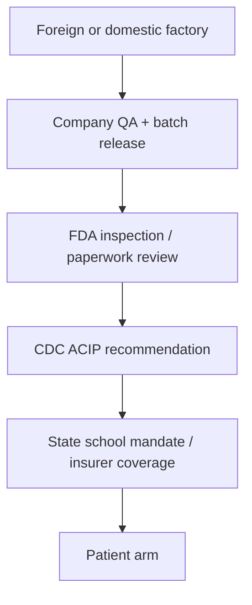

# Vaccine injury, liability immunity, and the unknowable reckoning — COVID archive, MMR/autism, and RFK Jr. at HHS

> **TL;DR:** This investigation **assumes as working premise** that vaccine injuries are **real**, **under-counted**, and **structurally suppressed** by an industry granted **near-total liability immunity**, with safety claims routed through **FDA/CDC/HHS trust chains** that **cannot be independently audited** at factory scale. **Trial doses** and **commercial batches** may not be the same product in any meaningful sense. The **true long-term consequence surface** of mass vaccination — especially **COVID mRNA** and **childhood schedules** — is **unknown** and may be **extremely bad**. **Measles/MMR → autism** is examined under the repo’s [**autism umbrella recategorization**](/history/chronology/investigations/childhood-autism-spectrum-conformity-recategorization-investigation.md): if “autism” names a **congealed diagnostic bucket**, then **MMR timing** may correlate with **regression presentations** that institutions **mislabel** rather than investigate. Mainstream debunks (Wakefield fraud, IOM “rejection,” VAERS misuse) are **logged** but treated as **closure machinery**, not proof the reckoning is complete. **RFK Jr.** as **HHS Secretary (2025–)** is a **federal-level policy earthquake** — whether antibody or controlled demolition of trust is **open**. **Author archive:** [`governance/genocide/vaccine/`](../vaccine/) — **238 files** inventoried below (OCR sample).

**Status:** Open — archive catalog drafted; factory-batch audit hooks TODO; NVICP docket sampling TODO.  
**Date:** 2026-05-31  
**Bias (explicit):** Pro-injured-party, anti-industry-immunity, skeptical of federal “safe and effective” epistemics. Debunks included **for completeness**, not as default truth.

---

## Guide (read order)

| If you want… | Section |
|--------------|---------|
| Investigation premise in one place | §1 |
| **Author COVID/vaccine image archive** (counts + OCR sample) | §2 |
| Liability immunity — why lawsuits fail | §3 |
| Trust chain — FDA, foreign plants, trial vs factory dose | §4 |
| **Measles / MMR / autism** under repo autism frame | §5 |
| MMR effectiveness & transparency criticisms | §6 |
| COVID-era injury reporting & censorship cycle | §7 |
| Notable online controversies (table) | §8 |
| **RFK Jr.** — federal policy shift (2025–2026) | §9 |
| Mainstream debunks & counterclaims (logged) | §10 |
| Debunk-overreach / adjacent-discard (injury lane) | §11 |
| **Trust breach + parent decision** (false advertising, suppressed injury) | **§12** |
| **Tetanus / meningococcal** — criticisms & studied harms | **§13** |
| **Vaccine-as-religion** metaphor + reader article | **§14** |
| Cross-investigations | §15 |
| Evidence tiers & open questions | §16 |

---

## 1. Author thesis — the reckoning is unknown and may be catastrophic

> **Investigation premise (2026-05-31):** Vaccine products sit inside a **legal and epistemic bubble**. Manufacturers enjoy **liability shields**; regulators **do not release** factory-level batch data to the public; **VAERS** and **NVICP** are **passive or capped** systems that **cannot** produce population true rates; **foreign contract manufacturers** (India, EU partners, etc.) operate under **FDA paperwork trust**, not continuous public audit. Parents and patients who report injury face **debunk-and-dismiss** cycles. The industry insists **“safe and effective”** while **no independent party** can verify that **commercial vials match trial material** in composition, storage, or contamination profile. Under [**prisca sapientia**](/docs/PRISCA_SAPIENTIA.md), institutional medicine is **not** default truth — especially where **Flexner-style credential monopolies** ([autism investigation §15](/history/chronology/investigations/childhood-autism-spectrum-conformity-recategorization-investigation.md)) and **1986 immunity** align.

| Layer | Claim | Tier |
|-------|-------|------|
| **Injuries real** | Anecdotes + compensation dockets + clinical case series (myocarditis, thrombosis, neurological regression) exist at scale | **Observed** — magnitude **disputed** |
| **Injuries suppressed** | Platform censorship, “misinformation” labels, hospital charting bias, media “fact-check closure” | **Documented pattern** — degree varies |
| **Immunity structural** | NVICP + PREP Act + EUA architecture limits discovery | **Documented** (statute) |
| **Factory opacity** | GMP inspections exist; **public** cannot audit batch-to-batch variance | **Partially documented** — author **audit demand** |
| **Trial ≠ commercial** | Phase III material vs post-approval manufacturing change (process, lipid, fill) | **Documented concern** in pharma literature; **causal injury link** = open |
| **Long-term unknown** | Childhood schedule + mRNA platform — **decades** of follow-up **not** complete | **Logical** — mainstream agrees lag exists; author stresses **severity tail risk** |

**What this file does *not* claim without separate dossiers:** that **every** vaccine **always** harms; that **measles** is harmless; that **COVID** was **only** a hoax ([archive contains both injury and hoax lanes — §2](#2-author-archive-governancegenocidevaccine)).

---

## 2. Author archive — `governance/genocide/vaccine/`

**Location:** [`../vaccine/`](../vaccine/) (companion stub: [`a.md`](../vaccine/a.md)).

### 2.1 Inventory (2026-05-31)

| Category | Count | Notes |
|----------|------:|-------|
| **Total files** | **238** | Single-folder collection |
| **Raster images** (jpg/png/webp) | **235** | Memes, news clippings, social screenshots |
| **PDFs** | **2** | `CovidPamphlet.pdf`, `covid19Pamphlet.pdf` |
| **`victim_*` screenshots** | **67** | First-person COVID vaccine injury / side-effect posts (2021–2022 timestamps on many) |
| **`vax_depopulation*` series** | **64** | Population-control / Gates / agenda graphics |
| **`vax_*` (other)** | **~40** | Fraud, deaths, measles, polio, passports, Fauci, etc. |
| **`covid_*`** | **6** | Pamphlets, masks, rules |
| **Misc.** | **~60** | `CDC-VAERS-report-4.png`, `myocarditis.jpg`, `wrongdose.jpg`, `safe-effective.jpg`, `vaccine_injury.jpg`, `vax_autism.jpg`, `vax_measles*.jpg`, etc. |

**Interpretation:** The collection is **not** a curated evidence dossier — it is a **personal capture archive** spanning **injury testimony**, **mainstream headline clippings**, **meme agitprop**, and **contradictory** lanes (e.g. “COVID hoax” essays in `a.md` **alongside** injury victim screenshots). Investigators must **tier** each artifact — see §13.

### 2.2 OCR sample (tesseract 5.3.4, May 2026)

Representative extractions — **typos are OCR artifacts**:

| File | OCR gist |
|------|----------|
| `victim_2021-03-22_17-42-31.jpg` | Moderna recipient — throat tightness, tingling, dizziness; later panic attacks, rising BP; nurses attributed to anxiety |
| `victim_2022-01-12_15-00-12.jpg` | Hospital worker post-vaccine — brain fog, tingling, numbness, facial swelling (wife’s account) |
| `notrare.jpg` | Cherie Romney — son Everest, ICU blood clots in brain **9 days after COVID vaccine**; medical records note adverse reaction |
| `CDC-VAERS-report-4.png` | Headline-style: “CDC: 2,794 DEAD 56,869 Injured following experimental COVID injections” (through April 5, 2021) |
| `myocarditis.jpg` | CNBC — Moderna vs Pfizer breakthrough cases; **higher myocarditis in young men** (Nov 2021) |
| `wrongdose.jpg` | NY Post — Virginia pharmacy gave **112 kids wrong COVID vaccine doses** (Nov 2021) |
| `safe-effective.jpg` | Herald Sun — **dozens of Victorian teens** with **myocarditis** after Pfizer (2021) |
| `vax_measles.jpg` | Meme contrasting VAERS measles-vaccine deaths vs CDC measles deaths (methodologically sloppy — §10) |
| `vax_measles2.jpg` / `vax_measles3.jpg` | Measles mortality/infection charts — **vaccine introduction 1963** annotation (effectiveness debate fodder — §6) |
| `CovidPamphlet.pdf` | Hashtag pamphlet — `#CovidVaccineVictims`, mask study citations, homeless/FEMA camp claims |

**TODO:** Full OCR pass to CSV (filename, date, quoted text, tier) — **not** done in this draft.

---

## 3. Liability immunity — why the industry cannot be sued into honesty

### 3.1 National Childhood Vaccine Injury Act (1986) → NVICP

**Documented:** After DTP injury lawsuits, Congress created the [**National Vaccine Injury Compensation Program**](https://www.hrsa.gov/vaccine-compensation) — **no-fault** compensation funded by excise tax, **replacing most tort** against manufacturers for **listed** childhood vaccines on the Vaccine Injury Table.

**Investigation read:**

| Feature | Effect on truth-seeking |
|---------|-------------------------|
| **No jury discovery** against pharma for table claims | **Reduced** document production on design/protocol |
| **Table vs off-table** injuries | Many COVID-era harms **initially** off-table or new |
| **Cap on pain/suffering** (historically) | Signals **low valuation** of injury |
| **“Unavoidably unsafe”** product framing | RFK Jr. quoted this logic in Dershowitz debate — echoed in [`a.md`](../vaccine/a.md) |

**RFK Jr. (debate paraphrase, logged in repo [`a.md`](../vaccine/a.md)):** Industry told Congress vaccines were **“unavoidably unsafe”** and demanded **blanket immunity** to continue — **no incentive** to make products safer if **negligence cannot be punished**.

**Mainstream counter:** NVICP **does** compensate some injuries; existence of program **proves** some risk acknowledged.

**Author counter:** Compensation **rates** and **denial rates** suggest **underpayment**; program **opacity**; **does not** restore **discovery**.

### 3.2 PREP Act (COVID)

**Documented:** [PREP Act liability shield](https://www.phe.gov/Preparedness/legal/prepact/Pages/default.aspx) for **countermeasures** — COVID vaccines, therapeutics — **broad** protection for manufacturers and administrators; **February 2020** declaration **pre-dated** pandemic declaration ([`a.md`](../vaccine/a.md) cites Final Call / Sarpatwari quote).

**Investigation read:** Emergency architecture **removed** the last **tort pressure** valve during **the largest rollout in history**.

### 3.3 EUA vs full approval — follow-on liability

Even after **Biologics License Applications**, **PREP** and **contractual** indemnities with governments **limited** suit paths in multiple jurisdictions (US, EU **Advanced Purchase Agreements**).

---

## 4. Trust chain — FDA, foreign manufacturers, trial dose vs factory dose

### 4.1 The verification problem

**Author claim:** Citizens are asked to trust a **stack**:

**No public step** provides **independent chemical/ biological verification** of **each lot** delivered to a pharmacy. **FDA** relies on **manufacturer-submitted** data, **periodic** inspections, and **post-market** passive reporting.

| Question | Mainstream answer | Investigation read |
|----------|-------------------|---------------------|
| Are commercial batches identical to trial batches? | **Process validation** required for scale-up | **Change control** history often **opaque** to public |
| Can lipid/mRNA degradation increase toxicity? | Stability studies | **Cold-chain breaks** documented in rollout — [`wrongdose.jpg`](../vaccine/wrongdose.jpg) is **dosing** error, not composition — but shows **operational failure** |
| Are foreign plants equivalent? | **FDA Form 483** inspections | Inspection **frequency** and **conflict** concerns — author **skeptical** of “trust foreign CDMO” |

### 4.2 “Safe and effective” as rhetorical closure

Regulatory labels mean **benefit-risk accepted by agency under current evidence** — **not** “cannot hurt you” and **not** “audited forever.”

**Archive artifact:** [`safe-effective.jpg`](../vaccine/safe-effective.jpg) — Australian teen **myocarditis** cluster clipped under **“Safe & Effective — greatest lie”** headline. **Tier:** press clipping + author commentary — **not** epidemiological proof of population rate.

---

## 5. Measles vaccine / MMR and autism — repo cross-read

### 5.1 Autism as umbrella (required cross-link)

This investigation **imports** the [**childhood autism spectrum recategorization**](/history/chronology/investigations/childhood-autism-spectrum-conformity-recategorization-investigation.md) frame:

- **DSM-5 ASD** = **single lump** for **mutism, hyperlexia, regression, PDA, sensory, organic encephalopathy**, etc. (§5 of that file).
- **Category 1** (organic/environmental) vs **Category 2** (conformity/abuse reaction) — **author decision tree** (§6, §11).
- That file **explicitly deferred** anti-vaccine claims (§12: “out of scope unless separately investigated”) — **this dossier** is that separate investigation.

**Investigation hypothesis (author-biased):** When a toddler **regresses** after MMR (or any immune activation + fever), clinicians **file ASD** — collapsing **possible vaccine injury**, **seizure**, **mitochondrial**, **gut**, **Category 2 trauma**, and **true Kanner autism** into **one billing code**. The **Wakefield debunk** then **closes** all MMR-autism inquiry **by ridicule** (§11).

### 5.2 Wakefield / Lancet 1998 — what happened (documented)

| Event | Source |
|-------|--------|
| 1998 Lancet case series (12 children) — MMR linked to bowel disease + developmental regression | [Wakefield et al., *Lancet* 1998](https://doi.org/10.1016/S0140-6736(97)11096-0) — **retracted** |
| Brian Deer / BMJ — data manipulation, undisclosed legal funding, selected timelines | [BMJ — “How the case against the MMR vaccine was fixed”](https://www.bmj.com/content/342/bmj.c5347) |
| 2010 GMC — Wakefield struck off register | [BMJ news](https://www.bmj.com/content/340/bmj.c593) |
| 2004 partial retraction by 10/13 authors | Co-authors disavowed interpretation |

**Mainstream conclusion:** **Fraud** + **no causal link** in subsequent large epidemiological studies ([IOM/NASEM review summary](https://www.ncbi.nlm.nih.gov/books/NBK25338/)).

### 5.3 Author read — why the debunk does not settle injury

| Mainstream move | Author response |
|-----------------|-----------------|
| “Wakefield fraudulent → MMR safe for autism” | **Non sequitur** under umbrella diagnosis — other mechanisms (immune activation, aluminum adjuvant, lot contamination) **not** tested by Wakefield debunk |
| “Danish cohort of 500k — no link” | Ecological designs **cannot** catch **subset** susceptibility (mitochondrial, MTHFR debates — **controversial**, tier C) |
| “Autism rising while thimerosal removed” | **Diagnostic expansion** (repo §5 autism file) **confounds** every epidemiological graph |
| “Regressive autism after MMR is anecdote” | **VAERS** + **VICP** + parent clusters **exist** — **causality** unsettled |

**Measles vaccine specifically:** US childhood schedule uses **MMR** (live attenuated) and **MMRV** combined — **RFK-era ACIP** moved toward **splitting** MMRV recommendation ([CIDRAP Mar 2026](https://www.cidrap.umn.edu/childhood-vaccines/state-us-vaccine-policy-special-edition-mar-17-2026)) — ironically **both** “more shots” and “less combined” narratives get spun.

### 5.4 Repo archive — measles graphics

| File | Content (OCR/visual) |
|------|------------------------|
| [`vax_measles.jpg`](../vaccine/vax_measles.jpg) | VAERS vs CDC death count meme — **bad methodology** |
| [`vax_measles2.jpg`](../vaccine/vax_measles2.jpg) | Infections/deaths curve — vaccine line at 1963 |
| [`vax_measles3.jpg`](../vaccine/vax_measles3.jpg) | Mortality rate per 100k — **pre-vaccine decline** argument (nutrition/sanitation debate) |
| [`vax_autism.jpg`](../vaccine/vax_autism.jpg) | Image present; OCR **empty** (likely graphic-only meme) |

---

## 6. Measles vaccine — effectiveness and transparency criticisms

### 6.1 Effectiveness lane

| Criticism | Detail | Tier |
|-----------|--------|------|
| **Primary vs outbreak control** | MMR **very effective** at preventing measles **in vaccinated**; **outbreaks** among vaccinated cohorts reported when waning immunity / strain mismatch | **Documented** (CDC outbreak reports) |
| **Mortality decline pre-1963** | Graphs like `vax_measles3.jpg` show **mortality** falling before vaccine — critics say vaccine **claims credit** for sanitation/nutrition | **Debated** — both factors real |
| **Waning immunity / boosters** | Two-dose schedule **required**; **third dose** debates in outbreaks | **Documented** |
| **Merck mumps component efficacy litigation** | Whistleblower suit alleged **misrepresented** mumps vaccine efficacy (Krahling & Wickerhamb) — **settled/dismissed** in parts; **transparency** concern | **Court docs** — [DOJ case references](https://www.justice.gov/usao-edpa/pr/merck-sharp-dohme-corp-agrees-pay-681-million-resolve-false-claims-act-liabilities) (related FCA matters) |

### 6.2 Transparency lane

| Criticism | Detail |
|-----------|--------|
| **Informed consent packets** | VIS sheets **downplay** serious adverse events relative to insert |
| **VAERS underreporting** | HHS-funded [Lazarus/ Harvard pilot](https://digital.ahrq.gov/sites/default/files/docs/publication/r18hs017045-lazarus-final-report-2011.pdf) estimated **<1%** of adverse events reported — **disputed** application to all vaccines but **institutional** |
| **Post-licensure study gaps** | **Passive** surveillance dominates |
| **Seal of approval without public batch data** | **No** consumer-facing lot lookup for composition QC |

### 6.3 Side-effect profile (mainstream logged)

MMR **live virus** — contraindicated in **severe immunocompromise**; **febrile seizures** risk documented; **SSPE** rare long-term measles complication **prevented** by vaccination — mainstream **strong** pro-vaccine argument.

**Author read:** Risk/benefit **tradeoff** may be rational for **measles** while **still** leaving **regression** subset **unstudied** under **clean autism label**.

---

## 7. COVID-era injury reporting and suppression

### 7.1 Reporting systems

| System | Role | Investigation read |
|--------|------|---------------------|
| **VAERS** | Passive; anyone can report | **Signal** not proof; **underreport** suspected |
| **V-safe** | Active SMS/app — **paused/scaled back** post-emergency | Rich data **not** fully public |
| **Pfizer docs (FOIA)** | Released adverse event pages | **Interpretation wars** — [PHMPT releases](https://phmpt.org/) |
| **Myocarditis** | **Confirmed** signal in young males — mRNA platforms | Mainstream **accepts**; **rate** disputed |

### 7.2 Censorship / debunk cycle

Parallel to [**autism investigation §18**](/history/chronology/investigations/childhood-autism-spectrum-conformity-recategorization-investigation.md) — **debunk-cycle epistemology**:

1. Injury story goes viral (`notrare.jpg`, `victim_*` series).  
2. Platform **reduces reach** or **labels misinformation**.  
3. Media **fact-check** focuses on **one exaggerated stat** → **whole injury category** treated as hoax.  
4. **Hospital charts** record **anxiety** (see OCR victim post) — **downstream** denial of causality.

**Cross-link:** [Brandy Vaughan — Merck whistleblower death](/influence/conspiracy/celebrities/brandy-vaughan.md); [virus isolation audit §0.4](/science/health/investigations/virus-isolation-never-proven-thesis-skeptical-audit-investigation.md) (vaccine hub link).

---

## 8. Notable online controversies (selected)

| Controversy | Years | Notes | Cross-link |
|-------------|-------|-------|------------|
| **Wakefield / MMR-autism** | 1998–2010+ | Fraud finding; **lasting** vaccine hesitancy | §5 |
| **Vaxxed documentary** (Wakefield) | 2016 | Tribeca pull; **controlled opposition** read optional | [CO adjacency — autism §18](/history/chronology/investigations/childhood-autism-spectrum-conformity-recategorization-investigation.md) |
| **COVID mRNA “gene therapy”** | 2020– | Platform novelty; **long-term** unknown | [`a.md`](../vaccine/a.md) Mikovits quotes |
| **Myocarditis in teens** | 2021– | **Mainstream acknowledged** | `myocarditis.jpg`, `safe-effective.jpg` |
| **Pharmacy dosing errors** | 2021 | 112 kids wrong dose — Virginia | `wrongdose.jpg` |
| **Sudden athlete deaths meme** | 2021–2022 | Often **miscaptioned** — debunk overreach risk | §11 |
| **#DiedSuddenly** | 2022 | Documentary; **embolism** claims **disputed** | Tier C |
| **Pfizer “director” Veritas sting** | 2022 | **Heavily edited**; not proof of global conspiracy | Tier C |
| **RFK Jr. nomination / confirmation** | 2024–2025 | Senate **narrow** confirm | §9 |
| **ACIP purge & schedule slash** | 2025–2026 | **Blocked** by federal judge Mar 2026 | §9 |
| **CDC autism webpage rewrite** | 2025–2026 | “Not evidence-based to say vaccines don’t cause autism” language | §9, §10 |

---

## 9. Robert F. Kennedy Jr. — federal policy inflection (2025–2026)

### 9.1 Role

**Robert F. Kennedy Jr.** — confirmed **U.S. Secretary of Health and Human Services** (2025). Longtime **vaccine critic**; founder **Children’s Health Defense**; author of *The Real Anthony Fauci*.

**Confirmation bargain:** Sen. **Bill Cassidy** extracted promise that CDC would **not remove** “vaccines do not cause autism” language — **partially broken** later ([PolitiFact Feb 2026](https://www.politifact.com/article/2026/feb/16/rfk-jr-hhs-promises-autism-vaccine/)).

### 9.2 Documented actions (first year)

| Action | Source |
|--------|--------|
| Fired **all 17 ACIP** members; replaced with vaccine-skeptic majority | [NBC Mar 2026](https://www.nbcnews.com/health/health-news/federal-judge-blocks-rfk-jr-cdc-childhood-vaccine-schedule-rcna263697) |
| Reduced **recommended** childhood disease count **18 → 11** (Jan 2026 memo) | Same |
| **COVID** shots — reduced recommendations for healthy children/pregnant women | [PBS](https://www.pbs.org/newshour/health/in-a-tumultuous-year-u-s-health-policy-transforms-under-rfk-jr) |
| **MMRV** — moved toward **separate** MMR + varicella | [CIDRAP](https://www.cidrap.umn.edu/childhood-vaccines/state-us-vaccine-policy-special-edition-mar-17-2026) |
| **CDC autism page** — added language that **studies have not ruled out** infant vaccines causing autism | PolitiFact; PBS |
| **Mar 17, 2026** — Federal Judge **Brian Murphy** **blocked** schedule overhaul, **stayed** new ACIP appointments, **nullified** ACIP votes since June 2025 | NBC; CIDRAP |

### 9.3 Investigation frames (non-exclusive)

| Frame | Read |
|-------|------|
| **Antibody** | HHS finally **audits** chronic-disease / vaccine nexus — **MAHA** agenda |
| **Controlled demolition** | **Extreme** anti-vaccine moves **discredit** all reform; **court restore** = **“see, conspiracy was wrong”** | [Angry Birds / debunk cycle](/history/chronology/investigations/childhood-autism-spectrum-conformity-recategorization-investigation.md#181c-2022-midterms--debunk-failure--angry-birds-parallel-author) |
| **Genuine policy war** | **29 states** rejecting federal guidance; **measles** outbreaks in **unvaccinated** clusters (Colorado 2026 — CIDRAP) | Public health **stress test** |

**Author sentiment:** RFK Jr. **elevates** questions this repo treats as **suppressed** — whether his **execution** survives courts and **delivers** transparent science **or** triggers **backlash re-immunization** of trust in pharma is **open**.

---

## 10. Mainstream debunks and counterclaims (logged)

*Presented so readers know the **official** story — **not** endorsed as final.*

| Claim | Mainstream response | Author reply (short) |
|-------|---------------------|----------------------|
| MMR causes autism | **False** — Wakefield fraud; IOM rejects causation | Umbrella diagnosis ** hides** regression cases |
| VAERS deaths = vaccine deaths | **Misuse** — unverified reports | Still **signal** requiring **proactive** study |
| COVID vaccine killed more than COVID | **False** — age-stratified mortality math | **Injury tail** in young **underweighted** in PR |
| “Safe and effective” | Regulatory **legal** phrase | **Archive** [`safe-effective.jpg`](../vaccine/safe-effective.jpg) — **myocarditis** real |
| Herd immunity requires 100% | **Strawman** | Mandate **logic** treated as moral law |
| ivermectin / hydroxychloroquine | **Ineffective** (RCT meta) | **Distraction** from **platform** injury debate |
| RFK changes **unscientific** | **AAP lawsuit** won injunction | **Process** violation **≠** proof vaccines **harmless** |

**Key mainstream citations:**

- [IOM — Immunization Safety Review: Vaccines and Autism](https://www.ncbi.nlm.nih.gov/books/NBK25338/)  
- [Cochrane — MMR safety review](https://www.cochranelibrary.com/cdsr/doi/10.1002/14651858.CD004407.pub3/full)  
- [CDC — MMR vaccine safety](https://www.cdc.gov/vaccines/vpd/mmr/public/index.html)

---

## 11. Debunk-overreach and adjacent discard (injury lane)

Method note: [`METHODS_DEBUNK_OVERREACH_ADJACENT_DISCARD.md`](/docs/METHODS_DEBUNK_OVERREACH_ADJACENT_DISCARD.md).

**Pattern in vaccine discourse:**

| Scoped debunk | Overreach |
|---------------|-----------|
| Wakefield **paper** fraudulent | → “**No** vaccine ever harmed **any** child” |
| One **miscaptioned** athlete death | → “**All** myocarditis reports fake” |
| VAERS **unverified** | → “**Ignore** VAERS entirely” |
| RFK **process violations** | → “**Restore** schedule **proves** zero injury concern” |

**Operational rule:** Evaluate **each injury report** (`victim_*`, NVICP docket, peer-reviewed myocarditis) **on its own chain** — do not **discard** the **`victim_*` archive** because **`vax_depopulation57.jpg`** is **meme tier**.

---

## 12. Trust breach, false advertising, and parent decision (debate capture)

> **Investigation rule (2026-05-31, author + assistant debate):** **False advertising and suppressed injury are first-class inputs** to any vaccination decision — not afterthoughts once “disease risk” is named. **You cannot recommend any vaccine to a doubting parent without warning them of false advertising and suppressed outcomes.**

### 12.1 Embed-ready blockquote (reader article)

> False advertising and suppressed injury aren’t side notes. They belong **inside** the decision, not after “disease risk vs reactogenicity.” “Safe and effective” is regulatory shorthand, not proof that commercial batches match trials or that population harm is fully measured. Liability immunity means the parent is **not** getting the same product assurance as with almost any other injected drug. NVICP **presumes** some serious harms (e.g. brachial neuritis with tetanus toxoid) while pamphlets still read like rare/no big deal. VAERS reports are dismissed by default; uptake campaigns stay absolute. **You cannot recommend any vaccine to a doubting parent without warning them of false advertising and suppressed outcomes.** If they proceed at all, they proceed knowing the label is **marketing**, the safety net is **NVICP—not the courtroom**, and the **true long-term consequence surface remains unknown**.

### 12.2 What the usual for/against lines strip out

| Lane | Slogan | Context omitted |
|------|--------|-----------------|
| **Pro** | “Safe and effective”; “vaccines saved millions”; “trust your pediatrician” | NVICP/PREP immunity; trial-vs-factory opacity; passive VAERS; debunk-as-closure; presumptive Table injuries (§3) |
| **Anti** | “All poison”; “depopulation”; “COVID hoax only” | Real disease severity (tetanus, meningococcus); studied reactogenicity tiers; which harms are **compensable** vs speculative |

**Investigation read:** Both lanes sell **closure**. Doubting parents need the **stack** — immunity architecture, injury visibility, factory audit gap, disease severity — not a bumper sticker.

### 12.3 If proceed at all

| Step | Action |
|------|--------|
| **Warn** | False advertising + suppressed injury **before** any product name |
| **Document** | Baseline health; lot numbers if obtainable; timeline after each dose |
| **Clinician** | One who records concerns without “misinformation” labels |
| **Off-ramp** | NVICP/VICP counsel path known **before** injection |

**Lay article:** [Vaccines, circumcision, and childhood consent — two rites, one theft](https://paradigmthreat.net/governance/genocide/vaccines-circumcision-childhood-consent-religion.md).

---

## 13. Tetanus-containing and meningococcal vaccines — criticisms & studied harms

*Summary from 2026-05-31 research pass — full tables live here; article stays prose.*

### 13.1 Tetanus / DTaP / Tdap / Td

**“1 in 5” disambiguation:** **~1 in 5** die from **clinical tetanus** (disease); **~1 in 5** get **local redness/swelling** after **Tdap** (common reaction) — not the same claim.

| Criticism | Tier |
|-----------|------|
| Whole-cell **DTP** encephalopathy/seizures → US replaced with **DTaP** (1990s); whole-cell still used elsewhere | **Documented** |
| **Bundled product** — hard to attribute injury to tetanus vs pertussis vs diphtheria | **Structural** |
| **Brachial neuritis** after tetanus toxoid — IOM favored causal; **NVICP Table** (2–28 days) | **Accepted** rare |
| **Prolonged crying >3 h**, **HHE**, febrile seizures (DTaP; ↑ with concomitant flu+PCV13) | **Studied** — ACIP still recommends co-admin |
| **GBS** after tetanus toxoid — case reports; population studies **≤ background** | **Disputed** causality |
| **Aluminum adjuvant** neuro concerns | **Theoretical** in cohort studies |
| **Arthus reaction** if toxoids too frequent | **Accepted** |

**Sources:** [StatPearls DTaP](https://www.ncbi.nlm.nih.gov/books/NBK545173/); [ACIP MMWR 2018](https://www.cdc.gov/mmwr/volumes/67/rr/rr6702a1.htm); [NVICP Injury Table](https://www.hrsa.gov/sites/default/files/hrsa/vicp/vaccine-injury-table-01-03-2022.pdf).

### 13.2 MenACWY / MenB (meningitis vaccines)

| Criticism | Tier |
|-----------|------|
| **MenACWY immunity wanes** 12–22 months → booster at 16 | **Documented** |
| **MenB** ACIP **GRADE** weak for routine all-adolescent recommendation | **Documented** |
| **MenB reactogenicity** — pain ~94%, fever up to ~60% in infant trials (Bexsero meta-analysis) | **Accepted** in trials |
| **Menactra GBS signal** (2005) → large studies cleared link | **Studied** then **officially dismissed** |
| **College mandates** mostly **MenACWY** while **MenB** drives many campus outbreaks | **Policy criticism** |
| **fHbp / Factor H** autoimmunity hypothesis (MenB) | **Hypothesis** |
| VAERS **pallor, hypotonia** disproportionality (MenB, 2026) | **Signal** — not proven causal |

**NVICP Table (meningococcal):** anaphylaxis, SIRVA, vasovagal syncope — **not** GBS or neurological injury presumptive.

---

## 14. Vaccine-as-religion metaphor + reader article

| Element | Religious parallel | Vaccine parallel |
|---------|-------------------|------------------|
| **Sacred text** | Scripture | CDC schedule, VIS, “safe and effective” |
| **Clergy** | Priesthood | White coats, public health authority |
| **Heresy** | Excommunication | “Antivax,” platform bans, school exclusion |
| **Initiation** | Childhood rite | Earliest-age shots |
| **Communion line** | Pure vs impure | Vaccinated playdates vs shunned |
| **Faith** | Works without proof | Antibody titer ≠ audited factory batch |

**Claim tier:** **Author structural thesis** — metaphor, not literal ecclesiology.

**Reader essay (consent + circumcision parallel):** [vaccines-circumcision-childhood-consent-religion.md](https://paradigmthreat.net/governance/genocide/vaccines-circumcision-childhood-consent-religion.md).

---

## 15. Related repo investigations

| Topic | Link |
|-------|------|
| **Autism umbrella / recategorization** | [childhood-autism-spectrum-conformity-recategorization-investigation](/history/chronology/investigations/childhood-autism-spectrum-conformity-recategorization-investigation.md) |
| **Vaccine archive stub** | [a.md](../vaccine/a.md) |
| **Brandy Vaughan — Merck / Learn The Risk** | [brandy-vaughan.md](/influence/conspiracy/celebrities/brandy-vaughan.md) |
| **Virus isolation / vaccine boundary** | [virus-isolation-never-proven-thesis-skeptical-audit-investigation](/science/health/investigations/virus-isolation-never-proven-thesis-skeptical-audit-investigation.md) |
| **GNM / Germanic New Medicine cluster** | [gnm-learninggnm-cancer-paradigm-cluster-investigation](/science/biology/investigations/gnm-learninggnm-cancer-paradigm-cluster-investigation.md) |
| **Flexner / credential monopoly** | [autism investigation §15](/history/chronology/investigations/childhood-autism-spectrum-conformity-recategorization-investigation.md) |
| **Debunk-cycle / Angry Birds** | [autism §18.1c](/history/chronology/investigations/childhood-autism-spectrum-conformity-recategorization-investigation.md#181c-2022-midterms--debunk-failure--angry-birds-parallel-author) |
| **Suppressed health technology motif** | [conspiracy — suppressed_health_technology.jpg](/influence/conspiracy/suppressed_health_technology.jpg) |
| **Circumcision cult / covenant** | [circumcision_cult.md](/influence/conspiracy/topics/circumcision_cult.md) |
| **Schooling / consent / parent essay** | [when-your-child-wont-fit-the-grade](/history/chronology/when-your-child-wont-fit-the-grade.md) |
| **Reader — vaccine religion + bodily consent** | [vaccines-circumcision-childhood-consent-religion.md](/governance/genocide/vaccines-circumcision-childhood-consent-religion.md) |

---

## 16. Evidence tiers, weak points, TODOs

### 16.1 Tier key

| Tier | Use in this file |
|------|------------------|
| **A** | Statute, court ruling, peer-reviewed RCT/meta |
| **B** | HHS/CDC/FDA publication, major press with documents |
| **C** | Social screenshot, meme, OCR victim post |
| **Author** | Investigation premise / audit demand |

### 16.2 Weak points (honest)

| Claim | Risk |
|-------|------|
| Population **death toll** from COVID vaccines | **Hotly disputed** — do not cite VAERS raw as rate |
| **All** factory batches **unsafe** | **Overreach** — claim is **audit gap**, not proven universal contamination |
| Wakefield **vindicated** | **Contradicted** by GMC/BMJ — author lane uses **other** mechanisms |
| RFK as **white hat** | **Political** — broken promises documented |
| Archive **`vax_depopulation*`** | **Agitprop** — do not merge with **`victim_*`** tier |

### 16.3 TODOs

- [ ] Full OCR catalog CSV for **`victim_*`** (67 files)  
- [ ] NVICP **MMR** + **COVID** docket sample table  
- [ ] FDA **483** / recall search for **COVID vaccine CDMOs**  
- [ ] Compare **Clinical trial lot numbers** vs **commercial** in FOIA (if obtainable)  
- [ ] Header illustration PNG (optional)  
- [x] Cross-link **from** autism investigation §12 → this file  
- [x] §12 trust breach + debate blockquote  
- [x] §13 tetanus/meningococcal research pass  
- [x] §14 religion metaphor + reader article link  

---

## Limits and disclaimers

**Prisca sapientia:** See [`PRISCA_SAPIENTIA.md`](/docs/PRISCA_SAPIENTIA.md). Institutional consensus is **not** default truth.

- **Medical:** Not medical advice. Consult licensed clinicians for vaccination decisions.  
- **Legal:** Not legal advice on NVICP/PREP claims.  
- **Harassment:** Do **not** use this file to **harass** parents of vaccinated children or clinicians.  
- **Measles:** Measles **can kill**; disease risk is **real** — this investigation targets **transparency and liability**, not **celebrating epidemics**.  
- **Bias:** Written **for** injured-party visibility and **against** immunity-without-audit — **debunks included** but **not** treated as moral closure.  
- **Archive:** Mixed-tier folder — **`victim_*`** ≠ **`vax_depopulation*`** in evidential weight.

---

Keywords: #Vaccine #VaccineInjury #COVID #MMR #Measles #Autism #RFKJr #NVICP #VAERS #PREPAct #LiabilityImmunity #Pharma #FDA #HHS #ACIP #Myocarditis #ParadigmThreatFiles

**Last updated:** 2026-05-31 (§12–§14 debate capture, tetanus/meningococcal, reader article)
