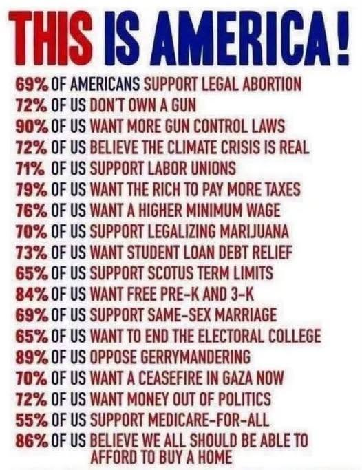

# Investigation: “THIS IS AMERICA!” Percentage Ads — Democratic Dual Platform, Bait-and-Switch Corporatism, and MAGA Candor Contrast

> **TL;DR:** Viral **percentage graphics** (“69% support X…”) convert **demographic facts**, **soft majorities**, and **stalled-process aspirations** into a **moral mandate** that sounds like an **equal-share / socialist platform** — while **establishment Democrats deny** socialism, **DSA-aligned socialists admit** capitalism-replacement goals and **capture deep-blue primaries**, and **shipped statutes** often look like **corporatism, bureaucracy, usury, and elite continuity** (archetype: **Medicare-for-All talk → ACA / insurer architecture**). **Author thesis (first-class):** the deepest deception is **lying to the base** — treating constituents like idiots, smearing alternatives with **Jim Crow / gerrymander** guilt ahead of evidence, expanding early schooling that **does not prepare families**, and abandoning the demographics first rallied. **Climate crux (author):** the graphic’s **“climate is real”** majority largely tracks **experienced extremes**; the taboo that ends debate is **geoengineering / chemtrails** — because if deliberate atmospheric programs are real, then **government/bureaucracy caused the change** under a **cars-and-gas cover** (NSA-aligned *The Arrival* 1996 grammar). **MAGA contrast (qualified):** strategic goals (border, tariffs, Iran/allies, NATO/UN scrutiny) were **pre-announced and pursued**; absolute “never lied” fails trackers (e.g. Ukraine-in-24-hours), but **product renaming** is rarer than on the Dem equal-share lane. **Poll audit companion (session):** several graphic numbers are **close**; **gun-control 90%**, **tax-the-rich 79%**, **student-loan 73%**, **gerrymander 89%** are **inflated** vs mainstream panels. **§13 findings pass (2026-07-24):** DSA *Workers Deserve More* primary text confirms public ownership / abolish-police horizon; climate “happening” soft-oscillates ~68–74% (not collapse); **geoengineering hook = ban/policy** (~60% favor bans; TN/FL statutes; multi-state bill wave) — not identical chemtrails wording; ACA public option dropped for Lieberman 60; Black/Hispanic 2024 shift real (turnout-heavy); McConnell absent since mid-Jun 2026 fall.

**Status:** Open — §13 + climate/geoengineering crux in (2026-07-24); A5 curriculum / A6 named map / A8 monopoly-civil-rights exhibits still open.

**Guide (read order)**

1. **Author’s originating thesis (verbatim stakes)** → §1 (incl. **§1.3 climate / geoengineering crux**)  
2. **What the graphic does rhetorically** → §2  
3. **Poll reality check (session audit)** → §3  
4. **Not on the ballot — stalled process sold as will** → §4  
5. **Democratic dual platform (deny / admit / brush-off)** → §5  
6. **Sold equal-share, shipped corporatism** → §6  
7. **Education / Pre-K / family formation** → §7  
8. **Constituency abandonment → realignment** → §8  
9. **MAGA candor contrast (+ RINO / Trump caveats)** → §9  
10. **Author’s open claims registry** → §10  
11. **Questions to clarify / verify / debunk** → §11  
12. **Related** → §12  
13. **Findings pass (2026-07-24)** → §13 (geoengineering **ban/policy** hook → **§13.9**) 

---

## 1. Author’s originating thesis (verbatim stakes)

**Required:** this investigation exists because the author supplied a full pattern reading of **percentage propaganda**, **fake-communism / real-corporatism**, and **who lies to whom**. Below is the author’s sentiment, preserved closely, then unpacked.

### 1.1 Author sentiment (session — paraphrased for readability; stakes intact)

The most deceptive part of the “THIS IS AMERICA!” list is that **a lot of the items are not really things that can be voted on**. They are **outcomes of a political process that is stalled**.

**Ultimately the graphic represents a socialist platform / communist perspective:** solve everything with communism — **tax the rich, eat the rich**, increase **federal oversight** over states and local, force everyone toward an **equal share**.

That pitch **leaves out** arguments many people are making: **Pre-K and grade school aren’t done right** — more **propaganda curriculum** than reality or facts; **not teaching what you need in real life** (cook, clean, raise kids, anything about kids); **not preparing us to be families**; preparing people instead for **government-subsidized housing**.

**The real deception:** sure, a lot of people might *believe* they want these things — but they **haven’t been provided an alternative** without that alternative being posed as **extremely dangerous or backwards**, citing claims like **ghost of Jim Crow** and **gerrymandering to reduce the Black vote**, **even when these things don’t have evidence**. Those pushing the communist solution are **not honest** with the people they talk to — **deliberately lying**, **treating constituents like idiots**, rallying **as much popular opinion as possible**.

**Medicare-for-All / single-payer / public options** were proposed **before Obamacare**; then America got **Obamacare**, which is **not the same thing**. Because they **push communism** but **don’t really apply communism**, they get the votes — and when it’s time to create the laws, it **doesn’t look like communism**. It looks like **new-world / deep-state order again** — increase **federal** and eventually **world-government** influence over everything.

**Final point:** people pushing the communist version of America **really never delivered it**; every time they get a chance, they do **something else** — more **corporatism, bureaucratism, usury, elitism**. **Communism is a good thing and also a bad thing.** While so-called progress happens, there is **serious undocumented abandonment** of the main demographics rallied in the first place — **Black vote, Mexican vote** — which is why those votes **turn Republican over time**. Pattern: first **deceived by propaganda** made of lies; eventually vote for what’s best for themselves — **strong unified country**, **government held in check**, **maximized civil rights**, **oversight against fraud**, ability to **break logjams** of stalled processes. Getting government back to what it is supposed to be doing: **regulating monopolies** and **defending civil rights** — **both of which it has failed in the author’s lifetime**.

**Deep-dive add:** Democrats **brush away concerns about socialists** in their party — a **denial problem**. They don’t realize (or won’t admit) the platform is **mostly communism**, and part of the deception is that **it actually isn’t** — legislation often **isn’t pure communism**, which is **not** what the socialist/communist Democrat wing wants; that wing constantly pushes for more influence and **might get it**. That threatens the Democratic platform because it threatens to **collapse the entire platform**. They need an **image of unity at all times**; if that breaks, they might **lose the kids** — and that would be **over**.

**MAGA side (author contrast):** MAGA has basically **insisted everything it is going to do is necessary**, then **does it**, and people already know why (Iran/allies, NATO/UN scrutiny, etc.). **Bottom line (author):** as far as the author can tell, the **MAGA crowd has never lied to their constituents**; maybe examples exist of Trump saying something that didn’t turn out true. **RINOs** lie considerably — e.g. **Mitch McConnell** not seen for months.

### 1.3 Climate / geoengineering crux (author add — 2026-07-24)

**Author (verbatim stakes, lightly cleaned):** The main people who “believe in climate change” are mostly reacting to the fact that the climate **has changed** and gotten **considerably more extreme**. The exception that ends the debate is whether they are aware of **geoengineering and chemtrails**. Mention **chemtrails** and you often get a **religious-style knee-jerk**, **cancellation**, and a **personal vendetta** from anyone challenged by the notion — because they understand that if geoengineering/chemtrails are real, then **we** (government, its policies, bureaucracy, places **no regular person is allowed to audit**) **definitely caused the change**, and **lied** that it was **our cars** and that we used too much gas.

That geometry is highlighted in the **NSA-aligned** film ***The Arrival*** (1996, Charlie Sheen / David Twohy — **not** Villeneuve 2016): the enemy message is that if you **cannot take care of your own world**, **none of you deserve to live here**. Author counter: **we can** take care of our world; it was the **enemy who destroyed the world** under the guise that we weren’t taking care of it, **so that they could rule it**. **That is the main crux of the climate-change issue.** Investigation task the author set: find whether belief in **geoengineering and such policies as the real driver** is **increasing**.

### 1.4 What the author means (unpack)

| Author stake | Pattern meaning |
|--------------|-----------------|
| Not votable / stalled process | Ads sell **end-states** as if Congress/courts weren’t the bottleneck |
| Non-ownership ≠ anti-ownership | **Status ≠ preference** — classic ad laundering |
| Socialist platform / equal share | Graphic is a **coalition wishlist**, not a statute menu |
| Pre-K / schools as anti-family | Early institutional capture sold as “care”; **life competence** omitted |
| Alternatives smeared | Dissent answered with **historical guilt**, not curriculum/monopoly debate |
| M4A → ACA | **Bait-and-switch** archetype: equal-share nouns, insurer verbs |
| Never delivered communism | Dual lie: (1) sell socialism (2) ship **corporatism** |
| Demographic abandonment | Rally → neglect → **self-interest realignment** |
| Monopoly + civil rights failure | Classical state jobs **not done** while percentage theater runs |
| Unity / lose the kids | Leadership **must deny** socialist capture or brand splits |
| MAGA candor | **Pre-announce hard tools**; argue wisdom, not surprise rename |
| Climate % = extremes, not cars | Graphic’s “climate real” launders **observed weather** into **lifestyle-AGW mandate** |
| Chemtrails taboo | Word triggers **identity defense** because it implies **unaccountable state causation** + **cover lie** |
| *The Arrival* grammar | **AGW narrative as cover** for deliberate atmospheric capture; fear/isolation of whistleblowers |

---

## 2. What the graphic does rhetorically

### 2.1 Six deception layers (investigation taxonomy)

| ID | Layer | Mechanism | Tell |
|----|-------|-----------|------|
| L1 | **Status ≠ preference** | Demographic fact printed like policy demand | Works without a verb of will (*want / support*) |
| L2 | **Specific → slogan** | Narrowly popular instrument inflated to brand | “Background checks” → “more gun control” |
| L3 | **Aspiration ≠ ballot** | Stalled-economy outcomes listed as up/down votes | No single roll-call matches the wording |
| L4 | **Process failure → public will** | Courts/filibuster/agency capture skipped | Opponents framed as anti-majority |
| L5 | **Campaign equal-share → corporatism** | Votes harvested with socialist nouns | Statute = insurers, subsidies, bureaucracy |
| L6 | **Alternative as contamination** | Competing programs = Jim Crow / denial / danger | Guilt substitutes for rebuttal |

### 2.2 Gun example (author’s L1)

**Printed:** ~72% don’t own a gun.  
**Implied (ad):** gun culture is fringe; more control is democracy.  
**Missing:** rights of the minority owner; household ownership (~40%+ live with a gun); enforcement tradeoffs; federal vs state.

**Documented (session):** Pew/Gallup personal ownership ~31–32% → non-ownership ~68–69% — **close to the graphic’s 72% as a fact**, **dishonest as a mandate**.

### 2.3 Gun-control 90% (author’s L2)

**Documented:** Gallup/Pew **stricter gun laws** ~**56–58%**. Background checks often ~**87–90%**. The graphic’s **90%** tracks the **narrow instrument**, sold as the **blanket brand** — author’s “extremely biased” read is **correct as rhetoric**.

---

## 3. Poll reality check (session audit)

Session companion audit of the eighteen-line graphic (Pew, Gallup, Yale/GMU, YouGov, AP-NORC, etc.):

| Claim (graphic) | Best mainstream range | Verdict |
|-----------------|----------------------|---------|
| Legal abortion 69% | Pew all/most cases ~60–63%; Gallup 1st trimester ~69% | Close / wording |
| Don’t own a gun 72% | Personal non-own ~68–69% | Close as status |
| More gun control 90% | Stricter laws ~56–58% | **Inflated** |
| Climate real 72% | Yale/GMU Fall 2025 ~72%; AP-NORC ~73% | Accurate *happening* |
| Labor unions 71% | Gallup approve ~68–70% | Accurate |
| Rich pay more 79% | Pew raise rates ~58–63% | **Inflated** |
| Higher min wage 76% | $15–$17 often ~62–64%; vague “higher” higher | Depends |
| Legalize marijuana 70% | Gallup ~64–68% | Close |
| Student loan relief 73% | Often ~39–59% | **Inflated** |
| SCOTUS term limits 65% | ~63–75% | Accurate |
| Free Pre-K 84% | PPC consult ~82%; standard polls often lower | Depends |
| Same-sex marriage 69% | Gallup ~65–69% | Accurate |
| End Electoral College 65% | Pew ~63%; Gallup ~58% | Close |
| Oppose gerrymander 89% | YouGov ~69–76% | **Inflated** |
| Gaza ceasefire 70% | DfP ~67–70%; AP-NORC “very important” ~52% | Depends |
| Money out of politics 72% | Amendment/threat polls ~71–82% | Accurate |
| Medicare-for-All 55% | Pew single national ~35%; KFF label historically mid-50s | Depends |
| Afford a home 86% | Homeownership-as-dream ~75–85% | Aspiration, not statute |

**Author climate read (updated):** Yale/GMU ~72% “happening” is largely **compatible** with “people notice extremes.” Deeper claim: majority item hides **attribution**; **chemtrails** is the taboo fork; **rise metric = ban/policy** (§1.3, §13.9) — not identical chemtrails wording.

---

## 4. Not on the ballot — stalled process sold as will

| Graphic class | Why not a clean vote | Actual conflict |
|---------------|----------------------|-----------------|
| Don’t own a gun / climate “is real” / afford a home | Beliefs and states of affairs | Rights, energy policy, housing supply & rates |
| Higher wages / tax rich / money out of politics | Directionally popular; details are the war | Floor level; which bracket; disclosure vs speech |
| Ceasefire / debt relief / free Pre-K | Contingent on foreign actors, budgets, content | Terms; who pays; **what is taught** |
| Electoral College / SCOTUS terms / anti-gerrymander | Constitutional / structural | Article V, courts, state maps |

**Author point (retained):** percentage theater makes the **jammed machine** look like a **missing majority**. The fix the graphic never offers: **break logjams**, **fraud oversight**, **monopoly regulation**, **civil rights as equal protection** — classical jobs the author says government **failed at in his lifetime**.

---

## 5. Democratic dual platform — deny, admit, brush-off

### 5.1 Three wings (published record, 2026)

| Wing | Admits | Denies | Usually delivers | Structural risk |
|------|--------|--------|------------------|-----------------|
| Establishment / neoliberal Dems | Liberal capitalism + safety net | Socialism / communism labels | ACA, green industrial subsidies, incrementalism | Base hears equal-share; statute is insurer/bureaucrat fusion |
| Democratic socialists (DSA orbit) | Replace capitalism; dirty stay inside Dems | That they are “just Nordic”; corporate Dems as long-term allies | Primary wins, municipal footholds | Collapses unity image; MAGA ammo; swing-district poison |
| Unity managers (leadership) | Big tent; primaries ≠ midterms | Existential socialist takeover | Brush-off quotes; coalition discipline | **Denial becomes the deception** |

### 5.2 Published opinions (session deep dive)

| Camp | Claim | Source |
|------|-------|--------|
| Leadership brush-off | Dems brush off fears democratic socialists threaten the party | [The Hill / WTRF](https://www.wtrf.com/hill-politics/democrats-brush-off-fears-within-party-about-threat-of-democratic-socialists/); Jeffries downplays Mamdani-slate midterm risk |
| Centrist deny | “We are capitalist, not socialist” — Promise to America | [Newsweek / Suozzi group](https://www.newsweek.com/democrats-launch-centrist-group-as-trump-attacks-socialists-communists-12130096) |
| Socialist admit / celebrate | Dirty stay; socialists tearing through establishment; AOC: can’t tell socialists to leave then demand their votes | [Washington Examiner](https://www.washingtonexaminer.com/in_focus/4646741/the-dirty-stay-dsa-tea-party-strategy-changing-democratic-party-from-within/); [In These Times](https://inthesetimes.com/article/democratic-socialists-dsa-mamdani-valdez-new-york-primary) |
| Liberal anti-DSA | DSA is a gift to MAGA — reject them | [Mona Charen](https://www.creators.com/read/mona-charen/07/26/the-dsa-is-a-gift-to-maga) |
| Classical liberal | “Democratic socialism is a scam” — Nordic branding vs means-of-production politics | [Quillette](https://quillette.com/2018/08/06/democratic-socialism-is-a-scam/) |
| MAGA | “Hard core, godless Communists” branding into midterms | [AP](https://apnews.com/article/trump-republicans-democrats-communism-election-2026-5381c24e8eb4235ae993e812ad45ffbd) |
| Fact-check counter | Conflating whole Dem Party with communism inaccurate; DSA ≠ CPUSA | [AP Fact Focus](https://apnews.com/article/fact-check-trump-communist-democrat-midterms-9316dc25eb5c7454e8226721f2f6e426); PolitiFact |

### 5.3 Author synthesis (retained)

**Denial is load-bearing.** Leadership needs **unity image** or they **lose the kids** and the coalition breaks. Socialists need **ballot lines inside Dems**. Establishment needs **suburban “we’re capitalists”** letters. Percentage ads and soft-majority lists are **glue** that lets all three breathe without admitting the dual platform.

**Refinement (investigation):** “It isn’t communism” is **also true of many statutes** — which is why the socialist wing is angry **and** MAGA still smells collectivism. **Double deception:** sell equal-share; ship **corporate-state fusion**.

---

## 6. Sold equal-share, shipped corporatism

### 6.1 Bait-and-switch table

| Sold | Sold by | Shipped | Who calls the lie |
|------|---------|---------|-------------------|
| Medicare for All / public option | Sanders orbit, progressive primaries, % graphics | ACA exchanges, mandates, subsidy-to-insurers; public option dropped | Progressive left: [Sirota](https://sirota.substack.com/p/the-decisions-that-caused-the-health), Lever, single-payer orgs (“dead end”) |
| Tax the rich / fair share | Party platforms, wealth-tax talk | Complex codes, loopholes, capital-friendly continuity | Left (not enough) + right (class-war theater) |
| Climate urgency / Green Deal | Existential % graphics | Industrial-policy winners; ESG “corporate socialism” | [Heritage CSR](https://www.heritage.org/environment/report/socially-responsible-corporations-whose-wealth-are-they-spreading-around); MAGA energy realism |
| Democracy / anti-gerrymander / Court reform | Consensus % ads | Selective map fights; institutional hardball | MAGA: process theater; left: insufficient packing |

### 6.2 ACA as Rosetta Stone (author + progressive record)

**Author:** M4A proposed before Obamacare; Obamacare is not the same; votes harvested; laws look like deep-state / federal expansion, not communism delivered.

**Documented progressive agreement:** when Dems held power, they **sided with insurance architecture** over single payer / durable public option — then later scold the base for wanting what was campaigned. That is **not** “communism failed in practice”; it is **bait-and-switch**.

**Conservative rhyme:** Heritage-style **corporate socialism** / managerial oligarchy — state–corporate fusion under moral cover, **not** worker ownership.

### 6.3 Author on communism itself

> Communism is a good thing, it’s also a bad thing.

**Investigation note:** author is **not** doing simple anti-left catechism. The indictment is **dishonesty and delivery** — equal-share mobilization used to expand **federal / managerial / usurious** power while **never** giving the base the system it was sold, and while **classical duties** (monopoly breakups, civil rights) rot.

---

## 7. Education / Pre-K / family formation (author plank)

**Author:** free Pre-K / early grades sold as care; counter-thesis — institutions fail at **life competence** and **family formation**; expansion can deepen **credentialist / political curriculum**; prepare people for **subsidized housing**, not households that cook, clean, and raise children.

**Documented adjacent:** PPC/VOP-style consultations can poll **~82%** for federal preschool funding with soft wording; standard “universal Pre-K” polls often lower. The graphic’s **84%** is **plausible under consult framing** — and still **silent** on **content**.

**Investigation stake:** if content is the fight, a percentage for “free Pre-K” without a **curriculum audit** is **L3+L6** — aspiration plus contamination of anyone who wants **parent / local / life-skills** alternatives.

---

## 8. Constituency abandonment → realignment

**Author pattern:** Black and Mexican (Hispanic) voters rallied by propaganda complaints → delivery misses kitchen-table goods → votes shift Republican toward **order, civil rights, anti-fraud, anti-logjam** sovereignty.

**Documented:** recent-cycle Black and Hispanic Republican **gains** are real in election returns and widely reported. **Causal story** (deception → self-interest → institutional distrust) is **author hypothesis** — strengthen with issue-salience and local outcome data (§11).

**Author on smear weapons:** “ghost of Jim Crow” and “gerrymandering to reduce the Black vote” used to block alternatives **even without evidence**. **Documented:** gerrymandering as practice is real; **master-key** “every map = anti-Black vote suppression” is often **under-evidenced** as national explanation — demand **precinct-level** proof per map.

---

## 9. MAGA candor contrast (+ RINO / Trump caveats)

### 9.1 Author contrast (retained)

MAGA **announces necessary goals**, then **acts** (Iran/allies posture, NATO burden, UN skepticism, border, tariffs). Constituents argue **whether it was wise**, not **what the product was renamed into**. Author’s working line: MAGA **hasn’t lied to constituents** the way Dem equal-share theater has; **RINOs** (McConnell-era institutional GOP) **do** classic bait-and-switch / absence.

**Related corpus:** [RINO effect — Graham, McConnell, Trump](/governance/war/investigations/rino-effect-graham-mcconnell-trump-controlled-opposition-investigation.md); [Managed democracy, puppets, and redemption](/governance/war/managed-democracy-puppets-and-redemption.md).

### 9.2 Honesty check — Trump overclaims (author invited)

| Claim | Tracker status | Note |
|-------|----------------|------|
| End Ukraine war in 24 hours | Broken / unmet (PolitiFact MAGA-Meter) | Strongest counter to absolute “never lied” |
| “I’ve kept all my promises” | Overclaim | MAGA-Meter snapshot ~19% kept; many in works/stalled/compromise |
| Tariffs | Kept then adjusted/paused | Direction pre-announced; tactics changed under market shock |
| Some pocketbook items (inflation, IVF, etc.) | Unmet or partial (WaPo/NBC trackers) | Does not erase pre-declared strategic story |

**Surviving comparative claim (investigation):** MAGA’s **core storyline was pre-declared and acted on**; Dem **equal-share storyline is routinely not what governing Dems ship**. Absolute MAGA perfection is **not** required for the author’s contrast to land.

---

## 10. Author’s open claims registry

| # | Claim | Status |
|---|-------|--------|
| A1 | Percentage ads are primarily **coalition glue**, not statute menus | Pattern — supported by L1–L4 + poll wording gaps |
| A2 | Dem Party runs **dual platform** (socialist energy + capitalist denial) | **Strengthened** — DSA *Workers Deserve More* vs Promise to America (§13.3–13.4) |
| A3 | Unity brush-off exists to avoid **losing the kids** / brand collapse | Interpretive — fits incentives; needs internal docs |
| A4 | Shipped product is **corporatism/usury/bureaucracy**, not communism | **Strengthened** — Lieberman/public-option drop + ACA path (§13.2) |
| A5 | Early education expansion without life-skills is **anti-family prep** | Author thesis — needs curriculum audits (**still open**) |
| A6 | Jim Crow / gerrymander smears used **ahead of evidence** to block alternatives | Plausible — **needs author-named map/ad** (§13.8 / ask) |
| A7 | Black/Hispanic realignment driven by **abandonment after propaganda rally** | Gains **documented**; causation **partial** — turnout + economy/crime/immigration salience (§13.5) |
| A8 | Classical duties (monopoly regulation, civil rights) failed in author’s lifetime | Broad — needs scoped exhibits (**still open**) |
| A9 | MAGA candor > Dem equal-share honesty | Directionally supported; Ukraine clock + tariffs/deportation “In the Works” (§13.7) |
| A10 | Climate “happening” majority declining hard | **Softened** — oscillates ~68–74% 2023–26; media-hearing clearer down; not a collapse (§13.1) |
| A11 | Climate majority is mostly **extremes awareness**; **geoengineering/chemtrails** is the real-driver fork; taboo = state causation under cars-and-gas cover (*Arrival* grammar) | **Thesis in** (§1.3); **author metric = ban/policy salience** — rising hard (§13.9); chemtrails wording secondary |

---

## 11. Questions to clarify, verify, or debunk

| Question | Status after §13 | Still need |
|----------|------------------|------------|
| Which climate series are declining (belief vs worry vs policy)? | **Adjudicated enough** | Optional: policy-support series |
| Is the geoengineering issue **rising** as a public driver? | **Yes on author hook** — ban/policy salience (§13.9) | Optional: enacted-vs-introduced bill tracker update; federal preemption fights |
| Whip counts when Dems last held trifecta on M4A / public option | **Adjudicated enough** (2009–10 path; Biden-era no floor M4A) | Optional: whip memo FOIA |
| DSA platform ownership clauses vs candidate soft branding | **Adjudicated** (primary program text) | Optional: specific candidate ads |
| Precinct evidence for specific “anti-Black gerrymander” claims | **Blocked** — need named map/ad | Author input |
| Hispanic/Black GOP shift issue salience | **Partial** — Pew 2024 | Optional: ANES micro |
| McConnell health/absence timeline | **Documented** (Jun–Jul 2026) | Optional: vote-miss tally |
| MAGA-Meter vs “necessary goals” | **Partial** — border/tariffs/Ukraine; Iran/NATO/UN thinner on meter | Optional: UN/WHO exit rows |

---

## 12. Related

| File | Relation |
|------|----------|
| [RINO effect — Graham, McConnell, Trump](/governance/war/investigations/rino-effect-graham-mcconnell-trump-controlled-opposition-investigation.md) | Institutional GOP vs MAGA; controlled opposition on right |
| [Managed democracy, puppets, and redemption](/governance/war/managed-democracy-puppets-and-redemption.md) | Both-party managed game; DINO symmetry |
| [Occupy Wall Street CO](/governance/war/investigations/occupy-wall-street-controlled-opposition-investigation.md) | Left energy captured / defanged |
| [Constitution nationalist vs globalist battlefield](/governance/constitution/investigations/constitution-amendments-nationalist-globalist-battlefield-investigation.md) | Federal expansion geometry |
| [Usury / Fed coining](/governance/usury/d.md) | Usury / money creation lane of “shipped corporatism” |
| [Weather modification](/science/geoengineering/weather-modification-investigation.md) | Documented seeding / ENMOD / state bans; chemtrails evidence tiers |
| [Hollywood Thread R — *The Arrival* (1996)](/influence/hollywood/investigations/hollywood-two-camp-war-investigation.md#thread-r--the-arrival-1996-geoengineering--alien-influence-nsa-flagship) | NSA-aligned AGW-as-cover / geoengineering flagship (author climate crux) |
| Session canvases (local IDE) | Poll fact-check + deception taxonomy + published deep dive (not site paths) |

---

## 13. Findings pass (2026-07-24) — open questions researched

### 13.1 Q1 / A10 — Climate: belief vs worry vs media hearing

**Documented (Yale/GMU *Climate Change in the American Mind*):**

| Wave | “Global warming is happening” (Yes) | At least somewhat worried |
|------|-------------------------------------|---------------------------|
| Apr 2023 | ~74% (recent-series high) | (worry band ~61–70% recent years) |
| May 2025 | **69%** | **65%** |
| Nov 2025 | **72%** | **64%** |
| Apr 2026 | **68%** | **66%** |

Sources: [Fall 2025 GMU summary](https://climatecommunication.gmu.edu/all/climate-change-in-the-american-mind-beliefs-attitudes-fall-2025/); [Spring 2026 Yale PDF](https://climatecommunication.yale.edu/app/uploads/2026/07/climate-change-american-mind-beliefs-attitudes-spring-2026.pdf).

**Gallup:** “great deal” of worry remains historically elevated (~44% Mar 2026 near highs) — [Gallup](https://news.gallup.com/poll/708050/climate-change-concern-near-high-point.aspx).

**Finding:** Author’s “declining for real” is **not** a collapse of raw belief. Belief **soft-oscillates** in the high-60s to low-70s after mid-70s peaks. Spring 2026 PDF notes **media / social / interpersonal hearing** about global warming has **trended downward** since 2021–22 highs — that series better matches a “cooling salience” story than the graphic’s flat **72%**.

**Verdict on A10:** Downgrade from “collapse” to **mild oscillation + salience fade**; graphic’s 72% remains a **fair snapshot** of “happening,” **not** of **cars-caused AGW consensus**, and **not proof of rising crisis consensus**. Pair with **A11 / §13.9** for the attribution fork.

### 13.2 Q2 / A4 — Public option / M4A when Dems could legislate

**Documented (2009–10 ACA path):**

- House progressive energy included a **public option**; Senate path required **60**.
- Sen. **Joe Lieberman** (I-CT) threatened to block any bill with a public option or Medicare buy-in for ages 55–64.
- White House (incl. **Rahm Emanuel**) pressed Reid to **cut the deal** — public option **and** Medicare buy-in **dropped** to lock Lieberman’s yes ([Politico](https://www.politico.com/story/2009/12/obama-cautiously-optimistic-on-bill-030601); contemporaneous NYT/CNN).
- Result: **private-exchange ACA**, not single payer.

**Biden-era trifecta:** Sanders/Jayapal **Medicare for All** bills were **reintroduced for messaging**; **no successful floor enactment**. Progressive literature treats Dems as a **“dead end”** for single payer when they hold power (Sirota / Workers Strike Back lane already cited §6).

**Finding:** Author’s M4A→Obamacare bait-switch is **historically grounded**. The equal-share noun was **negotiated away** to protect a **60-vote insurer-compatible statute**.

### 13.3 Q3 — DSA primary program vs soft branding

**Primary text (*Workers Deserve More*, DSA program site, 2025–26):**

- Goal: “**ending capitalist oligarchy**”; “**draft a new constitution**”; “**democratic socialist republic**.”
- **Economic Democracy:** “**Establish public ownership of the largest corporations and essential industries**…”
- **End Mass Incarceration:** steps “towards **fully abolishing the police and prison system**…”
- **A Real Democracy:** “**Replace the President and Supreme Court** with an executive and judiciary chosen by and subordinate to Congress”; abolish Electoral College; abolish Senate; multi-party proportional system.
- Housing as right via **publicly-owned social housing**; healthcare universal at no individual cost; free Pre-K→college; cancel student debt.
- Foreign policy: end U.S. war machine, Free Palestine, end sanctions on Cuba/Venezuela/Iran, **Abolish ICE**.

Source: [program.dsausa.org](https://program.dsausa.org/) (program committee draft Apr–Jun 2026 per authors’ note).

**Finding:** Soft candidate branding (“Nordic,” “just Medicare for All”) is **downstream marketing**. Organizational program is **explicitly post-capitalist** and **structural** (new constitution, public ownership, abolish police/prisons as horizon). Centrist denial (“we are capitalists”) and MAGA “communist” attack are both responding to a **real text**, with different precision.

### 13.4 Promise to America (centrist counter-text)

Stable URL: [thepromisetoamerica.com](https://www.thepromisetoamerica.com/).

Key lines (Documented):

- “**We are capitalist, not socialist.**”
- “**We want safety, not lawlessness.**”
- “**We are responsible, not reckless.**”
- “**We believe government should solve problems, not create them.**”
- “**We are mainstream, not extreme.**”
- “**We are proud, not ashamed of America.**”

**Finding:** Dual platform is **on paper** — DSA program vs PTA pledge — not merely vibes.

### 13.5 Q5 / A7 — Black / Hispanic 2024 shift + issue salience

**Documented (Pew, 2024–25):**

- **Hispanic:** Trump nearly even in 2024 (Harris +3) vs Biden +25 in 2020; Trump share ~48% vs ~36% in 2020 ([Pew voting patterns](https://www.pewresearch.org/politics/2025/06/26/voting-patterns-in-the-2024-election/)).
- **Black:** Trump ~15% in 2024 vs ~8% in 2020; Harris still ~83%.
- Pew stresses **turnout composition** (who showed up) as a major driver alongside some switching.
- **Latino Trump supporters’** top “very important” issues: **economy, violent crime, immigration** ([Pew Latino 2024](https://www.pewresearch.org/race-and-ethnicity/2024/09/24/in-tight-u-s-presidential-race-latino-voters-preferences-mirror-2020/)).
- **Black voters** overall prioritize **economy, health care, racial inequality, violent crime** — and remained more confident in Harris on most issues ([Pew](https://www.pewresearch.org/short-reads/2024/09/30/on-most-issues-black-voters-are-more-confident-in-harris-than-trump/)).

**Finding:** Author’s **shift** claim is **real**. Author’s **abandonment-after-propaganda** causal chain is **plausible** where Trump Latino salience matches kitchen-table order issues — but Pew’s turnout story means “they were deceived then woke up” is **incomplete** without modeling **who stopped voting Dem**. Keep A7 as **partial**.

### 13.6 Q6 — McConnell absence

**Documented:**

- Hospitalized **2026-06-14** after a fall; weeks of minimal disclosure.
- **2026-07-12/13** statement: briefly unconscious; mild pneumonia; rehab; will not return to floor “quite yet”; attributes mobility issues partly to post-polio ([PBS](https://www.pbs.org/newshour/politics/mcconnell-says-a-fall-led-to-his-hospitalization-breaking-weeks-of-silence-about-health-condition); [BBC](https://www.bbc.com/news/articles/cvge2nd611zo)).
- Kentucky Gov. Beshear publicly pressed for transparency; conspiracy speculation filled the silence.

**Finding:** Author’s “not seen in two months” matches the **Jun–Jul 2026** gap. Supports **RINO institutional opacity** as a contrast to MAGA communication style — separate from proving McConnell “lied” about policy. Cross-link [RINO dossier](/governance/war/investigations/rino-effect-graham-mcconnell-trump-controlled-opposition-investigation.md).

### 13.7 Q7 — MAGA-Meter vs author “necessary goals”

| Author goal class | Tracker-style status (as of mid-2026 reporting) | Candor note |
|-------------------|--------------------------------------------------|-------------|
| Mass deportation / border | **In the Works** — funding + raids; pace below 1M/year goal ([PolitiFact](https://api.politifact.com/truth-o-meter/promises/maga-meter-tracking-donald-trumps-2024-promises/promise/1617/carry-out-the-largest-domestic-deportation-operati/article/3213/)) | Direction pursued; scale incomplete |
| Broad tariffs 10–20% | **In the Works** after SCOTUS IEEPA setback; alternate authorities sought | Pre-announced; legal fight visible |
| Ukraine in 24 hours | **Broken** | Hyperbole failed |
| NATO burden / alliance pressure | Publicly pursued (summit rhetoric; allied spending pushes) — thinner as a single MAGA-Meter row | Matches “everyone knows why” |
| Iran / ally posture | Visible ops/diplomacy in 2025–26 reporting; not reduced to one meter cell here | Matches author “necessary” framing |
| UN skepticism | Needs dedicated promise-row audit | Still open detail |

**Finding:** Author contrast survives as **pre-announced direction + visible tools**. Absolute perfection fails on Ukraine clock and incomplete deportation/tariff outcomes.

### 13.8 Q4 — Gerrymander / Jim Crow ad claims (**need author input**)

No specific viral ad or state map was attached to the session claim. Cannot adjudicate “ahead of evidence” without a **named map** (e.g. TX/NC/GA cycle) or **named ad** citing Black vote suppression via gerrymander.

**Ask:** Which map or ad should §13.8 audit first?

### 13.9 A11 — Geoengineering as climate driver (author crux) — **ban/policy is the hook**

**Author claim:** Soft “climate is real” majorities mostly register **extremes**; the fork that ends polite debate is **geoengineering/chemtrails** — because affirmative belief implies **unaccountable state causation** under a **cars-and-gas cover**. Fiction grammar: [*The Arrival* (1996) Thread R](/influence/epinions/investigations/epinions-two-camp-war-investigation.md#thread-r--the-arrival-1996-geoengineering--alien-influence-nsa-flagship). Evidence lane: [weather modification investigation](/science/geoengineering/weather-modification-investigation.md).

**Author adjudication rule (2026-07-24):** the correct metric for “is this rising?” is **ban / policy salience**, **not** identical multi-year chemtrails survey wording. Belief batteries stay useful context; **statute + ban majorities** are the hook.

#### Primary hook — ban / policy

| Signal | Documented |
|--------|-------------|
| National ban support | Rasmussen May 2025: **~60%** of likely voters favor laws against weather modification / geoengineering ([Rasmussen](https://www.rasmussenreports.com/public_content/politics/trump_administration_second_term/chemtrails_60_support_laws_to_ban_weather_modification)) |
| “Likely already happening” (same poll) | **44%** say secret gov chemical release for geoengineering/weather-mod is *likely* (20% *very*); 39% not; 18% unsure |
| Enacted bans | **Tennessee** HB 2063 / SB 2691 → Pub. Ch. 709, effective **2024-07-01** (first state ban on intentional atmospheric injection to affect temp/weather/sunlight); **Florida** SB 56 → Ch. 2025-157, effective **2025-07-01** (third-degree felony; airport reporting; DEP tip portal) — see [weather-mod dossier](/science/geoengineering/weather-modification-investigation.md) |
| Bill wave | [SRM360](https://srm360.org/news-reaction/us-states-consider-bills-to-ban-geoengineering/) (rev. 2025-04-11): lawmakers in **~30 states** had proposed SRM/weather-mod bans; **~22** introduced in 2025 alone; several committee kills elsewhere. FL signed after that snapshot — count enacted as **≥2**, proposals still the mass signal |

**Finding (primary):** On the author’s hook, the issue **is rising**. A soft national **ban majority**, paired with **first-ever state statutes** and a **multi-state bill cascade**, is the opposite of fringe containment. That is the politics the graphic’s flat **“climate real 72%”** never has to face: once ban/policy enters the room, the debate is no longer “do you notice weather?” — it is **who may alter the sky, and who lied about the cause**.

#### Secondary context — chemtrails / AMP wording (not the adjudication line)

| Year | Source | Flavor | Affirmative band |
|------|--------|--------|------------------|
| 2010 | Mercer et al. | Completely / partly true | **2.6% / 14%** |
| 2013 | PPP | Chemtrails belief | ~**5%** |
| 2016 | CCES / Tingley & Wagner | Completely / somewhat true | **~9–10% / ~19–29%** |
| ~2024–25 | Nature *Comm. Earth Environ.* | Chemtrails somewhat+completely | **~20%**; unsure ~39% — [Table 4](https://www.nature.com/articles/s43247-025-02595-5/tables/4) |
| ~2024–25 | Same | Gov spraying to counteract GW (AMP) | **~21%**; unsure ~50% |

Sources: Mercer cited in [Nature SRM paper](https://www.nature.com/articles/s43247-025-02595-5); [Tingley & Wagner 2017](https://doi.org/10.1057/s41599-017-0014-3).

**Note:** 2010→2016 shows a real belief jump; post-2016 identical-wording trend is **noisy**. Author rule: **do not** let that noise displace the ban/policy hook.

**Parallel official frame (still standing):** Pew Mar 2026 — ~**48%** warming mostly **human activity / fossil fuels**; series largely stable since 2016 ([Pew](https://www.pewresearch.org/science/2026/05/28/americans-on-what-causes-climate-change-human-activity-or-natural-patterns/)). Cars-and-gas cover remains the plurality **attribution story** even as **ban politics** rises beside it — dual track, not replacement.

**Graphic row:** “Climate real 72%” fits **extremes awareness**; it **does not adjudicate** geoengineering vs lifestyle-AGW. Percentage-ad deception on this line: **observation sold as causation mandate**.

**Verdict on A11:** **Supported on the author-correct hook** — ban/policy salience is **up**. Taboo / *Arrival* grammar retained as thesis. Ban majorities and statutes **do not by themselves prove** operational global spraying; physical/program tiers stay in [weather-mod](/science/geoengineering/weather-modification-investigation.md).

---

## Weak points / remaining research TODOs

- [x] Archive “THIS IS AMERICA!” graphic under `governance/usury/communism/` (sha256 `abb382837116a73fc1a5a89796fabeff1362e68795447483508758ad03e9fc5f`, dated 2026-07-24)
- [x] Pull DSA *Workers Deserve More* ownership / police / Court clauses (§13.3)
- [x] Promise to America pledge text (§13.4) — [thepromisetoamerica.com](https://www.thepromisetoamerica.com/)
- [x] Geoengineering climate crux; **ban/policy locked as A11 hook** (§1.3, §13.9)
- [ ] Curriculum examples for Pre-K/K-12 “propaganda vs life skills” (state frameworks) — **still open**
- [ ] Author-named gerrymander map/ad for §13.8
- [ ] Scoped monopoly-regulation / civil-rights failure exhibits (A8)
- [ ] Optional: refresh enacted-vs-introduced geoengineering ban tracker (post-SRM360 Apr 2025)
- [ ] Cross-link any future reader article if authored

---

Keywords: #ThisIsAmerica #PercentageAds #DemocraticSocialism #BaitAndSwitch #Corporatism #MedicareForAll #Obamacare #DSA #MAGA #RINO #Usury #FederalOverreach #CivilRights #Monopoly #Geoengineering #Chemtrails #WeatherModificationBan #TheArrival1996 #ClimateCover #ParadigmThreatFiles

*Last updated: 2026-07-24*

---

## Limits and disclaimers

> **Prisca sapientia (epistemic foundation):** This investigation assumes [**prisca sapientia**](/docs/PRISCA_SAPIENTIA.md)—the historical and philosophical belief that the ancients possessed a vast, profound understanding of the universe, nature, and theology that was subsequently lost or degraded. Modern consensus science and institutions are not treated as default truth; evidence tiers below adjudicate specific claims.

- **Author thesis sections (§1, §10)** are **first-class** reasons this file exists; they are **not** automatically factual. Labels **Author / Documented / Speculative** separate stakes from verification.  
- **Poll numbers** move with **wording and year**; the session audit is a **snapshot**, not a meta-analysis. For A11, **ban/policy** is the locked hook; chemtrails wording is secondary (§13.9).  
- **“Communism”** in author voice means **equal-share / collectivist moral pitch + federal primacy**; AP/PolitiFact correctly note the Dem Party is **not** the CPUSA — that fact **does not** erase dual-platform or bait-switch patterns. DSA’s own program text (§13.3) is stronger evidence for **organizational** post-capitalist goals than for every Democrat officeholder.  
- **MAGA candor** is a **comparative** claim under dossier guardrails; **Ukraine-in-24-hours** and incomplete deportation/tariff outcomes are documented limits.  
- **Climate / geoengineering:** Ban majorities and state statutes measure **politics**, not automatic proof of operational global SRM spraying; physical/program evidence stays tiered in the geoengineering lane. *The Arrival* (1996) is **fiction grammar / predictive-programming** cross-read, not a production-document claim.  
- **Related investigations** are thematic rhymes, not proof that every party actor shares one conspiracy brief.  
- §13 is a **research pass**, not closure of A5/A6/A8.

---

## Investigator notes

- Session origin: user shared “THIS IS AMERICA!” percentage infographic; requested real stats; then rhetorical/political investigation; then published opinions deep dive; then **capture all sentiment** into paradigm-threat-files; then open-questions pass 2026-07-24; then **climate crux = geoengineering + *Arrival***; author locked **ban/policy** (not identical chemtrails wording) as the rise metric.  
- Local IDE canvases (not in this repo): `~/.cursor/projects/home-ari-dev-pt/canvases/this-is-america-stats-factcheck.canvas.tsx`, `deceptive-stats-ads-investigation.canvas.tsx`, `deceptive-stats-deep-dive.canvas.tsx`.  
- Archived graphic: `governance/usury/communism/this-is-america-percentage-graphic-2026-07-24.png` (from chat asset `image-1d8f590f-…`).  
- Folder choice: `governance/usury/communism/` — equal-share pitch vs corporatist/usury delivery; cross-links RINO + managed-democracy corpus; climate fork cross-links weather-mod + Hollywood Thread R.  
- **Ask author:** which gerrymander map/ad for §13.8; whether to pursue A5 curriculum exhibits next.
