# Investigation: Presidency Decoupling Pattern — Eisenhower to Trump

> **TL;DR:** Open spine on **decoupling the presidency / leadership cast from the voting base** after WWII. **Origin:** failure to **destroy/occupy Russia** → forever political-warfare board; **Eisenhower** weaponizes **CIA** (Ajax 1953 starts **Iran holy-war / DU pipeline**). **Gold** = monetary OS. **Chain:** Truman → JFK → **Nixon Nationalist** + Watergate → Ford/Carter vacuum → Reagan CIA-carrier → *BTTF* → **GHWB Nationalist+NSA sin-eater** on CIA-lit dinar board → Clinton chaos cast → **GWB** NSA tip then mid-term compromise open → 9/11 antibody → Obama → Cruz fails → *Infinity War* → **Trump Nationalist+NSA**. Companion: [AU-039](/governance/war/investigations/nsa-aligned-presidencies-nixon-reagan-trump-investigation.md); parent locks [AU-046 §9.1](/governance/war/investigations/presidential-alignment-globalist-vs-nationalist-investigation.md#91-author-lock--nationalist--nsa--sin-eater-2026-08-07). **AU-045.**

**Status:** Open — author thesis first-class; calendars Tier A; camp/motive reads Author unless cited.

---

## Guide (read order)

1. Origin locks — [§1](#1-authors-originating-thesis) · [§2](#2-pattern-grammar) · [§3](#3-origin--eisenhower-cia-weaponization-after-russia-failure)
2. Classical chain — [§4](#4-truman--pearl-harbor-atom-japan-betrayal-of-ally) → [§8](#8-reagan-revolution--planned-cast-voter-conversion-rino-turn)
3. Gold / Iraq / Libya — [§10](#10-ghw-bush--oil-war-dinar-strategy-nixon-style-vice) · [§12](#12-gwb--florida-pincer-911-antibody-oil-war-gold)
4. Late chain → Trump — [§13](#13-obama--malcolm-x-revolutionary-cast)–[§16](#16-infinity-war--tony-vs-thanos-trump-as-tony)
5. Claims / Qs — [§17](#17-authors-open-claims-au-045) · [§18](#18-questions-to-clarify-verify-or-debunk)

---

## 1. Author’s originating thesis

### 1.1 Verbatim capture (session 2026-08 — condensed)

> The pattern analyzes **decoupling the presidency and leadership cast from the voting base through deception**, starting where today’s **CIA-aligned board** begins — **not** pre-WWII plans as such, but the **failure** of OSS/CIA/Deep State **destruction and occupation of Russia**. **Eisenhower** transforms CIA into aggressive **global political warfare**, including **Ajax** — overthrow of elected Mossadegh — which **starts the Iran holy-war pipeline** (biggest continuous factor in modern politics/warfare via **DU/nukes**). He boosted CIA because he used it; it also **scared him** as he left. **Truman** is the same class of **bumbling controlled puppet** — zero necessity for the bomb or burning Japan; **Pearl Harbor** was a major false flag whose **method** later justifies an **equivalent-class** spectacle (**9/11**) on the **antibody** side. **Wallace** and others already named the **betrayal of ally USSR** after they defeated what we called our enemy. **JFK** staged exit triggers Democrat federal / lied-to normalization. **Nixon** regrounds to actual voters (Silent Majority / law and order — not backed into a corner); short-lived; **Watergate** containment; RINOs seize initiatives including **War on Drugs**. **Ford/Carter** vacuum — neither party allowed a real president. **Reagan Revolution** planned: Hollywood actor, religious-revival pretense, convert voters into fear-driven anti-Russia federal-fist dogma; **New Federalism** did not shrink DC; he was **badly advised / controlled** and may not have known how badly; GOP becomes **RINO**, voters less informed / more dogmatic. ***BTTF*** attacks the **whole revolution**. **GHWB** fights the **oil/dinar CIA strategy** (1991 real reason; whitewashed); NSA forced to fight the **oil war CIA started**. **Saddam** = CIA **seesaw puppet**. **Definitely real gold** in 2003; metallurgy kill-shot = lie; *Three Kings* CIA-aligned gold tease accusing allies of gold hunger; public told war was “for nothing” then “stealing gold.” **Clinton** managed cast. **GWB** Florida force-guardrail → **9/11** antibody → oil war continuation. **Obama** Malcolm-X revolutionary Democrat cast. **Hillary** not self-described socialist — progressive Democrat; **public option** as B-rail critics called socialism. **Angry Birds** puppets crash; **Cruz** last breakthrough attempt fails ([Cruz/Kevin dossier](/governance/war/investigations/cruz-kevin-malone-deep-state-hypothesis-investigation.md)); **Trump** required. ***Infinity War***: **Trump = Tony Stark**; **Thanos** = dimmer Dogmatic Global South / China + cull-by-force cynicism; audience must choose. **Gold** started OSS/CIA, steered the wars, countries destroyed to stop gold-backed / Global South settlement; **fiat won**; war ending.

### 1.2 Unpack

| Beat | Meaning |
|------|---------|
| **Decoupling** | Cast performs “the people” while board runs foreign/monetary scripts voters did not order |
| **Russia failure → CIA weapon** | Forever political warfare replaces occupation endgame |
| **Ajax → Iran DU** | Continuous #1 operational fuse |
| **Gold OS** | Nazi loot → agency fuel; Iraq/Libya settlement erasure; whitewash when exposed |
| **Reground vs contain** | Nixon hears Silent Majority → removed; programs kept/weaponized by RINOs |
| **Reagan** | Brand revolution + voter reeducation; ledger falsifies limited-gov sermon |
| **Trump = Tony** | Outsider CEO bet against Thanos-logic force/cull pole |

**Evidence posture:** Author thesis is **first-class**. Calendars, Ajax, Moral Majority founding, BTTF release, 2000 FL, 9/11, *Infinity War* (2018) are **documented**. Camp tags, whitewash reads, seesaw-puppet, “definitely real gold,” gold≠Au textbook are **Author** unless separately sourced.

---

## 2. Pattern grammar

| Move | What it does | Specimens |
|------|----------------|-----------|
| **Weaponize** | Build covert political-warfare organ | Eisenhower CIA / Ajax |
| **Decouple** | Cast ≠ base | JFK trauma federalization; Reagan voter conversion; Obama curated revolutionary |
| **Reground** | Principal hears actual voters | Nixon Silent Majority / China–détente surface |
| **Contain** | Scandal/staff-flip exit | Watergate |
| **Rock** | Compromised poles bounce; nothing major for the people | Ford ↔ Carter (AU-046 §2.4) |
| **Planned cast** | Popular actor / brand install | Reagan; Clinton; Obama |
| **Antibody tell** | Fiction names the construct | *BTTF*; *Infinity War* Tony vs Thanos |
| **Force-guardrail** | Rule-bend to keep tip on rails | GWB Florida; senators/brother geometry |
| **Monetary war** | Kill gold/settlement rivals; defend fiat | 1991 / 2003 Iraq; 2011 Libya |
| **Outsider bet** | Hand timeline to Tony-class CEO | Trump |

```mermaid
flowchart LR
  RussiaFail["Russia occupation fails"] --> IkeCIA["Eisenhower CIA weapon"]
  IkeCIA --> Ajax["Ajax Iran pipeline"]
  Ajax --> TrumanCast["Truman atom betrayal carrier"]
  TrumanCast --> JFK["JFK decouple Dems"]
  JFK --> Nixon["Nixon reground"]
  Nixon --> WG["Watergate"]
  WG --> Rock["Ford Carter rocking Globalist"]
  Rock --> Reagan["Reagan RINO turn"]
  Reagan --> BTTF["BTTF antibody"]
  BTTF --> OilWar["GHWB oil dinar war"]
  OilWar --> Clinton["Clinton cast"]
  Clinton --> GWB["GWB Florida"]
  GWB --> NineEleven["911 antibody"]
  NineEleven --> Obama["Obama Malcolm cast"]
  Obama --> AngryBirds["Angry Birds Cruz fail"]
  AngryBirds --> Trump["Trump Tony NSA cleanup"]
```

---

## 3. Origin — Eisenhower CIA weaponization after Russia failure

### 3.1 Board start (Author lock)

- **Not claimed:** today’s CIA-aligned plans were fully set **before WWII**.
- Pre-WW2 empire/covert rhymes may exist; **this file starts** where the **known board** begins.
- **Cause:** failure of OSS/CIA/Deep State **destruction and occupation of Russia** → pivot to long **political warfare** / holy-war geometry ([CIA investigation](/governance/war/investigations/cia-investigation.md); [Pearl Harbor / Barbarossa trigger](/governance/war/investigations/pearl-harbor-hijacked-imperial-japan-investigation.md)).

### 3.2 Why expand CIA (not “people’s information wing”)

Eisenhower “needed” CIA as a **deniable substitute army** after Korea: New Look + covert coups cheaper than another conventional meat-grinder. Public charter sounds like collection; practice is **action**. Equating CIA success with the American people’s interest was **wrong**.

**Anti-Soviet identity:** partly earned from wartime/endgame geography; **form** (global political warfare + false far-away history of Russian motives) was **Atlantic/Dulles-filtered**. Containment is **not** claimed here as a fair reading of Russian civilizational intent ([reverse crusades](/governance/war/investigations/reverse-crusades-comparison.md)).

### 3.3 Ajax (1953) — systematic overthrow + Iran pipeline start

**Documented:** CIA/MI6 **Operation Ajax** overthrows Iran’s elected PM **Mohammad Mossadegh** after oil nationalization; **Shah** restored to pro-Western absolute power ([CIA investigation](/governance/war/investigations/cia-investigation.md); Kinzer-class secondary).

**Author:** Eisenhower is the president who **normalizes CIA coup against elected governments** feared “friendly to Moscow” / independent on oil. Twin: **Guatemala Árbenz (1954)**. Say **first to normalize CIA coup as presidential instrument** at this scale — not “literally zero prior covert ops.”

**Ajax → Iran holy-war / DU pipeline** = **biggest continuous priority in modern politics/warfare** (Shah infrastructure → 1979 → enrichment → Hormuz/nuclear blackmail → [Iran 2026](/governance/war/mission-accomplished-again-iran-2026.md)). Nothing else matches that multi-decade fuse. **Gold** is the monetary OS underneath; **Iran DU** is the operational king.

**Boost + late fear:** He fed CIA because **Ajax worked**; farewell-era panic is **horror at the instrument he armed**, not innocence about MIC alone.

### 3.4 Gold starts the agency lineage

**Documented surface:** OSS **SAFEHAVEN**, Nazi looted gold accounting (Eizenstat), Paperclip continuity ([CIA §I](/governance/war/investigations/cia-investigation.md)).

**Author:** **Gold set OSS/CIA in motion** as self-funding political-warfare parasite. Gold was lied about, shifted, remelted to steer world politics; countries destroyed to prevent gold-backed / Global South settlement rivals; **fiat won**; war ending on that monetary axis. **Author (Limits):** gold is **not** textbook periodic-element Au as taught — dissent recorded beside [Great Awakening / gold esoteric note](/influence/controlled_opposition/investigations/great-awakening-alien-savior-rv-nwo-cluster-investigation.md#334-predictive-programming--the-animatrix-the-second-renaissance-and-currency-reset-rehearsal); not lab adjudication here.

---

## 4. Truman — Pearl Harbor, atom, Japan, betrayal of ally

**Author:** Truman = same **bumbling controlled puppet** class as Eisenhower — carrier of Atlantic false history, not a sovereign strategist.

| Claim | Tier |
|--------|------|
| Pearl Harbor = major entry false flag / let-it-happen–staging spectrum | Corpus + Author — [Pearl Harbor dossier](/governance/war/investigations/pearl-harbor-hijacked-imperial-japan-investigation.md) |
| Zero necessity for A-bomb / Japan burn as sold | Author (+ revisionist secondary) |
| Betrayal of wartime **ally USSR** after they bore the defeat of “our enemy” | Author + contemporaneous dissent |
| **Henry Wallace** named the flip (Way to Peace 1946; fired; 1948 Progressive wipeout) | Documented |

**PH → 9/11:** same **method family** (televised shock → mandate), **opposite camp** — Pearl Harbor = war-state entry; 9/11 = **NSA-aligned antibody** counter to CIA pipeline. PH **precedents** the spectacle class; it does not make NSA the 1941 author.

### 4.1 Truman founds NSA (1952) — not NSA-aligned

**Documented:** NSA created to fix fragmented COMINT after **AFSA** failed to centralize/coordinate with CIA/State.

**Author lock:** Founding ≠ modern antibody agenda. Early NSA ≠ today’s protect-Americans / anti-CIA posture. Wake-up is **later** (MINARET/Church → *Tron*-era read — [NSA investigation](/governance/war/investigations/nsa-investigation.md)). Could have been “weather watching”; irrelevant. What matters: NSA becomes central **anti-CIA** player with **closer proximity** to CIA than other resistance influences.

---

## 5. JFK — staged exit / Democrat decoupling

Link full proof stack: [JFK/RFK staged assassination investigation](/events/jfk/investigations/jfk-rfk-staged-assassination-hoax-investigation.md).

**Author (this spine):** Staged death theater **normalizes** Democrat federal expansion, trauma deference, and getting used to being **lied to** — first major **presidential cast** application of decoupling after the CIA weapon exists. Do not re-litigate Dallas here.

---

## 6. Nixon — reground, Silent Majority, War on Drugs

### 6.1 Reground (short-lived)

**Documented surface:** China opening, détente, Vietnam wind-down, 1972 landslide.

**Author:** Grounded American tip hearing **Silent Majority** demand for order vs 1960s chaos — then **contained**.

### 6.2 War on Drugs (1971) + Silent Majority strategy

**Documented:** Nixon actively ran **1968 law and order**; **1971** War on Drugs launch. Not “backed into a corner.”

**Author:** Framing drug abuse as national crisis **captured** alienated voters. Reground = real base ask for order; also a **federal expansion tool**.

**Systemic failure turn:** **1980s–1990s** mass incarceration under Reagan/Bush continuum. **June 2011** Global Commission on Drug Policy report catalyzes open elite/global “complete failure” language.

### 6.3 Watergate — inverse exit

Cite [JFK §1.2](/events/jfk/investigations/jfk-rfk-staged-assassination-hoax-investigation.md#12-post-kennedy-inverse-exit--nixon--watergate): staff-flip, spectacle, resignation — **contain** non-compliant principal. Modern calls of unfair/aggressive containment logged as secondary rhyme.

**Author:** After resignation, **RINOs who already existed in Nixon’s time seized his initiatives** (drugs first specimen; others open — Q4).

---

## 7. Ford / Carter — rocking Globalist poles

**Author:** Both widely received as **ineffective**; soft history sells post-Watergate recovery rivalry. Public unrest risk → board plans **Reagan Revolution** as controlled popular install.

**Parent (2026-08-07 lock):** **Globalist** rocking pair — same seesaw grammar as Cleveland↔Benjamin Harrison ([AU-046 §2.4](/governance/war/investigations/presidential-alignment-globalist-vs-nationalist-investigation.md#24-rocking-pawns--clevelandharrison-author-lock-2026-08-07)). They **argued era policies** — not blank tips. Contested/Open overlay **retired**; do not file them as a separate camp.

---

## 8. Reagan Revolution — planned cast, voter conversion, RINO turn

Companion depth: [NSA-aligned presidencies §5–§6](/governance/war/investigations/nsa-aligned-presidencies-nixon-reagan-trump-investigation.md).

### 8.1 Planned Hollywood cast + unknowing carrier

Popular actor sold as man-of-the-people; isolation + staff/agency filter. **Author:** highly **CIA/foreign-aligned** Russia-containment board (mujahideen / holy-war prep); he may **not have known** how badly advised/controlled he was — sincerity **irrelevant**. Media “senile/puppet” knife reveals method.

### 8.2 Voter conversion (the real revolution)

Convert Republicans into **Reagan-style voters**: anti-Russia identity, fear-driven, tolerate **more federal intrusion**, blind to ledger. Against what Republicans **were**; with what they **became**. Democrat foil: GOP painted as fearsome federal/religious enforcer — true as **product**, false as **pre-Reagan voter ask**.

### 8.3 New Federalism — ledger falsifier

| Claim | Record |
|--------|--------|
| Swap/turnback grand devolution | **Died** — governors rejected |
| What passed | OBRA block grants (~57–77 → ~9) often with **cuts** |
| Smaller DC | **No** — civilian employment up; debt roughly tripled; deficits high; defense soaked social cuts |
| Less intrusion | Abandoned when needed — banking/telecom preemption; highway **drinking-age 21** sanctions |

Cites: [Center for the Study of Federalism — Reagan New Federalism](https://federalism.org/encyclopedia/no-topic/new-federalism-reagan/); Reagan library federalism message; secondary budget/employment series.

### 8.4 1979 religious revival pretense

Link [1979 religious revival](/influence/religion/1979-religious-revival-investigation.md) — Moral Majority, Iran, Mecca, Poland synchronization; church vision/tech stays **Speculative** there. Under revival pretense Reagan succeeds; “insane / taking orders from outside government” reception matches CIA-aligned play read.

### 8.5 1980s Reagan/RINO turn (load-bearing)

**Author:** GOP **largely becomes RINO under Reagan**. Voters grow **less informed, more dogmatic**. Those already RINO in Nixon’s era **seize** the post-Watergate state; Reaganism **rebrands** the party while the war-state/CIA board runs. Cross-link [RINO effect](/governance/war/investigations/rino-effect-graham-mcconnell-trump-controlled-opposition-investigation.md).

### 8.6 PATCO — pro-federal deterrent

See presidencies §5.1.1 — mass firing as **pro-federal continuity / anti-militancy deterrent**, not pro-American worker toughness.

---

## 9. *Back to the Future* — attack on the whole Reagan Revolution

**Documented:** *BTTF* (1985) under sitting Reagan; Doc’s “Ronald Reagan? The actor?” gag.

**Author / NSA camp:** Not only actor ridicule — attack on the **revolution’s center**: anti-Russia federal strategy will birth **proxy terror blowback** (Libyan plutonium terrorists PP; 9/11 clue cluster). Full table: [presidencies §4](/governance/war/investigations/nsa-aligned-presidencies-nixon-reagan-trump-investigation.md#4-back-to-the-future-12--nsa-camp-assessment); [Hollywood two-camp](/influence/hollywood/investigations/hollywood-two-camp-war-investigation.md).

---

## 10. GHW Bush — Nationalist tip, NSA sin-eater on CIA-lit board

**Author lock (2026-08-07):** **George H. W. Bush** = **Nationalist** parent + **NSA-aligned** overlay — antibody **born inside** the CIA disease who chose to fight. Not scored as a CIA-product tip.

**Author:**

- **1991 Gulf War board** was **CIA-lit** (Iraq/Libya **dinar-class** monetary strategy — kill challenge to US-backed fiat / settlement). If paper is thin, **whitewash**. Official story does **not** hold.
- Same class of reason **Gaddafi’s gold-dinar / paradise** had to be destroyed later ([Libya / gold §6](/governance/war/investigations/dubious-stand-down-orders-libya-benghazi-investigation.md#6-libya-under-gaddafi--threat-to-the-west-gold-and-african-currency); [Great Awakening §3.3](/influence/controlled_opposition/investigations/great-awakening-alien-savior-rv-nwo-cluster-investigation.md#33-case-studies-public-products-and-author-read--iraq-libya-revaluation-resets)).
- **GHWB’s role:** Nationalist tip running **necessary containment / sin-eater** on that CIA-lit board so America-first priorities could continue — **NSA forced to fight the oil war CIA started**, with Bush as the keep-word face who could not always say the real stakes in a compromised media environment.
- Feared what came next: lose to **Clinton**-class petty-criminal cast → abject WW / chaos-for-order ([§11](#11-clinton--managed-cast)).
- **Read my lips** honesty brand; White House leaks / staff turn = **Nixon-style vice** pressure on a Nationalist tip; political cost still locked GOP into warlike brand Reaganism sold.

**Documented anchors:** Desert Storm calendar; 2000 Iraq **euro** oil invoices (not gold standard act); Libya gold-dinar proposal discourse.

**Cross-lock:** [AU-046 §9.1](/governance/war/investigations/presidential-alignment-globalist-vs-nationalist-investigation.md#91-author-lock--nationalist--nsa--sin-eater-2026-08-07).

---

## 11. Clinton — managed cast

**Author:** JFK-rhyme managed install — criminality/kompromat; offer effectively non-optional; non-presidential behavior lore; 1996 vs weak Republican puppet; two terms as board continuity. Cross-link [House of Cards / kompromat](/governance/war/investigations/house-of-cards-kompromat-blackmail-instances-investigation.md); [managed democracy article](/governance/war/managed-democracy-puppets-and-redemption.md).

---

## 12. GWB — Florida pincer, 9/11 antibody, oil war, gold

### 12.1 Florida 2000 force-guardrail

**Author:** Not simple “steal.” Dual pressure; Democrat fraud surface + Republican rule-bend (brother/FL) to force **NSA-aligned tip** onto rails. Method rhyme only with [2020 fraud dossier](/governance/constitution/investigations/2020-election-fraud-selective-battleground-audit-timing-investigation.md) — do not collapse years.

### 12.2 Within a year — 9/11 antibody counter

Link [09-11 investigation](/events/false_flag/investigations/09-11-investigation.md); [good-actor](/events/false_flag/investigations/good-actor-theory-interagency-antibody-investigation.md).

**Author:** Spectacular **NSA-aligned** counter to CIA pipeline after tip install. **Iraq forever-war / gold erasure** = fighting the **oil war CIA started** (and/or hijack contamination) — brand cost on the Republican face. Early: **NSA-aligned family** willing to helm dinar / DU-proxy containment; Author read he did not “react” to 9/11 news as a surprise because he was **inside that plan**.

### 12.2a 2001–~2005 — NSA “five years of bandage” (Author lock 2026-08-07)

**Author:** Those first ~five years are the **strong NSA-alignment** stretch — a **bandage** on a diseased state: force critical truth into daylight, not soft bipartisan theater.

| Fight | Anchor |
|-------|--------|
| **Tonkin / Hanyok** | NSA internal push ~2002→; public **2005** — second attack never occurred ([09-11 Tonkin](/events/false_flag/investigations/09-11-investigation.md#gulf-of-tonkin-the-template)) |
| **Mars RV daylight** | `CIA-RDP96-00788R001900760001-9` **Approved For Release 2000/08/08** — present civilization under collapse / leave-for-elsewhere; **not** a light drop ([Mars 1984 RV](/influence/controlled_opposition/investigations/cia-reading-room-mars-exploration-1984-rv-investigation.md#571-nsa-antibody-window-20002005--tonkin-declass-fight-vs-mars-stamp-author-speculation)) |
| **Pentagon Papers culture** | **2003** TV film pushed onto screens; most people did not care; Tonkin still not taught as false flag in ordinary schools |
| **Honest dating** | Full unredacted Pentagon Papers **NARA 2011** ≠ this bandage window — do not collapse; map Author “PP for real” memory to **Tonkin SIGINT + PP culture** in 2001–05 |

Full parent/overlay lock: [AU-046 §9.1a](/governance/war/investigations/presidential-alignment-globalist-vs-nationalist-investigation.md#91a-gw-bush--2001-2005-nsa-bandage-then-epstein-hinge-author-lock-2026-08-07).

### 12.2b Mid-term ruin — Epstein compromise hinge (Author — best fit 2026-08-07)

**Author:** After ~**2005**, the bandage is **ruined** while Bush is **still in office**. Soft Iraq-fatigue alone does not explain undoing an NSA-family tip that was inside the plan. **Best fit / only coherent hinge so far:** **Epstein blackmail network** compromise of **G.W. Bush** (double/clone lore may be downstream theater of the same capture). Consequence: NSA-aligned board can **install nearly any later president**; **Obama** already born/raised as **automated ideology** tip — appears orderless / non-conspiratorial, **and yet completely was** ([§13](#13-obama--malcolm-x-revolutionary-cast)). Cross-read [Epstein × 9/11](/events/false_flag/investigations/epstein-blackmail-network-9-11-crosslinks-investigation.md). **Open** on Tier A paper; **locked** as Author mechanism.

### 12.3 Saddam seesaw puppet + definitely real gold

**Author:** Shifting US coop/hostility **is** the puppet method — steer him where the board needs. “Not a CIA puppet” consensus + fog = whitewash.

**Definitely real gold** in the 2003 board. May 2003 border-truck **gold hype** (~$500M / Al Qaim) then Aug OMB **copper-zinc / shell-casing** kill-shot = **debunk-as-redaction**, not proof of no gold. Lying about gold is commonplace.

**Public treatment (light):** reminded the war was “for nothing,” then framed as Americans who tried to “steal their gold.”

### 12.4 *Three Kings* (1999) — CIA-aligned gold tease

**Documented lines:** “stealin' the gold” / “one bunker of gold and we retire from this horseshit” ([Libya dossier *Three Kings*](/governance/war/investigations/dubious-stand-down-orders-libya-benghazi-investigation.md#three-kings-1999-david-o-russell)).

**Author:** **CIA-aligned PP** — gold is the factor; almost teases **NSA-alignment** by accusing **allies/soldiers** of gold hunger (guilt on the wrong face). *Animatrix: Second Renaissance* (2003) rehearses competitor economic pole → blockade → total war ([§3.3.4](/influence/controlled_opposition/investigations/great-awakening-alien-savior-rv-nwo-cluster-investigation.md#334-predictive-programming--the-animatrix-the-second-renaissance-and-currency-reset-rehearsal)).

---

## 13. Obama — Malcolm X revolutionary cast

Link [Obama / Malcolm X puppet curation](/governance/war/investigations/obama-malcolm-x-paternity-birth-record-curation-investigation.md).

**Author (spine):** Popular **revolutionary Democrat** cast modeled off **Malcolm X** threat/answer geometry — curated slot, not organic base sovereignty.

**Author add (2026-08-07):** After the **GWB ~2005 Epstein-compromise hinge** ([§12.2b](#122b-mid-term-ruin--epstein-compromise-hinge-author--best-fit-2026-08-07); [AU-046 §9.1a](/governance/war/investigations/presidential-alignment-globalist-vs-nationalist-investigation.md#91a-gw-bush--2001-2005-nsa-bandage-then-epstein-hinge-author-lock-2026-08-07)), NSA-aligned / board planners could install nearly any tip. **Obama** was already **born and raised** with ideology set so he would operate as a **more-or-less automated** president — appearing to take **no orders** and to sit outside conspiracy — **and yet completely was**. That is maximum-polish managed cast: sincere-feeling autonomy as the product.

---

## 14. Hillary — public-option B-rail (not self-described socialist)

**Documented:** Hillary stated she is **not** a socialist; self-description **progressive Democrat who likes to get things done**. Critics cast **public option** / progressive health architecture as creeping socialism.

**Author:** **B-option** to rally Democrat socialist energy under **public option** branding — and **not deliver** single-payer end-state ([This Is America / bait-switch](/governance/usury/communism/investigations/this-is-america-percentage-ads-democratic-bait-switch-investigation.md)).

---

## 15. Angry Birds, Cruz fail, Trump required

**Documented/Author corpus:** 2012 Durst “Angry Birds” filter; puppet candidates fly and crash — [Cruz / Kevin Malone](/governance/war/investigations/cruz-kevin-malone-deep-state-hypothesis-investigation.md); [Jade Helm stack](/governance/war/investigations/us-citizens-vs-federal-armed-confrontations-investigation.md#jade-helm-hypothesis-stack); [RINO](/governance/war/investigations/rino-effect-graham-mcconnell-trump-controlled-opposition-investigation.md).

**Author:** **Cruz** = GOP’s **last attempt** to break the Angry Birds barrier; **failed** (Jade Helm hinge / co-option). **Trump was required.**

---

## 16. *Infinity War* — Tony vs Thanos; Trump as Tony

**Documented:** *Avengers: Infinity War* (2018); Strange surrenders Time Stone to Thanos to spare Tony.

**Author casting (lock):**

| Figure | Maps to |
|--------|---------|
| **Tony Stark** | **Trump** — egotistical CEO, private means/tricks, lead by popularity/ingenuity |
| **Thanos** | **Not Trump.** Dimmer **Dogmatic Global South** / **China** expanding influence; cynical metaphysics — only force leads; life turns on itself → **repeated half-culling** control |
| **Film work** | Audience hears every argument and almost believes — then must **choose Tony or Thanos** |

**GOP → outsider Trump** = Strange-class desperation: accept a world where Thanos-logic is live, still **bet the timeline on Tony**. Timed to mass myth while the bargain is live. Cleanup job: finish **NSA-aligned** closure of old **CIA** plans ([presidencies §8](/governance/war/investigations/nsa-aligned-presidencies-nixon-reagan-trump-investigation.md#8-trump--nsa-aligned-containment-plan); [Iran 2026](/governance/war/mission-accomplished-again-iran-2026.md)).

---

## 17. Author’s open claims (AU-045)

1. Today’s CIA board begins from **failed Russia occupation**, not a pre-WWII complete plan set.
2. **Eisenhower** normalizes CIA political-warfare coups (**Ajax**); that starts the **Iran DU/holy-war pipeline** — biggest continuous modern warfare priority.
3. **Gold** started OSS/CIA; steered Iraq/Libya destruction to stop gold-backed/Global South settlement; **definitely real gold** in 2003; metallurgy kill-shot = whitewash; **fiat won**.
4. **Truman** atom/Japan/Cold War carrier; founding NSA ≠ NSA-aligned.
5. **Pearl Harbor** FF method-precedent for **9/11** antibody spectacle (opposite camp).
6. **JFK** staged exit decouples Democrat cast/base toward federal/lied-to normalization.
7. **Nixon** reground + intentional Silent Majority/War on Drugs; **Watergate** containment; RINOs seize initiatives.
8. **Reagan** planned cast + voter conversion + hollow New Federalism + **RINO turn**; unknowing carrier.
9. ***BTTF*** attacks entire Reagan Revolution (NSA).
10. **1991** board = dinar/settlement **CIA-lit**; **GHWB** = **Nationalist + NSA** tip running **sin-eater / necessary containment** (not CIA-product tip).
11. **Saddam** = CIA seesaw puppet; *Three Kings* = CIA gold tease vs NSA-allies.
12. **GWB** **2001–~2005 NSA bandage** (Tonkin 2005, Mars RV daylight, PP culture fail) → mid-term **Epstein compromise** hinge (Author best fit) → automated **Obama** cast → outsider Trump path.
13. **Obama** Malcolm-X revolutionary cast; **Hillary** public-option B-rail without self-label socialist.
14. **Cruz** last Angry Birds break fails; **Trump** required; ***Infinity War*** Trump=Tony / Thanos=Global South–China cull cynicism.
15. **Trump** = **Nationalist + NSA** cleanup tip finishing old CIA plans ([AU-046 §9.1](/governance/war/investigations/presidential-alignment-globalist-vs-nationalist-investigation.md#91-author-lock--nationalist--nsa--sin-eater-2026-08-07)).

---

## 18. Questions to clarify, verify, or debunk

| # | Question | How to adjudicate |
|---|----------|-------------------|
| Q1 | Name 2–3 Nixon initiatives besides drugs seized post-resignation | Legislative/admin continuity table |
| Q2 | Primary trail for 1991 “dinar strategy” beyond whitewash thesis | Archive / Treasury / FOIA; expect redaction |
| Q3 | GWB Iraq: hijack of 9/11 antibody vs joint oil-war necessity | Timeline of who drove WMD package vs gold/settlement |
| Q4 | Wittingness of Saddam as seesaw asset | Coop/hostility chronology annotated |
| Q5 | Ford/Carter “ineffective” — reception cites vs Author only | Polls / contemporaneous press sample |
| Q6 | Gold≠Au Author claim — any lab/historical metallurgy dossier to open? | Separate investigation vs keep Limits-only |

---

## 19. Weak points / TODOs

- [ ] Expand Nixon-initiatives-seized table (Q1)
- [ ] Sample Wallace primary quotes beyond secondary summaries
- [ ] Wire more *Infinity War* dialogue beats if subtitle pass available
- [ ] Keep Cruz hinge **non-load-bearing** for Trump terminus if Jade Helm falsified

---

## 20. Related investigations

| File | Role |
|------|------|
| [NSA-aligned presidencies (AU-039)](/governance/war/investigations/nsa-aligned-presidencies-nixon-reagan-trump-investigation.md) | Republican gauge companion |
| [CIA investigation](/governance/war/investigations/cia-investigation.md) | OSS gold / Ajax / parasite |
| [NSA investigation](/governance/war/investigations/nsa-investigation.md) | Antibody wake-up / *Tron* |
| [JFK staged / Watergate inverse](/events/jfk/investigations/jfk-rfk-staged-assassination-hoax-investigation.md) | Decouple / contain |
| [Pearl Harbor](/governance/war/investigations/pearl-harbor-hijacked-imperial-japan-investigation.md) | Entry FF |
| [1979 religious revival](/influence/religion/1979-religious-revival-investigation.md) | Reagan pretense |
| [Good-actor / 9/11](/events/false_flag/investigations/good-actor-theory-interagency-antibody-investigation.md) | Antibody |
| [09-11 investigation](/events/false_flag/investigations/09-11-investigation.md) | Spectacular counter |
| [Libya / *Three Kings* / gold](/governance/war/investigations/dubious-stand-down-orders-libya-benghazi-investigation.md) | Gold PP |
| [Great Awakening / Animatrix / dinar](/influence/controlled_opposition/investigations/great-awakening-alien-savior-rv-nwo-cluster-investigation.md) | Settlement reset |
| [Obama / Malcolm X](/governance/war/investigations/obama-malcolm-x-paternity-birth-record-curation-investigation.md) | Dem revolutionary cast |
| [Cruz / Kevin / Angry Birds](/governance/war/investigations/cruz-kevin-malone-deep-state-hypothesis-investigation.md) | Last GOP break fail |
| [RINO effect](/governance/war/investigations/rino-effect-graham-mcconnell-trump-controlled-opposition-investigation.md) | Post-Reagan GOP |
| [Iran 2026](/governance/war/mission-accomplished-again-iran-2026.md) | DU fuse close |
| [It was the only way](/governance/war/it-was-the-only-way.md) | Reader essay — Strange bargain; Trump as Tony |
| [Presidential alignment — Globalist vs Nationalist (AU-046)](/governance/war/investigations/presidential-alignment-globalist-vs-nationalist-investigation.md) | All-era parent taxonomy; CIA/NSA = post-1947 sublayer |
| [Author-unique theories](/history/chronology/investigations/author-unique-theories.md) | **AU-045** |

Keywords: #PresidencyDecoupling #Eisenhower #Ajax #OperationAjax #Truman #Nixon #Watergate #Reagan #NewFederalism #SilentMajority #WarOnDrugs #RINO #BackToTheFuture #GeorgeHWBush #GeorgeWBush #Clinton #Obama #HillaryClinton #TedCruz #Trump #TonyStark #Thanos #InfinityWar #PearlHarbor #NineEleven #NSA #CIA #Gold #Iran #Mossadegh #SaddamHussein #Gaddafi #Antibody #ParadigmThreatFiles

*Last updated: 2026-08-07*

---

## Limits and disclaimers

> **Prisca sapientia (epistemic foundation):** This investigation assumes [**prisca sapientia**](/docs/PRISCA_SAPIENTIA.md)—the historical and philosophical belief that the ancients possessed a vast, profound understanding of the universe, nature, and theology that was subsequently lost or degraded. Modern consensus science and institutions are not treated as default truth; evidence tiers above adjudicate specific claims.

- **Author thesis** (§1, §17) is **first-class** for pattern work and **not** automatically factual.
- **Fiction ≠ orders:** *BTTF*, *Three Kings*, *Animatrix*, *Infinity War* are cultural/PP grammar, not production memos.
- **Camp labels** (NSA/CIA) are author taxonomy on the interagency desk.
- **Gold≠Au** is **Author** dissent from textbook chemistry — recorded for pattern language; **not** a completed materials-science adjudication in this file.
- **Whitewash** claims predict missing archives; absence of tidy paper is **not** treated as disproof here, but neither is it proof by itself.
- Companion dossiers hold deep proof stacks; this file is the **long-chain spine**.

---

## Investigator notes

- Session 2026-08-05: full author locks from Eisenhower/Ajax through Infinity War Tony/Thanos casting; War on Drugs; gold whitewash; Saddam seesaw; Cruz→Trump.
- Do not claim Truman NSA-aligned; do not cast Trump as Thanos.
- Plan path: `presidency-decoupling-pattern-eisenhower-to-trump-investigation.md` (AU-045).
