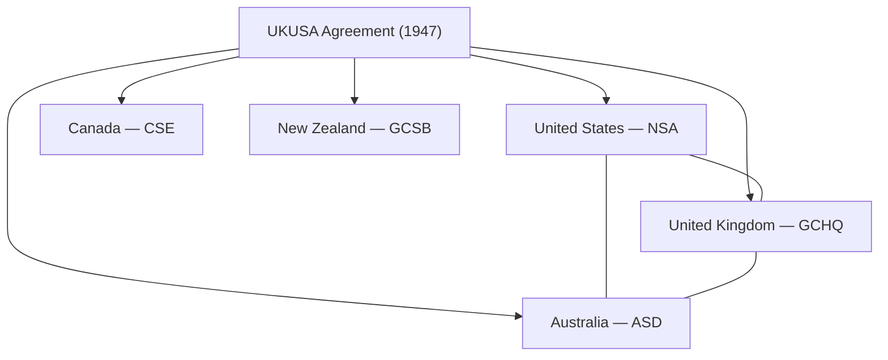

# Investigation: SIGINT — global history, events, and corpus alignment (open)

> **TL;DR:** **Signals intelligence (SIGINT)** — intercepting, processing, and exploiting communications and electronic emissions — is the **invisible war map** behind most modern conflicts. This dossier is the **repo spine** for SIGINT **history and events** (Black Chamber → **ULTRA** → **UKUSA / Five Eyes** → **NSA** → **ECHELON** → **MINARET / Church** → **Tonkin / Hanyok** → **STELLARWIND / PRISM / Snowden**). **Documented:** SIGINT is **legally and operationally distinct** from **HUMINT** (CIA) and from **DOE Q clearance** (Restricted Data — [Q-Anon §Q1.0](/influence/controlled_opposition/investigations/qanon-controlled-opposition-investigation.md#q10--real-world-q-clearance--q-influenced-media-timeline)). **Corpus read:** U.S. **NSA** as **SIGINT antibody** vs **CIA–MI6 infection** ([NSA investigation](/governance/war/investigations/nsa-investigation.md)); **Tonkin SIGINT forgery** as template for casus-belli lies ([good-actor § II.I](/events/false_flag/investigations/good-actor-theory-interagency-antibody-investigation.md)); **Snowden** as payload hitting **NSA** not **CIA** ([Snowden CO](/influence/controlled_opposition/investigations/snowden-wikileaks-cia-aligned-controlled-opposition-investigation.md)); **chan “Q”** as **anti-SIGINT** grammar (tripcodes, no custody — [Q-Anon §Q1.4](/influence/controlled_opposition/investigations/qanon-controlled-opposition-investigation.md#q14--sigint-landscape-pre-qanon--what-intel-really-looked-like-brief)). **Companion (U.S. antibody + *Tron*):** [NSA investigation](/governance/war/investigations/nsa-investigation.md) — do not duplicate § IV there.

**Status:** Open — master chronology + repo crosswalk **2026-08-28**  
**Date:** 2026-08-28

---

## Guide (read order)

| Part | Topic |
|------|-------|
| [§1](#1--definitions-and-lanes) | Definitions — SIGINT vs HUMINT vs COMINT vs ELINT vs Q clearance |
| [§2](#2--global-chronology-master-table) | **Master chronology** — pre-WWII → 2026 |
| [§3](#3--event-deep-dives) | Event deep dives — Tonkin, Church, ECHELON, 9/11-era, Snowden |
| [§4](#4--five-eyes--ukusa) | Five Eyes / UKUSA architecture |
| [§5](#5--u-s-institutional-arc) | U.S. institutional arc — pointer to [NSA investigation](/governance/war/investigations/nsa-investigation.md) |
| [§6](#6--corpus-theory-crosswalk) | **Repo theory crosswalk** — alignment, influence, CO reads |
| [§7](#7--sigint-vs-fake-insider-channels-qanon-etc) | SIGINT vs fake insider channels (Q-Anon, chan) |
| [§8](#8--open-claims-verification-limits) | Open claims, verification, limits |

**Epistemic tiers:** **Documented** = primary / court / agency-published; **Mainstream synthesis** = Wikipedia / press secondary; **Author thesis** = Paradigm Threat pattern read — not default fact.

---

## 1 — Definitions and lanes

| Term | Meaning | Tier |
|------|---------|------|
| **SIGINT** | Intelligence from **signals** — communications content and metadata, radar, telemetry | **Documented** ([NSA glossary](https://www.nsa.gov/)) |
| **COMINT** | Communications intelligence — **content** of messages | **Documented** |
| **ELINT** | Electronic intelligence — non-communication emissions (radar, etc.) | **Documented** |
| **HUMINT** | Human intelligence — agents, defectors, covert access | **Documented** — **CIA lane** in U.S. architecture |
| **OSINT** | Open sources — press, public data | **Documented** |
| **IMINT** | Imagery intelligence | **Documented** |
| **Q clearance** | DOE **Restricted Data** (nuclear weapons design, etc.) — **not SIGINT** | **Documented** — [Q-Anon §Q1.0](/influence/controlled_opposition/investigations/qanon-controlled-opposition-investigation.md#documented-baseline--q-clearance) |
| **Metadata** | Who called whom, when, length — often bulk-collected at scale | **Documented** (post-Snowden public) |

**Corpus distinction (critical):** Real SIGINT flows through **compartmented agencies**, **FISA / oversight fights**, and **historian audits** (Ellsberg documents, **Hanyok** SIGINT study). **Chan “Q”** uses **tripcodes** and **decode cults** — opposite grammar ([Q-Anon §Q1.4](/influence/controlled_opposition/investigations/qanon-controlled-opposition-investigation.md#q14--sigint-landscape-pre-qanon--what-intel-really-looked-like-brief); [Snowden §4 contrast matrix](/influence/controlled_opposition/investigations/snowden-wikileaks-cia-aligned-controlled-opposition-investigation.md#4-two-camp-adjudication--cia-co-primary-vs-nsa-antibody)).

---

## 2 — Global chronology (master table)

| Era | Event / institution | SIGINT role | Tier |
|-----|---------------------|-------------|------|
| **1914–1918** | **Room 40** (British Admiralty) | Naval cable / wireless intercept; foundation of modern Anglo SIGINT culture | **Documented** |
| **1919–1929** | **Black Chamber** (U.S. Cipher Bureau, Yardley) | Peacetime diplomatic cable intercept; shut after **1929** disclosure pressure | **Documented** |
| **1920s–1940s** | **GC&CS → GCHQ** (UK) | British COMINT continuity through WWII | **Documented** |
| **1930s–1945** | **ULTRA** / **Enigma** | Allied break of Axis cipher systems — decisive WWII SIGINT | **Documented** |
| **1940s** | **MAGIC** (Japanese diplomatic / military traffic) | U.S. Pacific SIGINT; **Pearl Harbor** debate includes intercept awareness ([Pearl Harbor investigation](/governance/war/investigations/pearl-harbor-hijacked-imperial-japan-investigation.md)) | **Documented** (intercepts) + **disputed** (foreknowledge) |
| **1943–1980** | **Venona** | Soviet espionage decrypts; long-secret U.S.–UK collaboration | **Documented** (declassified 1990s) |
| **1947** | **UKUSA Agreement** | U.S.–UK SIGINT pact; seeds **Five Eyes** | **Documented** |
| **1949–1952** | **AFSA → NSA** | Truman consolidates U.S. military COMINT under **NSA** (**1952**, NSCID 9) | **Documented** — [NSA investigation § I](/governance/war/investigations/nsa-investigation.md) |
| **1950s–1970s** | **Soviet tap / Berlin tunnel** etc. | Cold War SIGINT vs HUMINT competition | **Documented** (select programs) |
| **Aug 1964** | **Gulf of Tonkin** | Johnson admin cites **NSA SIGINT summaries** for **second attack** → **Tonkin Gulf Resolution** | **Documented** |
| **1967–1973** | **Project MINARET** | NSA watch-list intercept of U.S. persons’ international comms (names from FBI/CIA/DoD) | **Documented** — [NSA investigation § II](/governance/war/investigations/nsa-investigation.md) |
| **1975** | **Church Committee** | Senate exposes MINARET, NSA domestic abuses, intelligence community overreach | **Documented** |
| **1978** | **FISA** + **FISC** | Legal framework for U.S. domestic surveillance targeting | **Documented** |
| **1970s–1990s** | **ECHELON** (reporting name) | Five Eyes global satellite / relay intercept network — **European Parliament** 2001 report | **Documented** (reporting); scope debated |
| **2001** | **9/11** | SIGINT “failure to connect dots” narrative; **STELLARWIND** authorized post-attack | **Documented** (programs per later leaks) |
| **2001** | **Hanyok Tonkin study completed** | NSA historian reconstructs **skewed** Tonkin SIGINT | **Documented** — [Hanyok PDF](https://www.nsa.gov/portals/75/documents/news-features/declassified-documents/gulf-of-tonkin/articles/release-1/rel1_skunks_bogies.pdf) |
| **2002–2005** | **Hanyok declassification fight** | Internal battle → public release **Nov–Dec 2005** | **Documented** — [good-actor § II.I](/events/false_flag/investigations/good-actor-theory-interagency-antibody-investigation.md) |
| **2003–2008** | **Room 641A** (AT&T San Francisco) | Mark Klein allegations — NSA **upstream** collection cooperation | **Documented** (lawsuit / press); litigation details vary |
| **2006–2007** | **Terrorist Surveillance Program** exposure | **NYT Dec 2005** — warrantless wiretap reporting | **Documented** |
| **2013** | **Snowden disclosures** | PRISM, Verizon FISA order, Five Eyes bulk programs | **Documented** — [Snowden investigation §2](/influence/controlled_opposition/investigations/snowden-wikileaks-cia-aligned-controlled-opposition-investigation.md) |
| **2013–2020** | **USA FREEDOM Act** etc. | Post-Snowden statutory tweaks (metadata bulk phone — shifted) | **Documented** (statute) |
| **2016–2020** | **Vault 7** (WikiLeaks) | CIA **cyber tools** leak — **HUMINT/tech lane**, not NSA SIGINT core | **Documented** — [Snowden §6](/influence/controlled_opposition/investigations/snowden-wikileaks-cia-aligned-controlled-opposition-investigation.md) |
| **Oct 2017+** | **Q-Anon “Q”** | **Fake insider** channel — **not SIGINT** | **Documented** origin — [Q-Anon §3.1](/influence/controlled_opposition/investigations/qanon-controlled-opposition-investigation.md#q31--when-was-qanon-founded-and-how-did-platforms-migrate) |
| **2018–2026** | **Havana Syndrome** reporting | **Anomalous health incidents** — diplomatic / personnel; **SIGINT-adjacent** directed-energy debate | **Documented** (incidents); cause **disputed** — [Havana investigation](/science/havana_syndrome/havana-syndrome-investigation.md) |
| **2026** | **Iran / nuclear fuel war** | **DU / latency** board — SIGINT-adjacent **NSA-aligned** fear read in-repo | **Author thesis** — [Iran runner](/governance/war/investigations/iran-2026-war-runner.md); [nukes half-hoax](/science/nukes/investigations/nukes-dont-exist-investigation.md) |

---

## 3 — Event deep dives

### 3.1 Gulf of Tonkin — SIGINT as casus-belli fuse

| Beat | Finding | Tier |
|------|---------|------|
| **4 Aug 1964 (sold)** | **Second** North Vietnamese attack on U.S. destroyers | **Retracted** — Hanyok; NSA 2005 release |
| **White House use** | **NSA SIGINT summaries** treated as **objective proof** | **Documented** |
| **Hanyok audit** | ~**90%** of relevant 4 Aug intercepts **omitted** or **mis-framed** in summaries | **NSA-published** |
| **Curriculum** | Public schools rarely teach Tonkin as **SIGINT-forged war** even post-2005 | **Author observation** — [when-your-child-wont-fit-the-grade](/history/chronology/when-your-child-wont-fit-the-grade.md) |

**Corpus read:** Template for **war lies carried on intercept credibility** — compare [09-11 investigation](/events/false_flag/investigations/09-11-investigation.md) “failure to connect dots” vs **forged / curated** product. **Antibody act:** Hanyok = **SIGINT community auditing its own fuse** ([good-actor § II.I](/events/false_flag/investigations/good-actor-theory-interagency-antibody-investigation.md)).

### 3.2 Church Committee — domestic SIGINT scandal

- **MINARET** + **SHAMROCK** (telegraph cable access) exposed **U.S. person** surveillance without warrants.
- Targets included **MLK**, **Muhammad Ali**, **Frank Church**, journalists — critics of **Vietnam War**.
- **Outcome:** **FISA (1978)** — legalized foreign-intelligence surveillance with **FISC** oversight.

**Corpus read:** Evidence **SIGINT institutions can be weaponized domestically** — then **partially reckoned** ([NSA investigation § II](/governance/war/investigations/nsa-investigation.md)). **CIA** covert culture **not** same statutory cleanup story — **two-camp** spine ([CIA investigation § III](/governance/war/investigations/cia-investigation.md)).

### 3.3 ECHELON — Five Eyes global collection

| Source | Claim | Tier |
|--------|-------|------|
| **European Parliament STOA report (2001)** | Allies operate global intercept system; **ECHELON** reporting name | **Documented** (report exists) |
| **Five Eyes members** | U.S., UK, Canada, Australia, NZ — **UKUSA** derivatives | **Documented** |
| **Scope** | Satellite relays, international telecom — **exact capabilities** partly classified | **Partially documented** |

**Corpus read:** **Anglosphere SIGINT cartel** aligns with [British royalty / deep state](/governance/war/investigations/british-royalty-controlled-scheme-investigation.md) **interpretive** frames — structural, not proof of single authorship.

### 3.4 Post-9/11 — STELLARWIND, upstream collection, Room 641A

| Program / beat | SIGINT role | Tier |
|----------------|-------------|------|
| **STELLARWIND** | Bush-era warrantless surveillance umbrella (details via later leaks) | **Documented** (leak / reporting) |
| **Room 641A** | AT&T facility — **splitter** / upstream collection allegations | **Documented** (Klein declaration) |
| **TITANPOINTE / 33 Thomas** | NSA-linked urban SIGINT architecture (later Snowden reporting) | **Documented** (press + docs) |
| **WTC 7 / NSA NY** | Author thesis: **NSA presence** in **WTC 7** collapse cluster | **Speculative** — [09-11 investigation](/events/false_flag/investigations/09-11-investigation.md) |

### 3.5 Snowden moment (2013) — SIGINT goes public

**Documented payload:** Bulk metadata, **PRISM** provider cooperation, **Five Eyes** agreements, foreign leader targeting (e.g. Merkel reporting).

**Corpus adjudication:**

| Read | Summary | File |
|------|---------|------|
| **CIA-aligned CO** | CIA-pedigree leaker; **damages NSA** public legitimacy; monolith “government spies” lesson | [Snowden §4 Read A](/influence/controlled_opposition/investigations/snowden-wikileaks-cia-aligned-controlled-opposition-investigation.md) |
| **NSA / Tron antibody** | SIGINT auditor vs **MCP** — independent watchdog in new digital vacuum | [NSA investigation § IV](/governance/war/investigations/nsa-investigation.md) |
| **What Snowden did *not* teach** | Tonkin **forgery grammar**, CIA proxy terror, 9/11 deep cut, central banks | [Snowden §3.2](/influence/controlled_opposition/investigations/snowden-wikileaks-cia-aligned-controlled-opposition-investigation.md) |

---

## 4 — Five Eyes / UKUSA

| Function | Notes |
|----------|-------|
| **Division of labor** | Geographic / target sharing — **documented** at high level |
| **Domestic legal dodge (reporting)** | Allies may avoid **domestic** restrictions by partnering — **debated** in ECHELON literature |
| **Repo tie-in** | **Anglophone SIGINT** as **permanent board** behind **CIA–MI6 HUMINT** ops — [good-actor § I](/events/false_flag/investigations/good-actor-theory-interagency-antibody-investigation.md); [Islamabad antibody essay](/governance/war/islamabad-peace-deal-the-war-nobody-cares-about-2026.md) |

---

## 5 — U.S. institutional arc

**Do not duplicate** [NSA investigation](/governance/war/investigations/nsa-investigation.md) — that file owns:

- **MINARET / Church / FISA**
- **Tonkin / Hanyok** antibody narrative
- ***Tron* (1982)** allegory
- **1980s holy-war pivot** (author)
- **Hollywood PP thread table** (§ V)

This SIGINT spine adds **global pre-NSA history**, **UKUSA / ECHELON**, and **repo-wide crosswalk** (§6).

**Timeline chapters (site):**

- [CIA vs NSA: SIGINT Antibody, Tonkin, and *Tron* (1952–1982)](/timeline/evt-cia-vs-nsa-sigint-antibody-tron)
- [2000–2005: Tonkin declass fight vs Mars RV release](/timeline/evt-2000-2005-ce-nsa-tonkin-mars-declass-fight)

---

## 6 — Corpus theory crosswalk

### 6.1 Interagency two-camp model

| Lane | Tool | SIGINT file role |
|------|------|------------------|
| **Infection / war-state** | CIA–MI6 **HUMINT**, proxy wars, media casus belli | **Consumes** SIGINT products (Tonkin); **avoids** SIGINT audit exposure |
| **Antibody / audit** | **NSA SIGINT**, declassification fights, domestic comms watchdog | **Hanyok**, Church reckoning, ***Tron*** read, Ellsberg parallel |

**Spine:** [good-actor investigation](/events/false_flag/investigations/good-actor-theory-interagency-antibody-investigation.md) · [CIA investigation § III](/governance/war/investigations/cia-investigation.md) · [NSA investigation](/governance/war/investigations/nsa-investigation.md)

### 6.2 Document antibodies vs CO leakers

| Actor | Mechanism | SIGINT relevance |
|-------|-----------|------------------|
| **Ellsberg (1971)** | *Pentagon Papers* — **document** war deception | External to SIGINT shop; **complements** intercept audit |
| **Hanyok (2001–05)** | **Internal NSA** SIGINT reconstruction | **Pure SIGINT antibody** |
| **Snowden (2013)** | Leaks **NSA** systems | **Author: CO vs antibody** — [Snowden dossier](/influence/controlled_opposition/investigations/snowden-wikileaks-cia-aligned-controlled-opposition-investigation.md) |
| **WikiLeaks** | Dump franchise; **Vault 7** = CIA tools | Parallel **transparency brand** — selective spine |
| **Chan Q (2017+)** | **No** SIGINT chain of custody | [Q-Anon investigation](/influence/controlled_opposition/investigations/qanon-controlled-opposition-investigation.md) |

### 6.3 Nuclear / DU board (not SIGINT — adjacent)

| Claim | SIGINT relation | File |
|-------|-----------------|------|
| **Half-hoax nukes** | **NSA-aligned** actors feared **DU proxy** more than press/fatwa bomb talk | [nukes dossier](/science/nukes/investigations/nukes-dont-exist-investigation.md) |
| **Q clearance ≠ SIGINT** | Oct 2017 **mis-brands** DOE compartment as intel feed | [Q-Anon §Q1.0](/influence/controlled_opposition/investigations/qanon-controlled-opposition-investigation.md); [Part 7 conclusion](/influence/controlled_opposition/investigations/qanon-controlled-opposition-investigation.md#part-7--conclusion-author-synthesis) |
| **Iran 2026** | Latency / **DU** — briefing-room **imminence** | [CIA fatwa/DU](/governance/war/investigations/cia-investigation.md#authors-opinion-fatwa-depleted-uranium-and-the-real-iranian-nuclear-threat) |

### 6.4 Predictive programming — SIGINT in fiction

| Work | SIGINT / audit read | File |
|------|---------------------|------|
| ***Tron* (1982)** | Independent program **watchdogs MCP** (CIA) | [NSA investigation § IV](/governance/war/investigations/nsa-investigation.md) |
| ***Sneakers* (1992)** | NSA vs CIA vs FBI rivalry | [NSA investigation § V](/governance/war/investigations/nsa-investigation.md) |
| ***Burn After Reading* (2008)** | CIA **SigInt** purge; geolocation forecast | [Hollywood two-camp Thread Q](/influence/hollywood/investigations/hollywood-two-camp-war-investigation.md) |
| ***Half-Life* / Combine** | NSA warning / containment | [Half-Life NSA PP](/influence/predictive_programming/investigations/half-life-2-nsa-combine-warning-containment-investigation.md) |
| ***Children of Men* (2006)** | NSA warning PP | [Children of Men PP](/influence/predictive_programming/investigations/children-of-men-nsa-warning-predictive-programming-investigation.md) |
| ***The Matrix* (1999)** | Passport / surveillance PP | [Matrix containment](/influence/predictive_programming/investigations/matrix-not-like-this-containment-investigation.md) |
| ***Men Who Stare at Goats*** | STAR GATE / RV — **adjacent** to SIGINT compartment | [Goats investigation](/influence/hollywood/investigations/men-who-stare-at-goats-rv-satire-predictive-programming-investigation.md) |

### 6.5 Governance / courts / education

| Topic | SIGINT tie | File |
|-------|------------|------|
| **Captured courts** | **1979 / CIA / NSA** counter-frame vs Zionist headline trap | [BRSINV investigation](/influence/controlled_opposition/investigations/brsinv-st-julian-captured-courts-zionist-framing-investigation.md) |
| **Curriculum omission** | Tonkin **SIGINT lie** dropped from civics while Watergate stays | [childhood conformity investigation](/history/chronology/investigations/childhood-autism-spectrum-conformity-recategorization-investigation.md); [when-your-child-wont-fit-the-grade](/history/chronology/when-your-child-wont-fit-the-grade.md) |
| **NSA-aligned presidencies** | Nixon / Reagan / Trump as **SIGINT-board** reads | [NSA-aligned presidencies](/governance/war/investigations/nsa-aligned-presidencies-nixon-reagan-trump-investigation.md) |
| **COINTELPRO** | FBI domestic ops — **fed** names to MINARET | Church Committee · [presidential alignment](/governance/war/investigations/presidential-alignment-globalist-vs-nationalist-investigation.md) |

### 6.6 Remote viewing / STARGATE (adjacent compartment)

CIA **STAR GATE** / RV programs overlap **intel culture** but are **not classic SIGINT** — same **secrecy grammar**:

- [Mars 1984 RV investigation](/influence/controlled_opposition/investigations/cia-reading-room-mars-exploration-1984-rv-investigation.md)
- [RV two-way / Iran revival](/influence/controlled_opposition/investigations/cia-reading-room-rv-two-way-iran-revival-investigation.md)
- **Parallel declass window** with Hanyok fight — [NSA investigation § III.1](/governance/war/investigations/nsa-investigation.md)

---

## 7 — SIGINT vs fake insider channels (Q-Anon, etc.)

| Property | Real SIGINT product | Chan **Q** / Q-Anon |
|----------|---------------------|---------------------|
| **Source** | Intercept systems, FISA orders, analyst reports | **Tripcode** posts on imageboards |
| **Custody** | Classification, oversight fights, FOIA | **Broken** — [ICWSM 2023](https://ojs.aaai.org/index.php/ICWSM/article/view/19330) |
| **Verification** | Hanyok-style **reconstruction**; court/subpoena in rare cases | **Decode cult** — unfalsifiable |
| **Agency** | **NSA**, GCHQ, Five Eyes | **Disputed** Furber/Watkins — not cleared personnel |
| **Corpus verdict** | **Documented** institution with **abuse** and **audit** history | **Author: CO** harnessing **Q clearance** prestige without SIGINT rigor — [Q-Anon Part 7](/influence/controlled_opposition/investigations/qanon-controlled-opposition-investigation.md#part-7--conclusion-author-synthesis) |

**Author synthesis:** The public ignores **Q-Anon** because **Q clearance ≠ live intel** — correctly. The dossier stake is **different**: real **Q** (nuclear opacity / deep state) is **large**; chan **Q** is **misdirection** that **pollutes** legitimate **SIGINT-audit** literacy (Tonkin, Church, Snowden debates).

---

## 8 — Open claims, verification, limits

### 8.1 Author open claims (registry)

| ID | Claim | Tier |
|----|-------|------|
| S1 | **NSA** functions as **SIGINT antibody** to **CIA–MI6** HUMINT infection | **Author thesis** — [NSA investigation](/governance/war/investigations/nsa-investigation.md) |
| S2 | **Tonkin SIGINT skew** is **template** for later casus-belli intercept theater | **Author pattern** |
| S3 | **Snowden** primary read = **CO** damaging **NSA** while sparing **CIA** spine | **Author thesis** — [Snowden §4](/influence/controlled_opposition/investigations/snowden-wikileaks-cia-aligned-controlled-opposition-investigation.md) |
| S4 | **Five Eyes** = durable **Anglosphere board** above electoral politics | **Author interpretive** |
| S5 | **Q-Anon** is **anti-SIGINT** — mimics insider leak without institutional audit grammar | **Author synthesis** — [Q-Anon](/influence/controlled_opposition/investigations/qanon-controlled-opposition-investigation.md) |
| S6 | **1980s NSA** discovered **CIA holy-war setup** via SIGINT (speculative) | **Open** — [NSA investigation § IV](/governance/war/investigations/nsa-investigation.md) |

### 8.2 Verification checklist

| ID | Task | Priority |
|----|------|----------|
| V1 | **UKUSA** full text / amendments — public redactions vs reporting | Medium |
| V2 | **ECHELON** primary — EP STOA vs national denials | Low |
| V3 | **Hanyok** — curriculum adoption post-2005 by state | Medium |
| V4 | **Snowden** — primary on **classification decisions** vs **release selectors** | High |
| V5 | **9/11** — NSA / WTC 7 occupancy primary stack | Medium |
| V6 | **Chan Q** — FBI / DHS **Q-Anon** influence ops FOIA | High |
| V7 | **STAR GATE** declass bundle vs **2000–2005** Tonkin fight — interagency calendar | Medium |

### 8.3 Related investigations (index)

| File | Role |
|------|------|
| [NSA investigation](/governance/war/investigations/nsa-investigation.md) | U.S. antibody + *Tron* + MINARET/Tonkin detail |
| [CIA investigation](/governance/war/investigations/cia-investigation.md) | HUMINT / covert action counterpart |
| [good-actor investigation](/events/false_flag/investigations/good-actor-theory-interagency-antibody-investigation.md) | Eighty-year antibody arc |
| [Snowden × WikiLeaks CO](/influence/controlled_opposition/investigations/snowden-wikileaks-cia-aligned-controlled-opposition-investigation.md) | 2013 leak adjudication |
| [Q-Anon investigation](/influence/controlled_opposition/investigations/qanon-controlled-opposition-investigation.md) | Fake Q vs real clearance / SIGINT |
| [09-11 investigation](/events/false_flag/investigations/09-11-investigation.md) | Post-9/11 SIGINT expansion |
| [nukes half-hoax](/science/nukes/investigations/nukes-dont-exist-investigation.md) | DU board adjacent to clearance |

### 8.4 Limits and disclaimers

**Prisca sapientia:** This investigation assumes [**prisca sapientia**](/docs/PRISCA_SAPIENTIA.md) — evidence tiers above adjudicate specific claims.

- **Master chronology** is **not exhaustive** of every national SIGINT service (France **DGSE**, Russia **FAPSI/SVR**, Israel **Unit 8200**, etc.) — extend in future passes if needed.
- **Author two-camp reads** (NSA antibody vs CIA infection) are **first-class pattern work**, not proven institutional doctrine.
- **Snowden**, **Assange**, and **Q-Anon** sections **summarize** sibling dossiers — follow links for tiers and falsifiers.
- **Predictive programming** rows are **allegory**, not production proof.
- **Not** legal advice; **not** incitement.

---

Keywords: #SIGINT #NSA #GCHQ #FiveEyes #UKUSA #ECHELON #COMINT #HUMINT #GulfOfTonkin #Hanyok #ChurchCommittee #MINARET #Snowden #PRISM #STELLARWIND #Antibody #ControlledOpposition #QAnon #ParadigmThreatFiles

**Last updated:** 2026-08-28

---

## Investigator notes

- **2026-08-28:** Created as **repo SIGINT spine** per user request — global chronology + §6 crosswalk; **companion** to [nsa-investigation.md](./nsa-investigation.md) (no *Tron* duplication).
- Placement: `governance/war/investigations/`
- Extend next: **Unit 8200**, **French DGSE**, **Russian SORM** if Iran / Ukraine threads need them.
