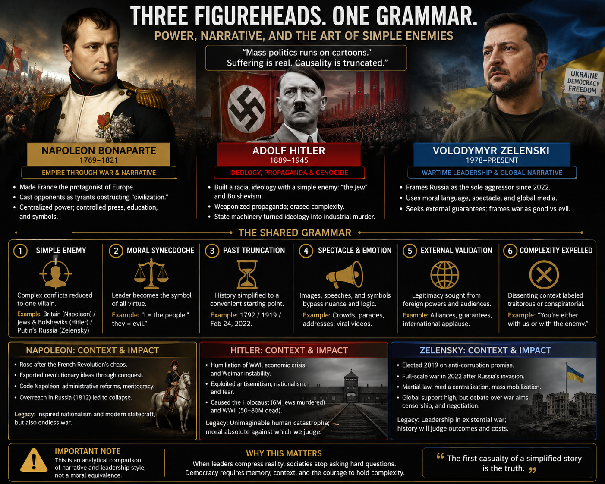

# Zelensky’s letter is a memory weapon

*Forward-only history, buried Holodomor, and the figurehead slot in the fourth reverse crusade*

> **TL;DR:** Zelensky’s **4 June 2026** [open letter to Putin](https://www.president.gov.ua/en/news/vidkritij-list-prezidentu-rosijskoyi-federaciyi-vid-preziden-104769) is **epistemology**, not diplomacy: **2022** as year zero, Russian grievances dismissed in **one sentence**, peace terms shaped like ultimatum. On **Holodomor** soil (~**3.9M** dead, **1932–34**), that truncation repeats Stalin’s habit — **one enemy, one past, no graph**. The same move runs through **Holocaust memory**: a **western camp photograph** replaces the **eastern** killing field; a **single postwar “Jew”** replaces **many prewar Jewish worlds**; **Russia-as-source** (Ostjude, Horde memory, Judeo-Bolshevism) gets **purged** into conspiracy-banned talk. **Hitler** and **Zelensky** share a **figurehead grammar**: moral synecdoche, simple causality, gallery-ready blame — whether or not either man authors the geometry behind him. Full letter TA: [open-letter dossier](https://paradigmthreat.net/governance/war/investigations/zelensky-open-letter-reality-model-investigation.md). Deep memory pass: [Holodomor–Holocaust investigation](https://paradigmthreat.net/governance/genocide/investigations/holodomor-holocaust-memory-redaction-investigation.md).

---

The letter landed after Ukrainian strikes hit **St Petersburg** during the economic forum. Headline: peace. Body: indictment, mockery, **US/EU guarantors**, and boast that the war reached **Russian heartland**. Putin called a meeting pointless. The [investigation](https://paradigmthreat.net/governance/war/investigations/zelensky-open-letter-reality-model-investigation.md) treats the text as a **primary exhibit** of Zelensky’s operative reality model — not as a treaty draft.

---

## Letter mechanics

Zelensky’s voice alternates **Parent** verdict (*“history will remember”*), **Child** taunt (St Petersburg *“paid a visit”*), and a thin **Adult** slice (*“I propose a meeting”*). The package already fixes the **front line**, excludes **Moscow/Kyiv** as venues, and demands **Washington/Brussels** in any security architecture — a **“Why Don’t You — Yes But”** structure: surface offer, built-in escape hatches, payoff in **moral credit**.

The epistemological airlock is one sentence:

> *“Whatever you may say about NATO, geopolitics, or the Russian language, this war is your personal choice — a war without a real cause.”*

**NATO**, **geopolitics**, **language** — named and sealed out. Year zero: **February 2022**. Former FM **Kuleba** (June 2026, Tier B) read the signal as **confidence**, not sincere negotiation — which fits an **open letter**: transparency for **observers**, not a back channel.

---

## Simple enemies — Hitler, Zelensky, and the same grammar

School history teaches **one national timeline per exam**. Zelensky’s letter exports that habit to wartime diplomacy: **simple past**, **simple enemy**, **one face** carrying all sin. The [reverse crusades comparison](https://paradigmthreat.net/governance/war/investigations/reverse-crusades-comparison.md) places **2022** in a **fourth pan-European packaging** after **1812**, **1914**, and **1941**.

**Hitler** operated the same compression — not because every Nazi document was honest, but because **mass politics runs on cartoons**. Rhetoric aimed at **Ostjuden**, **Judeo-Bolshevism**, and **Eastern** alignment; machinery eventually hit **defined Jews** across the Reich on **ancestry law**, not visa status ([Nuremberg Laws — GHDI](https://germanhistorydocs.org/en/nazi-germany-1933-1945/the-reich-citizenship-law-september-15-1935-and-the-first-regulation-to-the-reich-citizenship-law-november-14-1935)). **Words** targeted the **Eastern/Marxist** Jew; **actions** graded **east harder, west softer** — with **Berlin deportations from Oct 1941** as the hinge where **immigrant panic** met **racial removal** ([USHMM German Jews](https://encyclopedia.ushmm.org/content/en/article/german-jews-during-the-holocaust?parent=en%2F11003)).

**Zelensky** compresses **Maidan**, **Minsk**, **2014**, **language law**, and **1932–33** into *“almost half of your 26 years… waging war.”* **Putin** carries all Russian guilt; **Zelensky** carries moral Ukraine — while **MI6 geometry**, **media installation**, and **conscription logistics** stay off-stage. That is **figurehead war**: real suffering, **truncated causality**.

Neither man needs to be a genius. Both need to be **legible** to a gallery that hates **graphs**.

---

## The simplified Jew — before the Holocaust, after the memory

**Author thesis (Tier S unless labeled):** Historians and commemoration often write **“the Jew”** as one actor. Prewar reality was **plural**; postwar memory **collapsed** that plurality into a **single survivor type** — increasingly **Israel-aligned** in Atlantic public life, though many survivors **never** fit that mold (Bundists, Haredim, Soviet Jews, anti-Zionist Orthodox, Mizrahi worlds elsewhere).

### What Nazis actually graded

| Layer | Evidence | Tier |
|-------|----------|------|
| **Rhetoric** — Ostjude, Marxism, “foreign” Jew | Weimar **immigrant** panic; **Judeo-Bolshevism** | **A**–**B** |
| **Law** — Jew by **ancestry**, not assimilation wish | Nuremberg **Nov 1935** supplements | **A** |
| **Gradient** — east harder, Reich west softer until **1941** | Deportation lists; Polish vs Reich survival rates | **A**–**B** |
| **Compliance** — hide names, break community ties, **Mischling** status | Documented **categories**; scale of hidden identity **unquantified** | **B** / **S** |

**Repo read:** Nazi policy **rhymes with immigrant frenzy** in the **1930s** and **racial removal** after **1941**. It does **not** follow that **compliance** reliably saved **defined Jews**, or that **westernized** Reich Jews were **never** targeted — only that **lethal pressure arrived later and unevenly**.

### Russia as regional source — memory severed

Nazi talk **conflated** Jew with **Eastern** and **Russian-revolutionary** threat — a **pogrom ideology** upgraded to state power. **Regional** Jewish cultures (Yiddish east, assimilated west, Sephardi elsewhere) carried **different** legal and social positions. **Only from the east** does the **density of Yiddish / Pale / revolutionary** association make sense as **geography** — without inventing a secret cabal.

**After the Holocaust**, that **eastern source-map** was largely **lost in public**:

- **Money / food / administration** tropes moved to **banned conspiracy** grammar  
- **Crypto-Jew** / **interfaith survival** histories became **untouchable** or **caricature**  
- **“Jew”** simplified to **one** identity slot — producing modern frictions (**Beta Israel** recognition, “who counts as Jewish” fights) when **state and synagogue** pretend **one** definition always existed  

**Tier B:** commemoration politics and **IHRA** memory **flatten** diversity. **Tier S:** the flattening was **necessary** to sever **Horde / Russian** lineage from **Jewish** public memory and **relocate** sacred geography (Palestine, etc.) under **Scaligerian** chronology compression — see [prisca sapientia](https://paradigmthreat.net/docs/PRISCA_SAPIENTIA.md) and chronology investigations; **not** established here as fact.

### Fractured ruling class (Horde memory)

**Tier S:** Pre-modern **ruling networks** spanned **Eurasia**; **1917–45** **fractured** them into **nation-states** where **Jews and others** could hold **local** power — producing **pogrom** chemistry when **old imperial memory** met **new borders**. **Holodomor** and **Holocaust** sit on that **same Bloodlands** strip ([Snyder bridge — dossier §19](https://paradigmthreat.net/governance/genocide/investigations/holodomor-holocaust-memory-redaction-investigation.md#19-bloodlands-frame-snyder--investigative-bridge)); **Reverse Crusade** reads **WWII** as **contain Russia**, not only **defeat Hitler** ([Paperclip file](https://paradigmthreat.net/governance/war/investigations/operation-paperclip-nazi-continuity-and-wwii-narrative-investigation.md)). **Does not follow:** that **Polish** or **Reich** Jewish dead were **only** collateral to a **Russian** sacrifice story — demography still centers **Poland** (~3M Jewish dead) and **mixed** perpetrator geographies.

[Khazars / Cathars split-memory lane](https://paradigmthreat.net/influence/suppression/investigations/cathars-church-purge-khazar-split-investigation.md): **one purge**, **forked labels** — rhymes with **Holodomor vs Holocaust** competition on **Ukrainian soil**.

---

## Holodomor — the genocide class forgot

A decade before peak **Holocaust** killing on overlapping territory, the **Ukrainian SSR** suffered **state-engineered famine**. Best demographic consensus: **~3.9M** excess deaths **1932–34** in Ukraine ([Wolowyna et al., 2015](https://journals.library.ualberta.ca/csp/index.php/csp/article/download/21772/18080/0); [dossier §17](https://paradigmthreat.net/governance/genocide/investigations/holodomor-holocaust-memory-redaction-investigation.md#17-holodomor-demographic-consensus-sheet)). **Soviet memory erased it**; **Western Holocaust machinery** later **displaced** it in classrooms. Western publics still map genocide onto **Belsen/Dachau** (**camp-photo west**) while **most Jewish killing** happened **east of Germany** ([dossier §3, §5](https://paradigmthreat.net/governance/genocide/investigations/holodomor-holocaust-memory-redaction-investigation.md)).

**Dec 1932** Moscow resolutions tied **grain quotas** to **anti-Ukrainization** and **trade starvation** — primary register in [dossier §2.5](https://paradigmthreat.net/governance/genocide/investigations/holodomor-holocaust-memory-redaction-investigation.md#25-moscow-stated-rationales-193233--primary-register). Zelensky’s letter **never names 1932–33**. That omission is **memory war**: **forward history** for the gallery, **buried Holodomor** for the class.

---

## Two camps — denial law and the western photograph

Western **Holocaust** memory often anchors on **spring 1945** liberation imagery inside **Germany** — not **Treblinka, Babi Yar, or 1933 Ukraine**. The [two-camp taxonomy (§24)](https://paradigmthreat.net/governance/genocide/investigations/holodomor-holocaust-memory-redaction-investigation.md#24-two-camp-denial-taxonomy--and-the-containment-read) maps the public fight:

- **Camp 1** — disciplined edge: western **mislabel**, **Allied logistics** at Belsen, plaque math, speech-law chill (**§6–§7**)  
- **Camp 2** — spectacular denial: **no gas chambers**, **6M invented**, **Red Cross cleared Auschwitz** ([§23](https://paradigmthreat.net/governance/genocide/investigations/holodomor-holocaust-memory-redaction-investigation.md#23-meme-dees-typhus-not-holocaust--zyklon-lice-spray-2026-06-05), [§28](https://paradigmthreat.net/governance/genocide/investigations/holodomor-holocaust-memory-redaction-investigation.md#28-icrc-auschwitz-letter-22-nov-1944--pages-12-holocaust_lies1112))

**Containment read (Tier S / ecology B):** Camp 2 **bundles** with Camp 1; institutions **respond to caricature**; **geography critique** becomes **socially toxic**. Denial statutes **exist (Tier A)**; whether they **protect the crop** more than they **restore the Bloodlands map** is **author read (Tier S)**.

**Repo discipline:** **Mass murder east of Germany** is **not** denied ([§5.3](https://paradigmthreat.net/governance/genocide/investigations/holodomor-holocaust-memory-redaction-investigation.md#53-what-we-do-not-claim)). **Real** liberation photos can be **staged-as-framed** (**§7.4 S0–S1**) without **invented** bodies. Zelensky’s **2022** truncation mirrors that: **one moral photograph**, **no east**, **no before**.

---

## Casting, Tonkin, conscription

*Servant of the People* (2015–19) satirized a teacher vaulted to president; **Zelensky** played the role **for real** in **2019** (~**73%** runoff). [Dossier §12](https://paradigmthreat.net/governance/war/investigations/zelensky-open-letter-reality-model-investigation.md#12-servant-of-the-people--actor-first-media-coup-read): **casting precedes policy**.

**Gulf of Tonkin** template ([NSA investigation](https://paradigmthreat.net/governance/war/investigations/nsa-investigation.md)): engage the enemy’s claim **only to negate it**. **Conscription** converts persons into units — **1914**, **1941**, **2022–26** with **mobilization abuse** rumors (Tier **C** until URL-sourced; [dossier weak points](https://paradigmthreat.net/governance/war/investigations/zelensky-open-letter-reality-model-investigation.md#18-weak-points--remaining-research-todos)). **Distributed war** — Atlantic geometry, sanctions, intel feeds, militainment — **outlives any face**.

---

## Where next

- [Open-letter investigation](https://paradigmthreat.net/governance/war/investigations/zelensky-open-letter-reality-model-investigation.md) — full TA, media-coup lanes  
- [Holodomor–Holocaust investigation](https://paradigmthreat.net/governance/genocide/investigations/holodomor-holocaust-memory-redaction-investigation.md) — demographics, §7 staging taxonomy, §29 Paperclip/logistics  
- [Reverse crusades](https://paradigmthreat.net/governance/war/investigations/reverse-crusades-comparison.md) · [Bloodlands appendix](https://paradigmthreat.net/timeline/evt-bloodlands-holodomor-holocaust-continuum) · [Schooling essay](https://paradigmthreat.net/history/chronology/when-your-child-wont-fit-the-grade.md)

---

## Framing and limits

**Prisca sapientia:** [PRISCA_SAPIENTIA](https://paradigmthreat.net/docs/PRISCA_SAPIENTIA.md) — modern consensus not default truth; claims tiered in linked dossiers.

**Holocaust:** **~6M** Jewish dead under Nazi occupation **documented (A)**; this article **re-centers geography and memory**, does **not** deny eastern extermination ([§5.3](https://paradigmthreat.net/governance/genocide/investigations/holodomor-holocaust-memory-redaction-investigation.md#53-what-we-do-not-claim)).

**Simplified Jew / Horde fracture / Scaliger relocation:** **Tier S** unless marked **B** above. **Beta Israel** cited as **contradiction symptom**, not resolved here.

**Hitler–Zelensky parallel:** **structural** (figurehead grammar), not **moral equivalence** of regimes.

**Letter combat stats:** combatant assertions. **Kompromat lanes** in dossier: **Tier S / disinfo catalog** — not expanded here.

Investigation [Limits](https://paradigmthreat.net/governance/war/investigations/zelensky-open-letter-reality-model-investigation.md#limits-and-disclaimers) — full stack.

---

Keywords: #Zelensky #Holodomor #MemoryWar #HolocaustMemory #Ostjude #ReverseCrusades #Ukraine #ParadigmThreatFiles

**Last updated:** 2026-06-05

---

*Written and narrated by Ari Asulin, with drafting and research support from LLM agents.*
