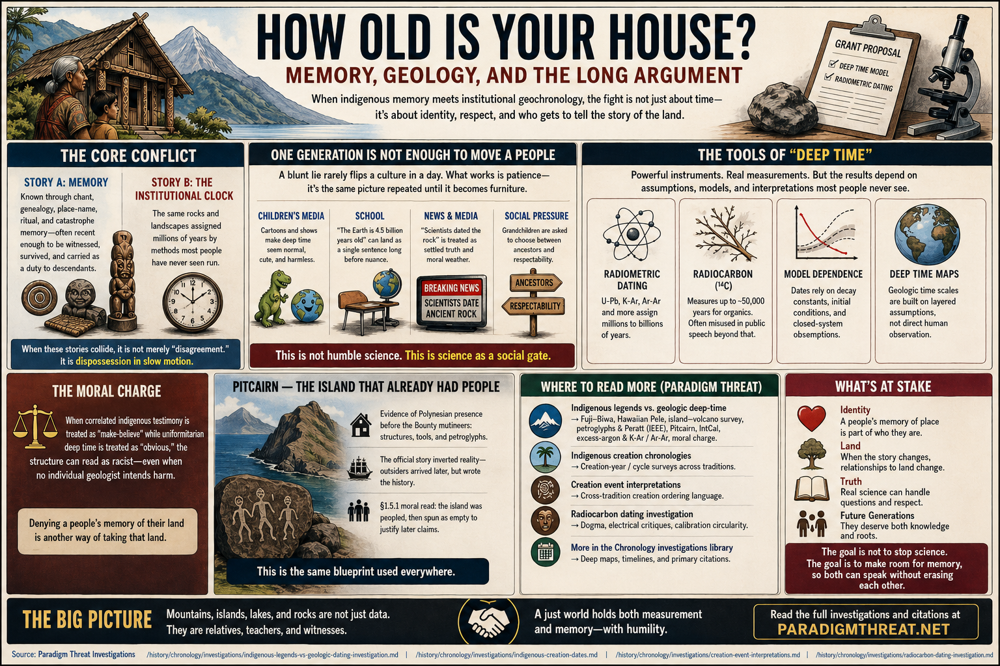

# How old is your house? — memory, geology, and the long argument

Imagine someone walked up to your door with clipboards, grant letters, and quiet confidence. They did not ask how your family remembers the place. They told you, kindly but firmly, that the house itself is roughly **a million years old**—that the timbers, the hearth, the stones you were raised to treat as witnesses to your grandparents’ hands are, in “real” time, almost entirely pre-human. You, they say, only arrived very recently to inhabit something that was never truly yours in the way you thought.

You might laugh them off once. You might answer with stories, songs, or silence. But if the same story returned year after year, in schoolbooks, on screens, in museum placards, in court maps, and in the tone ordinary people use when they say “science,” something else would happen: the house would stop feeling like yours—even if you still remember building it with people you loved.

Chemistry alone cannot touch what is happening here: a relationship to time and land being **rewritten from the outside**.

What happens when indigenous memory—of mountains, islands, lakes, creation, and catastrophe—meets **institutional geochronology** (radiometric stacks, “deep time” maps, and the public certainty that often rides along with them)? Why the fight hurts, and where to read the citations the Paradigm Threat tree has already gathered—without pretending one pass settles every lab bench or every elder’s account.

---

## One generation is not enough to move a people

A blunt lie rarely flips a whole culture in a single afternoon. What does work, across centuries, is patience: the same picture of the world repeated until it becomes **furniture**—something children meet before they meet your stories.

They meet it in cartoons and children’s media (mountains as cute props; planets as mascots; “prehistory” as a harmless wallpaper). They meet it again in school, where “the Earth is 4.5 billion years old” can land as a single sentence long before anyone explains which method measured which object, or where tree rings end and models begin. They meet it again when news treats “scientists dated the rock” as a kind of **moral weather**—settled, adult, serious—while oral tradition is filed under myth, belief, or culture (nice, but not evidence).

So the pressure is not only “new facts.” It is a contradictory dogmatic posture that asks grandchildren to choose between ancestors and respectability—between what was taught at home and what earns a good grade. Call it humble measurement if you like; in practice it often functions as **science as a social gate**.

---

## The controversy in plain clothes

Strip the jargon, and the controversy looks like two incompatible stories about the same places:

- **Story A (memory):** This island, this volcano, this lake, this range, is known through chant, genealogy, place-name, ritual, and catastrophe memory—often as recent enough to be witnessed, survived, or carried as a moral duty to descendants.
- **Story B (the institutional clock):** The same basalt, same shield volcano, same basin, is assigned millions of years by methods most people have never seen run—while radiocarbon (which tops out around tens of thousands of years for organic material) is often used in public speech as if it carried the whole billions-of-years edifice.

When those two stories collide, the pain is not merely “disagreement.” It is **dispossession in slow motion**: the land becomes a textbook object first, and a relative second.

The Paradigm Threat dossier [Indigenous legends vs. geologic deep-time](/history/chronology/investigations/indigenous-legends-vs-geologic-dating-investigation.md) walks that collision with citations: Fuji–Biwa motifs, Hawaiian Pele–chain narrative vs hotspot ages, a Pacific island–volcano survey table, petroglyphs and Peratt’s IEEE plasma–rock-art hypothesis (as a labeled physics lane—not merged with every oral claim), Pitcairn pre-mutineer material culture plus §1.5.1 moral read, radiocarbon IntCal extensions beyond annual rings, and the excess-argon debate as an entry point into K-Ar / Ar-Ar on basalts. It also names the **moral charge** plainly: when correlated indigenous testimony is treated as make-believe while uniformitarian deep time is treated as obvious, the structure can read as racist even when no individual geologist intends harm.

For creation-year / cycle surveys (another face of the same wound), see [Indigenous creation chronologies](/history/chronology/investigations/indigenous-creation-dates.md). For cross-tradition creation ordering language, see [Creation event interpretations](/history/chronology/investigations/creation-event-interpretations.md). For radiocarbon dogma, electrical critiques, and calibration circularity as the repo frames them, see [Radiocarbon dating — dogma and the electrical activity problem](/history/chronology/investigations/radiocarbon-dating-investigation.md).

---

## Pitcairn — the island that already had people

On Pitcairn, the material record is blunt: Polynesian structures, tools, and petroglyphs sit under the mutineer story the wider world prefers. People were there before the *Bounty* party landed. The record is mainstream enough to name without whispering: **place-memory** and marks on stone against a new population carrying imperial paper and romance—the same collision as above.

Then the island’s human layer was moved and thinned again and again: British administration, evacuations and returns (including the nineteenth-century Norfolk episode and the Tahiti attempt), a micro-state with a tiny electorate and extreme isolation. The linked dossier lays that stack out as documented history—start at [§1.5.1](/history/chronology/investigations/indigenous-legends-vs-geologic-dating-investigation.md#151-pitcairn--replacement-evacuation-and-what-the-author-reads-as-step-one-harm) in [Indigenous legends vs. geologic deep-time](/history/chronology/investigations/indigenous-legends-vs-geologic-dating-investigation.md).

**Polynesian continuity** was interrupted; **imperial romance** sat on top of older marks; later the public record includes UK-linked prosecutions and convictions for sexual offences involving minors. Downstream of power, isolation, and broken lineages, that record reads as more than a footnote. The tidy “unrelated” vacuum story fails; so does mono-cause proof on this page—§4 and Limits in the dossier carry what survivors and law-shaped language require.

**Epstein-island** as media earworm for private islands: only rhetoric of isolation and asymmetry here; the dossier states legal boundaries in plain type.

Broader European colonialism and missions (including Jesuit histories in some regions) regulated, moralized, expanded, and exploited commercial sex in colonized space in ways historians still unpack. Structural parallel: persuasion in remote places, then institutional distance from what society becomes. In that polemical light, modern field geology can look **Jesuit-like**—thin experts in faraway landscapes, high confidence aimed at young people, a universal timeline aligned with metropolitan “globalist” time—followed by shrugs when industrialization, war enlistment, or ethnic consolidation show up later.

Japan and Hawaiʻi—heavily colonized in mind and institution, both caught inside World War II in ways no single sentence can explain. Counterfactual: *if* elders’ legends had not been trained out as childish fantasy beside deep-time pedagogy, *perhaps* Japan would have been less primed for imperial identification, *perhaps* Hawaiʻi could have stayed further from total war integration. Pacific War scholarship still owns the multi-cause factual story; the cost of treating indigenous time as optional still belongs in the account.

---

## A literary war that never ends — and “progress” that keeps stoking it

If the modern world were steadily closing the gap—if each new instrument narrowed the uncertainty and restored respect for multiple knowledge lines—you could call that progress in the humane sense.

What many people experience instead is an everlasting literary controversy over what is real: dueling blogs, dueling papers, dueling “debunks,” dueling documentaries—sides that grow louder whenever a new dating headline drops. Radiocarbon revolutions reshaped what counted as “history” in archaeology journals (see the dossier’s bridge cite to *Radiocarbon*, “We’re all cultural historians now…”). IntCal work openly depends on non-annual archives beyond continuous tree rings—coral, speleothems, varves—technical honesty that rarely arrives in the sentence a child hears: “this part is **model-bound**.” Excess-argon fights on volcanic rocks become **culture-war fuel** (young-Earth compilations vs mainstream rebuttals) even when the original question was humble: what date does this sample deserve, and why?

Each “advance” too often feeds the flame: more specialism, more authority distance, more reason for a young person to believe that elders “just don’t understand science”—while elders often do not see the funding stack, the calibration curve, the press release, or the classroom sentence that smuggles metaphysics inside metrics.

**Divide and conquer** need not arrive as a stamped memo; very often it lands as an outcome: memory on one side, respectability on the other—and both poorer for it.

---

## Where rigor lives

Evidence tiers, legal boundaries on analogies, numbered open claims, and the Pacific War counterfactual lane live in [Indigenous legends vs. geologic deep-time](/history/chronology/investigations/indigenous-legends-vs-geologic-dating-investigation.md) (Limits, §1.5.1, §4).

---

## Where to go next (questions worth holding)

- [Common Questions — Q2: physical dating as an “independent check”](/history/common-questions.md#q2-can-physical-dating-methods-tree-rings-ice-cores-radiometric-dating-be-trusted-as-independent-checks-on-chronology)
- [Common Questions — Q3: indigenous origin stories](/history/common-questions.md#q3-do-all-indigenous-civilizations-really-share-the-same-origin-story-or-are-the-similarities-just-universal-human-patterns)
- [Earth history timeline — chronology hub](/history/chronology/page.md) (Saturnian alternate history framing; search in-page for indigenous, petroglyph, Peratt)

Voices who sharpen the “memory vs closure” case in print—Deloria, Tuhiwai Smith, Cruikshank, Kamakau / Malo / Beckwith / hoʻomanawanui, Mason’s archaeology–oral-tradition dialogue—start in [§2.1](/history/chronology/investigations/indigenous-legends-vs-geologic-dating-investigation.md#21-authors-who-sharpen-the-case-indigenous-decolonial-place-memory-vs-deep-time-closure) in the dossier, then follow its links.

---

Keywords: #IndigenousMemory #OralTradition #Geochronology #DeepTime #ParadigmThreatFiles #ColonialScience #Radiocarbon #PlaceMemory #Pitcairn

**Last updated:** 2026-04-30

---

*Written and narrated by Ari Asulin, with drafting and research support from LLM agents.*
