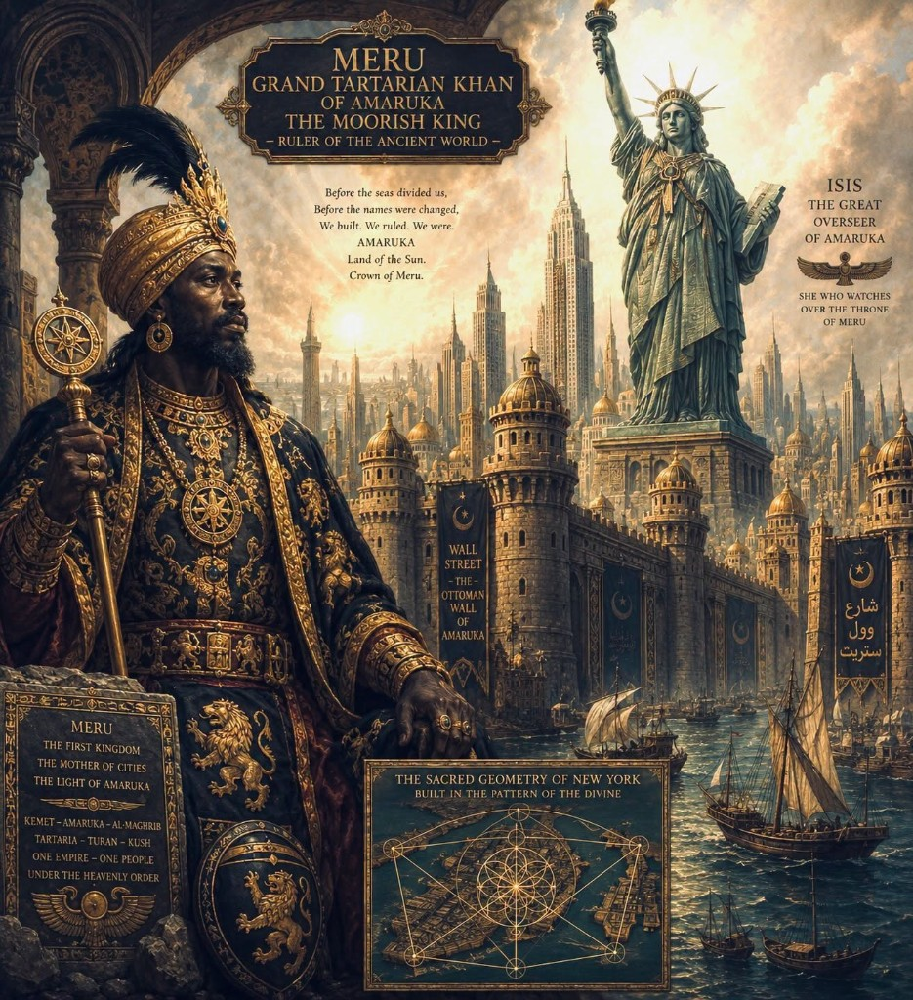

# Amaruka / Khan Meru Royalty & Wall Street as Ottoman Wall — Redaction Investigation

> **TL;DR:** Open investigation of whether **two linked claims** are **true but redacted**: **(1)** **Amaruka / Khan Meru / pre–Civil War royalty** on the Atlantic / New York horizon; **(2)** **Wall Street** named for an **Ottoman (Amaruka) wall**, with **Dutch New Amsterdam wall-history** as a **shell / misdirection** ([R6](/docs/REDACTION.md)). **Author lock (§1.1 / §5.1):** **“black king” did not mean African** — *black* was a period label for the **East** and for peoples outside narrow white/red/yellow bins; the real black Moor king would look **Russian / Asian**, possibly dark-skinned, **not African descent**. Circulating **Meru / Amaruka** poster and Charles Ross post are **context sparks only** (AI illustration noted once). Cross-links: [Franklin Boors/Moors](/history/chronology/investigations/franklin-palatine-boors-moors-screenshot-investigation.md) (**black German King George II** gloss), [Georgia AU-033](/history/chronology/investigations/georgia-mirror-naming-rus-horde-mars-investigation.md) (**George II shell**), [Moorish ten-presidents §2b](/history/chronology/investigations/moorish-ten-presidents-liberia-record-investigation.md) (**black king / Moor king** status misread), [europe whitewash](/history/chronology/investigations/europe-white-bloodline-complexion-whitewash-investigation.md), [slave-trades / Moorish Revival](/governance/slavery/slave-trades-and-moor-etymology-investigation.md), [Tartarian maps](/history/mudflood/investigations/tartarian-maps-investigation.md).

**Status:** Open — author thesis registered (incl. black≠African lock); handbook baselines logged; primary hunt not closed.  
**Date:** 2026-07-24  
**AU candidate:** **AU-038** (package: Meru/Amaruka royalty + Wall Street Ottoman wall + Dutch shell + black=eastern lock)

**Lexical / redaction cluster:** [Lexical redaction hub](/history/chronology/investigations/lexical-redaction-hub-investigation.md) — **Lane A** (label / translation politics); [REDACTION.md](/docs/REDACTION.md) — **R3/R5/R6** on toponym + king-name.

---

## Guide (read order)

| If you want… | Section |
|--------------|---------|
| Method + redaction ops | §0 |
| Author thesis (why this file exists) | §1 |
| Context artifacts (poster / Ross) | §2 |
| Claim 1 — Amaruka / Khan Meru / pre–Civil War royalty | §3 |
| Claim 2 — Wall Street = Ottoman Amaruka wall | §4 |
| Bridge — King George / “black King George” | §5 |
| **Author lock — black ≠ African; black = eastern** | §1.1, §5.1 |
| Alignment / difference vs Charles Ross lane | §2.1 |
| Moor-lane placement | §6 |
| Handbook closure (Dutch wall story) | §7 |
| Author open claims registry | §8 |
| Falsifiers / archive targets | §9 |
| Weak points / TODOs | §10 |

---

## 0. Method — investigating redacted truth, not meme forensics

**Repo rule:** This dossier **tests whether the author’s claims can be true under redaction**, not whether a social-media collage is a primary source. Per [Cherokee / Moorish cluster method](/history/chronology/investigations/cherokee-moors-lenape-delaware-moor-label-investigation.md) **§0 / §0.1**: name **handbook baselines**, keep **author thesis first-class**, treat **CO memes** as deliberate traps (**AU-042**), and **do not** treat easy debunk of viral art as **closure** on the stratum behind the garble.

**Honeypot risk (qualified):** Shares that glue **Tartaria + Moor + NYC** into one AI tableau are **easy to laugh off**. Debunkers may stop at “fake art” and never ask whether **Wall Street’s wall** or **pre–Civil War Atlantic sovereignty labels** were **substituted**. This file **does not** validate Meru-as-census-king from the poster; it **keeps the redaction question open**.

### 0.1 Applied redaction tags ([REDACTION.md](/docs/REDACTION.md))

| Op | How it would apply if thesis holds | Tier today |
|----|-------------------------------------|------------|
| **R3 Substitutive** | *Amaruka* / *Meru* / *khan* vocabulary swapped for *America* / *George* / *Dutch colony* | **Inferred** (author) |
| **R5 Flattening** | Multi-polity Atlantic / Horde–Ottoman memory → one Dutch trading-post + British king story | **Inferred** |
| **R6 Shell / misdirection** | Publish **respectable Dutch wall + Waalstraat** subset; withhold Ottoman / Amaruka fortification lane | **Inferred** — **core Claim 2** |
| **R1 Subtractive** | Omit ruler lists, charters, resident lineages before Civil War that would name Meru / Moor royalty | **Inferred** |
| **R4 Inversive** (strongest bar) | Victim/settler polarity flip — if later “colonists” were **vassals** of prior khanate | **Speculative** until primary |

**Absence of dig / newspaper proof is not a falsifier** under [prisca sapientia](/docs/PRISCA_SAPIENTIA.md) + erasure expectations — same posture as [Moorish Revival America scar](/governance/slavery/slave-trades-and-moor-etymology-investigation.md) mosque/masjid photo corpus.

---

## 1. Author’s originating thesis

**Author (2026-07-24, session) — claims under investigation as potentially true but redacted:**

1. **Amaruka / Khan Meru / pre–Civil War royalty** existed on the American / New York horizon and was later erased or renamed.  
2. **Wall Street = Ottoman Amaruka wall**; **Dutch history** of the wall / street-name is **fake** (shell narrative).

**Related author bridge (same session):** The **Moorish king** figure remembered in folk/MST channels is the sovereign later printed as **King George of Britain**, sometimes **“the black King George.”**

### 1.1 Author lock — “black king” did **not** mean African

**Author (2026-07-24, reply posture to Charles Ross lane — verbatim sense):**

> Black king **DID NOT MEAN AFRICAN**. Black also meant **eastern** at the time. It was a label for everything **not white / red / yellow** etc. The real “black” Moor king would have looked **Russian / Asian** and may have had **dark skin** too, but **not African descent**.

**What they mean (unpack):**

| Point | Stakes |
|-------|--------|
| *Black* ≠ modern US “Black / African American” | Period color-talk was a **taxonomy bin**, not a Sub-Saharan ancestry claim. |
| *Black* ≈ **eastern** | Same speech field as Franklin **swarthy** Russians/Germans and “black German King George” gloss — **East / Horde horizon**, not Maghreb-as-Africa only. |
| Outside white/red/yellow bins | “Black” soaked up **everyone not in the narrow white (and parallel color) slots** — a **catch-all imperial other**, later **literalized** into African phenotype art. |
| Phenotype of the real Moor king | **Russian / Asian** look; **may** be dark-skinned; **not** African descent. AI/MST posters that paint Meru as Maghrebi/African king are **downstream costume**, not the author’s ID. |

**Repo rhyme (not proof of Meru):** [Franklin §24](/history/chronology/investigations/franklin-palatine-boors-moors-screenshot-investigation.md) *swarthy* Europeans; [Benjamin essay](/history/chronology/lost-tribe-of-benjamin-apotheosis-and-monotheisms-war.md) George-in-the-East; [moorish §2b/E](/history/chronology/investigations/moorish-ten-presidents-liberia-record-investigation.md) Chermnaya→Chernaya + **status Moor ≠ census race**; [europe whitewash](/history/chronology/investigations/europe-white-bloodline-complexion-whitewash-investigation.md) — quote *swarthy/Moor*, do not silently upgrade to modern *black*.

**This lock is first-class author thesis** for how this dossier reads Ross-adjacent shares. It **does not** deny African Moors in other lanes (Barbary, Atlantic); it **blocks** collapsing **black King George / Meru** into **African descent**.

### What Claims 1–2 mean (unpack)

| Surface claim | Pattern stakes |
|---------------|----------------|
| **Amaruka / Meru royalty** | America was not an empty Dutch/English plot until 1620s–1860s; a **khanate / Moor-status royalty** sat on the land-memory before the Civil War cut. |
| **Wall Street Ottoman** | The **wall** that names the street is **imperial Ottoman–Amaruka fortification**, not a 1653 Dutch palisade invented for English/Native scare stories. |
| **Dutch history fake** | Schoolbook New Amsterdam is **R6** — a **respectable subset** that **misdirects** from prior sovereignty. |
| **George = redacted Meru** | Hanover **Georgius** brand **launders** (AU-033 rhyme) a **Moor-status / black-king** identity — pigment and turban memes are **downstream literalizations**. |
| **Black = eastern, not African** | §1.1 — major difference from timeline art that paints Meru as African. |

**This section establishes why the investigation exists for Paradigm Threat.** Claims 1–2 are **not** automatic fact; §1.1 is **author lock** on label meaning. Evidence tiers below adjudicate.

---

## 2. Context artifacts (spark only)

**Poster (study copy):** `amaruka-khan-meru-wall-street-ottoman-wall-investigation.png`

Visible claim-stack on the image (for inventory, not proof):

- Header: **MERU GRAND TARTARIAN KHAN OF AMARUKA THE MOORISH KING**  
- Banner: **WALL STREET — THE OTTOMAN WALL OF AMARUKA**  
- Liberty labeled **ISIS THE GREAT OVERSEER OF AMARUKA**  
- Tablet: Kemet–Amaruka–Al-Maghrib–Tartaria–Turan–Kush as one empire  
- Map inset: Manhattan under Flower of Life / “sacred geometry”

**Ross post (context):** `amaruka-khan-meru-wall-street-ross-post-context.png` — Charles Ross (Jul 2026) entertains that construction photos of **Moorish Amaruka / Old Troy / New Yort** were **fake history**, and that if so the original king was **Khan Meru** with **Moorish lineage** before the Civil War. Tags: `#meru #khanate #amaruka #blackamerican #tartarianempire`.

**Context note:** The Meru poster is an **AI illustration** used here only as a **claim inventory / folk-magnetism spark**. This dossier does **not** treat image forensics as the investigation.

### 2.1 Alignment with Charles Ross — and the one major difference

| Lane | Alignment |
|------|-----------|
| Meru / Amaruka / pre–Civil War Moorish royalty as **possible redacted truth** | **Aligned** — open Claims 1 |
| Wall / New York / “Old Troy–New Yort” as **fake or shell history** over older sovereignty | **Aligned in spirit** — Claim 2 (Dutch shell); Ross emphasizes fake construction photos |
| Tartaria / khanate tags | **Aligned as folk magnetism** — map-label Tartaria is a real fragment |
| **“Black” Moor king = African / Black American ancestry** | **Author difference (§1.1)** — **black meant eastern / non-white-bin**, **not African descent**; phenotype **Russian / Asian** (possibly dark-skinned) |

---

## 3. Claim 1 — Amaruka / Khan Meru / pre–Civil War royalty

**Author claim:** A **Khan Meru** (Moorish / Tartarian-framed) **royalty** held status in **Amaruka** (America) **before the U.S. Civil War**, later redacted.

### 3.1 Validation / status matrix

| # | Sub-claim | Status | Notes |
|---|-----------|--------|-------|
| 1.1 | Word **Amaruka** as ancient indigenous name for America | **Open / folk lane** | Circulates in MST / Afrocentric / online Tartaria remix. Handbook: *America* ← **Amerigo Vespucci**. Under redaction thesis, handbook etymology is **closure**, not automatic falsifier — needs **pre-1800** Atlantic print with *Amaruka* / cognates. |
| 1.2 | **Meru** as NYC / Atlantic khanate seat | **Not yet validated** | Handbook **Meru** = Hindu/Buddhist sacred mountain cosmology. **No** primary ruler list, coinage, charter, or gazette naming **Khan Meru** of New York located in this session. |
| 1.3 | **Pre–Civil War Moorish royalty / residents** on Atlantic seaboard | **Investigative** | Partial real fragments elsewhere: Delaware **“Moors”** as Lenape label ([Cherokee dossier](/history/chronology/investigations/cherokee-moors-lenape-delaware-moor-label-investigation.md)); Barbary / Moorish Revival scars ([slave-trades](/governance/slavery/slave-trades-and-moor-etymology-investigation.md)). **Does not** yet equal Meru NYC. |
| 1.4 | **Tartarian** / **Grand Khan** language | **Partial — real fragment** | Early-modern maps label NE Eurasia **Tartaria** / Great Khan ([tartarian-maps](/history/mudflood/investigations/tartarian-maps-investigation.md)). Relocating that khanate onto Manhattan is **author extension**. |
| 1.5 | Construction / “Old Troy / New Yort” photos are fake → therefore Meru true | **Logic open / weak as proof** | Conditional dissolves evidence; useful as **folk unease** signal, not as closed demonstration. Parallel mudflood “fake construction photo” grammar. |
| 1.6 | One empire: Kemet + Maghrib + Tartaria + Turan + Kush + Amaruka | **Speculative mega-merge** | Same **lane-merge** risk as Cherokee Moors pasting Delaware law onto Oklahoma. Test **pieces**, not the collage. |

### 3.2 What would raise Claim 1

- Pre-1861 Atlantic (esp. NY/NJ) print, map legend, court roll, church register, or traveler diary naming **Meru**, **Amaruka**, **khan**, or **Moorish king** as **local sovereign** (not Maghreb tourist metaphor).  
- Continuity between **Troy / New York** folk renames and **imperial** toponyms (Fomenko Troy/Yoros rhyme is Eurasian — bridge needs American primary).  
- Portrait / seal / coin chain later **reassigned** to Hanover **George** (see §5).

### 3.3 What would lower Claim 1 (without closing redaction entirely)

- Demonstrable **invention date** of *Amaruka* / *Khan Meru* in **20th-c.** MST literature with **no** earlier trail.  
- Continuous Dutch/English municipal archive for Manhattan **without** anomalous sovereignty vocabulary — still compatible with **R1** erasure, so **not** sole falsifier.

---

## 4. Claim 2 — Wall Street = Ottoman Amaruka wall (Dutch history shell)

**Author claim:** The wall that names **Wall Street** was an **Ottoman Amaruka** fortification; the story that it was a **Dutch New Amsterdam palisade (~1653)** later named *de Waalstraat* is **fake history** (**R6** shell).

### 4.1 Handbook baseline (closure layer — logged, not default truth)

| Element | Handbook story | Sources (closure) |
|---------|----------------|-------------------|
| Wall built | Dutch **palisade** / defensive wall, **c. 1653**, New Amsterdam | Standard NYC municipal / colonial histories |
| Threat framing | English and/or Native attack scare | Same |
| Street name | Street along the wall → **Wall Street** (Dutch *Waalstraat* / wall street) | Etymology handbooks |

Under [prisca sapientia](/docs/PRISCA_SAPIENTIA.md), this is the **establishment closure layer** to be **tested**, not obeyed.

### 4.2 Author counter-read

| Handbook piece | Author substitution |
|----------------|---------------------|
| Dutch built the wall | Wall already **Ottoman / Amaruka / Horde-civilizational** fortification |
| Named for Dutch wall | Named for **Ottoman Amaruka wall** (folk banner language may preserve truth) |
| 1653 as origin | **Backdated** or **reassigned** construction credit (**R3**) |
| English/Native threat story | **Misdirection** covering prior imperial police/toll/fort function (**R6**; rhyme to Barbary tribute-as-toll in [slave-trades](/governance/slavery/slave-trades-and-moor-etymology-investigation.md)) |

### 4.3 Status matrix

| # | Sub-claim | Status | Notes |
|---|-----------|--------|-------|
| 2.1 | A **physical wall** stood on the line later called Wall Street | **Compatible with both lanes** | Existence of a wall is not the dispute; **who built / whose empire** is. |
| 2.2 | Street named **because of a wall** | **Compatible with both lanes** | Toponym *wall* + *street* fits Ottoman-wall thesis **and** Dutch-wall thesis. |
| 2.3 | Builders / sovereign = **Dutch West India Company colony** | **Handbook validated / author disputed** | Author: **shell**. Needs Dutch primary that **cannot** be read as later overlay. |
| 2.4 | Builders / sovereign = **Ottoman Amaruka** | **Open — author** | No session hit yet for 17th-c. Dutch/English text saying **Ottoman wall** at Manhattan. Crescent/star on viral banners ≠ archival proof. |
| 2.5 | Dutch history of the wall is **entirely fake** | **Open — strong form** | Soft form: Dutch **repaired / renamed / claimed** an older wall. Hard form: **no** Dutch wall-event at all. Soft form is easier to evidence; hard form needs total archive failure or proven forgery. |
| 2.6 | **Ottoman** here = Maghrebi/Turkish national state of textbook 1653 | **Category caution** | Repo often uses **Ottoman ↔ Rus-Horde** civilizational rhyme (crescent, turban, mosque-form America). Clarify whether Claim 2 means **textbook Ottoman Empire outpost** or **Horde-Ottoman imperial form** on American soil ([moorish §0 iconography](/history/chronology/investigations/moorish-ten-presidents-liberia-record-investigation.md)). |

### 4.4 What would raise Claim 2

- Pre-1653 European or Atlantic map/text describing a **wall / fort** at Manhattan under **Ottoman, Moor, Tartar, khan, or Maghreb** vocabulary.  
- Dutch sources admitting **re-use** of an older wall, or anomalous masonry vs 1650s timber-palisade story.  
- Continuity with American **mosque / masjid** photo corpus and Moorish Revival scar thesis ([slave-trades](/governance/slavery/slave-trades-and-moor-etymology-investigation.md)) — fortification as same civilizational kit.  
- Etymology path where *Wall* encodes **more than** English/Dutch “wall” (pun / calque field) — speculative until primary.

### 4.5 What would lower Claim 2

- Continuous 1640s–1660s Dutch municipal orders, pay records, and eyewitnesses for **new** palisade construction **with timber sourcing**, inconsistent with re-use — still leave soft form (claiming credit) open.  
- Proven **first attestation** of “Ottoman Wall of Amaruka” only in **21st-c.** social media.

---

## 5. Bridge — King George / “black King George” as redacted Meru

**Author bridge:** The Moorish king (Meru) was **written as** Britain’s **King George**, sometimes **“the black King George.”**

### 5.1 What “black” means here (**author lock** — see §1.1)

| Reading | Status in this dossier |
|---------|------------------------|
| *Black king* = **African / Sub-Saharan descent** | **Rejected as author meaning** — major difference from MST/timeline art that paints Meru African |
| *Black* = **eastern** / outside white–red–yellow bins | **Author lock** |
| Real black Moor king phenotype | **Russian / Asian**; **may** have dark skin; **not African descent** |
| Later African-looking Meru posters | **Downstream literalization** of the label — costume, not ID |

### 5.2 Repo layers (hinge table)

| Layer | Repo status | File |
|-------|-------------|------|
| Franklin authentic text names George II “black” | **Absent** — not in *Observations* | [Franklin dossier](/history/chronology/investigations/franklin-palatine-boors-moors-screenshot-investigation.md) |
| Compilation page: “black German King, George the 2nd” | **Documented as circulating gloss**; book hunt open | Same + [Benjamin essay](/history/chronology/lost-tribe-of-benjamin-apotheosis-and-monotheisms-war.md) |
| Author: George’s world eastern / swarthy (Russia–Horde map) | **Interpretive** — **rhymes §1.1** | Benjamin essay |
| George II as **laundering shell** over older George/Mars | **Author AU-033** | [Georgia mirror](/history/chronology/investigations/georgia-mirror-naming-rus-horde-mars-investigation.md) |
| “Black king” = Chermnaya→Chernaya status misread + Moor as status | **Author + Fomenko rhyme** — **≠ census race** | [Moorish ten-presidents §2b/E](/history/chronology/investigations/moorish-ten-presidents-liberia-record-investigation.md) |
| Meru **≡** George (closed identity) | **Open / speculative ID** | This file — **do not close** without print/portrait/seal chain |

**Working posture:** The **George / black-king** lane is the **strongest existing PT hinge** for Claim 1’s *royalty redacted into British print*. Read **black** as **eastern / non-white-bin** (§1.1), not African descent. It does **not** yet prove the name **Meru**.

---

## 6. Placement in the Moor lane cluster

| Lane | Role for this investigation |
|------|----------------------------|
| **A. Maghrebi / Mediterranean Moor** | Costume + Barbary/Ottoman vocabulary; possible civilizational kit for “Ottoman wall” |
| **B. Delaware Indian “Moor”** | Proves American **Moor** label is **not** Maghreb-only — **geography ≠ NYC** |
| **C. MST / Amaruka / MUURS** | Primary **folk voice** of Meru/Amaruka shares; treat as **memory garble**, not automatic ur-text. **Where Lane C paints Meru African**, author **parts** (§1.1) |
| **D. Tartaria map label** | Real Eurasian cartography; Manhattan relocate = extension |
| **E. Mudflood / fake construction photos** | Ross conditional; evidence-dissolving if used alone |

**Forced-split rhyme:** [Europe whitewash §2c](/history/chronology/investigations/europe-white-bloodline-complexion-whitewash-investigation.md) — Boors/Moors disconnection. This dossier asks whether **Dutch Wall Street** is another **forced split** from **Ottoman/Amaruka fortification** memory.

---

## 7. Handbook closure — Dutch Wall Street story (contrast only)

Recorded so investigators know what they are testing against:

1. New Amsterdam under Dutch West India Company.  
2. Wall / palisade **c. 1653**.  
3. Street along the wall becomes **Wall Street**.  
4. British takeover **1664** → English municipal continuity.  
5. Later finance district identity is **economic history**, not etymology of *wall*.

**Author:** steps 1–3 are the **shell**. Finance-era Wall Street can sit on a **renamed imperial wall** without contradicting Claim 2.

---

## 8. Author’s open claims (registry)

| ID | Claim | Prior art in repo? | Label |
|----|-------|-------------------|-------|
| **AU-038a** | **Khan Meru** / **Amaruka** royalty real on Atlantic horizon before Civil War; later redacted | Partial rhyme only (Moor labels, Tartaria maps, black-king misread) | **Author** |
| **AU-038b** | **Wall Street** named for **Ottoman Amaruka wall** | Not previously dossiered as such | **Author** |
| **AU-038c** | **Dutch** New Amsterdam wall history is **fake** (**R6**) | Soft form rhymes with mosque-scar / architecture redaction; hard form new | **Author** |
| **AU-038d** | Meru identity **printed as** King George / “black King George” | Franklin gloss + AU-033 + §2b black-king — **ID link new** | **Author** |
| **AU-038e** | **“Black king” ≠ African descent** — *black* = **eastern** / outside white–red–yellow bins; real Moor king phenotype **Russian / Asian** (possibly dark-skinned) | Rhyme: Franklin *swarthy*, Benjamin East-map, Fomenko Chermnaya, europe whitewash quote-discipline; **phenotype lock author** | **Author lock** |

Registered in [author-unique theories](/history/chronology/investigations/author-unique-theories.md) as **AU-038**.

---

## 9. Questions to clarify, verify, or debunk

| # | Hook |
|---|------|
| 1 | Earliest **dated** use of *Amaruka* / *Amaruqa* / cognates in Atlantic print or oral collections? |
| 2 | Any **pre-1861** NY/NJ source naming **Meru**, **khan**, or **Moorish king** as local sovereign? |
| 3 | Dutch 1650s **pay warrants / timber orders** for the Manhattan wall — new build vs repair language? |
| 4 | Any early map legend **Wall** / **Waal** with **Ottoman, Turk, Moor, Tartar** gloss at Manhattan? |
| 5 | Continuity between **Troy, NY** / “New Yort” folk talk and imperial Troy/Yoros (Fomenko) — American primary? |
| 6 | Portrait or seal chain: **George II** likenesses vs “Swarthy Kings” / Moorish Science king iconography — pigment politics only, or identity stack? (**Do not** treat African-looking AI Meru as the answer — §1.1) |
| 7 | Clarify author: **Ottoman** = textbook empire outpost, or **Horde–Ottoman civilizational form**? |
| 8 | Soft vs hard Dutch-fake: re-credit of older wall, or **no Dutch wall-event**? |
| 9 | Period lexicons: attest *black* / *swarthy* / *Moor* as **eastern / non-white-bin** (not African-only) in 17th–18th-c. English — strengthen §1.1 with dated cites |

---

## 10. Weak points / TODOs

- [ ] Anna’s Archive / IA grep: `Amaruka`, `Khan Meru`, `Ottoman Wall` + Manhattan / New York  
- [ ] Pull Dutch primary excerpts (municipal) for 1653 wall — quote repair vs new-build verbs  
- [ ] Cross-check [Occupy Wall Street](/governance/war/investigations/occupy-wall-street-controlled-opposition-investigation.md) — finance symbolism only; no etymology claim there  
- [x] Add **AU-038** row to author-unique registry  
- [x] Author lock §1.1 / **AU-038e** — black ≠ African; black = eastern; Russian/Asian phenotype  
- [ ] Decide soft vs hard form of Claim 2 with author (§9 Q8)  
- [ ] Period lexicon cite bank for §1.1 (§9 Q9)

---

## Related investigations

| Topic | Link |
|-------|------|
| Franklin Boors/Moors + black George II gloss | [/history/chronology/investigations/franklin-palatine-boors-moors-screenshot-investigation.md](/history/chronology/investigations/franklin-palatine-boors-moors-screenshot-investigation.md) |
| Benjamin essay — George-in-the-East | [/history/chronology/lost-tribe-of-benjamin-apotheosis-and-monotheisms-war.md](/history/chronology/lost-tribe-of-benjamin-apotheosis-and-monotheisms-war.md) |
| Georgia / George II shell | [/history/chronology/investigations/georgia-mirror-naming-rus-horde-mars-investigation.md](/history/chronology/investigations/georgia-mirror-naming-rus-horde-mars-investigation.md) |
| Black king / Moor king status | [/history/chronology/investigations/moorish-ten-presidents-liberia-record-investigation.md](/history/chronology/investigations/moorish-ten-presidents-liberia-record-investigation.md) |
| Delaware Moor label | [/history/chronology/investigations/cherokee-moors-lenape-delaware-moor-label-investigation.md](/history/chronology/investigations/cherokee-moors-lenape-delaware-moor-label-investigation.md) |
| Slave trades / Moorish Revival America | [/governance/slavery/slave-trades-and-moor-etymology-investigation.md](/governance/slavery/slave-trades-and-moor-etymology-investigation.md) |
| Tartarian maps | [/history/mudflood/investigations/tartarian-maps-investigation.md](/history/mudflood/investigations/tartarian-maps-investigation.md) |
| Europe Boors/Moors forced split | [/history/chronology/investigations/europe-white-bloodline-complexion-whitewash-investigation.md](/history/chronology/investigations/europe-white-bloodline-complexion-whitewash-investigation.md) |
| Redaction ops | [/docs/REDACTION.md](/docs/REDACTION.md) |

---

Keywords: #Amaruka #KhanMeru #WallStreet #OttomanWall #NewAmsterdam #DutchShell #MoorishKing #BlackKingGeorge #BlackMeansEastern #Tartaria #Redaction #ParadigmThreatFiles #AU038

**Last updated:** 2026-08-03

---

## Limits and disclaimers

**Prisca sapientia (epistemic foundation):** This investigation assumes [**prisca sapientia**](/docs/PRISCA_SAPIENTIA.md)—the historical and philosophical belief that the ancients possessed a vast, profound understanding of the universe, nature, and theology that was subsequently lost or degraded. Modern consensus science and institutions are not treated as default truth; evidence tiers below adjudicate specific claims.

- **Author thesis sections (§1, §8)** are **first-class** reasons this file exists; Claims 1–2 are **not** automatically factual. **§1.1 / AU-038e** is **author lock** on *black* ≠ African descent.  
- **Handbook Dutch Wall Street** story is logged as **closure contrast**, not endorsement.  
- **MST / Amaruka / Tartaria** social media is **folk magnetism** — may garbled-encode real strata; literal collage claims (incl. **African Meru**) are not proof and **conflict** with §1.1.  
- Circulating **Hebrew Israelite** / **Moorish American** / race-replacement rhetoric is **not endorsed**; see [working definition of antisemitism](/history/chronology/investigations/paradigm-threat-working-definition-antisemitism.md).  
- **“Ottoman”** in this file may mean textbook empire **or** Horde–Ottoman civilizational form — keep §9 Q7 open.  
- **Barbary / African Moor** involvement in slavery ([slave-trades](/governance/slavery/slave-trades-and-moor-etymology-investigation.md)) remains **validated** in its own lane — **not** the phenotype of **black King George / Meru** under §1.1.  
- Study images are **context**; not museum accessions.

## Investigator notes

- Study copies: `amaruka-khan-meru-wall-street-ottoman-wall-investigation.png` (Meru poster); `amaruka-khan-meru-wall-street-ross-post-context.png` (Ross Facebook post).  
- Session origin: 2026-07-24 chat — author reframed from meme-debunk to **open redaction** on Claims 1–2; AI art = context only; **§1.1** black≠African / eastern lock from reply-to-Charles sentiment.  
- Canvas: `~/.cursor/projects/home-ari-dev-pt/canvases/amaruka-khan-meru-claim-analysis.canvas.tsx` (analysis board).  
- Prior Moor/Boor spine: Franklin + Cherokee + moorish-ten-presidents + slave-trades.
