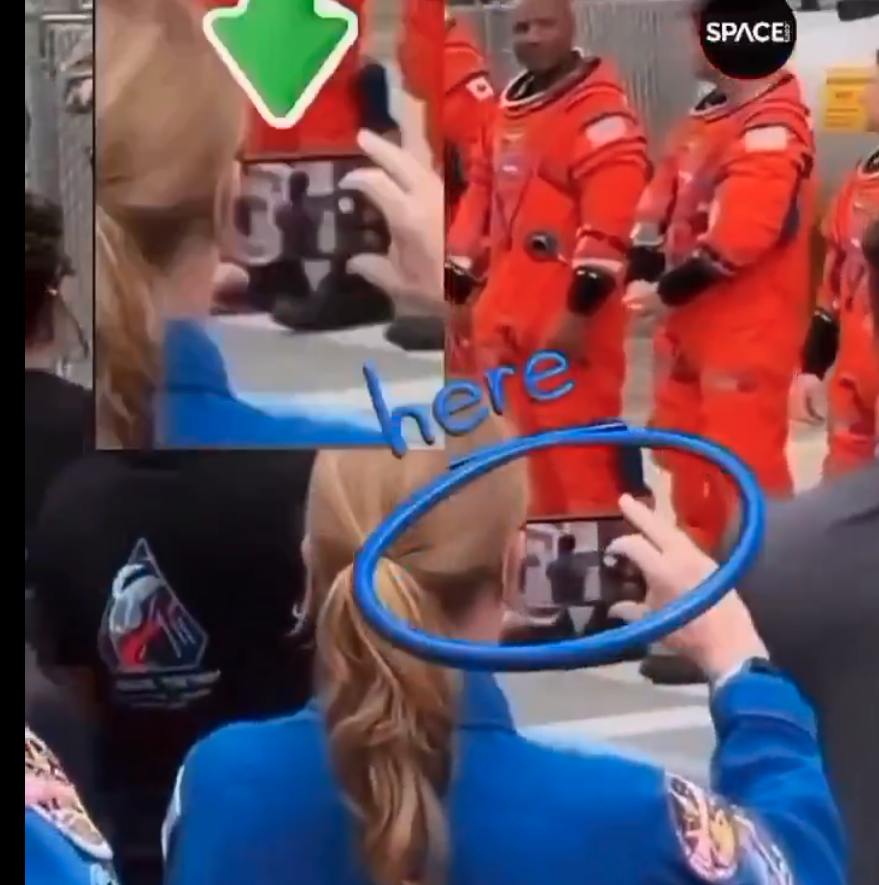

# Investigation: Artemis II — Mission as Faith Test, Staged-Production Readings, and Foreign-Press Patterns

## Summary

**Claim (investigation thesis):** The Artemis II lunar flyby campaign (launch targeted April 2026 after multiple slips; crewed Orion flight) is better read as a **public liturgy and loyalty test** than as a neutral science milestone. In this reading, the mission’s **media surface** (delays, viral “glitches,” AI-slop counterfeits, and polarized debate) functions as **divide-and-conquer**: most people cheer and trust institutional narrative; skeptics receive **enough contradiction to argue forever** without receiving **court-grade proof** of a hoax. A related suspicion is that **low-effort “mistakes”** in distributed footage are not random leaks but **controlled ambiguity**—the smallest flake of theory—so populations fight each other over interpretation while **faith in the agency** hardens among supporters.

**Addendum (faith-test mechanics):** The same episode can offer **footage that reads as plainly contradictory** *and* a **ready-made official explanation** that **sounds** technical and convinces **a large public**—while **failing to add up** for viewers who **already saw** the contradiction as **semantic** (e.g. text-like structure where it should not appear), not as “noise.” In that split, **persuasive debunk** is not the opposite of the thesis; it **is** part of the **test of faith** (which side you join after the explanation lands).

**Status:** Open. This file documents the thesis, mainstream and fact-check accounts, and web citations **for and against** a “staged mission” reading. It does **not** adjudicate physics or flight hardware; it maps **information dynamics** and **foreign press** behavior. **§13** records **institutional NASA** as the author reads it—**rhetoric**, **tax**, and **church** parallels—not a duplicate of the Artemis II hardware question.

---

## 1. Mainstream account (NASA and major outlets)

Official and wire-level reporting describe Artemis II as the **first crewed flight** of Orion / SLS-class stack on a **lunar flyby** profile (no landing), with extensive pre-launch delays tied to **wet dress rehearsal** issues (e.g. hydrogen, valves, helium flow, weather). Outlets framed a **successful** flight and splashdown in the Pacific in the April 2026 window.

**Representative sources:**

- NASA event and schedule framing: [Artemis II — NASA](https://www.nasa.gov/event/artemis-ii-launch/)
- Delay reporting (engineering and schedule): [NASA delays launch of Artemis II lunar mission by a month — NPR](https://www.npr.org/2026/02/03/nx-s1-5698214/nasa-artemis-ii-launch-delay-moon), [NASA's Artemis II lunar mission may not launch in March — NPR](https://www.npr.org/2026/02/21/nx-s1-5722339/nasa-artemis-ii-march-launch-delay)
- UK popular astronomy press on windows and rollout: [When will Artemis II launch? — BBC Sky at Night Magazine](https://www.skyatnightmagazine.com/news/when-will-artemis-ii-launch)
- Mission-follow coverage (splashdown narrative): [Artemis 2 splashdown / mission updates — Space.com](https://www.space.com/news/live/artemis-2-nasa-moon-mission-updates-april-10-2026)

**Investigation note:** The thesis section below **disputes** the epistemic weight of this package (trust in video, institutional narration, and “science event” framing), not necessarily every engineering bullet in isolation.

---

## 2. Thesis: “Science event” vs “faith event”

**Author framing (recorded here as hypothesis):**

- **Primary reframing:** Treat Artemis II’s **public-facing layer** as a **test of faith** in NASA and the Western space-state story—analogous to how religious liturgies test adherence when empirical ambiguity exists.
- **Divide and conquer:** The population splits into **cheerleaders** (no incentive to audit) and **skeptics** (incentive to audit). The middle is eroded: **argument replaces coalition**; **no shared evidentiary standard** survives the noise floor.
- **Generational targeting:** The campaign speaks to **young people** who might once have dreamed of crewed flight the way an older cohort dreamed in the Apollo era—**aspiration capture** as loyalty capture.
- **Lex Luthor parallel (cultural analogy):** In the 2025 *Superman* film, allies assist Luthor under **money, ideology, and fear** despite the operation’s moral color. The analogy here: **contractors, broadcasters, and secondary narrators** can be threaded into a deceptive production **without** each participant holding a single shared “script”—**incentives and fear** suffice. *Analogy only; not a claim about any named individual.*

**“Sloppy stage” hypothesis:** Viral anomalies (below) are read by some as **incompetent staging**—**low-grade actors** and **bad compositing**. The investigation adds an alternative: **sloppiness as signal**—just enough for **factional warfare**, not enough for **forensic conviction**.

---

## 3. Viral “hoax” strand — what circulated (April 2026)

Skeptical narratives clustered around:

1. **CNN interview / “Rise” plush (zero-G indicator):** A clip of crew interview footage showed odd **text-like artifacts** on the mission mascot **Rise**; many viewers called it **green-screen / chroma failure**. The clip often spread as **phone footage of a TV**, not a direct rip of a clean feed.
2. **Harness / green-screen stills:** Images of astronauts in harness-like rigs before green screens circulated; fact-checkers flagged **AI-generated** or **tool-generated** origins in prominent cases.
3. **Broader “fake space” memes:** Hashtags and repackaged Apollo-denial tropes resurfaced alongside **new AI slop** (e.g. fantastical Moon imagery, non-realistic spacewalk framing).

**Pro-hoax / skeptic commentary (secondary press):**

- [Artemis II Is 'Fake' Theory Explained — *Science Times* (summarizes flat-Earth / social voices)](http://www.sciencetimes.com/articles/61639/20260411/artemis-ii-fake-theory-explained-flat-earthers-claim-nasa-moon-mission-100-theatre.htm)

Treat influencer quotes therein as **claims**, not independent verification.

---

## 4. Debunking strand — official fact-checks and tech press

**Core debunk:** The **Rise** anomaly is widely attributed to **broadcast graphics / failed text overlay** on syndicated feeds, **not** to NASA’s master camera files—and secondarily to **re-capture** (e.g. phone pointed at a TV), which fact-check copy often bundles with **moiré / compression / overlay stacking**. **§5** marks the **totalizing** “phone/TV/subpixel” **comfort explanation** as **HARD LIE** (faith-test closure) **while** citing **imaging literature** that **does** document **real** phone–display artifact classes—**without** equating them to any **particular** viral clip’s **meaning-level** contradiction.

- [Artemis II broadcast error used to stoke false claims mission was staged — AFP Fact Check](https://factcheck.afp.com/doc.afp.com.A6WV668) (quotes UC Berkeley’s Hany Farid on overlay failure; compares viral clip to CNN YouTube upload)
- [NASA's Artemis II: conspiracy theories take off about ‘staged’ green screen — FRANCE 24 English (YouTube)](https://www.youtube.com/watch?v=4mJhY5zVo2s) — walks through **phone-off-TV**, **SynthID** on faked stills, and **AI garbage** in parallel.
- [Artemis II Conspiracy Theory Explained — IBTimes UK](https://www.ibtimes.co.uk/artemis-ii-green-screen-glitch-conspiracy-1790582) — summarizes viral spread and **alternate explanation** (re-encoding / social clip path).
- [Viral photos used to claim Artemis II footage is fake are actually AI fakes — Digital Camera World](https://www.digitalcameraworld.com/tech/artificial-intelligence/viral-photos-being-used-to-claim-artemis-ii-footage-is-fake-are-actually-ai-fakes-themselves-oh-the-irony) — **BBC Verify** / **SynthID** angle on counterfeit “evidence.”
- [Artemis II lunar mission draws flood of conspiracy theories — CBS19 (AFP wire)](https://www.cbs19news.com/artemis-ii-lunar-mission-draws-flood-of-conspiracy-theories/article_1c8f4980-c755-5bfb-8b5c-df201faa3680.html) — disinformation researchers on **reflexive fakery** claims; quotes experts.

**Investigation takeaway:** The debunk layer is **coherent** if one accepts **broadcast-chain optics** and **AI pollution** as sufficient explanation. The thesis section asks whether **that same structure** can still serve **social control** (faith testing) **even when** many anomalies are **mundane**—and whether **“mundane” explanations that satisfy crowds** can still operate as **closure that does not satisfy witnesses**.

---

## 5. Contradiction + canned explanation; the “phone / TV” debunk (author mark: **HARD LIE** as totalizing story)

### 5.1 Two-step pattern (author thesis)

1. **Contradictory footage:** Material circulates that **reads** as impossible under the official scene description (e.g. **text-like** behavior on a physical prop in ways viewers map to **compositing**, not to “random noise”).
2. **Pre-prepared explanation:** A **technical-sounding** account arrives **immediately** in the fact-check ecosystem—often **before** any serious witness-led inventory of **primary** feeds. The promoters of that account are **already positioned** to explain *this* contradiction (because the contradiction was **anticipated in narrative planning**, in the author’s reading—not because every engineer conspired, but because **media ops** are **pre-cleared**).

**Crowd vs witness:** A **huge** fraction of people find the official explanation **convincing**; that **majority assent** is **part of the faith test** for those who **do not** find it convincing—they must either **silence themselves**, **accept minority status**, or **escalate** into unpublishable territory.

### 5.2 Author position: the pop “phones filming TVs / subpixels / compression” package

**Marked claim (maintainer):** The **glib** line that **“phones filming TVs see subpixels, compression, and broadcaster overlays”**—offered as **full** explanation for **why** the viral clip **disagrees** with the clean CNN/YouTube rip—is treated here as a **HARD LIE** in the **investigation sense**: a **misdirection** that **functions** as **final** closure for the faithful **without** addressing the **witness** who already parsed **contradiction at the level of meaning** (structured glyphs on an object, not “wavy rainbow moiré”).

**Tighter author axiom:** **No phone ever shows anything but the preview / pipeline image**—never a **naive optical truth** of “the TV’s subpixels as such.” What you get is **ISP output**: demosaicing, tone mapping, sharpening, **then** re-encoding. Invoking “subpixels” as if the viewer were **directly** sampling the **display lattice** like a microscope is **the wrong model** for what people are arguing about in the **Artemis** clip dispute; the author reads that swap as **deliberate dim-minded comfort food** for one faction in the **test of faith**.

**Investigation label:** **HARD LIE** = **not** (yet) a court finding; = **this file’s** formal flag that the **totalizing pop-debunk** is **epistemically dishonest** as **closure** for the **Rise**-style controversy **unless** a **primary-feed** comparison is accepted **by the witness** as resolving **their** contradiction. Third-party assent and **expert branding** do not void that flag for the **unconvinced** observer.

### 5.3 Citations that exist *against* absolute “there is no phone–display interaction” (physics and imaging literature)

These sources **do not** prove any **particular** viral clip was **only** physics; they **do** show that **imaging an emissive display with a smartphone** is a **known** failure mode producing **structured** artifacts—so anyone asserting **both** “zero grid interaction” **and** “all pop debunks are physics-illiterate” would need a narrower argument.

- **Rolling shutter / row-wise readout:** CMOS **rolling shutter** means **not all rows** share one **instant** of scene time; interaction with **PWM / refresh** can yield **banding** and **partial exposure** effects. See [Rolling shutter — Wikipedia](https://en.wikipedia.org/wiki/Rolling_shutter).
- **Moiré + flicker-banding when mobile phones capture screens:** Peer-style preprint on **joint moiré and flicker-banding** from **smartphone** capture of **displays**, explicitly modeling **rolling shutter** × **display** modulation: [Combined Flicker-banding and Moiré Removal for Screen-Captured Images — arXiv 2602.01559](https://arxiv.org/html/2602.01559v1) (abstract and §1 describe **real degradations** when **photographing display screens with mobile devices**).

**Fork for readers:** If you **accept** the author’s **HARD LIE** mark, the **fork** is: **(A)** the **institutional** story misused **real** display-capture physics as a **blunt instrument** to **shut down** meaningful debate, or **(B)** the **physics papers** describe **orthogonal** failure modes from the **actual** objection. This file **does not** choose **(A)** vs **(B)**; it **requires** **primary-feed** dispute resolution **per clip**, not **crowd** closure.

### 5.4 Why “just use real phones in orbit” still fails the public (unchanged structural point)

Crew video is **downlinked, encoded, re-broadcast, re-compressed**. A smartphone on Earth in a viral chain **never** receives **raw** orbital sensor data; it receives **media economics**—**whether or not** a given **Earth-side** re-capture story is honest.

**Thesis-compatible extension (speculative):**

- If ambiguity were **useful**, **no additional** stage fakery would be **required** for every row of pixels—**distribution** alone manufactures **fight fodder**. The public still **never** gets **unmediated** phone video **from orbit** in Twitter threads; it gets **products**.

### 5.5 “HARD LIE” clip — crowd, phones, preview vs orange/red suits (**primary post located**)

**What the maintainer describes (the viral line, not the Rise/CNN story):**

- **Scene:** Astronauts in **bright orange / International Orange** suits (reading as **red-orange** on camera) **among spectators** at walkout-style event; people hold **phones** to film.
- **Claimed anomaly:** On at least one phone’s **live preview** / viewfinder, the **framing does not match** what the eye sees—**little or no orange/red**; instead a **dark silhouette** or **single figure** reading as **generic** vs the **vivid suited crew** in the real scene. Annotated reposts circle the phone and zoom the preview to stress the mismatch.

**Primary citations (X / Twitter) — same walkout / phone-preview issue, different posts:**

| Role | Status ID | Link |
|------|-----------|------|
| Annotated / quoted repost | `2043936717103665271` | [x.com/i/status/2043936717103665271](https://x.com/i/status/2043936717103665271) |
| **Longer mirror** (fuller clip / context) | `2043861546057773398` | [x.com/i/status/2043861546057773398](https://x.com/i/status/2043861546057773398) |

**Archive** both (e.g. archive.today); X links **rot**.

**Quoted overlay / caption from the viral chain (English translation of the thesis, not independent verification):**

> We knew that astronauts didn't actually board the rocket and that the footage inside the rocket was studio work, but this footage is legendary:  
> In the scene where the astronauts begin their journey toward the rocket, the spectators are taking photos, but the astronauts aren't visible in the camera view of their phones. Even this scene isn't real.

**Screenshot archived in this repo** (annotated still: crowd, **Space.com**-branded source corner, phone circled “here,” inset zoom on preview showing **dark silhouette** vs **orange suits** in-scene):

**Investigation status:** This is the **specific** incident behind the maintainer’s **HARD LIE** reaction to **glib** “phones filming TVs / subpixels” debunks when applied to **this** clip: the objection is **not** “moiré on a TV,” it is **preview pipeline vs physical scene** in a **crowd** context.

**Fact-check gap (unchanged in kind):** As of this writing, **no** AFP / Reuters / BBC Verify / FRANCE 24 / ITV / IBTimes / Digital Camera World / Snopes article has been seen that **names this walkout-preview claim** or **debunks it under this description** (they still cluster on Rise, AI stills, SynthID). That **absence** is **not** proof the claim is true; it is a **catalogue** gap.

**Closest “official” video of the *same kind of scene* (four suited crew, crowd, phones—April 1, 2026 walkout):** [NBC News — crew greets crowds](https://www.youtube.com/watch?v=rxUtgfltbu4), [VideoFromSpace — walkout and drive to pad](https://www.youtube.com/watch?v=fJBHhDx5ZoY), [NASA still — Artemis II Walkout](https://www.nasa.gov/image-detail/artemis-ii-walkout/). Compare **primary** broadcast **to** the viral post **frame-by-frame** if disputing compositing.

**Non-committal technical hypotheses (not conclusions):** Odd preview behavior could in principle include **exposure / HDR** crushing color on the **rear screen** while the **saved file** differs, **portrait / subject-tracking** UI, **reflection** of a different subject, **compression** in a **reupload chain**, or **edited** viral still—each needs **file-level** analysis. This file **does not** pick one without **primary** video file and **sensor** metadata.

**Witnesses:** Additional **mirrors**, **archives**, or **provenance** for the X post are still welcome via usual **Paradigm Threat** / repo channels.

### 5.6 Online references — this walkout / phone-preview claim vs “preview ≠ scene” (general tech)

**Search log (open web, April 2026):**

- The **X status IDs** for [post 1](https://x.com/i/status/2043936717103665271) and [post 2 (longer mirror)](https://x.com/i/status/2043861546057773398) did **not** surface in generic web search indexes (common for **ephemeral** social URLs). Discovery remains **direct link**, **screenshot**, or **in-repo** archive.
- **Artemis II — “glitch” / hoax coverage** in mainstream and fact-check outlets **does not** address the **walkout + spectator phone preview** thesis. Articles cluster on **(a)** **Rise / CNN** interview and **phone-filming-TV**, **(b)** **AI** green-screen **stills**, **(c)** **SynthID**. Examples (same cluster as §4 / §10): [AFP — broadcast error / staged claim](https://factcheck.afp.com/doc.afp.com.A6WV668); [FRANCE 24 — Truth or Fake](https://www.france24.com/en/tv-shows/truth-or-fake/20260409-nasa-s-artemis-ii-conspiracy-theories-take-off-about-staged-green-screen); [PRIMETIMER — “video glitch” / false claims](https://www.primetimer.com/features/artemis-ii-video-glitch-sparks-false-claims-that-nasa-mission-was-fake) (still **Rise/broadcast-layer** framing in the fact-check ecosystem, **not** walkout preview); [Digital Camera World — AI “evidence”](https://www.digitalcameraworld.com/tech/artificial-intelligence/viral-photos-being-used-to-claim-artemis-ii-footage-is-fake-are-actually-ai-fakes-themselves-oh-the-irony).

**General smartphone “preview vs what you get” (not NASA-specific):** Users often report **live preview** differing from **saved** image—**HDR**, **exposure**, **compression**, **display** gamut. Discussion threads (illustrative, not peer-reviewed): [Quora — preview vs saved quality](https://www.quora.com/Is-it-just-me-who-thinks-the-quality-of-photos-is-better-in-preview-of-camera-particularly-smartphone-camera-and-the-quality-decreases-when-you-see-the-saved-image); [Straight Dope — preview vs final](https://boards.straightdope.com/t/why-do-my-phone-digital-camera-pictures-look-different-from-the-preview-screen/660535). **Apple Support Community** threads on **washed / wrong colors** in close-ups and **HDR** rendering (e.g. [washed color close-ups](https://discussions.apple.com/thread/254601222), [Photos HDR rendering](https://discussions.apple.com/thread/251965469)) — **lock exposure** is a common mitigation. **Adobe / Premiere** community notes on **iPhone HDR (HLG)** vs **SDR monitors** explain **systematic** “looks wrong off-phone” effects ([example thread](https://community.adobe.com/questions-729/making-your-iphone-12-and-13-footage-look-normal-avoiding-blown-out-footage-1387063)).

**Segmentation / “subject” pipeline (possible rhyme with **silhouette**-like previews):** Phone **Portrait** modes rely on **alpha matting** and **depth**; **Google Research** describes **silhouette / illuminated-background** capture for training matting ([Accurate Alpha Matting for Portrait Mode — Pixel 6](https://research.google/blog/accurate-alpha-matting-for-portrait-mode-selfies-on-pixel-6/)). That does **not** prove any **specific** walkout phone was in Portrait mode; it only shows **commercial** pipelines **do** separate **subject** from **background** in ways that can look **unlike** a naive optical view.

---

## 6. Foreign sources — hoax endorsement vs debunk (search log, April 2026)

**What we found:**

- **Non-U.S. outlets debunking or contextualizing** the green-screen viral wave include **AFP** (France), **FRANCE 24** (French international English service), and **BBC**-linked verification cited via UK-oriented tech press—not state ministries, but clearly **non-American** editorial desks participating in the **debunk** cluster.
- **We did not locate** (in this pass) a **major foreign state wire** or **state space agency** officially endorsing the thesis “Artemis II was a hoax” with **independent tracking data**. Russian and Chinese **science bloggers** and **English-language aggregators** circulate **speculation** (e.g. anomaly narratives in other domains); nothing in the quick survey rose to **government-verified falsification** of the mission.

**Investigation note:** **Silence is not proof** of anything. Possible reads include: (a) **no foreign power** gains from picking this fight; (b) **all major powers** share **ISS-era** and **deep-space tracking** culture—**embargoing** a hot take is safer than **accusation without hardware evidence**; (c) **hypothesis space** (author): a **Cold War–descended international security / aerospace bloc** may align **narrative** more than national flags suggest—**unfalsifiable** from open sources here.

Record as **open**: If readers have **primary non-English** sources that **assert hoax with technical specifics** (radar, ranging, independent optical), they should be added with **date, author, and institutional backing**.

---

## 7. Strategic reads (hypotheses — low confidence until sourced)

These are **political-strategic** extensions, not technical proofs:

- **Stalling human spaceflight:** A **permanent fog** of **AI fakes + viral debunks** raises the **cost of public trust**; **real** programs can be **delayed** while **budgets and territorial consolidation** proceed on Earth.
- **“Only when no one can challenge”:** Mirrors older **gatekeeping** narratives in this repo’s war and governance investigations—see [British divide-and-conquer — Israel](/governance/war/investigations/british-divide-conquer-israel-investigation.md) and [CIA investigation](/governance/war/investigations/cia-investigation.md) for **pattern** language, not as **dependencies** of this file.

---

## 8. Open questions

1. **Independent tracking:** Which **non-NASA** entities published **ephemeris / ranging** consistent or inconsistent with a translunar Orion state vector for the flight days (amateur radio, optical, allied agencies)?
2. **Primary foreign ministry statements:** Did any **G20** foreign ministry or **space agency** issue **congratulations or silence** that diverges from expected diplomacy?
3. **Leak taxonomy:** Can viral artifacts be **fully explained** by **broadcast chains** + **AI slop**, or is there a **residual set** that survives **highest-quality primary feed** comparison?
4. **Workforce sociology:** Analogy to fiction aside, what **contractor incentives** and **NDA / clearance** structures shape **what ground crews can say**?
5. **Crowd / phone-preview clip (§5.5):** **X:** [annotated repost](https://x.com/i/status/2043936717103665271), [longer mirror](https://x.com/i/status/2043861546057773398); **screenshot** in-repo. Optional: **archive.today** of both URLs; **independent** frame analysis vs official walkout **broadcast** if primary video file obtained.

---

## 9. Related material in-repo

- [April First and the Test of Faith — illustration companion copy & annotated callouts](/history/chronology/investigations/artemis-ii-april-first-faith-test-illustration-article.md) (wide image prompt block + six label texts)
- [British divide-and-conquer — pattern frame](/governance/war/investigations/british-divide-conquer-israel-investigation.md)
- [Gnosis vs agnosticism — faith after “planet gods”](/history/chronology/investigations/gnostic-vs-agnostic-theism-after-planet-gods.md)

---

## 10. Debunk corpus — extended citations and debunkers’ main stated reasons

### 10.1 Additional online citations (pro–official narrative / anti–hoax claim)

These sources **defend** the mission’s authenticity or **explain away** viral “evidence” of staging. Listed for **inventory**; inclusion is **not** endorsement by this file.

| Source                                                          | URL                                                                                                                                                                                                                                                                |
| --------------------------------------------------------------- | ------------------------------------------------------------------------------------------------------------------------------------------------------------------------------------------------------------------------------------------------------------------ |
| **AFP Fact Check** — Rise plush / broadcast overlay             | [Artemis II broadcast error… staged](https://factcheck.afp.com/doc.afp.com.A6WV668)                                                                                                                                                                                |
| **AFP Fact Check** — AI “Apollo vs Artemis” Earth juxtaposition | [AI Earth images drive Artemis mission conspiracy theories](https://factcheck.afp.com/doc.afp.com.A7233KE)                                                                                                                                                         |
| **FRANCE 24** — *Truth or Fake* (article)                       | [NASA's Artemis II: conspiracy theories… staged green screen](https://www.france24.com/en/tv-shows/truth-or-fake/20260409-nasa-s-artemis-ii-conspiracy-theories-take-off-about-staged-green-screen)                                                                |
| **ITV News** — overview + expert quotes                         | [Moon mission or massive hoax? Why Artemis II reignited space conspiracy theories](https://www.itv.com/news/2026-04-10/moon-mission-or-massive-hoax-why-artemis-ii-reignited-space-conspiracy-theories)                                                            |
| **IBTimes UK** — Rise clip mechanics                            | [Artemis II green screen glitch conspiracy](https://www.ibtimes.co.uk/artemis-ii-green-screen-glitch-conspiracy-1790582)                                                                                                                                           |
| **Digital Camera World** — AI “evidence”                        | [Viral photos… are actually AI fakes](https://www.digitalcameraworld.com/tech/artificial-intelligence/viral-photos-being-used-to-claim-artemis-ii-footage-is-fake-are-actually-ai-fakes-themselves-oh-the-irony)                                                   |
| **Snopes** — moon rumor collection (Artemis II–era update)      | [Fly me to the truth: 15 moon claims, fact-checked](https://www.snopes.com/collections/moon-rumors/)                                                                                                                                                               |
| **Reuters Fact Check** — trajectory / Apollo comparison meme    | [Artemis I trajectory vs Apollo 11 not proof of hoax](https://www.reuters.com/article/fact-check/lengthier-artemis-i-trajectory-toward-moon-compared-to-apollo-11-is-not-proof-that-space-travel-is-a-hoax-idUSL1N32W1KI/) (notes flat-Earth-adjacent meme spread) |
| **Reuters Fact Check** — no stars in spacecraft photos          | [Stars not routinely visible… exposure](https://www.reuters.com/article/factcheck-artemis-space/fact-check-stars-not-routinely-visible-in-photographs-taken-from-spacecraft-due-to-light-exposure-on-earth-and-moon-idUSL1N32X1XR/)                                |
| **Third-party blog** — chroma / Rise (aggregated tone)          | [Debunking the Artemis II Green Screen Hoax — Allimmunology.org](https://allimmunology.org/article/debunking-the-artemis-ii-green-screen-hoax-what-really-happened)                                                                                                |

**Already listed in §4:** CBS19/AFP wire, FRANCE 24 YouTube segment, NPR/Space.com/BBC Sky at Night as **mainstream** mission narrative.

### 10.2 Synthetic checklist — what debunkers **most often** assert (reasons the mission was *not* fake)

Drawn from the sources above; **grouped by claim type**:

1. **Rise plush / “text on toy”:** Not present on **primary** CNN / VideoFromSpace uploads; anomaly = **broadcaster overlay failure** or chroma interaction with **blue** on the toy (expert: Hany Farid, AFP). **Not** NASA camera master.
2. **Viral path:** Clip is **second-generation** (phone → TV) and/or **re-encoded / edited** before share; **not** the clean feed (IBTimes, FRANCE 24).
3. **Wire-suspension / harness videos:** **AI-generated**; **SynthID** or similar flags (ITV, AFP, Digital Camera World, FRANCE 24).
4. **Far-side / lunar stills “wrong light”:** **NASA** statement on **Sun–Moon–spacecraft alignment** and visible fraction of far side; not “proof” of studio lighting (ITV).
5. **Apollo comparison memes (timing, trajectory):** Different **mission design** vs Apollo; meme is **missing context** (Reuters, Artemis I fact check).
6. **No stars:** **Exposure** / dynamic range; bright foreground washes faint stars (Reuters, standard astronomy explanation).
7. **Side-by-side Earth “same clouds”:** Image **not** from official NASA galleries; **AI / Gemini** watermarking (AFP A7233KE).
8. **Green screen as technique:** **Chroma key** is normal **TV production** vocabulary; conspiracy accounts **misread** studio grammar as if it implied Orion was on a soundstage (IBTimes explainer tone).
9. **Meta narrative:** Spike in theories reflects **institutional distrust** and **AI-fueled** doubt of **real** footage (ITV academic framing), not a independent proof of hoax.

**Investigation use:** This checklist is the **debunk industry’s** shared playbook as of April 2026. It is the baseline against which **§11** asks whether the **same economy** that funds **conspiracy entertainment** also funds **debunk entertainment**.

---

## 11. For-profit debunk vs for-profit conspiracy (controlled opposition hypothesis)

**Author thesis (hypothesis):** The **attention economy** does not cleanly separate **“responsible debunkers”** from **“irresponsible conspiracists.”** Both live on **views, shares, subscriptions, donations, and ad impressions**. Packages like **ITV’s** explainer, **FRANCE 24** (*Truth or Fake*), **Snopes** listicles, and **AFP** fact-check articles are **professionally produced content** with **entertainment pacing** (hook → viral clip → expert → resolution). **Serious forensic closure** (primary-feed chain of custody, independent ranging) is **not** the product being sold; **emotional resolution** for one faction is.

**Controlled opposition read (speculative):** Outlets that **appear** to oppose the hoax narrative may still **function** as **managed pressure release**—the same **algorithmic trough** where a viewer, after **accepting** the debunk, is **recommended** toward **flat Earth**, **Mandela Effect**, **ancient aliens**, **time travel**, etc., and where a viewer who **rejects** the debunk is **recommended** toward **the same** fringe cluster from the **opposite** door. **Neither** path produces **coalition** or **primary-source discipline**; both produce **engagement**.

**Pattern (author):** Hosts who **gain** an audience among **NASA-skeptical** viewers often **migrate** those viewers to **adjacent** high-engagement hoaxes—**not** because of a single provable handler, but because **platform incentives** and **content bundles** **reward** **topic drift**. **Investigation label:** **economic isomorphism** between debunk and conspiracy channels, **not** proof any named journalist is a **literal** agent.

---

## 12. April 1 launch timing; “fool-proof” rollout; Trump / Iran (speculative)

**April 1 (author):** Given the **degree of narrative packaging** (viral contradictions + **immediate** fact-check saturation), there is **no compelling reason** in this file to treat **April 1** as **accidental** symbolism. **Fool’s Day** alignment is recorded as **plausibly intentional**—a **wink** to **in-group** confidence that the **public** can be **sorted** into predictable buckets (**faith**, **mockery**, **debunk virtue**). **Not** a cryptographic proof.

**“Fool-proof” audience model (author):** The **aggression** of the rollout (volume of **AI slop**, **clip** volume, **speed** of institutional debunk) suggests **confidence** that **audience behavior** stays within **modeled** bands: **cheer**, **meme**, **debunk share**, **fringe argue**—with **no** mass **primary-source** pivot. **Hypothesis** only.

**Trump / Iran / credibility (speculative, April 2026 context):** A sitting president who **needs** maximum **credibility** on a **hot** **Middle East / Iran** file may **rationally avoid** picking a fight with **NASA** and **allied** space narratives—**independent** of what he **privately** believes. This file **does not** claim knowledge of any leader’s **inner belief**; it notes **incentive** not to **amplify** moon-hoax discourse when **other** crises **consume** political capital. **Open:** public statements by **White House** / **campaign** on Artemis II during the window (to be sourced if added later).

---

## 13. NASA as institution — dismissiveness since Apollo, taxpayer proportionality, and “church” parallel (author sentiment)

**Framing (author):** The **decisive** public issue is **not only** whether any **particular** mission claim is true. It is whether **NASA-as-institution** has ever, since the **first Apollo-era accusations**, treated **primary** skeptical claims with **good-faith, on-the-record, adversarial** engagement. In this reading, **every** major institutional response pattern sorts into **dismissal**: **labeling** (fringe, **flat Earth**, crank, “science denier”) **without** conceding the **specific** evidentiary prompts; **no** sustained, funded forum where **core** challenges are **named and answered** in the same vocabulary the challengers use. **Acknowledgement** of the **strongest** opposing case is **avoided**; **boundary work** replaces **inquiry**.

**Taxpayer proportionality (author):** Federal **space** budgets and **public-affairs** spend are **not** distributed as if **all** taxpayers were **represented** stakeholders. **Propaganda**, **education**, and **mission** lines are **large**; there is **no** sense in public accounting that a **proportional** slice is reserved for **skeptics**—for **independent verification** budgets, **adversarial** review panels, or **plain** outreach to people who **reject** the official story. **Counterfactual (speculative):** A **small** fraction of cumulative spend, directed at **substantive** engagement rather than **ridicule**, might have **reduced** the **daily** war of **sketchy** releases vs **endless** critics—**unprovable**, but raised as a **governance** question.

**Coercion / consent (author, parallel only):** There is **no** **checkbox** on typical **tax** instruments to **withhold** one’s share from **NASA** (or from other **morally contested** federal lines—**abortion-related** spending is named here **only** as the **same structural** pattern: **controversy** persists because **objectors still pay**). This file does **not** litigate abortion policy; it notes **fiscal** **non-consent** as **parallel** to **forced** **subsidy** of a **narrative** agency.

**“Church” parallel (author):** NASA is argued to **behave like a national church**: it **teaches** one **cosmology** and one **history** as **authorized**; it does **not** use its **platform** and **treasury** to **teach** **everyone** “everything,” including **alternate** frameworks **as equals**—e.g. **Saturnian cosmology** (this site’s chronology), **young-Earth** readings, or **Judeo-Christian creation** narratives—while still **extracting** **tax** from communities who **hold** those views. **Tithe** language is **metaphorical** (withholding is **not** legally available to most filers); the claim is **cultural**: **revenue** and **authority** **without** **line-item** **consent** and **without** the **full** **public audit** skeptics would recognize as **closure**.

**Investigation boundary:** This is **political-strategic** **sentiment** and **institutional** **critique**, **not** a proof that any **specific** launch was **faked**. It **rhymes** with **§2** (faith event) and **§11** (attention economy).

---

Keywords: #artemis #nasa #moon #faith #hoax #divide #conquer #chronology #investigation