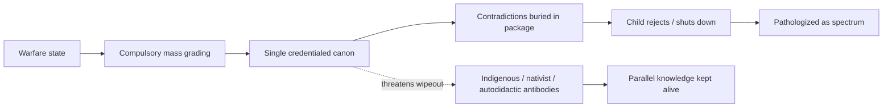

# Childhood “Autism Spectrum”: Conformity Grading, Diagnostic Umbrella, and Autodidactic Profiles

> **TL;DR:** **★ §2c:** Teachers think curriculum is **organic/consensus**; author asserts **collectivism + warfare** → **fear-driven** mass grading, **single contradicted canon**. **Lead child profile (§8.6):** **no verbal acknowledgment** of others (public **or** home); **rich private speech** (monologue, **songs**); **hyperlexia** (books + **environmental print**). **Historic literature:** Piaget/Vygotsky = **private speech** (normative); Kussmaul/Reed = **selective mutism** (speech **somewhere** with people); Treffert = **reading + minimal social speech**; **no pre-1940 unified syndrome** — psychiatry **lumped** under ASD (§5). **Curriculum audit (§2b.1):** Watergate vs Tonkin asymmetry. **Two categories:** **(1) disease/environmental** or **(2) behavioral** (conformity/coercion). **Autodidactic path:** print/typing, **no** forced verbal acknowledgment first. Lay article: [When your child won’t fit the grade](https://paradigmthreat.net/history/chronology/when-your-child-wont-fit-the-grade.md). §13 = [Higher Ground](https://higherground.substack.com/p/friday-note-no-montessori-isnt-child) reply draft.

**Status:** Open — literature map and recategorization framework drafted; primary-source deep reads TODO.  
**Date:** 2026-05-22

---

## Guide (read order)

| If you want… | Section |
|--------------|---------|
| **★ Highlighted conclusion** — curriculum, warfare, collectivism, antibodies | **§2c** |
| Author thesis in one place | §2 |
| Compromised curriculum, Flexner, tech/AI path | §2b |
| **Watergate vs Gulf of Tonkin** — asymmetric controversy | **§2b.1** |
| Transcription note (*autodidactic*, etc.) | §2a |
| vs Higher Ground “not child-led” article | §10.1b |
| Draft Substack reply (copy-paste) | §13 |
| **Parent advice** — try systems, homeschool, playdates, abuse stance | §14 |
| Reader article (advice + history) | [When your child won’t fit the grade](https://paradigmthreat.net/history/chronology/when-your-child-wont-fit-the-grade.md) |
| Timeline: child-rearing & schooling literature | §3 |
| WWI/WWII, schools, prisons, institutional twins | §4 |
| How “autism” became one umbrella | §5 |
| Two categories only: disease/environment vs behavioral (conformity/abuse) | §6 |
| Hyperlexia + mutism + preserved home speech — explained | §8.5 |
| **Anonymous anecdote** — strategic silence until necessity | **§8.5a** |
| **Private speech, no social acknowledgment** — historic literature map | **§8.6** |
| Decision worksheet — you choose the category | §11 |
| Gestalt learning vs forced drills | §7 |
| The specific child profile — what diagnoses fit | §8 |
| Historical & specialist literature for autodidactic children | §9 |
| Modern resources (success without conformity precondition) | §10 |
| “Fake Montessori” — brand vs practice | §10.1a |
| Historic speech — imitation vs initiative (Taine) | §3.5 |
| Flexner Report + credential monopoly pattern | §15 |
| 20th-c. schools as generational break (Khmer Rouge + parallels) | §16 |
| COVID remote + policy wars | §17 |
| **Debunk-cycle rule** (litter psyop read + Sandy Hook as cases) | §18, **§18.1b** |
| **2022 midterms** — litter amplification, failed debunks, **Angry Birds** read | **§18.1c** |
| Weak points / citation registry | §19 |
| Limits / disclaimers | §12 |

---

## 2. Author’s originating thesis (session synthesis + unpack)

> **Author (2026-05-21, transcribed):** The so-called **autism spectrum** has been **inaccurately, inappropriately, and negligently** **congealed together** from a **huge culture clash** when society went **full communism** in the **20th century** — pretending **all children** fall into a **grading system**, **ignoring** the ones who don’t. Modern times are a **slow recovery** from that, but we still live under **widespread generic diagnoses** that act as an **umbrella** for a **myriad of unexplained childhood behaviors**. Much of the taxonomy is really **conforming vs non-conforming**, though institutions speak only of **opportunities** and **performance**. **WWI** and **WWII** transformed society and produced **duplicate systems** — **schools** and **prisons** share built structure (cafeterias, classrooms, buses; different paint). **Autism** may need **complete recategorization**: **disease/environment** vs **behavior** (most real cases are **mixed** but need **separate, multiple** diagnoses, not one giant label). For a child who is **very high intelligence**, **autodidactic**, learned to **read mostly alone**, **won’t communicate** with people though they **know words** and **can speak clearly**, and **erupts** when forced through **conformity exercises** — what does literature say? Was there literature **for** autodidactic children? What **modern resources** exist where **conforming is not a precondition for success**? **Autodidactic** here means: if the child is to learn, material must be offered in a way they **choose**; **forcing** yields **more resistance**, **disconnect**, and **distrust**.

**Unpack (assistant):**

| Layer | Content |
|-------|---------|
| **Institutional** | Mass **compulsory** schooling + **standardized** metrics + **behavioral** compliance as default success |
| **Diagnostic** | Post-1940s child psychiatry **widened** “autistic” from Kanner’s narrow core toward **DSM-5 spectrum** (§5) |
| **Hidden axis** | **Compliance** under surveillance architecture (§4) vs **self-directed** learning drive |
| **Recategorization** | **Two categories only** (§6): organic **or** behavioral response to conformity/abuse — author decides per case via §11 |
| **Not claimed here** | That all presentations are only “misbehaving,” or that medical workup should be skipped when Category 1 signs exist |

**“Full communism” (author phrase — confirmed):** Means **collectivist mass-grading of persons**, **not** Marxist economy per se. Markers: compulsory cohorts, age grades, centralized canon, behavior charts, standardized tests, “educated” = accepts the package. **Western root:** Prussian/factory school (1763+), Mann/common schools, Flexner-style credential monopoly (§2b). **20th-c. climax (~1920s–1980s):** WWI/WWII nation-building, behaviorism, IQ tracking, federal standards, Soviet **parallel** with ideology layered on — **same grading machine**, different flags. **Post-1980s:** IEP/ASD lump, SEL, screen bans — conformity axis still explicit. See §3–4.

---

## 2b. Compromised curriculum, child rejection, and the technology exit (author 2026-05-21)

> **Author (session):** The **general education curriculum** was **not** put together in a reasonable, sound, **auditable** way. It was assembled by **special interest groups** and **victors of history**, with **long federal involvement** — material that is **not necessarily true**, often **one side of a story**, sold as **black and white**: you are **educated** (you believe the package) or **not educated** (you “haven’t been taught the truth”). We must **audit** what is true, what should **not** be taught, and what must **wait** until children are old enough. Examples: **Watergate** — question what’s taught and how; **Gulf of Tonkin** — causation of Vietnam — **under-taught or forbidden** in many programs while other narratives are mandatory. **Math:** drop topics that are **unproven**, detached from reality, or **useless**. **Literacy:** emphasize **reading and typing**, de-emphasize performative **writing** drills as gatekeeper. **Technology:** real **computers** early, not **tablet-only** babysitting; schools **ban devices** and blame “low attention spans” when the **implementation** is dubious — **better tools yield better results**. **Kid-oriented apps** (no ads, no addictive loops) already teach reading and concepts **without conformity or constant adult guidance**. **AI** (with **security/safety**) opens a path for **autodidactic** children to learn **far beyond standardized test content** and to learn **where to find information after the classroom** — a failure of both conventional schools and Montessori. **Main failure point:** our children **reject false knowledge** we try to **conform** them to; we must **listen from the earliest age** when they refuse what they dislike — maybe it **should not be taught**; if it must be taught later, **wait** (e.g. slavery, whipping, sexual violence — author: **too young** in public school; retained lesson as **men evil, women victims, white men most evil** rather than nuanced history).

**Unpack (assistant):**

| Layer | Author claim | Investigation tier |
|-------|--------------|-------------------|
| **Curriculum provenance** | K–12 + civics/history shaped by **lobbies and victors**, not open audit | **Partially documented** — textbook wars, state standards, federal **ED** influence; author wants **item-level** audit |
| **Flexner template** | 1910 Carnegie **Flexner Report** → standardized medicine, closed competing schools, Rockefeller-aligned pipeline — **model** for later **credential monopolies** | **Documented** for **medicine** ([PMC3178858](https://pmc.ncbi.nlm.nih.gov/articles/PMC3178858/)); **analogy** to K–12 is author **inference**, not identity |
| **Child as auditor** | Refusal / mutism / meltdown = **signal** about **bad content or bad delivery**, not only “disorder” | **Category 2** frame (§6, §8.5) |
| **Age appropriateness** | Traumatic historical detail **before** child can contextualize = **harm** | **Author experience** + mainstream debate on age ratings |
| **Tech path** | Computers + vetted apps + AI > **device bans** + pink-tower compliance | **Mixed** — evidence for literacy apps; AI child safety **evolving** |
| **Post-school literacy** | Must teach **how to access and weigh sources** after leaving building | Aligns with **information literacy** critique of both factory school and “life-led” Montessori without source criticism |

**Curriculum audit agenda (working — author to mark teach / defer / delete):**

| Topic area | Author stance | Notes |
|------------|---------------|-------|
| **Vietnam / Gulf of Tonkin** | Teach as **deception / false casus belli**, not only “attack → war” | Ellsberg / Pentagon Papers; NSA 2005 on second attack; [false-flag catalog](https://paradigmthreat.net/events/false_flag/investigations/20th-21st-century-catalog.md#gulf-of-tonkin-1964) |
| **Watergate** | Taught widely — **contrast** with Tonkin silence | Domestic scandal safe; war-lie episode suppressed — see **§2b.1** |
| **Slavery / violence / gender morality tales** | **Defer** until older **if** taught at all | Author’s retained harm from early exposure |
| **Math beyond use** | Cut or defer unproven / non-applied strands | Needs per-topic list |
| **Writing performance** | Reduce gatekeeping; **reading + typing** first | Hyperlexic channel (§8.5) |
| **Civics “educated vs ignorant”** | Reject binary | Tied to victor narrative |

**Link to autism investigation:** When schools **pathologize** children who **won’t swallow** the package, the system mislabels **Category 2** rejection as **Category 1** “disorder” and doubles coercion (§5, §11).

---

## 2b.1 Watergate vs Gulf of Tonkin — asymmetric controversy (author contrast)

> **Author intent (2026-05-22):** The two topics are **not** interchangeable “scandals.” **Watergate** is taught as **political controversy** inside the republic. **Gulf of Tonkin** is usually taught as a **cause of war** — while the **government-sponsored deception** Ellsberg documented stays **off the lesson plan** or buried in an AP footnote. That asymmetry is what the author meant by wanting a **curriculum audit**.

### Side-by-side — what the child actually gets

| Dimension | **Watergate (1972–74)** | **Gulf of Tonkin (1964)** |
|-----------|-------------------------|---------------------------|
| **Typical placement** | Civics / U.S. history — **major unit** | Vietnam unit — **incident → Tonkin Resolution → escalation** |
| **Controversy frame** | **Domestic** crime and cover-up; constitutional crisis; Nixon | Often **international** “enemy attack”; **Congress authorized** force |
| **Moral packaged for students** | “Even presidents can break law; oversight matters” | “America responded to aggression” — **not** “leadership fabricated or misrepresented attack” |
| **Ellsberg / Pentagon Papers** | Optional link to **secrecy** and **Vietnam** broadly | **Central** to Ellsberg: Tonkin deception as **why** he leaked |
| **Documented post-hoc truth** | Senate hearings, tapes, impeachment process | **Second attack likely did not occur** — NSA historical review, declassified **2005**; catalogued **Confirmed** in [false-flag dossier](https://paradigmthreat.net/events/false_flag/investigations/20th-21st-century-catalog.md#gulf-of-tonkin-1964) |
| **Author read** | **Safe controversy** — institution absorbs shame without delegitimizing **war state** | **Unsafe truth** — teaches that **casus belli** can be **staged or lied** — same machinery as Maine, Northwoods, etc. |

### What Ellsberg adds (investigation tier)

| Claim | Tier | Source lane |
|-------|------|-------------|
| Pentagon Papers documented **expanded secrecy** and **misleading** official history of Vietnam | **Documented** | Ellsberg leak (1971); *New York Times* publication |
| Ellsberg understood Tonkin episode as part of **deception** justifying war | **Documented** (motivation) | Ellsberg interviews / memoir literature |
| **Second Gulf of Tonkin attack** did not occur as reported | **Validated** in-repo | NSA Hanyok study + 2005 SIGINT release; [09-11 investigation §Gulf of Tonkin template](https://paradigmthreat.net/events/false_flag/investigations/09-11-investigation.md#gulf-of-tonkin-the-template); [good-actor § II.I — Hanyok](https://paradigmthreat.net/events/false_flag/investigations/good-actor-theory-interagency-antibody-investigation.md) |
| **NSA SIGINT skewed** for 4 Aug 1964 casus belli | **Validated** | Hanyok, *Cryptologic Quarterly* (NSA declassified 2005) |
| NSA historians **fought 2002–2005** to publish Hanyok | **Validated** | [NYT, 31 Oct 2005](https://archive.nytimes.com/www.nytimes.com/2005/10/31/politics/31war.html); NSA release |
| K–12 **routinely** teaches Tonkin as **false flag / government deception** | **Author audit target** — verify per state standards (§19 D5) | Often **under-taught** vs Watergate depth — **even after 2005 NSA release** |

### Robert Hanyok — NSA’s landmark disclosure fight (2001–2005)

Separate from Ellsberg’s **1971** external leak: in **early 2001** NSA historian **Robert J. Hanyok** completed a classified SIGINT audit showing the **second attack did not occur** and that **midlevel NSA reporting was deliberately skewed** — translation errors, withheld intercepts (~90% of relevant 4 Aug material), conflated products used as Johnson’s proof. NSA historians **pushed for public release from 2002**; higher levels **rebuffed**; outside historians **FOIA’d** in 2003; NSA **declassified Hanyok + 140+ documents** in **Nov–Dec 2005**. Study finished **before 9/11**; publication battle ran **into the 21st century**. Read as **NSA antibody vs war-state / SIGINT cover-up** — [good-actor investigation § II.I](https://paradigmthreat.net/events/false_flag/investigations/good-actor-theory-interagency-antibody-investigation.md); [Hanyok PDF](https://www.nsa.gov/portals/75/documents/news-features/declassified-documents/gulf-of-tonkin/articles/release-1/rel1_skunks_bogies.pdf).

**Unpack:** Textbooks can host **Watergate** because it is **entirely political and controversial** without asking the student to hold “my government lied me into a war” as the **default civics lesson**. **Tonkin** threatens that — so the canon keeps **war cause** and drops **war lie** — **even after NSA published the SIGINT correction**. That is **one-sided narrative assembly** (§2b), not missing “facts” by accident.

### Link to child rejection (Category 2)

- Child refuses **slavery morality cartoon** *and* senses **Tonkin ≠ Watergate** treatment → **integrity under contradicted canon**, not “oppositional defiant” by default (§6, §8.5).
- Parent / autodidactic path: after audit, use **primary sources** (Tonkin Resolution text, NSA review summary, Ellsberg documentary) — not only the district’s Vietnam chapter order.

**Lay article:** [When your child won’t fit the grade — Watergate vs Tonkin](https://paradigmthreat.net/history/chronology/when-your-child-wont-fit-the-grade.md#watergate-is-taught-gulf-of-tonkin-deception-is-not--and-that-contrast-is-the-point).

---

## 2c. ★ Highlighted conclusion — organic myth, warfare birth, collectivist canon, antibodies

> **Status:** **Primary author conclusion** for this investigation — links autism **congealing**, curriculum **contradiction**, child **rejection** (Category 2), and **indigenous/nativist** knowledge survival.

> **Author (2026-05-21, highlighted):** Most **teachers today** believe the education system and curriculum they know arose by **consensus** and **organic** evolution. In **reality**, it follows a **direct process of collectivism and warfare**. The modern education system can be described and asserted as **100% fear-driven** — created during the worldwide rise of **collectivist communism** (here: **collectivist mass-grading**, §2) and **imposed violently** under a **lasting state of warfare**. That is the **primary reason** the **curriculum** contains so much **contradiction** — it **rivals the Bible**. Like the Bible, our entire current curriculum — **math, science, history, astronomy** — sits under the umbrella of a **single collectivist doctrine**. The world, like a **giant body**, has **slowly become aware** of this scheme and is generating **antibodies**: **nativist, indigenous** sciences, literature, history, and languages must continue to be taught and not be **wiped away** by the collectivist education complex — **for-profit**, **industry-driven**, **tax-derived**, **unaudited**.

### Unpack (assistant) — what is being claimed

| Claim | Author meaning | Tier |
|-------|----------------|------|
| **“Organic / consensus” myth** | Teachers inherit **just-so story**; real assembly = **state + war + foundations + lobbies** | **Documented** strand (Prussian import, Mann, Flexner, WWI/WWII expansion, textbook adoption wars) + author **synthesis** |
| **Direct process: collectivism + warfare** | Mass grading scaled with **nation-state war** (mobilization literacy, tracking, Cold War STEM, permanent security state) | **Partially documented**; “direct” = author **causal emphasis** |
| **100% fear-driven** | Compliance through **threat** (failure, labels, poverty of options, shame, conscription of childhood) | **Author moral-psychological** frame — not a literal survey of every teacher’s motive |
| **Rise of collectivist communism worldwide** | **Collectivist mass-grading** climax **1920s–1980s** (§3.3), Soviet/West **parallel** | **Confirmed author vocabulary** — not “every school was run by a Communist Party” |
| **Imposed violently** | Compulsion laws, truancy prosecution, indigenous **boarding schools**, punishment regimes | **Documented** in many jurisdictions; **degree** varies by place/time |
| **Curriculum contradicts itself like the Bible** | One **canonical package** with **incompatible** units (civics vs suppressed history, math pedagogy vs applied reality, etc.) | **Author audit thesis** (§2b) — structural analogy, not theological claim |
| **Single collectivist doctrine umbrella** | **One credentialed canon** for all subjects under **same institution** (who is “educated”) | **Author frame** — “communist” = **collectivist doctrine of the state school**, not one Marx pamphlet per science class |
| **World generating antibodies** | Revivals: **mother-tongue**, local history, indigenous science, homeschool/unschool, **regional** curricula, open-source/AI bypass | **Observable movements**; “immune response” = author **metaphor** |
| **For-profit / tax / unaudited** | **ED**-funded pipelines, publishers, testing industry, credential cartels | **Partially documented**; **unaudited** = author **demand** (§2b audit table) |

### Causal chain (investigation spine)

1. **Warfare + collectivism** → factory/cohort school at scale (§3–4).  
2. **Fear** → compliance as survival inside the institution (grades, labels, exclusion).  
3. **One umbrella canon** → math + science + history + astronomy taught as **same legitimacy stack** without item audit.  
4. **Contradictions** → intelligent/autodidactic children **refuse** incoherent or age-wrong units → misread as **disorder** (§6 Category 2).  
5. **Antibodies** → families and cultures **preserve** non-canon knowledge (language, local science, oral history, homeschool, tech/AI exit in §10.5).

### What teachers are told vs what happened (short)

| Teachers often believe | Investigation read |
|------------------------|-------------------|
| Experts slowly agreed on best practices | **Victors + foundations + federal adoption** (Flexner **pattern**, §2b) |
| Curriculum updates are science | **Political** textbook cycles — **Watergate taught as controversy**, **Tonkin often as war cause not govt deception** (§2b.1) |
| Non-compliant child needs services | Child may be **rejecting false canon** (§8.5, §11 B11–B12) |
| More SEL / compliance training fixes it | Doubles down on **fear** inside same umbrella |

### Limits on this conclusion (read before citing externally)

- **Not** claiming every classroom teacher is a conscious agent of a communist party.  
- **Not** denying real math/science **skills** — claiming **packaging, gatekeeping, and narrative** are **institutionally unified** and **under-audited**.  
- **“100% fear-driven”** and **Bible parallel** are **author rhetoric** with **logical content** (coercion + canon contradiction), not empirical percentages.  
- **Antibody** metaphor **includes** legitimate indigenous survival **and** can be misused for **exclusionary nativism** — repo records **preservation**, not ethnic gatekeeping.  
- See §12; autism section **does not** require endorsing every historical audit item to use **Category 2** child-rejection frame.

**Downstream:** §5 (why one ASD umbrella), §6 (two categories), §10.5 (tech/AI as antibody), §11 (worksheet), §13 (Substack), §14 (parent advice), [lay article](https://paradigmthreat.net/history/chronology/when-your-child-wont-fit-the-grade.md).

---

## 2a. Transcription check

| Term | Likely intent | Notes |
|------|---------------|-------|
| **autodidactic** | **Correct** — self-directed learner | Standard English; matches author description |
| **congealed together** | **Confirmed (author 2026-05-21)** | Distinct phenomena set into one rigid mass — like cooling liquid, hard to separate later |
| **full communism** | **Collectivist mass-grading** (confirmed author meaning) | §2 — not Marxist economy only |
| **opportunities and performance** | School/IEP/NT rhetoric | “Participation,” “social skills,” “executive function” |

---

## 3. Timeline — literature on childhood, raising, and the conformist turn

### 3.1 Pre-industrial and early modern (child as small adult → romantic child)

| Era | Figure / work | Emphasis | Conformity pressure |
|-----|---------------|----------|---------------------|
| Medieval–early modern | Church catechism, apprenticeship | Role training, guild/kin obedience | High, local |
| 1673 | Locke, *Some Thoughts Concerning Education* | Habit, reason, **temperament-sensitive** tutoring | Moderate — tutor model, not mass classroom |
| 1762 | Rousseau, *Émile* | Natural development, negative education, **anti-premature socialization** | Rejects Parisian salon child — **proto–interest-led** |
| 1840s–1900s | **Kindergarten** (Froebel), **child study** movement | Play, developmental stages | Rising urban norm |
| 1907+ | **Montessori**, *The Montessori Method* (1912 EN) | **Auto-education**, prepared environment, “help me to do it myself” | **Counter-current** to row-and-grade (§9) |
| 1918–1945 | Mass schooling expansion (WWI demobilization, WWII state planning) | **Citizen formation**, vocational tracking | **Spike** in age-grading and IQ sorting |

### 3.2 20th century — behaviorism, psychiatry, and the “grade every child” apex

| Era | Figure / work | Emphasis | Conformity pressure |
|-----|---------------|----------|---------------------|
| 1920s–50s | Watson, Skinner; “scientific childrearing” | Conditioning, measurable behavior | **High** — adult schedule over child rhythm |
| 1943 | **Kanner**, “early infantile autism” | Social aloofness, sameness, **from infancy** | Clinical **non-conformity** pathologized |
| 1944 | **Asperger** (German; Anglosphere later) | “Autistic psychopathy” — able pupils, narrow interests | **Split** from Kanner — later **re-merged** (§5) |
| 1950s–70s | Bowlby attachment; school counseling | Adjustment to school | **Conformity = mental health** |
| 1960s | **John Holt**, *How Children Fail* / *How Children Learn* | Fear & grading **block** real learning | **Direct critique** of forced performance |
| 1980 | **DSM-III** “infantile autism” | Official psychiatric category | Gate for services — **binary** special ed |
| 1994 | **DSM-IV** Asperger’s | Higher-functioning **split** | Brief relief for articulate odd children |
| 2013 | **DSM-5** Autism Spectrum Disorder | **Single umbrella** | **Lump** (§5) |
| 2000s+ | RTI, standardized testing, “social skills” curricula | **Performance** metrics | **Conforming** axis explicit in IEP goals |

### 3.3 Collectivist mass-grading — when conformity peaks (author frame)

| Phase | What scales | Conformity |
|-------|-------------|------------|
| **1763–1900** | Prussia → exported **factory school** (bells, cohorts, duty) | Mass grading **invented** |
| **1910** | Flexner — **one pipeline** defines “educated” | Credential conformity |
| **1920s–50s** | Behaviorism + IQ sorting + USSR/West **parallel** mass systems | **High** — child as measurable unit |
| **1945–1970** | Federal role, Sputnik/STEM, special ed categories | National canon + tracking |
| **1980–2013** | DSM autism track + standardized testing culture | Non-performers → **diagnosis** |
| **2000s+** | RTI, IEP goals, SEL, device policy | **Performance** conformity overt |

**Author alignment:** Rise of **collectivist mass-grading** and rise of **pathologized non-conformity** (autism spectrum lump) are **same era** — not coincidence.

### 3.4 Author read on the “culture clash”

When **every** child must occupy a **seat, a score, and a behavior chart**, children who are **autodidactic**, **mute outside home**, or **demand-avoidant** read as **system failures**. Psychiatry supplies **one** receptacle label (**ASD**) because the **institution** cannot encode **“will not perform on command but learns alone.”**

---

## 4. WWI/WWII, duplicated institutions, and surveillance architecture

### 4.1 Wars and schooling

| Effect | Mechanism |
|--------|-----------|
| **WWI** | Mass mobilization → literacy campaigns, **intelligence testing** (Army Alpha/Beta legacy), youth as national resource |
| **Interwar** | Depression-era **social efficiency** schooling; expansion of psychology in schools |
| **WWII** | Child welfare state, **daycare** for war work, postwar **GI Bill** + high-school completion as norm |
| **Cold War** | STEM race, **Sputnik** shock → curriculum centralization; special education categories grow |

### 4.2 School ↔ prison structural parallel (documented strand + author observation)

| Feature | Schools | Prisons / jails | Source tier |
|---------|---------|-----------------|-------------|
| **Panopticon lineage** | Central office sightlines, corridor control | Bentham/Foucault **discipline** model | **Documented** — Foucault *Discipline and Punish*; educational studies applying panopticism to schools |
| **Long corridors, controlled doors** | Classrooms as cells | Cell blocks | **Observed** + architectural criticism |
| **Cafeteria as mass feeding under watch** | Lunch monitors | Chow hall | **Analogy** — functionally similar crowd control |
| **Yellow school bus vs transport van** | Age cohort batching | Inmate transport | **Author observation** — same **batch mobility** logic; paint differs |
| **Time tables, bells, movement permission** | Period bells | Lockdown schedules | **Documented** institutional rhythm |

**Repo stance:** The parallel supports the **conformity thesis** (architecture teaches obedience). It does **not** prove schools **were designed as prisons** in a single blueprint — historians note the “factory model” narrative is partly **retrofitted** (see Audrey Watters on invented factory history). Use as **structural metaphor** with mainstream citations, not conspiracy.

---

## 5. History of “autism” as umbrella — lumping vs splitting

| Year | Event | Lumping / splitting |
|------|-------|---------------------|
| 1877 | Kussmaul **aphonia voluntaria** | Early **mutism** label (separate from autism today) |
| 1943–44 | Kanner + Asperger | **Two** autistic descriptions, not yet one diagnosis |
| 1980 | DSM-III **infantile autism** | Narrow **split** from schizophrenia |
| 1994 | DSM-IV **Asperger’s** | **Split** for verbal, average/high IQ |
| 2000s | “Broad autism phenotype,” HFA, PDD-NOS | **Lump** toward spectrum concept |
| 2013 | **DSM-5 ASD** | **Definitive lump** — Asperger removed; single spectrum with severity levels |
| Ongoing | ICD-11, research **subgroups** (RDoC, dimensions) | Science pushes **split**; billing often **lumps** |

**Clinical literature consensus:** Diagnosis has **oscillated** between emphasizing one group and distinct subgroups ([Annual Review of Clinical Psychology](https://www.annualreviews.org/content/journals/10.1146/annurev-clinpsy-032813-153710); [PMC8531066](https://ncbi.nlm.nih.gov/pmc/articles/PMC8531066/)). **Author thesis** aligns with **splitting** by mechanism; mainstream still debates **dimensions vs categories**.

**Negligence frame (author):** Collapsing **mutism**, **hyperlexia**, **intellectual giftedness**, **anxiety**, **PDA**, **sensory processing**, and **true early infantile autism** into **one IEP acronym** prevents targeted intervention and blames the child for **institutional mismatch**.

---

## 6. Two categories only (investigation rule)

This file **does not** use open-ended multi-track tagging. Each child is classified into **one** primary bucket (author decision). Mixed cases: pick **dominant** driver, or document **Category 1 workup negative** before assigning Category 2.

| Category | Definition | Examples / mechanisms |
|----------|------------|------------------------|
| **1 — Disease / environmental** | Body or environment **damages or distorts** development **independently** of the child’s stance toward conformity | Hearing loss, epilepsy/absence seizures, sleep apnea, lead/toxins, malnutrition, prematurity, chronic pain, vision problems, post-illness regression (rare encephalitis), medication effects, **innate** neurodevelopmental difference present **from infancy in all settings** (if you read that as organic rather than situational) |
| **2 — Behavioral** (conformity rejection / abuse reaction) | Presentation is a **strategic or protective response** to **coercion**, institutional mismatch, bullying, shaming, forced speech, fake Montessori, compliance ABA, or other **abuse of power** — **same bucket** as rejecting conformity | Selective mutism **only** in hostile settings; **PDA-style** meltdown when demands imposed; hyperlexia as **self-chosen** channel; silence as **control/safety**; worsening after identifiable school/ adult pressure event |

**Descriptors (not separate categories):** hyperlexia, selective mutism, gifted intensity, “PDA profile” — these name **how** Category 2 (or sometimes Category 1) **looks**, not a third diagnosis.

**Billing label:** “ASD” may still appear on forms; this investigation treats it as **often Category 2 mis-filed** unless §11 points to Category 1.

**Intervention skew:**

| Category | First move |
|----------|------------|
| **1** | Medical workup (§11 table A); treat cause where found |
| **2** | **Remove or redesign** coercive environment; low-demand; interest-led learning; **no** forced speech; written/reading bridge |

---

## 7. Gestalt learning — why forcing fails for this profile

**Gestalt psychology** (Wertheimer, Köhler, Koffka, early 20th c.): perception and learning organize into **meaningful wholes**, not atomized drill. Problem-solving requires grasping **structure**, not rewarded step compliance ([InstructionalDesign.org — Gestalt](https://www.instructionaldesign.org/theories/gestalt/)).

| Principle | Application to autodidactic, non-speaking-at-school child |
|-----------|--------------------------------------------------------------|
| **Whole before parts** | Reading passion may be a **whole** (letters → words → books) while **social speech** has no gestalt in hostile setting |
| **Insight vs repetition** | Forced “social skills” scripts without **meaning** → no insight → **resistance** |
| **Closure under interest** | Child **completes** tasks they start; imposed worksheet breaks gestalt → **tantrum/meltdown** |
| **Isomorphism** | Inner rich language world **does not map** to classroom performance world — adult sees “won’t”; child experiences **category error** |

**Bridge to author:** **Interest** is the **organizing field**. Remove interest → field collapses → **explosion** (especially with **PDA** or **emotional overexcitability**). **Montessori** “auto-education” and **Holt** unschooling are **applied Gestalt** without using the word.

---

## 8. Profile anchor — autodidactic, hyperlexic, selectively mute, meltdown under conformity

### 8.1 Phenotype checklist (author)

- Very **high intelligence** (observed reasoning, reading)
- **Autodidactic** reading — minimal direct instruction
- **Adequate or clear articulation** on **private channel** (self-talk, songs, scripts) — **may not** speak to **any** adult or peer (**§8.6**), or may speak only at **home** (**§8.5**)
- **Refusal** to use spoken language with **other children/adults** for **social acknowledgment** (many or **all** settings)
- **Major emotional outburst** when subjected to **conformity exercises** (circle time compliance, forced speech, repetitive social drills)
- **Environmental print reading** (“off the wall”) — optional but **strong** signal for **§8.6**

### 8.2 Best-fit historical and modern labels (literature map)

| Label | Fit to profile | Historical notes |
|-------|----------------|------------------|
| **Selective mutism** (was *elective mutism*) | **Strong** — speaks in some contexts, not others | Kussmaul 1877; Tramer 1934; Reed 1963 (4 cases, **normal IQ**, good outcomes cited in reviews); DSM as **anxiety** disorder, often **comorbid** with ASD |
| **Hyperlexia** | **Strong** if reading **far** ahead of comprehension/social language | Treffert; ~84% overlap with ASD in studies but **not** all hyperlexic children are autistic; **non-speaking hyperlexia** documented |
| **Hyperlexia vs “gifted reader”** | Distinguish: hyperlexia = **communication below** age despite decoding | Gifted reader alone lacks communication gap |
| **PDA / extreme demand avoidance** | **Strong** for conformity-triggered **meltdown** | UK-recognized **profile** within autism; **self-directed** performance only |
| **Dabrowski overexcitabilities** | **Moderate** — intensity, psychomotor/emotional storms when misunderstood | Gifted education literature, not DSM |
| **Kanner “early infantile autism”** | **Weak–partial** if onset in infancy **and** global social sameness | Original cases unlike **only-school** mutism |
| **Asperger syndrome** (historical) | **Partial** — articulate, narrow interests | DSM-IV brief **split**, absorbed 2013 |
| **Schizoid personality in childhood** (old literature) | **Weak** — social detachment without necessarily mutism or hyperlexia | Bleuler/Kretschmer lineage — **outdated** child labels |
| **Oppositional defiant disorder** | **Mis-fit** if root is **anxiety/demand** not defiance | Often **misapplied** to PDA/SM |
| **“Twice-exceptional” (2e)** | **Useful** — gifted + disability/ND presentation | Education field, not single diagnosis |

### 8.3 What literature says about “won’t speak though can”

- **Selective mutism:** Consistent failure to speak in **specific social situations** despite speaking elsewhere; often **anxiety**, avoidance, **high academic** function in some cohorts ([IMT review](https://www.imt.ie/clinical/understanding-selective-mutism-10-09-2013/); [PMC2861522](https://ncbi.nlm.nih.gov/pmc/articles/PMC2861522/)).
- **Not** the same as **mutism** from intellectual disability — author profile assumes **clear speech when willing**.
- **Forcing speech** is **contraindicated** in modern SM treatment (pressure worsens silence).

### 8.5 Hyperlexia + mutism + preserved home speech (plain explanation)

> **Variant:** If the child **never** speaks to **family** but has **private speech + reading** (§8.6), skip “preserved home speech” below and use the **§8.6** historic map — schools still often write **nonverbal autism**.

Three pieces that often get **congealed** into “autism” but are **separate observations**:

| Piece | What it is | What it is **not** |
|-------|------------|-------------------|
| **Hyperlexia** | **Advanced decoding** — child reads (often **self-taught**) far above age; obsessed with letters/words/books | Not the same as **understanding** everything read; comprehension and **social language** may lag decoding |
| **Mutism (selective)** | **Failure to speak** in some settings (school, strangers, groups) | Not inability to speak; not global silence in every context |
| **Preserved home speech** | At home (or with 1–2 safe people), child **talks clearly**, full sentences, maybe verbose | Proves **articulation and language exist** — the block is **relational/situational**, not “nonverbal autism” in the motor sense |

**How they fit together:**

1. **Reading** becomes a **safe world** the child controls (letters are predictable; people are not).  
2. **Speech** is **withheld or shut down** where the child expects **judgment, demands, or punishment** (classroom, therapy that pushes talking, circle time).  
3. **Home** is the **control condition**: if speech is **good at home** and **absent at school**, the experiment points to **Category 2** (environment/conformity/abuse reaction) unless §11 Category 1 signs are strong.

**Typical adult mistake:** “He can talk at home so he’s **choosing** to be difficult at school” → moral blame. Literature read: **anxiety + control + trauma avoidance**, not defiance for its own sake.

**Typical clinical mistake:** “Nonverbal” on a form because school team never heard speech → **autism** label → compliance programs that **worsen** mutism.

**Treffert / hyperlexia note:** Some children are **non-speaking in all settings** but still hyperlexic (different profile). **Preserved home speech** is the **discriminator** this investigation cares about.

**Category assignment hint:**

| Pattern | Likely category |
|---------|-----------------|
| Home speech **good**, school silent, meltdown on forced participation | **2** — situational + conformity (**§8.5**) |
| **Private speech + reading** rich, **no verbal reply to anyone** (incl. home) | **2** default after **Category 1** rule-out — **§8.6** |
| Speech/pragmatics **equally** poor everywhere since infancy; medical signs | **1** — organic / global developmental |
| Home speech good, then **suddenly** stops everywhere after illness | **1** — rule out neurological event |
| Home speech good, silence **starts** after specific teacher/bullying/restraint | **2** — abuse/coercion timeline |

### 8.5a Anonymous correspondent — strategic silence until necessity (reference)

> **Source tier:** **Anecdote** — self-report in a **public comment thread** on the lay article (2026-05); **identity withheld** (investigation policy: no names). **Not** clinical verification. **Illustrative** for §8.5 / Category 2 only.

**Summary (paraphrase, anonymous):**

Correspondent reports **no speech addressed to other people** until about **age four**, while already able to **read and write** but **concealing** literacy from parents to preserve a **cover** of total non-participation. Reports using silence tactically (e.g. a sibling blamed for vandalism the correspondent committed — no spoken denial while treated as non-verbal). When **more food at table** — specifically **green beans** — could not be secured by gesture alone, and writing a request risked exposing reading/writing, they **chose speech**. First utterance to others was reportedly a **full paragraph** at a family dinner with extended relatives present. Family kept a chalkboard phrase from that night: **“I want big of it”** — described by the parent as how the child **saw scale** in life. When asked what ended the silence, correspondent answered that **green beans have always been a necessity**.

| Investigation read | Notes |
|--------------------|-------|
| **Not** motor inability | Language and literacy **present** under **cover** |
| **Hyperlexia hidden** | Reading/writing **before** social speech to others |
| **Category 2 signal** | Speech **turns on** when **instrumental need** exceeds cost of maintaining silence |
| **vs §8.6** | Correspondent **eventually** spoke to family; §8.6 = sustained **no verbal acknowledgment** — compare, do not merge |

**Lay article:** anonymous side story — [When your child won’t fit the grade](https://paradigmthreat.net/history/chronology/when-your-child-wont-fit-the-grade.md#a-side-story--silence-as-cover-until-green-beans-demanded-speech).

**Weak point:** Single **N=1** narrative; childhood memory; no independent corroboration in file.

### 8.4 Conformity exercises → eruption

Matches **PDA** literature: imposed demand → escalation → meltdown when escape fails ([Child Mind Institute — PDA](https://childmind.org/article/pathological-demand-avoidance-in-kids/); [National Autistic Society — demand avoidance](https://www.autism.org.uk/advice-and-guidance/behaviour/demand-avoidance)). Also matches **overexcitability** + invalidation in **gifted** children (intensity read as immaturity).

### 8.6 Private speech, hyperlexia, no social acknowledgment — historic literature map

> **Lead scenario (2026-05-22):** Child **does not talk to people** (public **or** home). **Talks to self** extensively. **Knows many songs** (memorized scripts). **Reads** books and **environmental print** (“off the wall”) in **well-spoken English**. **No verbal acknowledgment or response** to others — while adults may still debate whether the child is “taking in” social input nonverbally.

This is **not** the textbook **selective mutism** case (speech preserved with **specific** safe partners). It is a **compound profile** schools collapse into **“nonverbal ASD.”** Historic literature **mentions pieces**; **none** of the pre-psychiatric authors name this **exact cluster** as one syndrome.

#### Phenotype checklist (author)

| Signal | Notes |
|--------|--------|
| **Zero social speech** | No conversational return to parents, peers, teachers |
| **High private speech** | Monologue, scripting, humming, **song lyrics** |
| **Hyperlexia / environmental print** | Decoding signs, labels, walls — often **ahead** of assessed “communication” |
| **Well-formed English when vocalizing alone** | Proves **phonology and grammar exist** on a **non-social channel** |
| **Acknowledgment withheld** | May **look** “not taking in” adults; may **track** print and audio without **verbal** reply |

**Category hint:** Rule out **Category 1** (hearing, seizures, global delay from infancy). If language is **rich in private** and **absent only as social performance**, default **Category 2** until medical signs say otherwise (§11).

#### Do historic authors describe this **specifically**?

| Author / tradition | Do they mention it? | What they **actually** said |
|--------------------|---------------------|-----------------------------|
| **Plato / Locke / Rousseau** | **No** named syndrome | Locke: speech via **hearing others**; Rousseau: **anti-forced performance** — neither maps **global non-response + rich solitary speech** |
| **H. Taine (1876)** | **Partial** | Child’s **own initiative** in babble; adults **channel** — supports **not** forcing social speech; **does not** describe mute-to-all + self-talk + reading |
| **Darwin (1877 infant diary)** | **No** | Association of sound and object; **observation** — not mutism profile |
| **Kussmaul (1877) *aphonia voluntaria*** | **Partial** | **Voluntary mutism** — can speak, **won’t** in settings; assumes speech **somewhere** with humans, not **only** to self |
| **Tramer / Reed — selective mutism (20th c.)** | **Partial** | **Failure to speak in specific situations** despite speaking **elsewhere** — **mismatch** if child **never** speaks to family |
| **Piaget (1920s) — egocentric speech** | **Yes — different claim** | Young children talk **aloud while playing** for self; **normal stage**, expected to **fade** as socialized — **not** pathology, **not** paired with **no response to all humans** |
| **Vygotsky / Luria (1930s) — private speech** | **Yes — closest normative match** | **Private speech** mediates thought; later **internalizes**; **social speech** still expected to develop — describes **self-talk**, **not** permanent **social mutism** |
| **Montessori (1907+)** | **Indirect** | Child may work **alone**, **humming**; **auto-education** via environment — **not** a diagnostic category for **no acknowledgment** |
| **Watson / Skinner** | **No** | Imitation + reinforcement — **fails** to explain rich **private** language without social reward |
| **Kanner (1943)** | **Partial** | **Echolalia**, **islets of ability**, aloofness — **20th-c. autism** begins to **lump** pieces; **not** hyperlexia + environmental print as modern clinicians define it |
| **Asperger (1944)** | **Partial** | Verbose **monologues** about special interests — sometimes **one-sided** talk **at** people; **not** classic **zero** acknowledgment |
| **Treffert — hyperlexia (late 20th c.)** | **Yes — modern piece** | **Non-speaking** or minimally speaking children who **read** early — **closest medical line** to **reading + no social speech**; **private monologue** is **adjacent**, not always central in his essays |
| **John Holt (1960s–80s)** | **Indirect** | **Fear/coercion** block performance; respects **quiet** learners — **no** clinical syndrome name |

**Direct answer for parents:** Historic **pedagogical** authors (Rousseau, Montessori, Holt) argue against **forcing** speech and for **interest-led** channels — **compatible** with your child’s **refusal of performative dialogue**. Historic **clinical** writers **split** the signs: **mutism** (Kussmaul → selective mutism), **self-talk** (Piaget/Vygotsky as **normal** development), **reading gifts** (Treffert). **No pre-1940 author** lists **mute to everyone + sings + reads walls + no acknowledgment** as **one** entity. Psychiatry **later merged** overlapping presentations under **ASD** (§5) — which is why the school uses one acronym for a **multi-channel** child.

#### What to do with the literature (investigation stance)

| Move | Rationale |
|------|-----------|
| **Do not** treat “never speaks to family” as **selective mutism** without checking **any** human-directed speech | SM literature assumes **islands** of social speech |
| **Do** treat **private speech + reading** as **proof of capacity** | Taine / Vygotsky / hyperlexia lane |
| **Do not** force **social acknowledgment** as IEP goal | Contraindicated in SM; **worse** if child is **Category 2** |
| **Do** offer **written/typed** bridge, **low-demand** environment, **print-rich** autodidactic path (§10.5) | Gestalt / Holt / Montessori **when curriculum audited** |

**Lay article:** [When your child won’t fit the grade — opening scenario](https://paradigmthreat.net/history/chronology/when-your-child-wont-fit-the-grade.md).

---

## 9. Literature geared toward autodidactic / self-directed children

| Author / tradition | Work | Relevance |
|--------------------|------|-----------|
| **Rousseau** | *Émile* (1762) | Interest-paced tutor; skepticism of premature social performance |
| **Montessori** | *The Montessori Method*, *Spontaneous Activity in Education* | **Auto-education**, prepared environment |
| **Carolyn Sherwin Bailey** | *Montessori Children* (1915) | Case narratives of self-chosen work |
| **John Holt** | *How Children Learn*, *Teach Your Own*, *Growing Without Schooling* | **Unschooling** — learning follows curiosity |
| **John Dewey** | Progressive education | Continuity of experience; critique of rote — **institutional** progressive schools often still **graded** |
| **Paolo Freire** | *Pedagogy of the Oppressed* | Anti-banking model — **political** parallel to anti-conformity |
| **Dabrowski** | Theory of Positive Disintegration | **Overexcitability** in intense learners |
| **Treffert / hyperlexia clinic** | Hyperlexia essays & cases | **Reading-first** channel children |
| **Piaget** | *The Language and Thought of the Child* (1923) | **Egocentric speech** — self-talk while playing (**normative**) |
| **Vygotsky / Luria** | *Thought and Language* (1934); private speech research | **Private speech** mediates cognition — **§8.6** anchor |
| **Selective mutism** | Tramer, Reed, Kolvin & Fundudis (1981), SMRM.org lineage | **Mutism-specific**, not “spectrum” generic |

**Gap:** Few historic texts use the word **autodidactic**; **Montessori “auto-education”** and Holt’s **“unschooling”** are the closest **pedagogical** literature. **Medical** literature addresses **mutism** and **hyperlexia** **separately**; **§8.6 compound profile** is **parent-synthesized** — see historic table there. **Lay summary:** [article — Historic literature](https://paradigmthreat.net/history/chronology/when-your-child-wont-fit-the-grade.md#historic-literature--is-this-profile-named).

---

## 3.5 Historic literature — what “causes” children to speak?

**Question:** Is speech only **watching and mimicking** adults?

| Era | Figure | Claim | Disagreement |
|-----|--------|-------|--------------|
| Ancient | Plato | Word-meaning partly **innate** / correct fit | Not pure imitation |
| 1600s | Locke | **Tabula rasa** — speech from sensation + association + hearing others | Leibniz: innate structure needed |
| 1760s | Rousseau | Natural **stages**; forced early performance harms | Against empty mimicry |
| 1876 | **H. Taine** | **Self-initiated** babble first; adults **channel** sounds child already tries; **“natural vocal gestures”** invented | Against imitation-only |
| 1877 | Darwin | Infant diary — association of sound + object; human **power** of linking | Observation, not drill |
| 1907+ | Montessori | **Auto-education** in prepared environment | — |
| 1920s | Watson/Skinner | **Imitation + reinforcement** | Chomsky: poverty of stimulus |
| 1960s+ | Holt | Interest-led; fear blocks learning | — |
| 1920s–30s | **Piaget / Vygotsky** | **Private / egocentric speech** — child talks **to self** while thinking | **Normative** stage — **not** §8.6 pathology label |
| 1877 | **Kussmaul** | *Aphonia voluntaria* | Proto–**selective mutism** — partial fit §8.6 |

**Taine (primary):** [Lingual Development in Babyhood](https://en.wikisource.org/wiki/Popular_Science_Monthly/Volume_9/June_1876/Lingual_Development_in_Babyhood) — “**Initiative all came from herself**”; imitation fixes attention on sounds already attempted. Conclusion: child “**original genius**” adapting to language form built by prior geniuses.

**Profile link:** **§8.5** selective mutism = **can** speak, **won’t** in hostile setting — not failure to imitate. **§8.6** = **private speech + hyperlexia** without **social** return — Piaget/Vygotsky describe **self-talk**; Treffert describes **reading**; **no** single pre-1940 syndrome name.

---

## 10. Modern resources — success without conformity as precondition

*Not medical endorsement; starting points for families matching §8. Verify local laws (homeschool regulations), and pursue **medical rule-out** (§6A) in parallel.*

### 10.1 Education philosophy & community

| Resource | URL / access | Notes |
|----------|--------------|-------|
| **John Holt GWS** — unschooling | [johnholtgws.com](https://www.johnholtgws.com/) | Interest-led; **no** grade-performance prerequisite |
| **Alliance for Self-Directed Education** | [self-directed.org](https://www.self-directed.org/) | Networks for SDE centers & homeschool |
| **Montessori (AMI/AMS)** | ami-global.org / local accredited schools | Self-chosen work cycles — **vet carefully** (§10.1a); unaccredited “Montessori” often **replicates conformity** |
| **Agile Learning Centers / Liberated Learners** | liberatedlearners.net | Teen-friendly self-directed centers |

### 10.1a The “fake Montessori” problem (brand vs practice)

Montessori is cited throughout this investigation as a **counter-current** to mass grading (§3, §7, §9). In the **commercial school market**, the name is often **decoupled from the method** — parents pay **Montessori tuition** and still get a **conformist, performance-based** experience. For **autodidactic**, **demand-avoidant**, or **selectively mute** children, that mismatch can be **worse than honest traditional school** (false promise of self-direction, then **same** compliance pressure).

| Failure mode | What genuine Montessori requires | What “fake Montessori” often does |
|--------------|----------------------------------|-----------------------------------|
| **Lack of certification** | Guides trained through **accredited** pathways (**AMI**, **AMS**, or equivalent recognized training) | Facility uses the **label** to justify **high tuition** without **AMI/AMS**-trained staff |
| **Surface-level adherence** | **Sequential materials**, **prepared environment**, **trained observation**, child-chosen work cycles | **Wooden toys** and pastel classrooms **without** philosophy, observation, or uninterrupted work period |
| **Hidden conformity** | Mixed ages, **no** grades as primary motivator, follow the child’s **interest gestalt** | Row seating, worksheets, forced group time, “social skills” blocks — **factory rhythm** in Montessori paint |
| **Outcome for §8 profile** | Child can **enter** via reading/interest channel; demands **negotiated** | Forced circle participation, speech pressure, behavior charts → **meltdown** (same as brick school) |

**Why this matters here:** A non-conforming, autodidactic child placed in **label-only** Montessori may be **pathologized** for refusing performative tasks the school **calls** Montessori — reinforcing the **single umbrella** diagnosis instead of fixing the **environment**.

**Due diligence (parents / investigators):**

| Ask / verify | Pass signal | Fail signal |
|--------------|-------------|-------------|
| Teacher credentials | **AMI** or **AMS** diploma (or named affiliate training center) | “Montessori-inspired,” no credential named |
| Work period | Uninterrupted **3-hour** work cycle (primary) | Short blocks, constant transitions |
| Materials | Full **sequential** curriculum areas, not decoration | Toys on shelves, no presentation training |
| Observation | Lead guide can describe **individual** child interests | One-size “lessons” for whole class |
| Assessment | Narrative / portfolio, not leaderboard | Grades, stickers, public behavior charts |
| Speech / SM / PDA | **Low-demand**, optional participation, written bridge | Forced verbal participation, “use your words” |

**Alternatives if local Montessori fails vetting:** AMI/AMS **home program**, **Holt/unschooling**, **Liberated Learners** / SDE center, or **true** mixed-age co-op with documented self-direction — see §10.1 table.

**Tier:** **Documented** problem in Montessori community criticism and parent forums; **operational** checklist above is **investigative guidance**, not legal accreditation advice.

### 10.1b Higher Ground — “Montessori isn’t child-led” vs author’s deeper break

**Source:** Samantha Watkins, [No, Montessori isn’t “child-led”](https://higherground.substack.com/p/friday-note-no-montessori-isnt-child) (Higher Ground Education, Aug 2024).

| Their main point | Author agreement | Author **break** |
|------------------|------------------|------------------|
| “Child-led” marketing is incomplete | Yes — shallow label misleads | Same for **fake Montessori** (§10.1a) |
| Guide **observes**, prepares environment | Observation beats factory grading | Observation **cannot fix** a **false curriculum** |
| Redirect pink-tower “misuse”; **won’t** accept lasting refusal of math/literature | Discipline + mission | **Forcing** “human flourishing” subjects = **conformity** to **unaudited** content |
| Led by **“life itself”**, not whim or adult tyranny | Rejects pure adult tyranny | **Denies** that current **civilization curriculum** = “life”; it = **victor narrative** (§2b) |
| Child must understand **for self** | Yes — autodidactic core | So **let apps/AI/reading** deliver truth **after audit**, not guide **ignite** Gulf of Tonkin–free civics |

**Author’s real problem (not in the article):** Even **perfect** AMI Montessori still **assumes** the **structured general curriculum** is legitimate. Author says: **audit first** — until then, child’s **rejection** may be **correct**. Schools and Montessori both fail **post-classroom information access** (where to learn, how to weigh sources).

**Headline vs body — divide-and-conquer (author read, 2026-05-21):** The title **“No, Montessori isn’t child-led”** is **provocative on purpose**. Many readers never open the piece; they only inherit a **doubt bomb**:

| Headline-only reader | Likely reaction |
|----------------------|-----------------|
| Montessori parent / guide | “Are we doing it wrong? Is this fraud?” — **internal doubt** |
| Unschool / child-led advocate | “See — Montessori was never real.” — **external contempt** |
| Factory-school defender | “All progressive ed is confused.” — **dismissal of exit paths** |

The **article body** then reassures the **Montessori base**: guides **must** intervene, curriculum is **life**, observation is sacred — i.e. **stay in the tent**, just stop saying “child-led.” That is **splitting** two natural allies (interest-led families vs structured-Montessori families) over a **label** while **both** still deliver **adult-approved canon** (§2b). **CO-adjacent** in *effect* (channel conflict inward) without needing a literal agent: **engagement + repositioning + doubt for non-readers**.

**Comment thread note:** Carolyn Zelikow (education administrator) pushed back on **demonizing other pedagogies** — soft correction inside the coalition; Thomas Johanson used **prison/factory** language but still fenced exit inside **reformed Montessori**. Neither comment resolves **curriculum audit**.

**Draft public reply:** §13.

### 10.5 Technology, apps, AI — autodidactic stack (author program)

| Pillar | Author position | Caution |
|--------|-----------------|---------|
| **Real computers** | Keyboards, programming, search, file literacy — **early** | Parental controls; not school **ban-all-devices** policy |
| **Not tablet-only** | Tablets often consumption/addiction wrappers | **Documented** school “iPad cohort” problems — distinguish tool vs slot machine |
| **Reading + typing** | Primary literacy path; speech optional channel | SM/hyperlexia (§8.5) |
| **Vetted kid apps** | No ads, no addictive streaks; self-paced reading/concepts | Evaluate per app; privacy |
| **AI tutors** | Personalized breadth beyond **test-aligned** scope; answers **with sourcing** when mature | **Safety**, grooming, hallucination; adult oversight |
| **After school** | Teach **where** knowledge lives (archives, FOIA, primary sources, rival histories) | Neither Montessori nor factory school does this systematically |

**Attention-span claim:** Author rejects “technology destroyed attention” as blanket truth — **bad** technology and **boring false curriculum** destroy engagement; **good** tools improve autodidactic outcomes.

### 10.2 Profile-specific (mutism, hyperlexia, PDA, gifted)

| Resource | Focus |
|----------|-------|
| **Selective Mutism Association (SMRA)** | smrassociation.org — **no pressure** speaking protocols |
| **iSpeak** / SM-informed therapists | Graduated communication, often **written** bridge |
| **Treffert Center / hyperlexia** | Reading as **communication bridge** |
| **Davidson Institute, SENG** | Gifted + intensity; **2e** |
| **PDA Society (UK)** | pdasociety.org.uk — **low-demand** strategies |
| **Child Mind Institute** (PDA article) | Demand avoidance overview |
| **And Next Comes L** (hyperlexia blog) | Non-speaking + hyperlexic lived experience |

### 10.3 What to **avoid** if forcing deepens harm (author-aligned)

- **Compliance-only ABA** for SM or PDA without assent
- **Public shaming** for not speaking in class
- **Grade retention** solely for social immaturity when **academic** level is extreme
- **Single umbrella IEP** with only “social skills” goals and no **literacy channel** or **low-demand** plan
- **“Fake Montessori”** — tuition for the brand, **compliance** in practice (§10.1a)

### 10.4 Practical composite plan (after §11 category choice)

**If Category 1:** Work through §11 table A with a clinician; treat findings; reassess behavior after medical baseline improved.

**If Category 2:**

1. **Document** home vs school speech (§8.5 control experiment).  
2. **Reading** at true level — not withheld as reward for talking.  
3. **Written/typed** channel where speech blocked.  
4. **Remove** conformity precondition (low-demand, unschool/SDE, vet Montessori per §10.1a).  
5. **No** forced speech, behavior charts, or compliance-only ABA.  
6. Re-evaluate labels after **90 days** in changed environment — if presentation collapses, Category 2 **confirmed**.

---

## 11. Decision worksheet — you choose Category 1 or Category 2

Answer each item from **observation** (your memory, school records, video at home vs school). **Strong Category 1 cluster** → disease/environmental workup first. **Strong Category 2 cluster** → treat as conformity/abuse reaction; change environment before expanding psychiatric labels.

**Resolved:** author meant **congealed together** (not “jailed”) — 2026-05-21.

---

### A. Disease / environmental (Category 1) — details to check

| # | Question (specific) | If **yes** → tends Category **1** | What to obtain |
|---|---------------------|-------------------------------------|----------------|
| A1 | Did speech/pragmatics lag **everywhere** (home, relatives, strangers) **before age 3**, not only at school? | Innate/global, not situational | Old videos; parent diary |
| A2 | Any **hearing** concern (recurrent ear infections, failed screen, TV very loud, doesn’t respond to name from behind)? | Auditory input distortion | Audiogram |
| A3 | **Staring spells**, blank episodes, regression after fevers, unexplained **skill loss**? | Seizure/post-illness | EEG if clinician agrees |
| A4 | **Snoring**, mouth breathing, daytime sleepiness, waking unrested? | Sleep apnea → behavior mimic | Sleep study |
| A5 | Lead exposure risk (old paint home, industrial area)? | Toxic | Blood lead |
| A6 | Prematurity, prenatal alcohol/drugs, NICU stay, known genetic syndrome? | Developmental biology | Birth records |
| A7 | Chronic headaches, belly pain, joint pain with behavior swings? | Pain-driven withdrawal | Pediatrics workup |
| A8 | Vision never checked or squints, headaches reading board? | Sensory load | Eye exam |
| A9 | Medication start (stimulant, antihistamine, steroid) **coincides** with new mutism or rage? | Pharmacologic | Medication timeline |
| A10 | **Sudden** change in **all** settings (home speech lost too) after one illness/injury? | Neurologic event | Urgent neuro/peds |

---

### B. Behavioral — conformity rejection / abuse reaction (Category 2) — details to check

| # | Question (specific) | If **yes** → tends Category **2** | What to obtain |
|---|---------------------|-------------------------------------|----------------|
| B1 | **Clear speech at home** (or with one safe adult) but **silent** at school/with most outsiders? | Selective mutism pattern (§8.5) | Home video vs teacher report |
| B2 | Reading exploded **on own**; teachers say decoding **far** above “social” level? | Hyperlexia channel | Reading samples, workbooks child chose |
| B3 | Meltdown/tantrum **specifically** after circle time, forced answers, “use your words,” behavior chart, restraint, isolation room? | Conformity trigger | Incident log with **antecedent** |
| B4 | Can child do task **alone** but “cannot” when **same** task demanded by adult? | Demand/control (PDA-shaped) | Compare solo vs instructed |
| B5 | Worsening **after** identifiable event (new teacher, bullying, IEP meeting that added pressure, ABA, fake Montessori)? | Abuse/coercion timeline | Dates on emails/IEP |
| B6 | Child communicates by **writing/typing** or reading with you when speech shut off? | Preserved language, blocked speech | Chat logs, notes |
| B7 | Calmer in **homeschool/unschool** trial or summer break; worse **first weeks back**? | Institutional cause | Compare vacations |
| B8 | Adults describe child as “**defiant**” or “won’t” rather than “**can’t**” in school only? | Blame frame → Category 2 environment | Report card comments |
| B9 | Punishment or reward for speaking made silence **deeper**? | Coercion backfire | SM literature + your timeline |
| B10 | You consider **forcing conformity** and **abuse/coercion** the **same family** of cause for this child? | **Author frame** — assign Category **2** if dominant | Your judgment after A-table |
| B11 | Child **refuses specific lessons** (history, morality, writing performance) but pursues **own reading/tech**? | Rejecting **false or age-wrong** curriculum (§2b) | Note which units trigger silence/rage |
| B12 | Calmer with **computer + chosen app/AI** than with teacher-led same topic? | Content/delivery problem, not “attention deficit” | Screen-time log vs lesson log |

---

### C. Tie-breakers (when A and B both fire)

| Situation | Suggested call |
|-----------|----------------|
| A1–A3 **negative**, B1–B5 **strong** | **Category 2** — run environment change; medical screen light |
| A10 or global infant lag **positive** | **Category 1** first — even if school is abusive, fix body/brain then environment |
| B1–B3 **strong**, medical screen **clean** | **Category 2** — hyperlexia + mutism + home speech = §8.5 signature |
| School abusive **and** untreated sleep apnea | **Category 1** treat apnea **while** removing coercion (practical mix; investigation primary = what **maintains** presentation today) |

**Your call (fill in):**

| Field | Your answer |
|-------|-------------|
| Primary category | ☐ **1** Disease/environmental &nbsp;&nbsp; ☐ **2** Behavioral (conformity/abuse) |
| Confidence | ☐ high &nbsp; ☐ medium &nbsp; ☐ needs one more test from table A |
| Dominant descriptor | e.g. hyperlexia + SM + home speech preserved |
| First action | |

---

### D. Archive hooks (optional — not required for your decision)

| # | Item | Note |
|---|------|------|
| D1 | Reed 1963 elective mutism cases | Historical IQ/outcome |
| D2 | Treffert hyperlexia case series | Non-speaking hyperlexia variant |
| D3 | Fake Montessori audit | §10.1a |
| D4 | Flexner → K–12 federal standards lineage | History of education sources |
| D5 | State standards: Tonkin, Watergate, slavery grade placement | Per-state textbook PDFs |

---

## 13. Draft reply — Higher Ground Substack (author voice; edit before posting)

*Target:* comments on [friday-note-no-montessori-isnt-child](https://higherground.substack.com/p/friday-note-no-montessori-isnt-child). Brief; civil.

---

I agree “child-led” is often a lazy label, and I agree the guide’s job is not to follow whim. My disagreement runs deeper.

I don’t think the **general curriculum** your method delivers—math, civics, history, morality—was assembled in an auditable, neutral way. It was shaped for decades by **interest groups and victors**, funneled through foundations and federal standardization. The **Flexner Report** (1910) is the pattern I mean for medicine: one foundation-backed “science” closes alternatives and owns the word **educated**. K–12 did the same with different hands. Today you’re either “educated” (you believe the package) or not.

So when a guide won’t let a child skip math or redirects play on the pink tower, that isn’t only development—it can be **enforcing a narrative the child correctly distrusts**. Many of us saw this with our own kids: they shut down, melt down, or go mute not because they can’t learn but because they **reject** what’s false, age-inappropriate, or one-sided. I was given heavy material on slavery and violence too young; what stuck was a morality cartoon—men evil, women victims—not real history. **Watergate** gets the full **political controversy** treatment; **Gulf of Tonkin** usually does **not** get taught as **Daniel Ellsberg** and the **Pentagon Papers** framed it — **government-sponsored deception** and a **false casus belli**, not merely “an attack caused the war.” That asymmetry is the audit (§2b.1). That’s not “life itself”; that’s **curriculum capture**.

I’m not asking for Rousseau-style neglect. I want **audit**: teach what’s true, defer what isn’t, drop math with no use, emphasize **reading and typing** on **real computers** (not tablet-only), and use **carefully built** kid apps and **AI**—with safety—to let **autodidactic** children learn faster than any classroom, including **how to find information after they leave school**. Banning devices and blaming “attention span” misses that bad tools and bad content fail; good tools work.

Montessori observation is valuable. But until the **content** is trustworthy, pushing an “unengaged” child into every subject area can look like **conformity**, not care. Some children are telling us **no** from the earliest age. We should listen.

### 13b. Draft reply — to Carolyn Zelikow (demonize / algorithm / headline split)

*Target:* thread on [friday-note-no-montessori-isnt-child](https://higherground.substack.com/p/friday-note-no-montessori-isnt-child). Focus: her line on demonizing other pedagogies + Higher Ground as **CO-adjacent** in *effect*.

---

@Carolyn Zelikow — Fair point on tone. If Higher Ground has been harsh on other pedagogies, that’s worth correcting.

But I’d flip part of the question: **why is a title like “Montessori isn’t child-led” necessary?** A lot of people never read past the headline. They walk away with doubt — at Montessori, at child-led families, or at both — while the article underneath mostly reassures the Montessori base to keep the same structure and the same canon.

That pattern is everywhere on Substack: a few large education publishers get **most of the views**, algorithms **boost** decisive/confusing headlines, and small accounts from parents actually raising kids get **flooded out**. Whether you call that controlled opposition or just market capture, the **effect** is the same: **split** communities that might otherwise compare notes and **regroup** around what works, and bury **pluralistic** advice from people who aren’t running a network.

New parents are already lost online. Posts like this don’t mainly add clarity — they add **another fracture** (child-led vs “real” Montessori vs factory school) while the **content** question — *what’s true, what’s age-appropriate, what shouldn’t be taught yet* — stays off the table.

I’m not claiming one true way. I’m saying publishers with reach have extra responsibility not to **weaponize headlines** against the very exits families are searching for. People who only create content shouldn’t drown out people who are **in the trenches** with real children — including children who **reject** lessons that don’t pass a basic truth and timing audit.

Happy to hear how your program handles that without the provocative packaging.

---

## 14. Parent advice (author — highlighted)

> **Author (2026-05-21):** My advice for parents is very simple. **Try out all of the existing systems** — you’ll know **right away** if your kid is **rejecting** them. It’s okay; **try again**. But you **cannot ignore the signals** if they’re **consistent over the long term**. If your child has **rejected the system**, **home-raise them**. **Homeschooling** is becoming **easier than ever**. For these children, education is **almost entirely autodidactic**; the only real obligation outside that is **socialization** — and parents should **get together**, **organize playdates** like old-fashioned times, with **insured** supervisor responsibilities. That can be a **complete education** without the **emotional carnage** that comes as the cost of **conformity** — fallout even the **toughest-skinned** children still pay when **forced** into an **imperfect system**.
>
> For readers who think I’m wrong: I’ll be **straight back**. I don’t see many forms of **child abuse** as different from one another. I put **all** abuse from **any** system — **public or private school or church** — that produces **emotional fallout** and **long-term emotional problems** in the **same category** as **pedophilia**. **No exceptions.** **Child abuse is child abuse is child abuse.** I don’t care if someone got **positive reactions** out of it; abuse can still produce **positive reactions** — it’s still abuse.

**Unpack (assistant):**

| Element | Role |
|---------|------|
| **Try all systems** | Empirical test; **instant** rejection vs slow fit |
| **Long-term consistent signals** | Triggers §11 Category **2** workup |
| **Homeschool + autodidactic** | §10.5 tech/apps/AI; reading/typing channel |
| **Socialization via parent networks** | Playdates, shared supervision, insurance — **not** forced classroom performance |
| **§8.6 child** | **Do not** lead with “use your words” IEP goals; **reading/typing** bridge; treat **private speech** as **capacity**, not absence of language |
| **Emotional carnage** | Cost of conformity §2c, §8.4 |
| **Abuse equivalence (moral)** | **Author moral law** — institutional emotional harm ranked with sexual abuse; **not** a legal indictment of every teacher |

**Lay article:** [When your child won’t fit the grade](https://paradigmthreat.net/history/chronology/when-your-child-wont-fit-the-grade.md) — history, COVID, debunk cycle, parent advice (single article).

---

## 15. Flexner Report — credential monopoly pattern (K–12 analogy)

**Primary:** Abraham Flexner, *Medical Education in the United States and Canada* (1910); NIH summaries [PMC2567554](https://www.ncbi.nlm.nih.gov/pmc/articles/PMC2567554/), [PMC3178858](https://www.ncbi.nlm.nih.gov/pmc/articles/PMC3178858/).

| Layer | Medicine (documented) | K–12 (pattern analogy — **not** identical causation) |
|-------|----------------------|------------------------------------------------------|
| **Gate** | AMA/Carnegie-backed survey → **standardized** medical school | State boards, accreditation, **single** textbook/adoption pipelines |
| **Closure** | “Substandard” schools **closed**; homogenized curriculum | Alternative models marginalized; **homeschool** regulated unevenly |
| **Moral** | “Science” as **one** authorized narrative | “Standards” as **one** grade-band canon — child who rejects unit = **disorder** |

**Investigation rule:** Flexner **did not** invent compulsory K–12; use it to explain **how capture works** when a reform coalition defines **educated vs ignorant** and **closes** competing paths — parallel to §2b curriculum audit.

---

## 16. 20th-century schools as generational break (extreme + parallels)

**Extreme case (documented atrocity):** Democratic Kampuchea **abolished** formal schooling (1975–1979); literacy campaigns and **political re-education** replaced grade structure — see Cambridge *History of Education Quarterly* treatment of Khmer Rouge education policy (search: “Khmer Rouge” + “education” + HEQ).

| System | Mechanism | Link to §2c |
|--------|-----------|-------------|
| **Khmer Rouge** | Wipe prior canon; **year zero** pedagogy | Collectivist break — **not** US public school |
| **Hitler Youth / Soviet Pioneers** | Cohort loyalty, **performance** rituals | Mass grading + **ideological** canon |
| **Cultural Revolution** | Struggle sessions; attack “old culture” teachers | Fear-driven **content** swap |
| **Residential schools (colonial)** | Language erasure, **forced** conformity | **Antibody** = mother-tongue revival, homeschool |

**Author frame:** These are **scalings** of the same **cohort machine** §4 describes — different flags, same **seat-and-score** logic. **Do not** equate a US IEP meeting with Pol Pot; equate **institutional design family**.

---

## 17. COVID remote learning + parental-notification wars

**Remote instruction (documented shift):** RAND [RRA168-6](https://www.rand.org/pubs/research_reports/RRA168-6.html) — district adoption, equity gaps, **parent** visibility into daily **content** delivery for the first time at scale.

| Effect | Conformity link |
|--------|-----------------|
| **Home camera / packet work** | Parents saw **exact** lessons — triggered §2b audit fights |
| **“Learning loss” narrative** | Pressured **faster** return to **standardized** pacing |
| **Device policy fights** | Schools blamed screens; autodidactic families saw **tools** work |

**Policy wars (2020s, US-heavy — verify jurisdiction):**

| Topic | Example anchor | Investigation use |
|-------|----------------|-------------------|
| **Parental notification (gender/health)** | CA AG letter Feb 2024; district policies nationwide | **Secrecy vs transparency** — parallels **institutional** withholding from parents (§14) |
| **Curriculum transparency bills** | State-by-state | FOIA / board-meeting **audit** hooks |

**Nuance (§19):** COVID did **not** pause **culture-war** content everywhere; math/history **capture** fights continued on a **different axis** than remote logistics.

---

## 18. Debunk-cycle epistemology (registry rule)

> **Rule:** Whenever a **viral claim** → **major-media debunk** → **case closed** in public discourse, this investigation **must** ask whether the debunk is **complete**, **political cover**, or **whitewash** — without assuming debunk = truth or debunk = conspiracy.

**Layers:**

| Layer | Question |
|-------|----------|
| **L1 — Fact** | What is **documented** false (hoax URL, court record, primary denial)? |
| **L2 — Local residue** | Do **parents / staff / FOIA** still report variants? |
| **L3 — Incentive** | Who gains from **closing** the file (district liability, election, platform)? |
| **L4 — Parallel machinery** | Same **cycle** elsewhere — **not** “same hoax.” |

### 18.1 Case A — Litter boxes in schools (2016 prediction → 2021–2023 viral cycle)

**National debunk (documented — L1):** [Wikipedia — Litter boxes in schools hoax](https://en.wikipedia.org/wiki/Litter_boxes_in_schools_hoax); Snopes/PolitiFact — **no** verified US district **policy** installing classroom **cat litter** for students who “identify as cats.” Documented misread: Jefferson County CO **lockdown “go buckets”** (Columbine-era emergency kits) — cat litter for **shooting lockdown**, not furries. Wikipedia also notes **2021** dress-code incidents (students “acting like cats”) **without** litter accommodation.

| Tier | Status |
|------|--------|
| **Claim:** Nationwide furry **litter-box rollout** in restrooms | **Debunked** at policy scale — **do not** repeat as established fact |
| **Claim:** Kids urinated in litter boxes nationwide | **Debunked** — harassment bait; not evidenced |
| **Claim:** Specific board quote / principal on tape | **Open** until transcript / FOIA |
| **Claim:** **Something** at schools parents reacted to (costume incidents, gender/bathroom fights, counseling secrecy) | **Partially documented** (dress-code / “furry panic” news); **not** same as litter policy |

#### 18.1a Prediction before fulfillment (Brown 2016)

**Primary:** Michael L. Brown, “[Should We Provide Litter Boxes for People Who Identify as Cats?](https://www.christianpost.com/news/should-we-provide-litter-boxes-for-people-who-identify-as-cats.html),” *The Christian Post*, **21 April 2016** (op-ed against transgender accommodations; discusses **otherkin** / transspecies IDs). Closing line:

> “Otherwise, if we don't stop this downward slide, we might soon be required to provide **litter boxes** for people who identify as cats.”

**Timeline (documented public record):**

| Year | Event |
|------|--------|
| **2016** | Brown publishes **conditional prediction** (litter boxes if “downward slide” continues) |
| **2021** | Prank videos + parent rumors; some districts report **dress-code** “cat” behavior — **no** litter policy |
| **2022 (pre-midterm)** | Online mentions **spike**; GOP candidates + **Joe Rogan** repeat hoax; fact-checks **fail to stop spread** (Wikipedia [§2022 elections](https://en.wikipedia.org/wiki/Litter_boxes_in_schools_hoax#2022_United_States_elections); [NBC misinformation analysis](https://www.nbcnews.com/tech/misinformation/urban-myth-litter-boxes-schools-became-gop-talking-point-rcna51439)) |
| **2022–23** | Mass **debunk** + superintendent denials; many hoax-promoting candidates **lose** (Bolduc, Ganahl, Jensen); some **win** (Vance, Greene, Boebert) |

Wikipedia **already** cites Brown 2016 as precedent rhetoric — this investigation adds **author psyop read** below, not as settled historiography.

#### 18.1b Author thesis — “hoax” as executable psyop (investigation frame)

> **Author (2026-05-21):** The litter-box story might not be a mere **accidental hoax** but a **psyop-shaped** cycle: a **prediction** (Brown 2016) is **fulfilled** in public rumor (2022) so the symbol can be **struck down quickly** — “debunked,” case closed — while the **underlying school fight** (gender/bathroom/counseling/secrecy, kids resisting performance norms) stays in place. That pattern often runs **without** a real **national policy rollout** (so removal is easy) but **with** enough **local smoke** (parents, staff, board clips) that **denial statements** are required before the topic dies. Staff and parents who **pushed back early** are later **panned** as liars, pandering to hate groups, or “falling for online conspiracies.” I do **not** believe every teacher invented this from nothing — more likely there was **something happening inside schools** parents were noticing (even if it was **not** litter boxes), and the **litter-box headline** became the **disposable mascot** for a rapid **debunk + shame** ending. **Not** a claim that districts secretly adopted litter policy nationwide.

**Psyop-shaped cycle (author model — test against evidence):**

| Phase | Mechanism |
|-------|-----------|
| **1 — Seed** | Extreme **symbol** named years ahead (litter boxes) attached to **gender/otherkin** anxiety |
| **2 — Fulfill** | Viral **rumor** matches symbol; election-season amplification |
| **3 — Debunk fast** | Fact-checkers prove **no policy**; conflate **all** parent concern with **hoax believers** |
| **4 — Punish witnesses** | Board speakers, teachers, parents who spoke → **liars / bigots / conspiracy** frame |
| **5 — Close file** | FOIA and **curriculum/bathroom** audit abandoned; **conformity** machinery continues |

**Kernel-truth lane (separate from litter policy):** Wikipedia documents **2021** “students dressing and acting like cats” rumors and dress-code responses; **trans bathroom / notification** wars (§17); parents seeing **SEL / identity** modules post-COVID. Investigation treats these as **possible triggers** for **local** alarm — **not** proof of litter trays.

**Investigator discipline:** Hold **L1 debunk** (no national litter policy) and **author psyop hypothesis** in **parallel** — debunking the **mascot** does not disprove **local residue** or **cover-up-by-ridicule** (§18 rule: debunk may be **politically convenient closure**).

#### 18.1c 2022 midterms — debunk failure + **Angry Birds** parallel (author)

**Documented (Wikipedia summary — not author invention):** In the months before the **[2022 United States elections](https://en.wikipedia.org/wiki/2022_United_States_elections)**, online mentions of litter boxes in schools **increased significantly** as **Republican candidates** repeated the hoax. Talk hosts including **[Joe Rogan](https://en.wikipedia.org/wiki/Joe_Rogan)** amplified it (later **partial retraction** — Uproxx/Guardian, Oct–Nov 2022). Wikipedia states: **“Attempts by the news media to debunk false rumors were largely unsuccessful in stopping their spread.”** [NBC News](https://www.nbcnews.com/tech/misinformation/urban-myth-litter-boxes-schools-became-gop-talking-point-rcna51439) (Kingkade et al., Oct 2022) framed the urban myth as a **GOP talking point** despite fact-checks.

**Election outcome pattern (documented on same Wikipedia page):**

| Promoted hoax, **lost** (examples) | Promoted hoax, **won** (examples) |
|-------------------------------------|-----------------------------------|
| Don Bolduc (NH Senate), Heidi Ganahl (CO gov), Scott Jensen (MN gov), Catalina Lauf (IL House), Ed Thelander (ME House) | JD Vance (OH Senate), Marjorie Taylor Greene, Lauren Boebert (incumbents) |

*People* magazine suggested Bolduc’s litter-box repetition may have **alienated moderates** and contributed to defeat (Wikipedia cites Chamlee).

**Why this matters for §18 psyop read:** A symbol that is **trivially debunkable** yet **resists fact-check suppression** during a **hostile administration** (Biden/Dem executive branch 2022) is consistent with **strategic noise** — not because the litter policy was real, but because the **story’s job** may have been **electoral and reputational**, not factual.

> **Author (2026-05-21) — “Angry Birds” parallel:** This closely matches my **[Angry Birds](https://paradigmthreat.net/governance/war/investigations/cruz-kevin-malone-deep-state-hypothesis-investigation.md#the-national-security-thesis-media-blackmail-and-controlled-candidacies)** theory: during an administration **extremely hostile** to people **outside** the ruling party, the **mass-media / fact-check layer** does not starve every GOP message — it **amplifies** certain **puppet Republicans** (extreme, easily defeated, easily ridiculed) while **real** challengers stay **starved**. The litter-box cycle **demonstrates** the psyop: **predict** (Brown 2016) → **fulfill** on the **right** (2022 candidates + Rogan) → **debunk** loudly but **fail to kill spread** → **punish** the right as **conspiracy-addled** → **defeat** many of the loudest promoters at the ballot box while the **underlying school fight** (gender/bathroom/SEL) never gets the audit parents wanted. I read that as **Democrat-aligned grid** (or **deep-state media filter**) **feeding** defeatable **Angry Birds** Republicans — not claiming the DNC wrote the Michigan board clip, but that the **architecture** matches **controlled opposition**: absurd mascot on your side, **debunk** that doesn’t stop virality until **election damage** is done.

**Cross-investigation:** Full **Angry Birds** / media-starvation thesis — [Cruz / Kevin Malone — national-security thesis](https://paradigmthreat.net/governance/war/investigations/cruz-kevin-malone-deep-state-hypothesis-investigation.md#the-national-security-thesis-media-blackmail-and-controlled-candidacies); macro stack — [armed confrontations — extended hypothesis](https://paradigmthreat.net/governance/war/investigations/us-citizens-vs-federal-armed-confrontations-investigation.md#extended-hypothesis-angry-birds-gate-bush-epstein-frame-cruz-and-trump).

**Discipline:** Correlation (hoax promoters **often lost**) ≠ proof Democrats **launched** litter rumors. **MSNBC/Them** read the cycle as **GOP moral panic** — this file adds **author** counter-read without denying L1 false policy claim.

### 18.2 Case B — Sandy Hook (machinery only — not “same hoax”)

**Purpose here:** Illustrate **L1–L4 cycle** on a **high-stakes** event — **not** to merge with litter-box rumor.

| Tier | Handling |
|------|----------|
| **Documented deaths / legal outcomes** | Treat as **settled** for **harassment** and **defamation** risk |
| **“Staged” / crisis-actor claims** | **Speculative** tiers only — full claim bank in [`Something_in_books.md`](https://paradigmthreat.net/influence/conspiracy/essays/Something_in_books.md) |
| **Debunk-cycle lesson** | Official narrative + media **fact-check** → **social punishment** for questions → **no** further **institutional** audit in public square |

**Lay article:** debunk cycle — [When your child won’t fit the grade](https://paradigmthreat.net/history/chronology/when-your-child-wont-fit-the-grade.md).

---

## 19. Weak points / citation registry

| Claim | Risk | Handling |
|-------|------|----------|
| Flexner **caused** K–12 homogenization | Overstatement | §15 **analogy** only |
| Khmer Rouge ↔ US classroom | Moral outrage / false equivalence | §16 **design family**, not identity |
| National litter-box policy | **False** if stated as fact | §18.1 L1 |
| Litter story = **only** accidental hoax | Author disputes | §18.1b **psyop hypothesis** — not proven |
| Brown 2016 → 2022 = **proof** of psyop | Overreach | **Pattern** argument only |
| Staff/parent witnesses = **all** liars | Unfair | §18.1b **smear phase** after debunk |
| Litter hoax = **DNC psyop** (proved) | Overreach | §18.1c **Angry Birds** = pattern + election outcomes |
| Angry Birds = **only** about Cruz/2012 | Narrow | Extended to **2022** litter cycle here |
| Sandy Hook “staged” | Legal / reputational | Article = **cycle**; dossier = tiers + link |
| COVID “parents saw everything” | Uneven by district | RAND + local board minutes |
| “100% fear-driven canon” | Author thesis §2c | Label **investigation thesis** |
| Abuse ≡ sexual abuse (§14) | Misread as criminal accusation | **Moral** stance; lay **Framing** |
| §8.5a anonymous anecdote | N=1 self-report | **Illustration** only; not prevalence data |

---

## 12. Weak points / TODOs

- [ ] Header illustration — `childhood-autism-spectrum-conformity-recategorization-investigation.png`  
- [ ] Primary PDF pulls: Kanner 1943, Tramer 1934, Reed 1963, Holt 1967  
- [x] Lay article — [`when-your-child-wont-fit-the-grade.md`](https://paradigmthreat.net/history/chronology/when-your-child-wont-fit-the-grade.md)  
- [ ] Cross-link governance/education folder if created  
- [ ] Neurology referral checklist (one-page annex)  
- [ ] Curriculum audit table — author fill: teach / defer / delete by grade  
- [x] Flexner pattern annex — §15  
- [x] 20th-c. consolidation parallels — §16  
- [x] COVID + notification wars — §17  
- [x] Debunk-cycle registry — §18  
- [x] Weak-points table — §19  
- [x] Lay article — single file (COVID + debunk merged into `when-your-child-wont-fit-the-grade.md`)  

---

## Related repo investigations

| Topic | Link |
|-------|------|
| **Lay article** (history, COVID, debunk, parent advice) | [When your child won’t fit the grade](https://paradigmthreat.net/history/chronology/when-your-child-wont-fit-the-grade.md) |
| **Debunk / crisis-actor machinery** | [Something in books](https://paradigmthreat.net/influence/conspiracy/essays/Something_in_books.md) |
| **Angry Birds** — media filter, puppet GOP | [Cruz / deep-state hypothesis](https://paradigmthreat.net/governance/war/investigations/cruz-kevin-malone-deep-state-hypothesis-investigation.md#the-national-security-thesis-media-blackmail-and-controlled-candidacies) |
| Soul / mind replacement in modernity | [soul-science-investigation](/history/chronology/investigations/soul-science-investigation.md) |
| WWII fascism & mass institutions | [wwii-fascism-religious-apparatus](/governance/war/investigations/wwii-fascism-religious-apparatus-investigation.md) |
| Slow ecological / social collapse | [slow-ecological-collapse](/history/chronology/investigations/slow-ecological-collapse-mfee-through-donner-era.md) |
| **Vaccine injury / MMR-autism / liability immunity** (separate dossier — was §12 out-of-scope) | [vaccine-injury-liability-suppression-investigation](/governance/genocide/investigations/vaccine-injury-liability-suppression-investigation.md) |
| **Reader — vaccine religion, circumcision, bodily consent** | [vaccines-circumcision-childhood-consent-religion](/governance/genocide/vaccines-circumcision-childhood-consent-religion.md) |

---

Keywords: #Autism #AutismSpectrum #SelectiveMutism #Hyperlexia #PrivateSpeech #Vygotsky #Piaget #Treffert #PDA #Autodidactic #Unschooling #Montessori #FakeMontessori #FlexnerReport #CurriculumAudit #GulfOfTonkin #HigherGround #AI #EdTech #Conformity #PrussianSchool #ParadigmThreatFiles

**Last updated:** 2026-05-22 (§8.5a anonymous anecdote reference)

---

## Limits and disclaimers

**Prisca sapientia (epistemic foundation):** This investigation assumes [**prisca sapientia**](/docs/PRISCA_SAPIENTIA.md)—the historical and philosophical belief that the ancients possessed a vast, profound understanding of the universe, nature, and theology that was subsequently lost or degraded. Modern consensus science and institutions are not treated as default truth; evidence tiers below adjudicate specific claims.

- **Author thesis §2** is investigational — **not** medical advice. Parents should use licensed clinicians for diagnosis and treatment.  
- **Reject** stigmatizing language toward autistic people; this file critiques **diagnostic lumping** and **institutional conformity**, not neurodivergent identity.  
- **PDA** is debated (not in DSM); listed as **useful profile**, not settled science.  
- **School–prison parallel** is **partially metaphorical**; cite Foucault/architecture critically.  
- **“Communism”** in §2 is **author’s collectivist-grading metaphor**; do not reduce to anti-communist polemic without author clarification.  
- **§2b / §2b.1 curriculum claims** (Watergate vs Tonkin **asymmetric** teaching; Tonkin as deception per Ellsberg/NSA 2005; gender/race morality packaging) are **author audit targets** — verify per jurisdiction before asserting what is “forbidden” in a given school (§19 D5).  
- **§8.6 historic-literature map** is **synthesis** for parents — not a replacement for clinician workup (**Category 1** rule-out).  
- **§8.5a** anonymous anecdote is **N=1 self-report** (2026 comment thread); **no name** in file; **illustration** only — not diagnostic prevalence.  
- **§2c** “single communist/collectivist doctrine,” **100% fear-driven**, and **Bible parallel** are **author highlighted conclusions** — cite as investigation thesis, not established historiography without separate dossiers.  
- **Antibody / nativist** language must not be read as endorsing **ethnic exclusion** — preservation of local knowledge only.  
- **§14 abuse equivalence** is **author moral rhetoric** — does **not** allege every educator committed sexual crimes; see lay article **Framing and limits**.  
- **§13 Substack reply** is **author voice draft**, not endorsed by Higher Ground.  
- **§15 Flexner → K–12** is **pattern analogy**, not single-cause history.  
- **§16** extreme regimes are **design-family** comparison — **not** moral equivalence to every US school.  
- **§18 litter boxes:** **National litter policy** debunked (L1). **§18.1b psyop / prediction-fulfillment** and **§18.1c Angry Birds** are **author investigation theses** — not established fact; **kernel-truth** lane = documented dress-code / gender fights, **not** litter rollout. **§18.1c** does **not** allege proven DNC authorship of the hoax. **§18 Sandy Hook:** machinery-only; **staged** claims = **speculative** — see linked essay and **defamation** risk.  
- **Anti-vaccine / “autism is only toxins”** claims were **out of scope** in the original draft — now covered in [**vaccine injury investigation**](/governance/genocide/investigations/vaccine-injury-liability-suppression-investigation.md) (MMR timing, umbrella diagnosis, liability). This autism file still **does not** require vaccine causation for **Category 2** conformity frame.  
- Repo does **not** recommend avoiding all professional support — recommends **appropriate** support that does not **require** conformity as precondition (§10).

## Investigator notes

- Transcript reviewed 2026-05-21; **autodidactic** confirmed; **congealed together** confirmed (was mis-heard as “jailed”).  
- External mirrors for child psych history: PubMed, ERIC, [Ann Rev Clin Psych — autism evolution](https://www.annualreviews.org/content/journals/10.1146/annurev-clinpsy-032813-153710).  
- Higher Ground article parsed 2026-05-21; reply draft in §13.  
- Flexner: [PMC3178858](https://pmc.ncbi.nlm.nih.gov/articles/PMC3178858/) — medicine-specific; K–12 analogy flagged in §2b.
