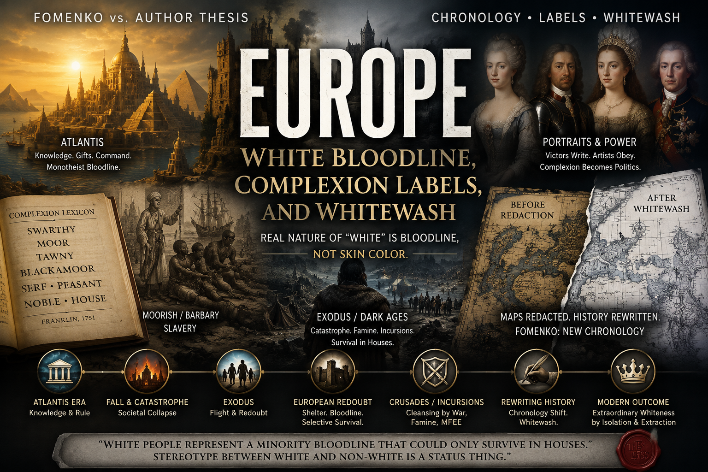

# Europe: White Bloodline, Complexion Labels, and Whitewash — Fomenko vs. Author Thesis

> **TL;DR:** This dossier maps **every major “non-white” label** used in European sources (swarthy, Moor, tawny, serf, peasant, etc.) against **Fomenko’s New Chronology** and **mainstream** demography/genetics. **Author thesis (not Fomenko):** “white” is a **minority house-bloodline** (indoor elite), not indigenous pale demography; post–**Exodus / Dark Ages** a remnant **camped in Europe**, then **famines, Crusades, MFEE** winnowed those **outside houses**; the **same pattern** applies to **North America** — European monotheist exodus (**1492** frame), **house-builders** ill-adapted without indigenous help, then **replacement** of Native populations to an extreme minority, paralleling what likely happened in **Europe** first. **Documented:** chronology skepticism, Franklin §24, Moor/Barbary slavery, colonial dependence on Native aid, demographic collapse of indigenous nations. **Speculative:** Atlantis command, 1492 as literal flight date, gas-mask memory, WW precondition scripting.

**Status:** Open — taxonomy and cross-links built; primary archive targets listed.  
**Date:** 2026-05-19

---

## Guide (read order)

| If you want… | Section |
|--------------|---------|
| Author’s full sentiment in one place | §2 |
| Americas parallel (1492, houses, indigenous replacement) | §2b |
| Definitions: white / non-white / confused terms | §3 |
| What Fomenko actually claims (and does not) | §4 |
| Mainstream vs. Paradigm Threat | §5 |
| Claim-by-claim validation table | §6 |
| Related repo investigations | §7 |
| Falsifiable next steps | §8–9 |

---

## 2. Author’s originating thesis (verbatim sentiment + unpack)

> **Author (2026-05-19, session synthesis):**  
> White people actually represent a **minority bloodline** that could only survive in **houses** throughout history. Almost everyone else can be considered **non-white** because they lived **outside of houses** or in a more **rugged** situation without modern conveniences. The stereotype between white and non-white seems to be entirely a **status** thing. Europe was white because of a sequence of events tracing to **Atlantis**, when white people were in charge and everyone came for gifts and technology. After their fall they kept the bloodline alive with that same technology; almost every other race took over and became majorities. After the **Dark Ages**, after the **Exodus** event, white people **exodused to Europe**, set up camp, brought **slaves**. Later: **famines**, **incursions**, **Crusades**, **MudFlood** energetic events — anyone who could not survive **inside a house** perished in Europe especially. Science fiction remembers this as **ecosystem collapse**, **smog**, **gas masks**. Final read: Europe was **extraordinarily white** compared to the rest of the world **not** because of indigenous history but because of an **Atlantean monotheistic bloodline**, isolated, considering itself in charge, working to **enslave the world**; in modern times creating **preconditions for world war** as in the last two world wars. **Real nature of “white” is bloodline, not skin color.**  
> The reason we find **white people in North America** is **not indigenous** either — **same reason** as Europe: **monotheists of Europe fled to America in 1492**. They were known for **building houses**, living in **extremely harsh conditions**, and **needing Native American help to survive**. Eventually they **replaced** Native Americans, reducing them to an **extreme minority** — and this is **most likely what happened in Europe as well**.

**Unpack (assistant):** The investigation treats **three stacked layers**:

1. **Semiotic layer** — Historical words (*swarthy*, *Moor*, *tawny*, *blackamoor*, *peasant*) are **not** stable synonyms for modern “people of color.”  
2. **Structural layer** — **Indoor elite** vs **outdoor mass** as a **class/shelter** divide that later gets **frozen into pigment politics**.  
3. **Timeline layer (author + NC-adjacent)** — Catastrophe → **European redoubt** → **Americas exodus (1492 frame)** → **replacement of prior majorities** → **cartographic and portrait whitewash** by **victors** (Romanov fracture, Scaligerian chronology, post-MFEE reordering). See §2b.

This file **does not** equate “non-white = inferior”; it documents how **labels moved** and how **author timeline** reinterprets them.

---

## 2b. Americas parallel — same bloodline logic, not indigenous “white”

**Author thesis:** Present-day **European-descended** populations in North America are **not** evidence that the continent was **indigenously white**. They are the **same house-bloodline / monotheist exodus** story applied westward:

| Stage | Author read | Mainstream overlap |
|-------|-------------|-------------------|
| **1492 flight** | European **monotheist elite** (Inquisition / Ottoman pressure frame in repo chronology) **flees** to Americas — calendar anchor **1492**, not “first discovery” of empty land | Columbus voyage, Reconquista, expulsions — see [chronology page](/history/chronology/page.md), [new-world naming](/history/chronology/investigations/new-world-naming-mfee-and-colonization-memory.md), [promised land](/history/mudflood/investigations/promised-land-investigation.md) |
| **House culture** | Arrivals **build houses** (timber framing, permanent settlement) — marks **bloodline lane** vs indigenous outdoor / longhouse / mobile economies in author model | Documented settler architecture; Jamestown, Plymouth, palisaded towns |
| **Harsh survival** | Ill-suited without **indigenous knowledge** (maize, climate, waterways, diplomacy) | **Documented** — Thanksgiving narratives, fur trade, agricultural instruction |
| **Replacement** | Over centuries, **demographic takeover** → Native nations reduced to **small minorities** on own land | **Documented** — disease, war, removal, boarding schools, reservation shrinkage (mechanisms disputed in detail, outcome not) |
| **Europe first?** | **Same sequence hypothesized for Europe earlier:** incoming house-line **replaces** prior majority populations; later **whitewash** presents result as **indigenous European pallor** | **Speculative** — mainstream: deep-time European admixture; author: victor + chronology rewrite |

**Fomenko note:** NC treats much of **American land as former Rus-Horde east** before 1775 fracture — **political**, not a pigment theory. Do **not** attribute §2b to Fomenko unless quoting [Ch.8 American war](https://chronologia.org/en/how_it_was/08.html).

**Contrast with Franklin (1751):** Franklin called **indigenous America** “**wholly**” tawny (§24) and feared **German Boors**, not “native whites” — supports **recent European “white” presence** as **immigrant politics**, not aboriginal identity. See [Franklin dossier](/history/chronology/investigations/franklin-palatine-boors-moors-screenshot-investigation.md).

**MFEE layer (repo):** [New World naming](/history/chronology/investigations/new-world-naming-mfee-and-colonization-memory.md) separates **1492 propaganda stratum** from **post–~1774** “New World” inflation after cataclysm — both compatible with author “exodus + repopulation” without merging dates blindly.

---

## 3. Taxonomy: versions of “white” and “non-white” in play

Use this table when reading European sources, meme books, or Fomenko side by side.

| Term / category | Typical historical meaning | Maps to modern US “race”? | Common confusion |
|-----------------|----------------------------|---------------------------|------------------|
| **White** (modern) | Light skin; social “Caucasian” | Yes | Projected onto past portraits |
| **White** (Franklin 1751) | “Purely white” ≈ **Saxons + English** only | Partial | He calls most Europeans **swarthy** |
| **Swarthy** | Darker European complexion; Mediterranean/Nordic border | Sometimes collapsed into “POC” in revisionist books | ≠ Sub-Saharan “black” in same texts |
| **Tawny** | Brownish; Asia; indigenous Americas in Franklin | Ambiguous | Often read as “black” in garbled reprints |
| **Black / black or tawny** (Franklin on Africa) | Continental color rhetoric | Partial | Not individual census categories |
| **Moor** | Muslim / Maghrebi / Iberian-era label; exonym | Sometimes | ≠ “Palatine Boors” (German peasants) — see [Franklin screenshot dossier](/history/chronology/investigations/franklin-palatine-boors-moors-screenshot-investigation.md) |
| **Negro / Ethiopian** (early modern) | Often any dark-skinned foreigner in art/literature | Partial | Geography imprecise |
| **Blackamoor** (art/luxury) | Dark-skinned figure in European decorative arts | Partial | Status symbol, not census |
| **Serf / peasant / boor** | Unfree or rustic **outdoor** labor | **Author:** non-white by **status** | Not ethnic labels in documents |
| **Noble / court / “house”** | Indoor, clothed, portrayed | **Author:** bloodline “white” lane | Portraits ≠ population genetics |
| **Tartar / Horde / Rus** (Fomenko) | World-empire political identity | Not a color category | NC = chronology, not pigment theory |
| **Slave / bondsman** | Legal property (Roman → Atlantic) | Overlaps with later racial slavery | Institution ≠ skin tone alone |
| **Barbary captive** | European enslaved by North African corsairs | Inverts popular “race and slavery” cartoon | See [slave-trades investigation](/governance/slavery/slave-trades-and-moor-etymology-investigation.md) |
| **People of color** (modern analytic) | Non-white in post–civil-rights discourse | Yes | Anachronistic on pre-1900 Europe |
| **Whitewash** (metaphor) | Cover-up, PR, paint on portraits | N/A | **This dossier’s forensic theme** |

**Repo rule:** When a source says **swarthy** or **Moor**, quote the word — do not silently upgrade to **black** or **white** in modern senses.

---

## 4. Fomenko’s New Chronology — what it contributes here

**Attributed to Fomenko / chronologia.org only:**

| NC claim | Relevance to complexion / Europe |
|--------|----------------------------------|
| Scaliger–Petavius **chronology insertion** / duplicate dynasties | **Victors rewrite time** — supports *whitewash by reordering*, not automatic pigment proof |
| **Christ ~1152**, Crimea / Istanbul | Recent Christianity → less deep “indigenous white Europe” |
| **Troy = Crusades**; **Mongols = Russians** | Wars as **same-event copies** — victor narratives recycled |
| **Rus-Horde / Great Tartary** maps (1771 vs later) | **Cartographic erasure** of empire names — parallel to **portrait erasure** thesis |
| **American War = eastern front** vs Horde (Ch.8) | Imperial fracture, not skin taxonomy |
| **Royal vs Apostolic Christianity** ([two-branches note](/history/chronology/investigations/two-branches-christianity-fomenko-vs-author.md)) | **Bloodline religion** vs institutional church — **closer** to author “house bloodline” than to Franklin |

**Not in Fomenko (author / Paradigm Threat only):**

- Atlantis as **source of white command bloodline**  
- **MudFlood / MFEE** killing outdoor Europeans selectively  
- **Gas-mask sci-fi** as memory of ecological collapse  
- **White minority** worldwide; **indoor = white** equation  
- Modern **WW precondition** scripting by same bloodline  

**Verification ladder:** [Fomenko NC verification investigation](/history/chronology/investigations/fomenko-new-chronology-verification-accessibility-investigation.md); local mirror index in repo `history/chronology/investigations/index-chronologia.md`.

---

## 5. Mainstream theories vs. author theory

| Question | Mainstream / academic mainstream | Author + Paradigm Threat timeline |
|----------|----------------------------------|-----------------------------------|
| Why is modern Europe demographically pale in many regions? | Migration, selection, UV/climate, Neolithic farmer vs hunter admixture, plague bottlenecks | **Remnant bloodline redoubt** after catastrophes; **indoor survival** bias |
| Are old portraits reliable for race? | Often idealized; pigment fades; restoration | **Victor whitewash**; “Swarthy Kings” debate — study copies only |
| What did “swarthy” mean? | Darker European tone | **Near-black in folk read** — [Franklin dossier](/history/chronology/investigations/franklin-palatine-boors-moors-screenshot-investigation.md) |
| Who rewrote European history? | Nation-states, archives, nationalism | **Scaligerian chronology**, **Romanov fracture**, **Deep State** continuity — [history-qa](/history/chronology/history-qa/page.md) |
| Mud / buried cities | Geology, urban fill, war, neglect | **MFEE** + map mismatch — [mfee](/history/mudflood/investigations/mfee-investigation.md), [tartarian maps](/history/mudflood/investigations/tartarian-maps-investigation.md) |
| Atlantis | Legend / metaphor | **Mars pole / Saturnian** tech hub — [atlantis theory](/history/chronology/atlantis/theory.md) (author cosmology) |
| Slavery and Europe | Atlantic + Barbary + serfdom | **Post-fracture extraction** — [slave-trades](/governance/slavery/slave-trades-and-moor-etymology-investigation.md) |
| World wars | Imperialism, treaties, industrial militarism | **Same apparatus** preconditions wars — [American Revolution](/governance/war/investigations/american-revolution-investigation.md), [WWII fascism](/governance/war/investigations/wwii-fascism-religious-apparatus-investigation.md), [reverse crusades](/governance/war/investigations/reverse-crusades-comparison.md) |
| Who are “white” Americans? | Immigrants + assimilation; indigenous prior occupancy | **Not indigenous white** — **1492 monotheist exodus** + house culture; same replacement pattern as **Europe hypothesis** |
| Native American decline | Disease, conflict, policy, structural violence | **Replacement by house-bloodline majority** — outcome **documented**, author **causal stack** speculative |

---

## 6. Validation matrix (author open claims)

| # | Claim | Tier | Notes |
|---|--------|------|-------|
| 1 | “White” today is **bloodline/status**, not skin alone | **Author / speculative** | Structurally argued; needs primary “house” genealogy chains |
| 2 | Minority **house bloodline** survived history | **Investigative** | Overlaps Fomenko **Royal Christianity**; not genetics-proved here |
| 3 | Outdoor / non-house populations = **non-white** in author sense | **Author definition** | Moral category — not historical self-label |
| 4 | Atlantis era: whites in charge, global tech gifts | **Speculative** | [Atlantis Mars theory](/history/chronology/atlantis/theory.md); not mainstream archaeology |
| 5 | Post-fall bloodline preserved by **technology** | **Speculative** | Aligns with “Deep State apparatus” in [two-branches](/history/chronology/investigations/two-branches-christianity-fomenko-vs-author.md) |
| 6 | Exodus → Europe encampment + slaves | **Investigative** | Links [promised-land](/history/mudflood/investigations/promised-land-investigation.md), Horde fracture, colonization memory |
| 7 | Famines, Crusades, incursions winnowed populations | **Partially documented** | Events real; **selective indoor survival** is author inference |
| 8 | MFEE killed those **outside houses** in Europe | **Speculative** | [MFEE](/history/mudflood/investigations/mfee-investigation.md), [blood-rain](/history/mudflood/investigations/blood-rain-dust-ecological-disasters-investigation.md), [spore](/history/mudflood/investigations/spore-ecological-disaster-martian-cylinders-investigation.md) |
| 9 | Sci-fi gas-mask era = cultural memory of collapse | **Speculative** | Pattern read (WotW, dieselpunk); not historical proof |
| 10 | Europe “extraordinarily white” vs world = remnant redoubt | **Partially documented** | Modern demography + **under-taught** swarthy Europe in sources |
| 11 | Atlantean monotheist line seeks world enslavement | **Author moral thesis** | Tied to slave-trade fracture timing — not monolithing any ethnicity |
| 12 | Modern WW preconditions repeat | **Investigative** | Finance / empire investigations; not complexion-specific |
| 13 | Victor wars **whitewashed** complexion record | **Partially documented** | Portrait restoration, curriculum silos, map erasure (Fomenko + NC) |
| 14 | Franklin **Boors** control copy | **Validated** | See [Franklin dossier](/history/chronology/investigations/franklin-palatine-boors-moors-screenshot-investigation.md); wget scan in Investigator notes |
| 15 | North American “whites” **not indigenous** | **Author thesis** | Aligns with anti-autochthonous “white native” myths; mainstream agrees pre-Columbian indigenous presence |
| 16 | **1492** = European monotheist flight to Americas | **Investigative** | Repo chronology; not all historians accept “flight” frame |
| 17 | Settlers **house-builders**, needed **Native help** | **Partially documented** | Early starvation winters, indigenous crops/diplomacy widely attested |
| 18 | Native Americans reduced to **extreme minority** | **Partially documented** | 20th–21st c. demographics; causation multi-factor |
| 19 | **Same replacement** happened in **Europe** earlier | **Speculative** | Parallel model; aDNA / archaeology main falsifiers |

---

## 7. Related investigations (cross-reference hub)

| Thread | File |
|--------|------|
| Chronology hub | [/history/chronology/page.md](/history/chronology/page.md) |
| First / Second / Third History, redaction | [/history/chronology/history-qa/page.md](/history/chronology/history-qa/page.md) |
| Fomenko vs author Christianity | [/history/chronology/investigations/two-branches-christianity-fomenko-vs-author.md](/history/chronology/investigations/two-branches-christianity-fomenko-vs-author.md) |
| Fomenko verification | [/history/chronology/investigations/fomenko-new-chronology-verification-accessibility-investigation.md](/history/chronology/investigations/fomenko-new-chronology-verification-accessibility-investigation.md) |
| Illig phantom time boundary | [/history/chronology/investigations/illig-fomenko-boundary.md](/history/chronology/investigations/illig-fomenko-boundary.md) |
| MudFlood / MFEE | [/history/mudflood/page.md](/history/mudflood/page.md), [mfee](/history/mudflood/investigations/mfee-investigation.md) |
| Tartarian maps | [/history/mudflood/investigations/tartarian-maps-investigation.md](/history/mudflood/investigations/tartarian-maps-investigation.md) |
| Franklin complexion + Palatine | [/history/chronology/investigations/franklin-palatine-boors-moors-screenshot-investigation.md](/history/chronology/investigations/franklin-palatine-boors-moors-screenshot-investigation.md) |
| Slave trades + Moor | [/governance/slavery/slave-trades-and-moor-etymology-investigation.md](/governance/slavery/slave-trades-and-moor-etymology-investigation.md) |
| American Revolution / 1775 fracture | [/governance/war/investigations/american-revolution-investigation.md](/governance/war/investigations/american-revolution-investigation.md) |
| Giants / Horde military lexicon | [/history/chronology/investigations/giants-infantry-guerrilla-etymology-investigation.md](/history/chronology/investigations/giants-infantry-guerrilla-etymology-investigation.md) |
| Prester John / Christian East | [/history/chronology/investigations/prester-john-presbyter-rus-horde-nc-investigation.md](/history/chronology/investigations/prester-john-presbyter-rus-horde-nc-investigation.md) |
| WotW / Mars catastrophe fiction | [/cosmos/mars/investigations/wotw-mfee-mars-catastrophe.md](/cosmos/mars/investigations/wotw-mfee-mars-catastrophe.md) |
| New World naming / 1492 vs MFEE | [/history/chronology/investigations/new-world-naming-mfee-and-colonization-memory.md](/history/chronology/investigations/new-world-naming-mfee-and-colonization-memory.md) |
| Promised land / 1492 exodus echo | [/history/mudflood/investigations/promised-land-investigation.md](/history/mudflood/investigations/promised-land-investigation.md) |
| Indigenous legends vs geology | [/history/chronology/indigenous-creation-legends-and-geology.md](/history/chronology/indigenous-creation-legends-and-geology.md) |
| Antisemitism working definition | [/history/chronology/investigations/paradigm-threat-working-definition-antisemitism.md](/history/chronology/investigations/paradigm-threat-working-definition-antisemitism.md) |

---

## 8. Questions to clarify, verify, or debunk

| # | Hook | Target |
|---|------|--------|
| 1 | Pre-1800 European parish / manor records: indoor elite vs outdoor labor mortality during famines | Regional archives |
| 2 | Portrait pigment analysis (Tudor, Hanover, Italian courts) vs burial remains | Museum conservation reports |
| 3 | Fomenko map editions side-by-side (1771 Tartary vs 19th c.) | [wget chronologia mirror](https://chronologia.org/en/index.html) |
| 4 | MFEE strata vs war fill — independent geology | [radiocarbon investigation](/history/chronology/investigations/radiocarbon-dating-investigation.md) |
| 5 | Identify screenshot book (Palatine **Moors** lineage) | Anna’s Archive fingerprints in Franklin dossier |
| 6 | Ancient DNA time series Europe — do bottlenecks match “house survival”? | aDNA papers (mainstream falsifier) |
| 7 | Gas-mask / smog fiction cluster as post-MFEE memory | Fiction survey + [wotw-mfee](/cosmos/mars/investigations/wotw-mfee-mars-catastrophe.md) |
| 8 | Jamestown / Plymouth starvation records vs indigenous aid | Colonial primary sources |
| 9 | Pre-1492 European aDNA vs modern pale regions | Population genetics |
| 10 | Indigenous population estimates 1491 vs 1900 vs 2020 | Demography + historiography of disease |

---

## 9. Weak points / TODOs

- [x] Header illustration — `europe-white-bloodline-complexion-whitewash-investigation.png`  
- [ ] Parent **article** only if author names path ([ARTICLES.md](/docs/instructions/ARTICLES.md))  
- [ ] Pull 3–5 primary portrait-restoration cases (documented whitewash)  
- [ ] Separate short annex: **Fomenko quotations on maps only** (no Atlantis bleed)  
- [ ] Link Benjamin Franklin wget `INDEX.md` from investigator notes only  

---

Keywords: #Europe #NorthAmerica #WhiteBloodline #Complexion #Whitewash #Fomenko #NewChronology #MudFlood #Atlantis #RusHorde #Swarthy #Moor #Columbus1492 #Indigenous #ParadigmThreatFiles

**Last updated:** 2026-05-20

---

## Limits and disclaimers

- **Author thesis §2** is **first-class** for Paradigm Threat but **not** established history or genetics.  
- **“Non-white”** in §3 includes **author-defined status categories** — do not treat as slur directed at modern groups.  
- **Fomenko** is cited only where marked; mainstream historians reject NC.global conclusions.  
- This investigation **does not** claim all Europeans were literally Black in modern sense, or that all modern “white” people are Atlantean — it documents **label confusion** and **timeline speculation**.  
- **§2b** does **not** deny indigenous genocide or Native sovereignty; it reframes **who “white Americans” are** in author timeline (exodus + replacement), parallel to **Europe hypothesis**.  
- See [antisemitism working definition](/history/chronology/investigations/paradigm-threat-working-definition-antisemitism.md): critique **institutions and bloodline myths**, **no** monolithing ethnic communities.  
- Fiction (gas masks, WotW) is **evidence of cultural memory**, not literal unless separately proved.

## Investigator notes

- Franklin control scan: `~/dev/wget/benjamin-franklin/INDEX.md` (Boors confirmed; Moors absent).  
- Chronologia mirror: repo `history/chronology/investigations/index-chronologia.md`; wget `~/dev/wget/chronologia.org`.
