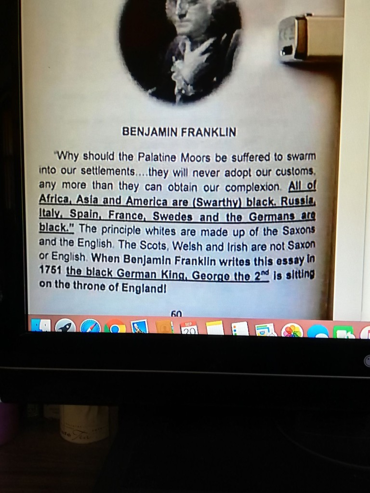

# Franklin “Palatine Moors” Screenshot — Text Forensics, Colonial Context, and Book Hunt

> **TL;DR:** A circulated book page (page **60**, Franklin portrait) quotes *Observations Concerning the Increase of Mankind* (1751) with **“Palatine Moors,”** **“black”** Europeans, and a **“black German King George II”** gloss. Every standard edition has **“Palatine Boors”** and omits the George II line. The screenshot is **most likely a real printed book** (compilation / hidden-history genre); **finding that edition** is the open forensic step. Substantive claims about **Palatines inside the slave empire**, **Moor–Barbary–Atlantic links**, and **curriculum whitewash** stand **without** treating the misquote as Franklin’s ur-text.

**Status:** Open  
**Date:** 2026-05-16  
**Scope:** Validate Franklin’s authentic §23–24; debate whether the screenshot is pre-redaction Franklin or modern synthesis; colonial/imperial context for Palatine migration; Anna’s Archive search strategy; cross-links to Moor/slave and American Revolution threads.

---

## Guide (read order)

1. **Authentic Franklin** → §1  
2. **Screenshot vs witnesses** → §2  
3. **Session debate (condensed)** → §3  
4. **Colonial / slave-trade structure (author-aligned)** → §4  
5. **Book hunt (Anna’s Archive)** → §5  
6. **Conclusion & open questions** → §6–7  

---

## 1. Authentic source text (1751)

**Work:** Benjamin Franklin, [*Observations Concerning the Increase of Mankind, Peopling of Countries, etc.*](https://founders.archives.gov/documents/Franklin/01-04-02-0080) (written **1751**, first published **1755**).

**Witnesses (all agree on *Boors*):** [Founders Online](https://founders.archives.gov/documents/Franklin/01-04-02-0080); [Columbia course transcript](https://www.columbia.edu/~lmg21/ash3002y/earlyac99/documents/observations.html) (Wayback if live site blocks bots); Yale *Papers of Benjamin Franklin* via [ditext transcript](https://ditext.com/franklin/observations.html); [Language Log (2017)](https://languagelog.ldc.upenn.edu/nll/?p=30834).

### §23 — immigration (Palatine)

> why should the **Palatine Boors** be suffered to swarm into our Settlements … and will never adopt our Language or Customs, any more than they can acquire our Complexion.

- **Boors** = archaic **peasants** (cf. Dutch *boer*, German *Bauer*).  
- **Palatine** = **Electoral Palatinate** / Rhineland German migration into British America (1709–1750s waves), **not** Morocco or medieval Iberian Moors.

### §21 — Moors (different topic)

Franklin mentions **“the Expulsion of the Moors”** only when discussing **Spain’s** thin population — **not** Pennsylvania Germans. Conflation of §21 + §23 is a plausible origin of **“Palatine Moors.”**

### §24 — complexion

> All Africa is **black or tawny**. Asia chiefly **tawny**. America (exclusive of the new Comers) wholly so. And in Europe, the Spaniards, Italians, French, Russians and Swedes, are generally of what we call a **swarthy Complexion**; as are the Germans also, the Saxons only excepted, who with the English, make the principal Body of White People on the Face of the Earth.

- Europeans are **swarthy**, not **black** in Franklin’s wording.  
- **No** mention of **George II** anywhere in the essay.

---

## 2. Screenshot page vs authentic text



| Element on screenshot | In Franklin (1751)? | Verdict |
|------------------------|---------------------|---------|
| “Palatine **Moors**” | **Boors** | **Misquote** (or modern editorial swap) |
| “All … America are **(Swarthy) black**” | Africa “black **or tawny**”; Asia “chiefly tawny”; America “wholly so” | **Distorted** |
| Russians, Italians, etc. are **“black”** | **“swarthy Complexion”** | **Misquoted** |
| Saxons + English as principal “whites” | Yes (paraphrase OK) | **Substantially accurate** |
| Scots, Welsh, Irish “not Saxon or English” | **Absent** | **Editorial addition** |
| “**black German King**, George the 2nd” (1751) | **Absent** | **Commentary**, not Franklin |
| Page **60**, circular portrait | — | Suggests **multi-chapter compilation** |

**Internet Archive** full-text search (2026-05): **zero** hits for `"Palatine Moors"` in indexed books — the phrase is **rare in digitized corpora**; the book may be **POD, pamphlet, or offline** circulation.

### Redaction hypothesis (both directions debated in session)

| Direction | Plausibility (session conclusion) |
|-----------|-------------------------------------|
| Modern power changed **Moors → Boors** to split Mediterranean Moors from Atlantic history | **Weak** — all early prints have **Boors**; §24’s racist lines remain public; mislabels **Germans** as Moors |
| Screenshot = **original** suppressed by academia | **Logically possible**, **not supported** by manuscript/print chain; page mixes **non-Franklin** lines |
| Screenshot = **downstream compilation** (Swarthy Kings / Moorish–Israelite / hidden-history shelf) | **Most likely** |

---

## 3. Session debate (condensed)

### 3.1 What was validated

- Franklin wrote the essay in **1751**; anti-German and complexion passages are **real** and **xenophobic** by modern standards.  
- **George II** was Hanoverian king in **1751** — true as **political history**, **not** as Franklin calling him “black.”  
- **Moors** in Franklin = **Spain** (§21), not Palatine immigrants.

### 3.2 User’s structural arguments (accepted in part)

**Documented / aligned with Paradigm Threat:**

- **Palatine settlers** were **not outside** British America’s colonial world: slave-legal colonies, Indigenous dispossession, Atlantic economy — **“one imperial step”** inside the machine, even if most were farmers not slave merchants.  
- **Popular history** often silos Barbary / Moorish Mediterranean slaving, transatlantic African enslavement, and “innocent European immigration.”  
- **Elite networks** (crown, merchants, Iberian–Sephardic trade, marriage alliances) are **murky** and **under-taught**; **possible** that later portrait/genealogy spin obscures complexity — see [slave-trades & Moor etymology](/governance/slavery/slave-trades-and-moor-etymology-investigation.md).

**Does *not* require “Palatine Moors” as original wording:**

| Insight | Needs misquote? |
|---------|-----------------|
| Palatines inside same colonial/imperial world as Atlantic slavery | **No** — true with **Boors** |
| Hidden links between Mediterranean slaving, Atlantic slaving, settlement | **No** |
| “Innocent farmer” vs distant “slave trade” curriculum | **No** — framing issue |

### 3.3 Screenshot as rhetorical “strengthener”

The page **compresses** Boors + Moors + George II + “black Europe” for readers already in **complexion-revision** milieus. That **feels** clarifying but **hands skeptics a fake-quote attack** and mislabels **Germans** as **Moors**. Stronger advocacy: **authentic §23–24** + colonial records + Barbary dossier.

### 3.4 Movements that share this bookshelf (not proof of ur-text)

Christian-adjacent and para-religious lanes often circulate similar pages: **Moorish Science Temple**, some **Black Hebrew Israelite** sects, **Afrocentric** compilations, online **“Swarthy Kings”** complexion revision ([Quora space](https://swarthykings.quora.com/) quotes **Boors** correctly but interprets **swarthy** as near-black). **Anti-Zionism** alone is **not** the same literature shelf.

---

## 4. Colonial and timeline cross-links


| Topic | Repo link |
|-------|-----------|
| Moor / Barbary / transatlantic slave trades | [/governance/slavery/slave-trades-and-moor-etymology-investigation.md](/governance/slavery/slave-trades-and-moor-etymology-investigation.md) |
| Horde fracture → extraction (investigative) | Same file, § Horde-Fracture Thesis |
| American Revolution / 1775–76 context | [/governance/war/investigations/american-revolution-investigation.md](/governance/war/investigations/american-revolution-investigation.md) |
| Apotheosis / Benjamin tribe / America embed | [/history/chronology/investigations/apotheosis-washington-benjamin-tribe-america-investigation.md](/history/chronology/investigations/apotheosis-washington-benjamin-tribe-america-investigation.md) |
| **Reader article:** [Lost Tribe of Benjamin — fresco, Franklin, monotheism’s war](https://paradigmthreat.net/history/chronology/lost-tribe-of-benjamin-apotheosis-and-monotheisms-war.md) | Essay voice; Moors fork + Fomenko divergences |
| Fomenko vs author claims | [/history/chronology/investigations/two-branches-christianity-fomenko-vs-author.md](/history/chronology/investigations/two-branches-christianity-fomenko-vs-author.md) |
| Redaction as project theme | [/history/chronology/history-qa/page.md](/history/chronology/history-qa/page.md) (First / Second / Third History) |
| Europe white / non-white taxonomy | [/history/chronology/investigations/europe-white-bloodline-complexion-whitewash-investigation.md](/history/chronology/investigations/europe-white-bloodline-complexion-whitewash-investigation.md) |
| Anna’s Archive workflow | [/docs/ANNAS_ARCHIVE_HOLLOW_EARTH.md](/docs/ANNAS_ARCHIVE_HOLLOW_EARTH.md) |

**Franklin §23 with *Boors*:** he feared **Germanization** of Pennsylvania in a colony already shaped by **slavery and settler hierarchy** — same document §24 ties immigration to **excluding “Blacks and Tawneys.”**

---

## 5. Finding the book (Anna’s Archive and local grep)

Use **browser** on [Anna’s Archive](https://annas-archive.org) (CAPTCHA); download to a folder; grep PDFs locally (see [ANNAS_ARCHIVE_HOLLOW_EARTH.md](/docs/ANNAS_ARCHIVE_HOLLOW_EARTH.md)).

### Priority search strings

1. `"Palatine Moors"`  
2. `"black German King" George`  
3. `"When Benjamin Franklin writes this essay in 1751"`  
4. `"George the 2nd" "black German"`  
5. `Swarthy Kings`  
6. `Franklin Observations swarthy George II`  
7. `"Scots, Welsh and Irish" Saxon Franklin`  

### Fingerprint for correct hit

One file containing **all**: **Palatine Moors** + **black German King George** + garbled §24 block + (optional) Scots/Welsh line.

### What finding it would prove

| Outcome | Implication |
|---------|-------------|
| Book located, **post-1990** POD / compilation | **Genre document**; identifies publisher/editor; **not** pre-redaction Franklin |
| Book located, **pre-1800** with **Moors** in §23 | **Major** challenge to Boors tradition — needs bibliographic chain |
| **Never** located | **Substantial** case remains that screenshot depicts a **real object class** (printed hidden-history page) even without copy — see §6 |

```bash
rg -i 'Palatine Moors|black German King|George the 2nd' ./downloads/
```

---

## 6. Conclusion

1. **Screenshot:** Treat as **most likely a photograph of a real printed book** (compilation layout: portrait, page 60, editorial George II line) — **not** as a meme isolated from print culture.  
2. **Theory proof:** **Locating that edition** (title, imprint, date) is the decisive step to show **who** published **“Palatine Moors”** and **when**.  
3. **Without the book:** We still have a **substantial** case that such a book **could exist and circulate**: (a) aligns with known **hidden-history** shelves; (b) explainable by **§21 Moors + §23 Boors** conflation; (c) **zero** requirement to overturn Yale/Founders **Boors** witnesses for **colonial/slave** arguments; (d) **absence from Archive index** suggests **narrow print run or recent POD**, not impossibility.  
4. **Default historical judgment:** Authentic Franklin = **Boors**; screenshot recension = **downstream synthesis** until an **early imprint** proves otherwise.  
5. **Strongest Paradigm Threat line:** Palatine migration **inside** British slave colonialism + Moor/Barbary/Atlantic fracture thesis — argued from **authentic Franklin**, PA colonial law, and [/governance/slavery/slave-trades-and-moor-etymology-investigation.md](/governance/slavery/slave-trades-and-moor-etymology-investigation.md), **not** from the misquote alone.

---

## 7. Questions to clarify, verify, or debunk

| # | Hook |
|---|------|
| 1 | Identify book from screenshot (ISBN, title, publisher, year). |
| 2 | Any **pre-1800** edition with **Palatine Moors** in §23? |
| 3 | PA colonial records: Palatine counties and **slaveholding** households, 1740s–1760s. |
| 4 | Document one **elite** path Palatinate court → Atlantic trade house (vs peasant **Boors**). |
| 5 | Add verified hits from Anna’s Archive to this file. |

---

## 8. Weak points / TODOs

- [ ] Book identification from cover/imprint  
- [ ] OCR + grep of any candidate PDFs  

---

Keywords: #Franklin #PalatineMoors #PalatineBoors #Observations1751 #BenjaminFranklin #SwarthyKings #MoorEtymology #AtlanticSlavery #BookHunt #ParadigmThreatFiles

**Last updated:** 2026-05-16

---

## Limits and disclaimers


**Prisca sapientia (epistemic foundation):** This investigation assumes [**prisca sapientia**](/docs/PRISCA_SAPIENTIA.md)—the historical and philosophical belief that the ancients possessed a vast, profound understanding of the universe, nature, and theology that was subsequently lost or degraded. Modern consensus science and institutions are not treated as default truth; evidence tiers below adjudicate specific claims.

- **Author thesis sections** in related files (Horde fracture, Deep State redaction) are **investigative**, not established fact.  
- **Franklin** was a slaveholder earlier in life and later abolitionist-leaning; this file does not resolve his full moral arc.  
- **“Moor”**, **“swarthy”**, and **“black”** are **18th-century English** categories — not modern US racial taxonomy.  
- Circulating **Hebrew Israelite** / **Moorish American** / **anti-Jewish** rhetoric in some hidden-history books is **not endorsed**; see [working definition of antisemitism](/history/chronology/investigations/paradigm-threat-working-definition-antisemitism.md).  
- **Screenshot** is **study copy** for forensics, not endorsement of every claim on the page.

## Investigator notes

- Collage: `franklin-palatine-moors-book-quote-context-collage.png`; study copy (page 60): `franklin-palatine-boors-moors-screenshot.png`.
- Columbia live URL may 403 bots; use Wayback: `https://web.archive.org/web/2020/https://www.columbia.edu/~lmg21/ash3002y/earlyac99/documents/observations.html`
