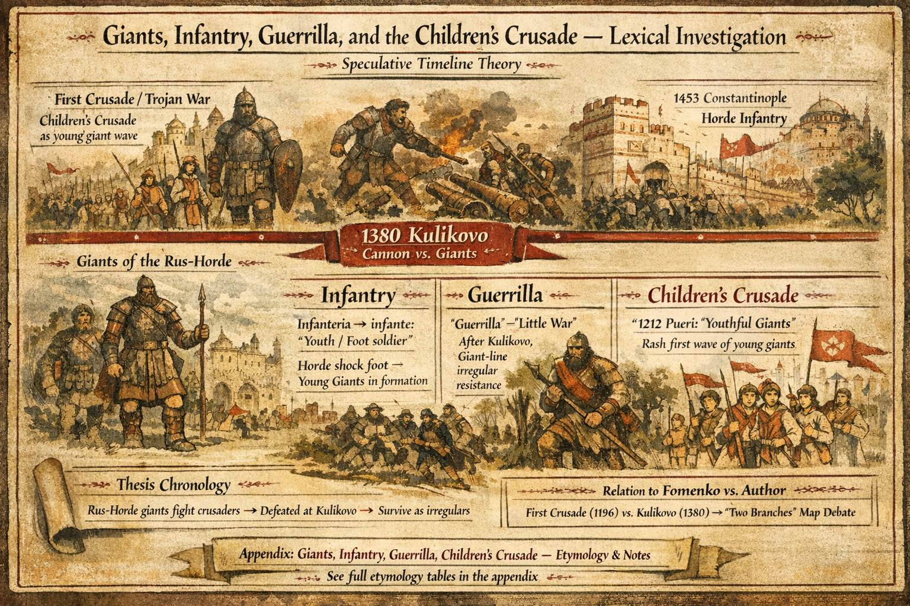

# Giants, Infantry, Guerrilla, and the Children's Crusade — Lexical Investigation

This note ties three military-historical terms to the timeline thesis that **Rus-Horde giant lineages** fought **crusading wars** against the **Istanbul–temple apparatus**, then lost **formed battle** to **cannon** and survived afterward as **irregulars**. Full etymological tables, mainstream chronology notes, and an extended related-word list sit in the timeline appendix: **[Giants, Infantry, Guerrilla, Children's Crusade — Etymology](https://paradigmthreat.net/timeline/evt-giants-infantry-guerrilla-childrens-crusade-etymology)**.

## Timeline anchors

| Event | Slug |
|-------|------|
| First Crusade / Trojan War; Children's Crusade as young giant wave | [evt-the-first-crusade-trojan-war](https://paradigmthreat.net/timeline/evt-the-first-crusade-trojan-war) |
| Giants of the Rus-Horde | [evt-the-giants-of-the-rus-horde](https://paradigmthreat.net/timeline/evt-the-giants-of-the-rus-horde) |
| Kulikovo — cannon vs giants | [evt-giants-are-defeated-at-the-battle-of](https://paradigmthreat.net/timeline/evt-giants-are-defeated-at-the-battle-of) |
| Constantinople — Horde infantry | [evt-1453-ce-fall-of-czar-grad-constantinople](https://paradigmthreat.net/timeline/evt-1453-ce-fall-of-czar-grad-constantinople) |

## Thesis (this chronology)

1. **Infantry** — Dictionaries derive the word from Italian/Spanish *infanteria* ← *infante* “foot soldier,” earlier “youth,” from Latin *infans*. Standard accounts stress **young, non-cavalry, on foot**. This chronology adds: Horde **shock foot** included **young giant** contingents; organized **line** assault was what states later remembered as **infantry**, without preserving stature in the gloss.

2. **Guerrilla** — Spanish *guerrilla* = diminutive of *guerra* “war” → **“little war”**; English from the Peninsular War (~1809). Etymology does **not** encode *gigante*. The narrative link here is **historical**, not phonetic: after **Kulikovo** and progressive **eradication**, giant-line **remnants** could not hold **set-piece** battles; **irregular**, **local**, **ungovernable** resistance matches what modern languages call **guerrilla** warfare.

3. **Children's Crusade** — Scaligerian scholarship places the **1212** movements in France and Germany, questions literal **children**, and notes Latin *pueri* as **social category** (youths / dependents). This timeline [already reads](https://paradigmthreat.net/timeline/evt-the-first-crusade-trojan-war) the name as the **rash first wave** of **young giants** before the main host. See the appendix for the mainstream vs. thesis contrast.

## Relation to Fomenko vs. author vocabulary

Do not merge **First Crusade (~1196)** polemics with **Kulikovo (1380)** branch labels without naming which map is in force — see [Two Branches: Fomenko vs Author](/history/chronology/investigations/two-branches-christianity-fomenko-vs-author.md).

## Where to read more

- [**Crucifixion giant redaction — nail metrology (AU-031)**](/history/chronology/investigations/crucifixion-giant-redaction-nail-metrology-investigation.md) — **1185** giant Passion; **nine-inch** nails; **inch/foot** rescaling after small-body redaction
- [**Lexical redaction hub**](/history/chronology/investigations/lexical-redaction-hub-investigation.md) — master cross-ref (**Lane A**)
- **Appendix (overflow):** [Giants, Infantry, Guerrilla, Children's Crusade — Etymology](https://paradigmthreat.net/timeline/evt-giants-infantry-guerrilla-childrens-crusade-etymology) — mainstream lexicography, dates, related words (*pueri*, *infante* royal title, *hoplite*, *cohort*, mythic giant vocabulary).

---

**Prisca sapientia (epistemic foundation):** This investigation assumes [**prisca sapientia**](/docs/PRISCA_SAPIENTIA.md)—the historical and philosophical belief that the ancients possessed a vast, profound understanding of the universe, nature, and theology that was subsequently lost or degraded. Modern consensus science and institutions are not treated as default truth; evidence tiers below adjudicate specific claims.

Keywords: #Giants #Infantry #Guerrilla #Etymology #Children #Crusade #Lexical

