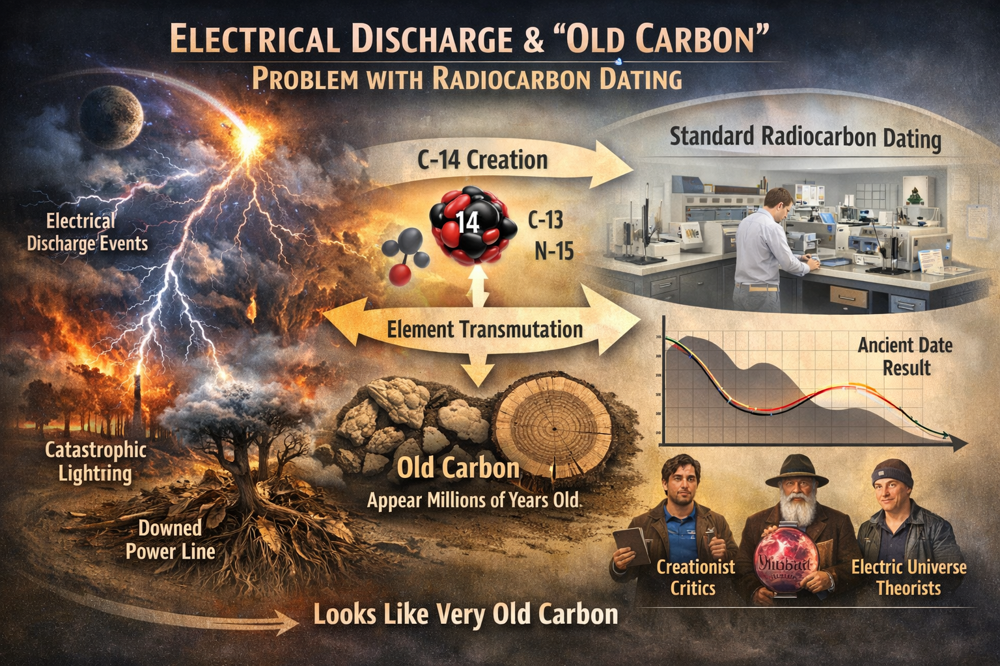

# Investigation: Radiocarbon Dating — Dogmatic Adoption and the Electrical Activity Problem

> **TL;DR:** TODO

## Summary

**Claim:** Radiocarbon dating was adopted dogmatically by the scientific community without adequate testing of its basic assumptions. The method cannot capture sharp increases in electrical activity — when intense electrical discharge occurs, it produces carbon that appears millions or billions of years old rather than showing a spike in the pattern. This fundamental flaw invalidates radiocarbon dating for catastrophic events involving electrical discharge, yet the method continues to be used uncritically as the primary means of establishing deep time chronologies.

**Status:** Open. This investigation documents critics of radiocarbon dating, evidence of its dogmatic adoption, the electrical activity problem, and connections to Electric Universe research (Peter Mungo Jupp, SAFIRE Project, instant fossilization).

---

## 1. The Core Problem: Electrical Activity and "Old Carbon"

### The Thesis

Radiocarbon dating assumes a steady-state production of carbon-14 from cosmic rays. When an intense electrical discharge occurs (e.g., interplanetary plasma discharge, catastrophic lightning, or electrical fossilization events), the method cannot register this as a spike. Instead:

- **Electrical discharge creates carbon-14 through nuclear reactions** (lightning has been documented to produce C-14, C-13, and N-15 isotopes)
- **But it also transmutes elements**, potentially creating carbon with depleted C-14 ratios
- **The result:** Samples affected by electrical activity appear as **very old carbon** (millions or billions of years old) rather than showing evidence of the catastrophic event
- **The pattern:** There is no pattern — the method simply fails to detect the event, making scientists conclude the material is ancient

This is the most fundamental flaw: **radiocarbon dating cannot capture sharp increases in activity**. If such an activity was to happen with an intense increase in electrical activity, it would not appear as a spike in the pattern. Instead, it would just appear like very old carbon, which would make scientists decide to date it as ancient, millions or billions of years old.

### Evidence from Lightning Research

Research has documented that lightning can trigger nuclear reactions in the atmosphere that produce rare isotopes, including radiocarbon (C-14). When lightning strikes, it creates cascades of subatomic reactions similar to those triggered by cosmic rays, producing isotopes like carbon-13, carbon-14, and nitrogen-15. However, the theoretical models examining C-14 synthesis under high-power electrical discharge conditions conclude that thunderstorm mechanisms cannot compete with cosmogenic production — but this assumes **normal** electrical activity, not catastrophic interplanetary discharge events.

---

## 2. Critics of Radiocarbon Dating

### Creationist Criticisms

Young-Earth Creationists have been among the most vocal critics, challenging radiocarbon dating on several grounds:

**Key Assumptions Questioned:**
1. Carbon-14 has decayed at a constant rate throughout Earth's history
2. No carbon-14 or carbon-12 was added to or removed from samples since burial
3. The carbon isotope ratio in samples matched the global ratio at that time
4. The ancient atmospheric carbon isotope ratio matched today's ratio

**Main Arguments:**
- **Atmospheric Equilibrium:** Creationists argue that atmospheric C-14 is only one-third of the way to equilibrium and would take 30,000 years to reach it, suggesting the Earth is less than 10,000 years old
- **Variable Atmospheric Ratios:** The assumptions that atmospheric carbon-14 concentration and production rates have remained constant are "not strictly correct, beyond a rough first approximation"
- **Magnetic Field Changes:** Creationists propose that Earth's stronger historical magnetic field would have reduced C-14 production in ancient times, making old samples appear older than they actually are

**Sources:**
- Institute for Creation Research (ICR) — multiple articles questioning radiocarbon dating assumptions
- Creation-science-prophecy.com — "Carbon-14 dating is not based on irrefutable data alone. It has as its basis of understanding, various assumptions which concern the conditions of the Earth tens of thousands of years ago. These assumptions were originated within an atmosphere of long age preexisting ideas."

### Electric Universe Theorists

**Wal Thornhill** (Thunderbolts Project) has argued:

> "I think the problem with radioactive dating is that it assumes the uniformitarian model that radioactive elements were created at some stage in the early formation of the solar system, and since then it's been a slow process of disintegration. Under the electrical theory, elements are being formed all the time in these discharges and, when you have interplanetary discharges, transmutation of elements is occurring and radioisotopes are being created."

This directly challenges the fundamental assumption that radiocarbon production has been constant.

### Academic Critics

Scholars have identified additional complexities:
- Assumptions about age offset constancy
- Calibration probability distributions
- The need for improved methodologies using Bayesian statistics
- Presentations and interpretations of radiocarbon ages can be misleading

**Sources:**
- "Problems in the Measurement, Calibration, Analysis, and Communication of Radiocarbon Dates" (Cambridge)
- "Progress and pitfalls in radiocarbon dating" (Nature)
- "Critical assessment of radiocarbon dating" (Royal Society)

---

## 3. Dogmatic Adoption Without Testing Basic Assumptions

### Libby's Original Assumptions (1946)

When W. F. Libby developed radiocarbon dating in 1946 (results published less than a year after WW2 ended), he made several foundational assumptions:

1. **Cosmic rays had been bombarding the atmosphere consistently** for a very long time relative to carbon-14's half-life (about 5,600 years)
2. **Steady-state condition:** Carbon-14 formation rates equaled decay rates
3. **Atmospheric carbon-14 would be diluted** into a mixing reservoir of approximately 8.5 grams of carbon per square centimeter
4. **The atmospheric ¹⁴C/¹²C ratio had always been constant** (as of 1950)

Libby explicitly identified critical assumptions required for the method to work correctly, including:
- The quantity of water and carbon in the hydrosphere must not have substantially changed over the past 40,000-50,000 years
- The influx of cosmic rays from stars and the sun must not have suffered substantial variations during the same period

### The Problem: Assumptions Not Tested

Despite these caveats, the method was **"hailed as completely reliable" and adopted dogmatically**. As testing expanded across numerous laboratories, researchers discovered "rather consistent deviation between radiocarbon age and historical age," with divergences of 500-700 years, particularly pronounced in Egyptian samples.

### Early Calibration Problems

The first carbon-14 experiments began in **1939** (coinciding with WW2), and results were published in **1946**. Egyptian tombs of Zoser and Sneferu were chosen to calibrate dating to 2625 B.C.E., but this calibration assumes those tombs are correctly dated by the Scaligerian framework in the first place — **circular reasoning**.

### The de Vries Effect (1958)

In 1958, Hessel de Vries demonstrated significant deviations from expected ratios by testing wood samples of known ages — a finding called the de Vries effect. This was resolved through dendrochronology (tree-ring analysis), which allowed scientists to construct calibration curves. However, **the oldest verified tree-ring sequences only extend to about 750 B.C.E.** Beyond that, the chronologies are constructed by cross-matching overlapping samples — a process that itself requires assumptions about continuity.

### Recognition of Limitations — Too Late

The scientific community eventually recognized these limitations, but only **after the method had been widely accepted without adequate preliminary testing of its core assumptions**. Rather than using the raw radiocarbon age, modern practice requires calibration against dendrochronology and other methods to account for variations — but this calibration itself depends on Scaligerian chronology.

---

## 4. Electric Fossilization and Radiocarbon Dating

### Peter Mungo Jupp: Instant Fossilization

**Peter Mungo Jupp** is an Australian archaeologist who studied at the University of Melbourne and combines expertise in archaeology, radiology (from his career at Siemens, Hewlett-Packard, and Toshiba), ancient history, biology, chemistry, magnetic phenomena, and mythology.

At the EU2017 conference in August 2017, Jupp presented a case for **instantaneous fossilization** — the idea that fossils can form rapidly rather than over millions of years. He questions what natural force could have created various fossil examples found on Earth, such as:
- Forests of giant trees turned to solid rock
- Soft-bodied crabs petrified within basalt
- Dinosaur remains with hearts turned to iron
- Schools of fish preserved in limestone

Jupp's work is associated with the Thunderbolts Project and Electric Universe theory, which proposes electrical phenomena as the mechanism for rapid fossilization. His research suggests that electrical discharge or electromagnetic processes may have instantaneously transformed organic matter into stone.

**Key Quote from EU2017:**
> "These fossils dramatically illustrate that these are not creatures which are disarticulated. They appear to have undergone no breakdown and decomposition. They are in very lifelike positions... It is an instantaneous thing."

**Connection to Radiocarbon Dating:**
If fossils were created instantaneously by electrical discharge (as Jupp argues), then any radiocarbon dating of such material would be meaningless — the carbon would have been affected by the electrical event, potentially appearing as very old carbon or showing anomalous ratios that cannot be interpreted using standard assumptions.

### E.R. Milton: Alberta Power-Line Incident

**E.R. Milton** documented a downed power line in Alberta, Canada: every tree root touching the live wire was **fossilized** (converted to silica with fused sand crust). This provides direct evidence that electrical discharge can cause instant fossilization.

### Wal Thornhill: Fulgurite Demonstrations

**Wal Thornhill** demonstrated the same principle at EU2017 with fulgurites. Water (H₂O) has 10 protons; calcium has 20. Russian studies confirm neutron propagation during lightning; adding neutrons to water molecules under massive current offers a pathway for transmuting H₂O to calcium carbonate — explaining aquatic creatures embedded in limestone without crushing or burning.

---

## 5. The SAFIRE Project and Plasma Transmutation

### SAFIRE Project Overview

The **SAFIRE PROJECT** (Stellar Atmospheric Function In Regulation Experiment) was initiated in 2012 by engineer **Montgomery Childs** to test whether the Electric Sun model — the Sun powered by plasma interactions rather than internal thermonuclear fusion — could be reproduced in a controlled laboratory.

**SAFIRE's results:**
- The plasma self-organized into a stable, continuous **heartbeat rhythm** alien to the Standard Solar Model
- Formed rotating double-layer spheres matching observed solar structures
- The anode demonstrated **transmutation of elements** — new elements detected via mass spectroscopy — consistent with cold plasma fusion, with no radioactive byproducts
- Most critically: **the reactor output more energy than it consumed** — reproducibly

### Connection to Radiocarbon Dating

SAFIRE Project confirmed that **plasma can transmute elements**. If plasma discharge can transmute elements in a laboratory, then catastrophic interplanetary plasma discharge events could have transmuted carbon isotopes in ways that radiocarbon dating cannot account for. The method assumes carbon-14 is produced only by cosmic rays and decays at a constant rate — it does not account for:
- Transmutation of carbon isotopes during electrical discharge
- Creation of carbon-14 through nuclear reactions in plasma
- Depletion of carbon-14 through transmutation to other elements

**Implication:** Any material affected by catastrophic electrical discharge would show anomalous radiocarbon ratios that cannot be interpreted using standard assumptions.

---

## 6. The 774–775 CE Carbon-14 Spike (Corrected to 1774 CE)

### The Spike Event

A dramatic spike in atmospheric carbon-14 occurred around 774–775 CE, detected in tree rings globally. The concentration increased by approximately 1.2% — about 20 times the normal year-to-year variation — making it the largest and most rapid rise in carbon-14 ever recorded.

**Paradigm Threat Timeline Correction:**
Under phantom-time correction (+1000 years), this event occurred in **1774 CE** — the same year as:
- The Pugachev Rebellion
- The MudFlood
- The Mars Catastrophe (Brandenburg's nuclear evidence)

### Cause: Solar Particle Events or Electrical Discharge?

The leading scientific explanation is that an extreme solar particle event (SPE) from an extremely powerful solar flare caused this spike. However, from an Electric Universe perspective, this could also be explained by interplanetary electrical discharge — the same mechanism that caused the 1774 CE petrification event.

### The Problem: Why Was This Detectable?

The 774/1774 spike **was** detectable because it was a **production event** — carbon-14 was created in the atmosphere. However, if electrical discharge **transmutes** existing carbon (depleting C-14), the result would be the opposite: material would appear **older** than it actually is, and the event would not show up as a spike.

This supports the thesis: **radiocarbon dating cannot capture sharp increases in electrical activity that transmute carbon rather than produce it.**

---

## 7. The Circular Reasoning Problem

### Calibration Against Scaligerian Chronology

Radiocarbon dating relies on circular reasoning:
1. One must already possess a reliable record of actual ages to calibrate new findings
2. No such record exists for the deep past
3. Egyptian tombs of Zoser and Sneferu were chosen to calibrate dating to 2625 B.C.E.
4. But this calibration assumes those tombs are correctly dated by the Scaligerian framework in the first place

### Tree-Ring Calibration

Tree rings have been used to calibrate carbon-14 timelines, but:
- The oldest **verified** tree-ring sequences only extend to about 750 B.C.E.
- Beyond that, chronologies are constructed by cross-matching overlapping samples
- This process requires assumptions about continuity
- Meanwhile, the oldest living trees on Earth point to a young, cataclysmic planet rather than a uniformitarian one

### The "Convergence" Artifact

The "convergence" of dating methods is an artifact of mutual calibration against Scaligerian assumptions rather than genuine independence. All methods are calibrated against the same flawed baseline.

---

## 8. Open Questions

1. **Experimental Validation:** Has anyone tested whether electrical discharge on carbon samples produces "old carbon" readings? What happens when you subject organic material to high-voltage discharge and then radiocarbon date it?

2. **Transmutation Pathways:** What specific nuclear reactions occur during electrical discharge that affect carbon isotopes? Can plasma transmutation deplete C-14 without producing a detectable spike?

3. **Catastrophic Events:** How many "ancient" radiocarbon dates might actually be recording catastrophic electrical events that made the carbon appear old?

4. **Calibration Independence:** Is there any way to calibrate radiocarbon dating independently of Scaligerian chronology? What would a truly independent calibration look like?

5. **The 1774 Event:** If the 1774 CE petrification event was caused by electrical discharge, what would radiocarbon dating of affected material show? Would it appear as very old carbon?

---

## 9. Related Timeline Articles

- [Challenging Established Physics](/timeline/evt-challenging-established-physics) — SAFIRE, electric fossilization
- [Instant Fossilization & Electric](/timeline/evt-instant-fossilization-electric) — Peter Mungo Jupp, E.R. Milton, Wal Thornhill
- [1774 CE — The Mars Catastrophe](/timeline/evt-1774-ce-the-mars-catastrophe-brandenburgs-nuclear-evidence) — Carbon-14 spike, MudFlood, Pugachev
- [The Length of a Year Changes Throughout Antiquity](/timeline/evt-the-length-of-a-year-changes-throughout-antiquity) — Carbon-14 corroboration table
- [Core Concepts](/timeline/evt-core-concepts) — Proposition 6: Conventional dating methods require recalibration

---

## 10. Sources and Citations

### Academic Sources
- "Problems in the Measurement, Calibration, Analysis, and Communication of Radiocarbon Dates" — Cambridge
- "Progress and pitfalls in radiocarbon dating" — Nature
- "Critical assessment of radiocarbon dating" — Royal Society
- "Radiocarbon Dating Considerations" — Wikipedia
- "The Problems of Radiocarbon Dating" — Academia.edu

### Creationist Sources
- Institute for Creation Research (ICR) — multiple articles
- Creation-science-prophecy.com — "Carbon-14 dating is not based on irrefutable data alone"
- TalkOrigins.org — "How Good Are Those Young-Earth Arguments?"

### Electric Universe Sources
- Wal Thornhill — "Electric Fossils and Thundercrabs" interview (Thunderbolts Project)
- Peter Mungo Jupp — EU2017 presentation on instant fossilization
- Thunderbolts Project — Electric Universe theory

### Historical Sources
- W. F. Libby — Nobel Lecture (1946)
- Hessel de Vries — de Vries effect (1958)
- "W. F. Libby and the Archaeologists, 1946-1948" — University of Arizona

### Lightning/Electrical Discharge Research
- "Lightning can trigger nuclear reactions, creating rare atomic isotopes" — Science
- "Radiocarbon Dating Using Electrostatic Accelerators" — Science
- Theoretical models of C-14 synthesis under high-power electrical discharge

### SAFIRE Project
- SAFIRE Project website — safireproject.com
- Phase Three results — transmutation of elements
- Commercialization — Aureon Energy Ltd.

### Paradigm Threat Sources
- [Common Questions About Alternate Chronology](/history/common-questions.md) — Q2: Physical dating methods
- [History Q&A](/history/chronology/history-qa/page.md) — Carbon-14 dating critique
- [Instant Fossilization Article](/timeline/evt-instant-fossilization-electric) — Peter Mungo Jupp, E.R. Milton
- [Core Concepts](/timeline/evt-core-concepts) — Proposition 6

---

## 11. Conclusion

Radiocarbon dating was adopted dogmatically without adequate testing of its basic assumptions. The method cannot capture sharp increases in electrical activity — when intense electrical discharge occurs, it produces carbon that appears millions or billions of years old rather than showing a spike. This fundamental flaw, combined with circular calibration against Scaligerian chronology, invalidates radiocarbon dating for catastrophic events involving electrical discharge. Yet the method continues to be used uncritically as the primary means of establishing deep time chronologies.

The evidence from Peter Mungo Jupp's instant fossilization research, E.R. Milton's Alberta power-line incident, Wal Thornhill's fulgurite demonstrations, and the SAFIRE Project's plasma transmutation experiments all point to the same conclusion: **electrical discharge can instantaneously transform organic matter and transmute elements in ways that radiocarbon dating cannot account for.**

The scientific community's dogmatic adoption of radiocarbon dating, combined with its failure to test basic assumptions about electrical activity, represents a fundamental methodological failure that has shaped our understanding of Earth's history for over 75 years.
