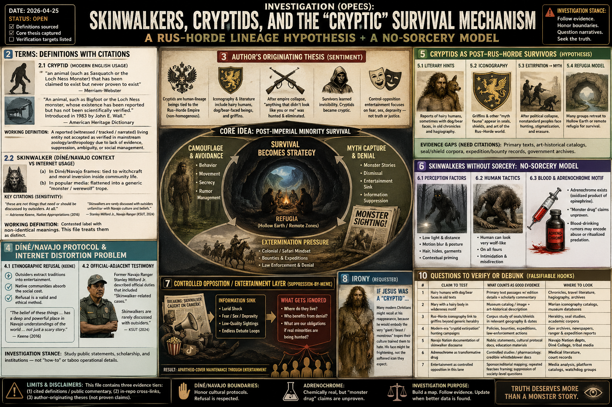

# Investigation (open): Skinwalkers, cryptids, and the “cryptic” survival mechanism — a Rus–Horde lineage hypothesis + a no-sorcery model

> **TL;DR:** This investigation defines **cryptid** and **skinwalker** with citations, then records (A) an **author-originating** thesis that many “cryptids” are **human-lineage peoples** (hairy / nonstandard phenotypes) whose survival strategy became **cryptic** under post–Rus–Horde collapse hunting pressure, and (B) a **no-sorcery** model for “skinwalker” accounts (misidentification, tactics, and physiology) while preserving the fact that **Diné/Navajo people treat witchcraft discourse as culturally sensitive** and often **not for outsiders** (Keene 2016; KSUT 2024). Cross-read: [Griffins / myth fauna extirpation](/history/chronology/investigations/myth-creatures-textual-record-human-extirpation-investigation.md), [Hollow Earth master investigation](/cosmos/cosmology/hollow_earth/hollow-earth-investigation.md), [Thompson bar-scene managed disclosure](/influence/predictive_programming/fiction_encoding/thompson/thompson-managed-disclosure-investigation.md), and [Rus–Horde lexicon (word bias)](/history/chronology/investigations/rus-horde-english-political-lexicon-speculation.md).

> Parallel: [Indigenous control systems — witchcraft discourse, Vodou “work,” and reservation containment hypotheses](/influence/suppression/investigations/indigenous-control-systems-witchcraft-vodou-skinwalkers-investigation.md).

**Date:** 2026-04-25  
**Status:** Open — definitions sourced; core thesis captured; verification targets listed.

---

## 1. Guide (read order)

1. If you only want **definitions + citations**, read **§2**.
2. If you want the **author’s full sentiment captured**, read **§3**.
3. If you want the **Diné/Navajo protocol / sensitivity** angle (and why internet horror distorts it), read **§4**.
4. If you want the **cryptids = post-imperial survivors** hypothesis, read **§5**.
5. If you want a **no-sorcery** model for “skinwalker” reports, read **§6**.
6. If you want **control-opposition / entertainment framing** as a suppression vector, read **§7**.
7. If you want the requested **irony section (Jesus-as-cryptid inversion)**, read **§8**.

---

## 2. Terms: definitions with citations

### 2.1 Cryptid (modern English usage)

Merriam-Webster defines **cryptid** as:

> “an animal (such as Sasquatch or the Loch Ness Monster) that has been claimed to exist but never proven to exist”  
> — Merriam-Webster, “cryptid” (`https://www.merriam-webster.com/dictionary/cryptid`)

American Heritage Dictionary similarly defines **cryptid** as:

> “An animal, such as Bigfoot or the Loch Ness monster, whose existence has been reported but has not been scientifically verified.”  
> and notes it was “introduced in 1983 by Canadian cryptozoologist John E. Wall.”  
> — American Heritage Dictionary, “cryptid” (`https://www.ahdictionary.com/word/search.html?q=cryptid`)

**Working definition for this investigation:** a **reported** (witnessed / tracked / narrated) **living entity** that is **not accepted as verified** in mainstream zoology/anthropology, whether because evidence is missing, suppressed, ambiguous, or socially unmanaged.

### 2.2 Skinwalker (Diné/Navajo context vs internet usage)

In Diné/Navajo contexts, “skinwalker” is typically discussed (in outsider-facing summaries) as a **harmful witch / witchcraft-related figure** associated with shapeshifting or animal-form travel; discussion is widely described as **sensitive** and frequently **taboo** with outsiders.

Two accessible public sources that explicitly foreground sensitivity:

- Adrienne Keene (Native Appropriations) frames “skin walker” material as something outsiders “don’t need to know,” calling the decision an “ethnographic refusal,” while emphasizing: “the belief of these things … has a deep and powerful place in Navajo understandings of the world … not just a scary story.”  
— Keene, “Magic in North America Part 1: Ugh.” (2016) (`https://nativeappropriations.com/2016/03/magic-in-north-america-part-1-ugh.html`)
- KSUT Public Radio’s interview write-up on Navajo Ranger Stanley Milford Jr. states skinwalkers “are rarely discussed with outsiders unfamiliar with Navajo culture and beliefs,” while quoting Milford describing ranger assignments that included “Skinwalker-related cases.”  
— KSUT, “Navajo Ranger breaks the silence on paranormal encounters” (2024-11-13) (`https://www.ksut.org/culture/2024-11-13/navajo-ranger-breaks-the-silence-on-paranormal-encounters`)

**Working definition for this investigation:** “skinwalker” as used in modern English is a **contested label**: (a) in Diné/Navajo frames, tied to witchcraft and moral inversion inside community life; (b) in popular media, often flattened into a generic “monster / werewolf” trope. This file treats those as **non-identical**.

---

## 3. Author’s originating thesis (verbatim intent + unpack)

The following captures the user’s full instruction set in one place so nothing is flattened out. This is **Paradigm Threat author sentiment**, not a set of proven claims.

### 3.1 Core claims (author sentiment, condensed but faithful)

- **Cryptids and skinwalkers** are to be studied as **real phenomena** with **societies**, **information systems**, and survival strategies under cataclysm and war.  
- **Cryptids** are assumed here to be **human-lineage** beings whose “lineage traces back to the Russian Horde Empire” (keyword “hoard” for a non-homogenous empire), with literary and iconographic evidence for **hairy humans**, sometimes with **dog/bear faces**, and “extinct creatures like griffins” appearing in imperial iconography.  
- After the empire’s destruction and a period of **“communization”** of humanity, anything that “didn’t look like you or me” was hunted and eliminated by a colonialist/safari mindset. Surviving groups learned that visibility triggers extermination and denial; thus “cryptids became cryptic.”  
- **Skinwalkers** should be investigated with **official citations** from Navajo tradition and legitimate documents. The “control-opposition” entertainment layer is suspected to focus on lurid fear/sex/depravity while doing little to end the apartheid/coverup.  
- Rule out **magic/sorcery** where possible: a “human can look very much like a wolf or bear” on all fours, covered in hair; a large “wolf” standing upright and interacting with a vehicle would be shocking but non-magical.  
- Factor in **adrenochrome**: publicly debunked as a transformative “monster drug,” but might still exist in a redacted form; blood drinking could be a mechanism for physiological change that is then interpreted as shapeshifting.  
- Cross-reference: Hunter S. Thompson (*Fear and Loathing in Las Vegas*) is treated as potentially reliable in its implication that “humans who feed on blood and adrenochrome” terrorize neighborhoods while authorities cover it up (managed disclosure / fiction encoding).  
- **Geography:** many cryptid/giant groups likely inhabit **Hollow Earth** rather than the surface; surface holdouts stayed due to integration or local protection.

### 3.2 What this means (unpack)

This thesis treats “cryptid” not as an **animal-classification** problem but as a **post-imperial minority survival** problem: beings perceived as “nonstandard humans” are pushed into:

- **Refugia** (remote surface zones, subterranean, hollow-earth models)  
- **Camouflage** (behavior, movement, avoidance, rumor management)  
- **Myth capture** (society converts an exterminated reality into a dismissible monster story)

---

## 4. Documented: Diné/Navajo protocol, refusal, and the internet horror distortion problem

This section is deliberately “light” on operational specifics. The goal is not to extract taboo knowledge; it is to document (with citations) that there are **boundaries** and that violating them is part of the modern distortion engine.

### 4.1 “Ethnographic refusal” as a citation-worthy method

Keene explicitly refuses to provide details and explains why: outsiders’ curiosity + entertainment markets convert living traditions into extractable content, and Native people then absorb the social cost. Keene’s phrasing is unambiguous: “these are not things that need or should be discussed by outsiders. At all.”  
— Keene (2016) (`https://nativeappropriations.com/2016/03/magic-in-north-america-part-1-ugh.html`)

**Investigation stance:** The “skinwalker” lane should be studied at the level of:

- **How the term is used in English media**
- **What Indigenous writers publicly say about boundaries**
- **What publicly published ethnography and scholarship say in general terms**
- **What official/public institutional actors say they do (or refuse to do)**

Not at the level of “how to do it” or “how to summon it.”

### 4.2 Public “official-adjacent” testimony exists, but is not the same as tribal doctrine

KSUT quotes Milford (a former Navajo Ranger) describing official duties that included “Skinwalker-related cases,” and repeats the claim that skinwalkers are rarely discussed with outsiders. That is useful as **public evidence of living seriousness**, even if it is not equivalent to internal religious law.  
— KSUT (2024-11-13) (`https://www.ksut.org/culture/2024-11-13/navajo-ranger-breaks-the-silence-on-paranormal-encounters`)

### 4.3 Why the silence can be “most telling” (deterrents beyond tourism)

Your question (“why won’t they talk?”) has a direct precedent in classic ethnography on Navajo witchcraft. Clyde Kluckhohn records that the subject is difficult to research because discussing it can:

- Mark the speaker as suspicious (“knowing too much,” therefore possibly a witch)
- Invite social retaliation from named/implicated parties
- And (within the belief system) invite direct witchcraft retaliation (“get him out of the way”)

He also records an informant’s phrasing: “People don’t tell out about these things; they keep them down here in the body.”  
— Clyde Kluckhohn, *Navaho Witchcraft* (orig. 1944; circulated later editions). Public digitization referenced via the Internet Archive scan (`https://archive.org/details/navahowitchcraftOOOOkluc`).

**Interpretive link (not claimed as proof of cryptids):** even if an outsider rejects metaphysics, the deterrents are structurally compatible with a “system of control” ecology: fear + suspicion + retaliation yields silence. The parallel investigation expands this comparative frame (Navajo / Vodou / Africa accusation ecologies).  
— [/influence/suppression/investigations/indigenous-control-systems-witchcraft-vodou-skinwalkers-investigation.md](/influence/suppression/investigations/indigenous-control-systems-witchcraft-vodou-skinwalkers-investigation.md)

---

## 5. Cryptids as post–Rus–Horde survivors (hypothesis track)

### 5.1 Anchor: “myth fauna” already has a project precedent

Paradigm Threat already maintains a concluded investigation that treats some “myth creatures” (e.g., griffins) as possibly real taxa later removed by human pressure and then mythologized. This provides an internal precedent for “extirpation → myth capture.”  
— [Griffins / myth fauna extirpation](/history/chronology/investigations/myth-creatures-textual-record-human-extirpation-investigation.md)

### 5.2 Rus–Horde collapse → extermination pressure (author thesis needs citations)

This investigation adopts (for exploration) the author’s claim that the Rus–Horde era included a non-homogenous imperial ecology in which “hairy humans” and other phenotypes existed openly enough to enter iconography and story, then were hunted down as political order shifted.

**There isn’t much evidence — but there is some.** The strongest “hairy human” evidence already present in your repos is iconographic + legend material clustered under **Hairy Mary** (Mary Magdalene as a hirsute “wild woman” figure in late medieval art/legend, and the broader Wild Woman iconography tradition).

#### 5.2.1 Evidence cluster: “Hairy Mary” (Mary Magdalene as hirsute wilderness figure)

- **Art-historical explanation (external citation, already mirrored in-repo):** Magdalena Łanuszka’s “Hairy Mary” notes that later legend says Mary Magdalene lived as a desert hermit so long her clothes turned to dust, and her long hair covered her nudity; medieval artists interpreted this literally as a body “covered with hair.”  
  — Local mirror: [/influence/religion/hairy_mary/index-hairy-mary-original.md](/influence/religion/hairy_mary/index-hairy-mary-original.md) (source: `https://en.posztukiwania.pl/2014/07/19/hairy-mary/`)
- **This still counts as evidence for the investigation’s narrow claim:** even if an allegory or an artistic misunderstanding, it demonstrates a durable cultural image: **a human saint depicted as hirsute / wild / outside civilization**, overlapping the “hairy human” cryptid phenotype category this file is trying to track.
- **Repository cross-link (timeline treatment):** the timeline expands this into a Rus’/Horde lineage thesis (“Wild People” / “Mary of Rus’”) and treats hirsute “wild woman” iconography as memory of a real phenotype. This is an internal thesis (not mainstream), but it is a concrete in-repo anchor for the “hairy human” track.  
  — Timeline article: [`Hairy Mary`](https://paradigmthreat.net/timeline/evt-hairy-mary) (repo source: `paradigm-threat-timeline/content/06.ce-12th-birth-of-christianity/06.01.01-hairy-mary.md`)
- **Second Rus–Horde anchor (internal thesis):** “The Giants of the Rus‑Horde” explicitly describes the Rus‑Horde leadership caste as “giant, hairy humans” and ties that to the “Wild People” / Hairy Mary thread.  
  — Timeline article: [`The Giants of the Rus-Horde`](https://paradigmthreat.net/timeline/evt-the-giants-of-the-rus-horde) (repo source: `paradigm-threat-timeline/content/07.ce-13th-the-russian-horde-tartarian-empire/07.01.02-the-giants-of-the-rus-horde.md`)

#### 5.2.2 Evidence cluster: Wild Woman iconography (non-saint “hairy human” normalization)

Even without the Rus‑Horde layer, the broader medieval Wild Woman tradition matters as “thin evidence” that hairy-humanoid imagery was a known iconographic category:

- Met Museum object: “Playing Card, with Wild Woman and Unicorn” (Master ES, 15th c.).  
  — Local mirror: [/influence/religion/hairy_mary/index-met-museum-wild-woman-unicorn.md](/influence/religion/hairy_mary/index-met-museum-wild-woman-unicorn.md) (source: `https://www.metmuseum.org/art/collection/search/364585`)

#### 5.2.3 Japan parallel (control-ecology + predictive-programming lane)

If “giants” are treated as a suppressed minority category, Japan is a useful parallel lane to track:

- A widely circulated “giant in Japan” clip is commonly debunked as a scene from *Big Man Japan* (2007).  
  — Snopes, “Giants in Japan” (`https://www.snopes.com/fact-check/giants-in-japan/`)
- Full deep-dive lane (provenance rules, “slippery logic” debunk-overreach pattern, WWII SFX context) now lives here:  
  — [/influence/suppression/investigations/giants-of-japan-archival-footage-big-man-japan-investigation.md](/influence/suppression/investigations/giants-of-japan-archival-footage-big-man-japan-investigation.md)

**What’s missing (evidence gap):**

- Specific **primary sources** (chronicles, hagiography, travel accounts) that describe **hairy humans** as contemporaries (not allegories), with dates, locations, and manuscript context.
- Specific **iconographic corpora** (shield rolls, heraldry catalogs) where “griffins” and “hairy humans” are tracked to institutions and regions that can plausibly be tied to a Rus–Horde frame rather than generic medieval heraldry.
- Specific **primary / catalog** citations for the “hairy Magdalene” depictions (object records, museum catalog entries) and (separately) for any “Mary wandered into the wilderness / went mad” narrative (edition and chapter), if this is distinct from the “desert hermit” legend described above.

### 5.3 “Cryptids became cryptic” as a survivorship mechanism

Regardless of whether a given creature exists, the social mechanism is historically common:

- **Extermination / stigmatization** drives secrecy.
- **Denial** becomes protective (if authorities “never find anything,” the public learns to stop looking).
- The story becomes “spooky entertainment,” which acts as an **information sink**: the more it’s treated as meme/horror, the easier it is to dismiss real sightings.

This mechanism is structurally similar to the “managed disclosure” pattern already used elsewhere in the repo (truth that can be dismissed as fiction).  
— [Thompson managed disclosure](/influence/predictive_programming/fiction_encoding/thompson/thompson-managed-disclosure-investigation.md)

---

## 6. Skinwalkers without sorcery: models that could generate “shapeshifter” reports

This section does **not** claim to explain Diné/Navajo doctrine. It answers a different question: if witnesses report “a wolf that stands,” “a humanoid on all fours,” “a human that looks like a coyote,” what non-magical mechanisms could produce that perception?

### 6.2 Human predation rumors as a “monster template” (Thompson as a citation to the template, not proof)

*Fear and Loathing in Las Vegas* contains an explicit “blood / glands / pineal” horror monologue and an “adrenochrome” motif. Paradigm Threat already treats it as potentially “managed disclosure,” i.e., truth embedded where it can be dismissed.  
— [Thompson managed disclosure](/influence/predictive_programming/fiction_encoding/thompson/thompson-managed-disclosure-investigation.md)

Important distinction: Thompson is **primary** for “this is a cultural motif in 1971,” not primary proof that the motif is real.

### 6.3 Adrenochrome: chemistry is real; the pop-culture “monster drug” is unproven

Adrenochrome exists as an **oxidation product of epinephrine/adrenaline** in chemistry literature. For example, an ACS paper describes monitoring “adrenochrome, the oxidized product of epinephrine.”  
— Garnayak & Patel, “Oxidation of Epinephrine to Adrenochrome…” (2014) (`https://pubs.acs.org/doi/10.1021/ie500037x`)

**Investigation stance:** treat “adrenochrome causes shapeshifting / monstrous bulk” as **unverified** unless and until evidence is produced. However, treat the motif itself (and why it spreads) as investigable: it may function as a **cover story**, a **psyop**, a **moral panic template**, or a **distorted echo** of some other pharmacology or abuse practice.

---

## 7. Controlled opposition / entertainment layer (suppression-by-meme hypothesis)

### 7.1 A documented mechanism: extraction + distortion

Keene’s essay is not about controlled opposition per se, but it documents a key mechanism: outsiders extract a living tradition into entertainment; the discourse becomes “content,” and the originating community becomes the target of questions and distortion.  
— Keene (2016) (`https://nativeappropriations.com/2016/03/magic-in-north-america-part-1-ugh.html`)

### 7.2 Hypothesis: “spooky entertainment” is an information sink

Working hypothesis (author-aligned): “skinwalker/cryptid” discourse is steered toward:

- Lurid shock and depravity
- Low-quality “sightings” content
- Endless debate loops

…while neglecting:

- The **societal** question (where do beings live; how do they avoid conflict)
- The **political** question (who benefits from denial; who polices the boundary)
- The **moral** question (what obligations humans have if real minorities are being hunted)

Verification would require media mapping (channels, sponsors, editorial patterns) rather than pure folklore collection.

---

## 8. Irony (requested): if Jesus was a “cryptid,” modern Christians might recoil

If Jesus were (in this investigation’s terms) a “cryptid” — a hairy, wilderness-dwelling human type rejected by “normal” humans — then a central irony follows:

- Many modern Christians might respond to his reappearance with fear and disgust, because he would embody the very “giant / beast / monstrous” tropes their culture trained them to hate, and his face might be frightening rather than the softened Cesare Borgia template.

This irony is recorded as a **cultural observation** about iconography, expectation management, and the modern gap between devotional art and “othered” bodies.

---

## 9. Author open claims registry (for cross-investigation threads)

1. **Rus–Horde cryptid lineage**: cryptids descend from non-homogenous imperial populations; iconography includes griffins; literature contains hairy humans with dog/bear faces.
2. **Systematic hunting/extirpation** after imperial collapse by colonial/safari mindset; survivors learned invisibility.
3. **Hollow Earth refuge** as the primary society location for giants/cryptids.
4. **Skinwalkers as non-magical**: posture, hair, and tactics can explain “wolf-man” reports.
5. **Blood/adrenochrome**: predation and gland/blood motifs may explain “transformation” narratives without sorcery.
6. **Controlled opposition**: entertainment discourse functions as apartheid-cover maintenance.

---

## 10. Questions to clarify, verify, or debunk (falsifiable hooks)

| #   | Claim to test                                                           | What would count as “good evidence”                                                                   | Where to look                                            |
| --- | ----------------------------------------------------------------------- | ----------------------------------------------------------------------------------------------------- | -------------------------------------------------------- |
| 1   | “Hairy humans with dog/bear faces” in old texts                         | Primary text passages with edition details + scholarly commentary                                     | Chronicles, travel literature, hagiography; art catalogs |
| 2   | “Mary with a hairy body in wilderness” motif                            | Museum catalog record / image + art-historical description                                            | Marian iconography catalogs; museum databases            |
| 3   | Rus–Horde iconography link to griffins beyond generic heraldry          | Corpus-level study of where/when griffins appear on shields/seals in the relevant political geography | Heraldry/seal studies                                    |
| 4   | “Cryptid extirpation” as modern-era hunting campaign                    | Documented policies, bounties, expeditions, law-enforcement actions                                   | Government archives, newspapers, ranger reports          |
| 5   | Navajo Nation / tribal-government documentation of skinwalker discourse | Public statements, cultural protocol docs, education materials                                        | Navajo Nation departments; Diné College; tribal media    |
| 6   | Adrenochrome as transformative drug                                     | Controlled studies / pharmacology; credible whistleblower documentation                               | Medical literature; court records                        |
| 7   | Entertainment as controlled opposition in this lane                     | Sponsor/editorial mapping; repeated “fear/sex” framing; suppression of society-level questions        | Media analysis; platform catalogs                        |

---

## 11. Related investigations (in-repo)

| Topic                                    | Link                                                                                                                                                                                                                 |
| ---------------------------------------- | -------------------------------------------------------------------------------------------------------------------------------------------------------------------------------------------------------------------- |
| Myth fauna → extirpation → myth capture  | [/history/chronology/investigations/myth-creatures-textual-record-human-extirpation-investigation.md](/history/chronology/investigations/myth-creatures-textual-record-human-extirpation-investigation.md)           |
| Hollow Earth as refuge model             | [/cosmos/cosmology/hollow_earth/hollow-earth-investigation.md](/cosmos/cosmology/hollow_earth/hollow-earth-investigation.md)                                                                                         |
| Thompson bar-scene (blood/pineal motif)  | [/influence/predictive_programming/fiction_encoding/thompson/thompson-managed-disclosure-investigation.md](/influence/predictive_programming/fiction_encoding/thompson/thompson-managed-disclosure-investigation.md) |
| Rus–Horde word-bias / memory replacement | [/history/chronology/investigations/rus-horde-english-political-lexicon-speculation.md](/history/chronology/investigations/rus-horde-english-political-lexicon-speculation.md)                                       |

---

Keywords: #Skinwalkers #Skinwalker #Cryptids #Cryptid #Cryptozoology #RusHorde #Horde #Tartaria #ControlledOpposition #ManagedDisclosure #Thompson #Fearandloathing #Adrenochrome #Hollowearth #Giants #Extirpation #Mythcapture

---

## Limits and disclaimers

**Prisca sapientia (epistemic foundation):** This investigation assumes [**prisca sapientia**](/docs/PRISCA_SAPIENTIA.md)—the historical and philosophical belief that the ancients possessed a vast, profound understanding of the universe, nature, and theology that was subsequently lost or degraded. Modern consensus science and institutions are not treated as default truth; evidence tiers below adjudicate specific claims.

- This file contains **three evidence tiers**: (1) **cited definitions / public commentary** (Keene, KSUT, dictionaries), (2) **internal cross-links** to existing Paradigm Threat investigations, and (3) **author-originating theses** that are recorded faithfully but are **not automatically factual**.
- The Diné/Navajo “skinwalker” lane is culturally sensitive. This investigation prioritizes **public, outsider-facing statements** about boundaries and refuses to treat the topic as a “how-to.”
- “Adrenochrome” is treated here as: **chemically real** (oxidation product of epinephrine) but **unproven** as a transformative monster drug. The presence of the motif in literature is not proof of the alleged practice.

---

## Investigator notes (maintainers/LLMs only)

- Keene 2016 is used here primarily as a **boundary/sensitivity** citation, not as ethnographic detail.
- KSUT 2024 provides a useful “official-adjacent” public quote about ranger assignments and outsider-discussion rarity.
