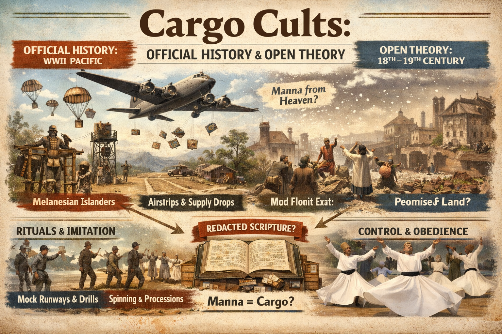

# Investigation: Cargo Cults — Official History, Human Behavior, and 18th–19th Century / Manna Redaction

> **TL;DR:** Investigation: Cargo Cults — Official History, Human Behavior, and 18th–19th Century / Manna Redaction: This investigation catalogues official and anthropological references to cargo cults (especially post–World War II plane drops), outlines the human behavior of cargo cults as spontaneous social reorganization around the receipt of cargo from above, and remains open to the possibility of cargo-cult-like behavior in…
## Status

**Date:** 2026-03-16  
**Status:** Open

This investigation catalogues **official and anthropological references** to cargo cults (especially post–World War II plane drops), outlines the **human behavior** of cargo cults as **spontaneous** social reorganization around the receipt of cargo from above, and remains **open** to the possibility of **cargo-cult-like behavior** in the **late 18th and early 19th century** during mass die-offs or periods when populations relied on delivered goods (“cargo,” “manna from heaven”). It considers the **open theory** that Old Testament **manna in the desert** and **promised-land** narratives may be **redacted** accounts of real cargo delivery and social coercion in a post–mud-flood world, and that the preservation of **obedient, Abrahamic-religious populations** was in the interest of whatever power was dropping the cargo.

**Related:** [MFEE investigation](mfee-investigation.md) (mud flood, late 18th c.); [Tartarian maps investigation](tartarian-maps-investigation.md); [hollow-earth investigation](/cosmos/cosmology/hollow_earth/hollow-earth-investigation.md) (suppression of contact, control of narrative). **Promised land** (sequence of exoduses, 1492 BCE/CE, final promised lands): [promised-land-investigation](promised-land-investigation.md).

---

# PART ONE: OFFICIAL HISTORY — CARGO CULTS AFTER WORLD WAR II

## I. What official history says

- **Term:** “Cargo cult” entered anthropology around **1945** and became a standard category for Melanesian (and later other) movements that organize around the expectation of **Western material goods (“cargo”)** delivered from outside—especially from **aircraft**.
- **Context:** During **World War II**, Allied (especially American) forces in the Pacific built airstrips, brought in vast quantities of supplies (medicine, canned food, equipment), and left after the war. Indigenous islanders witnessed **planes descending from the sky** with unprecedented abundance, then the source vanished.
- **Classic examples:**
  - **John Frum movement (Tanna, Vanuatu):** Islanders linked cargo to a figure “John Frum” (possibly based on an American serviceman). They built **bamboo runways**, **control towers**, **mock military drills**, **flags**, and **rifle-shaped sticks**; they perform rituals (e.g. annually on 15 February) to bring back cargo-laden aircraft. Still active in some form.
  - **Turaga and other Melanesian cargo cults:** Similar patterns—imitative runways, marching, ceremonies—to summon or replicate the conditions under which cargo arrived.
- **Anthropological framing:** Cargo cults are described as **responses to colonial disruption and cultural stress**; they blend desire for **material goods** with **moral salvation**, **respect**, and **anti-colonial** aspirations. They often involve **charismatic prophets** or **ancestral spirits**—though the **core behavior** (society reorganizing around receiving cargo) can be treated as **spontaneous** in the sense below.

**Sources (official / mainstream):** Britannica, Wikipedia “Cargo cult”; Smithsonian “In John They Trust”; MilitaryHistoryNow.com; Scientific American (1959 cargo cults Melanesia); Open Encyclopedia of Anthropology (cargo cults).

---

# PART TWO: HUMAN BEHAVIOR OF CARGO CULTS — SPONTANEOUS, NO PRIESTS REQUIRED

## II. Outline of behavior (for comparison across time)

The following is an **ideal-type** outline. It does not depend on priests, scripture, or instruction from above—only on **receipt of cargo** and **collective dependence** on it.

1. **Cargo from above.** Goods (food, medicine, tools, or “salvation”) arrive **from the air**—planes, drops, or “from heaven”—and are **essential for survival**. Without them, the population would **perish** (starvation, disease, exposure).

2. **Society coalesces around receiving.** The group **reorganizes** its structure, routines, and beliefs around **being ready to receive** cargo: clearing land for runways, forming queues, observing schedules, imitating the **technology or ritual** they associate with the arrival (marching, flags, runways, spinning, processions—see Part Four).

3. **Compliance and suppression of resistance.** To keep the supply coming, the population **falls in line**: they **suppress** acts of **resistance and defiance** that might disqualify them or anger the source. **Obedience** is rewarded with continued delivery; **disobedience** is perceived as risking cutoff.

4. **Rulers need only keep dropping cargo.** From the perspective of the **deliverers**, control is simple: **keep delivering**. No need for elaborate theology or priesthood—just **reliable cargo**. The recipients’ own fear of perishing and their **spontaneous** reorganization (runways, order, compliance) do the rest.

5. **Promised land.** Often cargo cults are coupled with a **promise**: if you stay obedient and receive, you will eventually be **delivered to a better place** (promised land, salvation, new world). That narrative **hardens** commitment and justifies present suffering or discipline. For the **sequence of promised lands** (1492 BCE → Europe; 1492 CE → America; post–Mud Flood → final promised lands), see [promised-land-investigation](promised-land-investigation.md).

**Implication:** If this behavior is **spontaneous** and **recurrent**, it could appear in **any** era where (a) a population depends on **delivered goods** for survival, and (b) the deliverers have an interest in **keeping them obedient** and **organised to receive**. The late 18th and early 19th century—during or after a **mass die-off** or **mud-flood** scenario—would be a candidate.

---

# PART THREE: OPEN SEARCH — 18TH AND EARLY 19TH CENTURY; MASS DIE-OFF; MANNA

## III. What we are looking for

- **Era:** Late 18th century, early 19th century.
- **Circumstances:** Any **mass die-off**, **famine**, **catastrophe**, or **“desert”** period when populations **relied on delivered goods** (cargo, relief, “manna from heaven”) to survive.
- **Behavior:** Instances where societies **reorganized around receiving** such cargo, **suppressed defiance**, and **coalesced** into obedient, “ready-to-receive” structures—**without** necessarily having a named “cargo cult” in the record.
- **Caveat:** There may be **no explicit references** in mainstream history to “cargo cults” in that period. The investigation stays **open** to:
  - Famine relief, military or missionary supply drops, or colonial distribution systems that could have induced the same **behavior** (compliance, reorganization, promised-land narrative).
  - Evidence that could **rule out** any explanation **other than** cargo-cult-like dependence (e.g. a population that could not have survived without external delivery and that developed rituals or social forms consistent with receiving).

## IV. Promised land everywhere

- **Observation:** Many cultures and nations hold a **strong memory of deliverance** and of having reached a **“promised land”** (America, Italy, Israel, etc.)—while **no** corresponding mainstream memory of a **global mud flood** or **mass die-off** that would have made such deliverance necessary.
- **Full narrative (1492 BCE/CE, Europe, America, final promised lands):** [promised-land-investigation](promised-land-investigation.md).

---

# PART FOUR: RITUALS AS CARGO-CULT IMPRINT — SPINNING, PROCESSIONS, RUNWAYS

## V. Imitative technology and ritual

- **Post-WWII cargo cults:** Islanders built **runways**, **control towers**, **flags**, and **drills**—direct **imitation** of the technology and behavior they saw when planes brought cargo.
- **Open question:** Could **other** rituals—especially **spinning**, **whirling**, or **circular processions**—be **cargo-cult imprints** from an earlier era? If 18th/19th-century survivors saw **rotating machinery**, **flying or descending devices**, or **ordered movements** associated with cargo delivery, they might have **encoded** those motions into **ritual** (e.g. spinning around and around, circling a sacred space) with no remaining memory of the original technology.
- **Eastern Europe / Orthodoxy / Sufism:** The user raised **spinning** and **dancing** in Eastern European or Orthodox context. **Sufi whirling** (Mevlevi dervishes, Rumi, 13th c.) is the best-known **spinning** ritual—**Islamic**, not Eastern Orthodox—and is explicitly linked to **cosmic rotation** (planets, creation). **Eastern Orthodox** tradition has **processions**, **circumambulation**, and **liturgical movement** but not typically “whirling” in the dervish sense. The investigation remains **open**: any **repetitive, rotational, or runway-like** ritual (in Orthodoxy, Sufism, or elsewhere) could be compared to the **imitative** behavior of classic cargo cults and to the possibility that such behavior reflects **technology seen** during a mud-flood or delivery era (18th/19th c.), later sacralised and detached from its origin.

---

# PART FIVE: OLD TESTAMENT — MANNA AND DESERT AS REDACTED CARGO

## VI. Biblical narrative (undisputed text)

- **Exodus 16:** Israelites in the **wilderness** receive **manna** from heaven—**fine flakes like frost**, white, tasting like **wafers with honey**; it appears with the **morning dew**, melts with the sun, **spoils after 24 hours** except on Sabbath eve (double portion). They eat it **forty years** until they reach the **border of Canaan** (Exodus 16:35).
- **Desert / wilderness:** The **desert** is the space of **dependency**—no natural food sufficient for the multitude; **life is sustained only by daily delivery**.
- **Scale:** Interpretive tradition puts the number in the millions; the **daily tonnage** required would be enormous—**no natural phenomenon** in the Sinai could supply it in the literal reading. So either **miracle** or **redacted logistics** (cargo drops, supply lines).

## VII. Open theory — Manna as redacted cargo; desert as post–mud-flood world

- **Desert = world after mud flood.** In this framework, the **“desert”** or **“wilderness”** is not only Sinai but the **earth in the aftermath** of a cataclysm (mud flood, MFEE)—where **life does not yet support itself** and must be **kept alive artificially** for a period (years or decades) until “life started to return on its own.”
- **Manna = cargo.** The **manna** is the **cargo**—delivered from above (planes, airships, or simply “from the air”) by whatever power had the means. The biblical narrative **redacts** the delivery mechanism into **divine miracle** and **dew**, preserving the **behavior**: daily dependence, gathering, obedience, **no hoarding** (spoilage rule), **Sabbath** (double portion so no work on rest day)—i.e. **society organised to receive**.
- **Forty years.** The duration (“forty years”) could be **literal or symbolic** for the period during which the population was **dependent on cargo** before reaching a **habitable land** (promised land) where they could eat “the produce of the land.”
- **What was being preserved.** The **open theory** goes further: the main thing the **deliverers** (Deep State, ruling remnant, or whatever label) wanted to preserve was **not** just human life in the abstract but the **obedient, lower-level end of Old Testament / Abrahamic religion**—**circumcised**, **loyal** populations who already followed the **law and narrative** that would later be codified as scripture. If those populations were **wiped out**, the rulers would have to **start over** with “a whole new animalistic, free wildman-type”—i.e. uncivilised, non-compliant humans. So it was in the **interest** of the ruling power to **keep alive as many religiously obedient as possible** during the aftermath of the mud flood—by **dropping cargo**, ordering societies to **coalesce** around receiving it, and promising **deliverance to a promised land** once they proved obedient. The **manna story** would then be a **redacted** record of that system: **cargo cult** elevated to **sacred history**. For the **sequence of promised lands** (1492 BCE → Europe; 1492 CE → America; post–Mud Flood → final promised lands) and **locating** each in the 19th–20th c., see [promised-land-investigation](promised-land-investigation.md).

**What would support (or weaken) the theory:**  
- Evidence of **large-scale food or supply delivery** (e.g. logistics, relief operations) in the 18th/19th century in regions or periods that could map onto “wilderness” or “exodus” narratives.  
- Evidence that **Abrahamic or other religious obedience** (circumcision, dietary rules, Sabbath) was **concentrated or enforced** in populations that were also **recipients** of relief or cargo.  
- Comparative study of **other** “manna” or “bread from heaven” motifs in traditions outside the OT—do they cluster in the same era or in similar “desert/deliverance” frameworks?

---

# PART SIX: SOURCES AND OPEN QUESTIONS

## VIII. References (official / anthropological)

| Source | Content |
|--------|--------|
| Britannica, “Cargo cult” | Melanesia, Pacific, rituals; post-WWII plane drops; John Frum. |
| Wikipedia, “Cargo cult” | Definition; 1945 term; John Frum, Turaga; runways, drills, imitation. |
| Open Encyclopedia of Anthropology, “Cargo cults” | Spontaneous social organization around cargo; colonial disruption; charismatic prophets; blend of material and salvation. |
| Smithsonian, “In John They Trust” | John Frum, Tanna, bamboo runways, 15 Feb rituals. |
| MilitaryHistoryNow.com | WWII South Pacific, America-worshiping, cargo cults. |
| Scientific American (1959) | Cargo cults of Melanesia. |
| Bible (Exodus 16) | Manna 40 years, desert, Canaan; dew, spoilage, Sabbath. |

---

## IX. Deep-dive findings (2026-03-16)

Research on the open questions yielded the following. None of this proves the redaction or mud-flood thesis; it supports keeping the investigation open and sharpens follow-up.

### 1. 18th/19th century — famine relief, logistics, mass die-off, delivered goods

- **18th-century Europe:** Famine relief was **inconsistent** and often **inadequate**. Great Bengal famine (1770): East India Company provided **little direct relief** despite controlling the region; **7–10 million** deaths; grain monopolies and tax policy exacerbated. Irish famine (1740–41): relief **entirely private/local** (parish, village); no large-scale state response. England 1766: tax cuts on imported grain, prohibition of exports, **charitable subscriptions** for the poor, some public mills/granaries. Swedish famine (1867–69): emergency loans and committees, but **transport** to northern counties failed (ice, poor communications)—i.e. **delivery** was the bottleneck.
- **Cargo cults before WWII:** Scholarly sources state that cargo cults **did not begin** with WWII. They **emerged in the 19th century** with "the first significant arrivals of Westerners" in Melanesia. Islanders had **pre-existing myths** (ancestor-god who went west and would return; west = land of the dead). When **ships** arrived from the west with goods, pale-skinned crews and **written messages that preceded shipments** were interpreted as **supernatural** and as confirmation of ancestral return. So **cargo-cult-like behavior** (reorganising around goods delivered from outside, interpreting deliverers as otherworldly) has **documented 19th-century precedent** in the Pacific—without planes; **ships and writing** as the "technology" imitated or ritualised.
- **Implication:** No mainstream source describes 18th/19th c. Europe or colonies as "cargo cult" in the Melanesian sense. But: (a) **mass die-offs** with **inadequate or controlled delivery** (Bengal, Ireland, India) show populations at the mercy of **who controls supply**; (b) **colonial and military logistics** (Sudan, Emin Pasha, India) show **delivered cargo** as a **tool of control**; (c) **19th c. Melanesia** already shows **spontaneous** reorganisation around **delivered goods** and **imitation of the delivery system** (ships, writing). So the **behavior** is not unique to post-WWII planes; it appears wherever **cargo from outside** becomes **essential** and then **ritualised**.

**Sources:** Wikipedia (Bengal 1770, Irish 1740–41, 1766 food riots, Swedish 1867–69, Indian famines 1876–78, 1896–97); Springer (Red Sea grain, British Sudan); Wikipedia (Emin Pasha Relief Expedition); Wikipedia/Britannica/Scientific American (cargo cult pre-WWII, 19th c. Melanesia, ships and writing).

### 2. Rituals — spinning, whirling, processions, runway-like

- **Eastern Orthodox:** **Lity** (λιτή): festive **procession** that can go **around the church** (outdoor circumambulation); clergy and congregation move to narthex or **circle the church**, with intercessions at each side. **Little Entrance:** priest/deacon move **counterclockwise around the Holy Table** before proceeding with Gospel. **Sunday of Orthodoxy:** **procession with icons** around the **outside** of the church (standards, candles, cross, icons). So **circular movement** and **procession** are embedded in liturgy.
- **Sufi whirling:** Origin story (Rumi, 13th c.): Rumi was inspired by **rhythmic goldbeating** in a **marketplace**—i.e. **repetitive mechanical sound**—which he interpreted as dhikr, and **began to spin**. Symbolism: **planets orbiting the sun**; **electrons/protons/neutrons** revolving in atoms; "revolutions throughout creation." So the ritual is **explicitly** linked to **rotation** and **cosmic/mechanical** imagery—compatible with a reading as **fossilised imitation** of rotating machinery or celestial motion observed during a delivery or technological era.
- **Runway and ritual:** **Thiruvananthapuram (Kerala) airport:** Twice yearly, a **temple procession** (chariots, idols, elephants) **crosses the runway**; flights halt for ~5 hours. Tradition dates to **1932** when the airport was built; the **runway was deliberately kept open** for the procession—the king reserved **two days for Lord Padmanabha**. So in at least one tradition, **runway** and **divine procession** are **literally** combined: the **path of aircraft** is the **path of the god**. That is a direct **runway-like ritual** (procession on runway) and could be compared to cargo-cult **imitation of runways** (building bamboo runways to summon planes).
- **Implication:** Circular/processional rituals exist across traditions; Sufi whirling ties **spinning** to **mechanical/cosmic** rotation; one Hindu tradition **uses a runway** for divine procession. This supports keeping the question open: any **repetitive rotational** or **runway-crossing** ritual could be compared to cargo-cult **imitative** behavior and to the possibility of **technology** (rotating devices, landing strips) encoded in ritual.

**Sources:** Wikipedia (circumambulation, Lity, Entrance, Sufi whirling, Sama); History Today (whirling dervish origin); Mevlana.org (Sema); BBC, The News Minute, NDTV, The Hindu (Kerala airport, Painkuni/Alpashi, runway procession).

### 3. Promised land

- **Promised-land** narratives (Jewish/American, Italian L'America, etc.) **cluster in the late 19th and early 20th century**; **strong memory of deliverance**, **weak or absent memory of catastrophe** (mud flood). Full narrative (1492 BCE/CE, Europe, America, final promised lands), Mary Antin, Italian immigration, and **locating final promised lands** → [promised-land-investigation](promised-land-investigation.md).

### 4. Manna / OT — extra-biblical, logistics, cargo reading

- **Extra-biblical and linguistic:** **Manna** likely from Hebrew *mân* ("what?"); cognates in Egyptian (*mennu*), Arabic (*mann*, also "gift" / "gift from God/heaven"—*mann as-samā*), Greek, Latin. **Extra-biblical:** In Northern Iraq, sweet substance from **ash trees** is called **mann al-sama** (manna of the heavens); in Iran, similar substance **gaz** from *Tamarix* etc. So **"manna from heaven"** or **"heavenly manna"** appears in **multiple ancient Near Eastern** traditions—not only Israel—as a **sweet, plant-derived** substance. Mainstream reading: **natural** (tamarisk, scale insects) or **miracle**.
- **Scale and logistics:** Conservative biblical study (e.g. Exodus 16) puts the **scale** at ~2 million people, **40 years**, **~1,800 metric tons per day** (or "375 locomotive loads" of grain) for 14,600 days—**no natural source** in Sinai could supply that in a literal reading. So the text **describes a logistical impossibility** without either **supernatural** or **redacted-supply** explanation. **No** mainstream scholar argues "manna = cargo drops"; the **logistical framing** (tonnage, daily delivery, Sabbath double-portion) is nevertheless **compatible** with a **supply operation** redacted as dew/miracle.
- **Implication:** Extra-biblical **manna** traditions exist (Arabic, Iraqi, Iranian); the **scale** of Exodus manna is explicitly **logistical** in scholarly discussion; a **cargo-delivery** reading remains **open** (not proven) for investigation.

**Sources:** Springer (Manna in Ancient World); Interesting Literature; Wikipedia (manna); Jewish Encyclopedia; Washington HortLib (plant sources); BibleHub, FBCThomson (Exodus 16 logistics), Britannica.

### 5. Deep State / obedience — relief and religious compliance

- **Souperism (Irish Famine, 1845–52):** **Protestant** missionaries and Bible societies provided **food** (soup, schools, daily feeding) **on condition of** receiving **Protestant religious instruction** or **conversion**. Those who converted for food were called "soupers" or "took the soup." **Reverend Edward Nangle**, Achill Mission Colony (from 1834): by 1847, **2,192 laborers** employed, **600 children fed daily** in scriptural schools; accused of being a "**buyer of souls**." **Reverend Edward Spring**, Cape Clear: accused of using "Indian meal and packages of old clothes" to **obtain converts** during the famine. So **relief** was explicitly tied to **religious obedience (conversion)**—"preserve or expand the obedient population" by making **food conditional on compliance**. Souperism was **rare** in scale but **lasting in memory**; it also **tainted** Protestant relief that did *not* proselytise and may have deterred Catholics from soup kitchens.
- **Implication:** A **direct historical precedent** exists for **delivering cargo (food) in exchange for religious compliance**—and for that practice to be **condemned** as "buying souls." The **structure** (deliver cargo → require obedience → preserve or grow a compliant population) is **documented** in 19th c. Ireland. The open theory extends this to **earlier** periods and to **Abrahamic** obedience (circumcision, Sabbath, dietary law) as the **marker** of the population being preserved; **souperism** does not involve circumcision/Sabbath but shows that **relief + religious obedience** has been used as a **control and preservation** strategy.

**Sources:** Wikipedia (Souperism); Irish Famine Exhibition (Achill, Nangle); Irish Hunger Martyrs (evidence); Connaught Telegraph (Achill, renunciation); Coolim Books (Edward Spring); Cambridge (ritual circumcision 19th c. NY immigrants); Jewish Encyclopedia (berit milah); National Humanities Center (foreign missionary movement 19th c.).

---

## X. Open questions and next steps (updated)

- [ ] **18th/19th century:** Search for **famine relief**, **military supply**, **missionary distribution**, or **colonial logistics** in the late 18th and early 19th century that could have induced **cargo-cult-like** dependence and social reorganization. Any **mass die-off** or **“desert”** period where survival depended on **delivered goods**.
- [ ] **Rituals (refined):** Compare **Kerala runway procession** (runway as sacred path) to **Melanesian bamboo runways**; document **all** traditions that use **circular** or **runway-like** space for ritual; test whether **Sufi whirling** symbolism (planets, atoms) could be read as **secondary rationalisation** of an older **mechanical/tech** imprint.
- [ ] **Promised land:** See [promised-land-investigation](promised-land-investigation.md) (1492 BCE/CE, Europe, America, final promised lands; locate each in 19th–20th c. and trace forward). Cross-reference **cargo (manna)** with **promised-land locations**.
- [ ] **Manna / OT (refined):** Survey **all** ancient Near Eastern **manna / bread from heaven** parallels (Iraqi *mann al-sama*, Iranian *gaz*, Arabic *mann*); check whether any **non-Israelite** tradition **narrates** manna as **delivered** (rather than harvested from plants); search **rabbinic** or **patristic** commentary for **logistical** or **military** readings of Exodus 16.
- [ ] **Deep State / obedience:** If the theory holds, trace whether **religious obedience** (circumcision, dietary law, Sabbath) correlates in the literature or in historical record with **populations** that were **recipients** of relief or organised delivery—and whether “preserving the obedient” appears as a stated or implied **interest** of any ruling or relief authority.

---

*Investigation file: `history/mudflood/investigations/cargo-cults-investigation.md`. Open theory; no claim that manna = cargo or that 18th/19th c. cargo cults are proven.*

---

Keywords: #Cargo #Cults #Official #Behavior #Th #Manna #Redaction

