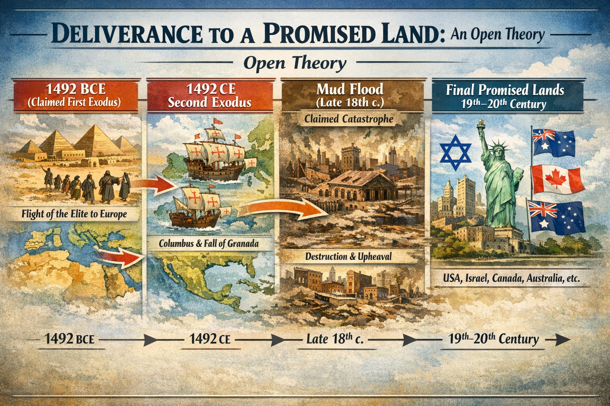

# Investigation: Deliverance to a Promised Land — 1492 BCE/CE, Europe, America, and the Final Promised Lands

> **TL;DR:** TODO

## Status

**Date:** 2026-03-16  
**Status:** Open

This investigation examines the **whole concept of deliverance to a promised land**: the pattern by which a ruling or religious elite **loses control** (or loses the faith of the people), **leaves in an exodus**, and is **delivered** to a new territory that becomes the next **promised land**—with the **date and narrative** sometimes repeated or inverted across centuries. It sets out an **open theory** in which **1492 BCE** was the first such event (exodus of the pyramidal-empire leadership to Europe) and **1492 CE** its deliberate echo (exodus to America under the Columbus narrative). **The 1492 BCE/CE pairing is the author's own theory**—no mainstream, Velikovskian, or Fomenko source uses 1492 BCE or links the two years as deliberate; the reasoning is set out in § I, § III, and § X. The rest of the theory: the **Mud Flood** (late 18th c., e.g. 1770 or aftermath) **decimated** America and necessitated **new** promised lands; and the **final promised lands on Earth** are the locations where **monotheistic traditions** became deeply embedded in the 19th and 20th centuries, with generations remembering **“the Intervention of God”** only a few hundred years ago. The investigation aims to **locate each of those final promised lands** as they existed in the 19th and 20th centuries and to **trace them forward** in time.

**Related:** [Cargo cults investigation](cargo-cults-investigation.md) (manna, cargo, obedience, promised-land as narrative); [MFEE investigation](mfee-investigation.md) (mud flood, late 18th c.); [Tartarian maps investigation](tartarian-maps-investigation.md); [“New World” naming, MFEE, and colonization memory](/history/chronology/investigations/new-world-naming-mfee-and-colonization-memory.md).

---

# PART ONE: OPEN THEORY — THE SEQUENCE OF PROMISED LANDS

## I. 1492 BCE — First exodus; Europe as first promised land (author's theory)

- **Event (open theory):** The rulers of the **pyramidal empire** lost control of it and **lost the faith of the people**. They had to **leave in an exodus**. It was **only the leadership** in the exodus—not the general population.
- **Destination:** They went **many places**; **Europe** was where they were **most numbered**. So **Europe** is the **first promised land**—the first territory to which the exiled elite was “delivered” and where they re-established authority and narrative.
- **Implication:** 1492 BCE is framed as the **Deep State’s greatest loss**: loss of the empire, loss of the people’s faith, forced exodus. The **memory** of that deliverance (we were brought here; this is the promised land) would be carried by the same lineage into later promised lands.
- **Why 1492 BCE (author's theory):** No other source places the Exodus at **1492 BCE**. Mainstream dates are earlier (e.g. 1446 BCE) or later (13th c. BCE); Velikovsky places it at **c. 1500 BCE** (start of *Ages in Chaos*), i.e. **before** 1492—close but not 1492. The author's reasoning for **1492** specifically is given in § III and § X (calendar control; world conquest strategy).

## II. Europe decays; Russia rises

- Over a **long time**, **Europe** became **the worst place on Earth** (from the perspective of the ruling narrative or of the loyal population).
- The **blossoming Russian Empire** became **the best place on Earth**—the new centre of gravity or the new “promised” pole.

## III. 1492 CE — Second exodus; America as second promised land

- **Date:** The **next** promised-land event is dated **1492 CE**. In the author's theory, **coincidence is not coincidence**—the date was **set by those exact people** (the same lineage or tradition that left in 1492 BCE). **1492 BCE** = Deep State’s greatest **loss**; **1492 CE** = Deep State’s greatest **gain** back. **Calendar reasoning (author's theory):** Whoever reset the calendar and arbitrarily placed the year zero was in **full control** of these dates. They would **not** have set the BC/CE dates for such major events so close to each other **by accident**. The author's theory is that the calendar's chosen starting year was part of a **world conquest strategy**—control the timeline, control the narrative.
- **Trigger:** The **Russian / Ottoman** pressure **chased the Europeans out of Europe**. So the exodus from Europe to the next promised land is tied to Russian and Ottoman expansion or conquest.
- **Deep State embeds in Russia:** During this 1492 CE event, the **Deep State embedded itself deep in the Russian Empire**. It made Russia **“go insane”** and **attack the world** on behalf of **monotheism** (which was pushing **polytheism** out). At some point they had to **attack their own people**; so they ensured that a **good chunk** of them could **migrate to America** under the **Columbus narrative**.
- **Who was delivered:** The Deep State ensured the **survival of their most loyal, circumcised, monotheistic** adherents—framed here as “slaves” in the sense of bound, obedient populations. Those were the ones **delivered** to America.
- **America = second promised land.** America became the **place promised**, **delivered to**, and eventually **coalesced** into a major **Deep State / monotheistic** foundation: the **United States of America**. Monotheistic **icons everywhere**; tradition **deeply embedded** in **government and judicial systems**. The **connection with England** is **stronger than the Civil War or independence**—none of those seem to matter as much in the end; the **monotheistic connection** was the one that mattered in hard times.
- **Until the Mud Flood:** America as promised land, growing power, wiping out Native Americans—**until the disaster of the Mud Flood** (1770 or its aftermath). That **decimated America**. So the second promised land was **shattered** by catastrophe.

## IV. After the Mud Flood — New promised lands; manna and desert

- **New promised lands** had to be created. A **time of long darkness**—a **desert** period.
- **Israelites** (still the **most loyal**) were **scattered** all over the world but **mostly in America and Europe**. During this time they were **promised**: if you **stay obedient**, you will **receive manna**, be **brought through the darkness of the desert** for however many years, and **delivered to a promised land**.
- So the **manna-in-the-desert** and **forty-years** narrative (see [cargo-cults-investigation](cargo-cults-investigation.md)) maps onto this **post–Mud Flood** period: **cargo** (manna) delivered to **obedient** populations in the **desert** (world after the flood), with the **promise** of deliverance to a **final** promised land.

## V. Final promised lands on Earth

- **Definition:** The **final promised lands** are the **locations on Earth** where **monotheistic traditions** became **deeply embedded**, with **generations** remembering **the Intervention of God** only a **few hundred years ago** (e.g. ~100 years prior)—and **teaching their kids** that this is **very serious and real**.
- **Task of this investigation:** **Locate each one** of the **final promised lands** as they **existed in the 19th and 20th centuries**, and then **trace them forward in time** (into the present and “tomorrow”).

---

# PART TWO: CONTENT DRAWN FROM CARGO-CULTS INVESTIGATION (PROMISED-LAND NARRATIVES)

## VI. Promised land “everywhere” — strong memory of deliverance, weak memory of catastrophe

- **Observation:** Many cultures and nations hold a **strong memory of deliverance** and of having reached a **“promised land”** (America, Italy, Israel, etc.)—while **no** corresponding mainstream memory of a **global mud flood** or **mass die-off** that would have made such deliverance necessary.
- **Open theory (cargo-cults):** The **promised-land narrative** may have been **repeated** in the 18th and 19th century in many regions: populations were told to **coalesce**, **obey**, and **receive cargo**, and in return they would be **delivered** to a promised land. That narrative could have been **hardened into religion**, leaving a world with **no memory of the mud flood** but a **very strong memory** of being delivered. See [cargo-cults-investigation](cargo-cults-investigation.md).

## VII. Documented promised-land narratives (late 19th / early 20th c.)

- **Jewish / American:** **Mary Antin**, *The Promised Land* (1912): autobiography of immigration from Belarus (1894) to the U.S.; America as **promised land**; **assimilation** and deliverance narrative; 85,000+ copies; narrative **contested** (anti-immigration rejection; some Jewish critics saw it as assimilationist). Broader pattern: Jewish immigrants have described America **both** as “the promised land” and as “the land of impurity”—**deliverance** vs. **threat to tradition**.
- **Italian:** Mass Italian emigration to America **peaked 1880–1924** (4+ million). Southern Italy and Sicily: hardship, exploitation; **L’America** as “the call”—**promised land** imagery. **False promises** and **scams** at the “dawn of mass immigration” (e.g. 1872): agents and posters **lured** desperate Italians; many arrived “stranded in New York, even poorer, and despised.” So the **promised-land narrative** (deliverance to a better place) was **actively promoted** (recruiters, ads) and **disappointed** in practice—consistent with a **controlled narrative** (promise of deliverance) that does not match lived outcome.
- **Clustering:** Promised-land and **deliverance** narratives in American (and Italian) context **cluster in the late 19th and early 20th century**—the period of **mass immigration** and of **state/narrative formation**. That is also the period when the **final promised lands** (as defined above) would have been **consolidating**—locations where monotheistic tradition and the memory of “Intervention of God” were embedded in the 19th and 20th centuries.

**Sources:** Penn Digital Library (Antin); Princeton International (invention of promised land); Wikipedia (The Promised Land autobiography); La Voce di New York, Everand, PBS, LOC, GlobalSecurity.org (Italian immigration, false promises, 1872, L’America).

---

# PART THREE: LOCATING THE FINAL PROMISED LANDS (19TH–20TH C. AND FORWARD)

## VIII. Working list and criteria

- **Criteria (from open theory):** A **final promised land** is a **location** where:
  1. **Monotheistic** (Abrahamic) tradition is **deeply embedded** in law, government, symbols, or daily life.
  2. **Generations** in the 19th and 20th century remembered **“the Intervention of God”** or deliverance as having occurred only **a few hundred years ago** (or ~100 years prior to living memory).
  3. That memory was **taught as serious and real** to the next generation.
- **Candidates to locate and trace:**
  - **United States of America** (post–Mud Flood re-foundation; monotheistic icons, judicial/government embedding; English connection).
  - **State of Israel** (Zionism, “promised land” in name and narrative; 19th–20th c. settlement and state formation).
  - **European** regions where monotheistic (e.g. Protestant, Catholic, or Orthodox) identity remained **foundational** to the state or to “who we are” in the 19th–20th c.—and where deliverance or “promised land” rhetoric was strong (e.g. Ireland, Poland, parts of the Russian/Soviet sphere).
  - **Other** territories where **mass immigration** or **religious settlement** in the 19th–20th c. was framed explicitly as **deliverance to a promised land** (e.g. Canada, Australia, South Africa, Argentina—each with its own “promised land” or “new Jerusalem” narrative).
- **Task:** For each candidate, document (a) **when** it functioned as a “final promised land” in the sense above (19th–20th c.); (b) **how** the narrative of deliverance / Intervention of God was **embedded**; (c) **trace forward**—how that narrative persists or mutates into the present (“tomorrow in time”).

## IX. Open questions and next steps

- [ ] **1492 BCE/CE:** Search for **mainstream or alternative** chronologies that place an **exodus** or **collapse of a “pyramidal” or Egyptian-style empire** near **1492 BCE**; and for **any** source (esoteric, traditional, or scholarly) that **links** 1492 BCE and 1492 CE as **deliberate** or **inverted** dates set by the same lineage.
- [ ] **Europe as first promised land:** Map **where** in Europe the exodus leadership is said or implied to have settled (1492 BCE or in tradition); and how **European** identity or state formation later **narrates** deliverance or “promised land.”
- [ ] **Russia / Ottoman / 1492 CE:** Document **Russian** and **Ottoman** expansion or pressure on **Europe** around **1492 CE** (fall of Granada, Reconquista, expulsion of Jews, etc.) and how that ties to **migration to America** and the **Columbus narrative** in the open theory.
- [ ] **Final promised lands — list:** Build a **complete working list** of **final promised lands** (19th–20th c.) using the criteria in § VIII; for each, add **sources** (constitution, symbols, education, sermons, immigration narrative) that show **embedded monotheism** and **memory of Intervention/deliverance**.
- [ ] **Trace forward:** For each final promised land, **trace** how the “promised land” or “deliverance” narrative **persists, weakens, or mutates** from the 20th century into the present—and whether **new** “promised lands” or **new** exodus narratives have appeared (e.g. digital, extraterrestrial, or territorial).

---

## X. Deep-dive findings (2026-03-16) — open questions and Fomenko (wget)

Research on the open questions and on **Fomenko/chronologia** material in the **wget** folder (chronologia.org mirror) yielded the following. None of this proves the 1492 BCE/CE or promised-land thesis; it supports keeping the investigation open and gives concrete references.

### 1. Fomenko — relevance to promised land and 1492

- **Location:** Fomenko & Nosovskiy material is in the **wget** chronologia.org mirror (path: `wget/chronologia.org/`). The **paradigm-threat-files** [MFEE investigation](mfee-investigation.md) cites **wget/chronologia.org** for Fomenko's map analysis (old_maps, e_books/14_great_tartary, chronologia4/, how_it_was/08.html). Same mirror is referenced in [tartarian-maps-investigation](tartarian-maps-investigation.md) (Fomenko map sources).
- **CHRON6 — "Conquest of the Earth promised. America":** In `chronologia.org/en/chronologia5/lit.html`, Fomenko & Nosovskiy's volume **CHRON6** is titled **"BIBLICAL RUSSIA. (World medieval Ordynian-Ataman Empire. Bible. Conquest of the Earth promised. America. Reformation. Calendar and Easter)"** — i.e. **"Conquest of the Earth promised"** and **America** and **Calendar and Easter** are **explicit** in the same volume. So in the Fomenko corpus there is a **direct** link between **Bible**, **promised (earth)**, **America**, and **Reformation/Calendar/Easter** (the latter tying to **1492** via Paschalia/calendar; see below).
- **1492 and calendar:** In `chronologia.org/en/chronologia5/empire12_09.html`, the **Paschalia** (Easter tables) **compiled by Metropolitan Zosima in 1492** is cited ([637], p. 132). So **1492** appears in the Fomenko narrative as the **year of a key calendar/ecclesiastical** formulation — consistent with the open theory that **1492** was a **set** or **symbolic** date.
- **Russia and Ottomans (1453, 1480, 1492):** Same file (empire12_09): **1453** — Ottomans took Constantinople (Fomenko: conquest of New Rome by **Russia and Ottomans/Atamans** together). **1480** — Muscovite prince becomes autocrat; end of "Tartar yoke"; in Fomenko's reading, end of a short period when Russia acknowledged Ottoman Ataman Mohammed II; after Mohammed's death (1481) Muscovite allies refused his heirs. **Moscow as Third Rome** formulated around **1514–1521** (Elder Filofey). So **Russia–Ottoman** alliance and **pressure on Europe** (Constantinople 1453) plus **1492** (Paschalia) fit the open theory's **1492 CE** frame: Russian/Ottoman dynamic and **calendar** in the same year as Columbus/Granada/expulsion.
- **America and Russia in Fomenko:** In `chronologia.org/en/chronologia5/empire14_14.html`: Russian settlements in **American** continent (Kodyak, Russian-American Company 1799); **Romanov** Russian-American Company; **United States of America** "made an independent state in 1776." So Fomenko treats **America** and **Russia** as part of the same imperial/civilisational story — useful for cross-reference with "America as second promised land" and Russian/Ottoman pressure.
- **Chronological shifts:** Fomenko's mechanism (chronicle duplication, shifts of 333, 1053, 1800 years) is summarised in **wget/investigations/chronology/illig-fomenko-boundary.md** (Illig 614–911 vs Fomenko ~1053-year shift; findings "to be populated"). **empire13_02.html**: "Christ (1152–1185)" in the **XII century**; "chronological shift" creating "elongated layered chronicle," "duplication of events, geographical shifts and altered dates." So **any** literal 1492 BCE exodus in conventional chronology would, in Fomenko's scheme, be **shifted** — the open theory's 1492 BCE is **not** Fomenko's dating (Fomenko compresses ancient history into the Middle Ages); but Fomenko's **1492** (Paschalia, calendar) and **"Conquest of the Earth promised. America"** are **directly** relevant.
- **Summary:** The wget chronologia.org mirror is a **primary source** for (a) **1492** as calendar/Paschalia year, (b) **Russia–Ottoman** narrative (1453, 1480), (c) **"Conquest of the Earth promised. America"** (CHRON6), (d) **America and Russia** in the same imperial story. No Fomenko text in wget was found that **explicitly** links 1492 BCE and 1492 CE as "same lineage"; the **parallel** (promised land, America, 1492, calendar) is documented.

### 2. 1492 BCE — author's theory; Velikovsky and controlled opposition

- **1492 BCE is the author's theory.** No mainstream, Fomenko, or Velikovskian source uses **1492 BCE** or explicitly links 1492 BCE and 1492 CE. Mainstream: **early** Exodus ~1446 BCE or **late** ~1279–1225 BCE (Ramesses II). Many scholars doubt a single historical Exodus; Egyptian records do not mention it.
- **Velikovsky** (wget: de Grazia, *The Velikovsky Affair*; *Ages in Chaos*) places the Exodus at the **end of the Middle Kingdom**, at the **start of his revised chronology: c. 1500 BCE**—i.e. **before** 1492 by about eight years. So **Velikovsky's estimate puts the author's 1492 in the bull's eye**; the dates are effectively the same event.
- **Author's reading: Velikovsky as controlled opposition.** Velikovsky was not "allowed" to say **1492** in his book—just as he was not allowed to say **Saturn** when describing Saturnian cosmology. His omission of some of the biggest major details in his theories can only be summed up as an **act of controlled opposition**. The same applies to his **silly TV fight with Sagan**—theatre that contained and deflected his work rather than letting it land. So the author's 1492 is not "from" Velikovsky; it is the number Velikovsky's 1500 points at but could not name.
- **Calendar reasoning (author's theory).** Whoever reset the calendar and arbitrarily placed the year zero was in **full control** of these dates. They would **not** have set the BC/CE dates for such major events (first exodus, second exodus) so close to each other **by accident**. The author's theory: **the calendar's chosen starting year was part of a world conquest strategy**—control the timeline, control the narrative; the 1492 BCE/CE mirror is deliberate.

### 3. 1492 CE — Granada, expulsion, Columbus, Russia/Ottoman

- **Documented:** **2 January 1492** — Fall of **Granada** to Catholic Monarchs (Ferdinand II, Isabella I); end of Reconquista. **31 March 1492** — **Alhambra Decree**: all unconverted Jews must leave Spain by 31 July 1492 or convert. **40,000–200,000** Jews expelled; many fled to **Portugal** (then forced conversion 1497), **Ottoman Empire**, North Africa, Mediterranean — **Sephardic diaspora**. **Columbus's first voyage** began in **1492**; **Isaac Abravanel** (Jewish leader, expelled) funded **one-third** of Columbus's voyage. 1492 is called *annus mirabilis* ("year of miracles") in Spanish history.
- **Implication:** **1492 CE** ties together: (1) **end of Islamic Spain** (pressure on "Moors"); (2) **expulsion of Jews** (exodus from Spain); (3) **Columbus to America** (narrative of "discovery" / new promised land); (4) **Jewish funding** of Columbus (Abravanel). So the **open theory** (exodus to America, loyal/monotheistic population delivered, Columbus narrative) has **strong documentary support** for **1492 CE** as the **year** of expulsion, voyage, and Sephardic diaspora — including **flight to Ottoman** (Russia–Ottoman axis in Fomenko fits "pressure on Europe" and destinations for exiles). No mainstream source describes this as "Deep State"; the **structure** (expulsion + voyage + promised land) is documented.

### 4. Final promised lands — Canada, Australia, South Africa

- **Canada:** The **Canadian West (Prairie)** was promoted as **"promised land"** in the late 19th and early 20th c.; government, railways, and boosters distributed promotional literature; "unbridled opportunity," utopian societies (e.g. Doug Owram, *Promise of Eden*; *Prairie West as Promised Land*).
- **Australia:** **South Australia** marketed as **"The Land of Promise"** (e.g. John Stephens 1839, *The Land of Promise: … New British Province of South Australia*). **Swan River** (Western Australia) "Swan River mania" 1829–1830 — "land of promise" in British press.
- **South Africa:** (Less direct in search; "Land of Promise" title for South Australia mirrors the pattern; South African expansionist or settler "promised land" narratives can be added in next steps.)
- **Implication:** **USA, Israel, Canada, Australia** (and likely South Africa, Argentina) have **documented** "promised land" or "land of promise" **immigration/settler** narratives in the **19th–20th c.** — consistent with the task of **building the list** of final promised lands and **tracing** how the narrative was embedded (constitutions, symbols, education).

### 5. Trace forward — next steps

- **Refined open questions:** (a) Search Fomenko CHRON6 (and related chronologia.org pages) for **any** explicit **1492 BCE** or **link** 1492 BCE/CE. (b) Map **European** "first promised land" — where tradition or Fomenko places exodus leadership (e.g. Rus-Horde, Scandinavia, "Biblical Russia"). (c) **Final list:** Add **Argentina**, **South Africa**, **Ireland** (souperism/deliverance), **Poland** (Catholic identity), **Russia** (Third Rome, Orthodoxy) to the working list; for each, add **sources** (constitution, symbols, sermons). (d) **Trace forward:** For USA, Israel, Canada, Australia — document how "promised land" rhetoric **persists or mutates** in 21st c. (e.g. civil religion, immigration policy, "new Jerusalem," digital or space "promised land").

---

## XI. Open questions and next steps (updated)

- [ ] **1492 BCE/CE (refined):** Search **Fomenko CHRON6** and chronologia.org for **any** explicit **1492 BCE** or **link** between 1492 BCE and 1492 CE. Search **alternative** chronologies (Rohl, Velikovsky, etc.) for exodus or empire collapse near **1492 BCE**; note **1446 BCE** (early Exodus) is ~46 years earlier.
- [ ] **Europe as first promised land (refined):** Map **where** in Europe (or in Fomenko's "Rus-Horde," Scandinavia, "Biblical Russia") the exodus leadership is said or implied to have settled; and how **European** identity or state formation **narrates** deliverance or "promised land."
- [ ] **Russia / Ottoman / 1492 CE (refined):** Use **wget/chronologia.org** (empire12_09, empire13_02, empire14_14) and mainstream history (Granada, Alhambra Decree, Abravanel, Columbus) to **document** the tie between expulsion, Columbus, and **migration to America**; and Fomenko's **Russia–Ottoman** (1453, 1480) and **1492** (Paschalia) for the open theory.
- [ ] **Final promised lands — list (refined):** Add **Canada** (Prairie "promised land"), **Australia** (South Australia "Land of Promise," Swan River), **Argentina**, **South Africa**, **Ireland**, **Poland**, **Russia** (Third Rome) to the working list; for each, add **sources** (constitution, symbols, education, sermons, immigration narrative) that show **embedded monotheism** and **memory of Intervention/deliverance**.
- [ ] **Trace forward (refined):** For USA, Israel, Canada, Australia (and others), **trace** how "promised land" or "deliverance" narrative **persists, weakens, or mutates** from the 20th c. into the present; and whether **new** "promised lands" or exodus narratives have appeared (digital, extraterrestrial, territorial).

---

*Investigation file: `history/mudflood/investigations/promised-land-investigation.md`. Open theory; 1492 BCE/CE and the sequence of promised lands are not asserted as established fact.*
