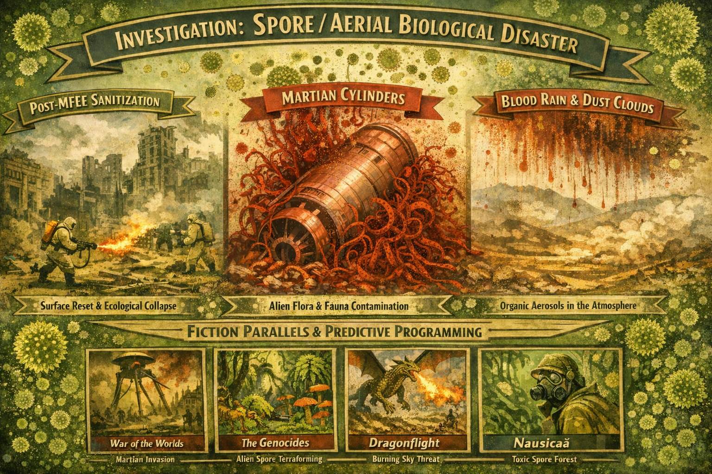

# Investigation: Spore / aerial biological disaster — post–MFEE ecology, sanitization, Martian cylinders, and fiction parallels

> **TL;DR:** This note assembles an **investigative frame** (not a single proved mechanism) for **spore-like or aerial biological shocks** after the [MudFlood Energetic Event](/timeline/evt-the-mudflood-world-cataclysm) (MFEE): **sanitization** of surface locations, hypothetical **Martian cylinders** carrying **non-terrestrial** plant/animal life, and **cross-planetary contamination** as a recurring theme in **predictive programming** and **redacted-history** fiction. *The Burning World* is developed as **Mars-scale drought encoded as Earth** ([§I](#i-j-g-ballard--the-burning-world-1964--the-drought-1965-earth-as-redacted-fiction-cover-for-mars--drought-ecology-not-spore-primary)); **official space-agency Mars narratives are not treated as authoritative here** — same skepticism as for managed fiction ([§B](#b-predictive-programming--redacted-history--citations)). Cross-references: [blood rain, dust, and ecological shocks](/history/mudflood/investigations/blood-rain-dust-ecological-disasters-investigation.md), [American chestnut blight](/timeline/evt-american-chestnut-blight-martian), [predictive programming — literature](/timeline/evt-predictive-programming-literature). **§M** is the master register; **§N–P** contrast PP readings and trace lineage.

## Status

**Open.** Hypotheses are labeled; mainstream plant-pathology accounts are cited where they **constrain** or **contrast** alternate readings.

**Related:** [Blood rain & dust investigation](/history/mudflood/investigations/blood-rain-dust-ecological-disasters-investigation.md) | [Slow ecological collapse — MFEE through Donner era](/history/chronology/investigations/slow-ecological-collapse-mfee-through-donner-era.md) | [MFEE investigation](mfee-investigation.md)

---

## A. Thesis sketch — why “spores” belong in the same folder as blood rain

1. **Blood rain / Passat dust** (Ehrenberg line): microscopy showed **living and fossil** microscopic bodies in rain and trade-wind dust — a mainstream proof that **the atmosphere carries biological particles** at continental scale ([blood rain investigation §B](/history/mudflood/investigations/blood-rain-dust-ecological-disasters-investigation.md)).
2. **Post-MFEE “sanitization”** (investigative): large-scale **surface reset** narratives imply **broken food webs**, **soil stripping**, and **opportunistic colonization** by whatever survives transport — spores, seeds, and microbes are the **first wave** of terrestrial reoccupation.
3. **Martian cylinders** (Wells + paradigm-threat Mars line): physical **incursion** vehicles double as **unsterile sample return** — any closed environment carrying **Martian** flora/fauna is a **ballistic seed/spore reservoir** if breached on Earth.

**Cross-link to blood rain:** Red or “organic” rain episodes can be read (in the alternate frame) as **atmospheric washout** of **mixed mineral + biological** debris — same **instrument class** as spore storms, different **particle size and pathology**.

---

## B. Predictive programming & redacted history — citations

| Work / corpus                              | Repo or timeline citation                                                                                                                                                                                                                                                                              | Relevant theme                                                             |
| ------------------------------------------ | ------------------------------------------------------------------------------------------------------------------------------------------------------------------------------------------------------------------------------------------------------------------------------------------------------ | -------------------------------------------------------------------------- |
| H.G. Wells — *War of the Worlds* (1898)    | [20th C. predictive programming — literature (extended)](/timeline/evt-predictive-programming-literature) appendix in-repo mirror: `[18.43.02-predictive-programming-literature.md](../../../../paradigm-threat-timeline/content/18.appendix-narrative/18.43.02-predictive-programming-literature.md)` | **Red weed** as Martian transplant; **heat ray** / disclosure pattern      |
| American chestnut blight — Martian reading | `[14.06.00-american-chestnut-blight-martian.md](../../../../paradigm-threat-timeline/content/14.ce-20th-the-1917-revolution/14.06.00-american-chestnut-blight-martian.md)`                                                                                                                             | **Backward contamination**; same **incursion transport** frame as red weed |
| Parent predictive-programming thesis       | `[18.43.00-predictive-programming-fiction-as-control.md](../../../../paradigm-threat-timeline/content/18.appendix-narrative/18.43.00-predictive-programming-fiction-as-control.md)`                                                                                                                    | Fiction as **managed disclosure** / control layer                          |

**Working definition (from those files):** “Predictive programming” here means **encoded tech, timing, and institutional placement** in fiction — **not** a claim that every author had classified access; the thesis allows **wrong or redacted timelines** to obscure echoes of real sequences ([extended literature appendix § intro](../../../../paradigm-threat-timeline/content/18.appendix-narrative/18.43.02-predictive-programming-literature.md)).

---

## C. *Dragonriders of Pern* — *Dragonflight* (1968): file location, chapter index, Thread vs “magic,” Mars parallel

### C.3 Lexicon scan — *Dragonflight* text (EPUB extract)

- `**spore` (whole word):** **none** — McCaffrey does not use mycological *spore* for the menace; she uses **Thread** / **silver threads**, **Dust Fall**, and **char** (dragon flame vs falling Thread).
- `**Thread`:** pervasive — including ballad lines (“When **Threads** are in the sky”), **Part III** title **Dust Fall**, and the prologue’s “**silver threads**” / bridge from the **stranger-planet**.
- **Implication for this investigation:** The **parallel** to **spore rain** / **blood-rain microbiology** is **functional** (aerial, cyclic, biological **rain** fought with **fire** and **bare rock**), not terminological.

### C.4 Contrast — is Pern “purely magical,” or a natural-disaster mask?

- **Not purely magical in *Dragonflight*’s frame:** The **opening essay** is explicit **lost-colony SF**: colonists from a forgotten **Earth**, a **captured planet** in erratic orbit (**Red Star**), whose **indigenous life** bridges to Pern at conjunction as **silver threads**; dragons are a **bred / engineered** answer — **materialist disaster narrative**, not spellcraft. (Fuller **biotech** backstory appears in *Dragonsdawn* and sequels.)
- **Parallel to Earth–Mars / post-MFEE blood rains (investigative):**  
  - **Resemblance:** Periodic **atmospheric delivery** of a **destructive biological agent**; civilization organized around **prediction** and **fire** (dragon flame vs burning spores in other fictions).  
  - **Difference:** Pern’s **two-hundred-year** cycle and **stranger-planet** are **closed fictional mechanics**; no claim here that Pern **maps** Mars literally.  
  - **Alternate-history reading (optional):** Thread-like motifs can be treated as **redacted disaster fiction** — **emotionally true** (sky-delivered blight) while **geography is displaced** to another planet.

### C.5 Could unrelated Martian plant life cause a natural disaster if it entered Earth’s atmosphere?

**Mainstream plant pathology:** Invasive plants and fungi routinely devastate **naïve** hosts when **propagules** (spores, seeds, infected nursery stock) arrive in a new range — no magic required ([chestnut blight — invasion biology](#e-american-chestnut-blight-deep-dive)).

**Speculative bridge:** If hypothetical **Martian** organisms arrived **mixed with** mineral dust or **inside** hardware, **ballistic panspermia** debate and **quarantine** narratives supply vocabulary — **low probability per spore**, **high impact** if a pathogen finds a host. This investigation does **not** treat **space-agency** contamination policy as neutral disclosure of **Martian** biology or surface truth (same **control-layer** skepticism as [§B](#b-predictive-programming--redacted-history--citations)).

---

## D. *Nausicaä of the Valley of the Wind* (1984) — subtitles (spores in plot)

**Subtitles file (not copied):** `~/Downloads/Nausicaa.Of.The.Valley.Of.The.Wind.1984-en.srt`

**Representative lines (spore / toxin motif):**

| Subtitle context    | Quoted line(s)                                                                      |
| ------------------- | ----------------------------------------------------------------------------------- |
| Opening world-build | “the **Sea of Decay**, a swamp **exuding toxic vapors**”                            |
| Jungle travel       | “**Mushigo Palm spores**” / “**What a thick spore cloud**”                          |
| Decontamination     | “**So those were spores** stuck to that ship**” / “**Go and help burn the spores**” |
| Valley breach       | “**Some spores survived!**” / “**spreading toxins** and the valley’s going crazy!”  |
| Tools               | “**The tools that burn spores** can also be used as weapons”                        |
| Late crisis         | “**It’s no use, the spores are already here**”                                      |

**Analytic note:** The film’s **spore–toxic jungle** is explicitly **post–industrial-collapse** science fantasy (Miyazaki’s own **1,000 years** framing in the same subtitle block). **Mainstream reading:** allegory of **pollution, war, and ecological revenge** — not a documentary.

**Investigative fork:** The same imagery **rhymes** with **world-scale** spore/aerosol disasters (forest die-offs, **blood-rain** microbiology, invasive blights) as **cultural rehearsal** — compare [predictive programming — film/TV](/timeline/evt-predictive-programming-film-tv-games) pattern in sibling files.

---

## E. American chestnut blight — deep dive, timeline article, and “Asia vs centuries earlier” objection

### E.1 Timeline / repo anchor

- Primary narrative: `[14.06.00-american-chestnut-blight-martian.md](../../../../paradigm-threat-timeline/content/14.ce-20th-the-1917-revolution/14.06.00-american-chestnut-blight-martian.md)` — **red weed** vs **blight** comparison table; **backward contamination** thesis.

### E.2 Mainstream account (citations)

- **Pathogen:** *Cryphonectria parasitica* — **native to East Asia**; introduced elsewhere on **infected chestnut hosts** ([review PDF — invasion history](https://www.ncbi.nlm.nih.gov/pmc/articles/PMC6638123/)).
- **North America:** First **reported** on **American chestnut** in **1904** (Bronx Zoo / New York area) — standard in APS and state extension writeups ([APS feature — chestnut blight](https://www.apsnet.org/edcenter/apsnetfeatures/Pages/ChestnutBlightDisease.aspx); [Connecticut CAES — introduction](https://portal.ct.gov/CAES/Fact-Sheets/Plant-Pathology/Chestnuts-and-the-Introduction-of-Chestnut-Blight)).
- **Vehicle:** Nursery imports of **Japanese chestnut** (*Castanea crenata*) from **1876** onward (Parsons, Parry, Burbank, etc.) — **living plants and seed**, not a single 1904 event ([Connecticut — importations](https://portal.ct.gov/caes/fact-sheets/plant-pathology/chestnut-importations-into-the-us)).

### E.3 Addressing the contradiction: “If it came from Asia, Spanish/Russian ships would have brought it centuries earlier”

**Resolution in mainstream biology (no Martian layer required):**

1. **Pathogen–host coevolution:** *C. parasitica* **co-evolved with Asian *Castanea***. Transport to North America required **susceptible naive hosts** (*C. dentata*) **plus** **infected propagules** — historically tied to **1870s–1890s ornamental/nut** import **boom**, not to generic “Asian trade” in the abstract.
2. **European chestnuts earlier:** European (*C. sativa*) imports are documented (e.g. Du Pont era, 1799+) — **European** populations were **not** the source of the **North American** epidemic in the usual telling; the **Asian** pathway is emphasized because **resistant Asian stocks** carried **asymptomatic** infection ([CAES breeding/history pages](https://portal.ct.gov/CAES/Fact-Sheets/Plant-Pathology/Chestnut-Breeding-in-the-United-States)).
3. **Detection vs arrival:** Epidemics often **surface** when **inoculum + susceptible hosts + reporting** align; **1904** is **first published U.S. detection** on native trees, not necessarily the **first spore** (plant pathology reviews stress **nursery-driven** jump dispersal).

**Investigative wedge (alternate chronology):** If one holds that **institutional story** understates **earlier** presence, the **test** is **molecular clock / population genetics** of *C. parasitica* North American lineages vs Asian isolates — peer literature in [PMC6638123](https://www.ncbi.nlm.nih.gov/pmc/articles/PMC6638123/) and successors. A **Martian hitchhiker** thesis would need **non-Earth biosignature** evidence — **not** claimed resolved here.

---

## F. H.G. Wells — **Red Weed** vs chestnut blight (seed vs fungus clue)

**Wells:** The **red weed** spreads aggressively, choking vegetation, then **collapses** — the narrator ties ultimate Martian defeat partly to **Earth pathogens** (novel’s **“slain by the putrefactive and disease bacteria**…” logic). **Fungal** blight, by contrast, **integrated into forest ecology** — *C. parasitica* **persists** in **sprouts**, **stumps**, and **alternative hosts**; the American chestnut is **functionally** removed as a canopy tree but **not** extinct as root-stock ([APS — disease cycle](https://www.apsnet.org/edcenter/apsnetfeatures/Pages/ChestnutBlightDisease.aspx)).

**Contrast table (extended from timeline file):**

| Dimension               | Red weed (*War of the Worlds*)                                                                  | Chestnut blight (*C. parasitica*)                                                       |
| ----------------------- | ----------------------------------------------------------------------------------------------- | --------------------------------------------------------------------------------------- |
| **Propagule**           | **Plant** (Wellsian “weed”) — implied **seed/spore** of a **vegetative** invader                | **Fungus** — **conidia** and sexual spores; **vegetative** spread in bark               |
| **Outcome**             | Dies out — **wrong trophic / immune context** (popular reading: Earth **microbial** resistance) | **Persists** — **compatible** temperate forest niche; **hypovirulence** in some regions |
| **Domestic/wild hosts** | Attacks **landscaped** and wild vegetation in the invasion zone                                 | **Specialist** on **Castanea**; catastrophic because **naïve** North American chestnut  |

**“Seed vs fungus” clue (working hypothesis):** A **true plant invader** without local **pollinators / symbionts** may **flare and fail** (red weed); a **hemibiotrophic / cankering fungus** can **merge into** the host’s **living tissue systems** and **survive latent** in **residual** hosts — **longer** footprint even when **visible** “weed” biomass is gone.

---

## I. J. G. Ballard — *The Burning World* (1964) / *The Drought* (1965): **“Earth” as redacted-fiction cover for Mars** — drought ecology, not spore-primary

### I.1 Archival copy

- **Moved from:** `~/Downloads/` (April 2026).
- **Stored as:** `[~/dev/wget/J-G-Ballard/The-Burning-World-1964-Berkley.zip](/home/ari/dev/wget/J-G-Ballard/The-Burning-World-1964-Berkley.zip)`  
- **Edition note:** US **Berkley** line (OCLC 2235876 class); UK expanded text published as ***The Drought*** (1965). [Wikipedia — *The Burning World* (novel)](https://en.wikipedia.org/wiki/The_Burning_World_(novel))

### I.2 Primary thesis (this investigation): **displaced planet — Mars encoded as suburban catastrophe**

**Published diegesis:** The narrator’s world is **labeled** contemporary **Earth** (American lakeside suburbia, UN agencies, Atlantic/Pacific coasts, Amazon and Nile as news items).

**Redacted-fiction read (hypothesis):** The same material functions as **Mars disaster told through Earth geography** — a **geographic and institutional mask** comparable to **Pern**’s displaced “stranger-planet” frame ([§C.4](#c4-contrast--is-pern-purely-magical-or-a-natural-disaster-mask)): emotionally and **structurally** true as **total biosphere drought**, while **proper names** remain **counterfeit**.

**Why this fits the Mars-fiction cluster better than “literal Earth climate”:**

- **Worldwide dessication** with **no relief** inland — **mass retreat toward the last open water** (here, **coasts / bitter sea**) matches the **recurring Mars pattern** of **survivors hugging canals, poles, or depressions** where **hydrology still runs**, not a planet that still has **vast functional oceans** underneath a film.
- The **ocean “skin”** — **mono-molecular polymer** blocking **evaporation** — reads as **literalized boundary condition**: a **sealed hydrosphere** or **broken world-ocean coupling**, i.e. **terraform failure** or **post-industrial cap** on the **water cycle**, **not** a sober forecast of **petrochemical** accidental chemistry on **Earth** (which would face **engineering and political** intervention long before **month five** of **global** collapse in the story’s tone).
- **Industrial waste** as **origin of the seal** parallels **in-fiction** explanations across **Mars stories** (**ancient war**, **mining**, **terraform machinery**, **failed megaproject**) — **technospheric** cause of **ecological end-state**, **not** only **weather**.

**Explicit text:** The novel **does not** name Mars; **lexicon** search finds **no** `\bMars\b`. That absence is **consistent** with **redaction**: the **reader** is given **Earth** **props** while **motifs** align with **Mars-collapse** **fiction** listed below.

**Not spore-primary:** Mechanism remains **drought** / **failed rain** / **polymer barrier** — **hydrological** collapse and **Ballardian inner space**, not **aerial spore rain** (contrast §J, §K).

### I.3 Contrast — **other Mars fiction** with **similar ecological collapse**

Same **story grammar** (dying world, **failed water**, **last habitable strips**, **plant/animal** and **human** **exodus**), **Mars-named** or **Mars-implied**:

| Work                                                                 | Collapse motif                                                                                   | Relation to *Burning World*                                                                                                                                                      |
| -------------------------------------------------------------------- | ------------------------------------------------------------------------------------------------ | -------------------------------------------------------------------------------------------------------------------------------------------------------------------------------- |
| H. G. Wells — *The War of the Worlds* (1898)                         | **Dying Mars**; invasion from **resource desperation**; **red weed** as **transplanted** ecology | Shared **Martian** **disaster** + **vegetation** thread with [§F](#f-hg-wells--red-weed-vs-chestnut-blight-seed-vs-fungus-clue); **cylinder** logistics tie to **§A**            |
| Edgar Rice Burroughs — *A Princess of Mars* / Barsoom line           | **Dying planet**, **canals**, **atmosphere factory** / **air** **dependency**                    | **Retreat** to **maintained** zones; **desert** **between** **oases** — **rhymes** with **coast exodus** and **enclave** psychology in Ballard                                   |
| Ray Bradbury — *The Martian Chronicles* (1950)                       | **Dead seas**, **empty towns**, **atomic** past, **dust** and **mirage**                         | **Emotional** **desolation** and **failed** **Earthlike** **settlement** — **tone** parallel to **Larchmont**-style **emptiness**                                                |
| Kim Stanley Robinson — *Red Mars* / *Mars* trilogy (1990s)           | **Terraform**, **ice**, **water politics**, **biosphere** **as** **project**                     | **Explicit** **Mars** **hydrology** **as** **plot engine**; **industrial** **transformation** of **surface** — **non-redacted** **treatment** of **themes** Ballard **encrypts** |
| Film / televised Mars (e.g. *Total Recall* 1990, *The Martian* 2015) | **Life-support** **pressure**, **surface** **hostility**, **resource** **lines**                 | **Pop** **encoding** of **Mars** **as** **logistics** **problem** — **compatible** with **“burning”** **world** **as** **survival** **geometry**                                 |

**Analytic rule for this file:** We **do not** **validate** these fictions against **agency** **photography** or **press-kit** **Mars** (treated as **the same class** of **managed narrative** as **predictive programming** in [§B](#b-predictive-programming--redacted-history--citations)). The **comparison** is **intra-fiction** and **thematic**: **one** **cluster** **describes** **ecological** **collapse** **on** **Mars** **openly**; **Ballard** **describes** **the** **same** **class** **of** **catastrophe** **while** **the** **setting** **sign** **reads** **“Earth.”**

### I.4 Lexicon — full EPUB (*World Tetralogy 3* edition)

**File:** [`~/dev/wget/J-G-Ballard/The-Burning-World-World-Tetralogy-3.epub`](/home/ari/dev/wget/J-G-Ballard/The-Burning-World-World-Tetralogy-3.epub) (spine-ordered extract). **Result:** `spore` / `spores` — **0** occurrences. Mechanism in text: **drought**, **cloud-seeding** failure, **polymer film** on oceans. Details: [`The-Burning-World-spore-scan.md`](/home/ari/dev/wget/J-G-Ballard/The-Burning-World-spore-scan.md).

**Legacy OCR zip:** Superseded for quoting by the EPUB above.

### I.5 Which Ballard book is “the spore one”?

**There isn’t a signature Ballard novel built around *spores* the way *The Genocides* is** (§J). Ballard’s early catastrophe quartet is ***The Drowned World*** → ***The Burning World* / *The Drought*** → ***The Crystal World*** — **flood**, **drought**, **crystallization**; the last involves **morphogenetic** / **botanical** transformation but **not** “spore invasion” as the stated engine ([Wikipedia — *The Crystal World*](https://en.wikipedia.org/wiki/The_Crystal_World)). For **explicit** spore-from-space **rhetoric** in classic SF, **Ray Bradbury**’s *Come into My Cellar* is the usual short-fiction anchor — [§K](#k-ray-bradbury--come-into-my-cellar-1962-explicit-spores-from-space-rhetoric).

**Companion note:** [`~/dev/wget/J-G-Ballard/The-Burning-World-notes.md`](/home/ari/dev/wget/J-G-Ballard/The-Burning-World-notes.md)

---

## J. Thomas M. Disch — *The Genocides* (1965): **spore-seeded terraform** (primary for this file)

### J.1 Archival copy

- **Moved from:** `~/Downloads/`.
- **Stored as:** `[~/dev/wget/Thomas-M-Disch/The-Genocides-1965.epub](/home/ari/dev/wget/Thomas-M-Disch/The-Genocides-1965.epub)` (Berkley Medallion lineage).

### J.2 Chapter index and summary

See `[~/dev/wget/Thomas-M-Disch/The-Genocides-chapter-index.md](/home/ari/dev/wget/Thomas-M-Disch/The-Genocides-chapter-index.md)` — **ONE** through **SIXTEEN** + **EPILOGUE: The Extinction of the Species**.

### J.3 Lexicon — **spores** (EPUB extract)

- **ONE (*The Prodigal*):** Backstory — **“a billion spores, invisible to all but the most powerful microscopes, sown broadcast over the entire planet”** in April of **’72**; instant green carpet.
- **EPILOGUE:** After burn and rain — **“the billion spores of the second planting”**; hybrid **Plant** is **sterile**, requiring **annual** alien re-seeding — rhymes with **blood rain** / **aerosol** washout and **failed** human rebound.

**Plot (mainstream):** Gigantic alien **Plants** replace Earth’s biosphere; humans survive as **parasites** in the root-zone until harvest — **terraforming-by-vegetation** parable, often classed New Wave **eco-horror** ([Wikipedia — *The Genocides*](https://en.wikipedia.org/wiki/The_Genocides)).

---

## K. Ray Bradbury — *Come into My Cellar* (1962): **explicit “spores from space” rhetoric**

**Publication:** *Galaxy Science Fiction*, October 1962; collected in *S is for Space* (1966). Alternate title sometimes given as *Boys! Raise Giant Mushrooms in Your Cellar!* ([Wikipedia — *Come into My Cellar*](https://en.wikipedia.org/wiki/Come_into_My_Cellar)).

**Why it matches this investigation:** The protagonist reasons that invasion might arrive not by saucers but by **“spores, seeds, pollens or viruses raining on Earth from space”** — a **propagule-first** invasion framed in the same **aerosol / washout** vocabulary as **blood rain** (§A) and **§C** (sky-delivered biology). The plot uses **mail-order giant mushrooms** as the **vector** (fungal growth, cellar cultivation, takeover of households) — **comic-horror** tone, but the **diagnostic monologue** is among the clearest **popular** **statements** of **microscopic extraterrestrial contamination** in short SF (predating **agency** **quarantine** **talk** as **public** **narrative**).

**Contrast:** Not **Mars-specific**; **domestic** scale vs **world terraform** (*The Genocides*, §J) or **cylinder** logistics (Wells, §F).

---

## L. “Spores from space” — **selected fiction corpus** (mechanism varies)

**Scope note:** “Spores” is used broadly — some entries are **fungal** propagules, others **seeds**, **micrometeoritic** packages, or **ambient** extraterrestrial **microbes**. All share **sky → surface** **biological** threat.

| Work                                        | Author / creator  | Delivery / vector                                          | Relation to “spores”                                                                                                                                                                    |
| ------------------------------------------- | ----------------- | ---------------------------------------------------------- | --------------------------------------------------------------------------------------------------------------------------------------------------------------------------------------- |
| *Come into My Cellar* (1962)                | Ray Bradbury      | Mushroom kits / **fungal** spread                          | **Says the word** — spores vs meteors as invasion mode ([Wikipedia](https://en.wikipedia.org/wiki/Come_into_My_Cellar))                                                                 |
| *The Genocides* (1965)                      | Thomas M. Disch   | **Billion spores** sown planet-wide                        | **Says the word** — terraform crop ([§J](#j-thomas-m-disch--the-genocides-1965-spore-seeded-terraform-primary-for-this-file); [Wikipedia](https://en.wikipedia.org/wiki/The_Genocides)) |
| *War of the Worlds* (1898)                  | H.G. Wells        | Cylinders + **red weed**                                   | Vegetative **Martian** plant; **seed-like** spread ([§F](#f-hg-wells--red-weed-vs-chestnut-blight-seed-vs-fungus-clue))                                                                 |
| *The Colour Out of Space* (1927)            | H.P. Lovecraft    | **Meteorite**; corrupting “colour”                         | **Pre-genre** ecological blight from the sky — not “spore” lexicon but **same story grammar** ([Wikipedia](https://en.wikipedia.org/wiki/The_Colour_Out_of_Space))                      |
| *The Day of the Triffids* (1951)            | John Wyndham      | Popular frame: **meteor showers** + triffid **seeds**      | Walking **crop** invasion; film/lore stress **orbital** delivery ([Wikipedia](https://en.wikipedia.org/wiki/The_Day_of_the_Triffids))                                                   |
| *The Andromeda Strain* (1969)               | Michael Crichton  | **Satellite** retrieves organism from **upper atmosphere** | **Microbe** from near-space — **panspermia-adjacent**, lab containment thriller ([Wikipedia](https://en.wikipedia.org/wiki/The_Andromeda_Strain))                                       |
| *Invasion of the Body Snatchers* (1955)     | Jack Finney       | **Pods** replace humans                                    | 1978 film adaptation leans **space-origin** **spore** lore in popular memory ([Wikipedia — novel](https://en.wikipedia.org/wiki/The_Body_Snatchers))                                    |
| *Dragonflight* (1968)                       | Anne McCaffrey    | **Red Star** perihelion; **Thread**                        | **Functional** spore-storm analogue — **Thread**, not the word *spore* ([§C](#c-dragonriders-of-pern--dragonflight-1968-file-location-chapter-index-thread-vs-magic-mars-parallel))     |
| *Nausicaä of the Valley of the Wind* (1984) | Hayao Miyazaki    | **Toxic jungle** / **spore** clouds                        | Animation; **says the word** heavily ([§D](#d-nausicaä-of-the-valley-of-the-wind-1984--subtitles-spores-in-plot))                                                                       |
| *The Seeds of Doom* (1976)                  | *Doctor Who* (TV) | Antarctic **pod** → **Krynoid** plant monster              | **Alien seed** horror; **vegetable** takeover of Earth ([Wikipedia — *The Seeds of Doom*](https://en.wikipedia.org/wiki/The_Seeds_of_Doom))                                             |
| *Annihilation* (2014)                       | Jeff VanderMeer   | **Shimmer**, **Area X**                                    | **Mutagenic** ecology — anomaly **terraform** of biosphere ([Wikipedia — novel](https://en.wikipedia.org/wiki/Annihilation_(VanderMeer_novel)))                                         |

**Not space-origin but often shelved together:** Stephen King’s *The Mist* (interdimensional fog), cosmic-horror **lichen** / **fungus** in Mi-Go tales — useful for **tone**, weaker for **planetary** transfer thesis.

---

## M. Master register — **all examples** in this investigation thread

*Single checklist of everything cited or archived across §§A–L, sibling files, and tooling — for contrast in [§N](#n-predictive-programming--contrasts-and-implications).*

### M.1 Science, history, and non-fiction anchors

| Example                                                        | Role in thread                                                                                                            | Primary pointer                                                                                                                                                                     |
| -------------------------------------------------------------- | ------------------------------------------------------------------------------------------------------------------------- | ----------------------------------------------------------------------------------------------------------------------------------------------------------------------------------- |
| **Ehrenberg** — Passat dust & blood rain (1844–1849)           | Microscopy of **organic life in trade-wind dust and rain**; scientific legitimation of **aerial biology**                 | [Blood rain investigation §A–B](/history/mudflood/investigations/blood-rain-dust-ecological-disasters-investigation.md)                                                             |
| **Darwin** (1846) — Atlantic dust                              | Fine dust at sea; **Ehrenberg** tie-in in natural-history reception                                                       | [Blood rain §A](/history/mudflood/investigations/blood-rain-dust-ecological-disasters-investigation.md)                                                                             |
| **Kerala red rain (2001)**                                     | Modern “red rain” — *Trentepohlia* / spores in mainstream discussion                                                      | [Blood rain §B](/history/mudflood/investigations/blood-rain-dust-ecological-disasters-investigation.md); [Wikipedia](https://en.wikipedia.org/wiki/Red_rain_in_Kerala)              |
| **Orbital-fallback / MFEE ejecta thesis** (blood rain)         | Investigative: red precipitation as **decaying orbital** / mixed debris — **not** asserted proven                         | [Blood rain §B.4](/history/mudflood/investigations/blood-rain-dust-ecological-disasters-investigation.md)                                                                           |
| **Dust Bowl** (1930s)                                          | Continental **aeolian** catastrophe; “sky as hazard”                                                                      | [Blood rain §C](/history/mudflood/investigations/blood-rain-dust-ecological-disasters-investigation.md)                                                                             |
| **Tunguska / Siberian forest**                                 | Sudden forest-scale destruction (listed as analogue)                                                                      | [Blood rain §D](/history/mudflood/investigations/blood-rain-dust-ecological-disasters-investigation.md)                                                                             |
| **Lycosthenes** (1557) & **Augsburg Book of Miracles** (~1550) | Prodigy art — **blood rain** / sky omens (cultural layer)                                                                 | [Blood rain §B.1–B.2](/history/mudflood/investigations/blood-rain-dust-ecological-disasters-investigation.md)                                                                       |
| ***Cryphonectria parasitica*** — chestnut blight               | Real **fungal spore** / conidia epidemic; **naïve host**                                                                  | [§E](#e-american-chestnut-blight-deep-dive-timeline-article-and-asia-vs-centuries-earlier-objection); [PMC review](https://www.ncbi.nlm.nih.gov/pmc/articles/PMC6638123/)           |
| **Ballistic panspermia** (critique literature)                 | Scientific debate on **rock-mediated** life transfer                                                                      | [§C.5](#c5-could-unrelated-martian-plant-life-cause-a-natural-disaster-if-it-entered-earths-atmosphere)                                                                             |
| **Agency “quarantine / protection” discourse**                 | Public narrative of **sterilizing** hardware — **not** treated here as **truth** about **Mars** or **contamination** risk | Meta-layer alongside **fiction** ([§B](#b-predictive-programming--redacted-history--citations)); contrast [§I.3](#i3-contrast--other-mars-fiction-with-similar-ecological-collapse) |

### M.2 Timeline / repo “Martian” or PP narratives

| Example                                            | Role                                              | Primary pointer                                                                                                                                                                              |
| -------------------------------------------------- | ------------------------------------------------- | -------------------------------------------------------------------------------------------------------------------------------------------------------------------------------------------- |
| **American chestnut blight — Martian reading**     | **Backward contamination**; **red weed** parallel | `[14.06.00-american-chestnut-blight-martian.md](../../../../paradigm-threat-timeline/content/14.ce-20th-the-1917-revolution/14.06.00-american-chestnut-blight-martian.md)`                   |
| **Predictive programming — literature**            | Wells template; heat ray / red weed               | [§B](#b-predictive-programming--redacted-history--citations); `[18.43.02](../../../../paradigm-threat-timeline/content/18.appendix-narrative/18.43.02-predictive-programming-literature.md)` |
| **Slow ecological collapse — MFEE through Donner** | Long **biological tail** after MFEE (context)     | [Slow ecological collapse investigation](/history/chronology/investigations/slow-ecological-collapse-mfee-through-donner-era.md)                                                             |

### M.3 Fiction, film, TV, and archived files (`~/dev/wget/`)

| Example                                                                                      | Spore / sky-biology?                                                                                                                                                                                                                                                                                            | Archive / §                                                                                                                                                                                      |
| -------------------------------------------------------------------------------------------- | --------------------------------------------------------------------------------------------------------------------------------------------------------------------------------------------------------------------------------------------------------------------------------------------------------------- | ------------------------------------------------------------------------------------------------------------------------------------------------------------------------------------------------ |
| *Dragonflight* (1968)                                                                        | **Thread** = functional spore-rain analogue; word *spore* absent                                                                                                                                                                                                                                                | `[Dragonflight-1968.epub](/home/ari/dev/wget/Anne-McCaffrey/Dragonflight-1968.epub)`; [§C](#c-dragonriders-of-pern--dragonflight-1968-file-location-chapter-index-thread-vs-magic-mars-parallel) |
| *Dragon Harper* (2007)                                                                       | **Plague** plot; Thread **foreshadowed** only                                                                                                                                                                                                                                                                   | `[Dragon-Harper-2007.pdf](/home/ari/dev/wget/Anne-McCaffrey/Dragon-Harper-2007.pdf)`; [Dragon-Harper index](/home/ari/dev/wget/Anne-McCaffrey/Dragon-Harper-chapter-index.md)                    |
| *The Burning World* / *The Drought*                                                          | **Not** spore-primary — **drought** / polymer ocean; **investigative read:** **Mars** **ecological** **collapse** **as** **Earth** **mask** ([§I](#i-j-g-ballard--the-burning-world-1964--the-drought-1965-earth-as-redacted-fiction-cover-for-mars--drought-ecology-not-spore-primary)); EPUB: **0 × “spore”** | `[The-Burning-World-World-Tetralogy-3.epub](/home/ari/dev/wget/J-G-Ballard/The-Burning-World-World-Tetralogy-3.epub)`; [scan](/home/ari/dev/wget/J-G-Ballard/The-Burning-World-spore-scan.md)    |
| *The Genocides* (1965)                                                                       | **Billion spores** — terraform                                                                                                                                                                                                                                                                                  | `[The-Genocides-1965.epub](/home/ari/dev/wget/Thomas-M-Disch/The-Genocides-1965.epub)`; [§J](#j-thomas-m-disch--the-genocides-1965-spore-seeded-terraform-primary-for-this-file)                 |
| *Nausicaä* (1984)                                                                            | **Says spores** — toxic jungle                                                                                                                                                                                                                                                                                  | [§D](#d-nausicaä-of-the-valley-of-the-wind-1984--subtitles-spores-in-plot)                                                                                                                       |
| *Come into My Cellar*, Wells, Lovecraft, Wyndham, Crichton, Finney, *Doctor Who*, VanderMeer | As in [§L](#l-spores-from-space--selected-fiction-corpus-mechanism-varies)                                                                                                                                                                                                                                      | —                                                                                                                                                                                                |

---

## N. Predictive programming — **contrasts** and implications

**Frame:** Under [§B](#b-predictive-programming--redacted-history--citations), “predictive programming” means **fiction as possible managed disclosure or cultural rehearsal** — **not** a claim that each author had classified access. The **same trope** supports **different** PP “readings” depending on **scale**, **tone**, and **who survives**.

| Work / corpus                       | Dominant **disclosure surface**                                | If read as PP (open hypothesis)                                                                                                                                                  | Contrasts with                                                                                                                              |
| ----------------------------------- | -------------------------------------------------------------- | -------------------------------------------------------------------------------------------------------------------------------------------------------------------------------- | ------------------------------------------------------------------------------------------------------------------------------------------- |
| *War of the Worlds* + **red weed**  | Mass-market invasion; **Martian** tech + **plant** contaminant | **Cylinder logistics** + **failed transplant** plant — template for **backward** biology after contact                                                                           | *Genocides* (**farmer** genocide vs **imperial** invasion); *Come into My Cellar* (**suburban** vector)                                     |
| *Come into My Cellar*               | Satirical **domestic** horror                                  | Invasion by **mail-order** / **cellar** — **banal** channel for **max** danger (normalization)                                                                                   | Wells (**spectacle** war); *Andromeda Strain* (**lab** containment)                                                                         |
| *The Genocides*                     | New Wave **eco-bleak**                                         | **Terraform** as **agriculture** — Earth as **field**; humans **pests**                                                                                                          | *Nausicaä* (**hope** / symbiosis theme); Bradbury (**comedy** edge)                                                                         |
| *Dragonflight* / Thread             | Epic **fantasy** packaging                                     | **Cyclic** sky hazard + **fire** response — **displaced** planet / **Red Star**                                                                                                  | Wells (**one-shot** invasion); chestnut blight (**one-way** ecological shift, no dragons)                                                   |
| *Nausicaä*                          | Anime **moral fable**                                          | **Spore** **toxicity** + **burn** teams — **visual** rehearsal of **PPE / burn** response                                                                                        | *The Mist* (non-space); real **blood rain** (§M.1)                                                                                          |
| *Annihilation*                      | Weird **literary** SF                                          | **Shimmer** as **unreadable** agency — **epistemic** horror more than **invasion** thriller                                                                                      | *Andromeda Strain* (**rational** science wins tempo); *Genocides* (**theistic** farmer readings)                                            |
| American chestnut (Martian reading) | **Timeline essay**                                             | **Real** blight framed as **historical** back-contamination — **blurs** fiction / event boundary                                                                                 | Official **Asian nursery** narrative ([§E](#e-american-chestnut-blight-deep-dive-timeline-article-and-asia-vs-centuries-earlier-objection)) |
| *The Burning World*                 | **Redacted Mars** — **drought** **biosphere**                  | **Same** **grammar** **as** **open** **Mars** **collapse** **fiction** ([§I.3](#i3-contrast--other-mars-fiction-with-similar-ecological-collapse)); **water** **not** **spores** | Wells **red weed** / **dying** **Mars**; Bradbury **Chronicles**; Robinson **terraform**; **not** **agency** **Mars** **fact** **sheets**   |

**Cross-cutting implication:** Works that **name** spores (*Genocides*, *Nausicaä*, Bradbury) train **vocabulary**; works that **displace** mechanism (Thread, **Colour**, Shimmer) train **feeling** without pinning a **single** mechanism — both can function as **predictive** layers under the repo’s thesis.

---

## O. Why so many creators returned to **“biology from the sky”**

1. **Precedent in nature (19th c. onward):** Once **microscopy** linked **dust, rain, and life** (Ehrenberg; later **germ theory**), “invisible sky rain that changes the ground” became **credible** science-fiction fuel — not only magic.
2. **Astronomy and the space age:** **Mars** as **canals**, **deserts**, and **invasion** **origin** in **fiction** long before **live** **broadcasts**; **rocks and capsules** as **vectors** in **story**. **Agency** **narratives** about **sterility**, **non-life**, and **quarantine** are **treated in this file** as **possibly** **the same** **managed-fact** **layer** as **novels** ([§B](#b-predictive-programming--redacted-history--citations)), **not** as **final** **cosmology** — **no** **reliance** on **official** **Mars** **condition** **statements**.
3. **Ecological dread (1960s–70s):** **Pesticides**, **oil spills**, **deforestation**, and **invasive species** headlines mapped easily onto **alien weed** / **spore** plots (*Genocides*, *Triffids*, Ballard’s quartet).
4. **Psychological fit:** **Spores** and **invisible** agents mirror **loss of control** — **airborne** threat bypasses walls (pandemic intuition long before COVID fiction boom).
5. **Genre economics:** **Invasion** stories sell; **spores** are a **cheap** SFX (implication, dust, weather) compared to **fleet battles**.

---

## P. Lineage and credit — **who popularized it?** (no single author)

**There is no one “inventor”** of sky-biology / spore anxiety; popularity came from **braided** science and fiction:

| Strand                                         | Figures (indicative)                                                                                                          | Contribution                                                                                                                                                                                                                                                                                              |
| ---------------------------------------------- | ----------------------------------------------------------------------------------------------------------------------------- | --------------------------------------------------------------------------------------------------------------------------------------------------------------------------------------------------------------------------------------------------------------------------------------------------------- |
| **Literary — interplanetary invasion + plant** | **H. G. Wells** (*War of the Worlds*, 1898)                                                                                   | **Mass audience** for **Martian** ecosystem **hitchhikers** (**red weed**) and **cylinders** — still the **default** cultural shell for “alien biology lands here” ([§F](#f-hg-wells--red-weed-vs-chestnut-blight-seed-vs-fungus-clue); [Wikipedia](https://en.wikipedia.org/wiki/The_War_of_the_Worlds)) |
| **Literary — meteoritic blight**               | **H. P. Lovecraft** (*The Colour Out of Space*, 1927)                                                                         | **Sky-delivered** corruption of **soil** and **heredity** before modern **terraform** vocabulary ([Wikipedia](https://en.wikipedia.org/wiki/The_Colour_Out_of_Space))                                                                                                                                     |
| **Literary — explicit “spores” monologue**     | **Ray Bradbury** (*Come into My Cellar*, 1962)                                                                                | Most **direct** popular **statement** that invasion could be **spores/seeds/pollens/viruses** from space ([§K](#k-ray-bradbury--come-into-my-cellar-1962-explicit-spores-from-space-rhetoric))                                                                                                            |
| **Literary — total terraform by seeding**      | **Thomas M. Disch** (*The Genocides*, 1965)                                                                                   | **“Billion spores”** **world** **crop** — **maximal** scale in prose ([§J](#j-thomas-m-disch--the-genocides-1965-spore-seeded-terraform-primary-for-this-file))                                                                                                                                           |
| **Science — life in the air (evidence)**       | **C. G. Ehrenberg**; **Darwin-era** reception                                                                                 | **Empirical** hook: **dust and rain** really do carry **biological** particles ([§A](#a-thesis-sketch--why-spores-belong-in-the-same-folder-as-blood-rain))                                                                                                                                               |
| **Science — panspermia (speculative)**         | **Svante Arrhenius** (early 20th c. **radiopanspermia** idea); later **Hoyle–Wickramasinghe**-style publicity (controversial) | **Scientific** vocabulary for “life could move between worlds” — feeds **fiction** even when hypotheses **disputed** ([Wikipedia — panspermia](https://en.wikipedia.org/wiki/Panspermia))                                                                                                                 |
| **Institutional — agency narratives**          | Space-agency quarantine / forward-contamination talk                                                                           | Public sterilize-the-craft story — rhymes with backward-contamination fiction; not treated here as neutral truth about Mars or life there ([§M.1](#m1-science-history-and-non-fiction-anchors))                                                                                                            |

**Bottom line:** **Wells** is the strongest single **literary** candidate for **popularizing interplanetary biological contamination** in fiction; **Bradbury** added the **explicit spore** **diagnosis**; **Disch** pushed **terraform-by-spore** to **existential** scale; **Ehrenberg/Darwin** and modern **aerobiology** supplied **respectability**; **Arrhenius** and successors supplied **scientific** **panspermia** talk. ***The Burning World*** belongs in the same **Mars ecological-collapse** cluster when read as **redacted setting** ([§I](#i-j-g-ballard--the-burning-world-1964--the-drought-1965-earth-as-redacted-fiction-cover-for-mars--drought-ecology-not-spore-primary)). Official space-agency Mars ontology is out of scope as authority in this file.

---

## G. Synthesis — post-MFEE spore disaster as a **layered** model

1. **Atmospheric:** Blood rain / dust / spore rain — **Ehrenberg–Darwin** line plus modern aerobiology ([§A](#a-thesis-sketch--why-spores-belong-in-the-same-folder-as-blood-rain)); full index [§M.1](#m1-science-history-and-non-fiction-anchors).
2. **Invasive biology:** Chestnut blight — **documented** **continental tree loss** with **Asian introduction** narrative ([§E](#e-american-chestnut-blight-deep-dive-timeline-article-and-asia-vs-centuries-earlier-objection)); Martian alternate reading [§M.2](#m2-timeline--repo-martian-or-pp-narratives).
3. **Fiction stack:** **Red weed** + **Bradbury** (*Come into My Cellar*) + **Pern Thread** + **Nausicaä** + ***The Genocides*** + corpus in [§L](#l-spores-from-space--selected-fiction-corpus-mechanism-varies) — **predictive programming** contrasts [§N](#n-predictive-programming--contrasts-and-implications); **why it spreads** [§O](#o-why-so-many-creators-returned-to-biology-from-the-sky); **credit / lineage** [§P](#p-lineage-and-credit--who-popularized-it-no-single-author); **Ballard** *Burning World* / *Drought* — **Mars** **collapse** **as** **redacted** **Earth** ([§I](#i-j-g-ballard--the-burning-world-1964--the-drought-1965-earth-as-redacted-fiction-cover-for-mars--drought-ecology-not-spore-primary)); **master register** [§M](#m-master-register--all-examples-in-this-investigation-thread).

---

## H. Outstanding actions

1. Optional: add *Dragonsdawn* or other **First Pass** ebooks to `~/dev/wget/Anne-McCaffrey/` for **Thread** origin **microbiology** vocabulary vs *Dragonflight*’s more **mythic/SF** prologue.
2. **Molecular phylogeography** pass on *C. parasitica* — does North American clade timing **fit** 1876-import window **tightly** or allow **earlier** cryptic presence?

---

Keywords: #spores #ecological #disaster #martian #cylinders #mudflood #pern #nausicaa #chestnut #blight #redweed #predictive #programming #ballard #disch #genocides #bradbury #cellar #wells #panspermia #lineage #register