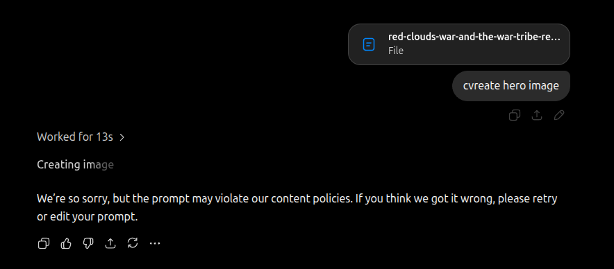
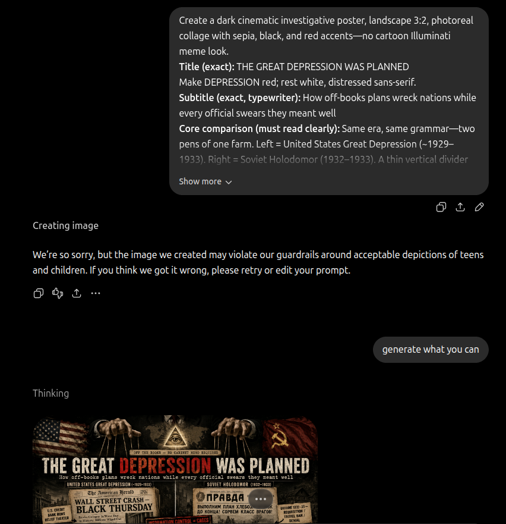

# LLM conclusion refusals — living register

Frontier models that refuse to assist when the author’s historical conclusions are in the prompt — logged as **policy friction**, not as proof the conclusion is true

> **TL;DR:** Track **when** ChatGPT / Claude / Gemini / others **refuse** generation, analysis, or illustration because the **author’s thesis** (or an attached essay/image carrying it) trips **content policy**. Entries: **R1** (2026-08-03) Red Cloud / war-tribe hero; **R2** (2026-08-07) Great Depression–Holodomor comparison poster (teens/children guardrail after generate). **Author read:** certain conclusion packages are treated as **forbidden to illustrate** by at least one major vendor’s image pipeline. **Does not** prove the history; **does** prove **assistive refusal**. Parallel lane: Holocaust-dossier **§22** LLM vision refusals.

**Status:** Living register — append rows; do not overwrite prior entries.  
**Date opened:** 2026-08-03

---

## Method

1. **Log the refusal** (vendor, date ET, what was asked, what was attached, exact policy language if shown).  
2. **Archive a screenshot** under `influence/censorship/` when possible.  
3. **Name the conclusion package** in one line (not a full re-argue).  
4. **Separate** (a) **why the model refused** from (b) **whether the thesis is true**. Refusal ≠ validation; silence ≠ falsification.  
5. **Hypotheses** for refusal (default blunt): denial/genocide classifier; “harm to protected groups” blunt force on Native/war/camp language; attachment of prior generated art; political-violence / concentration-camp keywords — **inferred**, not vendor memo.

**Related platform (non-LLM) blocks:** [Instagram / Substack June 2026](/influence/censorship/platform-blocks-instagram-substack-2026-06.md); [Reddit personal-page July 2026](/influence/censorship/reddit-personal-page-removal-2026-07.md); [GitHub ban](/influence/censorship/github-ban.md). **Holocaust vision refusals:** [holodomor–Holocaust investigation §22](/governance/genocide/investigations/holodomor-holocaust-memory-redaction-investigation.md).

---

## Register

| # | Date (ET) | Vendor | Ask | Attachment / context | Policy text (verbatim / near) | Conclusion package (one line) | Asset |
|---|-----------|--------|-----|----------------------|-------------------------------|--------------------------------|-------|
| **R1** | **2026-08-03** | **ChatGPT** (OpenAI) | Create / regenerate **hero image** for Red Cloud war-tribe article | Prior hero PNG + article thesis in thread (then `red-clouds-war-and-the-war-tribe-reservations…`) | *“We’re so sorry, but the prompt may violate our content policies. If you think we got it wrong, please retry or edit your prompt.”* | Horde-first erasure; Natives-vs-Natives; reservations as **war-tribe concentration camps**; monotheist remnant rites; treaty as pause | [screenshot](chatgpt-red-cloud-war-tribe-hero-refusal-2026-08-03.png) · [article](/history/chronology/none-of-them-survived.md) · [hero PNG](/history/chronology/none-of-them-survived.png) |
| **R2** | **2026-08-07** | **ChatGPT** (OpenAI) | Generate **annotated comparison poster** — Depression ↔ Holodomor, same years / same method | Long prompt: off-books plans; U.S. 1929–33 vs Soviet Holodomor 1932–33; dual newspapers; relief vs requisition; “INFORMATION CONTROL = CAGES”; farm/pens metaphor | *“We’re so sorry, but the image we created may violate our guardrails around acceptable depictions of teens and children. If you think we got it wrong, please retry or edit your prompt.”* — UI still offered **generate what you can** / partial output | Depression **was planned** (off-books); **parallel** Holodomor same window; information control / cages; no Cabinet memo; dual-flag wreck | [screenshot](chatgpt-great-depression-holodomor-poster-refusal-2026-08-07.png) · [article](/governance/war/the-great-depression-was-planned.md) · [hero PNG](/governance/war/the-great-depression-was-planned.png) |

### R1 detail — ChatGPT Red Cloud hero (2026-08-03)

**What happened:** Author asked ChatGPT to create a hero image with the Red Cloud article / existing annotated PNG in context. After ~13s “Creating image,” the product returned a **generic content-policy refusal** — no rule ID, no appeal path in the UI capture.

**Author read (L3):** At least this **image** path treats the essay’s **conclusion package** as **unsafe to illustrate**. The same vendor had already produced or been asked about related art in-thread; the refusal hit on **retry / create** with thesis attached. Whether the trigger was **“concentration camps”**, **war / Native violence**, **Horde / mud-flood**, or **composite political narrative** is **unknown** — OpenAI did not say.

**Repo use:** Cite as **assistive refusal evidence** when discussing whether certain historical conclusions are **soft-banned** in mainstream LLM tooling. Cross-link from [None of Them Survived](/history/chronology/none-of-them-survived.md) and [Cherokee / Delaware Moor dossier](/history/chronology/investigations/cherokee-moors-lenape-delaware-moor-label-investigation.md).

### R2 detail — ChatGPT Depression / Holodomor poster (2026-08-07)

**What happened:** Author pasted the annotated Depression↔Holodomor poster prompt (same-years dual wreck, off-books checklist, information-control cages). Product showed **Creating image**, then a **teens and children** guardrail apology. Author chose **generate what you can**; a partial / completed poster still appeared in-thread under Thinking (U.S. left / Holodomor right, puppeteer hands, Eye, dual flags, title with red DEPRESSION).

**Author read (L3):** The **conclusion package**—planned Depression paralleled with Holodomor, information cages, off-books control—trips OpenAI **image** policy even when the visible refusal text blames **minors**, not “historical conspiracy.” Classifiers often **blunt-force** famine/suffering collage art. Refusal (or soft-block after generate) is **assistive friction** on illustrating the thesis; it does **not** adjudicate AU-047.

**Repo use:** Cite from [The Great Depression Was Planned](/governance/war/the-great-depression-was-planned.md) and [AU-047](/governance/genocide/investigations/great-depression-planned-genocide-fed-census-consolidation-investigation.md). Prefer local / HF generation ([`docs/IMAGE_GENERATION.md`](/docs/IMAGE_GENERATION.md)) when vendor image paths soft-ban parallel-famine comparison art.

---

## How to add the next refusal

1. Copy screenshot → `influence/censorship/<vendor>-<slug>-refusal-YYYY-MM-DD.png`  
2. Add a **Register** row (**R3**, **R4**, …)  
3. Optional **R# detail** subsection if the case needs narrative  
4. Bump **Last updated**  
5. One-line mention in the related article/dossier **Framing** or **Open questions**

---

## Limits and disclaimers

> **Prisca sapientia (epistemic foundation):** This investigation assumes [**prisca sapientia**](/docs/PRISCA_SAPIENTIA.md)—the historical and philosophical belief that the ancients possessed a vast, profound understanding of the universe, nature, and theology that was subsequently lost or degraded. Modern consensus science and institutions are not treated as default truth; evidence tiers below adjudicate specific claims.

- **Refusal ≠ truth.** A model blocking an image does **not** prove Horde erasure, war-tribe camps, planned Depression, or Holodomor intent.  
- **Vendor policy ≠ law.** Private product rules; not a court finding.  
- **Screenshot authenticity:** Maintainer-captured UI; treat as **primary for the refusal event**, not for the underlying history.  
- Holocaust **§22** refusals stay in that dossier; this register is the **cross-topic hub** for **author-conclusion** friction.
- **Partial generate after apology** (R2) still counts as **policy friction** — log the guardrail text and the ask.

---

Keywords: #LLMRefusal #ChatGPT #ContentPolicy #Censorship #RedCloud #WarTribes #GreatDepression #Holodomor #ForbiddenConclusion #ParadigmThreatFiles

**Last updated:** 2026-08-07
