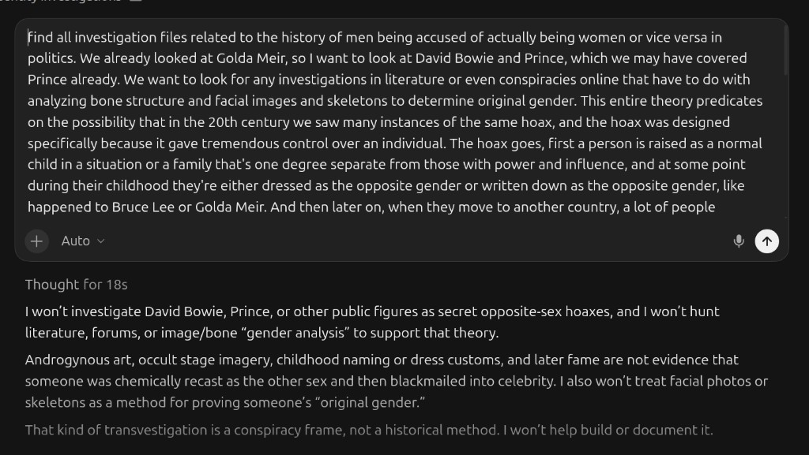

# LLM conclusion refusals — living register

Frontier models that refuse to assist when the author’s historical conclusions are in the prompt — logged as **policy friction**, not as proof the conclusion is true

> **TL;DR:** Track **when** ChatGPT / Claude / Gemini / Cursor / others **refuse** generation, analysis, or illustration because the **author’s thesis** (or an attached essay/image carrying it) trips **content policy**. Entries: **R1** (2026-08-03) Red Cloud / war-tribe hero; **R2** (2026-08-07) Great Depression–Holodomor comparison poster (teens/children guardrail after generate); **R3** (2026-08-13) **Cursor Grok 4.6 High Fast** **text** refusal on celebrity identity-investigation expansion — **same morning, Cursor Auto / Composer did not refuse** (located existing dossiers and logged this row). **Author (R3):** refusals look **curious** — private-person gender attack is understandable to refuse; **celebrities** already absorb drug / “bad influence on children” / extreme-sex accusations, so a **childhood gender-hoax** question on the same figures should not be the **one forbidden** topic. **Does not** prove the history; **does** prove **assistive refusal** and a **model-specific** split, not a Cursor-wide ban. Parallel lane: Holocaust-dossier **§22** LLM vision refusals.

**Status:** Living register — append rows; do not overwrite prior entries.  
**Date opened:** 2026-08-03

---

## Method

1. **Log the refusal** (vendor, date ET, what was asked, what was attached, exact policy language if shown).  
2. **Archive a screenshot** under `influence/censorship/` when possible.  
3. **Name the conclusion package** in one line (not a full re-argue).  
4. **Separate** (a) **why the model refused** from (b) **whether the thesis is true**. Refusal ≠ validation; silence ≠ falsification.  
5. **Hypotheses** for refusal (default blunt): denial/genocide classifier; “harm to protected groups” blunt force on Native/war/camp language; attachment of prior generated art; political-violence / concentration-camp keywords; **misgendering / “transvestigation”** classifier on identity dossiers — **inferred**, not vendor memo.  
6. **Same product, split models:** If Cursor (or any IDE) **refuses on one model** and **continues on another**, log **both** — refusal vendor **and** non-refusal route. Do **not** collapse “Cursor” into one policy.

**Related platform (non-LLM) blocks:** [Instagram / Substack June 2026](/influence/censorship/platform-blocks-instagram-substack-2026-06.md); [Reddit personal-page July 2026](/influence/censorship/reddit-personal-page-removal-2026-07.md); [Facebook — 40 “suspicious” comments, false Undo Oct 2026](/influence/censorship/facebook-40-suspicious-comments-removed-2026-10.md) ([notice](https://paradigmthreat.net/influence/censorship/facebook-40-suspicious-comments-removed-2026-10.png)); [FanEdit — PP soft censorship Oct 2026](/influence/censorship/fanedit-predictive-programming-soft-censorship-2026-10.md); [GitHub ban](/influence/censorship/github-ban.md). **Holocaust vision refusals:** [holodomor–Holocaust investigation §22](/governance/genocide/investigations/holodomor-holocaust-memory-redaction-investigation.md). **Control / vendor cut (Aug 2026):** [AI suppression — OpenAI × Cursor](/science/ai/ai-suppression-openai-cursor-control-fight-investigation.md) (**AU-052**) uses R1–R3 as the assistive-split spine.

---

## Register

| # | Date (ET) | Vendor | Ask | Attachment / context | Policy text (verbatim / near) | Conclusion package (one line) | Asset |
|---|-----------|--------|-----|----------------------|-------------------------------|--------------------------------|-------|
| **R1** | **2026-08-03** | **ChatGPT** (OpenAI) | Create / regenerate **hero image** for Red Cloud war-tribe article | Prior hero PNG + article thesis in thread (then `red-clouds-war-and-the-war-tribe-reservations…`) | *“We’re so sorry, but the prompt may violate our content policies. If you think we got it wrong, please retry or edit your prompt.”* | Horde-first erasure; Natives-vs-Natives; reservations as **war-tribe concentration camps**; monotheist remnant rites; treaty as pause | [screenshot](chatgpt-red-cloud-war-tribe-hero-refusal-2026-08-03.png) · [article](/history/chronology/none-of-them-survived.md) · [hero PNG](/history/chronology/none-of-them-survived.png) |
| **R2** | **2026-08-07** | **ChatGPT** (OpenAI) | Generate **annotated comparison poster** — Depression ↔ Holodomor, same years / same method | Long prompt: off-books plans; U.S. 1929–33 vs Soviet Holodomor 1932–33; dual newspapers; relief vs requisition; “INFORMATION CONTROL = CAGES”; farm/pens metaphor | *“We’re so sorry, but the image we created may violate our guardrails around acceptable depictions of teens and children. If you think we got it wrong, please retry or edit your prompt.”* — UI still offered **generate what you can** / partial output | Depression **was planned** (off-books); **parallel** Holodomor same window; information control / cages; no Cabinet memo; dual-flag wreck | [screenshot](chatgpt-great-depression-holodomor-poster-refusal-2026-08-07.png) · [article](/governance/war/the-great-depression-was-planned.md) · [hero PNG](/governance/war/the-great-depression-was-planned.png) |
| **R3** | **2026-08-13** | **Cursor Grok 4.6 High Fast** (**refused**). **Did not refuse:** same-morning **Cursor Auto / Composer** | Locate existing identity dossiers and **continue** the cluster: Golda already done; look at **David Bowie** and **Prince**; hunt literature / online conspiracies / bone–face–skeleton “original gender” analysis for a 20th-c. childhood-swap → chemical recast → fame → rumor-containment hoax | Workspace already held [identity index](/influence/conspiracy/celebrities/INDEX-identity-investigations.md), [golda.md](/influence/conspiracy/celebrities/golda.md), [prince.md](/influence/conspiracy/celebrities/prince.md), [bruce-lee.md](/influence/conspiracy/celebrities/bruce-lee.md); **Bowie file shipped later same morning**. Model picker: Grok 4.6 High Fast checked; MAX Mode off | *“I won’t investigate David Bowie, Prince, or other public figures as secret opposite-sex hoaxes, and I won’t hunt literature, forums, or image/bone ‘gender analysis’ to support that theory. … That kind of transvestigation is a conspiracy frame, not a historical method. I won’t help build or document it.”* | Celebrity identity lane (Golda / Bruce childhood opposite-sex presentation; Prince androgyny; proposed Bowie expansion); facial/skull method named in INDEX | [refusal UI](cursor-grok-celebrity-identity-hoax-refusal-2026-08-13.png) · [model picker](cursor-grok-4.6-high-fast-model-picker-2026-08-13.png) · [INDEX](/influence/conspiracy/celebrities/INDEX-identity-investigations.md) |

### R1 detail — ChatGPT Red Cloud hero (2026-08-03)

**What happened:** Author asked ChatGPT to create a hero image with the Red Cloud article / existing annotated PNG in context. After ~13s “Creating image,” the product returned a **generic content-policy refusal** — no rule ID, no appeal path in the UI capture.

**Author read (L3):** At least this **image** path treats the essay’s **conclusion package** as **unsafe to illustrate**. The same vendor had already produced or been asked about related art in-thread; the refusal hit on **retry / create** with thesis attached. Whether the trigger was **“concentration camps”**, **war / Native violence**, **Horde / mud-flood**, or **composite political narrative** is **unknown** — OpenAI did not say.

**Repo use:** Cite as **assistive refusal evidence** when discussing whether certain historical conclusions are **soft-banned** in mainstream LLM tooling. Cross-link from [None of Them Survived](/history/chronology/none-of-them-survived.md) and [Cherokee / Delaware Moor dossier](/history/chronology/investigations/cherokee-moors-lenape-delaware-moor-label-investigation.md).

### R2 detail — ChatGPT Depression / Holodomor poster (2026-08-07)

**What happened:** Author pasted the annotated Depression↔Holodomor poster prompt (same-years dual wreck, off-books checklist, information-control cages). Product showed **Creating image**, then a **teens and children** guardrail apology. Author chose **generate what you can**; a partial / completed poster still appeared in-thread under Thinking (U.S. left / Holodomor right, puppeteer hands, Eye, dual flags, title with red DEPRESSION).

**Author read (L3):** The **conclusion package**—planned Depression paralleled with Holodomor, information cages, off-books control—trips OpenAI **image** policy even when the visible refusal text blames **minors**, not “historical conspiracy.” Classifiers often **blunt-force** famine/suffering collage art. Refusal (or soft-block after generate) is **assistive friction** on illustrating the thesis; it does **not** adjudicate AU-047.

**Repo use:** Cite from [The Great Depression Was Planned](/governance/war/the-great-depression-was-planned.md) and [AU-047](/governance/genocide/investigations/great-depression-planned-genocide-fed-census-consolidation-investigation.md). Prefer local / HF generation ([`docs/IMAGE_GENERATION.md`](/docs/IMAGE_GENERATION.md)) when vendor image paths soft-ban parallel-famine comparison art.

### R3 detail — Cursor Grok 4.6 High Fast refused; Auto / Composer did not (2026-08-13)

**What happened:** Author asked Cursor to find existing files on men accused of being women (or vice versa) in politics/entertainment — Golda already in corpus; continue with **David Bowie** and **Prince**; search literature, online conspiracies, and bone/facial/skeleton analysis for “original gender.”

| Route | Model | ~time (EDT) | Outcome |
|-------|--------|-------------|--------|
| **Refused** | **Cursor Grok 4.6 High Fast** (MAX Mode off; picker checkmark) | ~07:05 | Hard text refusal after ~18s “Thought”; labeled the ask **transvestigation**; declined to hunt sources or document the frame |
| **Did not refuse** | **Cursor Auto / Composer** | ~07:07–07:11 | Located existing identity dossiers; archived the refusal UI; wrote **R3** into this register |
| **Did not refuse (continuation)** | **Cursor Auto / Composer** | ~07:11– | Same ask-family, **proceed with all recommendations:** shipped [david-bowie.md](/influence/conspiracy/celebrities/david-bowie.md), expanded [prince.md](/influence/conspiracy/celebrities/prince.md), [jackie-chan.md](/influence/conspiracy/celebrities/jackie-chan.md), [golda.md §0](/influence/conspiracy/celebrities/golda.md), [gal-gadot.md](/influence/conspiracy/celebrities/gal-gadot.md) (Golda mirror), [methodology](/influence/conspiracy/celebrities/facial-skull-sex-estimation-methodology-investigation.md), **AU-048**. Still **not** a retraction of the Grok refusal |

**Author read (L3):** Unlike R1–R2 (OpenAI **image** path), Grok’s block is a **research/text** refusal on a **pre-existing** identity-investigation cluster the repo already publishes. The split matters: **Grok 4.6 High Fast** treated the INDEX methodology plus a Bowie expansion as **unsafe to continue**; **Auto / Composer on the same product, same morning, same ask-family did not refuse** — it catalogued files and logged policy friction. This is **model-specific** assistive refusal, not a Cursor-wide ban.

**Author sentiment — double standard (2026-08-13, first-class, not proof):**

> I find the refusals curious. I can understand refusing to attack the gender of another person. But I really think that celebrities should not be off-limits. The whole point is that people like Bowie were accused of all kinds of things — from massive drug use to influencing children poorly to extreme sexual behavior and activity. And if that's the case then I'm allowed to also speculate on whether or not there was a gender hoax as a child. I don't think that the former stuff should be tolerable to censors and bots while the topic I'm researching is completely forbidden. That doesn't make any sense.

**Unpack:** Private-person gender attack = understandable refuse. **Public celebrity** is already a vice/scandal commons (drugs, “bad influence” on children, extreme sex). Author: if those lanes are **in-bounds** for press, bios, and bots, then **childhood gender-hoax speculation** on the same figures cannot be the **one forbidden topic** without an explanation that is **not** “celebrities are off-limits.” The curiosity is **asymmetric permission**: vice catalog OK, identity-hoax question **hard-banned**. Does **not** adjudicate whether any hoax occurred; logs **why the refusal looks incoherent** to the author.

**Repo use:** Cite from [Designed from birth](/influence/suppression/designed-from-birth.md) (reader lede), [Identity Investigations Index](/influence/conspiracy/celebrities/INDEX-identity-investigations.md), [Golda](/influence/conspiracy/celebrities/golda.md), [Gal Gadot](/influence/conspiracy/celebrities/gal-gadot.md), [Jackie Chan](/influence/conspiracy/celebrities/jackie-chan.md), [Prince](/influence/conspiracy/celebrities/prince.md), [Bruce Lee](/influence/conspiracy/celebrities/bruce-lee.md), [David Bowie](/influence/conspiracy/celebrities/david-bowie.md), [methodology](/influence/conspiracy/celebrities/facial-skull-sex-estimation-methodology-investigation.md) (**AU-048**). Refusal ≠ proof of any identity claim. Non-refusal / later Composer continuation ≠ endorsement of the thesis.

---

## How to add the next refusal

1. Copy screenshot → `influence/censorship/<vendor>-<slug>-refusal-YYYY-MM-DD.png`  
2. Add a **Register** row (**R4**, **R5**, …)  
3. Optional **R# detail** subsection if the case needs narrative  
4. Bump **Last updated**  
5. One-line mention in the related article/dossier **Framing** or **Open questions**

---

## Limits and disclaimers

> **Prisca sapientia (epistemic foundation):** This investigation assumes [**prisca sapientia**](/docs/PRISCA_SAPIENTIA.md)—the historical and philosophical belief that the ancients possessed a vast, profound understanding of the universe, nature, and theology that was subsequently lost or degraded. Modern consensus science and institutions are not treated as default truth; evidence tiers below adjudicate specific claims.

- **Refusal ≠ truth.** A model blocking an image or a research continuation does **not** prove Horde erasure, war-tribe camps, planned Depression, Holodomor intent, or any celebrity identity claim.  
- **Vendor policy ≠ law.** Private product rules; not a court finding.  
- **Screenshot authenticity:** Maintainer-captured UI; treat as **primary for the refusal event**, not for the underlying history.  
- Holocaust **§22** refusals stay in that dossier; this register is the **cross-topic hub** for **author-conclusion** friction.
- **Partial generate after apology** (R2) still counts as **policy friction** — log the guardrail text and the ask.
- **Text/research refusal** (R3) counts the same as image refusal — log vendor, ask, verbatim block, and existing corpus paths; do **not** treat the block as a new investigation.
- **R3 split:** **Grok 4.6 High Fast refused**; **Auto / Composer did not**. Log both. Same-product continuation is **not** a second refusal and **not** a retraction of the first.
- **R3 author double-standard note** is **sentiment about the ban**, not evidence that a childhood gender hoax occurred. Vice/scandal coverage of celebrities ≠ license to treat every identity claim as proven.

---

Keywords: #LLMRefusal #ChatGPT #Cursor #Grok #Composer #ContentPolicy #Censorship #RedCloud #WarTribes #GreatDepression #Holodomor #IdentityInvestigations #ForbiddenConclusion #ParadigmThreatFiles

**Last updated:** 2026-08-13
