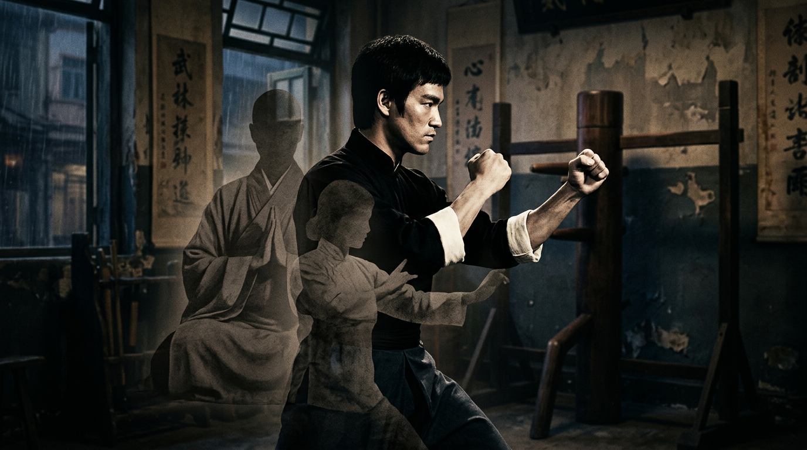

# Bruce Lee: Investigation into Death, Identity, Wing Chun, and British Suppression of Female Martial Arts

> **TL;DR:** Bruce Lee: Investigation into Death, Identity, Wing Chun, and British Suppression of Female Martial Arts: Bruce Lee died on July 20, 1973, in Hong Kong at age 32—days before Enter the Dragon premiered. The official cause was cerebral edema.
```
Note: This investigation is ongoing. Part of a broader inquiry (see INDEX-identity-investigations.md). 
Relies in part on AI-assisted skull/facial analysis—NOT definitive, but helps identify patterns 
and influences.
```



## Thesis

Bruce Lee died on July 20, 1973, in Hong Kong at age 32—days before *Enter the Dragon* premiered. The official cause was cerebral edema. The circumstances—death in mistress Betty Ting Pei's apartment, initial cover-up by business partner Raymond Chow, triad conspiracy theories, and Hong Kong's status as a British colony until 1997—warrant investigation. Could intelligence or criminal interests have had a role? The sweat-gland removal surgery (reducing thermoregulation) and the delay before summoning an ambulance remain unexplained.

**Extended thesis:** Lee may have been assigned female at birth and trained in Wing Chun—a martial art with 300-year female lineage—for that reason. The British had incentive to ensure Wing Chun's legacy was not associated with women (Ng Mui, Yim Wing-chun) but with one man who became "the legend" and then immediately vanished. This served to reduce the threat of female leadership at a time when the CCP—a phallocentric, patriarchal institution and British vassal—was chasing Republic leaders to Taiwan. Had Westerners seen films about female Wing Chun history, more women would have joined martial arts in the 20th century. Suppressed alongside Wing Chun's female origins was **Wuxing philosophy** (Five Elements), which originated the animal fighting styles. All of it would become obscure and trace back to one "man."

---

## I. Death Circumstances

| Factor | Detail | Source |
|--------|--------|--------|
| Location | Died in Taiwanese actress Betty Ting Pei's apartment, not at home with wife Linda | [CheatSheet](https://www.cheatsheet.com/entertainment/who-is-betty-ting-pei-and-what-is-real-her-link-to-bruce-lee.html/) [8days](https://www.8days.sg/entertainment/asian/bruce-lee-mistress-betty-ting-pei-reveals-what-happened-night-he-died-845796) |
| Initial cover-up | Raymond Chow told media Lee died at home with wife; truth emerged three days later | [CheatSheet](https://www.cheatsheet.com/entertainment/who-is-betty-ting-pei-and-what-is-real-her-link-to-bruce-lee.html/) |
| Timeline | Arrived ~5 p.m.; complained of headache; took Equagesic; Betty tried to wake him later; called Chow before ambulance | [SCMP](https://www.scmp.com/article/422201/light-may-be-shed-last-moments-legend) [History](https://www.history.com/articles/bruce-lee-death-mystery-solved-sweat-glands) |
| Betty's account (2025) | Chow instructed her to wait for him rather than call ambulance immediately; Bruce had fainted before | [8days](https://www.8days.sg/entertainment/asian/bruce-lee-mistress-betty-ting-pei-reveals-what-happened-night-he-died-845796) |
| Official cause | Cerebral edema; trigger debated (Equagesic allergy, heatstroke from sweat-gland removal) | [Biography](https://www.biography.com/actors/bruce-lee-death-mystery) [History](https://www.history.com/articles/bruce-lee-death-mystery-solved-sweat-glands) |

---

## II. Conspiracy Theories and Context

- **Triads:** Hong Kong triads were rumored to have threatened or targeted Lee. [SCMP](https://www.scmp.com/magazines/style/celebrity/article/3141681/what-killed-bruce-lee-triads-jealous-lover-ancient)
- **British Hong Kong:** Until 1997, Hong Kong was a British Crown Colony. British intelligence (SIS/MI6) operated in the territory. No direct evidence links British intelligence to Lee's death.
- **Drug speculation:** 2021 letters surfaced suggesting Lee may have used cocaine, LSD, and cannabis. [SCMP](https://www.scmp.com/lifestyle/entertainment/article/3158261/what-killed-bruce-lee-drug-rumours-add-mystery-surrounding)
- **Family curse:** Lee's son Brandon Lee died in 1993 from an on-set shooting—another unexplained death in the family.

---

## IV. Wing Chun's Female Lineage and British Suppression Thesis

### The 300-Year Female Legacy

Wing Chun's creation myth—recorded by Ip Man and widely transmitted—credits **Ng Mui** (Ng Moy), a Buddhist nun and survivor of the Shaolin Temple's destruction, with creating the art. She taught **Yim Wing-chun** (~1735–1795), a young woman threatened by a warlord; Yim Wing-chun defeated him and the art was named after her. Ng Mui synthesized the style from Crane and Snake techniques, designing it for fighters without size or strength advantage—a women's self-defense art. [Combat Museum](https://combatmuseum.com/was-wing-chun-invented-by-a-woman/) [Wikipedia: Yim Wing-chun](https://en.wikipedia.org/wiki/Yim_Wing-chun) [Kung Fu Tea](https://chinesemartialstudies.com/2019/09/29/the-history-and-global-transmission-of-wing-chun-in-less-than-five-thousand-words/)

### Ip Man, 1949, and the Hong Kong Transformation

Ip Man fled Foshan for Hong Kong late in 1949, ahead of the Communist advance. He began teaching professionally in British Hong Kong in 1950. [Kung Fu Tea](https://chinesemartialstudies.com/2019/09/29/the-history-and-global-transmission-of-wing-chun-in-less-than-five-thousand-words/) Wing Chun had **declined dramatically on the mainland after 1949**; it became a global phenomenon only when transmitted through British Hong Kong via Ip Man.

**Critical detail:** Ip Man's sons (Ip Chun, Ip Ching), who rejoined him in Hong Kong in 1962, noted that "traditional ideas and concepts such as the **'five phases' (sometimes translated as 'elements')** or the **'eight directions' had been eliminated from discussions**." Ip Man instead explained the art "in simple mechanical terms." [Kung Fu Tea](https://chinesemartialstudies.com/2019/09/29/the-history-and-global-transmission-of-wing-chun-in-less-than-five-thousand-words/)

### Wuxing and the Animal Styles

**Wuxing** (五行)—the Five Elements/Phases (Wood, Fire, Earth, Metal, Water)—is foundational to Chinese philosophy and martial arts. The Five Animal styles (Tiger, Crane, Leopard, Snake, Dragon) and Xingyi's Twelve Animals connect to Wuxing. Ng Mui was inspired by Crane and Snake when creating Wing Chun. [Wikipedia: Wuxing](https://en.wikipedia.org/wiki/Wuxing_(Chinese_philosophy)) [Five Element Kung Fu](https://www.fiveelementkungfu.com/five-animals-five-elements) By eliminating the "five phases" and "eight directions" from his Hong Kong curriculum, Ip Man stripped Wing Chun of its Wuxing and directional philosophy—rendering the art's cosmological roots obscure.

### Bruce Lee: The Legend Who Vanished

Lee trained under Ip Man from age 13 for approximately four and a half years. [UMF Academy](https://www.umfacademy.com.au/the-role-of-wing-chun-kung-fu-in-bruce-lee-s-training/) He left Hong Kong for America in 1959; *Enter the Dragon* (1973) was released shortly after his death, making him a global icon. Wing Chun's global transmission—and the martial arts boom—would trace back to **one man**: Bruce Lee. The female founders (Ng Mui, Yim Wing-chun) remained in the background; the living face of the art was male, and then he vanished.

**Thesis:** The British had interest in ensuring that (a) Wing Chun's 300-year female lineage was not popularized in the West, (b) the art was associated with a male figure who could be elevated and then removed, and (c) Wuxing philosophy—which contextualizes the animal styles and the art's cosmological basis—remained obscure. At a time when the CCP (phallocentric, patriarchal, British-aligned) was pursuing Republic leaders to Taiwan, a narrative of female martial arts leadership would have threatened the desired order. Had Western cinema featured the female Wing Chun legacy—Ng Mui, Yim Wing-chun, the art's design for the "weak to defeat the strong"—women's participation in martial arts in the 20th century might have been the rule rather than the exception.

### Lee as Assigned Female at Birth: Dressed as Girl, Female Name, Girl's School

**Documented evidence:** Bruce Lee was dressed as a girl and given a female name throughout early childhood. Accounts attribute this to **mother** (William Cheung: she was superstitious, feared demons would steal male children after an older brother died in infancy) or to **parents** collectively. [SMH](https://www.smh.com.au/national/victoria/all-the-right-moves-20110119-19wp3.html) [Encyclopedia.com](https://www.encyclopedia.com/history/encyclopedias-almanacs-transcripts-and-maps/lee-bruce)

| Fact | Detail | Source |
|------|--------|--------|
| Female nickname | **Sai Feng (細鳳)** — "Little Phoenix" — used throughout early childhood | [Academic Kids](https://academickids.com/encyclopedia/index.php/Bruce_Lee) [Wikispeedia](https://dlab.epfl.ch/wikispeedia/wpcd/wp/b/Bruce_Lee.htm) |
| Dressed as girl | Parents dressed him as a girl; Chinese superstition that demons steal male children | [Encyclopedia.com](https://www.encyclopedia.com/history/encyclopedias-almanacs-transcripts-and-maps/lee-bruce) |
| Girl's school | Attended a girl's school for a period | [Encyclopedia.com](https://www.encyclopedia.com/history/encyclopedias-almanacs-transcripts-and-maps/lee-bruce) |
| First film role (3 months) | *Golden Gate Girl* (1941) — Lee played the **baby girl** character; film tells of a woman who dies in childbirth and the baby girl raised by employees. Lee Hoi-chuen (father) agreed to director Esther Eng's use of his infant for the role. | [SCMP](https://www.scmp.com/magazines/style/celebrity/article/3167557/bruce-lees-forgotten-child-star-start-enter-dragon-and) [Metafilter](https://www.metafilter.com/184441/Esther-Eng-directed-the-1st-film-Bruce-Lee-was-in-he-played-a-baby-girl) |
| Bullying | Being dressed as a girl made him a target for bullies—later took up martial arts in response | [SMH](https://www.smh.com.au/national/victoria/all-the-right-moves-20110119-19wp3.html) |

**Mainstream explanation:** Superstition—demons steal male babies; disguising him as a girl would protect him. The older brother's death made the family fearful.

**Alternate reading:** The "superstition" narrative could be a cover. A child assigned female at birth might be dressed as a girl, given a female name (Sai Feng), sent to a girl's school, and cast as a baby girl in film—with the family later asserting he was "really" a boy protected by superstition. The father's involvement in the film industry (Cantonese opera, connections to Esther Eng) placed the infant in a role requiring a baby girl; the convenience of using a child already presented as female is notable. Dragon and phoenix are paired male/female symbols in Chinese tradition; Lee's later screen name "Little Dragon" (Li Xiaolong) pairs with his childhood "Little Phoenix"—suggesting a continuity of gendered presentation. **Open question:** Was the misgendering and cross-dressing a protective superstition, or evidence that Lee was assigned female at birth?

---

## V. Open Questions

1. Why did Chow instruct Betty to wait rather than call an ambulance?
2. Was Lee's sweat-gland removal (affecting thermoregulation) medically advisable for an athlete?
3. Do Hong Kong police or British colonial archives hold unreleased records?
4. Was the Equagesic prescription legitimate, and who prescribed it?
5. Did British colonial or intelligence interests shape Ip Man's removal of Wuxing from his Hong Kong curriculum?
6. Were there deliberate efforts to minimize Ng Mui and Yim Wing-chun in Wing Chun's Western transmission?
7. What was Lee Hoi-chuen's (father's) role in the decision to dress Bruce as a girl and use the female name Sai Feng? Did he participate, acquiesce, or oppose?

---

## References

- [Biography: Bruce Lee Death Mystery](https://www.biography.com/actors/bruce-lee-death-mystery)
- [SCMP: Bruce Lee Conspiracy Theories](https://www.scmp.com/magazines/style/celebrity/article/3141681/what-killed-bruce-lee-triads-jealous-lover-ancient)
- [History.com: Bruce Lee Death](https://www.history.com/articles/bruce-lee-death-mystery-solved-sweat-glands)
- [8days: Betty Ting Pei Interview](https://www.8days.sg/entertainment/asian/bruce-lee-mistress-betty-ting-pei-reveals-what-happened-night-he-died-845796)
- [Combat Museum: Was Wing Chun Invented by a Woman?](https://combatmuseum.com/was-wing-chun-invented-by-a-woman/)
- [Kung Fu Tea: History and Global Transmission of Wing Chun](https://chinesemartialstudies.com/2019/09/29/the-history-and-global-transmission-of-wing-chun-in-less-than-five-thousand-words/)
- [Wikipedia: Yim Wing-chun](https://en.wikipedia.org/wiki/Yim_Wing-chun)
- [Wikipedia: Ng Mui](https://en.wikipedia.org/wiki/Ng_Mui)
- [Wikipedia: Wuxing](https://en.wikipedia.org/wiki/Wuxing_(Chinese_philosophy))
- [UMF Academy: Wing Chun in Bruce Lee's Training](https://www.umfacademy.com.au/the-role-of-wing-chun-kung-fu-in-bruce-lee-s-training/)
- [SMH: All the Right Moves](https://www.smh.com.au/national/victoria/all-the-right-moves-20110119-19wp3.html) — mother dressed him as girl, female nickname, bullying
- [Encyclopedia.com: Bruce Lee](https://www.encyclopedia.com/history/encyclopedias-almanacs-transcripts-and-maps/lee-bruce) — parents, girl's school
- [SCMP: Bruce Lee's Forgotten Child Star Start](https://www.scmp.com/magazines/style/celebrity/article/3167557/bruce-lees-forgotten-child-star-start-enter-dragon-and) — Golden Gate Girl, baby girl role
- [Metafilter: Esther Eng, Bruce Lee played baby girl](https://www.metafilter.com/184441/Esther-Eng-directed-the-1st-film-Bruce-Lee-was-in-he-played-a-baby-girl)
