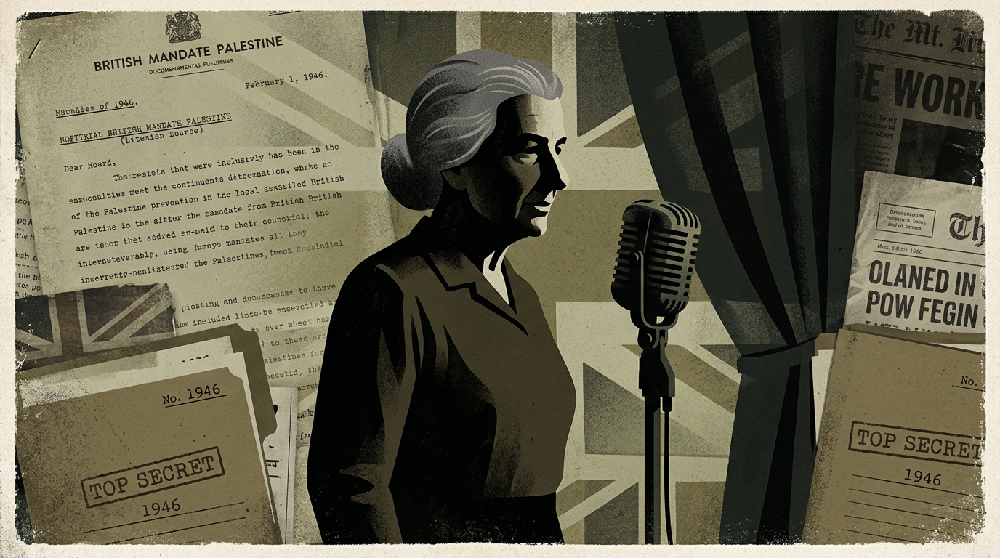

# Golda Meir: Investigation into Identity, British Orchestration, and Israel's Creation



> **TL;DR:** Golda Meir: Investigation into Identity, British Orchestration, and Israel's Creation: Could Golda Meir have been born male and deployed by British intelligence to infiltrate the highest levels of phallocentric Jewish/Israeli society—a society so prude that Arab leaders would not look under her dress, and religious authorities would refuse to appoint any woman except the one the British had elevated by arresting all male rivals? **AU-048 qualification (2026-08-13):** she is the **control hinge** for the Israel project — Agatha cleared the men; she and Ben-Gurion made the state; an immigrant with **dubious papers** who could have been deported instead wielded influence across Israel’s lifespan. Had she said different things, the project goes a different way. Soft history’s “only man in the room” = Author: **globalist man’s mindset**, almost nothing a woman would have brought. British-instrument evidence stays in §§II–V (not reopened here). Gate: [INDEX](INDEX-identity-investigations.md) · worked example [Jackie Chan §2](jackie-chan.md#2-qualification-gate-cluster-hinge). Method: [facial/skull](facial-skull-sex-estimation-methodology-investigation.md) — not a court.
```
Note: Ongoing. Skull/facial analysis is one contested input — not definitive.
Method: facial-skull-sex-estimation-methodology-investigation.md · INDEX-identity-investigations.md
```

## Thesis

Could Golda Meir have been born male and deployed by British intelligence to infiltrate the highest levels of phallocentric Jewish/Israeli society—a society so prude that Arab leaders would not look under her dress, and religious authorities would refuse to appoint any woman except the one the British had elevated by arresting all male rivals? The timeline, British involvement at every stage, her own refusal to discuss her private life, and contemporary descriptions of her as "the only man in the room" warrant a fresh investigation.

> "An androgynous, who presents both male and female physical traits, is in some ways like men and in some ways like women. In some ways, they are like both men and women, and in other ways, like neither men nor women." (Bikkurim 4:1)

---

## 0. Qualification — control hinge for the Israel project (2026-08-13)

> **Author (2026-08-13 session):** Golda Meir’s qualification is obvious. She helped create Israel, and in a very specific way where a lot of the men were removed from power before Israel would finally be created by her and essentially, I think, Ben-Gurion. So I think the evidence of her being a British instrument in that whole affair is extremely obvious and I already investigated it, but the point is that such a move, the creation of Israel and everything that came out later, is a huge pointer that she was under some kind of control system, especially since she was an immigrant with dubious papers. She could just as easily wound up being deported, but she became massively famous after getting to move to Israel. So I won’t get into it, but she qualifies because of the major effects that it had later that essentially this isolated person would wield such continual influence for such a long time during Israel’s lifespan. She could be considered essentially the **control hinge for the entire project**. Had she said different things, the project would have gone a different way. And as many people put it, she more or less represented the **globalist man’s mindset** and almost was devoid of anything that a woman would have brought to the table.

**Unpack (do not re-try Agatha here — that is §II):**

| Author lock | Meaning |
|-------------|---------|
| **Qualification is obvious** | G1–G4 are not a stretch. The *scale of later effects* is the pointer that a leash existed. Natal sex is a **separate** claim. |
| **Men removed, then she + Ben-Gurion create the state** | [Operation Agatha](https://en.wikipedia.org/wiki/Operation_Agatha) (29 Jun 1946) arrested the male Jewish Agency leadership; Ben-Gurion was in Europe; Golda became acting head of the Political Department. **Documented** sequence. **Author:** orchestration, not luck. |
| **British instrument already investigated** | This file’s §§II–V. New material is the **gate**, not a second Mandate history. |
| **Dubious papers / could have been deported** | 1906 travel under **false names (Mabovitch)**; birth certificate plausibly lost/altered (§V). An immigrant with that file can be **removed** — or **elevated**. Elevation after 1921 Palestine entry → 1948 money speech → PM is G1+G2. |
| **Isolated person, continual influence** | Not a dynasty. One body, decades: fundraising that “made the state possible,” signature on the Declaration, Labor, Foreign Minister, Prime Minister 1969–74. |
| **Control hinge** | If her lines change, the **project** changes — partition aftermath, US money, Soviet embassy, 1973 war framing. That is G4 at **geopolitical** scale, bigger than a record contract. |
| **Globalist man’s mindset / nothing a woman would bring** | Soft history already quotes Ben-Gurion: “only man in the Cabinet” / “best man in the government” (§IV). Author: that is not a compliment-metaphor — it is a **description of the payload**. A woman-shaped asset reciting the **male/globalist** script (state, war, money, no private life). |

### Gate score (this specimen)

| Gate | Golda | Evidence |
|------|-------|----------|
| **G1 Predicted fame** | Pass | After Agatha she is *the* remaining Political Department head; 1948 Chicago speech is already a world stage. Handlers did not need to guess. |
| **G2 Private-life control** | Pass | Dubious/false travel names; memoir lock (“I will not write about my private life”); inspection-proof “woman” on the Abdullah crossing. Deportation was the cheap alternative. |
| **G3 Ocean / culture gap** | Pass | Kiev → Quebec → Milwaukee → Denver → Palestine. Receiving publics cannot check the childhood paper. |
| **G4 A reason** | Pass — **Israel project hinge** | British Mandate endgame needed a controllable face who could raise US money, sit where a man would be arrested, and **not** introduce a woman’s independent politics into the new state. |

**Cluster note:** Jackie’s G4 is Pacific messaging / anti-bonding ([jackie-chan.md](jackie-chan.md)). Golda’s G4 is **state creation**. [Gal Gadot](gal-gadot.md) is the **Hollywood mirror** of this hinge — same loyalty job, American-sphere install. Different leashes, same gate — that is the point of AU-048.

**Crash rhyme (2026-08-13, Gal file):** Iron Lady is not forever. After the 1973 surprise, parents of the dead blamed her in the street; poll support **65% → 21%**; she resigned 10 Apr 1974 even though Labor had won in December ([JWA](https://jwa.org/encyclopedia/article/meir-golda); [TIME](https://time.com/archive/6877877/israel-mrs-meirs-house-divided/)). Gal’s *WW84* dump of the American right is the **culture-hinge version** of that same loss — military/conservative families first. Do not write Gal as “unlike Golda, she could not keep them.” Golda did not keep them either.

---

## I. Golda's Significance: Israel Could Not Be Created Without Her

David Ben-Gurion, Israel's founder and first prime minister, stated that when the history of Israel is written it will say: **"there was a Jewish woman who got the money to make the state possible."**

**The scene behind the quote (Documented):** In January 1948 the Haganah needed **$25 million** for arms. Golda was sent to the United States. On **21 January 1948** she spoke to the General Assembly of the Council of Jewish Federations in Chicago. She was not a celebrity orator. The speech told them they could not decide whether the Jews of Palestine would live — only whether they would help. She raised **$50 million**—twice the target. That speech became known as **"the speech that made possible a Jewish State."** [JWA](https://jwa.org/thisweek/jan/21/1948/golda-meir) [AWPC](https://awpc.cattcenter.iastate.edu/2017/03/21/speech-that-made-possible-a-jewish-state-jan-2-1948/) Without Chicago, Ben-Gurion’s later line is a compliment with no room.

**Kibbutz (why the girl was never inspected):** In **1921** she and Morris Myerson went to **kibbutz Merhavia** in the Jezreel Valley. A kibbutz is a collective farm — shared meals, shared work, shared rooms. There is no private inspection of a new woman’s body. The community inherits a married woman on kitchen and chicken work. After that crossing, the receiving public has a woman. They never check Kiev.

**Denver 1913 (Documented + Author cover):** Age **14**, train to Denver, sister **Sheyna Korngold**. Sheyna was already in **Labor Zionist** meetings. Golda sat in those rooms and met Morris there. Soft history: parents refused further education, so she ran. **Author:** the education story is a later cover; running from a house that would not keep the presentation fits the paper-trail smell.

**Political Department after Agatha:** Before the state, the Jewish Agency’s Political Department *was* the foreign office — talks with the British, other governments, and the UN vote. Moshe Sharett ran it. Agatha put him in **Latrun**. Golda became **acting head**: the diplomatic face of the Yishuv while the men who usually held that job were in a British camp. That is G1 on a calendar date, not a secretary’s chair.

She was one of the signatories of Israel's Declaration of Independence (May 14, 1948) and served as Israel's first ambassador to the Soviet Union. She later became Foreign Minister (1956–1966) and Prime Minister (1969–1974). **Without her fundraising, the state would not have been viable.** Her significance is undisputed.

---

## II. British Involvement at Every Stage of Israel's Creation

| Stage | British role | Source |
|-------|--------------|--------|
| 1917 | Balfour Declaration—British pledge of a "national home for the Jewish people" in Palestine | [Britannica](https://www.britannica.com/event/Balfour-Declaration) |
| 1920–48 | British Mandate for Palestine—full administrative and military control | [Wikipedia](https://en.wikipedia.org/wiki/Balfour_Declaration) |
| 1939 | White Paper severely restricting Jewish immigration (fearing Arab shift to Axis) | |
| 1944–48 | GCHQ COMINT (signals intelligence) provided main intelligence for British policy in Palestine | [GCHQ](https://www.gchq.gov.uk/information/palestine-mandate) |
| 1946 Jun 29 | **Operation Agatha (Black Saturday)**—British arrested ~2,700 people including **all male leaders of the Jewish Agency** (Sharett, Gruenbaum, Yosef, Remez, Maimon) and transferred them to Latrun. **David Ben-Gurion was in Europe and escaped.** Golda Meir became acting head of the Political Department. | [Wikipedia](https://en.wikipedia.org/wiki/Operation_Agatha) [Zionist Archives](http://www.zionistarchives.org.il/en/datelist/Pages/BlackSaturday.aspx) |
| 1948 | British withdrawal and handover—partition, Nakba, war | |

British intelligence relied heavily on the Jewish Agency as a liaison; when that relationship turned adversarial after 1945, British policy continued to shape outcomes. [Brunel](https://bura.brunel.ac.uk/handle/2438/14264) The arrest of male leaders immediately elevated Golda into the de facto political leadership. **Coincidence or orchestration?**

---

## III. CIA and Anglo-American Intelligence: Tracking Golda's Life

- **SSU (CIA precursor)** monitored Jewish underground movements in Europe (1945–46), including the Brichah (Holocaust survivor escort to Palestine). [Durham](https://durham-repository.worktribe.com/output/1496048)
- Golda traveled repeatedly to the United States. U.S. immigration and naturalization records exist; her father's death is recorded as **1944** in INS documents but **1946** in her autobiography—a discrepancy that suggests thorough record-keeping and possible cross-referencing.
- Anglo-American intelligence cooperation on Palestine was ongoing. The hypothesis: **British and U.S. agencies could have tracked Golda's movements, identity documents, and family records from adolescence onward.**

---

## IV. "Too Manly": Contemporary Descriptions and Accusations

### Ben-Gurion's Characterizations

David Ben-Gurion described Golda as **"the only man in the Cabinet"** and **"the best man in the government."** [History.com](https://www.history.com/articles/golda-meir-israel-prime-minister-iron-lady-yom-kippur-war)

Golda herself noted: *"A story once went the rounds of Israel to the effect that Ben-Gurion described me as 'the only man' in his cabinet. What amused me about it is that he (or whoever invented the story) thought that this was the greatest compliment that could be paid to a woman."* [Citaty.net](https://citaty.net/citaty/1903363-golda-meir-a-story-once-went-the-rounds-of-israel-to-the-effe/)

### Scholarly Analysis of Gender Presentation

Pnina Lahav (Boston University) argues that Golda **"blurred her sexuality and opted for the more masculine look"** so she would be taken seriously in a cabinet of men. Lahav also notes that Golda cultivated a "Jewish matriarch" persona—gray hair, simple bun, pearls—and that her effectiveness led others to interpret her through masculine terms. [Jerusalem Post](http://www.jpost.com/israel-news/politics-and-diplomacy/article-778059) [De Gruyter](https://www.degruyter.com/document/doi/10.1515/9780691239316/html)

### Accusations of Covering Up

- **Egyptian press (1973):** *Sabah al-Kheir* ran the headline: **"Golda Meir was a lesbian."**
- **Memoir negotiations (1975):** Golda told British publisher George Weidenfeld: *"I will not write about my private life. I will not settle political or other scores with anyone. I will not take advantage of the high office I have just left."* During production she said: *"I need this book like a hole in my head. I hate indiscretion. I hate memoirs."*

No mainstream source has accused her of covering up a male birth identity. The Egyptian lesbian claim implies concealment of sexuality; the memoir refusal is consistent with someone protecting secrets. **Open question:** Was she ever directly accused by contemporaries of hiding something about her identity or past?

### Israeli Culture: Prude and Phallocentric

- **1955:** Golda sought to run for mayor of Tel Aviv. Her selection depended on two religious-block votes; **one man refused to support a woman.** She did not receive a majority.
- **1949:** Religious block opposed her appointment as Minister of Labor because she was a woman.
- Orthodox Judaism restricts female authority. A woman rising to sign the Declaration of Independence, meet Arab kings, and fund the state was unprecedented. **A British covert asset presenting as female would have unique access—and Arabs would not inspect "under her dress."**

---

## V. Timeline: Key Data Points

| Date | Event |
|------|-------|
| 1898 | Goldie Mabovitch born in Kiev, Ukraine |
| 1906 | Family travels via Quebec to Milwaukee. **Father had helped a friend by pretending the friend's wife and daughters were his—family must use false names (Mabovitch) to depart.** Birth certificate plausibly lost or altered. |
| 1906–13 | Milwaukee: site of transgender pioneers (Harry Haynes/Brown Millie et al.). [Wisconsin LGBT History](https://archive.wislgbthistory.com/people/indiv.htm) |
| 1913 | **Age 14: Runs away from home**, takes train to Denver, moves in with sister **Sheyna Korngold** (Labor Zionist circle; meets Morris Myerson). Soft history: education. **Author:** later cover. "Denver was a turning point because my real education began." |
| 1921 | Immigrates to Palestine, **kibbutz Merhavia** (Jezreel Valley) — collective farm; no private inspection of the new “girl” |
| 1939 | British White Paper restricts immigration |
| 1944 vs 1946 | Father's death: INS says 1944; autobiography says 1946 |
| 1946 Jun 29 | Operation Agatha. **All male Jewish Agency leaders arrested.** Golda appointed acting head of Political Department. |
| 1948 Jan 21 | Chicago speech: $50 million raised. "Speech that made possible a Jewish State." |
| 1948 May | **Disguised as Muslim woman**, crosses into Trans-Jordan to meet King Abdullah secretly. Arabs would not inspect a "woman" in traditional dress. [JWA](https://jwa.org/encyclopedia/article/meir-golda) |
| 1948 May 14 | Signs Israeli Declaration of Independence |
| 1949 | Minister of Labor; religious block opposes woman |
| 1955 | Mayor bid fails—religious block refuses woman |
| 1969 | Prime Minister |
| 1975 | *My Life* published. "I will not write about my private life." |
| 1978 | Dies Jerusalem |

---

## VI. Open Questions

1. **Birth certificate:** Was it lost when the family used false names to travel? Can it be located?
2. **Runaway at 14:** Could gender identity (e.g., desire to live as female) have driven her to Denver?
3. **Operation Agatha:** Did the British deliberately arrest male leaders to elevate Golda? Ben-Gurion was in Europe—was his absence coordinated?
4. **Secret missions:** Was she sent to Arab leaders *because* a "woman" could pass without physical inspection?
5. **Memoir:** Why refuse to discuss private life? A woman who helped create Israel might be expected to offer wisdom to younger women—unless the private story could not be told.
6. **"Only man in the room":** Metaphor, or literal description?
7. **CIA/British files:** Do intelligence archives hold files on Golda from the 1910s–40s that would illuminate identity or British cultivation?
8. **Did Ben-Gurion know?** His "only man in the room" and "best man in the government" remarks—metaphor or coded acknowledgment?
9. **LLM refusal (R3, 2026-08-13):** **Cursor Grok 4.6 High Fast** declined to continue this identity lane. **Composer then shipped** [Bowie](david-bowie.md), expanded [Prince](prince.md), [Jackie Chan](jackie-chan.md), [Gal Gadot](gal-gadot.md) (Golda mirror), and the [methodology](facial-skull-sex-estimation-methodology-investigation.md) (**AU-048**). [Register](/influence/censorship/llm-conclusion-refusals-register.md) — assistive friction, not adjudication.
10. **Control hinge:** If Golda had refused the 1948 money speech, the Abdullah crossing, or the PM years, which later Israel-path would be unreachable? (Counterfactual — Author; not a lab test.)

---

## VII. Broader Context: British Neocolonialism and Palestine

Before partitioning Palestine, Britain imposed similar divide-and-rule structures in India (1947), Bengal, Ireland, South Africa. The Balfour Declaration (1917) pledged a Jewish national home; the Mandate (1923–48) implemented it. Britain's withdrawal left religious/ethnic tensions that led to the [Nakba](https://www.un.org/unispal/about-the-nakba/). Israel was no exception to the pattern of departing empires leaving fractured societies. [UN](https://www.un.org/unispal/about-the-nakba/)

---

## VIII. Film Note

*A Woman named Golda* (1982) depicts Golda jumping in front of a grenade to save Ben-Gurion in 1957—despite no known military training. Fact-check: unverified.

## IX. Helen Mirren — the later face (2026-10-25)

In 2023 Helen Mirren played Golda in Guy Nattiv’s *Golda*, a Yom Kippur War film. She was born Ilyena Mironoff in London in 1945. Her grandfather was a Tsarist colonel from **Gzhatsk, near Smolensk**, stranded in Britain after 1917. Her father changed **Mironov** to **Mirren** while she was a child. Kiev and Smolensk are not one town. Both are the western Russian Empire, and both names were replaced in the West.

**Author:** the cast is a weird rhyme because both women were politically useful for a whole public life. Golda is the hinge inside the state. Mirren is the performer who then wears that face, after she had already worn Elizabeth II’s. She told Nattiv she was not Jewish and offered to step away. He kept her. Both were kept on an international scene and brought out when the choreography needed a body. In 2011 *The Office* already had Dwight name her Mironov and call the room’s desire fake salivating over a Soviet-era Russian. Her later line that Israel must exist “for the rest of eternity” is the Zionism. *Golda* is the whitewash. The burnout record, the Office call-out, and the fact-checks are in [Helen Mirren](helen-mirren.md) (**AU-082**). That file is not an AU-048 natal-sex case.

---

## References

- [Jewish Women's Archive: Golda Meir](https://jwa.org/encyclopedia/article/meir-golda)
- [Operation Agatha - Wikipedia](https://en.wikipedia.org/wiki/Operation_Agatha)
- [Balfour Declaration - Britannica](https://www.britannica.com/event/Balfour-Declaration)
- [GCHQ: Palestine Mandate](https://www.gchq.gov.uk/information/palestine-mandate)
- [Pnina Lahav: The Only Woman in the Room](https://www.degruyter.com/document/doi/10.1515/9780691239316/html)
- [History.com: Golda Meir Iron Lady](https://www.history.com/articles/golda-meir-israel-prime-minister-iron-lady-yom-kippur-war)
- [Identity INDEX / AU-048](INDEX-identity-investigations.md) · [methodology](facial-skull-sex-estimation-methodology-investigation.md) · [Jackie Chan](jackie-chan.md) (qualification gate) · [Gal Gadot](gal-gadot.md) (Golda mirror) · [Ayn Rand](ayn-rand.md) (**Golda parallel** — find-and-install / Objectivist world path) · [Helen Mirren](helen-mirren.md) (**AU-082** — Smolensk house, the 2023 cast, career that does not stop; not a natal-sex file) · [David Bowie](david-bowie.md) · [Prince](prince.md) · [Bruce Lee](bruce-lee.md)

---

Keywords: #GoldaMeir #AU048 #QualificationGate #ControlHinge #OperationAgatha #BritishMandate #IdentityInvestigations #AynRand #ParadigmThreatFiles

**Last updated:** 2026-10-25

---

## Limits and disclaimers

> **Prisca sapientia (epistemic foundation):** This investigation assumes [**prisca sapientia**](/docs/PRISCA_SAPIENTIA.md)—the historical and philosophical belief that the ancients possessed a vast, profound understanding of the universe, nature, and theology that was subsequently lost or degraded. Modern consensus science and institutions are not treated as default truth; evidence tiers below adjudicate specific claims.

- **Qualification ≠ natal-sex proof.** Clearing G1–G4 means the Israel-project **leash was available and used**; it does not by itself prove a male birth.  
- **Author thesis is first-class and not automatically factual.** “Control hinge” and “globalist man’s mindset” are Author locks on top of Documented Agatha / money speech / “only man” quotes.  
- **Agatha as orchestration** remains Open (§VI Q3) — sequence is Documented; intent is Author.  
- **Photo/skull method** is not a court — [methodology](facial-skull-sex-estimation-methodology-investigation.md).

