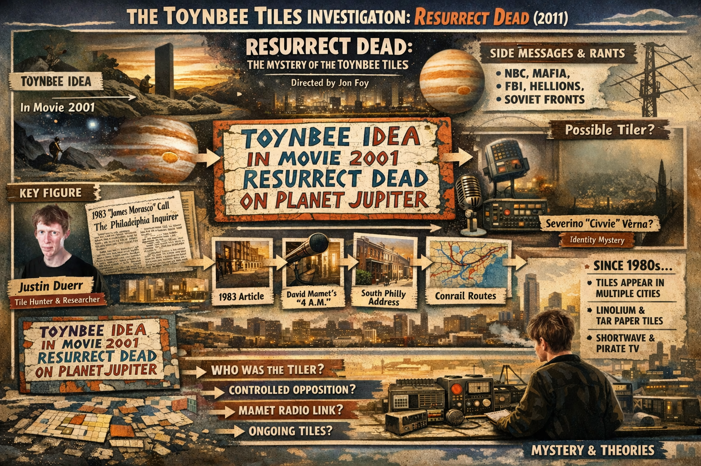

# Investigation: Toynbee Tiles — *Resurrect Dead* (2011) and the street campaign

## Status — Open (documentary-led dossier)

This file tracks the **Toynbee tiles**: asphalt-embedded messages, mainly in the U.S. and South America, built around historian **Arnold J. Toynbee**, **Stanley Kubrick’s** *2001: A Space Odyssey*, and the phrase **“resurrect dead on planet Jupiter.”** Primary narrative spine here is **Jon Foy’s** documentary ***Resurrect Dead: The Mystery of the Toynbee Tiles*** (2011), as reflected in **YouTube auto-generated English subtitles** (local copy reviewed April 2026). Auto-captions garble proper names (“Toynbee” → “twin b,” “Morasco” → “morosco/maresco,” etc.); this dossier uses standard spellings unless quoting transcript noise.

**Paradigm Threat hook (documentary / structural):** A multi-decade attempt to **route an idea around gatekept media**—newspapers, broadcast TV, then the early web—into **public infrastructure** (streets, shortwave). The structural pattern (bypass, pseudonym, silence after exposure) remains useful as **case material** even when the owner’s read of **intent** differs—see **Owner conclusion** below.

**Companion angles:** Kubrick / Jupiter / evolution imagery sits in the same cultural layer as other project notes on **fiction as public myth**; see [Predictive programming hub](/influence/predictive_programming/page.md). No claim is made that the tiles encode a specific PT chronology thesis.

---

## Owner conclusion — controlled opposition and the all-or-nothing trap

**Thesis (site owner):** The Toynbee tile mystery—as **public spectacle** and as the **closed, humanizing arc** of *Resurrect Dead*—operates as **controlled opposition**: it **deflects** from **real** government and institutional conspiracies by packaging “conspiracy” as **one bundled author** who is easy to pity, pathologize, or debunk.

**The trick** is an **all-or-nothing** frame pushed on the viewer:

1. **If** the tiler’s **full** story is treated as the standard—every sidebar about **NBC**, **FBI**, **Interpol**, **Soviet** fronts, **“hellions,”** **mafia**, **journalists**, etc.—then the audience is steered toward a **maximal, cartoon espionage** world: either you swallow the **whole** paranoid package or you walk away.
2. **If not**—if that package is rejected because the Jupiter resurrection scheme or the violent rants are absurd—the same logic **smuggles** a second conclusion: **there are no conspiracies at all**, anywhere, ever. Real coordination (documented **agency abuse**, **media capture**, **war lies**, **false-flag patterns**, **COINTELPRO-grade** history) gets **thrown out with the tile**.

Either pole **protects** the middle where **actual** conspiracies live: **partial**, **evidence-backed**, **institutional**—not identical to one street mystic’s manifesto. The **litmus test** for whether power conspires must **not** be whether this **bundle** is true.

**Operational read:** Reject the **package deal**; keep **disaggregated** inquiry. *Who* runs the opposition and whether any given film participant is **witting** stays **open** pending evidence.

---

## I. The core message (four parts)

Widely repeated tile text (variants exist):

1. **Toynbee idea** — Invokes historian Arnold J. Toynbee; the film argues the author read Toynbee as promising that **physical resurrection** could be achieved by scientific means (reassembly of the matter that once constituted a person).
2. **In movie 2001** — *2001: A Space Odyssey* is treated as the mythic template: humanity’s “next stage,” death and rebirth in space, Jupiter as the arena.
3. **Resurrect dead** — Literal physical return of the dead, not metaphor-only.
4. **On planet Jupiter** — Jupiter as the site where that project is to occur (astrophysical realism about Jupiter as a gas giant is beside the point for the campaign’s internal logic).

**Sidebar / manifesto tiles** (per film): Long rants naming **NBC**, **journalists**, a **“cult of the hellion,”** **mafia**, **FBI / Interpol**, **Soviet** fronts, etc.—material the documentary participants read as **paranoid** but also as evidence of **one obsessed author** rather than an art collective.

---

## II. Documentary investigation — chain of evidence (film narrative)

Roughly as *Resurrect Dead* presents it:

| Thread | Content |
|--------|---------|
| **Justin Duerr** | Philadelphia courier; multi-year catalog of tile locations; early web search for “Toynbee idea” returning zero, then growth of listings. |
| **Spread** | Tiles reported from the **early 1980s**; cities named include **Philadelphia, Baltimore, New York, Washington DC, Chicago, St. Louis**, and **South America** (e.g. **Santiago, Chile** tile bearing a **Philadelphia row-house address**). |
| **1983 newspaper** | *Philadelphia Inquirer* piece by **Clark De Leon** (March 13, 1983, per film): a caller identifying as **James Morasco**, “social worker,” claims Toynbee + *2001* support resurrecting humanity’s dead on Jupiter; mentions a **“Minority Association”** and outreach to talk shows and papers. |
| **David Mamet’s** *4 a.m.* | One-act play (early 1980s) with a late-night radio caller echoing the same cluster: Toynbee, *2001*, dead molecules / resurrection, Jupiter. **Mamet** states in the film he invented the caller; investigators note overlap with the phrase **“dead molecules”** appearing in De Leon’s article but not on photographed tiles—suggesting **independent reporting vs. dramatic invention** is unresolved. The film floats a **Larry King**–era call (February 1980) as a possible seed Mamet heard. |
| **Address in South America** | Chile tile → South Philly address → neighbors describe current resident **Severino Verna** (“Civvie” / bird-keeping, reclusive) and prior tenant **“Railroad Joe”** (rail worker). |
| **Conrail geography** | Hypothesis: North American tile map aligns with **Conrail** routes; **South America** link explained in film via **telescope components** shipped by rail through a yard where **Railroad Joe** worked (contemporary press mention). **Fatal flaw** for Railroad Joe as sole tiler: he **died** before later tiles. |
| **James Morasco vs. Verna** | Phone directories and interviews complicate a literal **Morasco** in the working-class neighborhoods De Leon recalled. **EuLess Fleming’s** preserved **Minority Association** packet—requested via a **P.O. box** read out on **shortwave**—includes typescript signed **James Morasco** but in one place **Severino Verna**, shared **handwriting**, **typewriter**, **phone**; the film’s synthesis: **Morasco was a public-facing pseudonym** for **Verna**. |
| **Methods** | Wheatpaste experiments, **shortwave** and **pirate TV**-style transmission (car-mounted antenna interfering with neighborhood TVs, per acquaintance interviews), then refined **linoleum / tar-paper** tiles pressed into fresh asphalt. |
| **Closure / ethics** | Duerr describes **not** confronting Verna on a bus when he believes he recognized him—choosing to **let the private author stay private** after years of pursuit. |

---

## III. Primary sources to verify outside the film

- **Clark De Leon**, *Philadelphia Inquirer*, **March 13, 1983** — “Theories” column; subject **James Morasco** / Toynbee / Jupiter / *2001*. (Microfiche in film; confirm via library or digital archive.)
- **David Mamet**, *4 a.m.* — compare diction to De Leon quotes and Minority Association letters.
- **Sundance / distribution** — *Resurrect Dead* won **Best Directing (Documentary)** at Sundance 2011; use for metadata and secondary reviews.
- **Contemporary tile photography** — [toynbetiles.com](https://toynbetiles.com) and other archivist sites (verify live); Wikipedia summary page for orientation only.

---

## IV. Project read — why this belongs in the files

1. **Media bypass:** The campaign is a case study in **moving a thesis from refused channels into durable public surfaces**—analogous in *form* (not in merit) to samizdat, graffiti, and later **algorithm-resistant** physical messaging.
2. **Pseudonym as interface:** **Morasco** as a **confident spokesperson** vs. **Verna** as **withdrawn maintainer** maps to how **personae** mediate dangerous or embarrassing ideas—relevant anywhere the archive shows **front names** and **hidden authors**.
3. **Sidebar text (dual read):** In-film participants treat violent, anti-journalist rants as **paranoia** plus evidence of a **single** author. **Owner conclusion** adds: that same **bundle** may function as **controlled opposition**—lumping **real** state/media crime with **absurd** claims so that rejecting the lump **clears** the whole board (see **Owner conclusion**).
4. **Kubrick / Jupiter:** The tiles treat **mass cinema** as **scripture**—useful when tracking how **Cold War–era blockbusters** became **shared eschatologies** for unofficial cosmologies (compare Mars/Jupiter threads under [cosmos investigations](/cosmos/mars/investigations/)).

---

## V. Outstanding questions

- **Controlled opposition (owner thesis):** What **evidence** would separate (a) a **sincere** lone campaign from (b) **placement or amplification** designed to **caricature** conspiracy inquiry—e.g. **timing**, **institutional boost** to the documentary, **imitator** tiles, or **narrative closure** that trains dismissal?
- **Mamet’s source:** Provable link between a **real 1980 broadcast caller** and *4 a.m.*, or convergent invention?
- **Legal record:** Any **charged offenses** or **civil actions** tied to tiles, shortwave, or TV interference—court files vs. anecdote.
- **Ongoing tiling:** As of dossier write-up, whether **new** tiles are **same lineage** or **imitators** (stylistic forensics).
- **Toynbee exegesis:** Precise **edition / page** the author read vs. **secondary summaries**—how much of “dead molecules” is **Toynbee** vs. **reader interpolation**.

---

## VI. Reference list (starting points)

- *Resurrect Dead: The Mystery of the Toynbee Tiles* (2011), dir. **Jon Foy**.
- Subtitle scan used: English (auto-generated) transcript, “Resurrect Dead - The mystery of the Toynbee Tiles (2011),” DownSub-style export (user local copy, 2026).
- [Wikipedia: Toynbee tiles](https://en.wikipedia.org/wiki/Toynbee_tiles) — orientation; cross-check claims.
- [IMDb: *Resurrect Dead*](https://www.imdb.com/title/tt1779232/) — credits and release data.

---

*Last updated: 2026-04-04 — owner conclusion (controlled opposition, all-or-nothing trap).*
