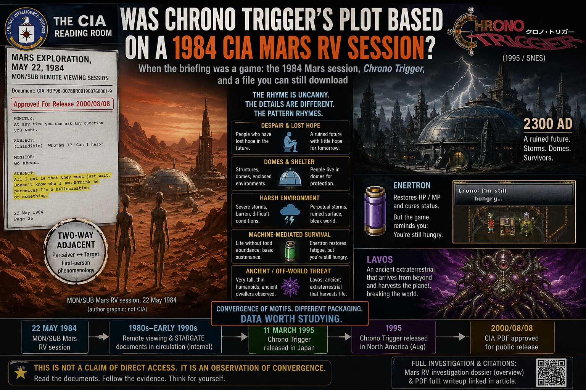

# Was Chrono Trigger’s plot based on a 1984 CIA Mars RV session?

When the briefing was a game: the 1984 Mars session, *Chrono Trigger*, and a file you can still download

**Updated:** 2026-04-27

There is a kind of quiet outrage that arrives when two unrelated cultural lanes—**a government PDF** and **a JRPG**—say the same thing about **despair**, **domes**, and **a world stripped of ordinary hope**, yet only one lane is allowed to be “real.” This article is not a proof that Square’s writers saw a STARGATE folder. It *is* an invitation to read the convergence with steady eyes: **fiction that familiarized the pattern years before the transcript sat on cia.gov** is not automatically coincidence, and treating it as data does not require believing every clause of every hypothesis downstream.

---

## The document

The CIA hosts a full **MON/SUB** remote-viewing transcript titled [*MARS EXPLORATION, May 22, 1984*](https://www.cia.gov/readingroom/docs/CIA-RDP96-00788R001900760001-9.pdf) (`CIA-RDP96-00788R001900760001-9`). You do not need an account to retrieve it. The [Reading Room landing page](https://www.cia.gov/readingroom/document/cia-rdp96-00788r001900760001-9) lists the same release. The scan carries a **2000/08/08** approval banner—so the public-facing artifact is turn-of-the-millennium FOIA posture, not a blog rumor.

What the text *does*, line by line, is documented in the dossier: [**Mars Exploration 1984 — RV investigation**](/influence/controlled_opposition/investigations/cia-reading-room-mars-exploration-1984-rv-investigation.md) (closed author verdict, MFEE map, optics fork, PP subsection) and the companion [**PDF full writeup**](/influence/controlled_opposition/investigations/cia-reading-room-mars-exploration-1984-pdf-full-writeup.md). This article stays at **overview depth**; those files carry citations, tables, and FOIA-chain notes.

---

## The two-way moment (why it matters)

Most pop summaries treat the session as exotic tourism. Inside the transcript there is a harder line—**the viewed side’s stance toward the viewer**—that reads less like “movie Mars” and more like **contact epistemics**.

When MON has SUB relay a meta-question (who SUB is, whether he can help), SUB reports back:

> All I get is that they must just wait. Doesn't know who I am. Think he perceives I'm a hallucination or something.

That is **not** a Hollywood flourish. It is **first-person protocol language** in which the target may **model the channel as unreal** while the viewer is still **present in the session**. The dossier treats this as **two-way-adjacent** phenomenology—perceiver ↔ target—without claiming a laboratory proof of telepathy ([§5.3](/influence/controlled_opposition/investigations/cia-reading-room-mars-exploration-1984-rv-investigation.md) there; Earth-side extension in the [Iran / two-way investigation](/influence/controlled_opposition/investigations/cia-reading-room-rv-two-way-iran-revival-investigation.md)). If you only take one paragraph from the PDF into public conversation, **take this one**: it is the moment the transcript stops behaving like a campfire story.

---

## *Chrono Trigger* (1995): the rhyme that is almost too on-the-nose

Square’s *Chrono Trigger* is routinely cited as a masterpiece of the 16-bit era ([overview](https://en.wikipedia.org/wiki/Chrono_Trigger)). For this article’s purpose, three design facts are enough:

1. **2300 AD** is a ruined “future” of storms, broken infrastructure, and people living in **domes**—a future the narrative treats as **Earth**, while the game’s time-travel frame lets **off-world catastrophe grammar** ride in without naming Mars ([setting summary](https://en.wikipedia.org/wiki/Chrono_Trigger#Setting)).
2. Survivors rely on **machine-mediated sustenance**; the **Enertron** restores fatigue while the text reminds you that you are **still hungry**—a blunt, humane detail about **life without food abundance** ([fan-compiled mechanics](https://www.chronowiki.org/wiki/Enertron)).
3. **Lavos** is framed as an **ancient extraterrestrial** power that **harvests** the biosphere and **breaks** the world—a **monster-from-beyond** that condenses “something terrible arrived and fed” into a boss fight ([antagonist summary](https://en.wikipedia.org/wiki/Chrono_Trigger#Characters)).

Against the Mars transcript, the emotional match is **uncanny**: **people who have lost hope in the future**, waiting through storms in shells that are **functional, not generous**. *Chrono Trigger* keeps them **ordinary humans**; the transcript emphasizes **very tall, thin humanoids**—a divergence that matters ethically (no license to dehumanize), yet **does not erase** the shared **post-catastrophe waiting-room** mood.

A speculative read—clinical, not proven—is that **popular SF redacts**: the **benign-seeming precursors** (tall forms, “ancient” dwellers) get **folded into** a **single hungry entity “from elsewhere”** so the audience can **process horror through a joystick** instead of through a FOIA bookmark. Lavos is **legible** as that compression: **the terrible aspect** lifted out of a wider situation and given a **name** and a **sprite**.

Timing sharpens the eyebrow-raise: the RV session is **1984**; the SNES game ships **1995**; the PDF’s visible **“Approved For Release 2000/08/08”** banner post-dates the game—so **fiction preceded the everyday public scan trail** many readers associate with “when this became real.” That ordering is what [predictive programming](/influence/predictive_programming/page.md) work *means* as **data**: culture rehearses **collapse + dome + hunger-machine + alien harvest** while agencies keep **plausible deniability** on the same motif in **declassified prose**.

---

## Other science fiction, same pressure-release valve

Mars-as-wounded-world is not proprietary to one game. The repo’s [Mars fiction encoding index](https://paradigmthreat.net/influence/predictive_programming/fiction_encoding/) collects how **novels and pulps** trained readers long before STARGATE. The point is not “every author had a clearance.” The point is **convergence**: when **many independent channels** sculpt **compatible nightmares**, the public arrives **pre-mapped**—so when a primary document appears, **laughter and dismissal are cheaper than thought**.

---

## Ecology without comfort: MFEE language as *one* collapse grammar (speculative)

The Mars dossier maps transcript beats onto [**MFEE** (MudFlood Energetic Event) site vocabulary](/history/mudflood/page.md)—**before / pulse / after** on a stressed surface. The [Mud flood hub](/history/mudflood/page.md) also describes a **secondary negative discharge** phase: energy that **rebounds through** a stressed body, **carving** and **volcanizing** in ways that **add** destruction beyond the first strike. Whether or not you accept the **full Earth narrative** on that page, the **pattern** is useful here as **hypothesis language**: a **primary catastrophe** plus a **secondary energetic rebound** that **deepens ecological corruption** matches the transcript’s movement from **storm / crisis** to **“corruption”** and **migration under pressure**.

Treat that as **cross-domain illustration**, not a lab result: the [Mars investigation §5.5](/influence/controlled_opposition/investigations/cia-reading-room-mars-exploration-1984-rv-investigation.md) table is where the mapping is argued in detail.

---

## Why this should raise eyebrows (without demanding faith)

If the Mars PDF were **nothing but** cold-war eccentricity, the **kind** custodial behavior you would expect is **boring paperwork**: training labels, drill codes, or a signed “why we released this” note tied to **this** RDP. The dossier’s **§5.7** tracks what **is** and **is not** in hand on that narrow question. Meanwhile, **cia.gov** still serves the file, and **pop culture** still served the **same myth kit** **earlier**—**that is a strange public hygiene** for a “meaningless” curiosity.

The healthier response is not instant belief. It is **proportion**: reserve **intellectual courage** for the possibility that **classification, entertainment, and disclosure** sometimes **share a corridor**—and reserve **intellectual discipline** for the difference between **pattern** and **proof**. The investigations exist to hold that tension **openly**, with **citations** and **limits** on the record.

---

## Disclosure posture (author conjecture)

Among the many threads this repo has pulled, the Mars transcript stands out as an unusually **clean overlap** with the investigation stack: **institutional RV**, **two-way-adjacent** language, **fiction-before-declass** timing when you set **1995** next to the scan’s visible **2000** release banner, and the wider question of **who controls the public frame** around anomalous material.

The detail that still lands hardest is almost banal: the **file remains on cia.gov**. A skeptical mind can always imagine **forgery** or **staged release**; the counterweight is the document’s **procedural texture**—the boring parts are hard to fake without inventing an entire parallel bureaucracy. So far, **no second document** has shown up in the same **genre** with the same **weight**; treat that as a **search result**, not as proof of uniqueness for all time.

A speculative historical read—again, **conjecture**—is that material like this **behaves as if something internal resisted total burial**: the “**good actor**” or **antibody** stratum inside large institutions may have understood a **Mars-class problem** (or its family of problems) **long before** the social web existed, may have fought for **partial daylight**, and may have lost the **headline war** once consolidated media had every incentive to **flatten or ridicule** the same motifs. If even a **sliver** of that story is true, the Reading Room entry is a **small** win: not enough to force consensus, but enough to leave **breadcrumbs** on the record.

The catastrophic failure mode is not that independent readers entertain strange hypotheses. It is a future where **primary traces disappear** and **narrative monopoly** wins completely. **As of today**, enough **clues** remain that a **motivated researcher** can still **assemble the puzzle** without a gatekeeper’s permission. **That survivability of evidence**—not instant belief—is a large part of **why this file matters**.

---

## Read next

- [**Mars Exploration 1984 — RV investigation**](/influence/controlled_opposition/investigations/cia-reading-room-mars-exploration-1984-rv-investigation.md) — verdict, MFEE table, optics conjecture (§5.3.1), PP §5.8 (*Chrono Trigger*), FOIA posture.  
- [**PDF full writeup**](/influence/controlled_opposition/investigations/cia-reading-room-mars-exploration-1984-pdf-full-writeup.md) — segment-by-segment MON/SUB.  
- [**Iran / two-way investigation**](/influence/controlled_opposition/investigations/cia-reading-room-rv-two-way-iran-revival-investigation.md) — Earth-side rhymes.  
- [**Predictive programming hub**](/influence/predictive_programming/page.md) — method: **data**, not verdict.

---

Keywords: #Mars #ChronoTrigger #CIAReadingRoom #RemoteViewing #PredictiveProgramming #STARGATE #ParadigmThreatFiles #TwoWayPerception #MFEE #FictionAndDeclass
