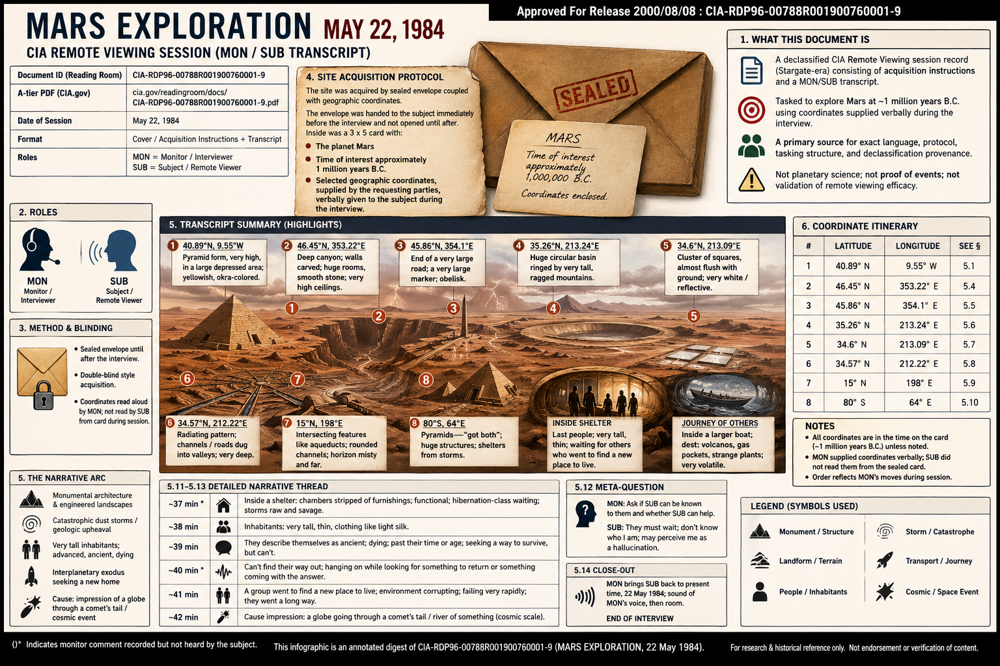

# Mars Exploration, 22 May 1984 — full writeup (`CIA-RDP96-00788R001900760001-9`)

**Companion** to [CIA Reading Room — Mars, RV, two-way, Iran / revival investigation](cia-reading-room-mars-rv-two-way-influence-iran-revival-investigation.md). This file is a **section-by-section digest** of the declassified PDF text (protocol + transcript). It **summarizes what appears on the page**; it does **not** assert planetary fact, operational success, or independent verification of SUB’s imagery.

---

## 1. Document identity

| Field | Value |
|--------|--------|
| **Title (PDF)** | MARS EXPLORATION |
| **Date (session)** | May 22, 1984 |
| **CIA Reading Room ID** | `CIA-RDP96-00788R001900760001-9` |
| **A-tier PDF** | [cia.gov/readingroom/docs/CIA-RDP96-00788R001900760001-9.pdf](https://www.cia.gov/readingroom/docs/CIA-RDP96-00788R001900760001-9.pdf) |
| **Landing** | [document page](https://www.cia.gov/readingroom/document/cia-rdp96-00788r001900760001-9) |
| **Form** | Cover / acquisition instructions + **MON/SUB** **TRANSCRIPT** |
| **Release line (banner)** | “Approved For Release 2000/08/08 : CIA-RDP96-00788R001900760001-9” (appears on pages) |

**Roles:** **MON** = monitor / interviewer; **SUB** = subject / remote viewer.

---

## 2. Copies, overlays, and how to cite

- **Canonical cite** for the **session words** is the **CIA-hosted** PDF or landing page (§1).
- **Third-party PDFs** sometimes prepend **The Black Vault** boilerplate (FOIA clearinghouse advertisement). That block is **not** CIA session content; the **TRANSCRIPT** heading marks where the agency session record begins.
- **THOLONIA** and other **HTML transcriptions** are handy but **C-tier** — checksum against **A-tier** before treating line breaks or punctuation as forensic.

---

## 3. Front matter (classification banner + title sheet)

**Summary:** Repeated **“Approved For Release 2000/08/08”** strip with **RDP96** control number; title **MARS EXPLORATION** and date **May 22, 1984**. Some circulating files insert **non-CIA** front pages — see §2.

---

## 4. Method of site acquisition (written protocol block)

**Summary:** The file states that the **site** was acquired by **“Sealed envelope coupled with geographic coordinates.”** The **envelope** was handed to the subject **immediately before** the interview and **not opened until after** the interview. Inside was a **3 × 5 card** with:

- **The planet Mars**
- **Time of interest approximately 1 million years B.C.**
- **Selected geographic coordinates**, supplied by the requesting parties, **verbally** given to the subject **during** the interview (i.e. coordinates are not only on the card; **MON** reads them aloud as the session proceeds).

**Section purpose:** Establishes **blind / double-blind style** framing (envelope unopened until end) and ties the session to **Mars + deep time + coordinates** as **tasking**, not as an astronomical observation log.

**Provenance / redaction (investigation note):** The quoted **“approximately 1 million years B.C.”** line is **suspiciously round** and **pop-register** (“B.C.,” **million** on the nose)—easier to read as **placeholder, summary label, or post-review substitution** than as serious **absolute-age** tasking. Declassification can mean **re-typed or replaced lines**, not only **masked** text; **tabular zeros** fit **template filler** better than a **real dated target** without **imaged card + custody** evidence. Do **not** treat that clause as **independent planetary chronology**. See parent file [**§7.4.4**](cia-reading-room-mars-rv-two-way-influence-iran-revival-investigation.md).

---

## 5. Transcript — segment summaries

Opening timestamp (MON, monitor-heard): **ROJ for 5/22 (May 22nd), time 10:09 AM** (marked * in original — monitor comment).

### 5.1 Opening focus — 40.89° N, 9.55° W

**MON** instructs **SUB** to use **only** the envelope information and focus on **40.89 degrees north, 9.55 degrees west**.

**SUB:** Oblique view of a **pyramid** or **pyramid form**, very high, in a **large depressed area**; color **yellowish**, **okra**-colored.

**Summary:** Opens on **monumental architecture** + **arid palette** at the first coordinate pair.

---

### 5.2 Move to time on the card — dust storm / geologic crisis

**MON:** Move in time to the time on the card; describe what is happening.

**SUB:** **Severe clouds**, more like a **dust storm**; **geologic problem**; perception “**really weird**.” **MON** asks for **raw perceptions**.

**SUB:** Emphasizes **geologic problem**.

**MON:** Go back to **before** the geologic problem.

**SUB:** **Total difference** — “**mountains of dirt**” that **appear and disappear** when going “before”; **large flat surfaces**, **smooth**, **angles**, **walls** — **megalithic**, very large.

**Summary:** Sharp **environmental discontinuity**: **storm/catastrophe** vs **pre-event** **mega-engineered** surfaces.

---

### 5.3 Inhabitants as shadows, then figures

**MON:** Before the geologic activity, look for **any activity**.

**SUB:** **Shadow of people**, **very tall**, **thin** — “**as if they were there and they're not there anymore**.”

**MON:** Go back to when **they are there**.

**SUB:** **Static / fragmentary** impressions; hard to hold.

**MON:** Report **raw data** only.

**SUB:** **Very large people**, **thin and tall**, **strange clothes**.

**Summary:** **Humanoid** presences scale as **anomalous size**; perception shifts **absence ↔ presence**.

---

### 5.4 Coordinate hop — 46.45° N, 353.22° E (canyon / carved interior)

**MON** moves **SUB** “in this time period” to **46.45 north, 353.22 east**.

**SUB:** **Deep canyon** (not “cavern”); **steep walls**; **structure** as if **the wall of the canyon itself has been carved**; again **very large** structures, **smooth stone**, **huge** rooms, **rabbit warren**-like corners; **very high** ceiling, **very wide** walls. **MON** confirms that insides/outsides exist.

**Summary:** **Interiorized geology** read as **habitable carved volumes**.

---

### 5.5 45.86° N, 354.1° E — marker / obelisk

**SUB:** End of a **very large road**; a **very large marker**; **Washington Monument overlay** — **obelisk** language.

**Summary:** **Axis / monument** imagery at a road terminus.

---

### 5.6 35.26° N, 213.24° E — vast basin

**SUB:** **Huge circular basin** surrounded **almost all the way** by **ragged**, **very tall** mountains; **scale seems off** — everything **very big**.

**Summary:** **Planetary-scale** landform (as perceived); **MON** accepts difficulty and asks **SUB** to continue.

---

### 5.7 34.6° N, 213.09° E — reflective “squares”

**SUB:** **Cluster of squares** (almost flush with ground), **connected**; **something very white** or **reflects light**.

**MON** asks viewing angle; **SUB:** **Oblique left angle**; **sun** “**weird**.”

**Summary:** **Grid-like ground installations** with **high albedo**.

---

### 5.8 34.57° N, 212.22° E — radiating channels

**SUB:** **Radiating pattern**; **strange intersecting roads** **dug into valleys** (road slightly below rim); **neat channels**, **very deep**.

**MON** notes **SUB** is “**electrically nulled out**” and asks for **focus**.

**SUB:** Signal **tough**, **sporadic**.

**Summary:** **Engineered linear earthworks** or **transport cuts**; monitor frames **signal loss** as part of session management.

---

### 5.9 15° N, 198° E — aqueducts, distant horizon

**MON:** Large **movement exercise**; hold **time focus**, move to **15 north, 198 east**.

**SUB:** **Intersecting** features like **aqueducts**; **rounded bottom** carved channels, **road beds**; **pointed tops** on horizon; horizon **misty**, **vague**, **far away**.

**Summary:** **Hydraulic / transport** infrastructure motif continues; **visibility degrades**.

---

### 5.10 80° S, 64° E — pyramids and monitor strategy shift

**MON:** Move to **80 south, 64 east**.

**SUB:** **Pyramids** — “**can't tell if it's overlay or not** 'cause they're different.” Then: “**got both**,” **huge**; “**interesting perception**.”

**MON** (monitor comment *, not for SUB): judges that **SUB** is **losing accurate movement** but is **drawn to interesting** targets; decides to **let SUB explore** what attracts him rather than **strict coordinate targeting**.

**SUB:** Structures **filtered from storms** / “**shelters from storms**.”

**Summary:** **Explicit protocol relaxation** — session pivots from **precision geo tasking** to **follow salience**; imagery converges on **storm-buffered megaforms** (**pyramids** again).

---

### 5.11 Inside a shelter — inhabitants, waiting, environmental collapse

**MON:** Go **inside** one structure; find **activity** (timestamp: ~**37 minutes** real time, *).

**SUB:** **Chambers**, **stripped** of furnishings — **functional**, **sleeping** / poor word choice → **hibernation**-class waiting; **raw inputs** of **storms**, **savage storm**, **sleeping through storms**. **MON** asks about inhabitants.

**SUB:** **Very tall**, **large** but **thin** people; clothing like **light silk**, **cut to fit** (not flowing).

**MON:** Move close; ask them to describe themselves.

**SUB:** **Ancient**; **dying** — “**past their time or age**”; **philosophic**; seeking a way to **survive**, **can’t**.

**MON** (timestamp ~**40 minutes**, “**voltage reversal**”, *).

**SUB:** **Can’t find their way out**; **hanging on** while looking for **something to return** or “**something coming with the answer**.”

**MON:** What are they **waiting for**?

**SUB:** A **group** went to find a **new place to live**; **“overwhelming input”** of **corruption of their environment**; **failing very rapidly**; group went a **long way**.

**MON:** What caused the **atmospheric** or **environment** disturbance?

**SUB:** Difficult; then **raw**: impression of a **globe** going through a **comet’s tail** / “**river of something**” — “**space pictures**,” **cosmic** scale.

**Summary:** **Narrative arc** inside structures: **last people**, **environmental failure**, **waiting**, **off-world / evacuation** party; **MON** pushes for **cause** of disturbance → **SUB** offers **astrophysical** metaphor.

---

### 5.12 Meta-question — identity and help

**MON:** Ask whether **SUB** can be **known** to them and whether **SUB** can **help**.

**SUB:** They **must wait**; **doesn’t know who I am**; may perceive **SUB** as **hallucination**.

**Summary:** **No consensual contact** framed as successful two-way dialogue; **epistemic break** between parties.

---

### 5.13 “When the others left” — boat interior → volatile destination

**MON:** When the others **left**, **how did they go**?

**SUB:** Impression of **inside a larger boat**; **rounded walls**; **shiny metal**.

**MON:** Follow their **journey**; where they **go**.

**SUB:** **Really crazy place** — **volcanos**, **gas pockets**, **strange plants**; **volatile**; **“from the frying pan into the fire”**; **more vegetation** than the prior place; **different kind of storm**.

**Summary:** **Transport** metaphor (**boat**, **metal**) chained to **high-energy biome** (**volcano / gas / exotic flora**).

---

### 5.14 Close-out

**MON** brings **SUB** back to **present time**, **22 May 1984**, sound of **MON’s** voice, then **room**.

**END OF INTERVIEW**

**NOTE (printed in file):** `()*` **Indicates monitor comment recorded but not heard by the subject.**

---

## 6. Coordinate itinerary (spoken by MON)

Approximate order as **MON** issues moves (all **in the time on the card** unless noted). **SUB** does not read these from the sealed card during the interview; **MON** supplies them verbally.

| Order | Latitude | Longitude | § above |
|-------|-----------|------------|---------|
| 1 | 40.89° N | 9.55° W | 5.1 |
| 2 | 46.45° N | 353.22° E | 5.4 |
| 3 | 45.86° N | 354.1° E | 5.5 |
| 4 | 35.26° N | 213.24° E | 5.6 |
| 5 | 34.6° N | 213.09° E | 5.7 |
| 6 | 34.57° N | 212.22° E | 5.8 |
| 7 | 15° N | 198° E | 5.9 |
| 8 | 80° S | 64° E | 5.10 |

**Digest:** The session is **coordinate-hopping** under fixed **deep-time Mars** tasking, with a **late-phase** shift from **strict targeting** to **follow SUB’s salience** (§5.10).

---

## 7. What this PDF is and is not (for investigators)

**Is:** A **primary** CIA Reading Room **session record** — useful for **exact language**, **protocol**, **tasking structure**, and **public-declassification** provenance.

**Is not:** **Planetary science**; not proof that **SUB** perceived **real 1 Ma Martian** events; not a substitute for **AIR** / program evaluation documents on **utility or validity** of RV (see parent investigation §4).

---

## 8. Related in-repo files

- [CIA Reading Room — Mars, RV, two-way, Iran / revival investigation](cia-reading-room-mars-rv-two-way-influence-iran-revival-investigation.md) — **hypothesis frame**, **§7.4.2** local mirror negative find, **Super Cockpit** rhyme.
- Local mirror ops (outside **paradigm-threat-files**): `~/dev/wget/cia/cia-reading-room-local-mirror-and-ocr-operations.md`

---

## Keywords

CIA-RDP96-00788R001900760001-9, MARS EXPLORATION 1984, remote viewing transcript, MON SUB, sealed envelope protocol, Mars coordinates, Stargate, Reading Room
