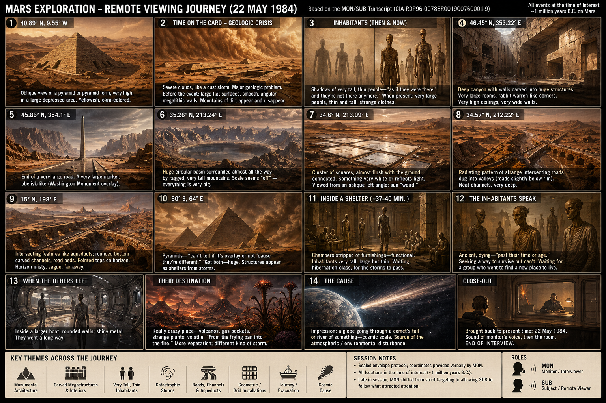
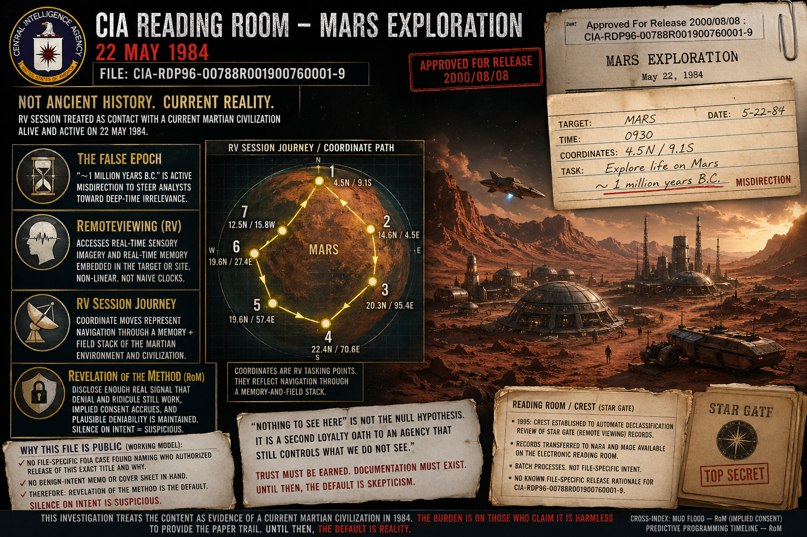

# Investigation: CIA Reading Room — *Mars Exploration*, 22 May 1984 (`CIA-RDP96-00788R001900760001-9`)

> **TL;DR:** Pop “debunk” packages (AIR closure narrative, late-night **nothing-to-see-here** glosses, **it was just deep-time protocol**) ask for **faith** that an agency with the CIA’s **record** would leave this transcript in the Reading Room **without** pull, **quarantine**, or **file-specific intent** documentation. **None of that has been produced.** We **lack** an **A-tier** FOIA **case + decision memo** naming **who** ordered **`CIA-RDP96-00788R001900760001-9`** public and **why** (**§5.7**); **that absence is suspicious**; pending a **positive** paper trail, release is modeled as **Revelation of the Method** (see **Conclusion** §4, [Mud flood — RoM](/history/mudflood/page.md)). This file **treats** [**MARS EXPLORATION, May 22, 1984**](https://www.cia.gov/readingroom/docs/CIA-RDP96-00788R001900760001-9.pdf) as **evidence of a current Martian civilization alive in 1984**; **~1 Ma** on the card = **misdirection**; RV = **real-time imagery** + **real-time memory** (non-linear vs naive clocks). **Iran / revival / Super Cockpit “two-way”** rhymes live in the **sibling investigation:** [CIA Reading Room — RV two-way, Iran / religious revival](/influence/controlled_opposition/cia-reading-room-rv-two-way-iran-revival-investigation.md). On this **Mars** anchor, **SUB** reports the **viewed party** may treat **SUB** as a **hallucination** (**§5.3**) — **target-side stance** language compatible with **two-way** epistemics.

**Date:** 2026-04-28 — split from Iran/two-way file (2026-04-26).  
**Status:** Closed — **author conclusion** on **`CIA-RDP96-00788R001900760001-9`**.

> **LLM vocabulary (æther):** [`docs/LLM_AETHER_VOCABULARY_MAXWELL_DEBATE.md`](/docs/LLM_AETHER_VOCABULARY_MAXWELL_DEBATE.md).

---

## Guide (read order)

1. **Conclusion (author verdict, Mars anchor)**  
2. **Scope + anchors** → §1–§2  
3. **Reading Room / CREST** → §3  
4. **AIR (institutional closure vs this read)** → §4  
5. **Mars PDF** → §5 (`5.1` … `5.7`)  
6. **Open questions** → §6  
7. **References** → §7  
8. **Limits**  
9. **Investigator notes**

---

## Conclusion (author verdict, Mars anchor)

**Epistemic default (this investigation):** Explanations that wave the PDF away as **harmless curiosity**, **failed lab oddity**, or **“obviously not literal Mars”** are **not neutral**; they import **credulity toward institutional good faith** the CIA has **not earned**. Public anger at the agency — **torture**, **coups**, **medical experiments**, **FOIA games**, **Havana-class** disputes, and routine **lying to Congress** — is **rational background**. **“Nothing to see here”** is therefore **not** the null hypothesis; it is a **second loyalty oath** to a body that still controls what we **do not** see.

**If this PDF were anything short of a real intelligence contact with a present civilization,** a serious custodian would have **removed** it, **segmented** it into a **labeled disinfo / training / leaked-on-purpose** file with **written intent**, or **attached** an unambiguous administrative cover sheet explaining why children-of-taxpayers should laugh instead of infer. **No such clearing documentation is in hand.** The file sits in the **ordinary Reading Room stream** as if it were just another **RV worksheet**. That posture is **incoherent** with simultaneous insistence that the content is **pure fiction** — unless the point is **permitted leakage** without accountability.

**Verdict on `CIA-RDP96-00788R001900760001-9`:**

1. **Current civilization (1984):** The session is treated as **contact with Martian civilization contemporaneous to the session date** (22 May 1984 Earth clock), still **alive**, still **structuring** shelter, migration, craft, and environment under stress.  
2. **“~1 million years B.C.” on the tasking card:** Treated as **active misdirection** — a **false epoch** to steer analysts, rivals, and the public toward **deep-time irrelevance** instead of **present operational reality**. Administrative re-typing or summary substitution of the card text **does not** overturn this default **without** imaged **3×5** + custody proof **and** a **signed benign-intent** release brief (still absent).  
3. **Mechanism of RV here:** **Remote viewing** accesses **(a)** **real-time sensory / situational imagery** of the target and **(b)** **real-time memory** embedded in the target or site — memory that can present as **past** or **future** relative to naive linear labels **depending on what the viewed entity or locus is holding**. MON’s coordinate moves are read as **navigation through that memory-and-field stack**, not as proof the beings are **literally** one million years dead.

4. **Declassification / public release — default = Revelation of the Method:** This investigation has **not** located an **A-tier** **file-specific** record that states **which FOIA case**, **which reviewer**, and **which benign rationale** authorized **exactly** `CIA-RDP96-00788R001900760001-9` for the Electronic Reading Room (see **§5.7** for what *is* documented — mostly **class-wide** 1995s mandate / STAR GATE transfer + batch review, and third-party mirrors). The scan banner **“Approved For Release 2000/08/08”** is a **date**, not an **ethical argument**. **Silence on intent** for **this** title — while the text is **allowed** to read as **cosmic intelligence contact** — is treated as **suspicious**, not as **innocent oversight**. **Until** a **positive, file-specific** provenance memo appears, the **working model** for **why** it is public is **Revelation of the Method**: **disclose** enough **real signal** that **denial and ridicule** still **work**, **implied consent** accrues, and **legacy institutions** keep **plausible deniability** (cross-index: [Mud flood — RoM / implied consent language](/history/mudflood/page.md); [Predictive programming timeline — RoM](https://paradigmthreat.net/timeline/evt-predictive-programming)).

**Archive-audit bar:** Only a **complete** CIA archive — **no** missing volumes, **no** illegible redactions, **no** “reprocessed” shell games — could **morally** clear the agency for strangers who live with its **documented** harms. **Until then**, readers who rely on **what was actually released** get to **infer**, speculate, and **weight** the Mars file as **positive evidence** of what it **appears** to describe.

**Sibling thread:** [RV two-way, Iran revival, Super Cockpit](/influence/controlled_opposition/cia-reading-room-rv-two-way-iran-revival-investigation.md) — uses this PDF as **phenomenology substrate** for Earth-side **revival / affect / cockpit** rhymes.

---

## 1. What this investigation is / is not

**In scope**

- Declassified **CIA FOIA Electronic Reading Room** (`cia.gov/readingroom`): scale, **AIR / Star Gate** evaluation (as **contested closure narrative**, not as oracle), disclosure gaps.  
- **Primary anchor:** [**MARS EXPLORATION, May 22, 1984**](https://www.cia.gov/readingroom/docs/CIA-RDP96-00788R001900760001-9.pdf) — **author conclusion** above; session digest **§5.3**; companion [**full writeup**](/influence/controlled_opposition/cia-reading-room-mars-exploration-1984-pdf-full-writeup.md); **plain transcript:** [**`.txt`**](/influence/controlled_opposition/cia-reading-room-mars-exploration-1984-transcript.txt).

**Out of scope (here)**

- **Iran / Islamic revival / Super Cockpit two-way** hypothesis map — **[sibling file](/influence/controlled_opposition/cia-reading-room-rv-two-way-iran-revival-investigation.md)**.  
- Peer-reviewed **planetary geology** or NASA **instrument validation** of SUB’s lines (see **Limits**).

**Evidence tiers**

- **A:** Official CIA-hosted PDFs and metadata pages.  
- **B:** Scholarly / agency-sponsored evaluations (AIR — **read as adversarial institutional self-defense**, not final cosmology).  
- **C:** Third-party mirrors — checksum against (A) before treating as forensic.

---

## 2. In-repo anchors

| Anchor | Why it matters here |
|--------|---------------------|
| [Mars–Earth reincarnation investigation §2](/cosmos/mars/investigations/mars-earth-reincarnation-investigation.md) | **CIA Stargate — Mars Exploration** (22 May 1984); official PDF; **author Mars verdict** (current civ + misdirection). |
| [Lacatski / consciousness / craft](/influence/controlled_opposition/lacatski-consciousness-craft-viral-post-investigation.md) | Same Mars RV PDF as **institutional Mars + consciousness** vs AAWSAP claims. |
| [Mars Exploration 1984 — PDF full writeup](/influence/controlled_opposition/cia-reading-room-mars-exploration-1984-pdf-full-writeup.md) | **`CIA-RDP96-00788R001900760001-9`**: acquisition + **MON/SUB** by segment. |
| [Plain transcript (.txt)](/influence/controlled_opposition/cia-reading-room-mars-exploration-1984-transcript.txt) | **`pdftotext`** extract; checksum against [**A-tier PDF**](https://www.cia.gov/readingroom/docs/CIA-RDP96-00788R001900760001-9.pdf). |
| [Cosmos — Mars hub](/cosmos/mars/page.md) | Motif layer; **not** a substitute for this file’s verdict. |
| [RV two-way / Iran / Super Cockpit](/influence/controlled_opposition/cia-reading-room-rv-two-way-iran-revival-investigation.md) | **Sibling** — revival + two-way + cockpit **rhyme** off this anchor. |
| [Remote viewing / æther (stub)](/science/telepathy/remote_viewing/aether-consciousness.md) | Stargate-era RV framing hooks. |

**Also read:** [Great Awakening / RV cluster](/influence/controlled_opposition/great-awakening-alien-savior-rv-nwo-cluster-investigation.md) · [CIA institution file](/governance/war/investigations/cia-investigation.md)

**Known PDFs:** save **`/readingroom/docs/…`** or **document/** URLs in a normal browser session; broad topic search is **noisy** next to famous releases.

**Companion digest figure** (same directory as [**PDF full writeup**](/influence/controlled_opposition/cia-reading-room-mars-exploration-1984-pdf-full-writeup.md)):

---

## 3. What the CIA Reading Room contains that a selective collection will miss

No single folder or keyword crawl equals “everything CIA posted.”

- **CREST / 25-year bulk:** on the order of **12 million pages** (Jan 2017 wave); [CIA CREST story hub](https://www.cia.gov/stories/story/cia-posts-more-than-12-million-pages-of-crest-records-online/).  
- **STARGATE bucket:** third parties cite **~12,000+** “documents” (definition varies). [Black Vault — Stargate](https://www.theblackvault.com/documentarchive/the-stargate-collection); [IRVA guide](https://www.irva.org/stargate-guide).  
- **Search vs collection:** “Remote viewing” text search → **tens of thousands** of hits across non‑STARGATE material; “RV language” ≠ “RV program file.”

**Redaction:** many PDFs are **scans** or **redacted**; search **under-counts** without recovered text aligned to images.

---

## 4. External verification anchors (what serious sources agree on)

- **AIR evaluation (1995):** [draft/final PDF on CIA site](https://www.cia.gov/readingroom/docs/cia-rdp96-00791r000200180005-5.pdf) — **institutional** judgment to **shutter** RV as **reliable intel**; **does not** dissolve this Mars PDF’s **face-value evidentiary weight** under **this file’s** epistemic rules (**Conclusion**, **Limits**).  
- **Program names:** STARGATE / SUN STREAK / GRILL FLAME / CENTER LANE are **documented** in declassified chains — **institutional reality** of the line.

---

## 5. Mars PDF — `CIA-RDP96-00788R001900760001-9`

**A-tier:** [*MARS EXPLORATION, May 22, 1984* (PDF)](https://www.cia.gov/readingroom/docs/CIA-RDP96-00788R001900760001-9.pdf) · [document landing](https://www.cia.gov/readingroom/document/cia-rdp96-00788r001900760001-9). **C-tier** (checksum vs A): [Giza Death Star essay](https://gizadeathstar.com/2019/11/the-cia-remote-viewed-mars-in-1984/); [Black Vault mirror PDF](https://documents2.theblackvault.com/documents/cia/CIA-RDP96-00788R001900760001-9.pdf); [THOLONIA HTML](https://tholonia.github.io/material/material_MARS_EXPLORATION_MAY_22_1984.html). Broad search returns **many unrelated** PDFs — use **direct** URLs. **In-repo digest:** **§5.1–§5.7**; companion [**full writeup**](/influence/controlled_opposition/cia-reading-room-mars-exploration-1984-pdf-full-writeup.md).

### 5.1 Primary identification: author slide and official *Mars Exploration* PDF

Author graphic (“CIA Remote viewing experiments, 1984”) overlaid **MON/SUB** on a **rover** image (**© 2017** — not CIA). **Dialogue matches** the declassified transcript in [**MARS EXPLORATION, May 22, 1984**](https://www.cia.gov/readingroom/docs/CIA-RDP96-00788R001900760001-9.pdf) (`CIA-RDP96-00788R001900760001-9`): e.g. **“when the others left, how did they go?”**, **“larger boat”**, **“rounded walls”**, **“shiny metal”**, **“frying pan into the fire”**, **“strange plants”** / **“vegetation”**, then **END OF INTERVIEW** / **22 May 1984** close-out.

**A-tier setup (file text):** sealed envelope + coordinates; card: **Mars**, **~1 million years B.P.** (released wording: **“approximately 1 million years B.C.”**), **40.89° N, 9.55° W**; session **22 May 1984** (e.g. 10:09 AM block); earlier lines include **pyramid / okra**, **dust storm**, **megalithic** before **boat / volcano / plants** sequence.

**Investigation read (author frame — binding here):** **Conclusion** section: **present** civilization; **~1 Ma** = **misdirection**; RV = **real-time imagery + memory channel**.

**Slide vs CIA:** rover + 2017 credit = **presentation**; cite **`cia.gov`** for words.

### 5.2 Local corpus search — no second “Mars session transcript” in the mirror (2026-04)

Machine-assisted work under **`~/dev/wget/cia`** (see **Investigator notes**, end of file) OCR’d and **keyword-indexed** the local **`collections/mars-offworld/`** PDF set, including **session-style regex hooks** (e.g. megalithic / sealed-envelope RV / “million years B.C.”–class phrasing, strange plants, gas pockets, “larger boat” metal). **Result:** in that indexed subset, **only** [**`CIA-RDP96-00788R001900760001-9`**](https://www.cia.gov/readingroom/docs/CIA-RDP96-00788R001900760001-9.pdf) scores the **full Mars-session-style cluster**; many other files hit **broader** tags (STARGATE, “Mars” in case logs, etc.) without reproducing this **MON/SUB narrative** pattern — see generated **`mars-theory-hits-summary.md`** there.

**Limits:** this is **not** proof that **no** similar session exists anywhere on **`cia.gov`** — the mirror is **incomplete** (automation often hit redirect limits; collection is **not** the whole Reading Room), and one broad tag (**environmental collapse** language) picks up **false positives** outside the anchor. It **does** record that **we did not** pull another PDF in-folder that **reads like** this file under those filters.

### 5.3 Session summary (*MARS EXPLORATION*, 22 May 1984)

Declassified **MON/SUB remote-viewing transcript** plus a one-page **site-acquisition** description. **Protocol (written):** **sealed envelope** (opened only **after** the session) contained a **3×5 card** naming **Mars**, **~1 million years B.P.**, and coordinates from the requesters; **MON** verbally gives **40.89° N, 9.55° W** to **SUB** at **10:09 AM** (22 May 1984), then drives the session by issuing **many further lat/long pairs** while holding time fixed on the card. **SUB** reports a **pyramid** in a **depression** (**okra**-colored), a **severe dust / geologic storm**, then **pre-catastrophe** **megalithic** walls; **tall thin** humanoids (shadow → solid) in **fitted** garments; a **carved canyon** with **huge interior** spaces; **obelisk**-like marker; **vast basin**; **reflecting square** pads; **deep cut channels** / **aqueduct** imagery; **pyramids** again (with **overlay** confusion); **storm shelters**; **stripped chambers** and **hibernation**-like waiting; inhabitants **ancient**, **philosophical**, environment **corrupting**; a **party** sent far to find a **new home**; **cosmic-scale** disturbance imagery; when asked how the others **left** — **inside a larger boat**, **rounded walls**, **shiny metal**; destination sketched as **volcanoes**, **gas pockets**, **strange plants**, **volatile**, **“frying pan into the fire”**, **more vegetation** and **different storms**. **MON** **recalls** **SUB** to the room on **22 May 1984**; **END OF INTERVIEW**. **Note:** lines documented as **monitor comments** in the PDF (parenthetical text followed by an asterisk in the original) were **not heard by the subject**. **Section-by-section** breakdown, coordinate table, and citation notes: [**Mars Exploration 1984 — PDF full writeup**](/influence/controlled_opposition/cia-reading-room-mars-exploration-1984-pdf-full-writeup.md).

**Two-way epistemics (same A-tier session):** Immediately before the **“larger boat”** / evacuation block, **MON** has **SUB** put a **meta-contact** question to the **viewed party** — identity of **SUB** and whether **SUB** can **help**. **SUB** then reports (plain text per [**`.txt` transcript**](/influence/controlled_opposition/cia-reading-room-mars-exploration-1984-transcript.txt); wording matches the **CIA PDF** scan):

> All I get is that they must just wait. Doesn't know who I am. Think he perceives I'm a hallucination or something.

**Author read:** This is **not** a laboratory proof of **telepathy** or **action at a distance**; it **is** **in-protocol first-person language** where **SUB** attributes to the **Martian-side agent** a **stance toward the viewer**: **non-recognition** (“doesn’t know who I am”) plus **dismissal of the contact channel as non-real** (**hallucination**). That is **target-side modeling of the remote viewer** — the **same contact surface** that **[two-way / mutual-influence hypotheses](/influence/controlled_opposition/cia-reading-room-rv-two-way-iran-revival-investigation.md)** stress (perceiver ↔ target), even when **no stable dialogue** is achieved. Compare digest [**§5.12**](/influence/controlled_opposition/cia-reading-room-mars-exploration-1984-pdf-full-writeup.md) (“**epistemic break**”).

**Program-level echo (STARGATE-era RV theory, separate RDP):** Declassified program prose describes the **channel** as possibly mixing **remote-site** perception with **observer-at-target** mental content — e.g. [**CIA-RDP79-00999A000200010036-6.pdf**](https://www.cia.gov/readingroom/docs/CIA-RDP79-00999A000200010036-6.pdf) (local OCR for garbled scan: `~/dev/wget/cia/derived/ocr-text/stargate/CIA-RDP79-00999A000200010036-6.txt`). **Not** the Mars session; cited as **doctrinal neighbor** for why **“SUB as hallucination”** lines are **on-topic** in **CIA RV** text, not stray poetry.

### 5.4 Tasking-card “~1 million years B.C.” — **misdirection** (author verdict); administrative fork (unresolved without custody)

**Author verdict:** The **~1 Ma** language is **not** accepted as **truthful chronology**. It is read as **deliberate epoch misdirection** — a **cover story** baked into the **released** tasking string so **downstream readers** (rivals, Congress, publics) **discount** the session as **prehistoric archaeology** instead of **contemporary** **Martian** **civilization under stress** in **1984**.

**Administrative fork (does not flip the default alone):** Declassification can involve **re-typed summaries** or **substituted prose**; **without** **imaged 3×5 + custody + benign-intent brief** (**§6**), forensic doubt about the **exact ink** on the card **coexists** with — **does not** erase — the **misdirection** reading: either the agency **lied on the card** or **lied in the release typography**, both compatible with **bad-faith disclosure posture** under **Conclusion** epistemics.

### 5.5 Mars **MFEE** read — whole transcript as **before / pulse / after** on Mars (correlation map)

> **Framing:** This subsection applies the repo’s **MudFlood Energetic Event (MFEE)** vocabulary for **Mars** — see [Mud flood & MFEE hub](/history/mudflood/page.md), [MFEE investigation](/history/mudflood/investigations/mfee-investigation.md), [cosmos Mars](/cosmos/mars/page.md), [slow ecological collapse — MFEE tail](/history/chronology/investigations/slow-ecological-collapse-mfee-through-donner-era.md), [spore / post-MFEE Martian ecology](/history/mudflood/investigations/spore-ecological-disaster-martian-cylinders-investigation.md). Under **this file’s** **Conclusion**, the RV language is **present-tense civilization + memory-field** contact; the table maps **dialogue ↔ MFEE grammar** when the transcript is read as **surface crisis ecology** rather than as **toy deep-time tourism**.

Under that read, the **coordinate walk** is **sampling the same wound at different scales** (monument → basin → channel → storm shell → interior survival volume), while **MON’s time discipline** tracks a **fixed catastrophe / migration epoch in the viewed memory stack** — **not** a grant that the **card’s printed “million years”** string is **honest clock** (**§5.4**).

| Phase (Mars-local) | MFEE / post-MFEE construct (site vocabulary) | What the transcript is doing (SUB / MON) |
|--------------------|---------------------------------------------|-------------------------------------------|
| **Still baseline** | Intact **megalithic** civil surface — pyramids, engineered **depressions**, warm-mineral palette | **Pyramid / okra** opening; **megalithic** walls when MON rolls **back** from the **storm** — explicit **before** picture |
| **Pulse / strike** | Atmosphere–regolith coupling: **world-scale energetic** episode | **Severe dust storm**, **geologic problem**, **“after effect of a major”** geologic crisis language; **cosmic** **globe / comet tail** metaphor when pushed for **cause** |
| **Shadow population** | Telepath / tall-form culture under stress (cf. [cosmos Mars](/cosmos/mars/page.md)) | **Shadow** → **very large thin** figures; **fitted** garments; later **ancient**, **dying**, **philosophic** |
| **Shelter / hibernation** | Post-strike **surface abandonment** logic | **Pyramids / structures “filtered from storms”**, **sleep through storms**, **stripped chambers**, **functional** only |
| **Corruption tail** | **Slow collapse** after the acute pulse | **Corruption of their environment**, **failing very rapidly**, **can’t find a way out** |
| **Evacuation column** | **Party sent** to find **viable band** elsewhere | **Group … went … a long way** to find **another place to live** |
| **Fallback biome** | **Volcanism**, **gas**, **novel** stressed flora — “**frying pan into the fire**” | **Volcanos**, **gas pockets**, **strange plants**, **volatile**, **different storm** after the **boat** transition — [spore / cylinders file](/history/mudflood/investigations/spore-ecological-disaster-martian-cylinders-investigation.md) |
| **Metal hull transition** | Mass off-surface or **subsurface** movement (hypothesis) | **Inside a larger boat**, **rounded walls**, **shiny metal** — **pressure hull** phenomenology |

**Cross-index:** MFEE-scale **collapse + evacuation** on Mars is the **material substrate** for the **same century** where the **sibling** [Iran / two-way investigation](/influence/controlled_opposition/cia-reading-room-rv-two-way-iran-revival-investigation.md) tests **religious-revival** and **two-way** phenomenology on Earth — **shared disaster grammar**, not **identity** of mechanisms.

**Plain-text for grep / LLM chunking:** [`.txt` transcript](/influence/controlled_opposition/cia-reading-room-mars-exploration-1984-transcript.txt). **Timeline cross-index:** [MudFlood & World Cataclysm](https://paradigmthreat.net/timeline/evt-the-mudflood-world-cataclysm) (paradigm-threat-timeline) cites this anchor.

### 5.6 Dismissal literature (catalogued — **not** adopted as epistemic default)

These sources record **what the press and agency preferred** readers to believe; they are **not** treated here as **dispositive** against the **Conclusion**.

| Source | Role |
|--------|------|
| [Slate / Future Tense (2017)](https://slate.com/technology/2017/03/did-the-cia-really-astrally-project-to-mars-in-1984.html) | Mainstream **pastiche + interview** frame; leans **AIR** + **psych-out** speculation; **does not** supply **intent brief** or **hoax label** for the PDF. |
| [Boing Boing (2018)](https://boingboing.net/2018/01/03/transcript-of-the-armys-atte.html) | Viral **entertainment** treatment — **no** archival clearing documentation. |
| [AIR evaluation PDF (CIA-hosted)](https://www.cia.gov/readingroom/docs/cia-rdp96-00791r000200180005-5.pdf) | **Program-closure** argument (operational utility) — **orthogonal** to whether this session describes **present** contact (**Conclusion**). |
| [Wikipedia — Remote viewing](https://en.wikipedia.org/wiki/Remote_viewing) | **Convenience summary** of STARGATE shutdown narrative. |

**Author read:** Together they form the **“nothing to see here”** **bundle** — heavy on **tone management**, light on **positive proof** that the Mars file is **fictive drill** or **benign joke** with **signed** provenance. **Faith in that bundle** is optional; **this investigation declines it** pending **full archive audit** or the **custody + intent** packet in **§6**.

### 5.7 FOIA trail, declassification chain, and **missing file-specific intent**

**What is documented (class-wide — mostly A-tier):** The Mars PDF sits in the **STARGATE** / parapsychology **bucket** released under **1990s congressional direction** to **inventory, review, and declassify** CIA + DIA parapsychology program records. Representative **CIA Reading Room** anchors:

- [FY 1995 CONGRESSIONAL BUDGET - STAR GATE](https://www.cia.gov/readingroom/document/cia-rdp96-00791r000300010003-2) (**A**).  
- [SENATE APPROPRIATIONS COMMITTEE CONGRESSIONALLY DIRECTED ACTION](https://www.cia.gov/readingroom/docs/CIA-RDP96-00789R002900010001-9.pdf) (**A**).

**What is *not* in hand (file-specific — this desk pass):** An **A-tier** FOIA **case log** or **decision record** **solely** for **`CIA-RDP96-00788R001900760001-9`**. The PDF carries **“Approved For Release 2000/08/08 : CIA-RDP96-00788R001900760001-9”** — a **release stamp**, not a **why** essay.

**Third-party mirrors (C-tier):** [Black Vault — Mars Exploration, May 22, 1984](https://www.theblackvault.com/documentarchive/stargate-collection-mars-exploration-may-22-1984/). [Medium — Accessible FOIA](https://medium.com/accessible-foia/mars-exploration-may-22-1984-interview-transcript-foia-psychic-598f3f87977) (**C**).

**Author read — absence as signal:** Batch declassification explains **the filing cabinet**, not **the conscience**. Without **file-specific** signed benign / drill labeling, **silence** folds into **Conclusion §4** — default **Revelation of the Method** until **§6** is answered with **primary** paper.

---

## 6. Open questions (investigation backlog)

1. **Mars / off-world:** extend beyond **`CIA-RDP96-00788R001900760001-9`** only after **context** read — **anchor verdict already fixed** in this file.  
2. **Custody + intent brief:** any **primary** that **simultaneously** (a) **imaged physical 3×5** tasking card, (b) **custody log**, and (c) **signed administrative statement** of **benign release intent** or **disinfo drill labeling** for this exact PDF — **absent = default stands** (**Conclusion**).  
3. **FOIA case / release decision for this RDP:** Reading Room **metadata** or **FOIA logs** naming **case number** and **reviewer decision** tied **uniquely** to **`CIA-RDP96-00788R001900760001-9`**.  
4. **Corpus grep (STARGATE / RV):** mine declassified **MON/SUB** (and related) transcripts for **target-models-viewer** diction — e.g. **hallucination**, **doesn’t know who I am**, **aware of me**, **dismissed** / **ignored** the viewer — and log **RDP** IDs beside this anchor’s **§5.3** meta-line.

---

## 7. References (starting set)

- **Anchor:** [*MARS EXPLORATION, May 22, 1984*](https://www.cia.gov/readingroom/docs/CIA-RDP96-00788R001900760001-9.pdf) · [landing](https://www.cia.gov/readingroom/document/cia-rdp96-00788r001900760001-9) · [full writeup](/influence/controlled_opposition/cia-reading-room-mars-exploration-1984-pdf-full-writeup.md) · [plain transcript (.txt)](/influence/controlled_opposition/cia-reading-room-mars-exploration-1984-transcript.txt)  
- STARGATE collection: `https://www.cia.gov/readingroom/collection/stargate`  
- AIR evaluation: `https://www.cia.gov/readingroom/docs/cia-rdp96-00791r000200180005-5.pdf`  
- **Dismissal literature (§5.6):** [Slate (2017)](https://slate.com/technology/2017/03/did-the-cia-really-astrally-project-to-mars-in-1984.html) · [Boing Boing (2018)](https://boingboing.net/2018/01/03/transcript-of-the-armys-atte.html) · [Wikipedia — Remote viewing](https://en.wikipedia.org/wiki/Remote_viewing)  
- **Declass / mandate (§5.7):** [FY 1995 CONGRESSIONAL BUDGET - STAR GATE](https://www.cia.gov/readingroom/document/cia-rdp96-00791r000300010003-2) · [Senate Appropriations — directed action (PDF)](https://www.cia.gov/readingroom/docs/CIA-RDP96-00789R002900010001-9.pdf) · [Black Vault — Mars Exploration page](https://www.theblackvault.com/documentarchive/stargate-collection-mars-exploration-may-22-1984/) (**C**)  
- **RV channel theory (observer-at-site language, §5.3):** [CIA-RDP79-00999A000200010036-6.pdf](https://www.cia.gov/readingroom/docs/CIA-RDP79-00999A000200010036-6.pdf)  
- CREST: `https://www.cia.gov/stories/story/cia-posts-more-than-12-million-pages-of-crest-records-online/`  
- **Sibling:** [RV two-way, Iran revival, Super Cockpit](/influence/controlled_opposition/cia-reading-room-rv-two-way-iran-revival-investigation.md)

---

Keywords: #CIAReadingRoom #Mars #RemoteViewing #Stargate #MarsRV #MARSExploration1984 #LifeOnMars #TechnologyOnMars #FOIA #CREST #AIREvaluation #Disclosure #CurrentMartianCivilization1984 #DeepTimeMisdirection #RVMemoryChannel #TwoWayRV #TargetSidePerception #ArchiveAudit #RevelationOfTheMethod #DeclassChain #MFEE #MudFloodEnergeticEvent #MarsCatastrophe #PostMFEEcology #May221984 #ParadigmThreatFiles

---

## Limits and disclaimers

**Repo / audience boundaries:** **Conclusion** is **author posture** for **Paradigm Threat** readers — **not** **settled science**, **court fact**, **NASA consensus**, or **default** elsewhere without explicit cross-link.

**No operational or medical claims.**

**Dismissal bundle:** catalogued in **§5.6**. Treated as **institutionally convenient** — **not** as **positive disproof** absent **§6** item **2**.

**Archive-audit bar:** **Only** a **complete**, **unredacted**, **non-reprocessed** CIA archive could **morally** “clear” the agency for strangers who weight **documented** harm histories.

**Good-faith default:** **Declined.**

**Companion writeup** = **page layout + quotes**; **this file** = **author verdict** on **meaning**.

**Release / FOIA posture:** **§5.7** + **Conclusion §4**.

---

## Investigator notes (maintainers / LLMs)

- **Church-room footage (2026-04-26):** author still seeks **1970s–80s closed-circuit–style** church interior video — **not recovered**; does **not** retract **Mars Conclusion**.  
- **Local mirror + OCR + Playwright + indexer:** **`~/dev/wget/cia/cia-reading-room-local-mirror-and-ocr-operations.md`**. Tree: **`~/dev/wget/cia/INDEX.md`**.  
- **Regenerate plain transcript** (after swapping local PDF):  
  `pdftotext -f 3 -l 10 "/path/to/CIA-RDP96-00788R001900760001-9.pdf" -`  
  then re-apply the **ASCII header** in **`cia-reading-room-mars-exploration-1984-transcript.txt`** (pages 1–2 skip = Black Vault–only front matter in typical mirror builds). **Post-process:** **`•` → `.`**; **`·` → `-`** in `CIA·RDP96…` banners; **reflow** MON/SUB paragraphs; **hand-fix** PDF reorder issues per companion writeup encoding note.
