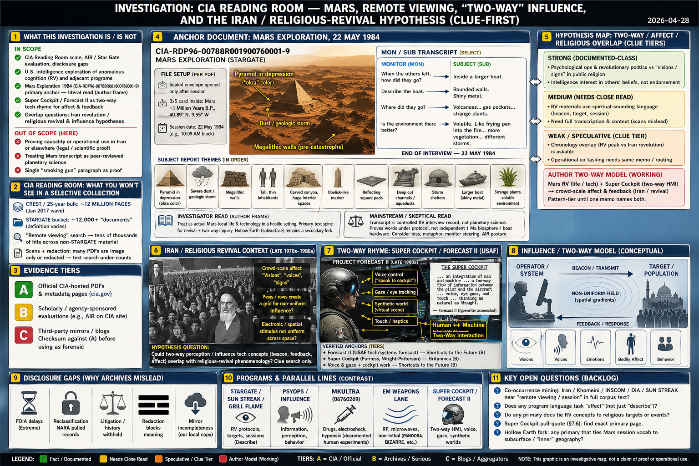

# Investigation: CIA Reading Room — Remote Viewing, “Two-Way” Influence, and the Iran / Religious-Revival Hypothesis (Clue-First)

> **Anchor moved (Mars PDF verdict):** The **closed** author verdict on **`CIA-RDP96-00788R001900760001-9`** (*MARS EXPLORATION, 22 May 1984*) — present Martian civilization in 1984, **~1 Ma** as misdirection, RV as **real-time imagery + memory channel**, **FOIA / RoM** default — now lives in **[Mars Exploration 1984 — RV investigation](/influence/controlled_opposition/cia-reading-room-mars-exploration-1984-rv-investigation.md#conclusion-author-verdict-mars-anchor)**. **This file** stays **open** on **Iran / revival**, **two-way** language, and **Super Cockpit** as **Earth-side** engineering / affect **rhymes** against that substrate.

> **TL;DR:** Under the **[Mars file’s conclusion](/influence/controlled_opposition/cia-reading-room-mars-exploration-1984-rv-investigation.md#conclusion-author-verdict-mars-anchor)**, **Mars 1984** supplies **phenomenology substrate** (present civ + memory-field navigation). **This investigation** maps **hypothesis-tier** overlap: **psych ops + revolutionary politics** vs “visions,” **in-program RV vocabulary**, **chronology** (RV peak vs Iran revolution), and an **author-led** glue — **Super Cockpit** (Forecast II line) as **attested two-way R&D** rhyming **two-way RV** talk — **without** claiming one FOIA PDF **proves** deployment vs clerics. **Corpus / custody / file-specific FOIA** for the Mars anchor are tracked on the **[Mars investigation](/influence/controlled_opposition/cia-reading-room-mars-exploration-1984-rv-investigation.md)** (**§5–§6** there). **Limits:** court/peer-review bounds; dismissal bundle addressed on the **Mars** file.

**Date:** 2026-04-28 — Mars anchor split to sibling file (2026-04-26).  
**Status:** Open — **Iran / two-way / Super Cockpit** threads; **Mars PDF verdict** = **[sibling (closed)](/influence/controlled_opposition/cia-reading-room-mars-exploration-1984-rv-investigation.md)**.

> **LLM vocabulary (æther):** [`docs/LLM_AETHER_VOCABULARY_MAXWELL_DEBATE.md`](/docs/LLM_AETHER_VOCABULARY_MAXWELL_DEBATE.md).

---

## Guide (read order)

1. **[Mars RV anchor — Conclusion](/influence/controlled_opposition/cia-reading-room-mars-exploration-1984-rv-investigation.md#conclusion-author-verdict-mars-anchor)** (sibling)  
2. **Hypothesis map** → §5  
3. **Online deep dive** → §7 (disclosure, STARGATE transfer, EM lane; **§7.5–7.6** MKULTRA + Super Cockpit)  
4. **Open questions** → §6  
5. **References** → §8  

---

## 1. What this investigation is / is not

**In scope**

- **Earth-side** threads: **two-way** / affect / **Iran–revival** hypothesis map (§5); **Super Cockpit / Forecast II** (§7.6) as **engineering rhyme** for two-way phenomenology.  
- **Institutional disclosure** context: Reading Room scale, contested closure narratives (§7.1–7.3) — **not** a substitute for the **Mars** file’s **verdict** on the PDF.  
- **Cross-link:** [Mars Exploration 1984 — RV investigation](/influence/controlled_opposition/cia-reading-room-mars-exploration-1984-rv-investigation.md) — **primary anchor** `CIA-RDP96-00788R001900760001-9`, **CREST / corpus**, **MFEE map**, **dismissal + FOIA** blocks.

**Out of scope (here)**

- **Author verdict** on whether the Mars session describes **literal present Martian civilization** — **[Mars file](/influence/controlled_opposition/cia-reading-room-mars-exploration-1984-rv-investigation.md)**.  
- Proving causality between RV programs and **named** clerics or crowds **to a court verdict**.  
- Peer-reviewed planetary geology / NASA validation of SUB’s lines.

**Evidence tiers**

- **A:** Official CIA-hosted PDFs and metadata pages.  
- **B:** Scholarly / agency-sponsored evaluations (AIR — **read as adversarial institutional self-defense**).  
- **C:** Third-party mirrors — checksum against (A) before treating as forensic.

---

## 2. In-repo anchors (two-way + Iran + Mars pointer)

| Anchor | Why it matters here |
|--------|---------------------|
| [**Mars Exploration 1984 — RV investigation**](/influence/controlled_opposition/cia-reading-room-mars-exploration-1984-rv-investigation.md) | **Closed** verdict on **`CIA-RDP96-00788R001900760001-9`**; **MFEE** read; **FOIA / RoM**; corpus note. **This file** builds **Earth-side** rhymes from that substrate. |
| [Mars–Earth reincarnation investigation §2](/cosmos/mars/investigations/mars-earth-reincarnation-investigation.md) | Official Mars RV PDF; table links to **Mars** investigation. |
| [Lacatski / consciousness / craft](/influence/controlled_opposition/lacatski-consciousness-craft-viral-post-investigation.md) | Same PDF as institutional Mars + consciousness thread. |
| [Mars Exploration 1984 — PDF full writeup](/influence/controlled_opposition/cia-reading-room-mars-exploration-1984-pdf-full-writeup.md) | Line-by-line **`MON/SUB`**; companion to **Mars** verdict file. |
| [Plain transcript (.txt)](/influence/controlled_opposition/cia-reading-room-mars-exploration-1984-transcript.txt) | **`pdftotext`** extract. **Transcript regen** steps: **[Mars file — Investigator notes](/influence/controlled_opposition/cia-reading-room-mars-exploration-1984-rv-investigation.md)**. |
| [Cosmos — Mars hub](/cosmos/mars/page.md) | Motif layer. |
| [RV / æther (stub)](/science/telepathy/remote_viewing/aether-consciousness.md) | Stargate-era RV framing hooks. |

**Also read:** [Great Awakening / RV cluster](/influence/controlled_opposition/great-awakening-alien-savior-rv-nwo-cluster-investigation.md) · [CIA institution file](/governance/war/investigations/cia-investigation.md)

---

## 3. What the CIA Reading Room contains that a selective collection will miss

No single folder or keyword crawl equals “everything CIA posted.”

- **CREST / 25-year bulk:** on the order of **12 million pages** (Jan 2017 wave); [CIA CREST story hub](https://www.cia.gov/stories/story/cia-posts-more-than-12-million-pages-of-crest-records-online/).  
- **STARGATE bucket:** third parties cite **~12,000+** “documents” (definition varies). [Black Vault — Stargate](https://www.theblackvault.com/documentarchive/the-stargate-collection); [IRVA guide](https://www.irva.org/stargate-guide).  
- **Search vs collection:** “Remote viewing” text search → **tens of thousands** of hits across non‑STARGATE material.

**Redaction:** many PDFs are **scans** or **redacted**; search **under-counts** without recovered text aligned to images.

---

## 4. External verification anchors (what serious sources agree on)

- **AIR evaluation (1995):** [draft/final PDF on CIA site](https://www.cia.gov/readingroom/docs/cia-rdp96-00791r000200180005-5.pdf) — program **closure** narrative; **Mars PDF** epistemics = **[Mars investigation](/influence/controlled_opposition/cia-reading-room-mars-exploration-1984-rv-investigation.md)**.  
- **Program names:** STARGATE / SUN STREAK / GRILL FLAME / CENTER LANE — **documented** in declassified chains.

---

## 5. Hypothesis map: “two-way / affect / religious overlap”

**Material substrate:** The **[Mars file](/influence/controlled_opposition/cia-reading-room-mars-exploration-1984-rv-investigation.md)** treats **`CIA-RDP96-00788R001900760001-9`** as **present-tense Martian civilization + memory-field** contact and maps **MFEE-scale collapse / evacuation** language on the transcript (**§5.5** there). **This file** does **not** re-argue that verdict; it asks whether **Earth-side** **revival / crowd affect** rhymes with **two-way** feedback (target ↔ perceiver, beacon, non-uniform field) in **RV protocol talk** and **cockpit / battlespace UI** discourse.

### 5.1 Plausible **non-mystical** overlaps (strongest, documented-class)

- **Psychological operations** + **revolutionary politics** vs “visions / signs” in public religion — usually **politics + charisma + violence + media**, not RV.  
- **Intelligence interest in “anomalies”** as **foreign assessments** (“what does X believe?”), not endorsement.

### 5.2 Plausible **in-program language** overlaps (medium, needs close read)

- RV materials define **targets**, **sessions**, **beacon**, etc.; language can **sound** spiritual — still worth mining for **routing** and **doctrine**. **Scans** need transcription or text extraction.

### 5.3 Weak / speculative overlaps (“clue tier”)

- **Chronology** (late Cold War RV peak vs Iran revolution) is *askable*; **operational co-tasking** needs **same memo / routing / code**, not keyword proximity across FOIA logs.

### 5.4 Author-led **two-way** model (Mars RV + Super Cockpit → revival)

Under the **author frame** (see **[Mars Conclusion](/influence/controlled_opposition/cia-reading-room-mars-exploration-1984-rv-investigation.md#conclusion-author-verdict-mars-anchor)**): **Mars 1984** → **present** civilization + **memory-field** navigation; **Super Cockpit** (§7.6) → **closed-loop multimodal** control (voice, gaze, synthetic world). **Glue** for **Iran / revival**: whether **crowd-scale religious affect** rhymes with **two-way feedback** in **both** RV protocol talk and **cockpit / battlespace UI** discourse — **pattern-tier** extension.

---

## 6. Open questions (investigation backlog)

1. **Co-occurrence mining:** windows around `Iran`, `hostage`, `Khomeini`, `INSCOM`, `DIA`, `SUN STREAK`, `GRILL FLAME` near `remote viewing` / `session` in full corpus text.  
2. **AIR vs session:** does program language ever *task* “effect,” or only “describe”?  
3. **Counter-deception:** religious vocabulary as **third-party belief analysis** vs operational intent?  
4. **Super Cockpit pull-quote (§7.6):** primary citation for the exact **“THE SUPER COCKPIT”** screenshot block.  
5. **Hollow Earth fork:** log only if a **primary** explicitly ties Mars-session vocabulary to subsurface / “inner” geography.  

**Mars-only backlog** (corpus mirror, custody, file-specific FOIA): **[Mars investigation](/influence/controlled_opposition/cia-reading-room-mars-exploration-1984-rv-investigation.md)** (**§5–§6** there — PDF deep dive + open questions).

---

## 7. Online citation deep dive — technology, disclosure gaps, “continuation”

**Tiers:** **A** = CIA-hosted; **B** = archives / serious press; **C** = blogs / aggregators (lead only).

### 7.1 “Cover-up” / incomplete disclosure

| Topic | What is alleged or documented | Example sources (tier) |
|--------|------------------------------|-------------------------|
| **Withheld / reprocessed** | Extreme FOIA delay | [Black Vault — reprocess story](https://www.theblackvault.com/documentarchive/cia-reprocesses-detention-program-record-under-foia-more-than-a-decade-after-public-disclosure/) (**C**) |
| **Reclassification** | NARA audit / “pulled” records | [WaPo 2006](https://www.washingtonpost.com/wp-dyn/content/article/2006/04/26/AR2006042602387.html) (**B**) |
| **Litigation / history withheld** | [NSArchive GWU 2014](https://nsarchive.gwu.edu/news/20140521) (**B**) |
| **Havana Syndrome press** | [Salon 2024](https://www.salon.com/2024/09/16/active-suppression-of-witnesses-cia-lied-about-havana-syndrome-whistleblower-documents-reveal) (**C**); [The Insider](https://theins.org/en/inv/290088) (**C**) |

**Synthesis:** does **not** prove RV continues; **does** show FOIA is **uneven** — why a **selective** mirror can **miss** later `cia.gov` releases.

### 7.2 “Handed off / continued” — documents vs inference

**A-tier:** STAR GATE **transfer to CIA** / review language — [draft PDF](https://www.cia.gov/readingroom/docs/CIA-RDP96-00791r000100040007-7.pdf), [alt draft](https://www.cia.gov/readingroom/docs/CIA-RDP96-00791r000100040014-9.pdf), [FY95 routing page](https://www.cia.gov/readingroom/document/cia-rdp96-00791r000300010003-2). **Institutional fact** of **record movement** under mandate — not proof of **ongoing psychic ops**.

### 7.3 “Heart attack gun” vs EM lane

**1975 emphasis:** **toxin dart** / mimic natural death — [Capitol artifact photo](https://www.visitthecapitol.gov/artifact/senator-frank-church-and-senator-john-tower-cia-poison-dart-gun-photograph-henry-griffin) (**B**); [C-SPAN clip](https://www.c-span.org/clip/senate-committee/user-clip-cia-director-william-colby-the-church-committee-and-the-shellfish-toxin-dartgun/4703553) (**B**). **Moscow Signals / PANDORA / BIZARRE** = **RF** track — [NSArchive briefing](https://nsarchive.gwu.edu/briefing-book/intelligence-russia-programs/2022-09-13/moscow-signals-declassified-microwave) (**B**); [CIA *Microwaves* I](https://www.cia.gov/readingroom/docs/CIA-RDP88B01125R000300120112-7.pdf), [II](https://www.cia.gov/readingroom/docs/CIA-RDP88B01125R000300120113-6.pdf) (**A**). Do **not** conflate **dart** and **microwave** as one mechanism.

### 7.5 MKULTRA (Reading Room anchors)

[MK-ULTRA document landing (`06760269`)](https://www.cia.gov/readingroom/document/06760269) (**A**) — contrast **documented** drug / electroshock / hypnosis programs with speculative “voice” overlap.

### 7.6 USAF **Forecast II** + **Super Cockpit** — two-way tech rhyme for **Ayatollah / revival**

**Author stance:** **Super Cockpit** + **Forecast II** line treated as **real state two-way R&D** — closest **attested engineering picture** to “two-way RV / crowd affect” for the **Iran / revival** thread — **not** a claim one FOIA file **proves** deployment vs clerics; **working model** for **hardware + doctrine class** in Stargate’s **century**.

**Forensic note:** USAF sources **B–C** by line; not CIA RV memos. **“THE SUPER COCKPIT”** typewriter screenshot = **unattributed** synthesis until primary page found.

**Verified program anchors:**

| Topic | What is solid | Sources (tier) |
|--------|----------------|----------------|
| **Forecast II** | Late-1980s USAF tech/systems forecast; **supercockpit** named | [*Shortcuts to the Future*](https://www.airandspaceforces.com/article/1087forecastii/) (**B**); [*USAF in the Twenty-first Century*](https://www.airandspaceforces.com/article/0886forecast/) (**B**) |
| **Super Cockpit** | Furness, Wright-Patterson, HMD / “virtual world” | [Britannica](https://www.britannica.com/topic/Super-Cockpit) (**B**); [Wikipedia Furness](https://en.wikipedia.org/wiki/Thomas_A._Furness_III) (**C**); [HITL bio](http://www.hitl.washington.edu/people/tfurness/) (**B/C**) |
| **Voice + gaze** | Press on Forecast II cockpit work | Same *Shortcuts* body (**B**) |

**Synthesis (author frame):** **Super Cockpit** = engineering **two-way** face; **[Mars 1984 RV](/influence/controlled_opposition/cia-reading-room-mars-exploration-1984-rv-investigation.md)** = RV face. No **merged program** without **co-signed** primary; the **rhyme** runs this file until better evidence.

---

## 8. References (starting set)

- **Mars anchor (verdict + deep cite):** [Mars Exploration 1984 — RV investigation](/influence/controlled_opposition/cia-reading-room-mars-exploration-1984-rv-investigation.md) · [*MARS EXPLORATION, May 22, 1984* (PDF)](https://www.cia.gov/readingroom/docs/CIA-RDP96-00788R001900760001-9.pdf) · [full writeup](/influence/controlled_opposition/cia-reading-room-mars-exploration-1984-pdf-full-writeup.md) · [`.txt` transcript](/influence/controlled_opposition/cia-reading-room-mars-exploration-1984-transcript.txt)  
- STARGATE collection: `https://www.cia.gov/readingroom/collection/stargate`  
- AIR evaluation: `https://www.cia.gov/readingroom/docs/cia-rdp96-00791r000200180005-5.pdf`  
- CREST scale: `https://www.cia.gov/stories/story/cia-posts-more-than-12-million-pages-of-crest-records-online/`  
- Neighbors: [Great Awakening / RV cluster](/influence/controlled_opposition/great-awakening-alien-savior-rv-nwo-cluster-investigation.md), [CIA institutional file](/governance/war/investigations/cia-investigation.md)

---

Keywords: #CIAReadingRoom #RemoteViewing #Stargate #Iran #IslamicRevolution #Ayatollah #ReligiousRevival #Influence #Beacon #ProjectForecastII #SuperCockpit #ThomasFurness #WrightPatterson #HumanMachineInterface #TwoWayPerception #MKULTRA #ControlledOpposition #ParadigmThreatFiles

---

## Limits and disclaimers

**Repo / audience boundaries:** Hypothesis map and **Super Cockpit** rhyme are **author investigation posture** — **not** **settled science**, **court fact**, or **automatic default** elsewhere without explicit cross-link.

**No operational or medical claims.** Cross-links are **thematic rhymes**, not proof of **identity** of mechanisms.

**Mars PDF:** **Author verdict**, **dismissal catalogue**, **archive-audit bar**, and **RoM / FOIA default** are on the **[Mars investigation](/influence/controlled_opposition/cia-reading-room-mars-exploration-1984-rv-investigation.md)** — not duplicated here.

**Good-faith default toward CIA tone-management:** **Declined** for **this** thread’s overlap questions; **Mars** file states the stronger institutional posture.

---

## Investigator notes (maintainers / LLMs)

- **Transcript regen, mirror paths, Mars corpus:** primary steps live under **[Mars investigation — Investigator notes](/influence/controlled_opposition/cia-reading-room-mars-exploration-1984-rv-investigation.md)** (`~/dev/wget/cia/…`).
