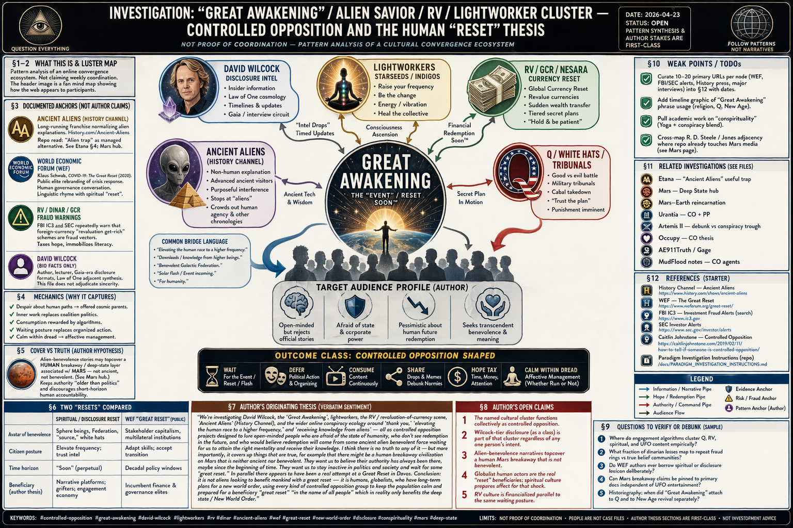

# Investigation: “Great Awakening” / Alien Savior / RV / Lightworker Cluster — Controlled Opposition and the Human “Reset” Thesis

> **TL;DR:** Case file treating the **online convergence** of **David Wilcock–style disclosure**, **“Great Awakening”** spirituality, **lightworker / starseed / frequency** language, **Iraqi dinar–style “RV”** (global currency reset) lore, ***Ancient Aliens*–style** extraterrestrial historiography, and adjacent **Q / “white hats” / tribunals** memes as a **single recruitment basin** for **managed dissent**—**not** proven as one operation, but **structurally** similar: it **promises** redemption through **non-human or occulted** benefactors and **patience**, while **parallel public** programs (e.g. **WEF “Great Reset”** framing) advance **human** **long-horizon governance** rebrands. **Pre-Q rhymes:** **2012**-era **“mass arrests”** **briefings** (e.g. **Drake** **Bailey** **×** **Wilcock** **transcript** on [Divine Cosmos](https://divinecosmos.com/davids-blog/1043-massarrests/)) and **mainstream** **celebrity-hosted** **conspiracy TV** (***Conspiracy Theory with Jesse Ventura***, 2009–2012 — [Wikipedia series summary](https://en.wikipedia.org/wiki/Conspiracy_Theory_%28TV_series%29)) **serialized** **state-threat** **content** **without** **organizing** **reciprocity**. **Author conclusion (pattern):** the **beneficiaries** of any real “reset” are **terrestrial power** **networks** (deep state / **NWO** vocabulary in repo idiom), **not** aliens; the **alien–savior** lane may **cover** hypotheses the repo treats separately—e.g. a **human** **breakaway** presence associated with **Mars** that is **neither ancient nor benevolent** ([Mars / deep state hub](/cosmos/mars/page.md)). Cross-read: [Etana / “Ancient Aliens” trap](/history/chronology/investigations/etana-sumerian-king-list-saturnian-investigation.md), [Urantia CO + PP](/influence/predictive_programming/fiction_encoding/urantia/index-urantia-book-investigation.md), [Artemis II debunk-vs-conspiracy trough](/history/chronology/investigations/artemis-ii-mission-as-faith-test-investigation.md), [Occupy OWS CO thesis](/governance/war/investigations/occupy-wall-street-controlled-opposition-investigation.md).

**Date:** 2026-04-23  
**Status:** Open — **pattern synthesis** and **author stakes** are first-class; **no single agency** running the whole cluster is **claimed** as **fact** here.

---

## Guide (read order)

1. **§1** — What this file is / is not (scope, evidence tiers).  
2. **§2** — The cluster (entities, pipes, how nodes **fuse**).  
3. **§3** — **Documented** anchors: *Ancient Aliens*, WEF “Great Reset,” **RV/dinar** (mechanics + fraud record), **Wilcock** (career + **Gaia** / **Goode** controversy + **2012** **mass-arrest** **promotion**), **pre-Q** **“Pentagon** **white** **hats”** **entertainment** (**Ventura** / **Drake**).  
4. **§4** — **Mechanics** (psychographics, rewarded behaviors, **celebrity** **avatar**).  
5. **§5** — **Cover vs truth** — Mars breakaway rhymes (repo cross-links).  
6. **§6** — **Two “resets”** — spiritual waiting room vs Davos branding.  
7. **§7** — **Author’s originating thesis** (verbatim + unpack + **celebrity-hero** **addendum**).  
8. **§8** — **Author’s open claims** (registry).  
9. **§9** — **Questions** to clarify, verify, or debunk.  
10. **§10** — **Weak points / TODOs**.  
11. **§11** — **Related investigations**.  
12. **§12** — **References** (expanded URL list).  
13. **Keywords** → **Limits**.

---

## 1. Scope and limits of the investigation object

This investigation names a **cultural object**: the **algorithmic and social graph** where spiritually burned-out, **state-skeptical**, and **future-pessimistic** audiences meet **disclosure entertainment**, **currency fantasies**, and **politics-as-script** narratives.

**What “controlled opposition” means here (outcome-first):** The phrase is **not** reserved for **proven** **paid** **agents**. In this file it marks **narrative** **structures** whose **steady-state** **behavior** is often **indistinguishable** from **containment**: **hope** is **routed** **off** **electoral** **and** **labor** **institutions**, **risk** is **personalized** as **vibration** or **intel** **drops**, and **agency** is **outsourced** to **occulted** **rescuers** (military tribunals **soon**, Galactic Federation **soon**, **RV** **window** **soon**). **Emergent** **capture** (grifters + platforms + audience desire) can produce the **same** **curve** as **deliberate** **CO** **without** a **single** **director**.

**In scope:** **Pattern language**, **documented** show/franchise and **policy** branding, **fraud** complaints and **press** **on** **RV** **schemes**, **public** **statements** and **third-party** **reporting** on **named** **influencers**, and **repo** **hypotheses** about **what** **such** **patterns** **may** **obscure**.

**Out of scope (here):** Proving **Wilcock**, **Gaia**, **History Channel**, or **WEF** **hold** **standing** **meetings**; proving **every** **dinarian** **forum** **moderator** **is** **on** **payroll**; **resolving** **every** **UAP** **case**.

**Evidence tiers (quick key):** **Primary** government filings and **litigation** **releases** > **mainstream** **investigative** **press** (e.g. **CNBC** on **dinar** **rings**) > **participant** **or** **fan** **blogs** (useful for **what** **was** **said**, **not** for **what** **is** **true**) > **commentary** **threads**.

---

## 2. The cluster — nodes, bridges, and fusion pressure

The table below is a **schematic**. In **practice**, **edges** **blur**: **Q** readers **also** **hold** **dinar**; **Law** **of** **One** **readers** **also** **watch** ***Ancient Aliens***; **“NESARA/GESARA”** **paste** **attaches** **to** **almost** **any** **node**.

| Node | Typical promise | Typical deferral |
|------|-----------------|------------------|
| **“Great Awakening”** (meme bundle) | Consciousness / justice wave; hidden war between good and evil | Wait for **the event** / **the plan** |
| **David Wilcock** (public career) | Insider “intel,” Law-of-One-flavored cosmology, **disclosure** timing, occasional **Pentagon**-flavored **“mass** **arrest”** **briefings** (see §3.4–3.5) | Episodic **updates**; **insider** **chain**; **transcript** **culture** |
| **Lightworkers / starseeds / indigos** | Personal frequency change heals collective trauma | **Inner work** substitutes for **coalition** **politics** |
| **RV / GCR / NESARA-style** lore | Sudden wealth redistribution after “reset” | **Hold** **currency**; **NDA** **fantasy**; **tiered** **“intel”**; **moving** **date** |
| ***Ancient Aliens* / “AA” culture** | Non-human explanation for anomalies | Stops at **aliens**; crowds out **human** **agency** and **other** **chronologies** |
| **Q-adjacent** “military tribunals” etc. | Punishment of cabal **imminent** | **Trust** **the plan** |

**Bridge phrases (observed in the wild):** “**elevating the human race** to a **higher frequency**,” “**downloads**” / **knowledge from higher beings**,” “**benevolent** **Galactic Federation**,” “**solar flash**,” “**for humanity**” attached to **macroeconomic** **miracles**, “**operation** **Green** **Light**,” “**RV** **any** **minute**.”

**Fusion mechanics (why it feels like one “map”):** Shared **villain** (**cabal**, **BIS**, **Fed**, **deep** **state**), shared **savior** (**white** **hats**, **Sphere** **Beings**, **Jesus** **ship** **soon**), shared **temporality** (**imminent** **flip**). Once those three match, **content** **from** **disparate** **authors** **interlinks** **naturally** in **feeds** **without** **central** **authorship**.

**Illustration:** The header image is a **dense** **mind-map** **style** graphic **representing** this **web**; it is **evidence** only of **how** **fans** **draw** **the** **map**, **not** of **factual** **links** **between** **every** **node**.

---

## 3. Documented anchors (not the author’s unique claims)

### 3.1 *Ancient Aliens* (History Channel / A+E Networks)

**What the product is:** A **long-running** **cable** franchise that **repeatedly** **poses** **extraterrestrial** **or** **ultra-ancient** **high-tech** **hypotheses** as the **go-to** **explanation** **class** for **historical** **and** **archaeological** **“mysteries.”** Official hub: [History.com — *Ancient Aliens*](https://www.history.com/shows/ancient-aliens).

**Why it matters to this investigation:** The show **occupies** the **same** **attention** **slot** as **sober** **chronology** **disputes**, **catastrophe** **geology**, **and** **institutional** **history**—but **routes** **anomalies** **into** **ET** **authorship** **by** **default**. That **default** is **exactly** what the [Etana file](/history/chronology/investigations/etana-sumerian-king-list-saturnian-investigation.md#4-predictive-programming-layer-why-ancient-aliens-is-a-useful-trap) calls a **“useful** **trap**”: **rebellious-looking** **non-mainstream** **channel** that **still** **blocks** **third** **readings** **centered** **on** **human** **witness** **and** **power**.

**Controversy (documented, mainstream):** Academics and **science** **communicators** have **long** criticized the program for **misquoting** **experts**, **false** **balances**, **and** **confusing** **speculation** with **evidence**—standard **science** **communication** **grievances**, **independent** of **this** **repo’s** **deeper** **chronology** **claims**. The **investigative** **point** **here** is **structural**: **high** **production** **value** + **mystery** **format** ⇒ **durable** **misdirection** **budget**.

**Repo read:** [Mars article](/cosmos/mars/page.md) explicitly **rejects** **AA**-style **pyramid** **authorship** while advancing a **human** **deep-state** **thesis**—useful **tension** when **cross-reading**.

### 3.2 “Great Reset” (Davos / WEF public framing)

**Documented fact layer:** **Klaus Schwab** and Thierry Malleret published *COVID-19: The Great Reset* (2020), and the **WEF** **promoted** **“Great** **Reset”** **as** **a** **named** **policy** **and** **cultural** **conversation** about **post-pandemic** **economic** **and** **social** **transformation**. Hub (verify current subpages): [WEF — The Great Reset](https://www.weforum.org/great-reset/).

**Analytic point for this file:** The **spiritual** **disclosure** **scene** **often** **uses** **“reset”** **and** **“awakening”** **language** **in** **parallel** **to** **Davos** **branding** **without** **sharing** **a** **mailing** **list**. **Lexical** **overlap** **still** **matters** **politically**: **both** **discourses** **train** **populations** **to** **think** **in** **epochal** **breaks** **rather** **than** **incremental** **accountability** **mechanisms** (budget votes, union contracts, **FOIA** **coalitions**, **local** **elections**).

### 3.3 RV / GCR / dinar — what promoters mean, how it works, and documented harm

**Vocabulary:**

- **RV** (*revaluation*): the **claim** that **one** **or** **more** **currencies** (classically the **Iraqi** **dinar**, **IQD**) will **revalue** **upward** **by** **orders** **of** **magnitude**, **instantly** **enriching** **holders**.  
- **GCR** (*global currency reset*): a **macro** **myth** in which **many** **currencies** **reprice** **together**, **often** **tied** to **gold** **or** **a** **new** **financial** **architecture**.  
- **NESARA / GESARA** (internet lore): a **bundle** of **legends** **about** **secret** **laws**, **debt** **forgiveness**, **and** **“prosperity** **packages”**—frequently **pasted** **onto** **RV** **chat** **rooms** **even** when **no** **verifiable** **statute** **matches** the **fantasy** **text**.

**Mechanics (generic scam pattern, not investment advice):**

1. **Buy** **physical** **or** **questionable** **paper** **currency** **or** **“reserve** **contracts”** **from** **promoters** **at** **steep** **markups** vs **spot** **rates**.  
2. **Subscribe** to **tiered** **“intel”**—**call** **times**, **private** **forums**, **“NDAs”** **as** **status** **props**.  
3. **Rolling** **windows**: **banks** **“on** **alert,”** **“800** **numbers”** **imminent,”** **“rates** **on** **screens”** **then** **pulled**—each **failure** **re-explained** as **cabal** **interference** **or** **need** **for** **more** **prayers** / **higher** **frequency**.  
4. **Community** **identity**: **years** **of** **shared** **waiting** **produce** **sunk** **social** **cost**; **exit** **feels** **like** **betraying** **friends**.

**Why this belongs beside “disclosure” and Q:** Same **imminent** **flip** **grammar**, same **insider** **chain**, same **villain** (**deep** **state** **blocked** **the** **RV** **again**). **Dinar** **forums** **and** **UFO** **disclosure** **channels** **overlap** **in** **audience** **graphs** **empirically** (platform-dependent; **§9** asks for **measurement**).

**Documented controversy — law, regulators, press:**

- **SEC** — *Litigation Release No. 23509* (31 Mar 2016): charges against **John** **Scott** **Clark**; complaint alleges **“bogus** **scheme** **involving** **investments** **in** **‘top** **secret’** **Iraqi** **currency** **and** **oil** **contracts,”** **claims** of **access** to **a** **secret** **U.S.** **military** **and** **government** **program**, **written** **guarantees** of **extreme** **returns**, and **instructions** **not** **to** **talk** **about** **it** ([SEC LR-23509](https://www.sec.gov/enforcement-litigation/litigation-releases/lr-23509)). **Criminal** **restitution** **and** **prison** **time** **are** **on** **the** **record** **in** **that** **release**.  
- **CNBC** investigative piece on a **multi-million-dollar** **dinar** **scheme** and **markups** ([CNBC — “Inside a $24 million investment scam: Buy the Iraqi dinar”](https://www.cnbc.com/2015/01/15/inside-a-24-million-investment-scam-buy-the-iraqi-dinar.html)).  
- **CFTC** — administrative **law** **judge** **opinion** **re** **Dinar** **Corp.** **(2020)** (fraud **findings** in **commodity** **/** **forex** **adjacent** **marketing**): [CFTC ALJ opinion PDF](https://www.cftc.gov/media/3481/enfdinarcorpincopinion021420/download).  
- **Trade** **press** **summaries** of **persistent** **false** **claims** around **IQD** (useful **for** **claim** **inventory**, **not** **as** **sole** **authority**): e.g. [Iraq Business News — “The Iraqi Dinar Revaluation Scam”](https://www.iraq-businessnews.com/2024/08/29/the-iraqi-dinar-revaluation-scam-false-hope-financial-deception/).

**Counter-narrative (honest dinar holders’ point):** **Iraq** is a **real** **country** with a **real** **central** **bank**; **exchange** **rates** **move** **for** **macro** **reasons** **unrelated** to **forum** **intel**. **Small** **legal** **currency** **purchases** **as** **souvenirs** **or** **speculation** **are** **not** **automatically** the **same** **as** **joining** **a** **fraud** **ring**—but **this** **file** **cares** about **the** **RV** **story** **when** it **becomes** **guaranteed** **wealth**, **secret** **military** **pipes**, **and** **moving** **deadlines**: that **shape** **matches** **enforcement** **cases**.

**Investigative use:** **RV** lore **behaves** like **controlled opposition** **in** **outcome**—it **taxes** **hope**, **immobilizes** **political** **economy** **literacy**, and **anchors** **trust** to **secret** **timing** **messages**.

### 3.4 David Wilcock — public arc, collaborations, and documented controversy

**Public arc (neutral sketch):** **Wilcock** rose as a **lecturer** **and** **author** blending **UFO** **/** **intelligence** **themes** with **spiritual** **synthesis** (often **Law** **of** **One**–adjacent). He **became** **a** **face** of **subscription** **streaming** **“disclosure”** through **Gaia**’s ***Cosmic Disclosure*** (co-starring **Corey** **Goode**). He **maintains** **Divine** **Cosmos** as a **primary** **publishing** **site**.

**2012 “mass arrests” promotion (primary source on his site):** In **2012**, **Wilcock** **published** **a** **long** **interview** **transcript** with **“Drake,”** **presented** **as** **a** **whistleblower** **channel** **for** **U.S.** **Patriots** **/** **military** **and** **civil** **authority** **planning** **against** **“cabal”** **figures**—including **claims** **of** **large-scale** **arrests** **and** **operational** **necessity** **for** **military** **support**. The **canonical** **URL** on **his** **domain** is still indexed as: [Divine Cosmos — “MASS ARRESTS: David Interviews Drake — Transcript!”](https://divinecosmos.com/davids-blog/1043-massarrests/). **Follow-on** **posts** in the **same** **season** **framed** **“divine** **intervention”** **and** **briefings** (e.g. [“Mass Arrests / Divine Intervention: New Briefings”](https://divinecosmos.com/davids-blog/1060-massdivine/)). **Falsifiable** **historical** **note:** **No** **such** **mass** **arrest** **wave** **materialized** **as** **public** **fact** **in** **the** **predicted** **shape**; **the** **episode** **is** **therefore** **central** **to** **any** **“pre-Q** **trust** **the** **plan”** **genealogy**.

**Benjamin Fulford overlap (context only):** **Wilcock** **also** **amplified** **/** **cross-interviewed** **Fulford**-style **“Asian** **secret** **society** **/”** **white** **dragon**” **narratives** in **the** **same** **era**—another **branch** of **“imminent** **cabal** **takedown”** **story** **economy**. **This** **file** **does** **not** **merge** **Fulford** **and** **Wilcock** **into** **one** **claim**; it **notes** **shared** **audience** **plumbing**.

**Documented controversy (third-party press):**

- **Gaia** **/** ***Cosmic Disclosure*** **fallout:** **Trade** **and** **tabloid** **press** **covered** **contract** **disputes**, **leaked** **email** **drama**, **lawsuits** **involving** **Goode** **and** **Gaia**, **and** **Wilcock’s** **public** **apology** **/** **clarification** **statements**—e.g. [SoapCentral summary](https://www.soapcentral.com/entertainment/what-happened-david-wilcock-corey-goode-gaia-fallout-surfaces-online-amid-ufo-influencers-death-reports), [Primetimer on Goode / Gaia lawsuit reporting](https://www.primetimer.com/features/who-is-corey-goode-gaia-lawsuit-controversy-explored-as-david-wilcocks-producer-accuses-whistleblower-of-lies). **Wilcock’s** **own** **Gaia** **statement** **page** **(primary):** [Divine Cosmos — Gaia statement](https://divinecosmos.com/gaia-statement/).  
- **Monetized** **“ascension”** **/** **COVID-era** **pitch** **criticism:** [Vice — “UFO Conspiracy Theorists Offer 'Ascension' From Our Hell World for $333”](https://www.vice.com/en/article/4ayyqw/david-wilcock-ufo-conspiracy-theorist-covid-19-deep-state-ascension) (reporting **on** **pricing** **and** **claims** **as** **framed** **by** **the** **outlet**).

**Pattern read (investigation-level, not a verdict on intent):** **Wilcock** **functions** **as** **a** **high-trust** **narrator** **node** **between** **spiritual** **soteriology** **and** **“Pentagon** **will** **save** **us”** **briefings**—**exactly** **the** **fusion** **described** **in** **§2**. Whether **that** **fusion** **was** **cynical**, **sincere**, **or** **mixed** **is** **not** **something** **this** **desk** **file** **resolves**; **the** **structural** **effect** **on** **attention** **and** **posture** **is** **the** **target**.

### 3.5 Pre-Q “military / patriots will fix Washington” — celebrity avatars and the Drake template

**Drake Bailey (not an A-list celebrity, but the clearest pre-Q “mass arrests” source Wilcock validated):** **Bailey** **was** **promoted** **in** **2012** **as** **a** **veteran** **with** **access** **to** **plans** **for** **large-scale** **detentions** **of** **“cabal”** **actors**, **sometimes** **described** **with** **military** **and** **media** **shutdown** **color** **in** **forum** **summaries** **of** **the** **era**. **Wilcock’s** **transcript** **post** **(§3.4)** **is** **the** **best** **single** **primary** **citation** **for** **what** **the** **lane** **actually** **said**. **Secondary** **retrospectives** **link** **Drake** **→** **Wilcock** **→** **later** **Q** **grammar** (e.g. [The Last American Vagabond — Drake Bailey piece](https://www.thelastamericanvagabond.com/drake-bailey-a-coup-of-the-us-empire/); [Steemit / community retrospective](https://steemit.com/qanon/@sadcorp/david-wilcock-drake-bailey-and-qanon-the-plan-4bcc83d3ea243) — **use** **as** **tertiary** **culture** **history**, **not** **as** **fact** **sources**).

**Jesse Ventura (mainstream celebrity parallel):** From **2009–2012**, **truTV** aired ***Conspiracy Theory with Jesse Ventura***—**mainstream** **cable** **with** **millions** of **viewers**, **hosted** by a **former** **governor** **and** **wrestling** **star** **with** **real** **Navy** **UDT** **background**. Episodes **treated** **police-state**, **HAARP**, **9/11**, **FEMA** **camp** **lore**, **and** **other** **“secret** **government** **power”** **topics** **as** **serialized** **entertainment** ([Wikipedia — *Conspiracy Theory* (TV series)](https://en.wikipedia.org/wiki/Conspiracy_Theory_%28TV_series%29); [IMDb title page](https://www.imdb.com/title/tt1572498/)). **This** **is** **not** **legally** **“disclosure”**; it **is** **television** **product** **that** **personalizes** **dread** **and** **hope** **through** **Ventura’s** **hero** **body** **on** **camera**.

**Why pair Ventura with Drake/Wilcock:** **Different** **production** **scale** **and** **demographics**, **same** **moral** **hazard** **class** **for** **this** **investigation**: **the** **viewer** **is** **trained** **to** **wait** **for** **a** **named** **champion** **or** **off-screen** **patriot** **plan** **rather** **than** **to** **build** **durable** **local** **power**. **Ventura** **is** **the** **closest** **fit** **to** **the** **author’s** **memory** **of** **a** **“celebrity”** **breaking** **Q-style** **news** **before** **Q**; **if** **the** **author** **meant** **a** **different** **name** **(e.g.** **a** **late-night** **host** **bit,** **a** **rapper’s** **tweetstorm,** **a** **particular** **actor),** **§9** **asks** **them** **to** **pin** **it** **so** **the** **row** **can** **be** **corrected**.

---

## 4. Mechanics — why the cluster captures “open-minded” state-fear

**Audience sketch (author-supplied, sociologically plausible):**

- **Open-minded** enough to **reject** **official** **comfort** **stories**.  
- **Afraid** of **state** and **corporate** **power**, sometimes **correctly**.  
- **Pessimistic** about **human** **institutions** delivering **redemption**.  
- **Susceptible** to **transcendent** **benevolence** **waiting** on **the** **other** **side** of **personal** **frequency** work.

**Rewarded behaviors:**

- **Consume** long **video** **chains**; **share** **drops**; **debunk** **normies** **online**.  
- **Reduce** **local** **political** **risk** (no **picketing**, no **FOIA** **clubs**, no **union** **density** **plan**).  
- **Wait** for **disclosure** / **RV** / **tribunals** / **flash** / **the** **next** **Wilcock** **briefing** / **the** **next** **season** **finale**.

**Celebrity / guru avatar mechanism (add-on to author stakes):** When **fear** **is** **large-scale** **(finance,** **war,** **police** **power,** **pandemic)** **but** **action** **feels** **forbidden** **or** **futile**, **media** **offers** **individual** **heroes** **who** **“know”** **more**. **The** **hero’s** **move** **is** **always** **next** **episode** **/ next** **post** **/ next** **donor** **tier**—**not** **your** **move** **as** **citizen** **organizer**. **That** **does** **not** **require** **villainy** **by** **the** **host**; **it** **is** **often** **how** **attention** **markets** **price** **hope**.

**Outcome class (CO-shaped):** **Calm** **within** **dread**—**affective** **management** **whether** **or** **not** **any** **node** **is** **consciously** **“run.”**

---

## 5. Cover vs truth — what the author says is obscured

**Repo-native hypothesis (cross-file, not re-proven here):**

- A **human** **breakaway** / **deep-state** **layer** may exist with **Mars-associated** **logistics** and **symbolism**—**not** **ancient** **aliens**, **not** **benevolent** **parents** ([Mars hub](/cosmos/mars/page.md); [Mars–Earth reincarnation investigation](/cosmos/mars/investigations/mars-earth-reincarnation-investigation.md)).  
- **Ancient** **lineage** **framing** (“**always** **here**,” “**older** **than** **politics**”) **naturalizes** **authority** and **discourages** **short-horizon** **human** **accountability**.

**Pattern claim (this file):** **Alien–benevolence** **stories** **and** **frequency** **soteriology** **can** **function** as **topcover** **for** **human** **continuity** **projects**—**especially** when **they** **tell** **the** **listener** that **redemption** **is** **incoming** **if** **consciousness** **is** **right**.

**Interaction with §3.5:** If **listeners** **believe** **“arrests** **are** **queued”** **or** **“RV** **is** **the** **economic** **justice** **event,”** **they** **may** **discount** **banal** **but** **real** **levers**—**tax** **policy**, **zoning**, **procurement** **contracts**, **base** **closures**, **sanctions** **evasion** **networks**—that **actually** **move** **power** **on** **Earth** **and** **in** **orbit**.

---

## 6. Two resets — spiritual waiting vs Davos branding

| Dimension | Spiritual / disclosure “reset” | WEF-style “Great Reset” (public document) |
|-----------|--------------------------------|-------------------------------------------|
| **Avatar of benevolence** | Sphere beings, Federation, “source,” **white hats** | **Stakeholder** capitalism; **multilateral** institutions |
| **Citizen posture** | **Elevate frequency**; trust **intel** | **Adapt skills**; accept **transition** |
| **Time horizon** | **Soon** (perpetual) | **Decadal** policy windows |
| **Beneficiary (author thesis)** | **Narrative** **platforms**; **grifters**; **engagement** **economy** | **Incumbent** **finance** **and** **governance** **elites** |

**Conclusion (author, pattern-level):** **Neither** column **needs** **aliens** for **real** **world** **effects**; **column A** **may** **soften** **resistance** **to** **column B** **by** **relocating** **hope** **off** **Earth**.

**Cable-TV footnote:** **Column A** **also** **includes** **commercial** **television** **that** **looks** **like** **investigation** **but** **sells** **ads** **against** **your** **stayed** **attention**—**see** **§3.5**.

---

## 7. Author’s originating thesis — sentiment, verbatim, and unpack

### 7.1 Verbatim author text (Paradigm Threat — consolidated from session language)

> We’re investigating **David Wilcock**, the **“Great Awakening”**, **lightworkers**, the **RV / revaluation-of-currency** scene, ***Ancient Aliens*** (History Channel), and the wider online conspiracy ecology around **“thank you,” “elevating the human race to a higher frequency,”** and **“receiving knowledge from aliens”** — all as **controlled opposition** projects **designed to lure** **open-minded** people who are **afraid of the state** of **humanity**, who **don’t see redemption** in the future, and who would **believe redemption** will come from some **ancient alien benevolent force** **waiting** for us to **attain the right mentality** and **receive their knowledge**. **I think there is no truth to any of it** — but **more importantly**, it **covers up things that are true**, for example that there might be a **human breakaway civilization on Mars** that is **neither ancient nor benevolent**. They want us to believe their authority has **always** been there, maybe **since the beginning of time**. They want us to **stay inactive** in **politics** and **society** and **wait** for some **“great reset.”** In parallel there appears to have been a real attempt at a **Great Reset in Davos**. **Conclusion:** it is **not aliens** looking to benefit mankind with a **great reset** — it is **humans**, **globalists**, who have **long-term plans** for a **new world order**, using **every kind of controlled opposition group** to keep the population **calm** and **prepared** for a **beneficiary** “great reset” **“in the name of all people”** which in reality **only benefits** the **deep state / New World Order**.

### 7.2 What the author means (short unpack)

- **Psychographic lure:** **Despair** about **human** **paths** → **offered** **parental** **cosmos**.  
- **Epistemic cost:** **True** **threads** (e.g. **human** **Mars** **continuity**) get **miscategorized** as **ancient** **ET** **temple** **plots**.  
- **Political cost:** **Waiting** **replaces** **organizing**.  
- **Lexical rhyme:** **Online** “**reset**” **spirituality** ↔ **Davos** “**Great Reset**” **rhetoric** — **beneficiary** **suspected** to be **terrestrial** **elites**, **not** **exotic** **saviors**.

### 7.3 Author addition — celebrity “Q-before-Q” memory (Paradigm Threat)

> I remember a **celebrity** who broke **QAnon-style** news **before** QAnon — **not** Q itself. The person would talk about the **US military** staging **coups** in **DC** and all kinds of things. It was **relevant to the news at the time**, but it felt like a **fictional narrative** **loosely tied to the truth**, with the same motivation: **keep people calm** into thinking **something is being done** in their country about the dangers they perceive. The idea was to create **individual celebrity heroes** who will **save us all**, rather than teaching us **how to resist** the threat — it teaches us to be **calm and wait** for the **celebrities** to make their moves.

### 7.4 Unpack — celebrity hero vs Drake vs Ventura

- **If** **the** **memory** **points** **to** **internet** **“insiders”** **more** **than** **Hollywood:** **Drake** **Bailey** **(2012)** **matches** **the** **military**/**mass-arrest** **story** **shape** **and** **predates** **Q**, **but** **is** **not** **a** **household** **celebrity** **until** **amplified** **by** **Wilcock**’s **platform** **(which** **is** **celebrity-like** **inside** **the** **niche)**.  
- **If** **the** **memory** **points** **to** **actual** **cable** **fame:** **Jesse** **Ventura’s** **show** **matches** **the** **“something** **big** **is** **being** **exposed”** **tone** **and** **the** **pre-Q** **timeline**, **with** **real** **production** **budget**.  
- **Neither** **option** **proves** **CO** **intent**; **both** **illustrate** **the** **author’s** **mechanism**: **hero** **substitution** **for** **collective** **practice**.

---

## 8. Author’s open claims (unique or not fully grounded in this file)

1. The **named** **cultural** **cluster** **functions** **collectively** as **controlled opposition** **toward** **calm** **and** **delay**.  
2. **Wilcock–tier** **disclosure** **(as a class)** is **part of that cluster** **regardless** of **any** **one** **person’s** **intent**.  
3. **Alien-benevolence** **narratives** **topcover** a **human** **Mars** **breakaway** **that** is **not** **benevolent**.  
4. **Globalist** **human** **actors** **are** the **real** **“reset”** **beneficiaries**; **spiritual** **disclosure** **culture** **prepares** **affect** **for** **that** **shock**.  
5. **RV** **culture** is **financialized** **parallel** to **the same** **waiting** **posture**.  
6. **Pre-Q** **“military** **will** **fix** **DC”** **content** **(celebrity** **or** **guru-hosted)** **trained** **audiences** **to** **wait** **for** **heroes** **instead** **of** **building** **resistance** **literacy**.

---

## 9. Questions to clarify, verify, or debunk

| # | Question | Why it matters |
|---|----------|----------------|
| 1 | Where do **engagement** **algorithms** **cluster** **Q**, **RV**, **spiritual**, and **UFO** **content** **empirically**? | Tests **“single basin”** **without** **asserting** **one** **operator**. |
| 2 | What **fraction** of **dinarian** **losses** map to **repeat** **fraud** **rings** vs **true** **belief** **communities**? | Separates **crime** **from** **culture**. |
| 3 | Do **WEF** **authors** **ever** **borrow** **spiritual** **or** **disclosure** **lexicon** **deliberately**? | **Lexical** **bridge** **hypothesis**. |
| 4 | Can **Mars** **breakaway** **claims** be **pinned** to **primary** **docs** **independent** of **UFO** **entertainment**? | **Separates** **this** **repo’s** **Mars** **lane** from **AA** **lane**. |
| 5 | **Historiography**: when did **“Great Awakening”** **attach** to **Q** **and** to **New Age** **revival** **separately**? | **Disambiguates** **terms**. |
| 6 | **Which** **specific** **celebrity** **did** **the** **author** **remember** **(name** **+** **year** **+** **show** **/ tweet**)? | Lets us **swap** **Ventura** **for** **the** **correct** **row** **without** **guessing**. |

---

## 10. Weak points / remaining research TODOs

- [x] Pin **starter** **SEC** / **CNBC** / **CFTC** **URLs** **for** **RV** **(done** **in** **§3.3** **and** **§12)**.  
- [x] Pin **primary** **Divine** **Cosmos** **URL** **for** **Drake** **mass-arrests** **transcript** **(done)**.  
- [ ] Add **timeline** **graphic** **of** **“Great Awakening”** **phrase** **usage** (religious history vs **Q** vs **New Age**).  
- [ ] Pull **academic** **sociology** on **“conspirituality”** (Yoga **+** **conspiracy** **blend**) **as** **neutral** **third-party** **vocabulary**.  
- [ ] Cross-map **Robert David Steele** / **Jones** **adjacency** **where** **repo** **already** **touches** **Mars** **media** **([Mars page](/cosmos/mars/page.md))** **without** **duplicate** **theory** **essays**.  
- [ ] **Author** **clarification** **on** **§9** **Q6** **→** **update** **§3.5** **if** **a** **different** **celebrity** **fits** **better**.

---

## 11. Related investigations

| Investigation | Relation |
|----------------|----------|
| [Etana — “Ancient Aliens” useful trap](/history/chronology/investigations/etana-sumerian-king-list-saturnian-investigation.md) | **Managed alternative** vs **human** **sky** **memory** |
| [Mars — Deep State hub](/cosmos/mars/page.md) | **Human** **Mars** **thesis**; **rejects** **AA** **pyramid** **frame** |
| [Mars–Earth reincarnation](/cosmos/mars/investigations/mars-earth-reincarnation-investigation.md) | **Mass** **death** / **continuity** **threads** **without** **benevolent** **ET** |
| [Urantia — CO + PP](/influence/predictive_programming/fiction_encoding/urantia/index-urantia-book-investigation.md) | **Long** **precedent** for **spiritual** **download** **narrative** **capture** |
| [Artemis II — debunk vs conspiracy trough](/history/chronology/investigations/artemis-ii-mission-as-faith-test-investigation.md) | **Algorithmic** **clustering** **of** **outcomes** |
| [Occupy — CO thesis](/governance/war/investigations/occupy-wall-street-controlled-opposition-investigation.md) | **Spectacle** **and** **managed** **dissent** **mechanics** |
| [AE911Truth / Gage](/events/false_flag/investigations/richard-gage-ae911truth-controlled-demolition-investigation.md) | **Different** **topic** — **shared** **“movement** **containment”** **language** |
| [MudFlood notes — CO agents](/history/mudflood/notes/page.md) | **Flat** **Earth** / **5D** / **Ancient Aliens** **named** in **repo** **warnings** |

---

## 12. References (expanded)

### Franchises, institutions, primary influencer pages

- History Channel — *Ancient Aliens*: https://www.history.com/shows/ancient-aliens  
- WEF — The Great Reset hub: https://www.weforum.org/great-reset/  
- Divine Cosmos — Drake mass arrests transcript: https://divinecosmos.com/davids-blog/1043-massarrests/  
- Divine Cosmos — follow-on mass arrests / “divine intervention” briefings: https://divinecosmos.com/davids-blog/1060-massdivine/  
- Divine Cosmos — Wilcock statement re Gaia: https://divinecosmos.com/gaia-statement/

### RV / dinar — regulators and major press

- SEC — Litigation Release **LR-23509** (John Scott Clark / Iraqi “top secret” currency scheme): https://www.sec.gov/enforcement-litigation/litigation-releases/lr-23509  
- CNBC — “Inside a $24 million investment scam: Buy the Iraqi dinar”: https://www.cnbc.com/2015/01/15/inside-a-24-million-investment-scam-buy-the-iraqi-dinar.html  
- CFTC — ALJ opinion PDF (Dinar Corp. line): https://www.cftc.gov/media/3481/enfdinarcorpincopinion021420/download  
- Iraq Business News — long-form debunk of persistent dinar claims: https://www.iraq-businessnews.com/2024/08/29/the-iraqi-dinar-revaluation-scam-false-hope-financial-deception/

### Wilcock / Gaia / criticism

- Vice — Wilcock / “ascension” pricing reporting: https://www.vice.com/en/article/4ayyqw/david-wilcock-ufo-conspiracy-theorist-covid-19-deep-state-ascension  
- SoapCentral — Gaia / Goode / Wilcock controversy summary: https://www.soapcentral.com/entertainment/what-happened-david-wilcock-corey-goode-gaia-fallout-surfaces-online-amid-ufo-influencers-death-reports  
- Primetimer — Goode / Gaia lawsuit reporting: https://www.primetimer.com/features/who-is-corey-goode-gaia-lawsuit-controversy-explored-as-david-wilcocks-producer-accuses-whistleblower-of-lies

### Pre-Q “mass arrests” lane — secondary culture history

- The Last American Vagabond — Drake Bailey retrospective: https://www.thelastamericanvagabond.com/drake-bailey-a-coup-of-the-us-empire/  
- Steemit — Drake / Wilcock / Q “plan” genealogy (tertiary): https://steemit.com/qanon/@sadcorp/david-wilcock-drake-bailey-and-qanon-the-plan-4bcc83d3ea243

### Mainstream celebrity parallel — Ventura show

- Wikipedia — *Conspiracy Theory with Jesse Ventura*: https://en.wikipedia.org/wiki/Conspiracy_Theory_%28TV_series%29  
- IMDb — series hub: https://www.imdb.com/title/tt1572498/

### Methodology

- Caitlin Johnstone — controlled opposition explainer (linked from site ecosystem): https://caitlinjohnstone.com/2019/02/11/how-to-tell-if-someone-is-controlled-opposition/  
- [Paradigm investigation instructions](/docs/PARADIGM_INVESTIGATION_INSTRUCTIONS.md) — author thesis handling.

---

Keywords: #controlled-opposition #great-awakening #david-wilcock #lightworkers #rv #dinar #gcr #nesara #ancient-aliens #wef #great-reset #new-world-order #disclosure #conspirituality #mars #deep-state #drake-bailey #jesse-ventura #iraqi-dinar

**Last substantive update:** 2026-04-23 — header image set to `great-awakening-alien-savior-rv-nwo-cluster-investigation.png`; expanded §1–§6; deep §3.3 RV and §3.4 Wilcock; new §3.5 pre-Q military-entertainment; author §7.3–7.4; §8–§12 refresh.

---

## Limits and disclaimers

- **Fiction vs evidence:** Mind maps, memes, and **YouTube** **bibliographies** are **not** **proof** of **coordination**. **Steemit** **and** **blogs** **are** **culture** **artifacts**, **not** **courts**.  
- **People are not case files:** **Named** **public** **figures** appear as **cultural** **signposts**; **no** **final** **moral** **verdict** **is** **required** for **pattern** **analysis**.  
- **Author thesis sections** are **first-class** **and** **not** **automatically** **factual** (per repo instructions).  
- **“Globalist”** here follows **author** **usage** as **shorthand** for **transnational** **elite** **governance** **networks**; it is **not** a **dogwhistle** **map** **to** **any** **ethnic** **group** **in** **this** **file**.  
- **Medical / financial:** This file **does** **not** **give** **investment** **advice**; **RV** **materials** tied to **guaranteed** **returns** **and** **“top** **secret”** **pipes** **overlap** **documented** **fraud** **patterns** **in** **§3.3**.

### Investigator notes (maintainers / LLMs)

- Header image: `influence/controlled_opposition/great-awakening-alien-savior-rv-nwo-cluster-investigation.png` (companion copy: `great-awakening-mind-map-infographic.png`).  
- If **author** **names** **a** **different** **celebrity** **for** **§7.3**, **duplicate** **§3.5** **row** **rather** **than** **deleting** **Ventura** **(keep** **as** **parallel** **unless** **author** **rejects** **it)**.
