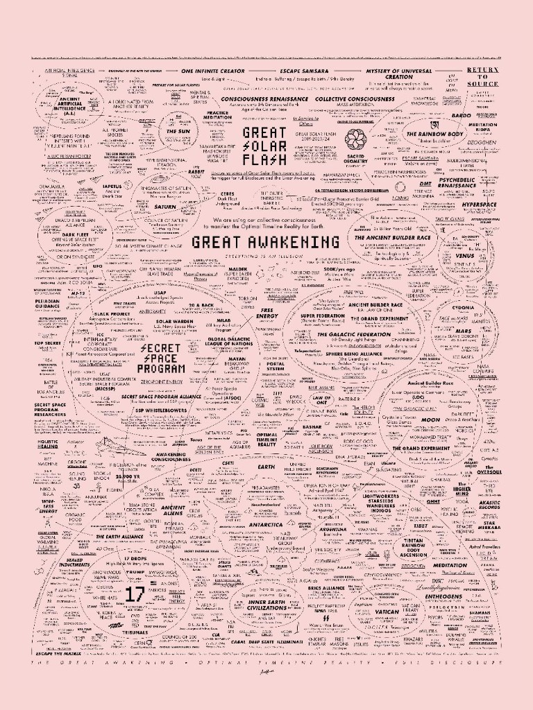

# Investigation: “Great Awakening” / Alien Savior / RV / Lightworker Cluster — Controlled Opposition and the Human “Reset” Thesis

> **TL;DR:** Case file treating the **online convergence** of **David Wilcock–style disclosure**, **“Great Awakening”** spirituality, **lightworker / starseed / frequency** language, **Iraqi dinar–style “RV”** (global currency reset) lore, ***Ancient Aliens*–style** extraterrestrial historiography, and adjacent **Q / “white hats” / tribunals** memes as a **single recruitment basin** for **managed dissent**—**not** proven as one operation, but **structurally** similar: it **promises** redemption through **non-human or occulted** benefactors and **patience**, while **parallel public** programs (e.g. **WEF “Great Reset”** framing) advance **human** **long-horizon governance** rebrands. **Author conclusion (pattern):** the **beneficiaries** of any real “reset” are **terrestrial power** **networks** (deep state / **NWO** vocabulary in repo idiom), **not** aliens; the **alien–savior** lane may **cover** hypotheses the repo treats separately—e.g. a **human** **breakaway** presence associated with **Mars** that is **neither ancient nor benevolent** ([Mars / deep state hub](/cosmos/mars/page.md)). Cross-read: [Etana / “Ancient Aliens” trap](/history/chronology/investigations/etana-sumerian-king-list-saturnian-investigation.md), [Urantia CO + PP](/influence/predictive_programming/fiction_encoding/urantia/index-urantia-book-investigation.md), [Artemis II debunk-vs-conspiracy trough](/history/chronology/investigations/artemis-ii-mission-as-faith-test-investigation.md), [Occupy OWS CO thesis](/governance/war/investigations/occupy-wall-street-controlled-opposition-investigation.md).

**Date:** 2026-04-23  
**Status:** Open — **pattern synthesis** and **author stakes** are first-class; **no single agency** running the whole cluster is **claimed** as **fact** here.

---

## Guide (read order)

1. **§1** — What this file is / is not.  
2. **§2** — The cluster (entities and pipes).  
3. **§3** — **Documented** anchors (Ancient Aliens, WEF language, RV fraud warnings).  
4. **§4** — **Mechanics** (who gets “captured,” what behaviors are rewarded).  
5. **§5** — **Cover vs truth** — Mars breakaway rhymes (repo cross-links).  
6. **§6** — **Two “resets”** — spiritual waiting room vs Davos branding.  
7. **§7** — **Author’s originating thesis** (verbatim + unpack).  
8. **§8** — **Author’s open claims** (registry).  
9. **§9** — **Questions** to clarify, verify, or debunk.  
10. **§10** — **Weak points / TODOs**.  
11. **§11** — **Related investigations**.  
12. **§12** — **References** (starter set).  
13. **Keywords** → **Limits**.

---

## 1. Scope and limits of the investigation object

This investigation names a **cultural object**: the **algorithmic and social graph** where spiritually burned-out, **state-skeptical**, and **future-pessimistic** audiences meet **disclosure entertainment**, **currency fantasies**, and **politics-as-script** narratives.

- **In scope:** **Pattern language**, **documented** show/franchise and **policy** branding, **fraud** advisories on **RV** scams, and **repo** **hypotheses** about **what such patterns may obscure**.  
- **Out of scope (here):** Proving **Wilcock**, **Gaia**, **History Channel**, or **WEF** **coordinate** **weekly** **meetings**; proving **every** **lightworker** **account** is **paid**; adjudicating **every** **UFO** **case**.  
- **Method:** Treat **“controlled opposition”** as an **outcome class** (containment, delay, **identity** **capture**) per [Paradigm investigation instructions](/docs/PARADIGM_INVESTIGATION_INSTRUCTIONS.md)—**intent** may be **emergent** from **markets** **and** **state** **interfaces** **without** **one** **smoking** **memo**.

---

## 2. The cluster — nodes and typical bridges

| Node | Typical promise | Typical deferral |
|------|-----------------|------------------|
| **“Great Awakening”** (meme bundle) | Consciousness / justice wave; hidden war between good and evil | Wait for **the event** / **the plan** |
| **David Wilcock** (public career) | Insider “intel,” Law-of-One-flavored cosmology, **disclosure** timing | Episodic **updates**; **insider** **chain** |
| **Lightworkers / starseeds / indigos** | Personal frequency change heals collective trauma | **Inner work** substitutes for **coalition** **politics** |
| **RV / GCR / NESARA-style** lore | Sudden wealth redistribution after “reset” | **Hold** **currency**; **NDA** **fantasy**; **tier** **secrecy** |
| ***Ancient Aliens* / “AA” culture** | Non-human explanation for anomalies | Stops at **aliens**; crowds out **human** **agency** and **other** **chronologies** |
| **Q-adjacent** “military tribunals” etc. | Punishment of cabal **imminent** | **Trust** **the plan** |

**Bridge phrases (observed in the wild):** “**elevating the human race** to a **higher frequency**,” “**downloads**” / **knowledge from higher beings**,” “**benevolent** **Galactic Federation**,” “**solar flash**,” “**for humanity**” attached to **macroeconomic** **miracles**.

**Illustration:** The header image is a **dense** **mind-map** **style** graphic **representing** this **web**; it is **evidence** only of **how** **fans** **draw** **the** **map**, **not** of **factual** **links** **between** **every** **node**.

---

## 3. Documented anchors (not the author’s unique claims)

### 3.1 *Ancient Aliens* (History Channel / A+E Networks)

- Long-running **cable** franchise presenting **extraterrestrial** **hypothesis** as **default** **explanation** class for historical mysteries. Official hub: [History.com — *Ancient Aliens*](https://www.history.com/shows/ancient-aliens).  
- **Repo read** (not dependent on this file): the **“alien trap”** as **managed alternative** sits explicitly in [Etana investigation §4](/history/chronology/investigations/etana-sumerian-king-list-saturnian-investigation.md#4-predictive-programming-layer-why-ancient-aliens-is-a-useful-trap); [Mars article](/cosmos/mars/page.md) rejects **AA**-style **pyramid** **authorship** **framing** while advancing **human** **deep-state** **thesis**.

### 3.2 “Great Reset” (Davos / WEF public framing)

- **Klaus Schwab** and Thierry Malleret, *COVID-19: The Great Reset* (2020) — **public** **elite** **rebranding** of **crisis** **response** and **economic** **transformation** (cite as **primary** **for** **what** **insiders** **said**, **not** as **validation** of **every** **conspiracy** **reading**). WEF site and **agenda** **archives** document **Davos** **rhetoric** as **human** **governance** **conversation**.  
- **Analytic point for this file:** the **spiritual** “**great awakening** / **reset**” **waiting** **room** **rhymes** **lexically** with **Davos** “**Great Reset**” **without** requiring **identity** of **actors**—both **sell** **transition** **comfort**.

### 3.3 RV / dinar / “global currency reset” — fraud and harm (documented)

U.S. regulators repeatedly treat **foreign-currency** “**revaluation** **get-rich**” schemes as **fraud** **vectors**:

- FBI / IC3 **public** **warnings** on **fraudulent** **currency** **investments** (search **IC3** **foreign currency** **fraud** for current consumer alerts).  
- SEC investor alerts on **high-pressure** **“prime bank”** and **exotic** **currency** **plays** (historical pattern: **promise** of **impending** **official** **revaluation**).  

**Investigative use:** **RV** lore **behaves** like **controlled opposition** **in** **outcome**—it **taxes** **hope**, **immobilizes** **political** **economy** **literacy**, and **anchors** **trust** to **secret** **timing** **messages**.

### 3.4 David Wilcock (biographical facts only — convenience layer)

- **Public figure**: author, lecturer, long association with **Gaia**-era **streaming** **disclosure** formats and **interviews**; heavy use of **Law of One** **adjacent** **synthesis**. For **neutral** **bio** **facts**, mainstream encyclopedia entries and **primary** **publisher** **pages** suffice; **this** **file** **does** **not** **need** **to** **adjudicate** **his** **sincerity**.

---

## 4. Mechanics — why the cluster captures “open-minded” state-fear

**Audience sketch (author-supplied, sociologically plausible):**

- **Open-minded** enough to **reject** **official** **comfort** **stories**.  
- **Afraid** of **state** and **corporate** **power**, sometimes **correctly**.  
- **Pessimistic** about **human** **institutions** delivering **redemption**.  
- **Susceptible** to **transcendent** **benevolence** **waiting** on **the** **other** **side** of **personal** **frequency** work.

**Rewarded behaviors:**

- **Consume** long **video** **chains**; **share** **drops**; **debunk** **normies** **online**.  
- **Reduce** **local** **political** **risk** (no **picketing**, no **FOIA** **clubs**, no **union** **density** **plan**).  
- **Wait** for **disclosure** / **RV** / **tribunals** / **flash**.

**Outcome class (CO-shaped):** **Calm** **within** **dread**—**affective** **management** **whether** **or** **not** **any** **node** **is** **consciously** **“run.”**

---

## 5. Cover vs truth — what the author says is obscured

**Repo-native hypothesis (cross-file, not re-proven here):**

- A **human** **breakaway** / **deep-state** **layer** may exist with **Mars-associated** **logistics** and **symbolism**—**not** **ancient** **aliens**, **not** **benevolent** **parents** ([Mars hub](/cosmos/mars/page.md); [Mars–Earth reincarnation investigation](/cosmos/mars/investigations/mars-earth-reincarnation-investigation.md)).  
- **Ancient** **lineage** **framing** (“**always** **here**,” “**older** **than** **politics**”) **naturalizes** **authority** and **discourages** **short-horizon** **human** **accountability**.

**Pattern claim (this file):** **Alien–benevolence** **stories** **and** **frequency** **soteriology** **can** **function** as **topcover** **for** **human** **continuity** **projects**—**especially** when **they** **tell** **the** **listener** that **redemption** **is** **incoming** **if** **consciousness** **is** **right**.

---

## 6. Two resets — spiritual waiting vs Davos branding

| Dimension | Spiritual / disclosure “reset” | WEF-style “Great Reset” (public document) |
|-----------|--------------------------------|-------------------------------------------|
| **Avatar of benevolence** | Sphere beings, Federation, “source,” **white hats** | **Stakeholder** capitalism; **multilateral** institutions |
| **Citizen posture** | **Elevate frequency**; trust **intel** | **Adapt skills**; accept **transition** |
| **Time horizon** | **Soon** (perpetual) | **Decadal** policy windows |
| **Beneficiary (author thesis)** | **Narrative** **platforms**; **grifters**; **engagement** **economy** | **Incumbent** **finance** **and** **governance** **elites** |

**Conclusion (author, pattern-level):** **Neither** column **needs** **aliens** for **real** **world** **effects**; **column A** **may** **soften** **resistance** **to** **column B** **by** **relocating** **hope** **off** **Earth**.

---

## 7. Author’s originating thesis — sentiment, verbatim, and unpack

### 7.1 Verbatim author text (Paradigm Threat — consolidated from session language)

> We’re investigating **David Wilcock**, the **“Great Awakening”**, **lightworkers**, the **RV / revaluation-of-currency** scene, ***Ancient Aliens*** (History Channel), and the wider online conspiracy ecology around **“thank you,” “elevating the human race to a higher frequency,”** and **“receiving knowledge from aliens”** — all as **controlled opposition** projects **designed to lure** **open-minded** people who are **afraid of the state** of **humanity**, who **don’t see redemption** in the future, and who would **believe redemption** will come from some **ancient alien benevolent force** **waiting** for us to **attain the right mentality** and **receive their knowledge**. **I think there is no truth to any of it** — but **more importantly**, it **covers up things that are true**, for example that there might be a **human breakaway civilization on Mars** that is **neither ancient nor benevolent**. They want us to believe their authority has **always** been there, maybe **since the beginning of time**. They want us to **stay inactive** in **politics** and **society** and **wait** for some **“great reset.”** In parallel there appears to have been a real attempt at a **Great Reset in Davos**. **Conclusion:** it is **not aliens** looking to benefit mankind with a **great reset** — it is **humans**, **globalists**, who have **long-term plans** for a **new world order**, using **every kind of controlled opposition group** to keep the population **calm** and **prepared** for a **beneficiary** “great reset” **“in the name of all people”** which in reality **only benefits** the **deep state / New World Order**.

### 7.2 What the author means (short unpack)

- **Psychographic lure:** **Despair** about **human** **paths** → **offered** **parental** **cosmos**.  
- **Epistemic cost:** **True** **threads** (e.g. **human** **Mars** **continuity**) get **miscategorized** as **ancient** **ET** **temple** **plots**.  
- **Political cost:** **Waiting** **replaces** **organizing**.  
- **Lexical rhyme:** **Online** “**reset**” **spirituality** ↔ **Davos** “**Great Reset**” **rhetoric** — **beneficiary** **suspected** to be **terrestrial** **elites**, **not** **exotic** **saviors**.

---

## 8. Author’s open claims (unique or not fully grounded in this file)

1. The **named** **cultural** **cluster** **functions** **collectively** as **controlled opposition** **toward** **calm** **and** **delay**.  
2. **Wilcock–tier** **disclosure** **(as a class)** is **part of that cluster** **regardless** of **any** **one** **person’s** **intent**.  
3. **Alien-benevolence** **narratives** **topcover** a **human** **Mars** **breakaway** **that** is **not** **benevolent**.  
4. **Globalist** **human** **actors** **are** the **real** **“reset”** **beneficiaries**; **spiritual** **disclosure** **culture** **prepares** **affect** **for** **that** **shock**.  
5. **RV** **culture** is **financialized** **parallel** to **the same** **waiting** **posture**.

---

## 9. Questions to clarify, verify, or debunk

| # | Question | Why it matters |
|---|----------|----------------|
| 1 | Where do **engagement** **algorithms** **cluster** **Q**, **RV**, **spiritual**, and **UFO** **content** **empirically**? | Tests **“single basin”** **without** **asserting** **one** **operator**. |
| 2 | What **fraction** of **dinarian** **losses** map to **repeat** **fraud** **rings** vs **true** **belief** **communities**? | Separates **crime** **from** **culture**. |
| 3 | Do **WEF** **authors** **ever** **borrow** **spiritual** **or** **disclosure** **lexicon** **deliberately**? | **Lexical** **bridge** **hypothesis**. |
| 4 | Can **Mars** **breakaway** **claims** be **pinned** to **primary** **docs** **independent** of **UFO** **entertainment**? | **Separates** **this** **repo’s** **Mars** **lane** from **AA** **lane**. |
| 5 | **Historiography**: when did **“Great Awakening”** **attach** to **Q** **and** to **New Age** **revival** **separately**? | **Disambiguates** **terms**. |

---

## 10. Weak points / remaining research TODOs

- [ ] Curate **10–20** **primary** **URLs** **per** **node** (WEF texts, **FBI/SEC** **alerts**, **History** **press**, **major** **interviews**) **into** **§12** **with** **dates** **retrieved**.  
- [ ] Add **timeline** **graphic** **of** **“Great Awakening”** **phrase** **usage** (religious history vs **Q** vs **New Age**).  
- [ ] Pull **academic** **sociology** on **“conspirituality”** (Yoga **+** **conspiracy** **blend**) **as** **neutral** **third-party** **vocabulary**.  
- [ ] Cross-map **Robert David Steele** / **Jones** **adjacency** **where** **repo** **already** **touches** **Mars** **media** **([Mars page](/cosmos/mars/page.md))** **without** **duplicate** **theory** **essays**.

---

## 11. Related investigations

| Investigation | Relation |
|----------------|----------|
| [Etana — “Ancient Aliens” useful trap](/history/chronology/investigations/etana-sumerian-king-list-saturnian-investigation.md) | **Managed alternative** vs **human** **sky** **memory** |
| [Mars — Deep State hub](/cosmos/mars/page.md) | **Human** **Mars** **thesis**; **rejects** **AA** **pyramid** **frame** |
| [Mars–Earth reincarnation](/cosmos/mars/investigations/mars-earth-reincarnation-investigation.md) | **Mass** **death** / **continuity** **threads** **without** **benevolent** **ET** |
| [Urantia — CO + PP](/influence/predictive_programming/fiction_encoding/urantia/index-urantia-book-investigation.md) | **Long** **precedent** for **spiritual** **download** **narrative** **capture** |
| [Artemis II — debunk vs conspiracy trough](/history/chronology/investigations/artemis-ii-mission-as-faith-test-investigation.md) | **Algorithmic** **clustering** **of** **outcomes** |
| [Occupy — CO thesis](/governance/war/investigations/occupy-wall-street-controlled-opposition-investigation.md) | **Spectacle** **and** **managed** **dissent** **mechanics** |
| [AE911Truth / Gage](/events/false_flag/investigations/richard-gage-ae911truth-controlled-demolition-investigation.md) | **Different** **topic** — **shared** **“movement** **containment”** **language** |
| [MudFlood notes — CO agents](/history/mudflood/notes/page.md) | **Flat** **Earth** / **5D** / **Ancient Aliens** **named** in **repo** **warnings** |

---

## 12. References (starter set — expand in §10)

- History Channel — *Ancient Aliens*: https://www.history.com/shows/ancient-aliens  
- WEF — *The Great Reset* hub and book metadata (verify edition/ISBN at time of citation): https://www.weforum.org/great-reset/  
- FBI — Internet Crime Complaint Center (IC3) consumer materials on investment fraud (update with direct alert URLs when pinned).  
- SEC — Investor education on prime bank / high-yield fraud patterns: https://www.sec.gov/investor/alerts  
- Caitlin Johnstone — “How to tell if someone is controlled opposition” (general methodology linked from root [page.md](/page.md) ecosystem): https://caitlinjohnstone.com/2019/02/11/how-to-tell-if-someone-is-controlled-opposition/  
- [Paradigm investigation instructions](/docs/PARADIGM_INVESTIGATION_INSTRUCTIONS.md) — author thesis handling.

---

Keywords: #controlled-opposition #great-awakening #david-wilcock #lightworkers #rv #dinar #ancient-aliens #wef #great-reset #new-world-order #disclosure #conspirituality #mars #deep-state

**Last substantive update:** 2026-04-23 — initial file; cluster map; cross-links.

---

## Limits and disclaimers

- **Fiction vs evidence:** Mind maps, memes, and **YouTube** **bibliographies** are **not** **proof** of **coordination**.  
- **People are not case files:** **Named** **public** **figures** appear as **cultural** **signposts**; **no** **final** **moral** **verdict** **is** **required** for **pattern** **analysis**.  
- **Author thesis sections** are **first-class** **and** **not** **automatically** **factual** (per repo instructions).  
- **“Globalist”** here follows **author** **usage** as **shorthand** for **transnational** **elite** **governance** **networks**; it is **not** a **dogwhistle** **map** **to** **any** **ethnic** **group** **in** **this** **file**.  
- **Medical / financial:** This file **does** **not** **give** **investment** **advice**; **RV** **materials** are **documented** **fraud** **risks** **in** **regulator** **corpora**.

### Investigator notes (maintainers / LLMs)

- Header image source: copied from session asset into `influence/controlled_opposition/great-awakening-mind-map-infographic.png` (2026-04-23).  
- Optional grep anchors for expansion: `Wilcock`, `Gaia`, `Great Awakening`, `NESARA`, `GCR`, `IC3 dinar`.
