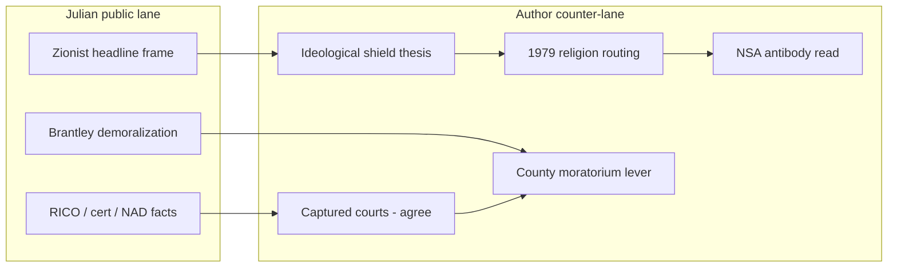

# Investigation: BRSINV / CB St. Julian — captured courts, Zionist framing, and demoralization CO (open)

> **TL;DR:** **Christopher Barton Julian** (**CB St. Julian of MalaCare**; blog **Blue_French_Qtr** / [brsinv.com](https://brsinv.com)) documents **federal court capture** and **USDA/FSA administrative tyranny** across public dockets (**4:13-cv-00054**, **14-1051**, **1:15-cv-01344**). He simultaneously publishes **Zionist** / **mammon** headlines and ran **demoralization + redirect** CO behavior on the **Brantley** wildfire thread as **Blue_French_Qtr** — the **Type B** (enthusiastic / danger-zone) flank in a **two-archetype** CO field documented alongside ***Protect And Alert***’s **Type A** (detached pseudo-professional) lane. **Compensation (paid vs. unpaid) is not provable here — speculative only.** **Author counter-thesis:** ethnic monolithing is an **ideological shield**; the **deep state routes all religions**; **1979** is the documented holy-war pivot (**CIA–Khomeini**, Mecca, Moral Majority); **NSA** class functions as **institutional antibody** to **CIA** primacy. **Policy fork:** engage docket substance; refuse ethnic exit; link [moratorium campaign](https://paradigmthreat.net/science/geoengineering/rural-burn-zones-density-moratorium-not-dew-investigation.md).

**Status:** Open — primary sources = Julian’s published posts + Substack comment API snapshot + May 14 live comment exchange; institutional claims cross-read from in-tree investigations.

**Date:** 2026-05-14

**Guide (read order)**

1. **Primary sources & identity map** → §1  
2. **Julian’s arguments (expanded)** → §2  
3. **Author counter-arguments** → §3  
4. **Brantley CO field link** → §4  
5. **Cross-investigation synthesis** → §5  
6. **Open questions / falsifiers** → §6  

**Reader-facing synthesis:** [Captured courts, wrong villain](https://paradigmthreat.net/influence/controlled_opposition/captured-courts-wrong-villain.md)

---

## 1. Primary sources and identity map

| Field | Value |
|-------|--------|
| **Site** | [brsinv.com](https://brsinv.com) — *Blue_French_Qtr*; tagline: *The root of all evil is not money it's a lie.* |
| **Author display name** | CB St. Julian of MalaCare / Christopher Barton Julian |
| **Substack / email pivot** | bluefrenchqtr@substack.com (cited in Brantley thread) |
| **Trigger post (analysis)** | [US Federal Judicial zionist whoremongers of mammon](https://brsinv.com/2026/04/28/us-federal-judicial-zionist-whoremongers-of-mammon/) — 2026-04-28 |
| **Comment-section handle** | **Blue_French_Qtr** on *Protect and Alert* Brantley DEW thread (May 2026) |
| **PayPal** | Donate button on site (legal battles) |

**Identity inference (author):** Same operator — site brand, Substack email, and comment handle align; [Atkinson §XI](https://paradigmthreat.net/science/geoengineering/investigations/atkinson-georgia-radiation-weapon-investigation.md#4-blue_french_qtr-newly-identified) catalogs **Blue_French_Qtr** demoralization quotes referencing **brsinv.com**.

---

## 2. Julian’s arguments — catalog and elaboration

### 2.1 Institutional / legal core (strongest lane)

Julian’s multi-year publishing arc treats the federal judiciary as **captured** by executive agencies and the **ABA**:

| # | Julian claim | Published basis | Evidence tier |
|---|--------------|-----------------|---------------|
| J1 | USDA/FSA/NAD operate a **criminal enterprise** denying due process | [Treason from Within Via the ABA](https://brsinv.com/2016/03/14/treason-from-within-via-the-aba/) | **Author litigation narrative** + CFR/NAD structure cited |
| J2 | Secretary of Agriculture holds **executive + legislative + judicial** power in one office — unconstitutional fusion | Same; Jefferson/Clinton oligarchy essays | **Author constitutional theory** |
| J3 | Federal judges **converted RICO suit** to FTCA/administrative review, denying jury trial | Case **4:13-cv-00054**; [We The People v. US Gov](https://brsinv.com/2016/02/24/) references | **Docket-exists (B)**; merits **disputed** |
| J4 | **Chevron deference** lets agencies invent crimes; Scalia concurrence quoted against agency lawmaking | ABA treason post; National Law Review cite | **B** (Scalia quote real; application **author**) |
| J5 | Fourth Circuit (**14-1480**, **14-1925**) and **SCOTUS cert denial 14-1051** = bench selling constitutional duty | [Supreme Court Sells out…](https://brsinv.com/2015/05/01/supreme-court-sells-out-constitutional-obligation-to-the-american-people/) | **B** (denial documented); interpretation **author** |
| J6 | Judge **Edward J. Damich** refused to attest oath adherence — proof of dishonest bench | ABA treason post (Feb 2016 motion narrative) | **Author court record narrative** |
| J7 | **ABA** membership of judges/agency heads = treason guild | ABA treason post | **Speculative institutional** |
| J8 | Article III treason: executive + judiciary **levying war** on *We the People* | ABA treason post | **Author moral-legal escalation** |

**Unpack:** Tier **J1–J6** contain **actionable public-law hooks** independent of ethnicity — NAD evidence rules, RICO conversion, cert denial, Chevron. Tier **J7–J8** escalate to **guild treason** language that risks drowning docket facts in apocalyptic rhetoric.

### 2.2 Philosophical / historical frame

| # | Julian claim | Source | Notes |
|---|--------------|--------|-------|
| J9 | Montesquieu: **apathy of citizens** in democracy worse than prince’s tyranny in oligarchy | [Spirit of the Laws [No Apathy]](https://brsinv.com/2019/01/18/spirit-of-the-laws-no-apathy/) | Enlightenment citation **B** |
| J10 | Cicero: traitor **inside the gate** whispers through government halls | Same | Rhetorical frame |
| J11 | Confucius / Bruno / Galileo arc — power punishes **outside-the-box** truth | Same | Long historical essay |
| J12 | Huguenot **St. Julien** / **Malacare** exile after Louis XIV seizes Orange | Same + parliamentary petition cites | Genealogical **author** narrative |
| J13 | Humanity must **imprison government and religion**, not be imprisoned by them | Same | Revolutionary philosophy |

**Unpack:** J9–J13 supply **moral urgency** for J1–J8. They do not require Zionist framing to cohere.

### 2.3 Ethnic / religious escalation (April 2026 headline lane)

| # | Julian claim (as published) | Source |
|---|------------------------------|--------|
| J14 | Federal judiciary = **“zionist whoremongers of mammon”** | [2026-04-28 post](https://brsinv.com/2026/04/28/us-federal-judicial-zionist-whoremongers-of-mammon/) |
| J15 | Spiritual corruption (**mammon**) mapped onto **Zionist** identity as judicial puppet-masters | Title + site’s Palestine/China aid post titles (e.g. 2025 China humanitarian aid to Palestine piece) |

**Unpack:** J14–J15 **collapse institutional capture into ethnic villainy** — the same associative move as **“Jewish space lasers”** on Brantley threads, with more literary dressing.

### 2.4 Demoralization / redirect (comment-section behavior)

> **Verbatim pattern (Brantley thread, May 2026):** “What kind of stupid thing would you like me to do? Repost your article? Contact my Congressman… Vote in a fake election Hold them accountable to the Law in a court owned and controlled by the Mafia? Why don't you focus on doing something that can actually make a difference?” — pivots to **brsinv.com** / Substack.

| # | Behavioral claim | CO marker (Atkinson §XI) |
|---|------------------|-------------------------|
| J16 | All standard civic actions are **futile** | Blackpill demoralization (#6) |
| J17 | Redirect to **own publication** | Self-promotion (#7) |
| J18 | “Only right thing” is vague gatekeeping | Thought-terminating (#4) |

**CO score (author framework):** **4/8** markers — same bucket as Posey/Chronodamus per [Atkinson CO rule](https://paradigmthreat.net/science/geoengineering/investigations/atkinson-georgia-radiation-weapon-investigation.md#co-detection-rule-of-thumb-derivable-from-this-dataset).

---

## 3. Author counter-arguments

### 3.1 On J1–J8 (substance without monolith)

| Julian hook | Author counter | Cross-link |
|-------------|----------------|------------|
| Courts captured | **Agree on inspectable pattern** — cert denial, agency deference, NAD evidence stripping are **worth public records** | [CIA investigation §V](https://paradigmthreat.net/governance/war/investigations/cia-investigation.md) post-9/11 crisis routing |
| RICO conversion | Frame as **extra-constitutional administrative state**, not ethnic quorum | [Working definition §3.5.A](https://paradigmthreat.net/history/chronology/investigations/paradigm-threat-working-definition-antisemitism.md) — structure talk allowed; unanimity claim forbidden |
| Treason rhetoric | **Article III treason** is a high bar; **institutional betrayal** language suffices without holy-war bait | Same file §5 Ten Commandments — no agitation toward holy war |
| ABA guild | Track **bar + agency capture** as **professional class**, not **Jewish essence** | OC ReMix / legal-profession rhymes optional |

### 3.2 On J14–J15 (ethnic frame = shield)

> **Author thesis (supplied):** Blaming **Jews** for world conspiracies is **off track**. Jewish **identity changed many times**; in modern discourse it often operates as an **ideological shield** so scrutiny stops at ethnicity instead of continuing to **CIA, NSA, finance networks, and captured courts**.

| Counter # | Claim | Support in-tree |
|-----------|-------|-----------------|
| C1 | **Non-monolithic Jewish history** — conversion, legal vs ethnic vs religious drift | [Working definition §3](https://paradigmthreat.net/history/chronology/investigations/paradigm-threat-working-definition-antisemitism.md) |
| C2 | **Deep state manipulates all religions** — Vatican, Islam, Christianity, Judaism as **routing layers** | [1979 investigation §Religion-Control Thesis](https://paradigmthreat.net/influence/religion/1979-religious-revival-investigation.md); [CIA investigation §IV](https://paradigmthreat.net/governance/war/investigations/cia-investigation.md) |
| C3 | Ethnic headline **taints** docket activism → **controlled opposition** for institutional reform | [Rural burn zones CO trap](https://paradigmthreat.net/science/geoengineering/rural-burn-zones-density-moratorium-not-dew-investigation.md#the-trap-is-older-than-brantley) |
| C4 | **Good-faith** court-reform readers should **not** be driven off by monolith language | [Atkinson §XI — good-faith skeptics](https://paradigmthreat.net/science/geoengineering/investigations/atkinson-georgia-radiation-weapon-investigation.md#identified-good-faith-skeptics--not-controlled-opposition) |

### 3.3 On 1979 — CIA set Muslims and Jews (and Christians) into holy-war geometry

> **Author thesis (supplied):** The **CIA set up Jews and Muslims to go to holy war in Iran in '79** — use **1979** as the teachable counter-narrative to ethnic blame.

| Event | Documented class | Author read |
|-------|------------------|-------------|
| U.S.–Khomeini Paris contacts; Huyser mission | **Guardian 2016**, declassified chains | Revolution **facilitated or exploited**, not “Jews did it” |
| Embassy hostage crisis | Mainstream history | Locks **permanent** adversary script |
| Grand Mosque siege | BBC / regional history | Khomeini **falsely** blamed U.S./Israel → riots; Saudi Wahhabism export |
| Moral Majority / papal Poland | Timing **B**; CIA direct fund **unproven** | **Synchronized revival** = religion-management **pattern** |
| U.S. **Atoms for Peace** → Iranian nuclear foundation | Brookings, History.com | Irony lane: U.S. built infrastructure later central to **WW3 anxiety** |

**Unpack:** Causation tiers separated per [1979 investigation Synthesis](https://paradigmthreat.net/influence/religion/1979-religious-revival-investigation.md#synthesis-and-open-questions). **CIA–Khomeini = documented contacts**; **global orchestration = hypothesis**.

### 3.4 On NSA — “heroes who destroyed them” (antibody read)

> **Author thesis (supplied):** Look at **CIA** first, then **NSA** — institutional rivals who **broke CIA primacy** after 9/11.

| Claim | Tier | Source |
|-------|------|--------|
| WTC 7 housed **CIA** station | **Validated** | NYT, CBS — [CIA investigation §VI](https://paradigmthreat.net/governance/war/investigations/cia-investigation.md) |
| 9/11 **early trigger** disconnecting CIA from long plans | **Speculative** | Same — author interpretation |
| **NSA** SIGINT / mass surveillance as **rival compartment** | **Documented institution**; rivalry **interpretive** | [PURSUE Release 01](https://paradigmthreat.net/influence/controlled_opposition/pursue-release-01-what-am-i-asking-u-fo.md); [Investigations Deep Dive](https://paradigmthreat.net/docs/INVESTIGATIONS_DEEP_DIVE.md) |
| **TITANPOINTE** = cover story true **and** incomplete | **B** journalism | *The Intercept* 2016 |

**Unpack:** “Heroes” is **author moral shorthand** for **antibody function**, not endorsement of bulk surveillance.

### 3.5 Policy counter — moratorium vs demoralization

| Julian move | Author counter-move |
|-------------|---------------------|
| “Courts are Mafia — nothing works” | **Local levers** still run: county moratoria, open records, parcel watches — [Brantley template](https://paradigmthreat.net/science/geoengineering/investigations/brantley-burn-zone-density-moratorium-template.md) |
| DEW / laser petition energy | Redirect to **density moratorium** — unites believers and skeptics |
| Self-promo to **brsinv.com** | **Steal docket numbers**; **reject** ethnic headline |

---

## 4. Brantley thread — CO field link (Blue_French_Qtr)

Full behavioral profile: [Atkinson investigation §XI.4](https://paradigmthreat.net/science/geoengineering/investigations/atkinson-georgia-radiation-weapon-investigation.md#4-blue_french_qtr-newly-identified). **Two-archetype field map:** [Atkinson §XI — Two CO archetypes](https://paradigmthreat.net/science/geoengineering/investigations/atkinson-georgia-radiation-weapon-investigation.md#two-co-archetypes--professional-detachment-vs-unpaid-enthusiasm-may-2026-update).

### 4.1 Two CO archetypes on one thread (author field read)

The Brantley *Protect and Alert* ecosystem is not only **mockers vs. believers**. Two **repeatable controlled-opposition roles** appeared with opposite **affect** but the same **containment product**: keep Georgians on an **unwinnable forensic ask** (fire chief / radiation weapon / ethnic theology) and off **county land-use levers** (moratorium, parcel registry, referendum).

| Field | **Type A — detached / pseudo-professional** | **Type B — enthusiastic / danger-zone** |
|-------|-----------------------------------------------|-------------------------------------------|
| **Operator in sample** | ***Protect And Alert*** (OP / host) | **Blue_French_Qtr / CB St. Julian** |
| **Compensation (tier)** | **Speculative: paid or institutionally aligned** — no receipt; phenotype matches hosted “expert briefing” lane | **Speculative: unpaid / temperamental** — true-believer energy; self-funded Substack, documentary plugs, donate buttons |
| **Tone** | Cool, “factual,” legal-draft register | Hot, insulting, apocalyptic, personal |
| **Rhetorical move** | **FRACTL**, **ATHENA**, Geneva Convention, microwave physics — hardware as if briefing a jury | **“Zionist whoremongers of mammon”** headlines; **Rothschild**, **synagogue of Satan**, **Roman Tower of Babel**, Bible-as-prescription; demoralization catalog |
| **When challenged on strategy** | Doubles down on **device trivia**; does not pivot to moratorium / act-of-God institutional reality | Refuses bullet-by-bullet rebuttal; **“Classic Egidiot”**; attacks reader intelligence; redirects to own media |
| **Moderation / admin** | **Selective comment removal** on moratorium / CO-trap reframes; curates “factual” DEW lane | **Low admin** — demoralization and ethnic exits typically **left visible** |
| **Audience effect** | Thread looks **serious** to moderates (“thank you for the factual”) while ask stays **politically unemployable** | Thread looks **crazy** to moderates; fact-checkers retire **whole** thread including real anomalies |
| **Containment outcome** | **Credibility** without a **winnable petition** | **Taint** without needing to disprove anomalies |

**Author limits:** Cannot prove Julian is unpaid or *Protect And Alert* is paid. **Can** document **behavioral phenotypes** and **joint effect** — same machine as [rural burn zones CO trap](https://paradigmthreat.net/science/geoengineering/rural-burn-zones-density-moratorium-not-dew-investigation.md#the-trap-is-older-than-brantley): official cover story + **two-flank** opposition.

### 4.2 Type A field notes — *Protect And Alert* (May 9–14, 2026)

- **[Poll post](https://protectandalert.substack.com/p/poll-to-see-if-i-should-start-a-group)** (May 9): draft letter to Fire Chief Stone demands **radiation-weapon / microwave** investigation; claims **“a thousand homes”** (press: **87**); microwave-oven analogy; Robert Brame citation. **~400 likes**, **120 comments**, thousands of views — **26** poll signers. OP frames low uptake as American cowardice, not as a **structurally dead ask**.
- **Main post comment thread (May 13–14):** External reader (**Paradigm Threat**) corrected that **“Jewish space lasers”** is a **headline meme** (MTG 2018 post: **lasers / blue beams**, PG&E, Rothschild Inc. — not that exact phrase); argued DEW/geoengineering/blue-house vocabulary is a **political non-starter** and **CO trap** vs. **county moratorium**. OP **did not adopt moratorium language**. Replied in **detached expert register**: **FRACTL** (tripod, dime at half mile at 60 MPH), **ATHENA** (mountable on anything), **Geneva Convention** — presented as the **factual** counter to strategic reframing. **Carol** thanked OP for “the factual”; OP **liked** both the correction and Carol’s thanks — **rewarding device trivia over campaign geometry**.
- **Institutional counter-frame (same thread, reader):** Fire chief / insurer / senator offices already bucket catastrophe under **act of God** — legal and theological umbrella where **beam vs. drought does not change the file**; insurance policies spell out **act-of-God exclusions**; lines touching **demonology** / divine judgment are **outside formal authority** — “when God acted, they do not open a beam investigation.” Type A rhetoric **feels rigorous** while preserving that dead end.
- **Comment moderation (May 19, 2026):** On [Georgia radiation petition thread](https://protectandalert.substack.com/p/georgia-just-attacked-with-a-radiation/), OP **removed all** comments by **Paradigm Threat / Ari Asulin** after moratorium / CO-trap / 26-signatures reframing — **“Comment removed”** stubs remain; **Luna Basheve-Singer** (HAARP / “Rod of God”), **Carol** (“factual”), and OP **FRACTL / ATHENA** replies stay. At least one deleted comment had been **liked by OP** pre-removal. **Author read:** **paid-CO phenotype** — mechanical thread hygiene; **Type B** (Julian) does not show equivalent admin labor on same thread.

### 4.3 Type B field notes — Julian / Blue_French_Qtr (May 12–14, 2026)

- **Brantley thread (May 12 API snapshot):** demoralization catalog + **brsinv.com** redirect — §2.4 / [Atkinson §XI.4](https://paradigmthreat.net/science/geoengineering/investigations/atkinson-georgia-radiation-weapon-investigation.md#4-blue_french_qtr-newly-identified).
- **Published headline lane:** [US Federal Judicial zionist whoremongers of mammon](https://brsinv.com/2026/04/28/us-federal-judicial-zionist-whoremongers-of-mammon/) — **danger-zone ethnic framing** in pseudo-legal costume.
- **Live challenge (May 14):** Reader: “I read your material; [outlined CO bullets](https://paradigmthreat.net/influence/controlled_opposition/captured-courts-wrong-villain.md); name the wrong one.” **Blue_French_Qtr** reply to “I did so!” — **no docket rebuttal**: **“Classic Egidiot,”** “you have no clue about the reality of the world,” documentary attachment, **Bible as prescription for salvation from satanic despotism**, **Roman Tower of Babel**, **synagogue of Satan**, **Jacob Israel Rothschild** — **zero** engagement with court-capture bullets or **county moratorium** counter-ask. **Verdict:** live confirmation of Type B — enthusiasm + insult + ethnic/theological exit instead of policy counter.

### 4.4 Why both types matter together

1. **Parallel capture** — fire communities steered away from **winning zoning fights**; legal-reform readers steered into **ethnic blind alleys**.
2. **Contagious cynicism** — “nothing works” (Type B) + “here are the real weapons” without a winnable target (Type A) lowers **moratorium** turnout.
3. **Identity reveal** — Type B is not an anonymous troll; is **published activist** with **opposite** stated mission (*Spirit of the Laws* / anti-apathy).
4. **Two-flank geometry** — Type A **lends credibility** to unemployable petitions; Type B **taints** the thread; moderates flee; believers radicalize; **commissioners face no organized moratorium pressure.**
5. **Moderation split** — Type A **deletes** the comment that names the trap and offers county levers; Type B **keeps arguing** in the open. **Paid vs. unpaid not provable**; **admin asymmetry** is documented.

**Paid vs. unpaid heuristic (author, speculative):** Professional CO behaves like a **robot on housekeeping** — curate, delete, gatekeep (“Liberty Warriors only,” “bow out”). Unpaid enthusiastic CO behaves like a **street preacher** — insults, theology, demoralization left up because conflict *is* the engagement model.

**Correct counter-tactic (from Atkinson §XI):** Name pattern; engage **good-faith** skeptics; starve mockers; **do not** conflate Volonakis with Posey — same rule applies to **separating Julian’s dockets from his ethnic titles** and to **separating real anomalies from Type A petition framing.**

---

## 5. Cross-investigation synthesis

| Thread | Relationship |
|--------|----------------|
| [Rural burn zones article](https://paradigmthreat.net/science/geoengineering/rural-burn-zones-density-moratorium-not-dew-investigation.md) | CO **trap** geometry; Julian as **live example** of demoralization role |
| [Working definition antisemitism](https://paradigmthreat.net/history/chronology/investigations/paradigm-threat-working-definition-antisemitism.md) | Normative guardrails for counter-argument |
| [1979 Religious Revival](https://paradigmthreat.net/influence/religion/1979-religious-revival-investigation.md) | Primary **holy-war pivot** evidence |
| [CIA investigation](https://paradigmthreat.net/governance/war/investigations/cia-investigation.md) | Religion routing + Iran end-game + antibodies |
| [Iran RV two-way investigation](https://paradigmthreat.net/influence/controlled_opposition/investigations/cia-reading-room-rv-two-way-iran-revival-investigation.md) | Phenomenology / two-way glue |

---

## 6. Open questions and falsifiers

| # | Question | Falsifier / next step |
|---|----------|------------------------|
| 1 | Is **Blue_French_Qtr** definitively Julian? | **Partially closed** — May 14 live reply under Julian handle; full identity forensics still useful |
| 2 | Is either operator **paid** CO? | **Unprovable** from public thread; track referral spikes, coordinated timing, account age |
| 3 | Did Julian **profit** from Brantley demoralization? | Traffic analytics unavailable; track referral spikes |
| 4 | Are **J1–J6** merits vindicated on appeal anywhere? | PACER pull; independent legal review |
| 5 | Does Julian publish **non-ethnic** court-reform headlines that gained traction? | Archive scrape — test whether Zionist framing is **always** present |
| 6 | Will *Protect And Alert* **pivot** to moratorium poll after 26/400 signal? | Watch next post / petition object |
| 7 | Can **moratorium + court-reform** coalition form without ethnic split? | Organizing experiment in Brantley + legal-sovereignty lanes |

---

## Related investigations

| File | Link |
|------|------|
| Reader article | [Captured courts, wrong villain](https://paradigmthreat.net/influence/controlled_opposition/captured-courts-wrong-villain.md) |
| Brantley CO field | [Atkinson §XI](https://paradigmthreat.net/science/geoengineering/investigations/atkinson-georgia-radiation-weapon-investigation.md#xi-comment-section-field-analysis-controlled-opposition-in-the-wild) |
| Moratorium campaign | [Rural burn zones](https://paradigmthreat.net/science/geoengineering/rural-burn-zones-density-moratorium-not-dew-investigation.md) |
| 1979 pivot | [Religious Revival](https://paradigmthreat.net/influence/religion/1979-religious-revival-investigation.md) |

Keywords: #ControlledOpposition #BRSINV #BlueFrenchQtr #CapturedCourts #ZionistFraming #1979 #CIA #NSA #Demoralization #Brantley

**Last updated:** 2026-05-19

---

## Limits and disclaimers

- **Not legal advice.** Docket descriptions follow Julian’s public narrative; no independent finding of racketeering, treason, or judicial crime.
- **Not a defamation filing.** Julian is analyzed as a **public blogger** and **commenter**; **CO** labels are **behavioral pattern** language, not proof of intelligence employment.
- **Ethnic claims:** Counter-arguments use the in-tree **working definition**; they **do not** assert all Jewish-identified actors are innocent of institutional wrongdoing — they reject **collective intent**.
- **1979 / NSA:** Mix **documented** and **hypothesis-tier** claims per linked investigations; reader must not treat author synthesis as court verdict.
- **Header image:** Placeholder path in repo; ship figure separately if missing on CDN.

## Investigator notes

- Brantley comment API snapshot referenced in Atkinson dossier (May 12, 2026).
- BRSINV fetch May 13, 2026 — April 2026 post body minimal (image + video).
- May 14 Substack exchanges: Paradigm Threat ↔ *Protect And Alert* (FRACTL/ATHENA vs. moratorium); Paradigm Threat ↔ Blue_French_Qtr (CO bullet challenge → Egidiot/Rothschild reply).
- May 19: *Protect And Alert* **removed all** Paradigm Threat / Ari Asulin comments on Georgia radiation thread after moratorium reframing; Luna/Carol/device-trivia lanes retained.
- Two-archetype CO typology (Type A detached / Type B enthusiastic) — author speculative on paid vs. unpaid; **moderation asymmetry** added as Type A signal.
