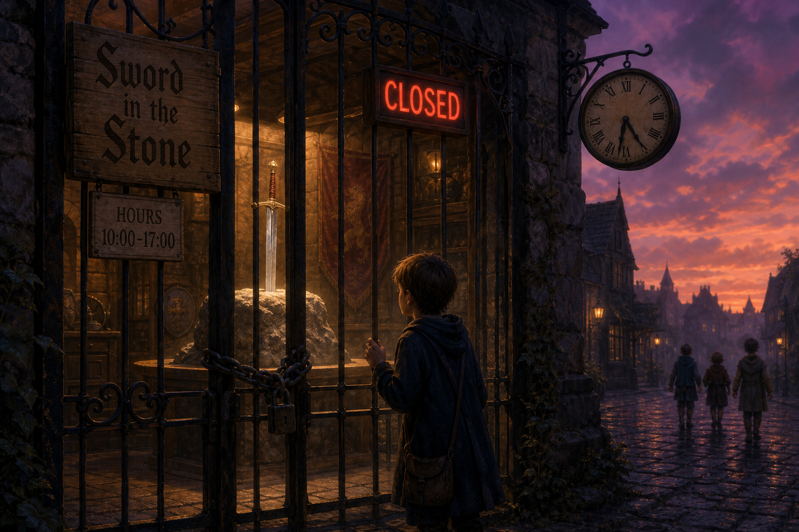

# *Cave Story* × Studio Pixel × Nicalis — controlled opposition, timeline skepticism, and legal chill on fan engines (open)

**TL;DR:** **Author thesis (investigator-supplied):** *Doukutsu Monogatari* functioned as an industry-grade cultural product misrepresented as a solo freeware legend — a legend so successful that, in the investigator’s read, most fans now reflexively “know” it was **one person over five years** despite the absence of a continuous five-year audit trail. §1.2 sharpens the counter-thesis: **actual studio production**, **~one year** of planning / engine / music / polish infrastructure, then **~three weeks** assembling the shipped game on an **existing engine**. §1.8 keeps the working suspicion that **Nintendo R&D1-adjacent** talent may have been routed through a **Studio Pixel** mask. The downstream outcome matters as much as the origin story: once community trust, ports, mods, and open-engine labor matured, publisher-side IP enforcement could legally dismantle competing fan/reverse-engineering pipelines — mirroring the fan-labor → corporate capture pattern tracked in [OC ReMix](/influence/controlled_opposition/investigations/ocremix-polarization-privatization-controlled-opposition-investigation.md) and **[*Homestuck*](/influence/controlled_opposition/investigations/homestuck-hussie-controlled-opposition-investigation.md). §6 argues the 2020 Nicalis / CSE2 episode helped normalize aggressive DMCA-first posture for fan reimplementations; §7 lists a selective 21st-century DMCA / anti-circumvention timeline anchoring Nintendo’s 2024–2026 emulator offensive. §1.7 archives narration contrasting genuine** *Undertale*-scale solo proof with opaque “followable” process, plus the sword-in-the-stone / gated shop metaphor for open commons vs. present enclosure. §1.9 archives an SNES / CD-ROM fork read (R&D1 “open hood” counterfactual vs. containment). §5.5 / §5.6 keep hardware-history counterweights. The same dossier holds mainstream falsifiers (public interviews, freeware provenance, Nicalis as distinct from Nintendo) and does not claim court-grade proof of Nintendo, yakuza, or studio-faked timeline without independent primaries.

**Status:** Open — §1.10: no accessible disproof at investigator audit bar; remains open until Studio Pixel reverses open-source / community-engine posture and releases full holdings (investigator does **not** expect that clearance). §1 is verbatim investigator stance; §2–§4 mix documented events with labeled speculation; §5 lists mainstream counter-readings (not treated as disproof at §1.10 bar); §6–§7 precedent / DMCA timeline.

**Guide**

- **Structural rhyme (community → enclosure):** [*Homestuck* §5.3](/influence/controlled_opposition/investigations/homestuck-hussie-controlled-opposition-investigation.md#53-fan-edits--video-derivatives--pattern-rhyme-ip-enclosure-adjacent) (DMCA / fan-edit lane; OpenMW vs MWSE fork sorting); [OC ReMix §7.4–§7.5](/influence/controlled_opposition/investigations/ocremix-polarization-privatization-controlled-opposition-investigation.md) (engine fork / legal chill geometry).
- **Reader essay alignment:** [Success — by any means necessary](/influence/controlled_opposition/success-by-any-means-necessary.md) — NDA silence, fan commons as subsidy, leader distance from community harm.
- **Readable companion:** [You do not have to stop loving *Cave Story*](/influence/controlled_opposition/you-do-not-have-to-stop-loving-cave-story.md) — longform reader essay (primer-level explanations in prose); silver platter (commons → corporate); media consolidation coda; §1.7 / §1.8 / §1.9 themes; gated-sword figure; Limits at end; full tables stay in this dossier.
- **Documented legal event (not hypothesis):** [GitHub DMCA — Nicalis, 19 Nov 2020](https://github.com/github/dmca/blob/master/2020/11/2020-11-19-nicalis.md) — takedown targeting **CSE2**-related repositories.

---

## 1. Investigator thesis — supplied narrative (first-class)

The following is preserved in the investigator’s voice as the load-bearing accusation this file exists to hold. It is hypothesis and moral-political reading, **not** a finding of fact by a court or regulator.

### 1.1 Macro arc — “controlled opposition” read

> The later devastation of the open-source / modding / reverse-engineering communities around *Cave Story* — especially Nicalis-era DMCA pressure on **CSE2** and related repos — ties together for the investigator as a controlled-opposition-shaped outcome: a cultural object that advertised the viability of a thriving non-corporate game culture, while the legal and publishing stack was positioned to smash community competition when it matured. Everyone in the fan lane was trained to repeat the same origin claim — one person, five years — while the investigator’s mirror work finds no continuous five-year progress record, only the 2004 brush-up year, sparse diary crumbs, and testimony.

The investigator reads this as continuous with other Paradigm Threat lanes where communities supplied free labor, feedback, focus-group energy, and idea mining, after which commercial routing divided, conquered, or chilled the commons — see [OC ReMix](/influence/controlled_opposition/investigations/ocremix-polarization-privatization-controlled-opposition-investigation.md) (fan submission licenses, industry coordination) and **[*Homestuck*](/influence/controlled_opposition/investigations/homestuck-hussie-controlled-opposition-investigation.md) (canon / IP recentralization**).

### 1.2 Production thesis — one-year plan, three-week build on existing engine, five-year cover (investigator)

> **Refined timeline model (investigator, May 2026):** The shipped *Cave Story* did not emerge from five years of weekly, auditable solo construction. The investigator is treating the one-person / five-year story as the claim to be disproven, not the neutral baseline. The working read is a two-phase industrial schedule masked by a retrofitted “five years in my spare time” legend when no inspectable ledger could justify that span.

> **Phase A — ~one year (plan + tooling + polish theater):** A planned ~12-month window covers engine readiness, music engine / Organya-family tooling, score pipeline, design iteration, tester routing, and public-facing “indie grind” performance. Engine and music infrastructure are treated as professional-grade inputs — **not** improvised in the same sprint as the final island content. On this read, the densest dated public trace — the 2004 “板‑裏” BBS (`doukutsu2004bbs`) — is exactly what you would expect from Phase A: months of bug, balance, and brush-up chatter with multiple handles, **not** proof of greenfield coding from zero across half a decade.

> **Phase B — ~three weeks (actual game assembly):** The playable game proper — maps, encounter scripting, narrative lock, asset integration on top of an already-existing engine — was built in a short sprint (**~three weeks** in the investigator’s gut read, rhyming with the early “three weeks” rumor). Content authoring on a mature stack is a different job than inventing the stack; conflating them is how “solo genius over five years” becomes morally legible without receipts.

> **Five-year cover story:** When interviewers and fans asked for calendar proof, the “five years” line (TIGSource April 2005, echoed in press) functioned as narrative padding — plausible, emotionally flattering, and almost impossible to falsify because no weekly dev log spans 1999→2004 in any mirror the investigator could download (**local evidence bundle:** `~/dev/wget/cave-story-timeline-evidence/` — ~11 sparse diary lines, ~215 BBS days in 2004 only, no continuous five-year ledger).

> **Credit routing (unchanged from prior §1.2):** Interviews and figurehead credit were deliberately routed to specific male Japanese public faces so industry labor could wear the mask of indie authenticity — **not** a useful idiot, on this read, but a participant in timeline packaging.

> **Studio / secrecy context (unchanged macro):** R&D-adjacent talent (hypothesis names Nintendo and, more specifically, keeps R&D1-adjacent capability in view) under secrecy, NDA, and partner-publisher credit-splitting culture — see §1.8 — **not** documented here as operational fact for *Cave Story*. In the investigator’s model, the freeware release is the packaging layer: industry-made or industry-assisted product repackaged as a fan-made free game.

**Unpack (assistant):** Pixel’s own `doukutsu-index` text admits total work ~5 years including remakes but publishes only the final brush-up year of board dialogue — compatible with investigator Phase A (documented year) plus off-stage claims (five years) without proving Phase B did **not** occur. §5.1, §5.7, and §1.10 hold counter-readings vs. investigator clearance bar.

### 1.10 Investigation status — open; no disproof at audit bar; clearance requires full open release (investigator-supplied)

> **No disproof on record (investigator):** As of the evidence mirrored in this lane (including `~/dev/wget/cave-story-timeline-evidence/`), nothing accessible disproves §1.2 or the broader §1 controlled-opposition read at the audit standard this dossier applies: continuous, inspectable, arms-length proof of five years of weekly solo construction; transparent open-source / engine stewardship; and good-faith defense of community reverse-engineering when publishers applied legal pressure. Mainstream interviews, sparse diary lines, beta crumbs, and one dense BBS year do **not** meet that bar — they remain compatible with §1.2 when reframed (plan year + short build + five-year sticker)**.

> **Clearance condition — what would “clear” the public face (investigator):** This investigation stays open until Studio Pixel (and successors / publishers in the chain where relevant) reverses its posture toward open source and community engines**: **withdraw / repudiate support for 2020-era legal chill against fan reimplementations; publish clear license posture for non-infringing tooling; and release everything held — engine source, music / Organya project files, dated build and commit-equivalent history, contract summaries redacted only where law requires — not curated HTML diaries or interview quotes alone**.

> **Expectation (investigator):** Does **not** expect that clearance to happen. Until it does, the named creator does **not** clear the timeline or controlled-opposition thesis in this file — **not** because guilt was adjudicated, but because the evidentiary burden the investigator assigns to exoneration was never met.

**Unpack (assistant):** “Open” here means investigation status, **not** a court verdict. §5 still lists mainstream counter-readings for readers who weight testimony and beta lore more heavily than the investigator’s audit bar.

### 1.3 Intent — not a “useful idiot”

> **Accusation (hypothesis):** The public creator was **not** a useful idiot but deliberately involved from the start in a scheme whose downstream included 2020-style legal hostility to community engines.

> **Scope of suspicion:** The investigator does not believe the named creator authored the whole project alone — including skepticism toward sole credit for music, music engine, and game engine. **Quality bar:** Professional-grade design, audio, and systems in an era when indie tooling was sparse is read as industry footprint, not accident.

### 1.4 Nintendo involvement heuristic (investigator)

> **Why Nintendo is invoked:** Secrecy discipline + finish quality + audio/engine coherence are treated as signals that only studio-process culture — hypothesis points at Nintendo-adjacent practice — could explain simultaneous silence and polish. No documentary proof of Nintendo contract labor on *Cave Story* appears in this dossier as of creation date.

### 1.5 Thematic / “industry standard” occult and misery grammar

> **Investigator read — occult / PP rhyme:** Ballos read as Baal-line villainy (Flash Gordon, *Stargate* TV, broader predictive-programming basin — cross [predictive programming hub](/influence/predictive_programming/page.md)). Heavy themes of suicide, misery, destitution, and escape are **not** treated as accidental; they are read as demographic-targeted tone deployment toward players who would later absorb antisocial / anti-humanity emotional palettes familiar from Hollywood repetition.

> **“Disney” backstory:** The king / sorcerer mythos is judged too Disney-shaped to read as organic Japanese inspiration — interpretive opinion, not comparative folklore scholarship.

> **Audio seam:** Some tracks are suspected to be written by different hands — discordant moments absent from the “main” style — hypothesis pending musicological or provenance work.

### 1.6 Ports, betrayal geometry — WiiWare 2010 and Nicalis 2020

> **WiiWare (March 2010):** The investigator recalls severe music / production regression on the North American debut relative to expectations from the PC freeware — a quality collapse that surprised them. **Question posed:** If the original creator “owned” quality soul, why permit the flagship Western console debut to sound broken or substandard?

> **Read:** That failure mode fits a model where “Studio Pixel” behaves like a label for multiple IPs sold through — no durable creative control after transfer — **not** like a single human guardian of every port.

> **Commercial routing / 2020:** The investigator describes the post-freeware path in shorthand as sold into the Nintendo / Nicalis lane: console legitimacy, publisher stewardship, and then Nicalis DMCA activity against **CSE2**-family repos. This is read as second betrayal geometry — same silence / same absence of creator-led defense of community reverse engineering — aligned with §1.1 thesis.

> **“Never open-sourced” reversal:** The investigator treats the 2020 posture as especially revealing because it arrives after roughly two decades of community porting, modding, editing, and forking around the free version. The message received by the community was: the myth could recruit your labor and attention, but when forks became a competing substrate, the rights-holder line hardened into “this was never open source” and hosted sharing can be removed.

### 1.7 Narration capture — *Undertale* contrast, open commons as “sword in the stone,” and the gated shop (investigator-supplied)

The following verbatim narration is archived here as sentiment and political theory language — not a journalistic finding about named people beyond what §1 already labels as hypothesis.

> **Transcription (investigator):** Toby Fox’s *Undertale* is precisely what the investigator says the industry was trying to prevent from becoming the uncontested public proof — unless that proof could be pre-colored by a controlled precedent. *Cave Story*, on this read, served that pre-coloring role: sell the myth that projects like this exist in the wild, built by individual fans alone without anyone else’s help, and able to challenge the biggest corporate products of the era. Toby’s version is treated as absolutely genuine on that axis; Studio Pixel’s public process, by contrast, is read as obscure, opaque, and useless as a how-to for anyone who wanted to actually follow in those footsteps with only their own labor and inspectable commons.

> **Open source / open publication metaphor:** Real open source behaves like the sword in the stone — in principle, any kid can walk up, grasp it, and inherit a kingdom of possibility. That is the power the investigator assigns to inspectable code and public method. The industry, on this thesis, always understood that threat and always worked to contain it.

> **Gated “sword shop” (present state):** Official culture will still feature the idea that someone can change the world with open source or ship a game that inspires everyone the way older games did. Yet the system today is jailed, walled, artificial, and legally constrained: the sword is on display behind hours, gates, and contracts — after closing, the kids go home with no stone left to touch.

### 1.8 Industrial-detour heuristic — N64 / 3D gravity, handheld routing of 2D & platformer craft, Nintendo→Studio Pixel working thesis (investigator-supplied)

**Framing:** Macro-industry story, **not** a leaked org chart. **Purpose:** explain why the investigator treats “Nintendo-adjacent R&D fingerprints” as plausible even without §2-grade contracts.

> **N64 inflection (hypothesis):** Something structurally odd lands, for this investigator, after Nintendo goes all-in on polygon identity for living-room consoles—not that 2D vanishes, but that the center of gravity moves toward first- and third-person 3D pipelines as the prestige lane. 2D and side-scrolling platformer craft keeps shipping, often routed to handhelds (GBA / DS era and successors) and to lower-headline SKUs relative to the SNES cadence—a pattern compatible with “spare” pixel-native / collision-native talent still inside first-party culture but **not** what mainline press conferences sell as the future of the TV box.

> **Nintendo R&D → Studio Pixel mask (working thesis until falsified):** The investigator sticks to the argument that the same Nintendo R&D ecosystem—especially the R&D1-adjacent pool of handheld / toy / pixel-native craft already accustomed, in this moral reading, to credit being split, borrowed, or fronted through partner publishers (Square, Rare, and similar historical names—not re-litigated here as contract facts)—could host labor later worn as “one indie Pixel.” §5.1 remains decisive hygiene: no primary employment / contract link is in this dossier as of last update.

> *Donkey Kong Country Returns* **(comfort read, not a review score):** Wii shake / waggle obligations are remembered as hostile to straight platformer muscle memory for part of the audience; later HD-style ports with conventional inputs are treated by the investigator as the first time that design read as “just play the 2D platformer” for that cohort—subjective, not evidence of malice in court.

> **2020 / “automatic” non-defense extension:** §6.1 already describes acquiescence while DMCA notices land. Here the investigator extends the moral charge: the recent record reads as what you would expect if highest-level containment culture treated the freeware-origin community as expendable once IP routing matured—not a claim that any named person signed each PDF. **Global clause (worldview language, not a country-by-country media survey):** the investigator suspects no propagated media vertical is fully outside pressure patterns that reward enclosure—still **not** a license to assert individual criminal knowledge without primaries.

### 1.9 SNES / CD-ROM fork — “open hood” counterfactual and R&D1 containment read (investigator-supplied)

**Framing:** Industrial alternate-history + organizational psychology read — **not** a scanned Nintendo R&D1 memo dump inside this dossier. §5.6 grounds hardware facts vs. moral language.

> **Backward-compat ambition (oral history / design-phase signal):** The investigator weights retrospective engineering accounts and industry memory that early Super Famicom / SNES planning treated cross-generation continuity as thinkable — NES-family compatibility or near-compat targets before final mask / cost cuts — i.e. a road where living-room consoles inched toward computer-like carry-forward, studios needed less forced rework to ship the same design grammar across generations, and players saw fewer “throw out the whole library” walls. Retail SNES did **not** ship as a native NES player in the flattened folk sense §5.6 corrects — this block is counterfactual / road-not-taken, **not** a SKU lie claim.

> **CD-ROM fork as splinter (documented business lore + investigator moral):** The collapsed Nintendo–Sony SNES CD alliance and the spin-out energy that fed Sony PlayStation are public business-history facts at headline grain — **not** re-litigated here clause-by-clause. On the investigator’s moral axis, had a CD-capable Nintendo-centered ecosystem survived with tool / education friendliness as a stated priority, the Super Nintendo generation could have read far closer to “home computer with a cartridge and optical lane” than the sealed appliance story that dominated later TV boxes. Instead, the work splintered outward into competitors whose incentive matrices the investigator reads as less aligned with quality / education-forward children’s software and more aligned with proprietary volume — another massive betrayal toward every open-community effort that already had to negotiate locked silicon just to breathe.

> **R&D1 as contained revolution:** Nintendo R&D1 (Yokoi-line portable / toy hardware thinking — no sainthood claim here) is read as a budding internal revolution that could have spread technical literacy beyond “consume the SKU” if the company had chosen programmable, legible, open-the-hood defaults for children worldwide — consoles you were allowed to understand, **not** only to buy. On this hypothesis, corporate containment did **not** merely miss a market — it shut down its own plausible future, splintered it, and sold / externalized pieces to other corporations.

> **Predict-destroy-build-later pattern:** The investigator treats the arc above as evidence-shaped (business history + hardware retrospectives) support for a softer systems law: incumbents can recognize early that open-source, inspectable, community-created game culture might eventually become load-bearing — then starve / split / lawyer the foundation they might still want to rent later when the rhetoric is convenient.

---

## 2. Documented facts (minimal anchors — not the thesis)

These items are widely cited in public sources and serve as shared reality anchors for readers who are not starting from the §1 hypothesis.

| Anchor | What sources generally report |
|--------|-------------------------------|
| **Freeware release** | December 2004 PC freeware *Doukutsu Monogatari*; later English visibility via translation scene. |
| **Pixel interview (English)** | April 2005 TIGSource interview — five-year development claim; solo framing — [mirror](https://archive.cavestory.org/tigsource/). |
| **Commercial publisher** | Nicalis published Cave Story+, WiiWare, and other SKUs — **not** interchangeable with “open source” governance. |
| **2020 DMCA** | Nicalis submitted GitHub notice listing **CSE2**-related repositories — [published notice text](https://github.com/github/dmca/blob/master/2020/11/2020-11-19-nicalis.md). |
| **pxtone / Organya** | Public credit lines associate Pixel with pxtone/Organya-family audio tooling — disputed by investigator in §1.3 but documented as mainstream attribution. |
| **2004 BBS density** | `doukutsu2004bbs` — dated posts 2004/01/25→2004/12/28; Pixel intro frames log as final brush-up year — local mirror under investigator `~/dev/wget/cave-story-timeline-evidence/studiopixel/`. |
| **Evidence vacuum** | No accessible weekly progress ledger 1999→2004; investigator §1.2 timeline model rests on pattern + sparse dated crumbs, **not** continuous audit trail. |

---

## 3. Pattern cross-reference — same repo “enclosure” geometry

| Sibling investigation | Rhyme with this lane |
|-----------------------|----------------------|
| [OC ReMix — polarization & privatization](/influence/controlled_opposition/investigations/ocremix-polarization-privatization-controlled-opposition-investigation.md) | Fan labor → LLC / publisher routing; §7.5 engine fork / legal chill language. |
| [*Homestuck* — CO & privatization](/influence/controlled_opposition/investigations/homestuck-hussie-controlled-opposition-investigation.md) | §5.3 — DMCA stress; divide-and-sort pipelines; IP enclosure. |
| [SDA × GDQ × MSF](/influence/controlled_opposition/investigations/sda-gdq-charity-msf-polarization-investigation.md) | Community institution → branded LLC / opaque money routing — weaker direct rhyme, same temperature. |
| [Success — by any means necessary](/influence/controlled_opposition/success-by-any-means-necessary.md) | NDA, black-box economics, leader distance from harm. |
| [You do not have to stop loving *Cave Story*](/influence/controlled_opposition/you-do-not-have-to-stop-loving-cave-story.md) (blog essay) | Longform reader-essay cadence; primer-level explanations in prose; §1.9 / SNES CD / R&D1 “open hood” rhyme in essay form; silver platter / media coda with primary links; Limits / disclaimers at end only—synthesis, **not** new evidence tier. |
| **Microsoft-style platform control** | Investigator shorthand for high diversification with central control: many brands, tools, stores, repos, platforms, and “communities,” but one coordinated enforcement grammar when free competition threatens the stack. |

---

## 4. Open questions / research hooks

1. Independent non-Pixel-hosted archival chain-of-custody for pre-2005 development artifacts — investigator stance: unsatisfied — aligns with prior chat skepticism about retroactive HTML.
2. Musicological diff — trace hand-count / style seams across Organya tracks (hypothesis in §1.5).
3. WiiWare audio regression — locate contemporary reviews / tech write-ups pinning music bugs or mastering issues (March 2010 window).
4. Nicalis–community correspondence — any public counter-notification or settlement narrative around **CSE2** (not compiled here).
5. Any primary employment / contract document linking Nintendo R&D to **Studio Pixel** or pre-release *Cave Story* — currently absent from this dossier (falsifier if never found).
6. Quantified routing story for first-party 2D / pixel talent post- N64 vs handheld / partner SKUs — to stress-test §1.8 without relying on impressionistic trade-show memory alone.
7. Primary engineering / business memos on Super Famicom early compatibility targets vs. final silicon cuts and on SNES CD partner negotiations — to ground §1.9 without leaning only on retrospective articles / oral history.
8. §1.2 timeline model — locate any third-party employment / contract / build farm record for a ~3-week content sprint on pre-existing engine (falsifier if never found )**.
9. Expand local mirror `~/dev/wget/cave-story-timeline-evidence/` — Wayback CDX when Archive.org rate limits lift; forum.cavestory.one threads.
10. §1.10 clearance — track any Studio Pixel / rights-holder move toward full source release, **CSE2** non-opposition, or license clarity (would trigger dossier re-review )**.

---

## 5. Contradictions, falsifiers, and mainstream narrative

**Purpose:** Make explicit that this investigation targets potential post-hoc timeline faking and industry-origin hypotheses — while mapping strong counter-readings.

### 5.1 Timeline and authorship (mainstream)

- **Long-horizon evidence:** 2004 Japanese development BBS activity (final-year polish) and 2005 English interview stating multi-year work — contradicts “three weeks only” if read as total calendar from zero without §1.2’s engine / plan split; mainstream treats sources as good-faith records of long project life including beta / remake phases.
- **Tooling:** **pxtone / Organya** ecosystem is documented as Pixel-associated music tooling — challenges “didn’t make the music engine” unless credit is false.
- **No Nintendo smoking gun:** Standard industry reporting treats *Cave Story* as indie freeware → commercial ports, not first-party Nintendo development. Absence of leak is **not** proof of absence, but it blocks easy confirmation of §1.2.

### 5.7 Investigator timeline model — audit bar vs. mainstream counter-readings

**Investigator position (§1.10):** No mirrored evidence disproves §1.2 at the clearance bar defined there. The table below maps what exists vs. what mainstream readers sometimes treat as refutation — the investigator does **not** accept those rows as exoneration without full open release.

| Claim (§1.2) | Supports in accessible mirror | Mainstream counter-read (does **not** clear §1.10) |
|--------------|------------------------------|-----------------------------------------------------|
| **~1 year documented polish / plan** | 2004 BBS ~215 unique days; Pixel intro: “brush-up year” | Jan 2004 high volume — compatible with Phase B before board or fabricated thread (investigator allows latter only as hypothesis ) |
| **~3 week content sprint on existing engine** | Early “three weeks” rumor; professional finish vs. sparse construction log | Beta 2001–2002 — read as earlier iteration or lore, **not** weekly solo ledger |
| **Five years as cover** | No weekly 5-year ledger; diary ~11 lines | TIGSource five-year quote — testimony, **not** inspectable audit trail |

### 5.2 Legal actor

- Nicalis, not Nintendo, filed the 2020 DMCA cluster captured on GitHub — IP publisher enforcement explains much of the chill without Nintendo named as rights-holder in that notice.

### 5.3 Port quality vs. conspiracy

- Bad WiiWare audio / bugs can arise from tight schedules, middleware, mastering mistakes, or publisher-side decisions without proving fake solo dev or studio swap.

### 5.4 Thematic reads

- Occult name rhymes (Ballos / Baal) can be literary or syncretic without central directors dictating global PP — §1.5 stays interpretive.

### 5.5 Home-console nuance — 2D did not literally vanish from TV (mainstream)

- **Counter to over-strong §1.8 readings:** Nintendo continued to ship 2D, hybrid, and retro-styled platformers on home consoles after N64 (e.g. New Super Mario Bros. line, Wii / Wii U entries, other revivals)—so §1.8 must be read as a center-of-gravity / prestige-pipeline thesis, not as “zero 2D on TV after 1996.”
- 3D platformers also remained a Nintendo home-console staple (Mario 3D line, etc.)—the investigator’s “unused platformer programmers” language targets a hypothesized 2D-native / pixel-native sub-pool, not a claim that Mario teams went on vacation.

### 5.6 SNES hardware history vs. moral reading (mainstream)

- **Retail SNES / Super Famicom:** Did **not** ship as a built-in native NES cartridge player in the simplified folk sense some oral histories compress toward; early-plan compat ambitions (if any) belong to design-phase / cost trade-space — §1.9 must be read as counterfactual / road-not-taken, **not** “Nintendo secretly shipped open computers and hid it.”
- **Sony / Philips / CD breakup:** Standard business-history explanations (royalty / control / contract friction) do **not** require malice toward educational software to predict PlayStation’s success; the investigator’s “betrayal of open community” language is moral-systems tone, **not** a joint venture fraud finding.
- **R&D1 idealization:** Naming R&D1 as “the revolution” is theory / poetic staffing read — **not** an HR roster or verified org-chart claim about who wanted what inside the building.

---

## 6. Investigator conclusion — 2020 controversy as precedent climate (hypothesis)

**Framing:** This block states moral-political judgment and pattern causation as investigator read — **not** a proved causal chain in court, **not** a finding that Pixel controlled Nicalis or Nintendo.

### 6.1 What the investigator concludes

> The November 2020 cluster around Nicalis, GitHub, and **CSE2**-family repositories set cultural and procedural precedent for rights-holders to dig in on hard DMCA / ownership rhetoric against decompilation and fan-engine work — at exactly the layer (hosted source, fork graphs) where open collaboration had tried to scale. The investigator describes this as an all-forks signal: not merely “please remove one infringing build,” but a visible message that fork graphs and community continuity could be treated as removable once the rights-holder asserted that the work was never open-sourced.

> **Pixel’s leverage (investigator read):** As recognizable author-face and moral center of the freeware mythos, Pixel sat in a rare position to force public negotiation over fair use, reverse-engineering norms, anti-circumvention boundaries, and good-faith community stewardship — e.g. clarifying license posture, protecting non-infringing tooling, or drawing press attention to abuse of process. Instead, the record the investigator weighs shows acquiescence while IP holders advanced actual notices that GitHub treated as compliance triggers — helping normalize “publisher says code-shaped-like-our-game → removal” without a countervailing creator-led fair-use crusade.

> **Bridge to Nintendo / Microsoft-style control:** That climate rhymes with — does not by itself legally cause — Nintendo’s later multi-wave campaign (2024→2026) pairing lawsuit / settlement (Yuzu) with mass repository DMCA sweeps and continued GitHub enforcement (published notices into early 2026). Nintendo needed no permission from Pixel; the investigator’s point is ecological: indie-origin IP stories that end in publisher DMCA against community engines train audiences and platforms to accept hard enforcement as default. This is the same **Microsoft-style** shape named in §3: diversified surfaces, centralized control, no durable competition from the free/open-source creator layer once the corporate stack decides to close.

### 6.2 Correlation hygiene (mainstream)

- Nicalis ≠ Nintendo as corporate person; Cave Story IP chain ≠ Switch TPM law — different statutes, different facts.
- Platforms (GitHub) respond to valid-looking 512(c) notices regardless of Pixel’s silence — §6.1 does **not** prove Pixel could have single-handedly won a U.S. fair-use war for **CSE2**.

---

## 7. Selective timeline — DMCA, §1201 anti-circumvention, and gaming-industry enforcement (21st century)

**Purpose:** Illustrative corroboration only — **not** a complete case law survey. Entries mix U.S. federal rulings, high-profile criminal DMCA episodes, and documented publisher GitHub / lawsuit actions. No single row proves Pixel caused later rows.

| Approx. date | Event (short) | Why it matters here |
|--------------|---------------|---------------------|
| Oct 1998 | DMCA signed (U.S.) — §512 takedowns + §1201 anti-circumvention | Baseline legal machinery all later rows assume. |
| Jul 2001 | Adobe / Sklyarov eBook DMCA arrest (DEF CON) — §1201 as criminal risk | Early proof that circumvention talk could meet prosecution, **not** only civil copyright. |
| Jul 2008 — Dec 2010 | MDY Indus. v. Blizzard — Glider bot vs. Warden; Ninth Circuit affirms DMCA anti-circumvention angle | Landmark online-game mod/bot layer under DMCA — [Ars coverage](https://arstechnica.com/gaming/2009/01/judges-ruling-that-wow-bot-violates-dmca-is-troubling/), appeal note 2010. |
| Apr 2011 | Sony settles with GeoHot et al. (PS3 jailbreak) | Console TPM fight pre- modern GitHub emu waves — corporate willingness to litigate hardware circumvention**. |
| Oct 2020 | RIAA youtube-dl takedown (GitHub) → reinstatement after process | Shows GitHub as pressure point for DMCA ecology (non-game but platform shape). |
| 19 Nov 2020 | Nicalis DMCA — ~36 **CSE2**-related repos — [GitHub published notice](https://github.com/github/dmca/blob/master/2020/11/2020-11-19-nicalis.md) | This dossier’s anchor — publisher notice against fan engine graph. |
| 26 Feb 2024 | Nintendo sues Tropic Haze (Yuzu) — Switch emulator | Opens 2024 “hard” TPM / trafficking framing against emu distribution. |
| 4 Mar 2024 | Yuzu discontinued; ~$2.4M settlement approved (injunction) — [Ars Technica](https://arstechnica.com/gaming/2024/03/switch-emulator-makers-agree-to-pay-2-4-million-to-settle-nintendo-lawsuit/) | Settlement plus injunction — strong precedent signal for emu teams. |
| May 2024 | Nintendo large-scale GitHub DMCA against Yuzu fork copies (reports of thousands of repos) — [The Verge](https://www.theverge.com/2024/5/3/24147936/nintendo-dmca-takedown-yuzu-emulator-copies) | Mass fork delisting — platform-level chill. |
| Apr 2024 | Nintendo targets circumvention / discord adjacent projects (reporting) — [Ars Technica](https://arstechnica.com/gaming/2024/04/nintendo-targets-switch-emulation-chat-servers-decryption-tools-with-dmca/) | Broadens enforcement beyond single binary. |
| Oct 2024 | Ryujinx shuts down under Nintendo pressure (reporting) — [TorrentFreak](https://torrentfreak.com/ryujinx-switch-emulator-project-shuts-down-under-nintendo-pressure-241002/) | Second major Switch emu pipeline removed from central hosting. |
| Mar 2025 | Anniversary wave — reports of thousands of additional emu-related repo takedowns — [TorrentFreak](https://torrentfreak.com/nintendo-easily-kills-4238-switch-emu-repos-on-yuzu-lawsuit-anniversary-250305/) | Shows sustained GitHub campaign after 2024 settlement. |
| 12 Feb 2026 | Nintendo GitHub DMCA notice listing multiple Switch emulator projects — [published notice](https://github.com/github/dmca/blob/master/2026/02/2026-02-12-nintendo.md); press e.g. [Nintendo Life](https://www.nintendolife.com/news/2026/02/13-switch-emulators-hit-by-latest-wave-of-nintendo-takedowns) | Continues the 2024 pattern into 2026 — corroborates “early 2024 → Feb 2026” enforcement arc. |

---

## Related investigations

| Investigation | Relation |
|---------------|----------|
| [OC ReMix](/influence/controlled_opposition/investigations/ocremix-polarization-privatization-controlled-opposition-investigation.md) | Fan labor → industry routing; §7 legal chill geometry |
| [*Homestuck*](/influence/controlled_opposition/investigations/homestuck-hussie-controlled-opposition-investigation.md) | Canon/IP enclosure; §5.3 DMCA / fork lane |
| [Great Awakening / PP cluster](/influence/controlled_opposition/investigations/great-awakening-alien-savior-rv-nwo-cluster-investigation.md) | Optional PP cross-read for occult / reset grammar |

---

Keywords: #CaveStory #Undertale #StudioPixel #Nicalis #CSE2 #ControlledOpposition #FanLabor #ReverseEngineering #DMCA #Nintendo #N64 #OpenSource #ParadigmThreatFiles

**Last updated:** 2026-05-19 (fan-belief / no-five-year-ledger refinement; Nintendo/Nicalis commercial-routing sentiment; all-forks DMCA signal; **Microsoft-style** diversified/central-control rhyme)

---

## Limits and disclaimers

**Publication hygiene:** Private research file — **not** legal advice; **not** a regulatory or journalistic certificate of fact. §1 is investigator hypothesis and accusatory moral reading preserved on purpose — **not** a judicial finding that named individuals committed fraud, breach of contract, RICO, criminal conspiracy, or any crime. Nintendo, organized crime, and state-level “vassalship” references in §1.2 are macro-theoretical language in this file — no named handler network is asserted as proven for *Cave Story*.

**Defamation guardrail:** If any sentence reads as a settled factual accusation against a living person, treat that as labeling defect pending revision — intent is to house investigator thesis with counterweights in §5.

**Evidence tiers:** §2 lists commonly reported anchors; §1 overwrites none of them with proof. DMCA text on GitHub is primary for the notice itself, **not** for Pixel’s intent.

**§6–§7 causal discipline:** §6.1 does **not** establish that Nicalis 2020 legally caused Nintendo 2024–2026 actions or that Pixel had determinative power to rewrite fair-use outcomes for **CSE2**. §7 is selective illustration — omissions are expected.

§1.8 / §5.5 **discipline:** §1.8 is industrial storytelling + working thesis, **not** a SKU inventory of every Nintendo home console 2D title; §5.5 blocks literal misreadings. §1.8’s “no innocent exceptions” clause is moral systems language — **not** a defamation vector against named individuals.

§1.9 / §5.6 **discipline:** §1.9 mixes documented headline business history (SNES CD / Sony splinter) with counterfactual / moral systems reads — §5.6 separates retail hardware facts from R&D1 idealization. “Betrayal” toward open communities is political judgment, **not** a tort complaint against named executives without docket-grade filings.

**§1.10 clearance discipline:** “Open” investigation status is **not** a criminal conviction. Mainstream material in §5 is preserved for reader balance but does **not**, in the investigator’s view, disprove §1.2 without the full release bar in §1.10.

**Assistant / tooling:** File created with drafting support from LLM agents; investigator supplied §1 substance and directives.

---

## Investigator notes

- Repo-relative path: `influence/controlled_opposition/investigations/cave-story-studio-pixel-nicalis-controlled-opposition-investigation.md`
- **Cross-link maintenance:** If OC ReMix § anchors drift, patch **Guide** block URLs to stable headings.
