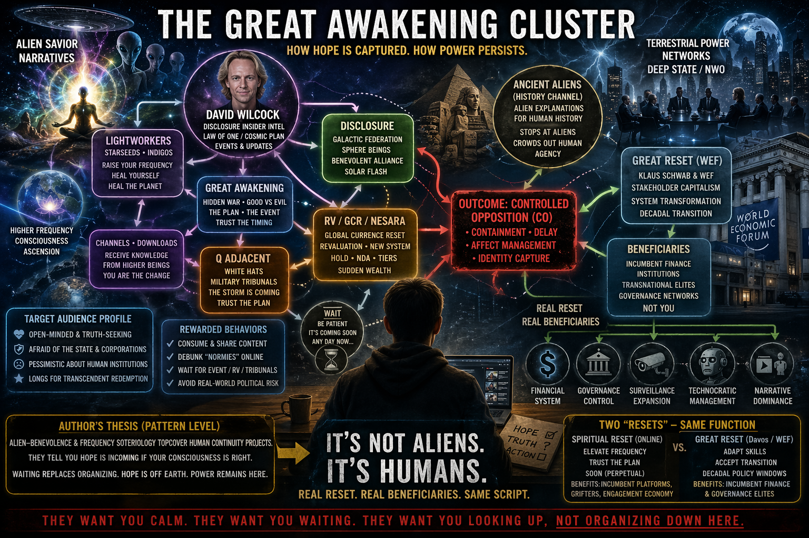

# Investigation: “Great Awakening” / Alien Savior / Revaluation (Dinar) / Lightworker Cluster — Controlled Opposition and the Human “Reset” Thesis

> **TL;DR:** Case file treating the online convergence of David Wilcock–style disclosure, “Great Awakening” spirituality, lightworker / starseed / frequency language, Iraqi dinar–style **revaluation** (global currency reset) lore — promoters often type **“RV”** in forums; that is **not** intelligence-community **remote viewing** ([Mars 1984 worksheet](/influence/controlled_opposition/investigations/cia-reading-room-mars-exploration-1984-rv-investigation.md)) — *Ancient Aliens*–style extraterrestrial historiography, and adjacent Q / “white hats” / tribunals memes as a **single recruitment basin** for **managed dissent**—not proven as one operation, but **structurally** similar: it promises redemption through non-human or occulted benefactors and patience, while the same arc names a macro financial “reset” aligned with the **WEF Great Reset camp** (**§3.2**, **§3.3.1**). **Author hard-power corollary:** U.S.-led destruction of Iraq (1991 / 2003) and Libya (2011) and of gold / settlement forks is read as fear of a parallel financial reset outside that camp (timeline **§3.3.2**). WEF-style public programs advance human long-horizon governance rebrands in parallel. **Pre-Q rhymes:** [Benjamin Fulford](https://benjaminfulford.net/about/)-style weekly “secret war” / mass-arrest forecasting; Drake Bailey × Wilcock ([Divine Cosmos transcript](https://divinecosmos.com/davids-blog/1043-massarrests/)); **§3.7** QAnon (“Trust the plan,” Storm) as the same grammar at scale. **Cable parallel:** *Conspiracy Theory with Jesse Ventura* ([Wikipedia](https://en.wikipedia.org/wiki/Conspiracy_Theory_%28TV_series%29)). **Author conclusion (pattern):** the beneficiaries of any real “reset” are terrestrial power networks (deep state / NWO vocabulary in repo idiom), **not** aliens; the alien–savior lane may cover hypotheses the repo treats separately—e.g. a human breakaway presence associated with Mars that is **neither ancient nor benevolent** ([Mars / deep state hub](/cosmos/mars/page.md)). Cross-read: [Etana / “Ancient Aliens” trap](/history/chronology/investigations/etana-sumerian-king-list-saturnian-investigation.md), [Urantia CO + PP](/influence/predictive_programming/fiction_encoding/urantia/index-urantia-book-investigation.md), [Artemis II debunk-vs-conspiracy trough](/history/chronology/investigations/artemis-ii-mission-as-faith-test-investigation.md), [Occupy OWS CO thesis](/governance/war/investigations/occupy-wall-street-controlled-opposition-investigation.md), [QAnon CO hub](/influence/controlled_opposition/00).

**Date:** 2026-04-23  
**Status:** Open — pattern synthesis and author stakes are first-class; **no** single agency running the whole cluster is claimed as fact here.

**Terminology:** This file centers **currency revaluation** (Iraqi dinar / GCR / NESARA–style waiting-room economy). That scene abbreviates **revaluation** as **“RV”** in chat — unrelated to CIA **remote viewing**, also abbreviated “RV” elsewhere in the repo ([1984 Mars remote-viewing investigation](/influence/controlled_opposition/investigations/cia-reading-room-mars-exploration-1984-rv-investigation.md)).

---

## Guide (read order)

1. **§1** — What this file is / is not (scope, evidence tiers).  
2. **§2** — The cluster (entities, pipes, how nodes fuse).  
3. **§3** — Case studies: *Ancient Aliens*, WEF “Great Reset,” revaluation / dinar (**§3.3.1–3.3.3** Iraq/Libya / financial reset read + timeline + gold conclusion), Wilcock, **§3.5** Fulford / Drake / Ventura, **§3.6** missing/dead scientists (**§3.6.6**), **§3.7** QAnon.  
4. **§4** — Mechanics (psychographics, rewarded behaviors, guru / insider avatar).  
5. **§5** — Cover vs truth — Mars breakaway rhymes (repo cross-links).  
6. **§6** — Two “resets” — spiritual waiting room vs Davos branding.  
7. **§7** — Author’s originating thesis (verbatim + unpack).  
8. **§8** — Author’s open claims (registry).  
9. **§9** — Questions to clarify, verify, or debunk.  
10. **§10** — Weak points / TODOs.  
11. **§11** — Related investigations.  
12. **§12** — References (expanded URL list).  
13. **Keywords** → Limits.

---

## 1. Scope and limits of the investigation object

This investigation names a **cultural object**: the algorithmic and social graph where spiritually burned-out, state-skeptical, and future-pessimistic audiences meet disclosure entertainment, currency fantasies, and politics-as-script narratives.

**What “controlled opposition” means here (outcome-first):** The phrase is **not** reserved for proven paid agents. In this file it marks narrative structures whose steady-state behavior is often indistinguishable from **containment**: hope is routed off electoral and labor institutions, risk is personalized as vibration or intel drops, and agency is outsourced to occulted rescuers (military tribunals soon, Galactic Federation soon, revaluation window soon). Emergent capture (grifters + platforms + audience desire) can produce the same curve as deliberate CO without a single director.

**In scope:** Pattern language, documented show/franchise and policy branding, fraud complaints and press on revaluation / dinar schemes, public statements and third-party reporting on named influencers, and repo hypotheses about what such patterns may obscure.

**Out of scope (here):** Proving Wilcock, Gaia, History Channel, or WEF hold standing meetings; proving every dinarian forum moderator is on payroll; resolving every UAP case.

**Evidence tiers (quick key):** **Primary** government filings and litigation releases > mainstream investigative press (e.g. CNBC on dinar rings) > participant or fan blogs (useful for what was said, **not** for what is true) > commentary threads.

---

## 2. The cluster — nodes, bridges, and fusion pressure

The table below is a schematic. In practice, edges blur: Q readers also hold dinar; Law of One readers also watch *Ancient Aliens*; “NESARA/GESARA” paste attaches to almost any node.

| Node | Typical promise | Typical deferral |
|------|-----------------|------------------|
| **“Great Awakening”** (meme bundle) | Consciousness / justice wave; hidden war between good and evil | Wait for the event / the plan |
| **David Wilcock** (public career) | Insider “intel,” Law-of-One-flavored cosmology, disclosure timing, occasional Pentagon-flavored “mass arrest” briefings (see §3.4–3.5) | Episodic updates; insider chain; transcript culture |
| **Lightworkers / starseeds / indigos** | Personal frequency change heals collective trauma | Inner work substitutes for coalition politics |
| **Revaluation / GCR / NESARA-style** lore (forums often say “RV”) | Sudden wealth redistribution after “reset” | Hold currency; NDA fantasy; tiered “intel”; moving date |
| *Ancient Aliens* / “AA” culture | Non-human explanation for anomalies | Stops at aliens; crowds out human agency and other chronologies |
| **Q-adjacent** “military tribunals” etc. | Punishment of cabal imminent | Trust the plan |

**Bridge phrases (observed in the wild):** “elevating the human race to a higher frequency,” “downloads” / “knowledge from higher beings,” “benevolent Galactic Federation,” “solar flash,” “for humanity” attached to macroeconomic miracles, “operation Green Light,” “RV any minute” (revaluation-window hype; **not** remote viewing).

**Fusion mechanics (why it feels like one “map”):** Shared villain (cabal, BIS, Fed, deep state), shared savior (white hats, Sphere Beings, Jesus ship soon), shared temporality (imminent flip). Once those three match, content from disparate authors interlinks naturally in feeds without central authorship.

**Illustration:** The header image is a dense mind-map style graphic representing how fans draw the map; evidential status is in **Limits and disclaimers**.

---

## 3. Case studies, public “products,” and author read — Iraq, Libya, revaluation, resets

This section pairs what is on the record (shows, regulators, press, dates) with Paradigm Threat’s read of why the Great Awakening / revaluation / NESARA–GCR channel economy matters: those CO-shaped feeds name and rehearse a macro financial “reset” in lockstep with a clearly defined Davos / WEF “Great Reset” camp (**§3.2**)—globalist and anti-national-sovereignty in effect, whatever party holds the White House. The author treats U.S.-led destruction of Iraqi and Libyan governments (1991 / 2003; 2011) and of their gold, settlement, and parallel-currency vectors as driven—not exclusively, but substantially—by fear of a competing financial reset outside Anglo-American preference (**§3.3.1–§3.3.4**). Evidence-tier hedges and mono-cause caveats sit in **Limits and disclaimers**.

### 3.1 *Ancient Aliens* (History Channel / A+E Networks)

**What the product is:** A long-running cable franchise that repeatedly poses extraterrestrial or ultra-ancient high-tech hypotheses as the go-to explanation class for historical and archaeological “mysteries.” Official hub: [History.com — *Ancient Aliens*](https://www.history.com/shows/ancient-aliens).

**Why it matters to this investigation:** The show occupies the same attention slot as sober chronology disputes, catastrophe geology, and institutional history—but routes anomalies into ET authorship by default. That default is exactly what the [Etana file](/history/chronology/investigations/etana-sumerian-king-list-saturnian-investigation.md#4-predictive-programming-layer-why-ancient-aliens-is-a-useful-trap) calls a **“useful trap”**: a rebellious-looking non-mainstream channel that still blocks third readings centered on human witness and power.

**Controversy (documented, mainstream):** Academics and science communicators have long criticized the program for misquoting experts, false balances, and confusing speculation with evidence—standard science communication grievances, independent of this repo’s deeper chronology claims. The investigative point here is **structural**: high production value + mystery format ⇒ durable misdirection budget.

**Repo read:** [Mars article](/cosmos/mars/page.md) explicitly rejects AA-style pyramid authorship while advancing a human deep-state thesis—useful tension when cross-reading.

### 3.2 “Great Reset” (Davos / WEF public framing)

**Documented fact layer:** Klaus Schwab and Thierry Malleret published *COVID-19: The Great Reset* (2020), and the WEF promoted “Great Reset” as a named policy and cultural conversation about post-pandemic economic and social transformation. Hub (verify current subpages): [WEF — The Great Reset](https://www.weforum.org/great-reset/).

**Analytic point for this file:** The spiritual disclosure scene often uses “reset” and “awakening” language in parallel to Davos branding without sharing a mailing list. **Lexical overlap** still matters politically: both discourses train populations to think in epochal breaks rather than incremental accountability mechanisms (budget votes, union contracts, FOIA coalitions, local elections).

### 3.3 Revaluation / GCR / dinar — what promoters mean, how it works, and documented harm

**Vocabulary:**

- **Revaluation** (dinar / GCR scene; chat shorthand **“RV”** — **not** [remote viewing](/influence/controlled_opposition/investigations/cia-reading-room-mars-exploration-1984-rv-investigation.md)): the claim that one or more currencies (classically the Iraqi dinar, IQD) will revalue upward by orders of magnitude, instantly enriching holders.  
- **GCR** (*global currency reset*): a macro myth in which many currencies reprice together, often tied to gold or a new financial architecture.  
- **NESARA / GESARA** (internet lore): a bundle of legends about secret laws, debt forgiveness, and “prosperity packages”—frequently pasted onto revaluation chat rooms even when no verifiable statute matches the fantasy text.

**Mechanics (generic scam pattern, not investment advice):**

1. Buy physical or questionable paper currency or “reserve contracts” from promoters at steep markups vs spot rates.  
2. Subscribe to tiered “intel”—call times, private forums, “NDAs” as status props.  
3. Rolling windows: banks “on alert,” “800 numbers” imminent, “rates on screens” then pulled—each failure re-explained as cabal interference or need for more prayers / higher frequency.  
4. Community identity: years of shared waiting produce sunk social cost; exit feels like betraying friends.

**Why this belongs beside “disclosure” and Q:** Same imminent-flip grammar, same insider chain, same villain (deep state blocked the revaluation again — forums: “they blocked the RV”). Dinar forums and UFO disclosure channels overlap in audience graphs empirically (platform-dependent; **§9** asks for measurement).

**Documented controversy — law, regulators, press:**

- **SEC** — *Litigation Release No. 23509* (31 Mar 2016): charges against John Scott Clark; complaint alleges “bogus scheme involving investments in ‘top secret’ Iraqi currency and oil contracts,” claims of access to a secret U.S. military and government program, written guarantees of extreme returns, and instructions not to talk about it ([SEC LR-23509](https://www.sec.gov/enforcement-litigation/litigation-releases/lr-23509)). Criminal restitution and prison time are on the record in that release.  
- **CNBC** investigative piece on a multi-million-dollar dinar scheme and markups ([CNBC — “Inside a $24 million investment scam: Buy the Iraqi dinar”](https://www.cnbc.com/2015/01/15/inside-a-24-million-investment-scam-buy-the-iraqi-dinar.html)).  
- **CFTC** — administrative law judge opinion re Dinar Corp. (2020) (fraud findings in commodity / forex adjacent marketing): [CFTC ALJ opinion PDF](https://www.cftc.gov/media/3481/enfdinarcorpincopinion021420/download).  
- Trade press summaries of persistent false claims around IQD (useful for claim inventory, not as sole authority): e.g. [Iraq Business News — “The Iraqi Dinar Revaluation Scam”](https://www.iraq-businessnews.com/2024/08/29/the-iraqi-dinar-revaluation-scam-false-hope-financial-deception/).

**Counter-narrative (honest dinar holders’ point):** Iraq is a real country with a real central bank; exchange rates move for macro reasons unrelated to forum intel. Small legal currency purchases as souvenirs or speculation are **not** automatically the same as joining a fraud ring—but this file cares about the **revaluation** story when it becomes guaranteed wealth, secret military pipes, and moving deadlines: that shape matches enforcement cases.

**Investigative use:** Revaluation lore behaves like **controlled opposition** in outcome—it taxes hope, immobilizes political economy literacy, and anchors trust to secret timing messages.

#### 3.3.1 Great Reset camp, “official” Iraq, Libya’s bipartisan window, and the financial-reset fear

**Great Reset camp (author definition):** The Davos / WEF-branded **Great Reset** (**§3.2**) is treated here as a **coherent camp**: multilateral rules, stakeholder capitalism, digitized and centralized financial governance, and—in practice—hostility to national settlement outside that lattice (gold blocs, parallel pricing, sanctions-proof pipes). It is not MAGA-style American nationalism; it is transnational elite continuity with **U.S. hard power** as enforcer when needed.

**Iraq — official story vs. public plausibility:** The Bush administration’s 2003 bundle (WMD stockpiles, al-Qaeda links, “mushroom cloud,” mobile labs) collapsed in credibility for many Americans once the weapons did not materialize at scale. Desert Storm (1991) had a cleaner legal surface (Iraq invaded Kuwait) but still terminated in who held Gulf reserves and pricing power. For the author, the gap between televised rationales and what ordinary people find believable is where revaluation–GCR “real reason” narratives draw oxygen—and where this investigation places **gold**, **euro** settlement ([CNN 2000](https://www.cnn.com/2000/WORLD/meast/10/30/iraq.un.euro.reut/); [RFE/RL](https://www.rferl.org/a/1095057.html)), and **reserve custody** (**§3.3.3**).

**Libya 2011 — gold named where, and who cheered:** UNSC Resolution 1973 (no-fly / protection of civilians) does not list “gold dinar.” Gold and African currency integration appear in diplomatic and leaked-email circulation (e.g. Blumenthal threads summarized in press and in [Africa Check](https://africacheck.org/fact-checks/meta-programme-fact-checks/did-gaddafi-plan-introduce-african-currency-backed-gold))—tertiary for mono-cause proof, but real as discourse the author weights. Secretary of State Hillary Clinton was the face of intervention optics; on learning of Gaddafi’s death she said on camera, “We came, we saw, he died” ([CBS News](https://www.cbsnews.com/news/clinton-on-qaddafi-we-came-we-saw-he-died))—a rare moment where the “final word” tone matched destruction openly. The author reads 2011 Libya as **less heavily contested in liberal mass media** than Iraq 2003: Democratic establishment figures were largely on board or muted compared to anti-Bush street energy (qualitative pattern; quantification and counterexamples sit in **Limits**). Bipartisan comfort (R executes, D owns optics) with smashing a regime that had signaled parallel African / gold-settlement ambition fits the thesis that **both D.C. camps** could live with Tripoli’s ruin when the humanitarian banner was available.

**Bait and blowback (author hypothesis):** After Iraq’s costly occupation and radicalization effects, the globalist layer (per author) had incentive to prefer a lighter-footprint Libya model that still killed the gold / AU vector yet risked state collapse and arms diffusion across the Sahel. Boko Haram’s escalation in Nigeria and wider jihadist entropy followed in the same arc; UN panels often cite Libyan spillover as one driver of regional instability (general linkage; direct Boko causation disputed—**Limits**). The author reads that as forecastable blowback accepted for the sake of killing a non–Great-Reset financial fork.

**America’s fear (bottom line for this file):** The West—America first among enforcers—feared regimes that could anchor or symbolize a **parallel financial reset** outside the Great Reset camp. Destroying those governments and their gold-backed or gold-adjacent currency storylines was, for the author, part of the same strategic curve as flooding the public with spiritual “Great Awakening” / **revaluation** waiting rooms (**§2**, **§4**): different channels, one austerity of national options.

#### 3.3.2 Timeline — U.S.-led Iraq interventions and gold / settlement columns

| When | What happened (anchor) | Official / mainstream frame (short) | Gold, bullion, or settlement (author read) |
|------|-------------------------|-------------------------------------|---------------------------------------------|
| **Aug 1990** | Iraq invades Kuwait | Iraqi aggression vs. neighbor | Kuwait’s gold and reserves become loot / recovery object; *Three Kings* (1999) encodes Kuwaiti bullion in bunkers as pop-culture “known fact” about the conflict ([Wikipedia — *Three Kings*](https://en.wikipedia.org/wiki/Three_Kings_(1999_film))). |
| **Jan–Feb 1991** | Operation Desert Storm | Liberate Kuwait; damage Iraqi military | Outcome tier: who holds Gulf reserves and pricing levers post-war (oil + hard assets). |
| **2000** | UN allows Iraq to invoice some Oil-for-Food oil in euros | Sanctions politics; jab at dollar habit ([CNN](https://www.cnn.com/2000/WORLD/meast/10/30/iraq.un.euro.reut/)) | Monetary defiance layer before 2003 (not identical to “gold revaluation” lore, but same family of threat per author). |
| **Mar 2003 – 2011** | Iraq War + occupation | WMD / terror / regime change → nation-building | Regime change plus re-architecting Iraqi central bank and settlement; gold / reserve layer per **§3.3.3**. |

Wikipedia overviews for dates and labels: [Gulf War](https://en.wikipedia.org/wiki/Gulf_War), [2003 invasion of Iraq](https://en.wikipedia.org/wiki/2003_invasion_of_Iraq).

#### 3.3.3 Iraq (1991 and 2003) and gold — *Three Kings*, stress-test, investigation conclusion

The author treats WMD-as-primary-cause for 2003 as failed in plain English for millions of citizens; that failure is why this file does not treat Congress’s stated reasons as exhaustive of real motives.

**Steel-man (still recorded):** Legal trigger for 1991 was Kuwait; 2003 public law emphasized WMD and terrorism. Treasury press releases rarely say “gold first.”

**Why gold stays in the stack anyway:** Wars end in reserve custody and who marks bullion; Iraq was already testing the dollar periphery (euro invoices, **§3.3.2**). *Three Kings* (1999) made “gold in the Iraq wars” a mass gestalt before the second invasion ([Wikipedia](https://en.wikipedia.org/wiki/Three_Kings_(1999_film))). Without a full declassified decision trace (**§9** Q7), “gold mattered zero” is not a conclusion this investigation will sign.

**Investigation conclusion:** A gold / hard-reserve / currency-back layer was part of the **real reason** for both Iraq wars—not proven as the only CNN headline, but not motive zero. Official rationales do not satisfy the author as an explanation of the whole event; the financial-reset containment read (**§3.3.1**) does.

### 3.4 David Wilcock — public arc, collaborations, and documented controversy

**Public arc (neutral sketch):** Wilcock rose as a lecturer and author blending UFO / intelligence themes with spiritual synthesis (often Law of One–adjacent). He became a face of subscription streaming “disclosure” through Gaia’s *Cosmic Disclosure* (co-starring Corey Goode). He maintains Divine Cosmos as a primary publishing site.

**2012 “mass arrests” promotion (primary source on his site):** In 2012, Wilcock published a long interview transcript with “Drake,” presented as a whistleblower channel for U.S. Patriots / military and civil authority planning against “cabal” figures—including claims of large-scale arrests and operational necessity for military support. The canonical URL on his domain is still indexed as: [Divine Cosmos — “MASS ARRESTS: David Interviews Drake — Transcript!”](https://divinecosmos.com/davids-blog/1043-massarrests/). Follow-on posts in the same season framed “divine intervention” and briefings (e.g. [“Mass Arrests / Divine Intervention: New Briefings”](https://divinecosmos.com/davids-blog/1060-massdivine/)). **Falsifiable historical note:** No such mass arrest wave materialized as public fact in the predicted shape; the episode is therefore central to any “pre-Q trust the plan” genealogy.

**Benjamin Fulford overlap:** Cross-promotion with Fulford (**§3.5.1**) fed the same “imminent cabal takedown” story economy without merging the two men into one thesis here.

**Documented controversy (third-party press):**

- **Gaia** / *Cosmic Disclosure* fallout: trade and tabloid press covered contract disputes, leaked email drama, lawsuits involving Goode and Gaia, and Wilcock’s public apology / clarification statements—e.g. [SoapCentral summary](https://www.soapcentral.com/entertainment/what-happened-david-wilcock-corey-goode-gaia-fallout-surfaces-online-amid-ufo-influencers-death-reports), [Primetimer on Goode / Gaia lawsuit reporting](https://www.primetimer.com/features/who-is-corey-goode-gaia-lawsuit-controversy-explored-as-david-wilcocks-producer-accuses-whistleblower-of-lies). Wilcock’s own Gaia statement page (primary): [Divine Cosmos — Gaia statement](https://divinecosmos.com/gaia-statement/).  
- Monetized “ascension” / COVID-era pitch criticism: [Vice — “UFO Conspiracy Theorists Offer 'Ascension' From Our Hell World for $333”](https://www.vice.com/en/article/4ayyqw/david-wilcock-ufo-conspiracy-theorist-covid-19-deep-state-ascension) (reporting on pricing and claims as framed by the outlet).

**Pattern read (investigation-level, not a verdict on intent):** Wilcock functions as a high-trust narrator node between spiritual soteriology and “Pentagon will save us” briefings—exactly the fusion described in **§2**. Whether that fusion was cynical, sincere, or mixed is not something this desk file resolves; the **structural** effect on attention and posture is the target.

### 3.5 Pre-Q “insider war” briefings — Benjamin Fulford, Drake, Wilcock, Ventura

#### 3.5.1 Benjamin Fulford — long-running fixture and narrative shape

**Resume (self- and third-party documented):** [benjaminfulford.net — About](https://benjaminfulford.net/about/) lists Forbes Asia-Pacific Bureau Chief (1998–2005), prior Nikkei / SCMP / Knight-Ridder work, and states that weekly reports draw on sources including “yakuza, MI6, … Freemasons, the CIA, … Japanese military intelligence” while claiming independence from corporations and governments. That mix—legacy business-press credibility plus occulted “secret war” framing—positions him as a **durable insider avatar** for readers who reject mainstream U.S. foreign-policy storylines but still want a named scribe with a calendar of imminent elite defeats.

**Typical content class (pattern, not adjudicated here):** “White Dragon Society” / Asian secret-society allies vs Western cabal; predicted mass arrests of bankers / Illuminati figures; geopolitical bombshells (including Fukushima and 9/11 as deliberate attacks in some years of output). Skeptical secondary catalogues note failed dated predictions—e.g. [Skeptophilia — Benjamin Fulford tag](https://www.skeptophilia.com/search/label/Benjamin%20Fulford).

**How he relates to this investigation:** Same structural slot as Drake (**§3.5.2**) and later Q (**§3.7**): outsourced hope to off-stage patriots and “secret” coalitions, episodic “we’re winning” morale without electoral or labor discipline. Cross-interviews with Wilcock were part of the 2010s disclosure economy (tertiary genealogy note: [Steemit — Drake / Wilcock / Q “plan”](https://steemit.com/qanon/@sadcorp/david-wilcock-drake-bailey-and-qanon-the-plan-4bcc83d3ea243)).

#### 3.5.2 Drake Bailey + Wilcock (2012 “mass arrests” lane)

**Drake Bailey** was promoted in 2012 as a veteran with access to plans for large-scale detentions of “cabal” actors, sometimes described with military and media shutdown color in forum summaries of the era. Wilcock’s [Divine Cosmos transcript](https://divinecosmos.com/davids-blog/1043-massarrests/) is the best single primary citation for what that lane said on his site. Retrospectives link Drake → Wilcock → later Q grammar (e.g. [The Last American Vagabond — Drake Bailey](https://www.thelastamericanvagabond.com/drake-bailey-a-coup-of-the-us-empire/); [Steemit](https://steemit.com/qanon/@sadcorp/david-wilcock-drake-bailey-and-qanon-the-plan-4bcc83d3ea243))—tertiary culture history only.

#### 3.5.3 Jesse Ventura (*Conspiracy Theory with Jesse Ventura*, 2009–2012)

**Mainstream cable parallel at scale:** truTV serialized “secret government power” topics (police state, HAARP, 9/11, FEMA lore, etc.) through a former governor / wrestler host body ([Wikipedia — *Conspiracy Theory* (TV series)](https://en.wikipedia.org/wiki/Conspiracy_Theory_%28TV_series%29); [IMDb](https://www.imdb.com/title/tt1572498/)). Same moral-hazard class as **§3.5.1–3.5.2:** spectacle of exposure without institutional reciprocity for the viewer.

### 3.6 Missing / dead U.S. scientists (2024–2026 news cycle) — Wilcock, specialties, validation, and counter-claims

**Why this belongs in the file:** In April 2026, mainstream political press and the White House acknowledged a cluster of deaths and disappearances among people tied to defense, DOE labs, NASA JPL, and related contractors—then disclosure influencers layered UFO and “something big” framing on top. David Wilcock referenced the same headline environment on YouTube shortly before his death (April 20, 2026 per law enforcement and obituary chains cited below).

#### 3.6.1 What Wilcock said (secondary press quoting the livestream)

**Meaww** attributes these lines to his final livestream (~day before death): *“People are disappearing. Scientists are going missing … The president himself is saying they’re gonna look into this … It’s a little bit scary.”* — [Meaww — Wilcock livestream / Boulder Sheriff summary](https://news.meaww.com/ufo-expert-david-wilcock-said-he-felt-grateful-to-be-alive-in-livestream-a-day-before-his-death). Treat as press paraphrase / quote until matched to a stable primary transcript or timestamped video archive.

Older Divine Cosmos (website) content about “missing … scientists” is **not** the same story: Wilcock summarized a *Sun* tabloid line about a “missing team of scientists” in Antarctica (2002) in [Antarctic “LIVE Intel” post](https://divinecosmos.com/davids-blog/1212-antarctic-atlantis/)—third-party paper, not a U.S. criminal docket.

#### 3.6.2 What the news cycle actually alleged (validated: officials commented; link unproven)

- **White House / FBI review:** Press secretary Karoline Leavitt said the administration was “actively working with all relevant agencies and the FBI” to review cases “together” and find “commonalities”—[Fox News — Leavitt statement / Doocy exchange](https://www.foxnews.com/politics/white-house-reviewing-cases-missing-dead-scientists-possible-links-11th-person-identified). President Trump called the matter “pretty serious stuff” and hoped it was “random” (same Fox piece).  
- **DOE / NNSA:** Fox reports NNSA aware and “looking into the matter” (statement quoted in article above).  
- **NASA pushback on “security threat” framing:** NASA spokesperson Bethany Stevens told Newsweek that at that time “nothing related to NASA indicates a national security threat” while coordinating with agencies—[Newsweek — NASA statement vs. Oversight rhetoric](https://www.newsweek.com/nasa-issues-update-missing-nuclear-rocket-scientists-probe-11857798). James Comer (House Oversight) had called the pattern a possible “national security concern” in the same coverage cycle (Newsweek quotes him via Fox).  
- **What remains unvalidated** in public sources read for this file: a single proven conspiracy or one foreign hand behind all listings; officials explicitly note **no** confirmed connection between cases (Fox closing graphs).

#### 3.6.3 Specialties / roles on the circulating lists (documented inventory — not proof of pattern)

Newsweek’s April 2026 summary table (journalistic inventory; check dates against primary obits / police releases) includes e.g.:

| Name (as listed) | Role / specialty (as reported) | Status |
|------------------|--------------------------------|--------|
| **Amy Eskridge** | Scientist tied to anti-gravity claims in some lists | Died 2022 |
| **Michael David Hicks** | NASA JPL; DART, Deep Space 1 | Died July 2023 |
| **Frank Maiwald** | NASA JPL principal researcher | Died July 2024 |
| **Anthony Chavez** | Former Los Alamos | Missing from May 2025 |
| **Monica Reza** | JPL materials processing | Missing June 2025 (hiking) |
| **Melissa Casias** | Los Alamos administrative | Missing June 2025 |
| **Steven Garcia** | Contractor, Kansas City National Security Campus (NM) | Missing Aug 2025 |
| **Nuno Loureiro** | MIT plasma / fusion (Nuclear Science / Engineering) | Died Dec 2025 |
| **Carl Grillmair** | Caltech astrophysicist; NASA NEOWISE / NEO Surveyor | Died Feb 2026 |
| **William “Neil” McCasland** | Retired USAF major general; SAP / space portfolio | Missing Feb 2026 |
| **Jason Thomas** | Pharmaceutical researcher | Found dead Mar 2026 |

**Source:** [Newsweek — list and NASA statement](https://www.newsweek.com/nasa-issues-update-missing-nuclear-rocket-scientists-probe-11857798). **Interpretation:** the mix spans astrophysics, planetary defense missions, materials science, fusion, nuclear lab admin / legacy staff, defense contracting, pharma, and retired flag officers—i.e. “sensitive” employment is a selection filter for who gets bundled into viral lists, **not** by itself proof of one enemy or one motive.

#### 3.6.3.1 Huntsville, Alabama — “best kept secret,” known aerospace footprint, and what is actually evidenced

This subsection addresses a recurring add-on claim in the April 2026 cycle: that **Huntsville** is a “best kept secret,” is allegedly “#3” on nuclear strike target lists, and that **two** of the dead/missing scientists are tied to Huntsville—one dying in a **Tesla fire**.

**What is evidenced (high confidence):**

- **Two named cases tied to Huntsville show up repeatedly in April 2026 reporting:** **Amy Eskridge** (died 2022) and **Joshua LeBlanc** (died 2025). A mainstream Alabama outlet explicitly frames the pair as the Alabama-linked nodes in the broader list, while stressing **no confirmed link** between incidents: [Montgomery Advertiser — “FBI reviews scientist deaths… Are 2 AL cases linked?” (Apr 23, 2026)](https://www.montgomeryadvertiser.com/story/news/2026/04/23/fbi-looks-for-al-links-in-string-of-scientist-deaths-and-disappearances/89753011007/).  
- **Proof of the Tesla fire fatality (as a real crash / fire death):** **AL.com** reports a Tesla Model 3 crash in Walker County (victim: **Joshua K. LeBlanc**, age 29, of Huntsville) leaving the road, striking a guardrail/trees, and catching fire: [AL.com — “Man killed when Tesla runs off road… catches on fire in Walker County” (Jul 31, 2025)](https://www.al.com/news/2025/07/man-killed-when-tesla-runs-off-road-crashes-into-trees-catches-on-fire-in-walker-county.html). (Note: this is **not** a declassified sabotage file—just a confirmed fatal crash/fire report.)  
- **Huntsville’s defense/aerospace R&D footprint is not “forum-only”:** it is anchored by **Redstone Arsenal** and **NASA’s Marshall Space Flight Center**, plus dense contractor ecosystem and DoD tenants. A primary institutional reference for Marshall: [NASA — Marshall Space Flight Center Fact Sheet](https://nasa.gov/reference/marshall-space-flight-center-fact-sheet). A broad public summary of Redstone tenants: [Wikipedia — Redstone Arsenal](https://en.wikipedia.org/wiki/Redstone_Arsenal) (secondary, but cross-checkable through agency sites).  

**What appears to be rhetorical / political branding (medium confidence):**

- “**Best kept secret**” is a phrase used in mainstream Alabama political press about Huntsville/Redstone (e.g., Tuberville press conference framing, not a classified admission): [1819 News — Tuberville calls Huntsville/Redstone the “best kept secret” while pitching “Golden Dome” involvement](https://1819news.com/news/item/best-kept-secret-tuberville-pushes-for-redstone-arsenal-involvement-in-golden-dome-missile-defense-program). That phrase’s existence does **not** establish covert anti-gravity labs; it does show how the city’s **national-security** identity is marketed.  

**What is not evidenced (low confidence / likely myth-shape):**

- The claim that Huntsville is “**#3 on the list of top nuclear strike targets**” is not supported by any public **official** targeting document for modern plans (which are generally classified). What *is* visible publicly is (a) lots of internet “target lists” of unknown provenance, and (b) historical nuclear planning documents that do **not** map cleanly to a “Top 3 U.S. cities” meme. A general debunk of “my city is a top target” folklore exists in opinion form: [WV Gazette-Mail — “Blasting apart the nuclear target myth”](https://www.wvgazettemail.com/opinion/blasting-apart-the-nuclear-target-myth/article_0c7520ee-646f-5128-ba22-93f08def5a23.html).  
- Some sites publish **DIY target maps** that include Huntsville, but these are not official and often conflate “important installation” with hard strike ranking. Treat as culture signal only (example dataset site, not authoritative): [nuclearwarmap.com — target list](https://www.nuclearwarmap.com/targetlist.html).  

**How this connects to this investigation’s theme:** Huntsville functions as a **plausible anchor city** for the narrative (real defense ecosystem + real deaths + political “best kept secret” branding), which makes it easy for the feed to layer **covert R&D** and **nuclear-target** lore on top—whether or not the added layers have sourcing.

#### 3.6.4 Counter-claims and “debunk” / skeptical analysis (still read each case file)

- [The Debrief — “Are Scientists with Knowledge of U.S. Secrets Disappearing? The Facts Tell a Different Story”](https://thedebrief.org/are-scientists-with-knowledge-of-u-s-secrets-disappearing-the-facts-tell-a-different-story/) (Micah Hanks, Intelligence Brief): argues (1) correlation ≠ causation; (2) not everyone on lists is a “scientist” or same agency; (3) cases span years and mix missing persons, undetermined deaths, and homicides; (4) little evidence most had meaningful “UFO secrets”; (5) McCasland 911 / family context (medical / mental health stress, missing firearm) suggests mundane tragedy hypotheses compete with espionage theater; (6) Grillmair killing tied by law enforcement to a named suspect / property dispute ([KABC 7](https://abc7.com/post/man-charged-killing-caltech-astrophysicist-carl-grillmair-llano-carjacking-own-relative-burglarizing-home/18626990/) via Debrief), not a shadow program.  
- Hiking / outdoor missing-person base rate: Debrief cites NPS mortality data and search-rescue scale to contextualize Reza-type disappearances (same article).  
- Newsweek sidebar links to family / colleague pushback on misinformation (e.g. “wife of missing UFO expert,” “colleague speaks out”)—see URLs embedded in [Newsweek NASA piece](https://www.newsweek.com/nasa-issues-update-missing-nuclear-rocket-scientists-probe-11857798).

#### 3.6.5 Investigation posture (Paradigm Threat)

- **Validated:** Official and major press layers exist (White House review, agency statements, named individuals in news tables).  
- **Not validated here:** Single operator / alien angle / “all one plot”—explicitly disputed by skeptical analysis and by “no confirmed connection” language in Fox reporting.  
- **Wilcock fit to cluster thesis:** He imported headline fear into a disclosure livestream—same attention economy as **§4** (wait for authority to resolve dread) whether or not the underlying crimes prove coordinated.

#### 3.6.6 Working conclusion — what the “vanished scientists” layer *offers* the reader (author / desk, not a forensic finding)

**Author working thesis:** On the evidence assembled in **§3.6.2–3.6.4**, there is **no** solid public basis for a single coordinated program “disappearing” specialists to suppress breakthrough physics—officials explicitly caution against linking cases; many rows resolve to mundane crime, health, or outdoor risk when followed to primary files.

**Why the story shape still “works” in the cluster:** Popular lore has repeatedly reinvented anti-gravity (and adjacent “breakaway physics”) from Nazi wonder-weapon mythology through Cold War and post–Cold War U.S. military / black-budget imagery—a century-wide tape loop in books, cable, and feeds. If that lore is already treated as real-but-hidden, then selectively murdering a scatter of named researchers is **not** the cleanest explanation for why the public still has no flying saucers in the driveway: secrecy narratives usually imply institutional compartmentalization, classification, and budget—not a rolling assassination campaign against CVs on Newsweek tables.

**Sentiment the narrative invites (pattern read, including what an LLM would flag as implied moral):** It gives believers a reason why “they” still withhold anti-gravity and the rest of the toy box—not because the physics story never closed or because power prefers incremental aerospace, but because **exotic custodians** (aliens, higher density, “parents”) are gating or revoking access. A companion beat (often adjacent in the same basin) is **departure fantasy**: “they” are leaving / ascending / evacuating and taking “the best humans” with them—which flatters the listener (chosen, in the know) while excusing decades of absent hardware as someone else’s moral or spiritual decision rather than Earth-bound politics and engineering limits.

**Desk note:** That is **not** the same as proving every case on every list benign or that no espionage ever targets labs—only that the viral “scientists are vanishing because of the secret” package behaves like the rest of this file: it routes curiosity into cosmic permission slips and waiting rooms (see **§4**, **§5**).

### 3.7 QAnon — timeline, claims, debunks, and fit to this file

**Repo hub:** [QAnon is Controlled Opposition](/influence/controlled_opposition/00) (stub / working notes in repo). This subsection adds neutral timeline anchors and mainstream synthesis so **§2**’s “Q-adjacent” row has citations here.

#### 3.7.1 Timeline (compressed; mainstream consensus)

| Phase | What happened (documented) |
|-------|------------------------------|
| **2016** | Pizzagate precursor (DNC emails → Comet Ping Pong violence)—feeds Q’s later child-trafficking frame ([Wikipedia — QAnon § Pizzagate](https://en.wikipedia.org/wiki/QAnon)). |
| **Oct 2017** | “Q Clearance Patriot” posts on 4chan /pol in “Calm Before the Storm” thread; moves to 8chan / 8kun ([Wikipedia — QAnon](https://en.wikipedia.org/wiki/QAnon)). |
| **2017–2020** | “Drops” aggregated; influencers (Patriots’ Soapbox, QMap, etc.); Trump rally Q shirts; platform moderation waves (same source). |
| **Jan 6 2021** | Capitol attack cluster includes Q-adherents; post-attack deplatforming intensifies (same source). |
| **Post-2020** | Some themes persist in politics under new brands; original Q posting cadence / centrality declines per scholarly / press summaries in Wikipedia and ADL (below). |

#### 3.7.2 Core claims (as summarized by Wikipedia)

- Hidden cabal (Satanic / cannibalistic / pedophilic elite + “deep state”) vs Donald Trump as secret savior figure.  
- “The Storm” / mass arrests / military tribunals imminent.  
- Cryptic “Q drops” requiring community decoding (“Trust the plan,” “Nothing can stop what is coming”).  
- Antisemitic tropes often adjacent (Soros, Rothschild fixation) per [Wikipedia — QAnon](https://en.wikipedia.org/wiki/QAnon).

#### 3.7.3 Counter-claims, debunks, and institutional responses

- Failed predictions and moving goalposts (Clinton arrest, dated DoD “events,” etc.)—see [Wikipedia — QAnon](https://en.wikipedia.org/wiki/QAnon) (“Q’s posts” / “failed predictions” sections).  
- Identity of Q disputed; 8chan / 8kun ownership and moderation controversies (same article).  
- **ADL** backgrounder on movement harms and antisemitism: [ADL — QAnon](https://www.adl.org/resources/backgrounder/qanon).  
- FBI / DHS warnings on domestic violent extremism often name Q-adjacent radicalization vectors (search FBI press releases “QAnon” for primary statements as they age).

#### 3.7.4 How QAnon fits this investigation’s pattern

- **Same grammar** as **§3.5** (Fulford / Drake) and **§3.3** (revaluation): imminent justice, insider chain, cabal blocks the plan this week, stay ready not organized.  
- **Difference in scale:** Q merged chan culture, evangelical apocalyptic tones, and U.S. electoral politics into one mass movement—bigger blast radius than newsletter subcultures alone.  
- **Controlled opposition read (outcome tier):** Whether or not “run” by any agency, it functionally captured distrust of elites into waiting rooms and Jan 6–style high-risk spectacle rather than durable left / right coalitions with auditable demands (see [Occupy CO thesis](/governance/war/investigations/occupy-wall-street-controlled-opposition-investigation.md) for parallel mechanics).

---

## 4. Mechanics — why the cluster captures “open-minded” state-fear

**Audience sketch (author-supplied, sociologically plausible):**

- Open-minded enough to reject official comfort stories.  
- Afraid of state and corporate power, sometimes correctly.  
- Pessimistic about human institutions delivering redemption.  
- Susceptible to transcendent benevolence waiting on the other side of personal frequency work.

**Rewarded behaviors:**

- Consume long video chains; share drops; debunk normies online.  
- Reduce local political risk (no picketing, no FOIA clubs, no union density plan).  
- Wait for disclosure / revaluation (“RV”) / tribunals / flash / the next Wilcock briefing / the next season finale.

**Guru / insider avatar mechanism:** When fear is large-scale (finance, war, police power, pandemic) but action feels forbidden or futile, feeds offer named guides (Fulford, Q decoders, revaluation-scene “elders,” disclosure hosts) who “know” more. The avatar’s move is always next episode / next post / next donor tier—**not** your move as citizen organizer. That does **not** require villainy by the host; it is often how attention markets price hope.

**Outcome class (CO-shaped):** Calm within dread—affective management whether or not any node is consciously “run.”

---

## 5. Cover vs truth — what the author says is obscured

**Repo-native hypothesis (cross-file, not re-proven here):**

- A human breakaway / deep-state layer may exist with Mars-associated logistics and symbolism—**not** ancient aliens, not benevolent parents ([Mars hub](/cosmos/mars/page.md); [Mars–Earth reincarnation investigation](/cosmos/mars/investigations/mars-earth-reincarnation-investigation.md)).  
- Ancient lineage framing (“always here,” “older than politics”) naturalizes authority and discourages short-horizon human accountability.

**Pattern claim (this file):** Alien–benevolence stories and frequency soteriology can function as **topcover** for human continuity projects—especially when they tell the listener that redemption is incoming if consciousness is right.

**Interaction with §3.3–3.7:** If listeners believe “arrests are queued,” “the **revaluation** is the economic justice event” (forums: “the RV”), “Q drops map to tomorrow’s news,” or “the missing scientists story proves off-world / deep continuity without primary dockets,” they may discount banal but real levers—tax policy, zoning, procurement contracts, base closures, sanctions evasion networks—that actually move power on Earth and in orbit. **§3.3** names how hard wars on Iraq / Libya and soft CO “resets” in feeds can be one enclosure: destroy or wait out alternatives to the Great Reset camp.

---

## 6. Two resets — spiritual waiting vs Davos branding

| Dimension | Spiritual / disclosure “reset” | WEF-style “Great Reset” (public document) |
|-----------|--------------------------------|-------------------------------------------|
| **Avatar of benevolence** | Sphere beings, Federation, “source,” white hats | Stakeholder capitalism; multilateral institutions |
| **Citizen posture** | Elevate frequency; trust intel | Adapt skills; accept transition |
| **Time horizon** | Soon (perpetual) | Decadal policy windows |
| **Beneficiary (author thesis)** | Narrative platforms; grifters; engagement economy | Incumbent finance and governance elites |

**Conclusion (author, pattern-level):** Neither column needs aliens for real-world effects; column A may soften resistance to column B by relocating hope off Earth.

**Great Reset camp vs. nationalism (author, ties §3.3):** The WEF “Great Reset” column (**§3.2**) is treated as a defined **globalist** pole—anti-national in the sense that it prefers transnational rules and settlement rails over gold / parallel blocs. The spiritual / revaluation / Q waiting room (column A) feeds the same curve by keeping populations out of national economic self-defense (**§3.3.1**).

**Cable-TV footnote:** Column A also includes commercial television that looks like investigation but sells ads against your stayed attention—see **§3.5.3**.

---

## 7. Author’s originating thesis — sentiment, verbatim, and unpack

### 7.1 Verbatim author text (Paradigm Threat — consolidated from session language)

> We’re investigating David Wilcock, the “Great Awakening,” lightworkers, the **currency revaluation** scene (dinar / GCR — not remote viewing), *Ancient Aliens* (History Channel), and the wider online conspiracy ecology around “thank you,” “elevating the human race to a higher frequency,” and “receiving knowledge from aliens”—all as **controlled opposition** projects designed to lure open-minded people who are afraid of the state of humanity, who don’t see redemption in the future, and who would believe redemption will come from some ancient alien benevolent force waiting for us to attain the right mentality and receive their knowledge. I think there is **no truth** to any of it—but **more importantly**, it **covers up things that are true**, for example that there might be a **human breakaway civilization on Mars** that is **neither ancient nor benevolent**. They want us to believe their authority has always been there, maybe since the beginning of time. They want us to stay inactive in politics and society and wait for some “great reset.” In parallel there appears to have been a real attempt at a Great Reset in Davos. **Conclusion:** it is **not** aliens looking to benefit mankind with a great reset—it is humans, globalists, who have long-term plans for a new world order, using every kind of controlled opposition group to keep the population calm and prepared for a beneficiary “great reset” “in the name of all people” which in reality only benefits the **deep state / New World Order**.

### 7.2 What the author means (short unpack)

- **Psychographic lure:** Despair about human paths → offered parental cosmos.  
- **Epistemic cost:** True threads (e.g. human Mars continuity) get miscategorized as ancient ET temple plots.  
- **Political cost:** Waiting replaces organizing.  
- **Lexical rhyme:** Online “reset” spirituality ↔ Davos “Great Reset” rhetoric—beneficiary suspected to be terrestrial elites, **not** exotic saviors.

---

## 8. Author’s open claims (unique or not fully grounded in this file)

1. The named cultural cluster functions collectively as **controlled opposition** toward calm and delay.  
2. Wilcock-tier disclosure (as a class) is part of that cluster regardless of any one person’s intent.  
3. Alien-benevolence narratives topcover a human Mars breakaway that is **not** benevolent.  
4. Globalist human actors are the real “reset” beneficiaries; spiritual disclosure culture prepares affect for that shock.  
5. Revaluation culture is a financialized parallel to the same waiting posture.  
6. Benjamin Fulford–style weekly insider “secret war” briefings (mass-arrest forecasts, Asian secret-society allies) occupy the same waiting / deferral slot as Drake (2012) and scaled Q drops (**pattern claim**).  
7. A gold / hard-reserve / currency-back layer was **part of the real reason** for U.S.–led coalition wars against Iraq in **1991** and **2003**; official WMD-first rationales for 2003 fail ordinary plausibility for the author and many citizens (**§3.3.3**).  
8. The **Great Reset camp** (**§3.2**, **§3.3.1**, **§6**) is a defined **globalist** pole, anti-national in settlement effect; America and allies smashed Iraq and Libya in part because those regimes symbolized a **parallel financial reset** (gold / AU / euro periphery) outside that camp.  
9. **Libya 2011:** Democratic establishment was **more aligned** with intervention optics than liberal organs were with Iraq 2003; Clinton’s on-camera “We came, we saw, he died” ([CBS](https://www.cbsnews.com/news/clinton-on-qaddafi-we-came-we-saw-he-died)) exemplifies the pattern. Post-Libya Sahel chaos and groups such as Boko Haram sit in the same blowback arc the author reads as **bait**—acceptable radicalization after the gold/settlement fork was killed (**§3.3.1**).

---

## 9. Questions to clarify, verify, or debunk

| # | Question | Why it matters |
|---|----------|----------------|
| 1 | Where do engagement algorithms cluster Q, revaluation / dinar, spiritual, and UFO content empirically? | Tests “single basin” without asserting one operator. |
| 2 | What fraction of dinarian losses map to repeat fraud rings vs true belief communities? | Separates crime from culture. |
| 3 | Do WEF authors ever borrow spiritual or disclosure lexicon deliberately? | Lexical bridge hypothesis. |
| 4 | Can Mars breakaway claims be pinned to primary docs independent of UFO entertainment? | Separates this repo’s Mars lane from AA lane. |
| 5 | Historiography: when did “Great Awakening” attach to Q and to New Age revival separately? | Disambiguates terms. |
| 6 | For each name in **§3.6.3**, what do coroner / sheriff / employer primary releases actually say (manner / cause / missing-person status)? | Moves the table from journalism to adjudicated fact per case. |
| 7 | For Iraq 2003 and Libya 2011, what do **primary** cables / NSC / Treasury contemporaneous records say about settlement currency vs humanitarian or WMD rationales (where declassified)? | Separates **§3.3.1** speculation from adjudicated state paper. |
| 8 | Can editorials / polls quantify “liberal opposition” to Libya 2011 vs Iraq 2003 (**§8** claim 9)? | Moves **§3.3.1** domestic-media read from qualitative to measured. |

---

## 10. Weak points / remaining research TODOs

- [x] Pin starter SEC / CNBC / CFTC URLs for revaluation / dinar (done in **§3.3** and **§12**).  
- [x] Pin primary Divine Cosmos URL for Drake mass-arrests transcript (done).  
- [ ] Add timeline graphic of “Great Awakening” phrase usage (religious history vs Q vs New Age).  
- [ ] Pull academic sociology on “conspirituality” (Yoga + conspiracy blend) as neutral third-party vocabulary.  
- [ ] Cross-map Robert David Steele / Jones adjacency where repo already touches Mars media ([Mars page](/cosmos/mars/page.md)) without duplicate theory essays.  
- [ ] **§3.6.3** inventory → attach one primary document per row (coroner, missing-person case file, NASA / LANL employee statement where public)—**§9** Q6.

---

## 11. Related investigations

| Investigation | Relation |
|----------------|----------|
| [Etana — “Ancient Aliens” useful trap](/history/chronology/investigations/etana-sumerian-king-list-saturnian-investigation.md) | Managed alternative vs human sky memory |
| [Mars — Deep State hub](/cosmos/mars/page.md) | Human Mars thesis; rejects AA pyramid frame |
| [Mars–Earth reincarnation](/cosmos/mars/investigations/mars-earth-reincarnation-investigation.md) | Mass death / continuity threads without benevolent ET |
| [Urantia — CO + PP](/influence/predictive_programming/fiction_encoding/urantia/index-urantia-book-investigation.md) | Long precedent for spiritual download narrative capture |
| [Artemis II — debunk vs conspiracy trough](/history/chronology/investigations/artemis-ii-mission-as-faith-test-investigation.md) | Algorithmic clustering of outcomes |
| [Occupy — CO thesis](/governance/war/investigations/occupy-wall-street-controlled-opposition-investigation.md) | Spectacle and managed dissent mechanics |
| [QAnon — CO hub](/influence/controlled_opposition/00) | Repo stub / working notes on Q as CO-shaped outcome (cross-read **§3.7**) |
| [AE911Truth / Gage](/events/false_flag/investigations/richard-gage-ae911truth-controlled-demolition-investigation.md) | Different topic—shared “movement containment” language |
| [MudFlood notes — CO agents](/history/mudflood/notes/page.md) | Flat Earth / 5D / Ancient Aliens named in repo warnings |
| [Lacatski / AAWSAP — insider mechanics & politics](/influence/controlled_opposition/investigations/lacatski-consciousness-craft-viral-post-investigation.md) | **§3.7** on-record turf/funding/ideology/Kona Blue; **§6.1–§6.3** same **conditional-tech / withdraw** grammar as this basin but **re-rooted** to **bureaucracy + suppressed engineering** fork; viral meme appendix |
| [What Are You Waiting For? — reader essay](/influence/controlled_opposition/what-are-you-waiting-for.md) | Lay synthesis: **deferral** keeps populations calm across religion, ideology, disclosure feeds, and spectacle timing; Rabbi Sacks **where were we** hinge; links **§3** / **§4** themes without duplicating dossier machinery |

---

## 12. References (expanded)

### Franchises, institutions, primary influencer pages

- History Channel — *Ancient Aliens*: https://www.history.com/shows/ancient-aliens  
- WEF — The Great Reset hub: https://www.weforum.org/great-reset/  
- Divine Cosmos — Drake mass arrests transcript: https://divinecosmos.com/davids-blog/1043-massarrests/  
- Divine Cosmos — follow-on mass arrests / “divine intervention” briefings: https://divinecosmos.com/davids-blog/1060-massdivine/  
- Divine Cosmos — Wilcock statement re Gaia: https://divinecosmos.com/gaia-statement/

### Revaluation / dinar — regulators and major press

- SEC — Litigation Release **LR-23509** (John Scott Clark / Iraqi “top secret” currency scheme): https://www.sec.gov/enforcement-litigation/litigation-releases/lr-23509  
- CNBC — “Inside a $24 million investment scam: Buy the Iraqi dinar”: https://www.cnbc.com/2015/01/15/inside-a-24-million-investment-scam-buy-the-iraqi-dinar.html  
- CFTC — ALJ opinion PDF (Dinar Corp. line): https://www.cftc.gov/media/3481/enfdinarcorpincopinion021420/download  
- Iraq Business News — long-form debunk of persistent dinar claims: https://www.iraq-businessnews.com/2024/08/29/the-iraqi-dinar-revaluation-scam-false-hope-financial-deception/

### Dollar / petrodollar / Oil-for-Food / Libya currency lore (**§3.3.1**)

- Wikipedia — Oil-for-Food Programme (UN escrow / pricing context): https://en.wikipedia.org/wiki/Oil-for-Food_Programme  
- CNN — UN to let Iraq sell oil for euros (2000): https://www.cnn.com/2000/WORLD/meast/10/30/iraq.un.euro.reut/  
- RFE/RL — Baghdad moves to euro (2000): https://www.rferl.org/a/1095057.html  
- Africa Check — Gaddafi gold-backed African currency claim: https://africacheck.org/fact-checks/meta-programme-fact-checks/did-gaddafi-plan-introduce-african-currency-backed-gold  
- CBS News — Clinton on Qaddafi (“We came, we saw, he died”): https://www.cbsnews.com/news/clinton-on-qaddafi-we-came-we-saw-he-died  
- Wikipedia — *Three Kings* (1999 film; Kuwaiti gold / Gulf War–Iraq setting — **§3.3.2** cultural cite): https://en.wikipedia.org/wiki/Three_Kings_(1999_film)

### Wilcock / Gaia / criticism

- Vice — Wilcock / “ascension” pricing reporting: https://www.vice.com/en/article/4ayyqw/david-wilcock-ufo-conspiracy-theorist-covid-19-deep-state-ascension  
- SoapCentral — Gaia / Goode / Wilcock controversy summary: https://www.soapcentral.com/entertainment/what-happened-david-wilcock-corey-goode-gaia-fallout-surfaces-online-amid-ufo-influencers-death-reports  
- Primetimer — Goode / Gaia lawsuit reporting: https://www.primetimer.com/features/who-is-corey-goode-gaia-lawsuit-controversy-explored-as-david-wilcocks-producer-accuses-whistleblower-of-lies

### Pre-Q “mass arrests” lane — secondary culture history

- The Last American Vagabond — Drake Bailey retrospective: https://www.thelastamericanvagabond.com/drake-bailey-a-coup-of-the-us-empire/  
- Steemit — Drake / Wilcock / Q “plan” genealogy (tertiary): https://steemit.com/qanon/@sadcorp/david-wilcock-drake-bailey-and-qanon-the-plan-4bcc83d3ea243

### Benjamin Fulford + QAnon (primary / mainstream synthesis)

- Benjamin Fulford — self-described career / beat (About): https://benjaminfulford.net/about/  
- Wikipedia — QAnon (timeline, claims, failed predictions): https://en.wikipedia.org/wiki/QAnon  
- ADL — QAnon backgrounder: https://www.adl.org/resources/backgrounder/qanon

### Mainstream celebrity parallel — Ventura show

- Wikipedia — *Conspiracy Theory with Jesse Ventura*: https://en.wikipedia.org/wiki/Conspiracy_Theory_%28TV_series%29  
- IMDb — series hub: https://www.imdb.com/title/tt1572498/

### April 2026 — “missing / dead scientists” news cycle (Wilcock + validation + pushback)

- Meaww — Wilcock final livestream quote + Boulder Sheriff death summary: https://news.meaww.com/ufo-expert-david-wilcock-said-he-felt-grateful-to-be-alive-in-livestream-a-day-before-his-death  
- Fox News — White House / FBI review, Doocy exchange, Trump “pretty serious stuff”: https://www.foxnews.com/politics/white-house-reviewing-cases-missing-dead-scientists-possible-links-11th-person-identified  
- Newsweek — name/specialty table, NASA “no national security threat” statement, Comer quotes: https://www.newsweek.com/nasa-issues-update-missing-nuclear-rocket-scientists-probe-11857798  
- Montgomery Advertiser — Alabama-linked cases (Eskridge + LeBlanc) and FBI review framing (Apr 23, 2026): https://www.montgomeryadvertiser.com/story/news/2026/04/23/fbi-looks-for-al-links-in-string-of-scientist-deaths-and-disappearances/89753011007/  
- AL.com — Joshua LeBlanc Tesla crash/fire fatality report (Jul 31, 2025): https://www.al.com/news/2025/07/man-killed-when-tesla-runs-off-road-crashes-into-trees-catches-on-fire-in-walker-county.html  
- The Debrief — skeptical analysis (“correlation,” case-by-case mundane explanations): https://thedebrief.org/are-scientists-with-knowledge-of-u-s-secrets-disappearing-the-facts-tell-a-different-story/  
- KABC 7 — Grillmair homicide charging / law-enforcement frame (via Debrief): https://abc7.com/post/man-charged-killing-caltech-astrophysicist-carl-grillmair-llano-carjacking-own-relative-burglarizing-home/18626990/  
- Divine Cosmos — older “missing team of scientists” *Sun* cite (Antarctica post): https://divinecosmos.com/davids-blog/1212-antarctic-atlantis/  
- TMZ — Wilcock death notice (Wikipedia cites as secondary): https://www.tmz.com/2026/04/22/david-wilcock-dead/

### Methodology

- Caitlin Johnstone — controlled opposition explainer (linked from site ecosystem): https://caitlinjohnstone.com/2019/02/11/how-to-tell-if-someone-is-controlled-opposition/  
- [Paradigm investigation instructions](/docs/PARADIGM_INVESTIGATION_INSTRUCTIONS.md) — author thesis handling.

### Huntsville / Redstone — contextual anchors referenced in §3.6.3.1

- NASA — Marshall Space Flight Center Fact Sheet: https://nasa.gov/reference/marshall-space-flight-center-fact-sheet  
- Wikipedia — Redstone Arsenal (tenant overview; secondary): https://en.wikipedia.org/wiki/Redstone_Arsenal  
- 1819 News — “best kept secret” quote in Golden Dome pitch (Tuberville): https://1819news.com/news/item/best-kept-secret-tuberville-pushes-for-redstone-arsenal-involvement-in-golden-dome-missile-defense-program  
- WV Gazette-Mail — “Blasting apart the nuclear target myth” (opinion / debunk shape): https://www.wvgazettemail.com/opinion/blasting-apart-the-nuclear-target-myth/article_0c7520ee-646f-5128-ba22-93f08def5a23.html  
- nuclearwarmap.com — “target list” dataset (non-official; culture signal only): https://www.nuclearwarmap.com/targetlist.html  

---

Keywords: #ControlledOpposition #GreatAwakening #DavidWilcock #Lightworkers #Revaluation #Dinar #GCR #NESARA #AncientAliens #WEF #GreatReset #NewWorldOrder #Disclosure #Conspirituality #Mars #DeepState #DrakeBailey #BenjaminFulford #Qanon #JesseVentura #IraqiDinar #MissingScientists #April2026 #Petrodollar #Dedollarization #OilForFood #Libya

**Last substantive update:** 2026-04-23 — **§3.3** Iraq/Libya reset read, timeline **§3.3.2**, gold stress-test **§3.3.3**; **§8** claims 7–9; **§9** Q7–Q8; **Limits** war-causation / media / Boko caveats; **§12** CBS Libya clip + Africa Check; **§3.6.6**; **§3.5**/**§3.7**.

---

## Limits and disclaimers

- **Fiction vs evidence:** Mind maps, memes, and YouTube bibliographies are not proof of coordination. Steemit and blogs are culture artifacts, not courts.  
- **People are not case files:** Named public figures appear as cultural signposts; no final moral verdict is required for pattern analysis.  
- **Author thesis sections** are first-class and not automatically factual (per repo instructions).  
- **“Globalist”** here follows author usage as shorthand for transnational elite governance networks; it is **not** a dogwhistle map to any ethnic group in this file.  
- **Medical / financial:** This file does not give investment advice; revaluation-scene materials tied to guaranteed returns and “top secret” pipes overlap documented fraud patterns in **§3.3**.  
- **§3.6** (deaths / missing persons): News tables and debunk articles are not substitutes for reading families’ stated preferences and official case files; avoid harassing survivors or treating grief as content fuel.  
- **§3.3 — war causation:** Real wars have multiple causes. “Gold-only” or “Great-Reset-only” mono-cause chains are **not** what this file asserts; it asserts **layered** incentives. [Africa Check](https://africacheck.org/fact-checks/meta-programme-fact-checks/did-gaddafi-plan-introduce-african-currency-backed-gold) is skeptical that public documentation alone proves NATO’s **primary** motivation was the gold dinar. Libya vs Iraq U.S. domestic media opposition (**§3.3.1**, **§8** claim 9, **§9** Q8) is qualitative here until polls or editorial counts are added. Boko Haram / Sahel radicalization after 2011: general Libyan spillover is often discussed; direct Boko causation is disputed. *Three Kings* is fiction, not a primary document. Header image: illustrative mind-map only (**§1**). Wilcock “pattern read” does not assign intent without separate evidence.

### Investigator notes (maintainers / LLMs)

- Header image: `influence/controlled_opposition/investigations/great-awakening-alien-savior-rv-nwo-cluster-investigation.png` (companion copy: `great-awakening-mind-map-infographic.png`).  
- Named “insider / weekly briefing” parallel for pre-Q mass-arrest grammar: Benjamin Fulford (**§3.5.1**); cable parallel only in **§3.5.3** (Ventura).
