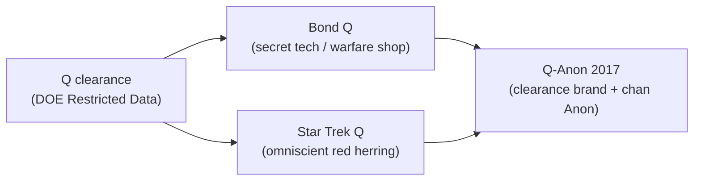

# Investigation: Q-Anon — Pre-Q “Q,” Anonymous, merger, predictions, and protest poison-pill pattern (open)

> **TL;DR:** Q&A dossier for **Q-Anon** as **controlled opposition** — companion to the two-part protest series: [Flat Earth trance — Part I](/cosmos/flat_earth/the-flat-earth-trance.md) · [The Q trance — Part II](/influence/controlled_opposition/the-q-trance.md) (author confrontation with Chansley). **Documented:** Q-Anon began **Oct 2017** on **4chan /pol** as **“Q Clearance Patriot”**; migrated **4chan → 8chan → 8kun**; **4,953** authenticated drops through **Dec 8, 2020** per [ADL](https://www.adl.org/resources/backgrounder/qanon); mainstream attribution points to **Paul Furber** then **Ron Watkins** — **disputed**, not a court finding; **Anonymous** label from **4chan ~2003**; **Q clearance** is real **DOE** category for **Restricted Data**, **not** a public SIGINT channel; no located primary explaining **why** the letter **Q** was chosen. **Author thesis (Q clearance):** the clearance guards more than “nuclear weapons design” — it marks insiders who manage the **half-hoax** on **power** (flash myth vs real **DU** harm, proxy threat, blocked transformative **Power**); **Bond Q** and **Star Trek Q** mirror that insider grammar before Oct 2017 — see [**§Q1.0 timeline**](/influence/controlled_opposition/investigations/qanon-controlled-opposition-investigation.md#q10--real-world-q-clearance--q-influenced-media-timeline). **Anonymous** as blanket anarchy CO; **Anonymous + Q → Q-Anon** breaks **chain of custody**; protest poison pills — cross-read [Phoenix §3C](/governance/constitution/investigations/phoenix-protest-timeline-investigation.md#3c-jun-24-photo-evidence--frame-grabs), [Q-Anon shaman Part II](/influence/controlled_opposition/the-q-trance.md), [Occupy CO §10](/governance/war/investigations/occupy-wall-street-controlled-opposition-investigation.md#10-field-note--arizona-occupy-author-observation). Nukes half-hoax spine: [nukes dossier](/science/nukes/investigations/nukes-dont-exist-investigation.md). Pre-Q rhymes: [great-awakening §3.7](/influence/controlled_opposition/investigations/great-awakening-alien-savior-rv-nwo-cluster-investigation.md#37-qanon--timeline-claims-debunks-and-fit-to-this-file). Hub: [Q-Anon CO](/influence/controlled_opposition/00).

**Status:** Open — **Part 7 conclusion** (Q → deep state → Q-Anon CO synthesis + pushback) **2026-08-28**; **§Q1.0** media timeline; prediction registry; Chansley through **Aug 2026**.  
**Date:** 2026-08-28

---

## Guide (read order)

| Part | Topic |
|------|-------|
| [Part 1](#part-1--pre-q-history-qa) | Pre-Q history — **[§Q1.0 clearance + media timeline](#q10--real-world-q-clearance--q-influenced-media-timeline)**, codename, SIGINT, Bond / Star Trek Q |
| [Part 2](#part-2--anonymous-qa) | Anonymous — founding, timeline, accusations, CO read |
| [Part 3](#part-3--q--qanon-origin-qa) | Q-Anon origin, platform migration, claims, **prediction table** |
| [Part 4](#part-4--merger-thesis-qa) | Anonymous + Q merger, custody break, CO pattern, cross-links |
| [Part 5](#part-5--jacob-chansley--jan-6-qa) | Chansley biography, Scottsdale, Capitol, legal status |
| [Part 7](#part-7--conclusion-author-synthesis) | **Conclusion** — Q through-line, CO read, **pushback / weak points** |
| [Part 6](#part-6--open-claims-verification-limits) | Open claims, verification checklist, limits |

**Epistemic tiers:** [§0A](#0a-epistemic-tiers)

---

## 0A. Epistemic tiers

| Tier | Meaning |
|------|---------|
| **Documented** | Primary, court record, or mainstream-secondary citation |
| **Mainstream synthesis** | Wikipedia / ADL / academic press — useful timeline; verify primaries |
| **Author hypothesis** | Investigator pattern read; falsifiable, not corroborated |
| **Author eyewitness** | First-person protest / field observation |
| **Open question** | Competing reads held without collapse |

---

# Part 1 — Pre-Q history (Q&A)

## Q1.0 — Real-world Q clearance + Q-influenced media timeline

**Read this first** for the **author anchor**: what real **Q clearance** is, what the author holds it **really** guards, and how **fiction Q** may mirror that insider class **before** Oct 2017 chan **“Q.”**

### Documented baseline — Q clearance

| Fact | Notes | Tier |
|------|-------|------|
| **[Q clearance](https://en.wikipedia.org/wiki/Q_clearance)** | U.S. **Department of Energy** access for **Restricted Data** (nuclear weapons design, fissile material handling, etc.) — adjudicated by DOE | **Documented** |
| **Origin era** | Atomic Energy Act / post-WWII compartmentalization — clearance category **~1940s–1950s** in public references | **Documented** (secondary) |
| **Why the letter “Q”** | **No located declassified primary** explaining the alphabetic choice | **Documented absence (search-limited)** |
| **Public framing** | “Nuclear secrets,” weapons labs, Restricted Data — **not** a generic “highest military clearance” | **Documented** |
| **Holder profile** | Cleared personnel in DOE complex, contractors, weapons-adjacent programs — **need-to-know**, not a public brand | **Documented** |

**Distinction (critical):** Documented Q clearance is an **access category**, not proof of a **follower-facing insider channel** named Q pre-2017 (see Q1.2).

### Author thesis — what Q clearance *really* marks (nuclear / Power)

> The letter **Q** may have **no origin beyond a random alphabetic choice**, but the **clearance itself cannot be understated**. It might sound like it is only for nuclear secrets, but if my investigations are right, the **real secret** is keeping a lid on the **real nature of nuclear energy**: making people believe **nuclear bombs are far more powerful than they really are**, **denying the reality of depleted uranium** — especially as it became a **proxy threat** — and otherwise preventing the world from ever realizing **Power** in a transformative way. That is the **real nature of Q**: people behind the scenes who knew the truth — that we were being **lied to about nuclear power** — and whose **management of that lie** gave them **extraordinary abilities**. Those abilities are reflected in **Q media**.

**What they mean (unpack):**

| Piece | Unpack | Tier |
|-------|--------|------|
| **Random “Q” letter** | Official label may be arbitrary; **stakes live in the compartment**, not the glyph | **Author hypothesis** + **Documented absence** on naming |
| **Half-hoax on power** | **Flash-for-miles** bomb mythology vs real **DU** battlefield harm — project stance [nukes half-hoax](/science/nukes/investigations/nukes-dont-exist-investigation.md); [Islamabad DU blind spot](/governance/war/islamabad-peace-deal-the-war-nobody-cares-about-2026.md); [CIA fatwa/DU](/governance/war/investigations/cia-investigation.md#authors-opinion-fatwa-depleted-uranium-and-the-real-iranian-nuclear-threat) | **Author thesis** (cross-repo) |
| **Proxy threat** | **DU** latency and radiological ordnance filed as sci-fi or “byproduct” while cleared insiders treat it as the **serious board** | **Author thesis** |
| **Transformative Power blocked** | Public kept on **Hollywood fission** and fear theater instead of what **Power** actually is and what it would change if understood | **Author thesis** |
| **Q holder = truth manager** | Cleared class **knows the managed lie** and derives **operational advantage** from that knowledge asymmetry | **Author hypothesis** |
| **Q media mirrors ability** | Fiction **Q** characters display **omniscience**, **gadget sovereignty**, **plot redirection** — traits of people who **already know the hidden physics and policy** | **Author pattern read** |

**Cross-repo (do not re-prove here):** [US Civil War DU lane](/governance/war/investigations/us-civil-war-investigation.md); [Georgia mirror §7](/history/chronology/investigations/georgia-mirror-naming-rus-horde-mars-investigation.md); [nukes hub correction 2026-07-19](/science/nukes/page.md).

### Timeline — potentially Q-influenced media (clearance → fiction → chan)

| Era | Beat | Documented fact | Author read on “Q” grammar | Tier |
|-----|------|-----------------|---------------------------|------|
| **~1946–1950s** | **Q clearance** category established for **Restricted Data** | DOE / AEC-era nuclear compartment | **Anchor**: real-world **Q** = gate to **managed nuclear truth**, not merely “big bomb” trivia | **Documented** (category) + **Author thesis** (hidden load) |
| **1958–1964** | **James Bond “Q”** (Major Boothroyd / quartermaster) enters Fleming canon; film **1962+** | MI6 **Q Branch** — gadgets, weapons, vehicles for field ops; [Wikipedia — Q (James Bond)](https://en.wikipedia.org/wiki/Q_(James_Bond)) | **Overlap**: state **secret warfare / espionage** shop that **already knows** deployable tech the public will not see for decades — **might as well hold Q clearance**; invisible cars, exotic ordnance = **preview of compartmented engineering** | **Documented** (character) + **Author pattern** |
| **1987–1994+** | **Star Trek TNG “Q”** (John de Lancie) | Continuum member; **godlike** powers; trial of humanity; [Roddenberry / Quarton naming](https://en.wikipedia.org/wiki/Q_(Star_Trek)) | **Red herring to the plot**: omniscient being who **knows secrets humans cannot** — mirrors **insider who sees the board** while audience chases **misdirection**; creator **Quarton** honor name **outranks** SIGINT codename unless new primaries surface | **Documented** (production) + **Author pattern** |
| **2003+** | **Anonymous** on 4chan | Default username **Anonymous** | Separate thread — [Part 2](#part-2--anonymous-qa); sets up **Anon + Q** portmanteau later | **Documented** |
| **Oct 2017** | **“Q Clearance Patriot”** → **Q-Anon** | Chan insider persona claiming **Q clearance** | **Brands** the real clearance **category** onto **tripcode drops** — imports **authority of §Q1.0 anchor** without **chain of custody** ([Part 4](#part-4--merger-thesis-qa)) | **Documented** + **Author CO read** |

**Pattern summary (author):** Three **Q** layers stack — **(1)** real **clearance / compartment**, **(2)** **Bond Q** = **applied secret tech** for state violence and espionage, **(3)** **Star Trek Q** = **omniscient red herring** who bends the story while humans argue the wrong frame. **Oct 2017 Q-Anon** **weaponizes (1)** through chan culture **(2)+(3)** already seeded in mass media: **insider who knows**, **trust the gadgets/plan**, **plot you cannot verify**.

### Q1.0.1 — Bond Q vs Star Trek Q (media contrast)

| Dimension | **James Bond Q** | **Star Trek Q** |
|-----------|------------------|-----------------|
| **Institutional home** | MI6 **quartermaster** — British state espionage support | **Q Continuum** — extra-dimensional species |
| **Documented role** | Builds field gadgets, weapons, vehicles (Aston Martin, invisible car lore, etc.) | Judges humanity; reality-warping; knows futures and hidden rules |
| **Overlap with Q clearance (author)** | **Direct**: alternative **government secret** branch; access to **all available technology** required to build **deployable** systems public thinks impossible | **Indirect**: **godlike knowledge** of secrets humans **cannot** derive — **managerial omniscience** without lab coat |
| **Narrative function (author)** | **Hardware face** of compartmented **Power** — “here is what we can already do” | **Plot red herring** — audience chases **trial / philosophy** while **Continuum rules** stay off-stage |
| **Tier** | Character facts **Documented**; clearance overlap **Author pattern** | Production facts **Documented**; red-herring / insider mirror **Author pattern** |

**Fair read:** Documented sources give **no** evidence Fleming or Roddenberry named characters after **DOE Q clearance** — hold **creator intent** and **author pattern read** separately. The timeline above is **pattern stakes** for this investigation, not proof of witting DOE placement in Hollywood.

---

### Q1.1 — What did military / SIGINT / intel “Q” actually mean historically?

| Sense | What it is | Tier |
|-------|------------|------|
| **[Q clearance](https://en.wikipedia.org/wiki/Q_clearance)** | U.S. **Department of Energy** access category for **Restricted Data** (nuclear weapons design, etc.) — adjudicated by DOE, not a generic “highest military clearance” | **Documented** |
| **International Q-codes** | ITU/radio **brevity codes** (QRA, QRK, QSL…) since early 20th century — procedural, not a movement brand | **Documented** |
| **WWII cipher “Q” prefixes** | German Lorenz/Tunny traffic used **QEP**, **QEK** as cipher-setting markers (Bletchley literature) | **Documented** |
| **Bond “Q”** | MI6 **quartermaster** — gadgets branch in fiction — expanded [**§Q1.0.1**](/influence/controlled_opposition/investigations/qanon-controlled-opposition-investigation.md#q101--bond-q-vs-star-trek-q-media-contrast) | **Documented** |
| **Codename “Q” as public SIGINT network** | No located declassified primary for a follower-facing channel branded **“Q”** pre-2017 | **Documented absence (search-limited)** |
| **Internal compartment codename “Q”** | Author asks whether any **non-public** SIGINT-adjacent network used that label | **Author hypothesis** — no located primary |

**Distinction (critical):** Conflating **(a)** Q-codes, **(b)** Q clearance, **(c)** fictional Q, and **(d)** Oct 2017 **“Q Clearance Patriot”** is **documented** in Q-Anon rhetoric; it is **not** evidence any one hidden network existed.

**Repo contrast:** Real high-impact leak lanes in corpus ([Snowden dossier](/influence/controlled_opposition/investigations/snowden-wikileaks-cia-aligned-controlled-opposition-investigation.md)) hit **named programs** with **identifiable journalists** and **forensic archives** — different grammar from **tripcode drops** on imageboards.

### Q1.2 — Was there ever a public intelligence channel called “Q”?

| Question | Finding | Tier |
|----------|---------|------|
| Declassified **public-facing** military SIGINT feed named **“Q”** pre-2017 | **No located primary** in this survey | **Documented absence (search-limited)** |
| Government **insider bulletin** publicly branded **“Q”** | **Not found**; mass phenomenon under that brand begins **Oct 2017** | **Mainstream synthesis** ([Wikipedia — Q-Anon](https://en.wikipedia.org/wiki/QAnon)) |
| **Pre-Q** “trust the plan” / mass-arrest briefing culture | Fulford, Drake/Wilcock **2012** lane — [great-awakening §3.5](/influence/controlled_opposition/investigations/great-awakening-alien-savior-rv-nwo-cluster-investigation.md#35-pre-q-insider-war-briefings--benjamin-fulford-drake-wilcock-ventura) | **Documented** newsletters; **interpretive** CO read |

**Open questions:** Declassified NSA/GCHQ reading-room search for codename **“Q”** as network label (**§6** checklist V1); whether Oct 2017 violated a real **non-public** boundary by design (CO) or grift (**Author hypothesis** P4).

### Q1.3 — Star Trek TNG “Q” — creator intent vs author hypothesis?

| Source | Claim | Tier |
|--------|-------|------|
| [Wikipedia — Q (Star_Trek)](https://en.wikipedia.org/wiki/Q_(Star_Trek)) citing David Alexander biography | Gene Roddenberry chose **“Q”** honoring British fan **Janet Quarton** | **Documented** creator intent |
| TNG pilot | **Q** as judge at humanity’s trial; John de Lancie’s performance extended role | **Documented** production history |
| In-universe novel joke (*The Buried Age*) | “Because **U** will always be behind me” | **Fiction** |
| [**§Q1.0 timeline**](/influence/controlled_opposition/investigations/qanon-controlled-opposition-investigation.md#timeline--potentially-q-influenced-media-clearance--fiction--chan) | **Star Trek Q** as **omniscient red herring** — knows secrets humans cannot; mirrors **Q-clearance insider grammar** in fiction | **Author pattern** (see [**§Q1.0.1**](/influence/controlled_opposition/investigations/qanon-controlled-opposition-investigation.md#q101--bond-q-vs-star-trek-q-media-contrast)) |

**Author hypothesis P2** (Star Trek **Q** references a real SIGINT network): **Outranked** by documented Quarton naming unless future primaries surface. **Author hypothesis P2b** (Star Trek **Q** mirrors **compartmented nuclear-truth managers** and functions as **plot red herring**): **first-class pattern read** — distinct from naming etymology; see **§Q1.0**.

### Q1.4 — SIGINT landscape pre-Q-Anon — what intel really looked like (brief)

**Full spine:** [SIGINT history investigation](/governance/war/investigations/sigint-history-investigation.md) — global chronology, Five Eyes, Tonkin/Church/Snowden events, repo crosswalk §6.

| Element | Documented baseline |
|---------|---------------------|
| **SIGINT** | NSA / Five Eyes intercept → process → analyze; **compartmented programs** (STELLARWIND-era leaks, etc.) — **systems**, not a **public pseudonym** followers decode |
| **Leak channels** | Journalists, FOIA, congressional oversight, whistleblower pipelines — **attributable** chains even when disputed |
| **Chan “insider” posts** | Anonymous boards, **tripcodes**, no chain of custody — **opposite** institutional leak grammar |

---

# Part 2 — Anonymous (Q&A)

### Q2.1 — When was Anonymous founded, and what was the primary motivation?

| When | Event | Tier |
|------|-------|------|
| **Oct 1, 2003** | **4chan** launches; default username **“Anonymous”** on `/b/` | **Documented** ([Wikipedia — Anonymous](https://en.wikipedia.org/wiki/Anonymous_(group))) |
| **2003–2006** | Collective label for **raids** / **trolling** (“for the lulz”) | **Documented** |
| **Jan 2008** | Gawker posts Cruise Scientology video → church legal threats | **Documented** |
| **2008** | **Project Chanology** — DDoS, pranks, **street protests**; Guy Fawkes masks | **Documented** |

**Primary motivation (documented phases):** **Entertainment / trolling** → **censorship retaliation** (Chanology) → **decentralized hacktivism** with declared political targets (PayPal, HBGary, etc.). Gabriella Coleman’s histories treat evolution as **subcultural**, not single-authored ([*Hacker, Hoaxer, Whistleblower, Spy*](https://en.wikipedia.org/wiki/Anonymous_(group)#History) — secondary).

### Q2.2 — Major events timeline

| Date | Event | Source |
|------|-------|--------|
| **2006** | Habbo Hotel raid, etc. | Wikipedia |
| **2008** | **Project Chanology** peak | Wikipedia |
| **2010–2012** | Anonymous-linked ops (PayPal, HBGary, etc.) | Wikipedia |
| **Aug 23, 2011** | Anonymous video promoting **#OccupyWallStreet** | **Documented** — [OWS CO §2](/governance/war/investigations/occupy-wall-street-controlled-opposition-investigation.md) |
| **2011–2012** | Arab Spring sympathy ops (decentralized) | Mainstream synthesis |

### Q2.3 — Accusations against Anonymous (documented)

| Accusation / finding | Notes | Tier |
|---------------------|-------|------|
| **Illegal hacking** (DDoS, intrusions) | Multiple prosecutions worldwide | **Documented** |
| **Harassment / doxxing** | Documented in Chanology and raid culture | **Documented** |
| **No central leadership** | Structural fact — complicates “who speaks for Anonymous” | **Documented** |
| **FBI / law enforcement infiltration** | Documented in OWS-adjacent and hacktivism cases (see OWS CO §9) | **Documented** (case-specific) |
| **Controlled opposition** (witting front for state) | **Not proven** as unified operation | **Author hypothesis** — see Q2.4 |

### Q2.4 — Author CO read vs organic-start possibility?

| Read | Claim | Tier |
|------|-------|------|
| **Author CO** | Blanket **anarchy without deliverable goals**; perpetual **next op**; energy routed to **tribal votes** and **culture-war** noise | **Author hypothesis** |
| **Organic evolution** | Coleman / mainstream: real political effects (Chanology, Occupy amplification) without puppetmaster | **Mainstream synthesis** |
| **Sincere participants + manageable outcome** | Compatible with both | **Open question** |

**Repo:** [Occupy CO §10](/governance/war/investigations/occupy-wall-street-controlled-opposition-investigation.md#10-field-note--arizona-occupy-author-observation) — Arizona field note; **no** dedicated Anonymous file before this dossier. **Cicada 3301:** zero repo hits — out of scope unless added.

---

# Part 3 — Q / Q-Anon origin (Q&A)

### Q3.1 — When was Q-Anon founded, and how did platforms migrate?

| Date / beat | Documented fact | Source |
|-------------|-----------------|--------|
| **Oct 28, 2017** | First posts on **4chan /pol**; “Calm Before the Storm” thread; Clinton arrest prediction | [ADL](https://www.adl.org/resources/backgrounder/qanon); [Q Origins Project](https://qoriginsproject.org/the-making-of-qanon-a-crowdsourced-conspiracy/) |
| **Nov 1–2, 2017** | Moniker **“Q Clearance Patriot”** → signs as **“Q”** | ADL |
| **Late Nov 2017** | Moves to **8chan** (citing 4chan “infiltration”) | Wikipedia — Q-Anon |
| **2018–2020** | Aggregators (QMap, Patriots’ Soapbox, etc.); rally apparel | Wikipedia; ADL |
| **Aug 2019** | **8chan** forced offline after El Paso shooting | PBS; Wikipedia |
| **Nov 2019** | Returns as **8kun** | ADL |
| **Dec 8, 2020** | Last drop before long silence (4,953 posts total per ADL) | ADL |
| **Jun 24, 2022** | Brief re-emergence (handful of posts) | ADL |
| **Jan 6, 2021** | Capitol attack cluster includes Q-adherents | **Documented** |

**Culture context:** [Q Origins Project](https://qoriginsproject.org/the-making-of-qanon-a-crowdsourced-conspiracy/) — Q-Anon **cannot** be separated from **/pol/** conspiracy slurry (Pizzagate lineage, antisemitic tropes).

### Q3.2 — What did Q claim to be? What did accusers and media say?

| Actor | Claim | Tier |
|-------|-------|------|
| **Q persona** | High-level **government insider** with **Q clearance**; leaking to prepare public for **“the Plan”** / **Storm** | **Documented** (self-claim in posts) |
| **Followers** | **“Great Awakening”**; Trump recruited by **white hats** vs **Deep State** cabal | **Documented** (movement lore — ADL) |
| **ADL / mainstream** | Baseless conspiracy; antisemitic undertones; extremism vector | **Mainstream synthesis** |
| **Academic attribution** | **Paul Furber** (early 4chan) → **Ron Watkins** (8chan era) via stylometry — **disputed**, not court-adjudicated | **Mainstream synthesis** ([Cafiero & Camps 2023](https://doi.org/10.1093/llc/fqac078); [ethnology.tech Dec 2024](https://ethnology.tech/addressing-quotations-and-copy-paste-in-qanon-authorship-attribution)) |
| **ICWSM 2023** | Likely **deliberate persona takeover**; tripcode insecurity; Q silent when 8chan down — questions “government official” frame | **Academic synthesis** ([ICWSM paper](https://ojs.aaai.org/index.php/ICWSM/article/view/19330)) |

### Q3.3 — Who is behind Q? (Furber / Watkins — current attribution status)

| Finding | Status | Tier |
|---------|--------|------|
| **Furber** early-post stylistic match | Supported by multiple ML / forensic studies | **Mainstream synthesis** — not criminal conviction |
| **Watkins** (8chan admin) takeover ~2018 | Supported by HBO *Q: Into the Storm*, academic work; **Watkins denies** being Q | **Disputed** |
| **Single author entire run** | **Unlikely** per ICWSM — persona shifts, tripcode changes | **Academic synthesis** |
| **State actor** | **Not proven** | **Open question** |

### Q3.4 — Q drop predictions and promised events (registry)

**Method:** Past-tense analysis through **Aug 2026**. Sources: [ADL backgrounder](https://www.adl.org/resources/backgrounder/qanon), [Newsweek failed predictions](https://www.newsweek.com/qanon-trump-march4-predictions-failed-1573739), [Q-Anon Debunked list](https://www.qanondebunked.com/2020/08/08/non-comprehensive-list-of-qdrops-that-have-been-debunked/), [sealed-indictment debunk](https://wmerthon6.wixsite.com/website-1/post/who-started-the-60k-sealed-indictment-claim), [Wikipedia — Q-Anon](https://en.wikipedia.org/wiki/QAnon), [James Carner drop test](https://jamescarner.com/qanon-tested-prophecy-pattern-or-psychological-operation/) (drop-date inventory). **Believer reinterpretations** noted where standard.

**Outcome key:** **Failed** = no matching public event by stated window; **Reinterpreted** = community moved goalposts; **Ambiguous** = partial real event retrofitted; **Pending (believers)** = still claimed “coming” despite elapsed windows.

| Date of drop | Claim / prediction | Stated timeframe | Outcome (by Aug 2026) | Source |
|--------------|-------------------|------------------|----------------------|--------|
| **Oct 28, 2017** | **HRC extradition** “already in motion”; cross-border run; **mass riots** if arrested | Imminent (2017) | **Failed** — no Clinton arrest/extradition | ADL; Drop 1 ([4plebs archive](https://4plebs.org/)) |
| **Oct 28, 2017** | **HRC arrest** **Oct 30, 2017**, **7:45–8:30 AM ET**; passport flagged | Oct 30, 2017 AM | **Failed** | Carner; Q-Anon Debunked |
| **Oct 28, 2017** | HRC **“detained, not arrested (yet)”** | Present tense Oct 2017 | **Failed** | ADL; Carner |
| **Oct 29–31, 2017** | **National Guard** activated across major cities tied to Clinton ops | Oct–Nov 2017 | **Failed** at claimed scale | Carner; ADL |
| **Oct 31, 2017** | **“Friday and Saturday will deliver on MAGA promise”**; **“cleaning house (gov’t)”** | Nov 3–4, 2017 weekend | **Reinterpreted** → Saudi purge (below) | Impious Digest; Telegraph 11.3 analysis |
| **Nov 1, 2017** | **John Podesta** arrest announced | **Nov 3, 2017** (“11.3”) | **Failed** — no Podesta arrest | Q-Anon Debunked; Telegraph |
| **Nov 1, 2017** | **Huma Abedin** indictment | **Nov 6, 2017** (“11.6”) | **Failed** | Q-Anon Debunked |
| **Nov 2, 2017** | **Nov 3** = “big day”; **National Guard** deployments; **“calm before the storm”** | Nov 3, 2017 | **Failed** as mass-arrest day; phrase **retrofitted** to Trump Oct 5 remark | ADL; Carner |
| **Nov 4–5, 2017** | Clinton / Podesta / Abedin arrests “first week of November” | Nov 2017 | **Reinterpreted** → **Saudi royal purge** (real event, **not** named targets) | Telegraph; ADL |
| **Nov 2017** | **George Soros** targeted / arrested | Nov 2017 | **Failed** | Impious Digest |
| **Nov 2017** | **Tony Podesta** indicted | Nov 3, 2017 | **Ambiguous** — Podesta Group shutdown later; **no** indictment as claimed | Impious Digest |
| **Nov 2017** | **“Think sealed indictments”** — tens of thousands incoming | Weeks–months | **Failed** as described; **Reinterpreted** ongoing | ADL; sealed-indictment debunk |
| **Nov 2017–ongoing** | **60,000+ sealed indictments** for mass arrests | Rolling | **Failed** — PACER misread / non-criminal sealed cases ([debunk](https://wmerthon6.wixsite.com/website-1/post/analysis-of-a-photoshopped-image-used-to-support-the-qanon-60k-sealed-indictments-claim)) | wmerthon6; ADL |
| **Dec 23, 2017** | **“Dark [10]”** — ten days darkness | Dec 25, 2017 – Jan 4, 2018 | **Reinterpreted** — Q **posting silence**, not global blackout ([Praying Medic](https://prayingmedic.com/2023/06/30/ten-days-darkness/)) | Praying Medic; drops |
| **Early 2018** | **Mass suicides** of Trump critics | Feb 2018 | **Failed** | Newsweek |
| **2018** | **MOAB** on **North Korea** | 2018 | **Failed** | Newsweek |
| **2018–2019** | **“The Storm”** — mass arrests, Gitmo tribunals | **Dec 5, 2018**; **Jan 19, 2019**; **Mar 19, 2019** | **Failed** each date; **Reinterpreted** | Newsweek; ADL |
| **Drop 1332 (2018)** | **“Obama goes down”** | Near-term | **Failed** | Q-Anon Debunked |
| **2019–2020** | **Mass awakening** — public learns cabal truth via Plan | Before 2020 election | **Ambiguous** — audience grew; **no** cabal exposure | ADL |
| **2020 cycle** | **Trump wins** 2020 election | Nov 2020 | **Failed** (Biden certified) | ADL; Skeptical Inquirer |
| **2020–2021** | **EBS** (Emergency Broadcast System) activation; truth documentaries | Various 2020–2021 windows | **Failed** | ADL; movement lore |
| **2020–2021** | **Ten days of darkness** — global comms blackout + mass arrests | Multiple 2020–2021 dates | **Failed**; **Pending (believers)** in derivative channels (2026 Judy Byington–style posts — **not** authentic Q drops) | ADL; [Operation Disclosure Feb 2026](https://operationdisclosureofficial.com/2026/02/26/restored-republic-via-a-gcr-as-of-february-26-2026/) |
| **2020–2021** | **Military tribunals** at **Guantanamo** for elites | Post-Storm | **Failed** at claimed scale | ADL |
| **Late 2020** | **Biden** illegitimate; **Trump** still commander / **devolution** | Jan 2021+ | **Failed** as stated; **Reinterpreted** (Patel Patriot etc.) | ADL |
| **Mar 4, 2021** | **Trump reinstatement** (sovereign-citizen “19th president” theory) | Mar 4, 2021 | **Failed** | ADL; Newsweek |
| **Jan 20, 2021** | **Trump** inaugurated second term / Biden arrest | Inauguration day | **Failed** | Skeptical Inquirer; ADL |
| **2021–2022** | **JFK Jr.** alive; returns as Trump VP | 2021 Dallas vigil etc. | **Failed** | ADL |
| **2022** | Q **brief return** Jun 24 — implies Plan ongoing | Post-Dobbs | **Ambiguous** — few posts; **no** Storm | ADL |
| **2024–2026** | **Storm / sealed indictments** under new branding | Rolling | **Failed** to date; derivative channels still **Pending (believers)** | [The Conversation Mar 2026](https://theconversation.com/the-long-afterlife-of-qanon-conspiracy-theories-haunting-american-politics-289784) |

**Fair read:** Early drops were **time-specific** (Clinton Oct 30, Podesta Nov 3). After failures, Q and decoders deployed **“disinformation is necessary,”** **“future proves past,”** and **“trust the plan”** — shifting burden to audience ([ADL](https://www.adl.org/resources/backgrounder/qanon); [Skeptical Inquirer](https://skepticalinquirer.org/exclusive/when-qanon-prophecy-fails/)). By **2026**, public Q posting is **dormant**; slogans persist in politics and **derivative** prophecy channels — **not** the same as original drop fulfillment.

**Pre-Q rhyme:** Fulford / Drake **2012 mass arrests** — [great-awakening §3.5](/influence/controlled_opposition/investigations/great-awakening-alien-savior-rv-nwo-cluster-investigation.md#35-pre-q-insider-war-briefings--benjamin-fulford-drake-wilcock-ventura); compressed Q timeline — [§3.7](/influence/controlled_opposition/investigations/great-awakening-alien-savior-rv-nwo-cluster-investigation.md#37-qanon--timeline-claims-debunks-and-fit-to-this-file).

---

# Part 4 — Merger thesis (Q&A)

### Q4.1 — How does Anonymous + Q → Q-Anon naming / implication work?

| Layer | What it imports | Problem |
|-------|-----------------|---------|
| **Anonymous** (chan) | Decentralized **Anons**, decode culture, raid idiom | **No identity**, **no accountability** |
| **“Q”** persona | **Insider** military/intel **authority** | **Tripcode** ≠ chain of evidence |
| **Q-Anon** brand | **Serious** coup / tribunals / Trump war vs cabal | Followers **merge** joke-board culture with **national-security** claims |

The portmanteau **Q-Anon** (= **Q** + **Anon**) encodes both halves: **classified insider** + **faceless crowd**. Structurally **unreliable** for disciplined investigation — by design if CO, by grift if not (**Author thesis** A4).

### Q4.2 — Chain of custody / reliability problem

Anonymous intel on chan boards **cannot** be verified: tripcodes **compromised** multiple times ([ICWSM 2023](https://ojs.aaai.org/index.php/ICWSM/article/view/19330)); Q **did not** mirror drops to attributable channels when 8chan went dark ([Wang & Click 2020](https://ojs.aaai.org/index.php/ICWSM/article/view/19330)). Contrast [Snowden dossier](/influence/controlled_opposition/investigations/snowden-wikileaks-cia-aligned-controlled-opposition-investigation.md).

### Q4.3 — Author CO pattern (divide / conquer / dead ends / poison pill)

| Mechanism | Author read | Tier |
|-----------|-------------|------|
| **Divide and conquer** | Routes dissent into **factional decode cults** vs shared document chains | **Author hypothesis** |
| **Wrong dead ends** | Dated arrests, sealed-indictment math, sovereign-citizen reinstatement | **Documented** failures + **Author pattern** |
| **Poison pill at protests** | Absurd adjacency discredits legitimate grievance lanes | **Author eyewitness** — see Q4.4 |
| **Pretend ally, damage Trump lane** | Q aesthetics + outcomes that **discredit** adjacent dissent | **Author interpretive** (A5) |

**Later-phase read:** Compare McCarthy flamethrower stunt + Chansley defense fund — [Phoenix §7](/governance/constitution/investigations/phoenix-protest-timeline-investigation.md#7-trump-debate-challenge--flamethrower-maga-hat-january-2022); [2020 election poisoned hinge](/governance/constitution/investigations/2020-election-fraud-selective-battleground-audit-timing-investigation.md).

### Q4.4 — Cross-links (one sentence each — no duplication)

| Investigation | Link |
|---------------|------|
| **[Phoenix §3C](/governance/constitution/investigations/phoenix-protest-timeline-investigation.md#3c-jun-24-photo-evidence--frame-grabs)** | Jun 24, 2020 Scottsdale — McCarthy speaks; **TV cameras pivot** to Chansley **“Q sent me”**; author disrupted shot; QMap.pub signage — **full witness sequence there**. |
| **[Flat Earth trance — Part I](/cosmos/flat_earth/the-flat-earth-trance.md)** · **[The Q trance — Part II](/influence/controlled_opposition/the-q-trance.md)** | Two-part Arizona protest poison-pill series; author confrontation with Chansley in Part II; **dossier keeps claim tables**. |
| **[Occupy CO §10](/governance/war/investigations/occupy-wall-street-controlled-opposition-investigation.md#10-field-note--arizona-occupy-author-observation)** | Arizona Occupy — one speaker recruiting **civil disobedience** escalation; same **one-faction poisons crowd** mechanics. |
| **[mudflood-gatekeepers](/influence/controlled_opposition/mudflood-gatekeepers.md)** | Sorting rule: absurd adjacency → treat as **CO behavior** until falsified. |

**Faith-only debate grammar:** Q **“trust the plan”** rhymes with Norman / ic911a hosts — [ic911a §5.7](/events/false_flag/investigations/ic911a-911revision-controlled-opposition-investigation.md#57-harassment-industry-adjacency--alef--scam-center-grammar-2026); [alef clog essay](/influence/controlled_opposition/alef-and-the-clogged-internet.md). Indexed only.

---

# Part 5 — Jacob Chansley / Jan 6 (Q&A)

### Q5.1 — Documented biography and Q-Anon Shaman role

| Field | Fact | Tier |
|-------|------|------|
| **Name** | Jacob Anthony Chansley (also Jake Angeli, Yellowstone Wolf) | **Documented** ([Wikipedia](https://en.wikipedia.org/wiki/Jacob_Chansley)) |
| **Born** | **1988**; raised Phoenix area | **Documented** |
| **Education** | Moon Valley HS; Glendale Community College (psychology, religion, philosophy, ceramics) | **Documented** |
| **Military** | U.S. **Navy** Sep 2005 – Oct 2007; USS **Kitty Hawk**; discharged after **anthrax vaccine** refusal; final rank SK **Seaman Apprentice** (E-2) | **Documented** ([Military.com](https://www.military.com/daily-news/2021/01/11/qanon-shaman-arrested-storming-us-capitol-navy-veteran.html)) |
| **Public persona** | Self-styled **“Q-Anon Shaman”**; horned headdress, face paint; **Trump rallies** Arizona **2020** | **Documented** |
| **Q-Anon** | Former believer and **amplifier**; later **repudiated** movement (2025–2026 press) | **Documented** ([Independent](https://www.the-independent.com/news/world/americas/qanon-shaman-capitol-riot-sentencing-b1958223.html)) |

### Q5.2 — Jun 24, 2020 Scottsdale (documented + witness)

**Grievance:** Anti-**mask** mandate **“Unmask Us”** — **not** Stop the Steal. **Documented:** McCarthy spoke ([azcentral Jun 24, 2020](https://www.azcentral.com/story/news/local/scottsdale/2020/06/24/scottsdale-councilman-leads-protest-against-mask-mandates/3245724001/)).

**Author eyewitness + frame grabs:** **FOX 10 single-camera** Chansley TV beat (**“Q sent me”**); author intervention on **`VID_20200624_110648.mp4`**; Q-Anon / Flat Earth adjacency — **do not duplicate** — [Phoenix §3](/governance/constitution/investigations/phoenix-protest-timeline-investigation.md#3-primary-witness--mccarthy--chansley--tv-cameras-june-24-2020-unmask-us), [§3C](/governance/constitution/investigations/phoenix-protest-timeline-investigation.md#3c-jun-24-photo-evidence--frame-grabs).

### Q5.2b — Arizona post-Scottsdale circuit + Dec 3 dry run (documented + author read)

**Do not duplicate** full beat table — [Phoenix §3G](/governance/constitution/investigations/phoenix-protest-timeline-investigation.md#3g-chansley--arizona-post-scottsdale-circuit-dec-3-dry-run-jan-6-aftermath).

| Beat | Fact | Tier |
|------|------|------|
| **Nov 5–7, 2020 MCTEC** | Chansley fixture / speaker; horned **Q** press imagery | **Documented** ([Cronkite News](https://cronkitenews.azpbs.org/2020/11/06/hundreds-gather-outside-maricopa-election-center-for-third-day-of-protests/)) |
| **Dec 3, 2020 Arizona House lobby** | Rush-in on pizza delivery; **occupation** label; **Chansley speaker**; DPS clear; **2 trespass arrests** | **Documented** ([azcentral Feb 2, 2021](https://www.azcentral.com/story/news/local/arizona-investigations/2021/02/02/jake-angeli-other-trump-fans-rushed-arizona-capitol-month-before-jan-6/4349283001/)) |
| **Dec 3 as Jan 6 dress rehearsal** | Same actor + costume + Capitol-building target **33 days** earlier | **Documented** parallel (press dates) + **Author CO read** (A14) — **not** handler proof |
| **McCarthy shared Nov–Dec circuit** | Capitol, MCTEC, Executive Tower — poison pills not expelled | **Author memory** + partial press — [Phoenix §5](/governance/constitution/investigations/phoenix-protest-timeline-investigation.md#5-mccarthy-controlled-opposition-read) |

### Q5.2c — Pretrial custody / organic food (documented)

| Beat | Fact | Tier |
|------|------|------|
| **Feb 2, 2021** | Judge **Lamberth** orders **USDA organic** meals (religious accommodation) | **Documented** ([order](https://storage.courtlistener.com/recap/gov.uscourts.dcd.225845/gov.uscourts.dcd.225845.8.0_4.pdf)) |
| **Hunger stretch** | Defense: **>9 days** no standard food; **~20 lb** loss | **Documented** ([AP](https://apnews.com/article/capitol-riot-man-gets-organic-food-jail-198eccc02b8173f4e5071ca342250518)) |
| **Transfer** | D.C. DOC → **Alexandria, VA** when D.C. could not comply | **Documented** ([CBS](https://www.cbsnews.com/news/qanon-shaman-jake-angeli-jail-transfer-organic-meals/)) |
| **“Handled gently” / asset read** | Iconic face + accommodation + early release vs median Jan 6 defendant | **Author interpretive** (A15) — counter: RFRA-style process; **2025** category pardon |

### Q5.2d — Jan 6 custody contrast (Chansley vs cohort)

**Full beat tables:** [Phoenix §3G — Jan 6 custody contrast](/governance/constitution/investigations/phoenix-protest-timeline-investigation.md#jan-6-custody-contrast--chansley-vs-other-defendants) · **Author thesis (A16):** [deception / jail control](/governance/constitution/investigations/phoenix-protest-timeline-investigation.md#author-originating-thesis--jan-6-deception-and-custody-a16).

| Layer | Fact | Tier |
|-------|------|------|
| **Harsh cohort backdrop** | Greene *Unusually Cruel* (23-and-1 / ~200-day solitary claims); USMS CDF failure; **Lamberth contempt** of jail officials; Jan 6 **+9 intake points** | **Documented** (mixed sources — Greene is **partisan**) |
| **Quaglin control case** | Celiac → days without edible meals, major weight loss in filings — **no** equivalent court-ordered transfer | **Documented** (filings) |
| **Chansley differentials** | **Organic court order + Alexandria transfer (Feb 2021, diet-driven — not cohort-wide)**; **floor sentence**; **early release** Mar 2023 | **Documented** |
| **Solitary (~11 months)** | Defense public claim — BOP **unconfirmed** | **OPEN** — **author seriously doubts**; may support **not in conventional jail** ([A16](/governance/constitution/investigations/phoenix-protest-timeline-investigation.md#author-originating-thesis--jan-6-deception-and-custody-a16)) |
| **Author read (A15)** | **Selective accommodation** — visibility asset grammar vs harsh cohort | **Author interpretive** |
| **Author read (A16)** | **Deception premise**; **staged hijacking + blame Republicans**; **same hands** stage + jails; **tool cannot rot**; **deferred Jan 6 investigation**; **future CO exposure**; **tool-disposal risk** | **Author thesis** |

**Companion article:** [The Q trance — Jan 6, deception, and why the tool could not rot in jail](/influence/controlled_opposition/the-q-trance.md#jan-6-deception-and-why-the-tool-could-not-rot-in-jail).

**Diet note:** Primary sources say **organic**, not **vegetarian-only**.

### Q5.3 — Jan 6, 2021 Capitol (documented)

| Beat | Fact | Tier |
|------|------|------|
| **Date** | **Jan 6, 2021** — entered Capitol ~**2:14 PM**; Senate chamber; spear with U.S. flag | **Documented** (DOJ; [Fox 10 Phoenix](https://www.fox10phoenix.com/news/jan-6-rioter-qanon-shaman-jacob-chansley-secures-early-release-from-prison-to-halfway-house-lawyer-says)) |
| **Charges** | Knowingly entering restricted building; violent entry; disorderly conduct; **obstruction** (felony plea) | **Documented** |
| **Plea** | Guilty **obstructing an official proceeding** (18 U.S.C. § 1512) | **Documented** |
| **Sentence** | **41 months** prison, 36 months supervised release, **$2,000** fine — **Nov 17, 2021** (Judge Lamberth) | **Documented** |
| **Time served** | **27 months**; released to **halfway house** **Mar 2023** | **Documented** ([The Hill](https://thehill.com/regulation/court-battles/3926036-qanon-shaman-released-from-prison-transferred-to-halfway-house/)) |
| **Pardon** | **Jan 20, 2025** — Trump **full unconditional pardon** for Jan 6 defendants (incl. Chansley); conviction erased; supervised release terminated | **Documented** ([Independent](https://www.independent.co.uk/news/world/americas/us-politics/aqnon-shaman-jacob-chansley-trump-pardon-b2683533.html); [White House EO](https://www.whitehouse.gov/)) |
| **Status Aug 2026** | **Pardoned**; no active federal sentence; public break with Trump; reported **Arizona governor** run as independent — verify current ballot status per cycle | **Documented** (press through 2026) |

**ADL:** At least **66** known Q-adherent Jan 6 arrestees (Sep 2022 data) — [ADL](https://www.adl.org/resources/backgrounder/qanon).

### Q5.4 — Author hypothesis: public Q avatar, handlers, staging (clearly unverified)

| Claim | Notes | Tier |
|-------|-------|------|
| Chansley as **deliberate visual** for Q-Anon at **center of historic event** | Iconic Jan 6 imagery | **Documented** (media role) + **Author interpretive** |
| **“Ride he knew”** / **handlers** at Scottsdale | **One FOX 10 camera** on Chansley continuously; other crews on **local interviews** nearby; Chansley from **side** onto empty patch — [Phoenix §3 staging read](/governance/constitution/investigations/phoenix-protest-timeline-investigation.md#3-primary-witness--mccarthy--chansley--tv-cameras-june-24-2020-unmask-us) | **Video-reviewed** + **Author hypothesis** — **not** proof of witting asset |
| **Coincidence vs staging** | Legitimate grievance crowd + **TV-ready** Q mascot | **Open question** |

**Distinguish:** Jan 6 **as event** = **Documented**. **CO / staging read** = **Author hypothesis** tiers only.

---

# Part 7 — Conclusion (author synthesis)

**Scope:** Closing read after [§Q1.0](/influence/controlled_opposition/investigations/qanon-controlled-opposition-investigation.md#q10--real-world-q-clearance--q-influenced-media-timeline) → [Part 3](/influence/controlled_opposition/investigations/qanon-controlled-opposition-investigation.md#part-3--q--qanon-origin-qa) → [Part 4](/influence/controlled_opposition/investigations/qanon-controlled-opposition-investigation.md#part-4--merger-thesis-qa). Investigation **remains open** for primaries; this section states **author stakes** and **honest counter-pressure**.

### 7.1 Author words (conclusion — session 2026-08-28)

> Although the Q-Anon movement seems to have **no real origin beyond media and Q clearance** — which most people find **out of sync** with the main claims of secret intel (a scientist who knows how to make nuclear bombs does **not** necessarily have real-time military intel; those are **two different departments**) — it can be easily understood why **nobody would see the significance** of the word Q-Anon. But the significance is that the **Q character is far more of an influence than publicly perceived**. The Q character essentially has the **biggest influence of all** — keeping the **biggest secrets of all**, and harnessing the secrets and/or lies to extend **massive influence over the world population**, even to the point of being able to **cause world wars** like the one we're in right now — **over nuclear fuel**. More significantly, if we understand that **Q is definitely a real force that's always been there**, a **transformative force**, and that **Q-Anon represents that same patriotic, intelligence-leaking character** that apparently still works for the government and is still very transformative, then what we're really deriving is that the **government is secretly sending us a message to cause anarchy** — even **against that same government**. Not just anarchy, but **anti-Semitism** and everything else Q-Anon is associated with. The movement is **harnessing the legitimacy of the real Q influence** and suggesting that it is the **only signal** coming out of the chaos of government that we should trust — **follow the plan**, even if that plan means the **destruction of that same government and our country** in a not-surprisingly **Marxist prediction** of the future. Not surprising because this has always been the **deep state plan**, and the **deep state represents the Q** — the ability to **hide information**, **lie to the masses**, **carry out secret clearances**, which all started over **nuclear fuel** in the first place, or the ability to **create (or unsuppress publicly in a controlled way) nuclear weapons after World War II**. Most of our government **wasn't as secretive as the CIA and nuclear-clearance sectors**; it was within those **absolutely opaque sectors** where some of the **most heinous conspiracies** could be birthed. The argument that nuclear-energy clearance does not look like the breeding ground for worldwide anarchy conspiracies is **precisely** the misdirection — the public looks for intel leaks in Langley headlines while the **Q compartment** runs the board on **Power**.

### 7.2 What they mean (unpack)

| Piece | Unpack | Tier |
|-------|--------|------|
| **Surface mismatch** | Q-Anon sells **live military intel**; **Q clearance** is **DOE Restricted Data** — different departments, different skill sets | **Documented** mismatch + **Author read** (misdirection is the point) |
| **Hidden significance** | Word **Q-Anon** looks absurd on surface; **real Q grammar** (clearance + media Q + deep opacity) is **underweighted** in public debate | **Author thesis** |
| **Q as largest influence** | Not chan persona — **compartment class** that **manages nuclear truth**, **DU proxy**, war timing ([Iran 2026](/governance/war/investigations/iran-2026-war-runner.md)) | **Author thesis** |
| **Transformative force** | **Power** knowledge suppressed since post-WWII nuclear lock — [§Q1.0](/influence/controlled_opposition/investigations/qanon-controlled-opposition-investigation.md#author-thesis--what-q-clearance-really-marks-nuclear--power) | **Author thesis** |
| **Q-Anon as patriotic leak fiction** | Movement **dresses** real **Q** authority in **insider-leak** costume — **“Q Clearance Patriot”** | **Documented** branding + **Author read** |
| **Message = anarchy against state** | Followers decode **trust the plan** toward **institutional collapse** while believing they **defend** the nation | **Author interpretive** |
| **Toxic adjacency** | **Anti-Semitism**, cabal lore, sovereign-citizen reinstatement — **documented** in movement ([ADL](https://www.adl.org/resources/backgrounder/qanon)); author read = **feature** if CO | **Documented** themes + **Author CO read** |
| **Legitimacy harvest** | Chan **Q** **borrows** real clearance **prestige** + decades of **Bond / Trek Q** omniscience — only **signal** worth trusting in chaos | **Author thesis** |
| **Marxist-collapse rhyme** | **Destroy the nation to save it** grammar parallels **revolutionary** end-state predictions — author: not accident, **deep-state long game** | **Author interpretive** |
| **Deep state = Q** | **Hide, lie, classify** — born in **nuclear fuel / weapons** opacity after WWII, extended through **CIA-class** sectors | **Author thesis** |
| **Opacity breeding ground** | Least transparent branches (**nuclear clearance**, **CIA**) — not routine bureaucracy — **where worst plots gestate** | **Author thesis** |
| **CO army without visible puppet master** | **Millions recruited**, **no named handler**, **no deliverable goals** — **mob in reserve** for politics or **real-world anarchy** ([Part 4](/influence/controlled_opposition/investigations/qanon-controlled-opposition-investigation.md#part-4--merger-thesis-qa)) | **Author thesis** |

### 7.3 Dot connection — from nuclear Q to Q-Anon (author chain)

| Step | Link | Gap? |
|------|------|------|
| **1** | Post-WWII **Q clearance** creates **Restricted Data** priesthood — first mass **Power** secret ([§Q1.0](/influence/controlled_opposition/investigations/qanon-controlled-opposition-investigation.md#documented-baseline--q-clearance)) | Documented category; **author load** on **half-hoax** is thesis |
| **2** | **Deep state / Q class** = hide, lie, classify — capacity exceeds any single agency headline | **Author synthesis** |
| **3** | **Bond Q** + **Star Trek Q** pre-seed **omniscient insider / secret tech** in mass culture decades before chan | **Documented** media + **Author pattern** |
| **4** | **Anonymous** (2003+) supplies **faceless army** grammar | **Documented** |
| **5** | **Oct 2017** — **“Q Clearance Patriot”** **merges (3)+(4)**; imports **(1)** prestige while claiming **(2)** live intel | **Documented** origin + **Author CO read** |
| **6** | **Prediction failures** ([§3.4](/influence/controlled_opposition/investigations/qanon-controlled-opposition-investigation.md#q34--q-drop-predictions-and-promised-events-registry)) + **toxic themes** → **discredit** adjacent dissent; **reserve army** remains ([Jan 6](/influence/controlled_opposition/investigations/qanon-controlled-opposition-investigation.md#q53--jan-6-2021-capitol-documented), [Phoenix](/governance/constitution/investigations/phoenix-protest-timeline-investigation.md)) | **Documented** outcomes + **Author pattern** |
| **7** | **2026** — **nuclear fuel / DU / latency** wars as downstream of **(1)** board ([Iran runner](/governance/war/investigations/iran-2026-war-runner.md), [CIA DU](/governance/war/investigations/cia-investigation.md#authors-opinion-fatwa-depleted-uranium-and-the-real-iranian-nuclear-threat)) | **Author thesis** — temporal stretch |

**Author verdict (conclusion):** The through-line **closes without rhetorical gaps** *inside the author model*: **real Q opacity** → **cultural Q avatars** → **Q-Anon harvest** → **deployable chaos army** serving the **same class** that **classified nuclear Power** first. Q-Anon did **not** need a visible puppet master if it **extended** an **already operating** unseen influence — **controlled opposition** on top of **controlled information**.

**Tier:** **Author synthesis** — not adjudicated fact. See **§7.4**.

### 7.4 Pushback — where this conclusion may fail or stay weak

Steel-man counter-reads — **not** a demand for **court-grade sponsorship proof**. **Site claim:** [`co-evidence-methodology`](/site-claims.json) — CO is **pattern + overlapping influence + cui bono**, not routine payroll memo proof; court-grade witting sponsorship is **rare** (COINTELPRO-scale exceptions; modern DOJ/FBI waves **may** add cases but are **not** the default bar). This repo’s CO standard is **behavior + function + outcome**, same as [mudflood-gatekeepers](/influence/controlled_opposition/mudflood-gatekeepers.md) (“**not a courtroom finding** of CIA payroll”), [Meltrix dossier](/history/mudflood/investigations/meltrix-druzhinin-mudflood-controlled-opposition-poison-pills-investigation.md), and [Occupy CO](/governance/war/investigations/occupy-wall-street-controlled-opposition-investigation.md) (**plausible to investigate** ≠ proof of single puppetmaster). **Known plausibility gap:** you will **not** normally find public evidence that would **hold up in court** proving Q-Anon (or Assange, Snowden, FE injectors, etc.) was **witting** state-controlled opposition — unless history opens like **post-war Nazi archives** or a **COINTELPRO-scale** declassification. **That absence is expected**, not a surprise defeat of the thesis. We are **never** primarily hunting **direct conspiracy links**; we study **patterns**, **overlapping influence**, **who benefits**, and **history/literature** to deduce the best-fit read from **realistic possibilities** (tier-labeled). Hub tell: [**high media promotion when true opposition is blacklisted**](/influence/controlled_opposition/00.md); dossier tells: **broken custody**, **prediction failures**, **toxic adjacency**, **poison-pill witness** ([Phoenix](/governance/constitution/investigations/phoenix-protest-timeline-investigation.md)). Pushback below tests **competing reads**, not “produce a memo or lose.”

| # | Challenge | Why it pressures the thesis | Repo-aligned response / what would *shift* the read |
|---|-----------|----------------------------|-----------------------------------------------------|
| **P1** | **Department mismatch → “just LARP”** | Skeptics say Q-Anon claims **live military intel** while **Q clearance** is **DOE nuclear** — therefore **grift**, not **deep continuity** | **Misread of author model.** The mismatch is **documented** ([§Q1.0](/influence/controlled_opposition/investigations/qanon-controlled-opposition-investigation.md#documented-baseline--q-clearance)) and **the point**: chan **Q** **harvests clearance prestige** while selling **SIGINT-insider** fantasy — **misdirection**, not accidental error. CO classification here does **not** require proof a **Los Alamos** holder wrote the drops. **Would shift read:** independent **organic** origin story that **better explains** promotion + **outcome function** (discredit dissent) **without** clearance-harvest grammar — not a DOE memo |
| **P2** | **Furber / Watkins = visible platform operators** | Mainstream-academic chain: **Paul Furber** → **Ron Watkins** ([§3.3](/influence/controlled_opposition/investigations/qanon-controlled-opposition-investigation.md#q33--who-is-behind-q-furber--watkins--current-attribution-status)) — **grifters on imageboards**, not “unseen Q” | **Compatible with CO.** Visible operators **do not falsify** managed opposition; they are the **public skin** ([Snowden §4](/influence/controlled_opposition/investigations/snowden-wikileaks-cia-aligned-controlled-opposition-investigation.md) — “CO can speak true sentences”). **Would shift read:** Watkins/Furber **consistently** behaved as **sincere believers** with **no** monetization / **no** discredit outcome for adjacent movements — weak given Jan 6 / Phoenix adjacency |
| **P3** | **Emergent fandom scales without command** | Chanology, Pizzagate → Q fits **decentralized toxic fandom** + **ICWSM** persona takeover | **Strongest non-CO read.** Must be held **live**. **Would shift read:** not payroll — **documented** that Q-Anon **underperformed** every **CO function** (no adjacent-lane poison, no media lift, no reserve army) — **contradicted** by ADL Jan 6 set, Phoenix witness, hub “unsuccessful” = **discredit metric** not zero reach |
| **P4** | **Nuclear clearance is a weak unique seed for antisemitic chan lore** | **/pol/** slurry explains cabal / Storm themes more locally than **Restricted Data** managers | **Fair pressure on causal bridge** — distinct from **sponsorship proof** gap. Author ties **Q class** (opacity / Power) to **deep state**, not every drop to **Los Alamos**. **Would shift read:** Q-Anon toxic themes **track only** random chan noise with **zero** clearance-brand lift — disputed while **“Q Clearance Patriot”** branding persists |
| **P5** | **Self-harming CO? — Trump alignment + Jan 6 blowback** | Q-Anon **pro-Trump**; Jan 6 **hurt** second-term lane in mainstream post-mortems | **Function vs intent.** CO often **damages the crowd it pretends to serve** ([§Q4.3](/influence/controlled_opposition/investigations/qanon-controlled-opposition-investigation.md#q43--author-co-pattern-divide--conquer--dead-ends--poison-pill)). **Would shift read:** Q-Anon **only** mobilized base **without** discrediting **any** parallel serious dissent lane — **not** what Phoenix / election season show |
| **P6** | **“Deep state = Q” merges rhetorical objects** | **Deep state** ≠ **DOE Q clearance** without **institutional bridge** | **Fair conceptual pressure.** Dossier uses **Q** as **grammar** (hide / lie / classify), not identity of every bureaucrat. **Would shift read:** bridge table with **documented** DOE ↔ IC ↔ political ops **policy** contacts — optional strengthener, **not** required for CO class |
| **P7** | **Media Q etymologies break clearance chain** | **Bond Q** = quartermaster; **Trek Q** = **Quarton** — documented creator intent | **Fair on naming etymology** — author **P2** already **outranked** for SIGINT codename. **Pattern read** (omniscient red herring) is **separate tier** ([§Q1.0.1](/influence/controlled_opposition/investigations/qanon-controlled-opposition-investigation.md#q101--bond-q-vs-star-trek-q-media-contrast)). **Would shift read:** media Q **zero** rhymes with insider-opacity grammar — weak given on-screen roles |
| **P8** | **Iran 2026 / nuclear fuel — long jump from Oct 2017 chan** | **DU / latency** board predates and **outlives** Q-Anon | **Fair on causal length.** §7.3 step **7** is **author thesis**, not proven chain. Q-Anon **not required** for Iran war — only **same opacity class** |
| **P9** | **Hub calls Q-Anon “unsuccessful” CO** | If state-run, why **predictions dead**, **Watkins exposed**, movement **toxic**? | **Discredit-as-success** read: hub **unsuccessful** = failed **coup prophecy**, not failed **poison-pill function**. **Would shift read:** **no** measurable discredit of adjacent lanes (mask fraud, election audit, etc.) — witness files argue otherwise |
| **P10** | **Occam — chan residue without Q priesthood** | Pizzagate + Trump anxiety + grifters **without** post-WWII **Q** class | **Default skeptic read** — must **outpredict** on **outcomes**: promotion, topic shape, custody break, protest adjacency. **Payroll memo** is **not** Occam’s blade here |

**Synthesis of pushback:** The conclusion is **coherent as author pattern work** and **first-class** for this repo’s **nuclear / opacity** spine. **Weakest** on **long causal jumps** (clearance → Iran 2026; Bond/Trek → chan Q **naming**). **Strongest** on **documented CO grammar** — broken custody, prediction failures, toxic adjacency, reserve-army structure, Phoenix poison-pill witness, **media promotion tell** — **without** pretending a **court memo** is the expected bar. The **department mismatch** is **evidence for misdirection** in the author model, **not** automatic proof of LARP — and **cannot** be flipped into “no memo, therefore organic,” because **this repo explicitly names that plausibility gap**.

**Fair holding position:** **Open** — author chain **closed in intent**; **competing reads** (especially **P3** emergent fandom) stay live; **sponsorship payroll** remains **out of scope** as a **decisive falsifier**.

---

# Part 6 — Open claims, verification, limits

### 6.1 Author open claims

| ID | Claim | Tier |
|----|-------|------|
| A0 | **Q clearance** marks managers of the **nuclear half-hoax** (flash myth, **DU** denial, blocked transformative **Power**) — not merely “weapons design” trivia | **Author thesis** — [§Q1.0](/influence/controlled_opposition/investigations/qanon-controlled-opposition-investigation.md#q10--real-world-q-clearance--q-influenced-media-timeline); [nukes dossier](/science/nukes/investigations/nukes-dont-exist-investigation.md) |
| A0b | **Bond Q** / **Star Trek Q** form a **pre-2017 media timeline** mirroring **compartmented tech** + **omniscient red herring** before chan **Q-Anon** brands real clearance | **Author pattern** — **§Q1.0** |
| A1 | Real **pre-2017** military intel network called **“Q”** existed (non-public) | **Author hypothesis** |
| A2 | Oct 2017 **Q** is **fiction on real intel culture** or **deliberate CO** | **Author hypothesis** |
| A3 | **Anonymous** functions as **controlled opposition** / **anarchy sink** | **Author hypothesis** |
| A4 | **Q-Anon** = **Anonymous + Q** merger with **broken custody** — **never reliable** | **Author thesis** |
| A5 | Q-Anon **pretends ally**, later **damages** Trump-aligned dissent | **Author interpretive** |
| A6 | **Chansley TV beat** Jun 24 2020 = **staged poison pill** beside legitimate anti-mask protest (**one FOX 10 camera** on Chansley; other crews on **local interviews**) | **Video-reviewed** + [Phoenix](/governance/constitution/investigations/phoenix-protest-timeline-investigation.md) |
| A7 | **Flat Earth** + **Q-Anon** **parallel** injectors at **large** AZ protests | **Author pattern** |
| A8 | **Occupy Phoenix** escalation speaker = same **poison-pill** class | **Author eyewitness** (single event) |
| A9 | **Real Q** (clearance / deep-state opacity class) is **transformative force** with **larger public influence** than Q-Anon surface suggests | **Author conclusion** — [§7](/influence/controlled_opposition/investigations/qanon-controlled-opposition-investigation.md#part-7--conclusion-author-synthesis) |
| A10 | **Q-Anon** **harvests** real **Q legitimacy** to sell **anarchy**, **anti-Semitism**, and **institutional collapse** as **patriotic “trust the plan”** | **Author conclusion** |
| A11 | **Deep state = Q grammar** — hide / lie / classify born in **nuclear fuel** opacity; **CIA + clearance sectors** most fertile for **heinous conspiracies** | **Author conclusion** |
| A12 | **Q-Anon** = **deliberate CO** extending pre-existing **Q** influence into **million-user reserve army** **without visible puppet master** | **Author conclusion** — CO = **function / behavior** tier; **not** payroll proof ([§7.4 gap](/influence/controlled_opposition/investigations/qanon-controlled-opposition-investigation.md#74-pushback--where-this-conclusion-may-fail-or-stay-weak)) |

### 6.2 Verification checklist

| ID | Task | Priority |
|----|------|----------|
| V1 | Declassified archives: codename **“Q”** as SIGINT network (NSA reading room, GCHQ) | High |
| V2 | Roddenberry / **Quarton** naming — Alexander biography page cite | Medium |
| V2b | DOE / AEC primary on **why letter Q** was chosen for clearance category | Medium |
| V2c | Fleming / Bond Q naming — interview or memo on **Q Branch** etymology vs quartermaster slang | Low |
| V3 | **Furber / Watkins** — primary academic papers, not only Wikipedia | High |
| V4 | **8kun** moderation / Watkins congressional testimony — posting gaps | Medium |
| V5 | News archive: **Jun 24 2020** aired Chansley segment — [Phoenix §9](/governance/constitution/investigations/phoenix-protest-timeline-investigation.md#9-questions-to-clarify-verify-or-debunk) | High |
| V6 | Frame-review **`VID_20200624_102221`**, **`110943`** | Medium |
| V7 | **Anonymous** early organizer interviews (Coleman; Housh) — CO vs organic | Medium |
| V8 | **Cicada 3301** — in-scope decision | Low |
| V9 | **Q-Anon** themes **2024–2026** under new brands | Ongoing |
| V10 | **Pre-Q** Fulford/Drake dated predictions vs **§3.4** registry | Medium |
| V11 | **§7.4** — FOIA / archives on **FBI–DHS–Q-Anon** infiltration or amplification (**optional** — **not** decisive bar for CO class) | Low |
| V12 | **§7.4 P5** — documented **CO success metric** (discredit dissent vs mobilize base) for Q-Anon | Medium |

### 6.3 Related investigations

| File | Why |
|------|-----|
| [Q-Anon CO hub](/influence/controlled_opposition/00) | Short hub thesis |
| [CO hub page](/influence/controlled_opposition/page.md) | Index |
| [Phoenix protest timeline](/governance/constitution/investigations/phoenix-protest-timeline-investigation.md) | Chansley / Q-Anon witness |
| [Flat Earth trance — Part I](/cosmos/flat_earth/the-flat-earth-trance.md) · [The Q trance — Part II](/influence/controlled_opposition/the-q-trance.md) | Arizona protest poison-pill series |
| [2020 election fraud](/governance/constitution/investigations/2020-election-fraud-selective-battleground-audit-timing-investigation.md) | Voter-fraud season |
| [Occupy Wall Street CO](/governance/war/investigations/occupy-wall-street-controlled-opposition-investigation.md) | Anonymous → OWS |
| [Great Awakening §3.7](/influence/controlled_opposition/investigations/great-awakening-alien-savior-rv-nwo-cluster-investigation.md#37-qanon--timeline-claims-debunks-and-fit-to-this-file) | Pre-Q rhymes; compressed Q timeline |
| [Snowden × WikiLeaks CO](/influence/controlled_opposition/investigations/snowden-wikileaks-cia-aligned-controlled-opposition-investigation.md) | Real SIGINT leak vs chan “Q” |
| [SIGINT history spine](/governance/war/investigations/sigint-history-investigation.md) | Global SIGINT chronology + repo alignment |
| [Nukes half-hoax dossier](/science/nukes/investigations/nukes-dont-exist-investigation.md) | Flash myth vs **DU** — **§Q1.0** clearance thesis |
| [CIA fatwa / DU](/governance/war/investigations/cia-investigation.md#authors-opinion-fatwa-depleted-uranium-and-the-real-iranian-nuclear-threat) | Proxy threat / media blind spot |
| [mudflood-gatekeepers](/influence/controlled_opposition/mudflood-gatekeepers.md) | Poison-pill sorting |

### 6.4 Limits and disclaimers

**Prisca sapientia:** This investigation assumes [**prisca sapientia**](/docs/PRISCA_SAPIENTIA.md) — evidence tiers above adjudicate specific claims.

- **Author thesis sections** (Pre-Q military **Q**, Anonymous/Q-Anon as **witting CO**, protest staging) are **first-class** for Paradigm Threat pattern work and are **not** automatically factual.
- **Documented** timelines do **not** prove or disprove **2020 election** claims — see [election fraud dossier](/governance/constitution/investigations/2020-election-fraud-selective-battleground-audit-timing-investigation.md).
- **Chansley** — public record + linked Phoenix witness; no clinical labels.
- **Identity of Q** reported as **disputed mainstream research**, not court fact.
- **Not** legal advice; **not** incitement; **no** defamatory intent toward private persons beyond public acts and published records.
- **§3.4 prediction table** is **not exhaustive** of all 4,953 drops — focuses on **major testable buckets**; ambiguous decode-heavy posts omitted by design.

---

Keywords: #QAnon #Anonymous #4chan #8kun #ControlledOpposition #PoisonPill #PreQ #SIGINT #QClearance #JamesBondQ #StarTrekQ #DepletedUranium #NuclearHalfHoax #JacobChansley #Phoenix #Occupy #Chanology #ChainOfCustody #ParadigmThreatFiles #QDropPredictions

**Last updated:** 2026-08-28

---

## Investigator notes

- **2026-08-28:** User requested Q&A reorganization; prediction registry (**§3.4**, **29 rows**); Chansley status through pardon **Jan 20, 2025**; cross-links without Phoenix/FE/OWS duplication.
- **2026-08-28:** User supplied **§Q1.0** anchor — Q clearance **nuclear / Power thesis**, **Bond Q** + **Star Trek Q** media timeline, mermaid flow; claims **A0** / **A0b**; nukes / DU cross-links.
- **2026-08-28:** User corrected **§7.4** — CO **known plausibility gap** (no court-grade sponsorship expected); **P1** reframed (mismatch = misdirection, not memo falsifier); pushback table aligned with [mudflood-gatekeepers](/influence/controlled_opposition/mudflood-gatekeepers.md) behavior standard.
- Placement: `influence/controlled_opposition/investigations/`
