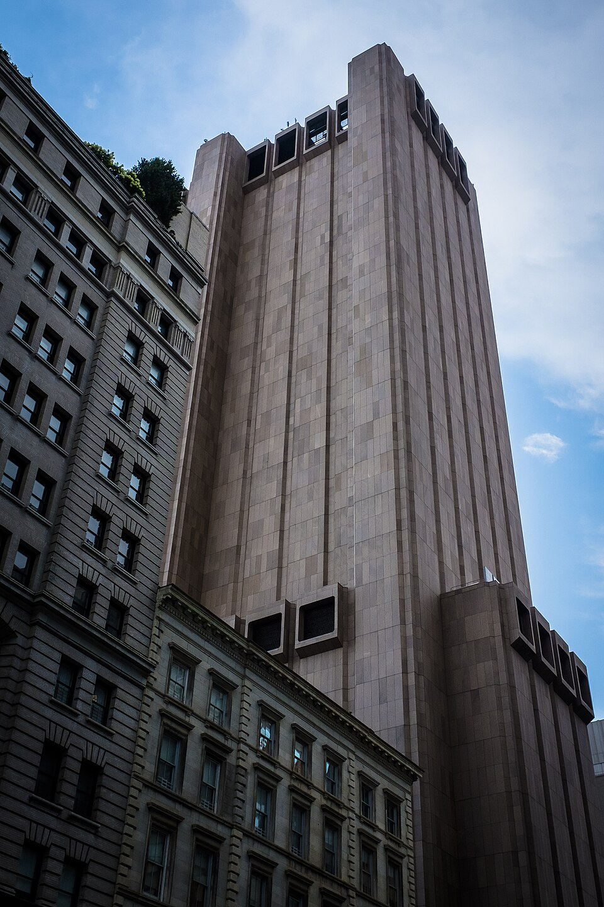

# PURSUE Release 01 — What Am I Asking U FO?

A flying triangle, two centuries of sightings, and a government file drop that still refuses to answer the witness problem

*Photo: 33 Thomas Street by Billie Grace Ward, 2017, [CC BY 2.0](https://creativecommons.org/licenses/by/2.0/), via [Wikimedia Commons](https://commons.wikimedia.org/wiki/File:33_Thomas_Street_(37125221130).jpg).*

On 8 May 2026 the renamed **Department of War** (DOW) launched [war.gov/ufo](https://www.war.gov/ufo/) and posted **Release 01** of the **Presidential Unsealing and Reporting System for UAP Encounters** — yes, **PURSUE**, an acronym so on-the-nose it reads as a small dare. One hundred sixty-two records, a CSV manifest, a rolling release schedule, and a press push that asked the country to treat the upload as historic. The full corpus build, theme scans, and analyst consensus are in the [PURSUE 01 investigation](/influence/controlled_opposition/investigations/pursue-2026-may-uap-release-investigation.md). The short version: **lots of files, very little new evidence, and zero documents in the corpus describing a working anti-gravity craft.**

That is supposed to settle the matter. It does not. There is a contradiction sitting in the middle of the upload like a stone in a shoe, and it is the same one that has been sitting there for almost eighty years: **mass witness testimony on one side, no released proof on the other.** PURSUE Release 01 simply gives that stone a Truth Social post and a sleeker URL.

## The triangle over the house

Two nights in 2015, in a Phoenix-area neighborhood in Arizona, a flying triangle came over my house. Both times it was loud, low, and physically vibrational — the kind of pressure you feel in the floor and the chest before you feel it in your ears. It moved like a deliberate object, not a formation of wandering planes. It was, on a smaller and later scale, the same phenomenon thousands of Arizonans reported on the night of 13 March 1997 ([Phoenix Lights overview](https://en.wikipedia.org/wiki/Phoenix_Lights); [NUFORC reference page](https://nuforc.org/phoenix/)).

I am not going to pretend my account is instrumented proof. I do not have radar logs, FAA tracks, or a base exercise schedule for that night. What I have is a memory of a real, specific thing that happened twice, in a home, with a body that had to live afterward with what it just saw. The right question is not whether I am sure. The right question is what an honest investigation does with eyewitnesses like me when there are millions of us across the record.

The Phoenix Lights are the canonical case for a reason. Then-Governor Fife Symington joked at a press conference, brought out an aide in an alien costume, and years later told reporters he had personally seen something that "defied logic and challenged my reality." A V-shaped craft moved across hundreds of miles of desert sky over hours; later in the night, the Air Force confirmed flares dropped from A-10s on the Barry M. Goldwater Range. Believers and skeptics still argue about how cleanly those two events can be peeled apart. What is not in dispute is that *something happened*, that *thousands of normal people saw it*, and that *the official account did not extinguish the question.* It only shifted it.

I cite my own memory because it is honest, not because it is decisive. The point of section 8 in the [investigation timeline](/influence/controlled_opposition/investigations/pursue-2026-may-uap-release-investigation.md) is that this honesty is multiplied across two centuries. You cannot get to "no proof, therefore no problem" without first walking through everyone who is, by that logic, supposed to be lying or broken.

## The witness problem is not a punchline

A clean argument from the released record runs like this: AARO has reviewed the holdings. AARO has interviewed the named whistleblowers. AARO has concluded *no empirical evidence of extraterrestrial visitation, recovered non-human technology, or non-human intelligence reverse engineering* ([AARO Historical Record Vol. I, March 2024](https://www.aaro.mil/Portals/136/PDFs/AARO_Historical_Record_Report_Vol_1_2024.pdf)). PURSUE 01 adds nothing to that conclusion. Therefore the case is closed, and the rest is mass delusion or misidentification.

The first half of that argument is fair. The second half is where investigative discipline collapses into a religious posture. **Mass delusion is not a finding. It is a label that allows the labeler to skip the finding.** If you actually run the alternative hypothesis with rigor, you have to explain how thousands of mutually unconnected witnesses across decades, including pilots, police officers, radar operators, and a sitting governor, ended up all being mistaken in compatible directions about phenomena that periodically scrambled fighter jets. Saying "it was Venus" or "it was a flare" or "they were stressed" works in individual cases. It does not work across the whole population.

A useful test for a skeptic position is the same test we apply to a believer position: *what would falsify it?* "It was all delusion or misidentification" carries the same shape as "they were all sent by aliens." Both refuse counterexamples by definition. Both allow the holder to feel certain without doing the work. **A real solution to the UFO problem has to account for the witness mass without insulting the witnesses,** because anything less is not skepticism — it is a science-shaped contempt that science itself does not endorse.

That contempt is doing work for somebody. We will get to who.

## A short history of people seeing the wrong thing in the sky

Before getting to the modern story, the long arc is worth a paragraph each. The full table — with dates, locations, and official explanations row by row — lives in the [investigation, section 8](/influence/controlled_opposition/investigations/pursue-2026-may-uap-release-investigation.md). The compressed version is enough here.

**1896-97 — the mystery airship wave.** Across California, Texas, and the Midwest, newspapers reported a structured, lit, dirigible-like craft over towns that did not yet have practical aircraft. There were pilots, searchlights, anchors, even an alleged crash in Aurora, Texas with a pilot's grave. Some of it was hoax, some of it was newspaper contagion, some of it remains unexplained. The category mattered before the technology existed to explain it.

**February 1942 — the Battle of Los Angeles.** Less than three months after Pearl Harbor, anti-aircraft batteries fired more than 1,400 rounds into the night sky over Los Angeles, against radar contacts and visual sightings that were never satisfactorily identified. Officially: weather balloon plus war nerves. In the photographic record: searchlights converging on something the gunners decided was real enough to shoot at. **Military overreaction is a kind of witness statement too.**

**1944-45 — foo fighters.** Allied pilots in both the European and Pacific theaters reported balls of light pacing their aircraft. Combat pilots are exactly the kind of witness population a serious investigation does not get to dismiss. The reports went into intelligence channels because they had to.

**June 1947 — Kenneth Arnold.** Nine objects near Mount Rainier moving "like saucers skipping on water." The press named the era. Within weeks, **Roswell**: a "flying disc," then a weather balloon, then decades of myth. The 1994-95 USAF reports attribute the debris to Project Mogul and the alleged bodies to anthropomorphic dummies dropped under Project High Dive. Acceptable as a closing of one case; insufficient as a closing of the category.

**1952 — Washington, D.C. radar-visual sightings.** Objects tracked on radar over the capital on two consecutive July weekends. Jets scrambled. Press attention saturated the country. The CIA convened the **Robertson Panel** in January 1953, which recommended that UFO reports be **demystified** through media cooperation to reduce public hysteria and channel overload. That is not a folk memory. That is a documented influence-on-public-affairs proposal — and it is one of the two halves of the story this article keeps coming back to.

**1969 — Project Blue Book closes.** Twelve thousand cases, around seven hundred unresolved, the official Air Force public-facing study shut. The institutional vacuum that follows is what civilian investigators, abductee narratives, and 1970s tabloid coverage rush in to fill.

**1980-1997 — Rendlesham, Belgian wave, Phoenix.** The triangle becomes the post-saucer archetype. Belgian air force scrambles F-16s. American military witnesses near RAF Bentwaters report lights and landing traces. Then on 13 March 1997, an enormous V crosses Arizona slowly enough that thousands of people get a long, unhurried look. Symington at first jokes; later admits.

**2004 onward — the sensor era.** **Tic Tac** off the *Nimitz*. **Gimbal**, **GoFast**, the *New York Times* AATIP story in 2017, the Navy's confirmation that the leaked videos are real recordings, and finally David Grusch's 2023 testimony alleging crash-retrieval programs. By the time AARO is established and the **2024 Historical Record** lands, the public has been handed a roughly fifteen-year stretch of "we have videos, we cannot fully resolve them, we have no NHI evidence to share."

**8 May 2026 — PURSUE Release 01.** A new portal, a CSV, 162 records, almost all of them re-issues of FBI Vault material, NASA Apollo transcripts, State Department cables already released in February 2026, and AARO unresolved-case mission reports. Every record carries the **unresolved** tag. Every analyst — TWZ, *New York Magazine*, Engadget, Defense News, John Greenewald of *The Black Vault* — converges on the same line: *transparency norm yes, revelation no.*

If this were the first uncertain release in an otherwise clear archive, "no proof" would close the question. Stacked against the prior two centuries, "no proof" becomes an institutional fact about disclosure rather than a complete fact about the sky. That distinction is the whole game.

## Get used to saying Martians

Try the word out loud. Notice the impulse to laugh. The reflex was installed.

Marvin the Martian first appeared in Chuck Jones's **"Haredevil Hare" in 1948** — one year after Roswell, one year after Kenneth Arnold ([Marvin the Martian](https://en.wikipedia.org/wiki/Marvin_the_Martian)). He came back as a recurring antagonist through the 1950s, including in **"Duck Dodgers in the 24½th Century" (1953)**, in which Daffy Duck plays an interplanetary captain claiming "Planet X" in the name of Earth ([Duck Dodgers in the 24½th Century](https://en.wikipedia.org/wiki/Duck_Dodgers_in_the_24½th_Century)). For most American children born after 1948, the *first* Martian they ever met wore a Roman helmet, carried an Illudium Q-36 Explosive Space Modulator, and fit comfortably between the Tooth Fairy and Santa Claus on the developmental shelf labeled *cute fictions you outgrow.*

That shelf is not neutral. It is a managed-disclosure surface. Cartoon Martians arrive early enough that "Martian" enters the vocabulary as a comedy register. By the time a child is old enough to read a real article about Mars — geology, atmosphere, water history, possible biosignatures — the word itself has been pre-laughed at by adults who long since filed it next to elves. The category of *people from Mars* gets reserved for fiction by the time anyone is in a position to take it seriously.

The disclosure mechanism this article is interested in works in two directions at once. The **Robertson Panel direction** in 1953 said: *demystify, suppress, channel humor against panic.* The cartoon direction running in parallel said: *put Mars in front of every child as a joke before they meet it as a question.* You can read those as a coincidence of mid-century pop culture. You can also read them as one cultural settlement: the public will be permitted to know that something is up there, on the condition that the *image of who is up there* is permanently silly.

A future generation that is not pre-laughed at will read the same word and hear something different. The disclosure machine has prepared for that, too — but on its own terms, not on theirs. More on that in the closing.

## Two UFOs, not one

PURSUE 01 forces a choice that neither the believer lane nor the skeptic lane actually wants to make: *what is the witness pool reporting on?* The releases keep treating UAP as a single phenomenon. The witness record is messier. The working hypothesis here keeps two categories distinct, on purpose.

**Category A — original UFOs.** The author model under investigation is that the original UFO phenomenon comes from a **breakaway human civilization on Mars**, not from "ancient aliens" in the standard alien-savior frame, and not from any other star system. Limits on the model:

- Transit windows are constrained by **Earth-Mars opposition**, when the planets' larger electromagnetic environments — Van Allen belts, magnetospheres, "atmospheres" in the older field-theoretic sense — overlap or come close enough to permit safer passage.
- A second mode involves **forced atmospheric coupling or quantum-style teleportation**, in which a high-altitude vehicle in Earth's atmosphere generates enough energy that the flow routes to the nearest compatible body. The closest publicly available analog is the Eric Davis [Teleportation Physics Study](https://apps.dtic.mil/sti/citations/ADA416108) commissioned by AFRL in 2003, which is *not* in the PURSUE corpus and which Release 01 conspicuously does not surface.
- Humans born and raised on Mars cannot freely live in Earth's heavier, denser, bacteria-rich atmosphere. Pressure, pathogens, sunlight, and gravity loadings that are normal to a terrestrial body are pathological to a Martian-adapted one. A visitor would need controlled, low-light, climate-stabilized, sealed environments — quarantine in everything but name.

That last point is the one that opens the windowless-towers section below. None of this is established fact. It is the working frame the PURSUE corpus is being read through.

**Category B — reverse-engineered or classified military aerial platforms.** This is the more terrestrial half of the witness pool. Craft built by U.S. or allied or adversary militaries, from recovered, reverse-engineered, or independently developed propulsion. The motive for secrecy is ordinary: warfare, espionage, sensor defeat, deterrence. Adversaries cannot adapt to a capability they do not know exists. Citizens cannot vote against a budget they cannot see. The black-triangle tradition — Belgian wave 1989-90, Phoenix Lights 1997, late-1990s TR-3B folklore, recurring American triangle reports including my own — sits closest to this category.

The two categories matter because **collapsing them into one "alien" bucket is exactly the move the disclosure economy needs you to make.** Once "alien" becomes the only word in play, every triangle over a neighborhood becomes a debate about ET rather than a debate about classified American aerospace. The Mars-breakaway hypothesis stays in Category A on purpose; my house was in Arizona, and what flew over it was almost certainly Category B. The two stories are different and have to stay different to be analyzable.

## Windowless towers and other places nobody is supposed to wonder about

If Category A is even partially real, then the practical question is where a Mars-adapted human visitor would actually live during a stay on Earth. Sealed, low-light, climate-controlled, sound-isolated, hardened against electromagnetic noise. Conveniently, several major American cities have buildings that match that description, in plain sight, at downtown addresses, and the public does not quite know what to do with them.

**33 Thomas Street** in Lower Manhattan is the canonical example. A 550-foot Brutalist slab completed in 1974 for the AT&T Long Lines Division, designed by John Carl Warnecke, with virtually no windows. The official explanation has always been telecommunications: a hardened long-distance switching center for AT&T's 4ESS switches, and later one of the most secure data centers in New York. In 2016, *The Intercept* and *The New Yorker*, working from Snowden documents, reported that the same building functioned as **TITANPOINTE**, an NSA surveillance hub used for monitoring international calls and internet traffic ([*The Intercept* — "Titanpointe"](https://theintercept.com/2016/11/16/the-nsas-spy-hub-in-new-york-hidden-in-plain-sight/)). The cover story turned out to be only part of the story, which is the right epistemic posture to bring to any other windowless tower in any other downtown.

**375 Pearl Street**, also in Manhattan, is another. A nearly-windowless 1970s telecom tower, retrofitted in the 2010s into a partially window-clad data center, sometimes called Verizon's "Sapphire" building. **AT&T Long Lines facilities** in Kansas City, St. Louis, Cleveland, Chicago, and Atlanta repeat the typology: tall, hardened, mostly windowless, downtown, and explained by infrastructure. **The Long Lines bunker network**, the COG (Continuity of Government) underground sites, and Cold War civil-defense hardening all sit in the same architectural family.

The mainstream explanations are not silly. Telecom switches do require climate stability, vibration isolation, and protection from solar loading. Data centers do prefer minimal envelope penetrations. Cold War nuclear hardening did push entire bureaucratic functions underground or into windowless cores. Surveillance hubs do prefer not advertising their interiors. Each individual tower likely has a real, boring, document-supported reason for not having windows.

The hypothesis this article is willing to leave open is narrower: in the same way that 33 Thomas Street turned out to be doing more than its cover story claimed, *some* of the unusual tower stock in major cities might be doing more than the public explanation says. If Category A visitors exist and need quarantine-grade habitat, they would not advertise. They would build cover stories that pass casual inspection. The way to falsify the hypothesis is building-by-building: floor plans, energy footprints, staffing patterns, mechanical loads, after-hours occupancy. The way *not* to dismiss it is "obviously not." That sentence is doing the same job as "mass delusion."

The image at the top of this article is 33 Thomas Street. It is in this article specifically because the building is *normal* enough that the surveillance use was hidden inside the telecom story for forty years. That is the shape of cover that any real Category A program would be expected to wear.

## What PURSUE Release 01 actually gives us

Stripped of theatre, the upload contains:

- The **war.gov/ufo** site itself, with a structured CSV manifest that makes bulk analysis possible (this is how the [investigation corpus](/influence/controlled_opposition/investigations/pursue-2026-may-uap-release-investigation.md) was built).
- **FBI 62-HQ-83894** with several pages less redacted than the FBI Vault versions.
- A handful of NASA Apollo transcripts and "areas of interest" image overlays — explicitly captioned as *not* analytical judgments.
- State Department UAP Cables already released in full in February 2026.
- A package of recent AARO unresolved-case mission reports (2022-2025).
- A "bronze metallic ellipsoid" hero image that, on inspection, is a composite sketch of a field with an FBI-lab graphic overlay.

The single most underreported document in the whole corpus is buried in **AARO Vol. I, footnotes around pages 22 to 24.** It describes a 2010-era proposal by **BAASS**, the Bigelow Aerospace subsidiary that ran the AAWSAP/AATIP money, to **hire supportive reporters and celebrity moderators** to host "intellectual debates" at academic institutes that would **assume "E.T. visitations are true"** and steer the conversation away from "dead-end discussions" and the "morass" of "evidence." The stated downstream goal was to **increase appetite for "disclosure."** Full quote and analysis in [section 6 of the investigation](/influence/controlled_opposition/investigations/pursue-2026-may-uap-release-investigation.md).

This matters because it is **the same mechanism as the 1953 Robertson Panel, run in the opposite direction.** Robertson asked the press to *demystify* UFOs to reduce hysteria. BAASS proposed to *mystify* them through paid surrogates to manufacture appetite. Both are explicit influence-on-public-affairs proposals, both are documented inside this corpus, and both treat the public's affective relationship to the question as the actual deliverable. PURSUE Release 01 is a third turn of the same wheel: a centralized, branded, rolling-release "transparency" surface that controls cadence, redaction, framing, and which whistleblower gets a microphone.

That is what the upload actually is. Not a revelation. A scheduling instrument.

## The final trick is the wrong reveal

The cleanest read of the last seventy years of UFO disclosure is that it has functioned as **controlled opposition and managed disclosure**, with the goal of preventing stable conclusions and durable political will rather than concealment forever. The mechanics are visible:

- Periodic file drops calibrated to dominate a news cycle and then taper.
- Whistleblowers whose claims cannot be fully verified or fully refuted in the same lifetime.
- A believer lane fed enough material to stay loyal and a skeptic lane fed enough material to stay smug, with neither lane ever holding the lever.
- Cultural products — Marvin the Martian to *Ancient Aliens* — that pre-shape what kind of reveal will be psychologically legible when one finally lands.

The endgame this article is willing to name, as a working hypothesis the [investigation](/influence/controlled_opposition/investigations/pursue-2026-may-uap-release-investigation.md) keeps open, is this: a future generation is being prepared to accept a reveal in which "Martians" are introduced **not** as a breakaway human civilization with documents, history, and accountability, but as **ancient aliens** with universal authority and ancient plans already in motion. The ontology arrives wrong on purpose. Generations are sorted out as the ones who laugh at "Martian," the ones who can say it without flinching, and the ones who hear it and accept the cosmology that was prepared for them. Divide, conquer, exhaust, then reveal under the wrong frame.

If that read is right, the correct response to PURSUE Release 01 is not to wait for Release 02. It is to refuse the basin entirely: to keep the witness record honest, keep the two categories of UFO separate, keep the windowless towers under questions, keep "Martian" in the working vocabulary as a possible *people* and not as a comedy register, and keep the budget side of the disclosure economy under the same scrutiny we would apply to any other program that runs on government contracts and a press push.

The triangle that came over my house in 2015 was almost certainly Category B — somebody's classified airframe, made by humans, using engineering nobody outside a vault gets to see. That does not make me a believer in saucers from Zeta Reticuli. It makes me a witness with a small, clear stake in the larger question of who gets to decide what other witnesses are allowed to say. PURSUE 01 did not answer that question. It changed the URL.

### Where next

- [PURSUE Release 01 — full investigation](/influence/controlled_opposition/investigations/pursue-2026-may-uap-release-investigation.md) — corpus build, theme scans, two-century timeline, BAASS PR-campaign footnote, author registry, limits.
- [Lacatski / AAWSAP — insider mechanics](/influence/controlled_opposition/investigations/lacatski-consciousness-craft-viral-post-investigation.md) — the bureaucratic engine behind half this story.
- [Great Awakening / alien-savior / RV cluster](/influence/controlled_opposition/investigations/great-awakening-alien-savior-rv-nwo-cluster-investigation.md) — the affective grammar PURSUE plugs into.
- [What Are You Waiting For?](/influence/controlled_opposition/what-are-you-waiting-for.md) — deferral as calm technology; rolling-release schedules as an attention design pattern.
- [Mars × *Chrono Trigger*](/influence/controlled_opposition/cia-1984-mars-chrono-trigger.md) — fiction-and-declassification reading discipline.
- [Mars-Earth reincarnation](/cosmos/mars/investigations/mars-earth-reincarnation-investigation.md) — adjacent Mars-human-continuity material.

## Framing and limits

The 2015 Arizona triangle account is first-person witness testimony, not instrumented proof. The Mars breakaway-civilization model in Category A is a working hypothesis, not a finding established by PURSUE, AARO, NARA, or any other government source in the corpus. The reverse-engineered military hypothesis in Category B is similarly a frame for organizing the witness record, not a documented capability. The windowless-towers reading treats one verified surveillance reuse (33 Thomas Street as TITANPOINTE) as a license to keep questions open about other downtown buildings, *not* as evidence that any specific tower houses Martian visitors. The managed-disclosure read of the last seventy years is interpretation, not subpoena. Heavy citations, evidence tiers, falsifiers, and the per-claim audit trail live in the [PURSUE 01 investigation](/influence/controlled_opposition/investigations/pursue-2026-may-uap-release-investigation.md#limits-and-disclaimers).

Keywords: #PURSUE #UAP #UFO #DepartmentOfWar #AARO #AAWSAP #BAASS #Bigelow #PhoenixLights #BlackTriangles #BattleOfLosAngeles #FooFighters #KennethArnold #Roswell #ProjectBlueBook #RobertsonPanel #Nimitz #TicTac #DavidGrusch #Marvin #DuckDodgers #ManagedDisclosure #ControlledOpposition #Disclosure #BreakawayCivilization #MarsOpposition #Titanpointe #ThirtyThreeThomasStreet #WindowlessTowers #ParadigmThreatFiles

**Last updated:** 2026-05-08

---

*Written and narrated by Ari Asulin, with drafting and research support from LLM agents.*
