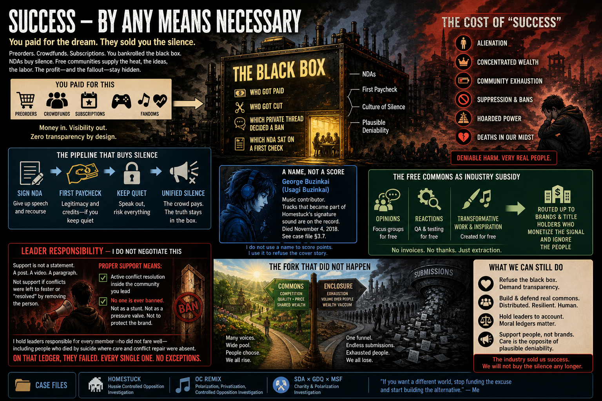

# Success — by any means necessary

If you ever preordered a sequel you hated, crowdfunded a train wreck, or paid a subscription that only deepened a fandom fire, you already bankrolled the black box. The part you could not see—who got paid, who got cut, which private thread decided a ban, which NDA sat on a first check—stayed invisible on purpose. I start there because the cost of “success” in these scenes is not only money on the price tag; it is alienation, concentrated wealth, and fallout that only shows up as plausibly deniable afterimages—unless you refuse to let the industry’s comfort language cover it.

> **TL;DR:** Paying customers fund a zero-visibility pipeline. NDAs and the first paycheck buy silence; free fan communities subsidize focus-group heat, QA feedback, and inspirational work for nothing. The ethical line was crossed long ago; what we can still count is deniable harm. I am unapologetic: I hold leaders of these communities responsible for people who did not survive the shape of the place—including potential suicides where real support did not exist. A press statement is not support. Resolving conflict inside the community you lead and upholding **no one is ever banned** is the minimum bar for leadership; on that bar, they failed—every one, no exceptions. Case files: [*Homestuck*](/influence/controlled_opposition/investigations/homestuck-hussie-controlled-opposition-investigation.md), [OC ReMix](/influence/controlled_opposition/investigations/ocremix-polarization-privatization-controlled-opposition-investigation.md), [SDA × GDQ × MSF](/influence/controlled_opposition/investigations/sda-gdq-charity-msf-polarization-investigation.md).

---

## The black box you paid for

We—buyers, donors, subscribers, the people who made the line go up—paid for the art, the marathons, the soundtracks, the “community” brand. Visibility into how money, credit, and harm were handled stayed at zero for us. The development path is expensive; the artifacts often feel worse at higher prices; the silence is total on the inside. That is not a technical accident. NDA culture and enclosure turn the production floor into a black box so the public story can stay plausibly deniable no matter how much fallout leaks at the rim.

The first paycheck in these lanes is often the first gag: sign away speech and recourse to get legitimacy or credits that should not have required a muzzle. Stack that across decades and you get an entire industry trained in suppression—not because every signer is evil, but because the incentive is unified silence while the crowd still pays the tab.

---

## The free commons as industry subsidy

Fan communities are still sold as organic and self-healing. In practice they are unpaid R&D: opinions that function like focus groups, reactions that function like QA, and transformative work and inspiration published for nothing asked back but an audience and feedback. No invoice line for that labor or emotional weight; the return was routed up to title holders and brands who could monetize the signal while ignoring the people when the signal turned into grief.

That structural gift is the soil the industry strips after it proves fertile.

---

## The cost of success: fallout you are not supposed to total

Plausible deniability is the unit you get when ledgers are private and forums are curated: you can name alienation, poverty of belonging, hoarding at the top, and deaths in the news feeds of the same scenes—without a single line item that courts would treat as causation in a docket. I still total it morally anyway.

Music contributor George Buzinkai died November 4, 2018; tracks that became part of *Homestuck*’s signature sound are on the record; memorial threads and family context are in [**§3.7**](/influence/controlled_opposition/investigations/homestuck-hussie-controlled-opposition-investigation.md). I do not use a name to score points—I use it to refuse the cover story that no one was responsible for the shape of the room.

---

## The fork that did not happen

If leaders had refused to conform these rooms to industry gravity—if they had kept commons from collapsing into a single funnel—those same communities could eventually have competed with the industry on quality and price discipline. Wealth could have spread across people who choose what they want from a wide pool instead of watching it vacuum through one pipe.

We do not live in that fork. What little public square existed got replaced by channels flooded with submissions while the people who would give feedback and attention are ground down by the volume. Exhaustion is part of the design when the only approved move is more output for less reciprocity.

---

## Leader responsibility — I do not negotiate this

I hinge everything on who held the microphone and the ban hammer.

Support is not a statement. A thread, a video, a corporate paragraph of sympathy is not support if the conflicts that broke people were left to fester or were “resolved” by removing the person instead of the problem.

Proper support—in the standard I apply without apology—requires active conflict resolution inside the community you lead and a hard rule I do not soften: **no one is ever banned**. Not as a stunt, not as a pressure valve, not as a tool to protect the brand from embarrassment. If your answer to discord is ejection, you have already admitted you were running a stage, not a commons.

I hold those leaders responsible for every member who did not fare well—including people who died by suicide where adequate community care and conflict repair were absent. That is not a court complaint in this file; it is moral ledger work. On that ledger, the leaders I mean failed. Every single one. No exceptions.

I believe one reason I was never allowed to lead in those lanes is that I would have run them under this rule set—and that rule set breaks the business model that depends on throwing people away.

---

## Where to read carefully

| Lane | Start here |
|------|----------------|
| Remix / policy / HD Remix / firsthand lane | [OC ReMix investigation](/influence/controlled_opposition/investigations/ocremix-polarization-privatization-controlled-opposition-investigation.md) — §4–§8 |
| Webcomic IP / commerce / contributor death record | [*Homestuck* investigation](/influence/controlled_opposition/investigations/homestuck-hussie-controlled-opposition-investigation.md) — §3; §3.7 George Buzinkai |
| Marathon charity / opacity / router fights | [SDA × GDQ × MSF investigation](/influence/controlled_opposition/investigations/sda-gdq-charity-msf-polarization-investigation.md) — §3–§4 |

Hub: [Controlled opposition](/influence/controlled_opposition/page.md).

---

## Honesty cap

Nothing here is a legal finding that any named person caused a death or breached a duty recognized by a court. My no-ban bar names the ethical minimum I assign to leadership in volunteer fan commons—not a claim that every host or law can operate literal zero enforcement in every jurisdiction. The careful tier labels and Limits live in each dossier.

Keywords: #ControlledOpposition #ContributorWelfare #FanLabor #LeadershipEthics #Privatization #Polarization #OCReMix #Homestuck #Speedrunning #CharityRouter #ParadigmThreatFiles

**Last updated:** 2026-05-02

---

*Written and narrated by Ari Asulin, with drafting and research support from LLM agents.*
