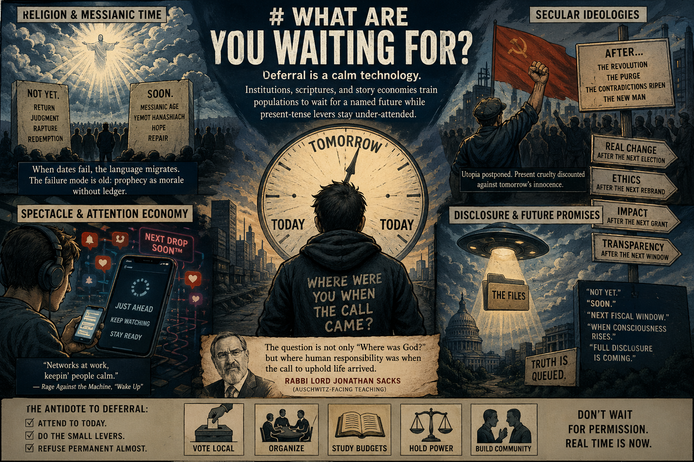

# What Are You Waiting For?

The first time I clocked the line was not in a stadium or a protest tape. It was the end of *The Matrix* (1999), in a dollar theater, sitting through the credits while the house lights stayed down. Rage Against the Machine’s “Wake Up” ([Wikipedia — song](https://en.wikipedia.org/wiki/Wake_Up_(Rage_Against_the_Machine_song))) landed over the scroll, and one phrase stuck: *“Networks at work, keepin' people calm.”* Same film that had just spent two hours telling you the world was a stitched lie—then handed you a true sentence about how the lie breathes: not only by hiding facts, but by scheduling your attention so the present never becomes urgent enough to break things.

That scheduling habit is everywhere once you listen for it. It is not a single conspiracy; it is a shape—religious, political, scientific-marketing, and feed-native—where tomorrow carries the moral weight so today stays tolerable.

> **TL;DR:** Deferral is a calm technology: institutions, scriptures, and story economies train populations to wait for a named future (return, disclosure, Davos Great Reset branding, Iraqi dinar–style revaluation / GCR gold lore, revolution, pole shift, “full stack” space tourism) while present-tense levers—tax, labor, courts, local politics—stay under-attended. I name that pattern, link the repo’s dossiers on disclosure basins and spectacle timing, and argue with Rabbi Lord Jonathan Sacks’ Holocaust-era reframing: the harder question is often where we were when the call came—not what the sky will do next week.

## The deferral habit

Deferral sells continuity. If the critical event is always just ahead, you can live inside a permanent almost: almost disclosure, almost justice, almost rapture, almost liberation, almost default. The emotional product is relief without change. You are not asked to do nothing—you are asked to prepare, to stay ready, to keep watching, which is a different machine than organizing a rent strike or reading a municipal budget.

Radiohead’s “The Bends” (the title track on [*The Bends*, 1995](https://en.wikipedia.org/wiki/The_Bends_(song))) is not scripture; it is a pressure gauge for modern life under constant headlines. The speaker is drowning in now—bad news, powerlessness, the sense that nothing you do will move the lever—so the mind outsources relief to a past that reads as simpler and to a future event that might finally break the spell. That is the same deferral muscle I am tracking here: anxiety without agency, plus a wish that *something*—anything—would happen so you would not have to be the one who happens. Yorke puts it flat:

> *I wish it was the '60s, I wish we could be happy*  
> *I wish, I wish, I wish that something would happen*

The pattern crosses registers. A preacher says not yet. A minister says soon. A Marxist tradition says after the contradictions ripen. A UFO thread says when consciousness rises. A defense agency says next fiscal window for transparency. A dinar chat says the reset is in hand. Different vocabularies; same posture: the decisive truth is queued.

## Religion and messianic time

Christianity’s dominant mass-market story (especially in America) often compresses history into a terminal episode: return, judgment, closure. Jewish discourse around messianic age / yemot hamashiach has its own grammar—legal, communal, often cautious about dating the arrival—while still carrying hope that history can bend toward repair.

Both can be weaponized into waiting—not by every believer, and not by every rabbi or priest, but by any authority who needs a crowd patient more than it needs a crowd accountable. When dates fail, the language migrates to mystery; when mystery wears thin, it migrates to metaphor; when metaphor thins, it migrates to “you misunderstood the calendar.” The failure mode is old: prophecy as morale without ledger.

After the Shoah, Rabbi Lord Jonathan Sacks—writing and teaching in public for decades—pressed a reframing that matters here. The question is not only “Where was God?” but where human responsibility was when the commandments against murder and oppression were already spoken. The Rabbi Sacks Legacy curriculum summarizes his Auschwitz-facing teaching in those terms: the horror is not resolved by treating the divine as a slot machine that failed to pay out on schedule; it is confronted by asking where humanity was when the call to uphold life arrived ([Rabbi Sacks Legacy — God and the Holocaust curriculum](https://rabbisacks.org/curriculum/holocaust/topic-1-god-and-the-holocaust/); see also [Where Was God During the Holocaust? — video](https://rabbisacks.org/videos/where-was-god-during-the-holocaust/)). I agree with that hinge. It moves the reader off the balcony and into the street.

## Secular ideologies

Marxist and Marxist-Leninist traditions also built future-weight: the new society arrives after a break, a purge of class enemies, a new man tempered by history. The deferral habit is not unique to pulpits. When utopia is postponed until the body count clears, you get the same emotional loan: present cruelty discounted against tomorrow’s innocence.

The same curve shows up in softer forms: parties that promise “real change” after the next primary, corporations that promise ethics after the next rebrand, NGOs that promise impact after the next grant cycle. None of those require a conspiracy theory; they only require incentives and humans. The shape still trains the nervous system to wait for permission.

This repo does not treat economics as a sermon. The point is narrower: any ideology that makes the real moral work always tomorrow will rhyme with religions that make salvation always tomorrow—and with intel-adjacent disclosure cultures that make the file drop always tomorrow. The alignment is structural, not a claim that rabbis, commissars, and program officers share a group chat.

## Governments, agencies, and “soon”

States do not only lie. They also schedule truth. A hearing date moves. A report is “imminent.” A redacted PDF appears without the cover memo that would explain intent. The public gets enough seam to argue, rarely enough lever to withhold consent cleanly. That is not always a room full of villains; it is often bureaucracy plus politics—still a calm machine, because outrage that cannot convert into durable institutional pressure functions like a release valve.

The repo’s heavier read on partial disclosure and Revelation of the Method language lives in dossiers (for example the Artemis file’s §0 spine and the Mars dossier’s RoM default). I only borrow the user-facing consequence: when “disclosure” becomes a genre, it becomes another thing to wait for—and waiting is compatible with tax flows, recruitment, and wartime budgets continuing unchanged.

## Aliens, enlightenment gates, and internet disclosure

The alien lane has been remarkably consistent: help is conditional on our maturity. Sometimes the condition is spiritual (“raise your frequency”), sometimes civic (“stop the deep state”), sometimes both, blended in the same paragraph. The same conditional-release grammar shows up in Pentagon-adjacent disclosure talk—breakthrough tech after enlightenment, benefactors who withdraw if humanity fails the vibe check.

The repo’s [Lacatski / AAWSAP investigation](/influence/controlled_opposition/investigations/lacatski-consciousness-craft-viral-post-investigation.md) tracks that fork on-record: bureaucracy and funding fights, not a located ET memo, while the public story shape still rhymes with waiting rooms. The [Great Awakening / revaluation / disclosure cluster](/influence/controlled_opposition/investigations/great-awakening-alien-savior-rv-nwo-cluster-investigation.md) maps the wider basin: Wilcock-adjacent disclosure, *Ancient Aliens* defaulting, Q-adjacent “trust the plan,” and the same imminent flip grammar. If you want receipts and enforcement links, live in that dossier; here I only name the shared curve—then I linger on the money lane below, because I have never seen anything else online match its budget and cadence.

## Great Reset branding, dinar “RV,” and the fork they would not wait out

Klaus Schwab’s circle literally branded a post-pandemic macro program Great Reset ([WEF hub](https://www.weforum.org/great-reset/)). Separate from that Davos product—but lexically rhyming with it—sits the internet’s global currency reset (GCR) / Iraqi dinar revaluation complex: hold physical IQD (or worse), subscribe to tiered “intel,” refresh for tomorrow’s rate screen, tomorrow’s “green light,” tomorrow’s proof that Treasury or UST or the military is “ready.” Forum shorthand is “RV”—revaluation, not CIA remote viewing; the dossier keeps the two abbreviations apart on purpose ([Great Awakening investigation](/influence/controlled_opposition/investigations/great-awakening-alien-savior-rv-nwo-cluster-investigation.md) §3.3).

The dinarian “RV” scene was at its loudest roughly between 2011 and 2015: dedicated forums, conference-call “intel,” guru brands (including figures like TNT Tony), and the same story reshaped for social feeds—with a noticeable second wind after the 2016 US election. That is the window when I first really noticed it. For more than four years the tease never landed: another weekend window, another “final” checklist, another stack of government-adjacent PDFs and long threads that *looked* like due diligence—verbose, footnoted, cross-linked—until you tried to correlate primary to claim and the chain went mushy. If you were not doing that work, the package read as close to bulletproof as anything on the internet: sober tone, apparent official paper, a community that sounded like it had insiders. The same stretch doubled as simulated briefing culture—calls, drops, and fresh stacks of “this leak” and “that memo” that could read like government prep even when the chain was forum → reseller → YouTube rather than White House → press room. Of every waiting story I have watched share a screen with holy-text prophecy culture, that financial-reset feed is the most heavily pushed and the best capitalized: paid tiers, conventions, currency markups, legal enforcement cases because real money moved (SEC, CFTC, CNBC—all pinned in §3.3 of the same file).

Later, regulators and press bundled a lot of that retail machinery under “scam.” I am not here to litigate every promoter. My narrower point is personal: from the outside of the spreadsheet, a real policy shock *could* still have matched some of what the feeds were selling; the failure mode was not only “nothing was ever true.” What killed the continuity of the story I was watching—not the only lens on Iraq or the dollar—was sequence in the real world: after the destruction of Libya, and again after the election of Trump, the same “reset in hand” plot could not keep threading without breaking. The window I mean is narrative and political as much as it is forex math.

The Paradigm Threat desk goes harder on geopolitics than on chat-room innocence: the investigation treats gold, euro-invoice, and parallel-settlement symbolism around Iraq and Libya as part of a layered fear—not mono-cause cartoon history—that Anglo-American hard power answered with regime destruction when a competing financial-reset story threatened to anchor outside the Great Reset camp as the repo defines it (§3.3.1–§3.3.3, Limits on war causation). I read that dossier as complementary to the personal beat above. What the carnival asked retail to wait for (overnight revaluation, gold-backed shock, fiat “busted”) sits in the same family of futures elites already fought on a shorter clock—and sometimes the thing “they” tell you to wait for is not absence but the advent of their endgame: your patience priced while their chess finishes elsewhere. If one example holds the whole shape, for me it is the dinarian RV spiral: daily certainty, institutional cosplay, money up front—prophecy with a POS terminal.

On the fiction side, the [Great Awakening investigation](/influence/controlled_opposition/investigations/great-awakening-alien-savior-rv-nwo-cluster-investigation.md) **§3.3.4** names *The Animatrix* / *The Second Renaissance* as the clearest mass-media rehearsal of the same escalation ladder: a competitor pole gains economic autonomy; the Western coalition answers with **blockade** logic under **currency stress**; the arc moves from trade war to **total war** and a **ruined surface** (canon: machine nation 01 vs humans; allegorical read in-file maps that shape onto parallel settlement and reserve-currency fear). Retail dinar “RV” copy almost never advertises war as the prize; the cartoon still installs the contingency—and the [predictive programming hub](/influence/predictive_programming/page.md) lists it beside *The Matrix* proper as currency-reset pattern data.

## Cataclysm queues

Not every waited-for event is good. Some are catastrophe porn dressed as awakening. Internet culture still feeds pole shift / crust-displacement fantasies as a soon hammer—even though instant, civilization-erasing crust slip is not what geomagnetic observations show. Magnetic poles wander; Hollywood conflates that with continents surfing in an afternoon. A plain-language explainer from a geological survey institution is enough to separate magnetic drift from apocalypse scheduling ([USGS — Do magnetic reversals cause extinctions?](https://www.usgs.gov/faqs/do-magnetic-reversals-cause-extinctions))—not to win an argument with true believers, but to mark the difference between anxiety and mechanics.

People wait for those, too—sometimes because fear is easier to narrate than municipal policy.

If you need one clean distinction: magnetic reversal is a real, slow geophysical topic discussed in the open literature; Hollywood instant pole shift is mostly catastrophe branding—useful for clicks, useless for sandbags.

## Disclosure as shared clock

“Disclosure” became a portable word: it can mean declassified files, Congressional theater, podcast drops, or whatever keeps your feed refreshing. The convergence is the point. When geopolitical stakes spike—wars, coups, currency shocks—the appetite for a bigger story spikes with it. A spectacle that feels like history’s hinge can compete with headlines that actually decide borders and bodies.

The [Artemis II investigation](/history/chronology/investigations/artemis-ii-mission-as-faith-test-investigation.md) treats one April 2026 window that way: a crewed lunar flyby campaign as public liturgy—faith test, viral forensics, polarization—while the file’s authors keep explicit distance from adjudicating flight hardware and focus on information dynamics. Whether you buy every clause there or not, the useful question I care about is narrower: why “we’re going back to the Moon” is an easy future to sell when Earth’s board is on fire. It is another soon—a civilizational side quest with souvenir patches.

The [Mars × *Chrono Trigger* article](/influence/controlled_opposition/cia-1984-mars-chrono-trigger.md) makes a different cut: fiction and declassification can share a corridor without proving writer access to a folder. The honest posture is proportion—pattern without proof-hijacking—which is the same discipline I want here.

I am not claiming a dated, measured correlation between every crisis week and every disclosure spike. I am saying the incentive is visible: futures sell calm when presents demand courage.

## Prophecy failure and accountability

Prophecy cultures accumulate a backlog of missed dates—not a controversial claim, just history. When nothing happens, the community rarely publishes a correction with the same energy it published the countdown. The debate slides into metaphor defense or hidden fulfillment—unfalsifiable moves that protect the social role of the oracle more than the truth role of the sentence. That is the same migration of language already named in religion and messianic time (mystery, metaphor, calendar)—scaled from pulpit cadence to forum archives.

That move has costs. It trains audiences to accept non-accountability as normal. It also trains cynics to treat all testimony as scam-adjacent, which throws out indigenous and geological archives along with grift—exactly the wrong trade.

Chronology critics widen the calendar—Scaliger-weighted grids, phantom-time lines, “doubled history”—so the failure stack of waiting gets taller still; depth lives in the [chronology hub](/history/chronology/page.md), [Common Questions Q1](/history/common-questions.md#q1-does-modern-chronology-rest-on-independent-science-or-does-it-ultimately-depend-on-the-framework-created-by-scaliger-and-the-church), and [indigenous legends vs geologic deep-time](/history/chronology/investigations/indigenous-legends-vs-geologic-dating-investigation.md). I am not asking you to adopt any one thesis here—only noticing that deferral pairs naturally with who owns the years.

## The record is already messy enough

Here is the hardest pill, stated flat: most of the “not yet” events you were sold already have rough analogs in the human record—war, empire, collapse, migration, elite continuity—readable without importing a spaceship savior. The civilized world spent centuries dismissing indigenous testimony and then re-lost the continuity layer; that loss makes it profitable for new oracles to say: none of it counted until my YouTube channel says so—send money.

I am not telling you the past is closed or simple. I am telling you the future-as-narcotic is a known product. The antidote is not cynicism. It is contact: with budgets, with neighbors, with primary documents, with the parts of religion that demand today’s justice rather than next quarter’s reveal.

If you are spiritually inclined, treat that as teshuvah-shaped work in the world you can measure—food banks, bail funds, council meetings—not only inner weather. If you are not, the same sentence stands without the Hebrew: public love has to land somewhere strangers can audit it.

The soundtrack detail is small but honest: *The Matrix* placed “Wake Up” where most audiences hear credits as disposable time—exactly where a culture trains you to stop parsing. I am not claiming the filmmakers intended every political reading you can hang on it. I am saying the fit between image-system and lyric is too tight to be an accident of mood alone.

### Where next

- [Controlled opposition hub](/influence/controlled_opposition/page) — pattern list and case studies.
- [Great Awakening / revaluation cluster](/influence/controlled_opposition/investigations/great-awakening-alien-savior-rv-nwo-cluster-investigation.md) — disclosure + spirituality + dinar waiting room, with Limits for evidence discipline.
- [Lacatski / AAWSAP](/influence/controlled_opposition/investigations/lacatski-consciousness-craft-viral-post-investigation.md) — institutional mechanics vs “aliens test us” grammar.
- [Artemis II — faith test](/history/chronology/investigations/artemis-ii-mission-as-faith-test-investigation.md) — spectacle timing read.
- [Mars × *Chrono Trigger*](/influence/controlled_opposition/cia-1984-mars-chrono-trigger.md) — classification, culture, proportion.

## So what are you waiting for?

Disclosure? Not on the calendar you are carrying—not soon, and not in the shape you are picturing. The word already means different things to different people, and almost everyone quietly wants the same prize: *their* belief disclosed as the final truth for everyone else. That is not how the public world works. People build lives inside partial pictures; absolute, shared, once-for-all “proof for all minds” is a fantasy genre, not a broadcast schedule. I am not offering a metaphysics of death here—only the flatter observation that hindsight keeps winning arguments it refused to hold in real time.

In another sense, a lot has already been disclosed—just not settled. It sits in the open, oscillating in a sea of debunking, hot takes, and lazy conjecture, never quite landing as common ground. The next cohort has always been softened to accept what the previous one laughed off; the kids have already lived inside disclosure-shaped media ([predictive programming hub](/influence/predictive_programming/page.md)), and many of them treat the story-world as real until an adult voice tells them otherwise. That is a clean folding strategy: move the watermark into culture early enough that no single “reveal night” has to arrive—no watershed, no citable hinge, no day off work for history.

Mark my words: when a capstone disclosure ever does arrive in the wild, it will probably read as a small headline—easy to miss, easy to scroll past—while the argument stays loud somewhere else. So forget waiting on prophecy. Start weighing real plans you can touch: budgets, votes, contracts, bodies in rooms.

As Gandalf would say: “All we have to decide is what to do”...yadda yadda...

Keywords: #Deferral #Disclosure #Messianism #ControlledOpposition #ParadigmThreatFiles #WakeUp #Matrix1999 #Animatrix #SecondRenaissance #ArtemisII #Chronology #RabbiSacks #GreatReset #IraqiDinar #Revaluation #GCR #PredictiveProgramming

Last updated: 2026-04-30

---

*Written and narrated by Ari Asulin, with drafting and research support from LLM agents.*
