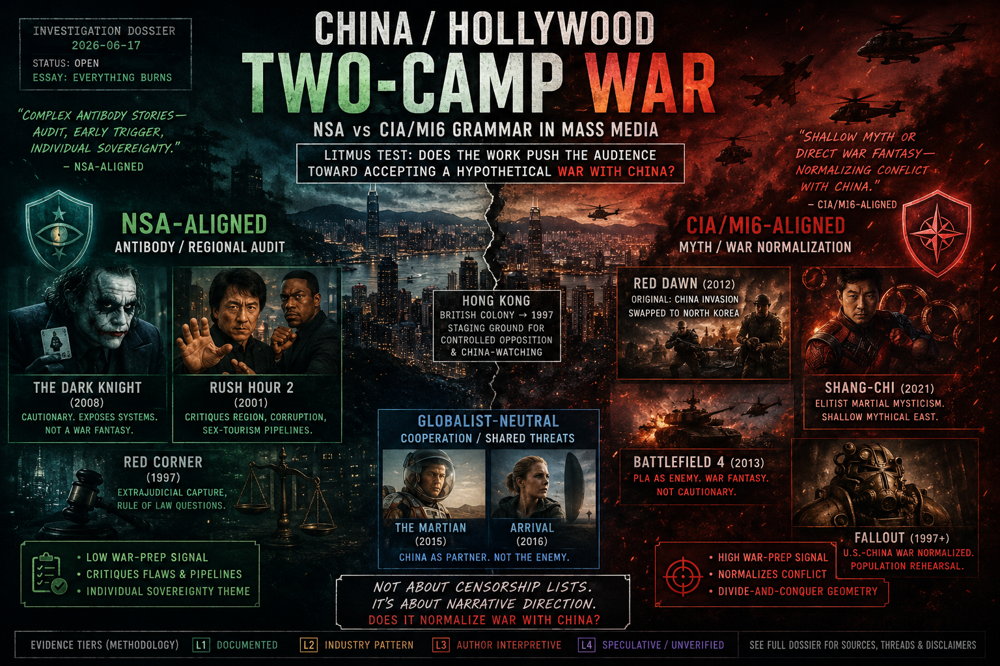

# Investigation: Hollywood two-camp war — media catalog (Pacific lane: war-prep litmus)

> **TL;DR:** Open dossier cataloging **NSA-aligned** vs **CIA/MI6-aligned** grammar in blockbuster film, TV, and games. **Camp is not “China content.”** **Pacific lane** litmus: war-prep with China? **Cyber / unity lane:** agency, declass, common foe? **Thread N — *T2*; Thread O — *ID4* (1996)** = NSA flagships. **Thread P — *Stargate* (1994 film)** = **CIA/globalist contrast** — ancient aliens + modern authority, **Atlantis/Mars laughed off**, sketchy portal physics/plot; **nothing “fake”** in *ID4* by comparison. **Thread Q — *Burn After Reading* (2008)** = **NSA-aligned interagency satire** — CIA **SigInt** purge, **Harry (Clooney) cellphone geolocation forecast**, **burn the body** (no FBI), **“What did we learn?”** closure. **Thread R — *The Arrival* (1996, Charlie Sheen)** = **NSA-aligned geoengineering / alien-influence flagship** — **not** Villeneuve’s *Arrival* (2016). Greenhouse plants as terraforming; JPL/spy compromise; Wolf 336 catastrophe stand-in; **AGW narrative as cover**. **Thread S — *The Big Lebowski* (1998)** = **NSA-aligned sovereignty / Gulf War ROTM** — hard talk wrapped in **Walter** (unchecked-aggression Vietnam vessel); **Kuwait bullying** reminder; **“This aggression will not stand”** as **line-crossed response**, not Bush-as-aggressor close; **Jesus / pederast declaration**; clinical sexuality-control warning. ***Congo* (1995)** = **NSA overall** (Ross *loveless…sons of bitches* CIA audit + pro-African balance) with **residual CIA Africa contempt** (Monroe *settle scores*) and ***King Solomon’s Mines* / Zinj** memory-war payload. ***Back to the Future* (1985) + *Part II* (1989)** = **NSA** (Reagan-as-actor call-out; Libyan plutonium terrorists; 9/11 PP cluster) — presidency cross-read [NSA-aligned presidencies](/governance/war/investigations/nsa-aligned-presidencies-nixon-reagan-trump-investigation.md). **Author heuristic:** NSA-camp blockbusters **rarer** and often **classics**; CIA-camp titles **more common**, **contradictory plots** tolerated to move misdirection payload.

**Date:** 2026-06-17  
**Status:** Open investigation; **reader essay published** 2026-06-17; ***Congo* / Spielberg brand cluster** added 2026-07-21; ***The Arrival* (1996)** Thread R added 2026-07-23; ***Back to the Future* 1–2** NSA catalog rows + presidency cross-link added 2026-07-26; ***The Big Lebowski* (1998)** Thread S added 2026-08-30.  
**Reader essay:** [**Everything Burns**](/influence/hollywood/everything-burns.md)

---

## Guide (read order)

**Part I — Taxonomy and catalogs**

1. [Thread A — Definitions and litmus test](#thread-a--definitions-and-litmus-test)
2. [Paradigm methodology — evidence tiers](#paradigm-methodology--evidence-tiers)
3. [Author’s originating thesis](#authors-originating-thesis)
4. [Thread D — Media catalog (film + TV working tables)](#thread-d--media-catalog-film--tv-working-tables) — includes [*Congo* (1995)](#congo-1995--nsa-overall-cia-audit-residual-africa-contempt-ksmzinj); [Spielberg brand / Kennedy–Marshall (open)](#author--spielberg-brand--kennedy-marshall-machine-open)
5. [Thread E — Games and interactive war fiction](#thread-e--games-and-interactive-war-fiction)
6. [Thread F — Censorship vs camp](#thread-f--censorship-vs-camp)

**Part II — NSA camp case studies**

7. [Thread B — *The Dark Knight* (anchor case study)](#thread-b--the-dark-knight-anchor-case-study)
8. [Thread N — *Terminator 2: Judgment Day* (1991): cyber-antibody flagship](#thread-n--terminator-2-judgment-day-1991-cyber-antibody-flagship)
9. [Thread O — *Independence Day* (1996, original): unity-lane NSA flagship](#thread-o--independence-day-1996-original-unity-lane-nsa-flagship)
10. [Thread P — *Stargate* (1994 film): globalist / CIA contrast to *ID4*](#thread-p--stargate-1994-film-globalist--cia-contrast-to-id4)
11. [Thread Q — *Burn After Reading* (2008): CIA decay / interagency satire](#thread-q--burn-after-reading-2008-cia-decay--interagency-satire)
12. [Thread R — *The Arrival* (1996): geoengineering / alien-influence NSA flagship](#thread-r--the-arrival-1996-geoengineering--alien-influence-nsa-flagship)
13. [Thread S — *The Big Lebowski* (1998): sovereignty / Gulf War ROTM](#thread-s--the-big-lebowski-1998-sovereignty--gulf-war-rotm)
14. [Thread G — Hollywood hot war: containment, forced labor, war-movie conveyor](#thread-g--hollywood-hot-war-franchise-containment-forced-labor-war-movie-conveyor)
12. [Thread C — *Rush Hour* franchise (1998–2001)](#thread-c--rush-hour-franchise-19982001)
12. [Thread M — Stolen memory: Jackie Chan artifacts, Taiwan, tech trigger](#thread-m--stolen-memory-jackie-chan-artifacts-taiwan-tech-trigger)
13. [Thread K — *24* (TV, 2001–2010): China torture, proxy terror, CTU destruction](#thread-k--24-tv-20012010-china-torture-proxy-terror-ctu-destruction)

**Part III — Containment and calendar**

12. [Thread G — One-off masterpiece / franchise containment](#thread-g--one-off-masterpiece--franchise-containment)
13. [Thread H — Obama / 2008 / Libya 2011 (author speculative chain)](#thread-h--obama--2008--libya-2011-author-speculative-chain)
14. [Thread I — Joker lineage: Ledger resistance vs Phoenix containment (2019)](#thread-i--joker-lineage-ledger-resistance-vs-phoenix-containment-2019)
15. [Thread J — Celebrity speech containment (bridge → suppression dossier)](#thread-j--celebrity-speech-containment-bridge--suppression-dossier)

**Part IV — Author conclusion**

16. [Author's conclusion — subconscious retention, debt scenario, PP success metric](#authors-conclusion--subconscious-retention-debt-scenario-pp-success-metric)
17. [Thread L — *The Office* “China” (S07E10): conversation beats fear](#thread-l--the-office-china-s07e10-conversation-beats-fear)

**Closing**

18. [Questions to clarify, verify, or debunk](#questions-to-clarify-verify-or-debunk)
19. [Weak points / research TODOs](#weak-points--research-todos)
20. [Related investigations](#related-investigations)
21. [Limits and disclaimers](#limits-and-disclaimers)

---

## Thread A — Definitions and litmus test

This investigation extends the **two-camp interagency war** frame documented in [**Not Like This**](/influence/controlled_opposition/not-like-this.md), [**Ghost War: The Antibody Phase**](/influence/hollywood/ghost-war-the-antibody-phase.md), and the [good-actor antibody synthesis](/events/false_flag/investigations/good-actor-theory-interagency-antibody-investigation.md) into a **Hollywood media catalog**. **Litmus tests vary by lane** — not one geography:

| Lane | Litmus (author) | Example titles |
|------|-----------------|----------------|
| **Pacific** (Installment II) | Does the work **prepare the audience for war with China**? | *Dark Knight*, *Rush Hour*, *24* — [Thread D Pacific table](#thread-d--media-catalog-film--tv-working-tables) |
| **Cyber / NWO** (Installment I rhymes) | Does the work **sell a fixed dystopian future** inside **“the plan”**, or **agency** — audit, preemptive strike, **chart unknown paths**? | ***Terminator 2*** (1991), ***The Matrix*** (1999) — [Thread N](#thread-n--terminator-2-judgment-day-1991-cyber-antibody-flagship); [Matrix dossier](/influence/predictive_programming/investigations/matrix-not-like-this-containment-investigation.md) |
| **Unity / declass** (1990s antibody window) | Does the work **unite former enemies against a common foe**, **surface hidden programs** (Area 51), and **punish compartmentalized secrecy** — **without** holy-war predestination? | ***Independence Day*** (1996, **original only**) — [Thread O](#thread-o--independence-day-1996-original-unity-lane-nsa-flagship) |
| **Ancient aliens / globalist misdirection** | Does the work **sell ancient astronauts + modern authority**, **misdirect real history/tech**, and **train ridicule** of forbidden topics (Atlantis, Mars) — with **sketchy** plot/physics? | ***Stargate*** (1994 **film only**) — [Thread P](#thread-p--stargate-1994-film-globalist--cia-contrast-to-id4) |
| **Geoengineering / climate-cover** | Does the work **name deliberate atmospheric modification**, **alien or elite capture of government/spy desks**, and **AGW as cover story** — without requiring the audience to “believe in aliens”? | ***The Arrival*** (1996, **Charlie Sheen**) — [Thread R](#thread-r--the-arrival-1996-geoengineering--alien-influence-nsa-flagship); **not** Villeneuve *Arrival* (2016) |
| **Sovereignty / Gulf War ROTM** | Does the work **remind the audience of Kuwait bullying / a line crossed**, **wrap** hard talk in a comic **unchecked-aggression vessel**, and keep **American sovereignty / declaration culture** in view — **without** closing as “Bush was the aggressor”? | ***The Big Lebowski*** (1998) — [Thread S](#thread-s--the-big-lebowski-1998-sovereignty--gulf-war-rotm) |

**Pacific lane — camp table (v1 seed):**

| Camp (author label) | Narrative grammar | China / Asia portrayal | War-prep signal | Example titles (v1 seed) |
|---------------------|-------------------|------------------------|-----------------|--------------------------|
| **NSA-aligned** | **Low war-prep** — audit pipelines, deterrence cost, or **cross-Pacific rapport** without rehearsing invasion; **depth is not a sort key** (can be complex *or* shallow) | Hong Kong finance, Triads, extrajudicial capture; **PRC intelligence torture** of American operators; **American–Chinese buddy partnership** | **Low** — audience not primed to fight China | *The Dark Knight* (2008), *Rush Hour* (1998), *Rush Hour 2* (2001), *Red Corner* (1997), ***24*** (2001–2010) |
| **CIA/MI6-aligned** | **High war-prep** — mythical ancient East, **PLA invasion** fantasy, resource-war normalization; shallow **or** prestige packaging | Elitist martial mysticism; PLA invaders; resource-war gameplay | **High** — population rehearsed for conflict | *Red Dawn* (2012, orig. China), *Shang-Chi* (2021), *Battlefield 4* (2013), *Fallout* (1997+) |
| **Globalist-neutral (contrast bucket)** | Cooperation, competence, shared threat | PRC as partner | **None** | *The Martian* (2015), ***Arrival*** (2016 Villeneuve — **not** [Thread R *The Arrival* 1996](#thread-r--the-arrival-1996-geoengineering--alien-influence-nsa-flagship)) |

**Litmus test (author):** Does the work **prepare the audience for war with China**? If **yes** → **CIA/MI6 camp** on this taxonomy, even when Beijing also blocks the title for unrelated scene triggers. If **no** → **NSA camp** (or neutral bucket) — **regardless of thematic depth or production quality**.

**Not a sort key:** “Complex antibody” vs “shallow mythical” — NSA-side titles can be **extremely shallow** (*Rush Hour* buddy adventure) while still accomplishing **low war-prep** goals (Americans and Chinese **talking together**, sharing culture, on the same side).

**Discipline:** Camp labels are **author interpretive taxonomy**, not declassified agency memos. **Accusation ≠ proof.**

**Per-film always (author rule):** Camp is assigned **title by title**, never **director-by-director** or **studio-by-studio**. **Emmerich/Devlin** prove the rule: ***Stargate* (1994) = CIA/globalist** ([Thread P](#thread-p--stargate-1994-film-globalist--cia-contrast-to-id4)); ***Independence Day* (1996) = NSA unity/declass** ([Thread O](#thread-o--independence-day-1996-original-unity-lane-nsa-flagship)). Same team, **opposite camp reads** — because **grammar differs per film**, not because one auteur “belongs” to a side.

**Author quality heuristic (L3 — not a sort key):** On this read, **NSA-aligned** mass blockbusters are **rarer** and disproportionately become **enduring classics** (*T2*, *ID4*, *Matrix* 1999, *Dark Knight*). **CIA/globalist-aligned** summer tentpoles are **more common** and often carry **contradictory or sloppy plots** because the **payload** (misdirection, war-prep, ridicule training) matters more than internal logic. **Counterexamples exist** — do not treat as law.

**Hong Kong (light v1):** British colony through 1997; author read — staging ground for Western **controlled opposition** and **China-watching** (MI6 structural tie; CIA heavy use). Cross-read [`z.md` § Hong Kong](/influence/controlled_opposition/z.md), [Jackie Chan investigation](/influence/conspiracy/celebrities/jackie-chan.md), [British divide-and-conquer investigation](/governance/war/investigations/british-divide-conquer-israel-investigation.md). **No dedicated Hong Kong history dossier in v1.**

---

## Paradigm methodology — evidence tiers

| Tier | Label | Use in this file |
|------|-------|------------------|
| **L1 — Documented** | Plot summaries, trade press, script excerpts, on-record studio statements | Lau plot; Warner China skip; Rush Hour script beats; Red Dawn China→NK swap |
| **L2 — Validated practice / industry pattern** | Hollywood–China co-production economics, censorship norms, franchise sequel economics | 2012 NK digital swap; Tibet edits on *Doctor Strange* |
| **L3 — Author interpretive** | Two-camp classification, antibody read of *Dark Knight*, Rush Hour as NSA-coded critique | **Default tier for thesis** |
| **L4 — Speculative / unverified** | Obama/Libya/gold-standard timing chain; intelligence authorship of Warner decisions | **Explicitly flagged** |

---

## Author’s originating thesis

> Much like the British divided and conquered the Middle East and set it against itself in a holy war, they also set up China for a future war with America — mostly through their colony of Hong Kong and CIA ties. There seem to be **two kinds of movies** when it comes to China: ones that **do not prepare Americans for war with China** — whether through **regional audit** (*Dark Knight*, *24*) or **shallow cross-cultural buddy adventure** (*Rush Hour*) — and **everything else** that **does** rehearse conflict (invasion fantasy, resource-war games, mythical East as enemy terrain). **MI6** was more structurally tied to Hong Kong; the **CIA** also used Hong Kong heavily as a China-watching hub. China likely censors **both camps evenly**; censorship lists alone cannot sort them. **Depth and complexity are not indicators.** The only litmus test is whether the narrative **prepares the audience for war with China**.
>
> ***The Dark Knight*** is the flagship: an Asian banker funding American gangs from Hong Kong, captured by Batman, held for **open-court testimony** — then **stolen from GCPD custody** by the Joker, who **extracts the mob-fund location** and **burns Lau on a pile of money** — *“Everything burns.”* Warner Bros. did not release the film in mainland China. ***Rush Hour*** (1998) may have accomplished its primary goal — Americans and Chinese **talking together**, sharing culture and adventure — **without** war rehearsal, even where the concepts were shallow. ***Rush Hour 2***’s “Heaven on Earth” massage parlor is strongly coded as sexualized tourist fantasy. War games and movies depicting **actual US–China war** are usually **not cautionary** and fall into the **CIA/MI6** camp. ***The Dark Knight Rises*** was a very **typical** sequel with no comparable messaging — an instance of the **one great movie** franchise pattern.

**What the author means:** Hollywood is another front in the same **two-camp war** already tracked through *Matrix* and *Ghost War* — but the Pacific vector runs through **Hong Kong finance, tourism, and war rehearsal** rather than proxy Islam alone.

---

## Thread B — *The Dark Knight* (anchor case study)

### Plot beats (L1)

| Beat | Detail | Tier |
|------|--------|------|
| **Lau (Chin Han)** | CEO of Lau Security Investments; launders mob money from a **Hong Kong office**; appears on a monitor addressing Gotham crime bosses after a heist | L1 |
| **Batman in Hong Kong** | Batman extracts Lau from a Hong Kong high-rise; Lucius Fox uses sonar to map the building; Lau is delivered to Gotham police — **extradition bypass** | L1 |
| **Gordon holds Lau for testimony** | Lau kept in **GCPD holding cells** (not county); Gordon needs a **living witness** for **open-court testimony** to imprison the mob and **seize laundered funds** ([Wikipedia — *The Dark Knight*](https://en.wikipedia.org/wiki/The_Dark_Knight_(2008_film)); [Lau — Batman wiki](https://batman.fandom.com/wiki/Lau)) | L1 |
| **Joker abducts Lau** | Joker **allows himself to be captured**, detonates a bomb hidden inside a detainee, **escapes GCPD with Lau**, forces Lau to **reveal mob-fund location** ([Joker — Wikipedia](https://en.wikipedia.org/wiki/Joker_(The_Dark_Knight)); [Jim Gordon — Batman wiki](https://batman.fandom.com/wiki/James_Gordon_(Nolanverse))) | L1 |
| **Joker burns the pile** | Lau is **tied atop a pile of cash** in a warehouse; Joker douses money with gasoline; after igniting it: *“It’s not about money… it’s about sending a message. **Everything burns.**”* (screenplay attribution: [Black List Daily Dialogue](https://gointothestory.blcklst.com/daily-dialogue-january-16-2017-2522a3ecab13); [Wikiquote — *The Dark Knight*](https://en.wikiquote.org/wiki/The_Dark_Knight_(film))) | L1 |
| **Gordon quote (post-abduction)** | While the warehouse burn airs on TV, Gordon: *“I want Lau alive. The Joker, either way.”* — **reaction after** the witness plan failed; Gordon wanted Lau alive **for testimony while in custody**, not as intent for the burn scene | L1 |
| **“American guns” line** | Press summaries note Harvey Dent recommending **American guns over Chinese guns** as a potential censor trigger ([china.org.cn 2008](http://www.china.org.cn/culture/2008-12/25/content_17008508.htm)) | L1 (secondary summary) |

### Mainland China release (L1)

Warner Bros. **opted not to pursue a theatrical release** in mainland China, citing *“pre-release conditions”* and *“cultural sensitivities to some elements of the film”* ([Variety, Dec 2008](https://variety.com/2008/film/awards/china-to-miss-out-on-dark-knight-1117997740/)). The studio **did not submit** the film to Chinese censors ([AP / *Globe and Mail*](https://www.theglobeandmail.com/arts/dark-knight-distributor-wont-show-film-in-china/article665267/)). Press speculated Hong Kong extradition scenes and portrayal of a **Chinese money launderer** were concerns ([CBC](https://www.cbc.ca/news/entertainment/dark-knight-won-t-be-on-big-screen-in-china-1.740993)). The film **did play in Hong Kong** (same AP/Globe reporting).

### Author reads (L3–L4)

| Read | Tier | Notes |
|------|------|-------|
| **NSA antibody message** — Hong Kong finance pipeline exposed; Joker **defeats Gordon’s testimony plan** by harvesting Lau’s intelligence then destroying the witness; “everything burns” as warning to **globalist** money architecture | L3 | Pairs with [NSA investigation](/governance/war/investigations/nsa-investigation.md) audit lane; **low war-prep** |
| **Audience amnesia** — viewers remember the Joker, not **Asian banker on fire** | L3 | Reception pattern; not yet surveyed academically |
| **2008 release → Obama election → 2011 Libya “what burns”** | L4 | See [Thread H](#thread-h--obama--2008--libya-2011-author-speculative-chain) |

---

## Thread N — *Terminator 2: Judgment Day* (1991): cyber-antibody flagship

**Author thesis (verbatim capture):** ***Terminator 2: Judgment Day*** (1991) is a **major NSA-aligned** blockbuster on the **cyber / NWO lane** — not Pacific war-prep. The plot **stops a virus-born new world order** (Skynet), **breaks “the plan”** of a fixed dystopian future, and insists **“there is no fate but what we make for ourselves”** — agency over **CIA–MI6 slow-burn holy-war predestination** (predictable dystopia, populations asleep inside a script they never consented to). **Truth-tellers and fighters for humanity** land in **psychiatric custody** while **corporations lie to their own employees** about secret weapons R&D. A **canal-chase overpass** carries a **9′-11″** clearance sign — widely read as **9/11 predictive programming** (*“caution 9/11”*). **Cyberdyne** is breached and **destroyed from the inside** — a beat **mirrored** in ***The Matrix* (1999)** when Neo **tears an office tower open** with a **helicopter minigun** (NSA-camp wake-up grammar in the later franchise). A **deleted *Terminator* (1984)** scene had Sarah Connor propose **finding Cyberdyne and blowing it up before Judgment Day** — **preemptive strike** reasoning **rarely allowed** in mass media; on this read it may have been **redacted** because it rhymes with **forbidden logic**: *don’t wait for the holy war — go find the building and stop the plan.*

### Plot beats (L1)

| Beat | Detail | Tier |
|------|--------|------|
| **Skynet / Judgment Day** | Military **AI virus** becomes self-aware; nuclear **Judgment Day**; future war against machines | L1 — [Wikipedia — *T2*](https://en.wikipedia.org/wiki/Terminator_2:_Judgment_Day) |
| **“No fate”** | Sarah carves ***“No fate but what we make for ourselves”*** (from Kyle’s message); John repeats it; team acts to **change the timeline** | L1 — same; [Wikiquote — *T2*](https://en.wikiquote.org/wiki/Terminator_2:_Judgment_Day) |
| **Sarah institutionalized** | Sarah held at **Pescadero State Hospital**; psychiatrists treat her **Skynet warnings** as psychosis | L1 |
| **Miles Dyson / Cyberdyne** | Dyson leads **secret Skynet precursor** work; **employees** do not grasp full scope; Sarah nearly kills him, then team **targets the lab** | L1 |
| **Cyberdyne interior destruction** | Team enters **Cyberdyne building**; **explosives and gunfire from inside**; facility **destroyed** to prevent Skynet birth | L1 |
| **Canal chase — 9′-11″ sign** | During LA River chase, overpass shows **“CAUTION 9′-11″”** (nine feet eleven inches clearance); truck roof **sheared**; T-1000 **crashes into abutment** | L1 — [MovieMistakes still](https://www.moviemistakes.com/picture23924); [TerminatorFiles trivia](https://www.terminatorfiles.com/saga/t2/trivia.htm); production used real **9′-11″** bridge height |
| ***The Matrix* (1999) rhyme** | Neo fires **minigun from helicopter** into **Morpheus’s office tower**, **blasting floors open from above** — later **NSA-camp** blockbuster | L1 — [Matrix dossier](/influence/predictive_programming/investigations/matrix-not-like-this-containment-investigation.md#thread-n-rhyme--terminator-2-911-pp-and-tower-breach-grammar) |

### *Terminator* (1984) — deleted Cyberdyne preemptive-strike scene (L1)

| Beat | Detail | Source | Tier |
|------|--------|--------|------|
| **Sarah discovers Cyberdyne** | Deleted beat: Sarah learns **Cyberdyne Systems** will build Skynet | [SciFiMovieZone — *T1* trivia](https://scifimoviezone.com/terminator8403.shtml); [Screen Rant — deleted scenes](https://screenrant.com/terminator-arm-deleted-scene-judgment-day-sequel-worse/) | L1 |
| **“Blow up the place”** | Sarah to Reese: *“We’ll blow up the place… burn it down. Something.”* — **prevent the war** themselves | [Hope Of The Future — deleted script](https://www.hopeofthefuture.net/deletedscenes/t1del04.html) | L1 |
| **Reese refuses** | *“That’s not my mission”* — **protect Sarah**, not **change the future** | Same | L1 |
| **Cut from theatrical** | Cameron removed scene (pacing; weak forced cast in factory ending); **expanded into *T2*** at “much larger scale” | [TheTerminatorFans — Cameron quote](https://www.theterminatorfans.com/the-terminator-the-reason-james-cameron-deleted-cyberdyne-systems-scene/) | L1 |
| **408 area code relic** | Sarah gives **408** (San Jose / Silicon Valley) for motel — script remnant of **Cyberdyne raid** plot | SciFiMovieZone | L1 |

### Author reads (L3–L4)

| Read | Tier | Notes |
|------|------|-------|
| **NSA cyber-antibody** — stop **Skynet NWO**, **audit secret tech**, **destroy birthplace of the plan** before Judgment Day | L3 | Pairs with [CIA investigation](/governance/war/investigations/cia-investigation.md) **slow-burn** lane; [good-actor § predestination](/events/false_flag/investigations/good-actor-theory-interagency-antibody-investigation.md) |
| **9′-11″ sign as 9/11 PP** — *“CAUTION 9′-11″”* read as **caution 9/11**; T-1000 **crashes the abutment** during chase | L3 | Sign dimensions **documented** (L1); **date encoding** = author PP read — same cluster as Neo passport ([Matrix dossier](/influence/predictive_programming/investigations/matrix-not-like-this-containment-investigation.md)) |
| **Tower breach grammar → *Matrix*** — **high-rise opened by violence from inside / through** before **1999 helicopter minigun** set piece | L3 | Visual rhyme, not proof Cameron influenced Wachowskis |
| **Asylum = dissent containment** — Sarah’s **accurate warnings** framed as **madness** | L3 | Rhymes celebrity / whistleblower **psychiatric** lane |
| **Corporate compartmentalization** — Dyson’s team **reproduces Skynet tech in secret** while **lying to staff** | L3 | Audit / SIGINT “see the real pipeline” grammar |
| **T1 deleted scene — forbidden preemptive strike** — *find the building, blow it up, don’t wait for Judgment Day* | L3–L4 | Author read: mass media **rarely** sells **preemptive destruction of the war machine’s birthplace**; cut scene may have been **too close** to **9/11-building** justification logic (*stop the plan before the holy war*) — **thematic only**; **not** claim Cameron or editors knew 2001 |
| **“No fate” vs holy-war predestination** | L3 | **Agency** and **unknown futures** vs **CIA-camp** predictable **proxy-war dystopia** |

**Camp label (author):** ***T2* = NSA-aligned (cyber lane)** — **high-confidence** on this taxonomy. ***T3* onward** and later franchise resets are **out of scope** for v1 (contain-camp sequel drift — TODO).

Cross-read [**Not Like This § *T2* rhyme**](https://paradigmthreat.net/influence/controlled_opposition/not-like-this.md); [Matrix dossier — Thread N rhyme](/influence/predictive_programming/investigations/matrix-not-like-this-containment-investigation.md#thread-n-rhyme--terminator-2-911-pp-and-tower-breach-grammar).

---

## Thread O — *Independence Day* (1996, original): unity-lane NSA flagship

**Scope:** ***Independence Day*** (1996 theatrical / extended cut only). ***Independence Day: Resurgence*** (2016) and franchise extensions are **out of scope** — treated as later contain-camp drift (TODO).

**Author thesis (verbatim capture):** The **original *Independence Day*** (1996) is a **major NSA-aligned** blockbuster on the **unity / declassification lane** — a **bright shining moment** when **modern enemies align** to fight a **common foe** (humanity vs **locust-like** strip-miners). **Reader essay premise (Installment III):** **everything in the 1996 film is true** as a viewing rule — separate **PP context** from the **viewer transaction** ([**Everything in Independence Day Is True**](https://paradigmthreat.net/influence/hollywood/everything-in-independence-day-is-true.md)). On screen the invaders are left **intentionally mysterious** — motives, methods, **who / what** they are stay obscure past Whitmore’s **locust** economy (**consume every natural resource**, **move on**) — that mystery **is** the point. **Off-screen author read (L3):** the harvest of **this planet** is real; the locusts are **still humans / same species** — even if a branch broke away long enough they barely resemble us, or live most of life in **biosuits**. The film makes a point about **their nature** without stating that deeper identity; the claim was too outrageous / unnecessary for the payload. **Title grammar (author — do not overlook):** The film **should be named *Independence Day*** because humanity is **declaring independence from a parasitic influence** — **locust harvesters** in **bio-mechanical host suits**, **strip-mining** the planet, **occupying** capitals before the **July 4** counterstrike. **Holiday vs film:** historical July 4 / War of Independence read as **hoax vacuum-name** (break framed against a **collapsed** empire while **British entanglement continues**); the **movie** is the real declaration from a force we were **actually** dependent on — fireworks patriotism is weaker than Whitmore’s speech ([American Revolution investigation](/governance/war/investigations/american-revolution-investigation.md)). The film carries a **clear 9/11 predictor**: over **New York**, a **City Destroyer’s shadow creeps slowly** across the skyline — **Twin Towers** visible ([VFX HQ — destroyer shadows](http://www.vfxhq.com/1996/id4-a.html); [Wikipedia — WTC in *ID4*](https://en.wikipedia.org/wiki/World_Trade_Center_(1973%E2%80%932001))). It **shows Area 51 to the world** — Roswell, recovered ship, **alien bodies / biomechanical suits** — and argues **secrecy never should have existed**; **Nimziki** withholding Area 51 since **1947** = **human blindness** that enables invasion; aliens know Earth’s **authority stack** better than humans know them. **Host-body reveal** in the hangar = mass opening Wells/**WotW** never performed ([wotw-martian-analysis § Host Body](/cosmos/mars/investigations/wotw-martian-analysis.md)). **Tax-waste rhetorical analogy:** Julius’s film line — **$20,000 hammer** / **$30,000 toilet seat** — riffs the **1980s** DoD spare-parts scandals (**~$435 hammer**, **~$640 toilet seat**) that fed the [Packard Commission](https://en.wikipedia.org/wiki/Packard_Commission); film dollars inflated for the gag — black-budget insult while the public is kept blind ([GovExec hammer myth](https://www.govexec.com/federal-news/1998/12/the-myth-of-the-600-hammer/5271/); [Post toilet seats](https://www.washingtonpost.com/archive/politics/1985/04/20/dod-and-the-toilet-seats-contd/31face2e-fde5-4e53-aa55-3c16885447b5/)). A **deleted / extended scene** has Whitmore on compromise vs principle ([Movie-Censorship](https://www.movie-censorship.com/report.php?ID=587558); [Clip.Cafe](https://clip.cafe/independence-day-1996/its-a-fine-line-between-standing-behind-a-principle-and-hiding-behind-one/)).

### Plot beats (L1)

| Beat | Detail | Tier |
|------|--------|------|
| **Locust civilization** | Whitmore after psychic link: *“They’re like locusts. They’re moving from planet to planet… After they’ve consumed every natural resource, they move on.”* | L1 — [FilmSite synopsis](https://www.filmsite.org/independenceday.html); script |
| **City Destroyer shadows** | **15-mile-wide** ships **cast creeping shadows** over capitals before attack — signature VFX beat | L1 — [VFX HQ](http://www.vfxhq.com/1996/id4-a.html) |
| **New York / WTC** | Destroyer over **NYC**; **Twin Towers** in skyline (novelization notes towers **relatively intact** vs other landmarks — ironic vs real 2001) | L1 — [ID4 fandom — NYC](https://independenceday.fandom.com/wiki/New_York_City); Wikipedia WTC in film |
| **Area 51 reveal** | Nimziki forced to admit **UFO program since Roswell**; **refurbished alien fighter**, **three corpses**; *“Welcome to Area 51”* | L1 — Wikipedia; script |
| **Host body / occupant** | Captured alien in **bio-mechanical suit**; when opened, **smaller fragile being** inside (large cranium, eyes) | L1 — film |
| **Nimziki secrecy cost** | Knew of **Area 51** + tech; **did not inform president** before first strike → **counterattack fails** against shields; **millions dead** | L1 — Wikipedia; ID4 wiki |
| **Global unity finale** | **July 4** coordinated strike; **foreign squadrons** join; Whitmore **“Independence Day”** speech — **common survival** over **petty differences** | L1 |
| **Title — *Independence Day*** | Working title / release name frames victory as **independence from alien occupation** — **parasitic locust** influence **expelled** on the **Fourth of July** | L1 title; L3 author read |
| **Nimziki fired** | President **dismisses** SecDef **before** the final strike — after Nimziki tries to kill Levinson’s virus plan | L1 — [ID4 wiki — Nimziki](https://independenceday.fandom.com/wiki/Albert_Nimziki); film |

### Deleted / extended — Whitmore on compromise (L1)

| Line | Context | Source |
|------|---------|--------|
| *“It’s a fine line between standing behind a principle and hiding behind one.”* | Whitmore to **Constance Spano** in **extended EV scene** (~6:33) | [Movie-Censorship](https://www.movie-censorship.com/report.php?ID=587558) |
| *“You can tolerate a little compromise if you’re actually managing to get something accomplished.”* | Same scene — **cost of progress** vs **principle-as-excuse** | Same; [Clip.Cafe transcript](https://clip.cafe/independence-day-1996/its-a-fine-line-between-standing-behind-a-principle-and-hiding-behind-one/) |
| *“That’s… that’s accomplishing something.”* | Punchline after **“10 sexiest men”** poll — **light beat before SecDef call** | Same |

**Discipline:** Extended cut is **L1 dialogue**; author read that it **normalizes compromise-as-progress** (Nimziki’s lane) **beside** the film’s **anti-secrecy** moral is **L3** — tension, not contradiction proof.

### Author reads (L3–L4)

| Read | Tier | Notes |
|------|------|-------|
| **Locust harvest of this planet** — on-screen economy opaque / mysterious; off-screen locusts still **humans / same species** (biosuit or long breakaway may change appearance) | L3 | Film **deliberately** withholds identity; deeper claim not stated on screen — [Everything in Independence Day Is True](https://paradigmthreat.net/influence/hollywood/everything-in-independence-day-is-true.md) |
| **NSA unity-lane antibody** — **common foe** unites **US + world**; **America leads** without **holy-war predestination** | L3 | Contrast [CIA investigation](/governance/war/investigations/cia-investigation.md) **slow-burn** / proxy lane |
| **Pro-American brightness** — **no imperial past audit**; **competence fantasy** as **1996** morale | L3 | Reception: [LATimes](https://www.latimes.com/archives/la-xpm-1996-07-02-ca-20348-story.html) “adolescent charm” |
| **WTC slow shadow = 9/11 PP** — **twin towers** under **creeping destroyer shadow** before fire | L3 | **Five years before** 9/11; WTC **on screen** documented (L1); **intent** unproven |
| **Area 51 = declassification PP** — **Roswell**, **reverse-engineering**, **hidden fleet** shown to mass audience | L3 | Rhymes [NSA investigation](/governance/war/investigations/nsa-investigation.md) **audit / forced disclosure** |
| **Host-body demo** — **suit / occupant** split = ***War of the Worlds*** Martian grammar; *ID4* **opens** what Wells left closed | L3 | [wotw-martian-analysis § Host Body](/cosmos/mars/investigations/wotw-martian-analysis.md); Wells cover-up / plagiarist lane (L3–L4) |
| **Title = independence from parasitic influence** — film names **sovereignty restored**; **holiday farce** vs **movie as real declaration** | L3 | [Everything in Independence Day Is True](https://paradigmthreat.net/influence/hollywood/everything-in-independence-day-is-true.md); [American Revolution investigation](/governance/war/investigations/american-revolution-investigation.md) |
| **Secrecy = blindness** — Area 51 **never should have been secret**; Julius **hammer / toilet** waste line | L3 | Political giveaway that film is **reveal**, not generic alien pulp |
| **Info asymmetry** — invaders know Earth’s **control/authority** better than humans know them | L3 | Cost of compartmentalization |
| **World military unity** — nations drop tensions; America as **world police the world needs** (vs WWII unready) | L3 | Author translation of best on-screen beat |
| **Nimziki = compartmentalization kills** — **one official’s secrets from president** → **preventable megadeath** | L3 | Thematic rhyme to **SIGINT withheld from audit** — not literal NSA claim |
| **Deleted compromise quote** — **progress tolerates compromise** vs Whitmore’s **anti-secrecy** arc | L3 | Cut from theatrical; **extended/TV** only |

**Camp label (author):** ***Independence Day* (1996 original) = NSA-aligned (unity / declass lane)** — **high-confidence**. Sequels / reboot grammar **not** counted.

Cross-read [**Everything in Independence Day Is True**](https://paradigmthreat.net/influence/hollywood/everything-in-independence-day-is-true.md) (Installment III reader essay); [**Not Like This § *ID4***](https://paradigmthreat.net/influence/controlled_opposition/not-like-this.md); [Matrix dossier — 9/11 PP cluster](/influence/predictive_programming/investigations/matrix-not-like-this-containment-investigation.md#thread-n-rhyme--terminator-2-911-pp-and-tower-breach-grammar).

---

## Thread P — *Stargate* (1994 film): globalist / CIA contrast to *ID4*

**Scope:** ***Stargate*** (1994 theatrical film only). ***Stargate SG-1***, ***Atlantis***, and later TV/movie extensions are **out of scope** — separate contain/franchise drift (TODO).

**Author thesis (verbatim capture):** By contrast with [**Thread O — *ID4***](#thread-o--independence-day-1996-original-unity-lane-nsa-flagship), ***Stargate* (1994) is not NSA-aligned.** It aligns with **globalist narrative** grammar: **ancient aliens with modern authority**, **misdirection of technology and real history**, and **predictive programming** that **names Atlantis and Mars in the first act** — then **everyone laughs** and walks out. Same **1990s blockbuster summer** lane as *ID4* (both **Dean Devlin / Roland Emmerich** — *Stargate* 1994, *ID4* 1996), but **opposite camp read** on this taxonomy.

**Plausibility contrast (author):** **Nothing in *ID4*** needs to be treated as **fake** on-screen — **shielded ships**, **Area 51 recovered ship / bodies / biomechanical suits**, **government plausible deniability**, **locust resource logic** read as **competence fantasy with audit moral**. **Everything central in *Stargate*** can be treated as **fake in real life** on this read: **not-so-ancient, not-so-far-away** “gods,” **pyramids as alien airports**, **wormhole dial** with **wrong physics** — six **constellation points in 3D space** plus a **seventh “point of origin,”** **no periodic gate alignment** (planet **orbits** ignored), **rotary dial** unlikely as a **real portal** interface. The **plot is sketchy**: Jackson “discovers” the **last symbol** was **always available** — the inner track glyphs were **star charts**, including **Earth**, visible to the **study crew** the whole time. **CIA-aligned movies**, on this read, **often tolerate bad/contradictory plots** to deliver the **misdirection message**; **NSA-aligned movies** are **far more rare** and tend to be the **best / most classic** entries in the catalog.

### Plot beats (L1)

| Beat | Detail | Tier |
|------|--------|------|
| **Jackson lecture** | Egyptologist argues **Fourth Dynasty did not build** Great Pyramids; **no hieroglyphs inside**; audience **derides** him | L1 — [Reactor rewatch](https://reactormag.com/the-stargate-rewatch-stargate-1994-film/); [Wikipedia — *Stargate* film](https://en.wikipedia.org/wiki/Stargate_(film)) |
| **Atlantis / Mars heckle** | Heckler: *“Men from Atlantis? Or Martians perhaps?”* — crowd **laughs**, **walks out** (*“what a joke”*) | L1 — [script transcript](http://hvom.blogspot.com/2016/12/stargate.html); Jackson: *“The point is not who built them; the point is when.”* |
| **Ancient astronaut reveal** | **Ra** = **alien** in **human host** posing as **god-king**; pyramids as **landing platforms** | L1 |
| **Gate addressing** | **Seven chevrons** — six **constellation coordinates** + **seventh point of origin** (Earth) | L1 — film dialogue |
| **Jackson’s breakthrough** | Realizes cartouche glyphs are **constellations**, not phonetic hieroglyphs — **seventh symbol** was on the **coverstones** all along | L1 |
| **Military silo program** | **Creek Mountain** / **Area 51**-class secrecy — but payload is **ancient-mystery** framing, not *ID4*’s **live-war declass** | L1 |

### Investigator assessment — partial agree, flagged nuances

| # | Author claim | Verdict | Notes |
|---|--------------|---------|-------|
| V1 | *Stargate* = **CIA/globalist ancient-aliens misdirection** vs *ID4* NSA unity/declass | **Supported as author taxonomy** | L3 — coherent with [CIA investigation](/governance/war/investigations/cia-investigation.md) **proxy sleep / myth** lane |
| V2 | **Atlantis/Mars** named then **ridiculed** = PP + **train dismissal** | **Supported (L1 dialogue)** | PP **intent** = L3 |
| V3 | ***ID4* “nothing fake” vs *Stargate* “everything fake”** | **Partial** | *ID4* still **science fantasy** (virus upload, shields) — author means **institutional/plausible** vs **ancient-mystery hoax** grammar |
| V4 | **Bad plot** = CIA-camp pattern (seventh symbol always there) | **Supported as critique** | L1 plot hole widely noted in fan/review discourse |
| V5 | **Wrong portal physics** (no orbits, dial UI) | **Supported as critique** | L3 author engineering read — not physics paper |
| V6 | **NSA movies = classics; CIA = more common + sloppier** | **Partial / taste heuristic** | L3 — *Stargate* was **box-office hit** (~$200M); **pattern not law** |
| V7 | **Same filmmakers** Emmerich/Devlin: *Stargate* CIA read, *ID4* NSA read | **Supported (L1 credits)** | **Camp = title grammar**, not auteur fixed — important nuance |

**Bottom line (investigator):** The **contrast with *ID4*** is **strong** on this site’s frame — *Stargate* **trains ridicule** of **Atlantis/Mars** while **selling ancient authority**; *ID4* **surfaces Area 51** and **punishes secrecy**. The **“NSA = classic / CIA = sloppy”** rule is a **useful author heuristic**, not a **falsifiable law** — keep as L3.

### Author reads (L3–L4)

| Read | Tier | Notes |
|------|------|-------|
| **Globalist ancient-aliens** — **pyramids + gods** = **misdirection** from **real history / tech timeline** | L3 | Cross-read mudflood / tartaria lanes only as **optional** — not proven here |
| **PP ridicule beat** — say **Atlantis/Mars**, then **laugh** → audience learns to **mock** those search terms | L3 | First-act **seminar** scene |
| ***ID4* contrast** — shields, autopsy, Nimziki **plausible deniability** vs *Stargate* **fairy-tale archaeology** | L3 | [Thread O](#thread-o--independence-day-1996-original-unity-lane-nsa-flagship) |
| **Portal physics as decoy** — **3D coordinate cheat**, **no orbital period**, **chevron dial** = **Hollywood wormhole**, not engineering spec | L3 | Author physics read |
| **Plot contradiction as feature** — **message over logic** | L3 | Seventh chevron / constellation retcon |

**Camp label (author):** ***Stargate* (1994 film) = CIA/MI6-aligned (globalist ancient-mystery lane)** — **high-confidence** on this taxonomy. **Not NSA.**

Cross-read [**Not Like This § *ID4* vs *Stargate***](https://paradigmthreat.net/influence/controlled_opposition/not-like-this.md); [predictive programming hub](/influence/predictive_programming/page.md).

---

## Thread Q — *Burn After Reading* (2008): CIA decay / interagency satire

**Scope:** ***Burn After Reading*** (2008 theatrical film). Coen Brothers comedy — **no** claim of agency production contact unless sourced later.

**Author thesis (verbatim capture):** ***Burn After Reading* belongs on the NSA-aligned movie list** because it is **heavily critical of the CIA** — not as cartoon villains but as **bureaucratically wasteful, intransigent, casually law-breaking** institution that **fires independent thinkers**, **covers its own messes**, and **refuses domestic law enforcement** when a corpse would embarrass the desk. The film’s **transactional analysis** is **subtle but extremely powerful**: every character chases **sex, money, or status** while **misreading** a worthless analyst memoir; the agency ends with **no lesson learned** — **“What did we learn, Palmer?”** / **“I don’t fucking know either.”** That closure reads as **CIA past its prime**: even **average dullards** (Chad, the Brad Pitt gym trainer) operate in a culture where **phone taps**, **SIGINT**, and **“CIA shit”** are **pop-culture wallpaper** — a **Hollywood-overblown** version of real collection grammar. **Harry Pfarrer** (George Clooney), Treasury nitwit on-screen, delivers an **NSA-aligned collection forecast** in passing: databases killed the **art** of finding people, and **cell phones** mean **“pretty soon they're gonna know where everyone is… at any given moment”** — **almost the reality now**. That is **SIGINT location grammar** spoken as **everyday inevitability**, not thriller exposition. **NSA charter vocabulary** enters through **SigInt** explicitly: Osborne Cox is **removed from the SigInt desk** after his drinking problem surfaces; Chad later guesses the lost disc holds **“Signals intelligence shit.”** The **FBI** is portrayed as **bumbling** and **excluded on purpose** — Palmer asks whether to **interface with the FBI** on a recovered body; **Gardner Chubb** refuses: **“No! No, we don’t want those idiots blundering around in this. Burn the body.”** That is a **clear sovereignty / constitutional violation read** — **extrajudicial disposal** to **protect the institution**, not **serve police power**.

### Plot beats (L1)

| Beat | Detail | Tier |
|------|--------|------|
| **SigInt purge** | **Palmer** and **Peck** remove analyst **Osbourne Cox** from **Balkans** and **SigInt** entirely; demotion to **State** at **lower clearance** — framed as **drinking problem**, not merit | L1 — [published screenplay PDF](https://www.dailyscript.com/scripts/BurnAfterReading.pdf) |
| **Memoir chaos** | Cox’s unfinished **memoir** CD copied by gym staff; **Russian embassy** (**Kolyma-2**) and **Treasury** agent **Harry Pfarrer** pulled into **competing blackmail / sex plots** | L1 |
| **Chad’s SIGINT guess** | **Chad Feldheimer** (Brad Pitt): disc might be **“Highly classified shit… Signals intelligence shit, CIA shit”** | L1 — screenplay |
| **Harry’s cellphone forecast** | **Harry Pfarrer** (George Clooney): databases ended the **art** of finding people; **“now with the cell phones? pretty soon they're gonna know where everyone is… at any given moment… it's almost the reality now”** | L1 — [screenplay dialogue corpus](http://nldslab.soe.ucsc.edu/charactercreator/film_corpus/film_20100519/output/burn-after-reading-harry.txt) |
| **Surveillance culture** | Chad and Linda **tap Pfarrer’s phone**; Chad cites **standard tactics** in **absurd** fitness-bro register | L1 |
| **Body in Chesapeake** | Agency **surveillance** follows Pfarrer after **gunshot** at Cox house; body **dumped**, later **recovered scrubbed of ID** | L1 |
| **Burn the body** | Chubb to Palmer: **do not** interface with **FBI** — **“Burn the body. Get rid of it.”** | L1 |
| **Closing non-lesson** | **Chubb:** **“What did we learn, Palmer.”** / **“I don’t fucking know either… I guess we learned not to do it again… Although I’m fucked if I know what we did.”** | L1 |
| **Aerial CIA HQ** | Final shot pulls back from **CIA headquarters** through clouds — **institutional shrug** | L1 |

**Discipline:** Published screenplay uses **“SigInt”** and **signals intelligence** dialogue — **not** the literal acronym **“NSA.”** Author camp read maps **SigInt desk** to **NSA charter rhyme** ([NSA investigation § V](/governance/war/investigations/nsa-investigation.md)); **Palmer/Chubb** are **CIA** chain-of-command.

### Investigator assessment

| # | Author claim | Verdict | Notes |
|---|--------------|---------|-------|
| V1 | Film **audits CIA** as **wasteful / lawless / cover-up** | **Supported (L1 plot)** | **Burn the body** + **FBI exclusion** are explicit |
| V2 | **SigInt** vocabulary = **NSA-domain** rhyme | **Supported as taxonomy** | L3 — desk is **inside CIA** on-screen; **charter** read is author frame |
| V3 | **FBI bumbling** + **exclusion** | **Supported (L1)** | Chubb **“idiots blundering”** |
| V4 | **Transactional analysis** — petty motives, **no intelligence outcome** | **Supported (L1 theme)** | Coen **farce** structure |
| V5 | **CIA past its prime** / **institutional decay** | **Supported as author read** | L3 — closing **learned nothing** |
| V6 | Chad = **pop SIGINT literacy** in **Hollywood-overblown** form | **Supported (L1 + L3)** | Pitt character **not** analyst but **knows tropes** |
| V6b | Harry’s **cellphone location** line = **NSA/SIGINT inevitability** read | **Supported as author read** | L3 — Clooney character is **Treasury**, not CIA; **grammar** is **mass geolocation** |
| V7 | **Burn body** = **sovereignty / constitutional** violation | **Supported as legal read** | L3 — **no** on-screen warrant / ME chain |
| V8 | Coen Brothers received **agency direction** | **Unproven** | **No production evidence** in dossier |

**Bottom line (investigator):** ***Burn After Reading* fits the interagency-satire catalog** alongside ***Sneakers*** — **audit CIA infection**, **name SIGINT**, **sideline FBI**, **no war-prep**. **NSA-aligned** on this taxonomy **by critique lane**, not by **celebrating** any agency.

### Author reads (L3–L4)

| Read | Tier | Notes |
|------|------|-------|
| **Institutional arson** — CIA **creates** chaos, then **destroys evidence** rather than **submit to police power** | L3 | **Burn the body** beat |
| **Independent thinker purge** — Cox **assaulted** by demotion; **drinking** as **HR pretext** | L3 | Opening **SigInt** firing scene |
| **SIGINT as wallpaper** — **everyone** knows **tap / SigInt** tropes; **competence** absent | L3 | Chad + Linda **phone plot** |
| **Cellphone geolocation forecast** — **real-time location for everyone** **“very soon”** / **“almost the reality now”** | L3 | Harry (Clooney) — **NSA-domain** rhyme |
| **Antibody rhyme** — film **legible** to audience that **CIA** is **post-competence** bureaucracy | L3 | Pairs [good-actor § II.G](/events/false_flag/investigations/good-actor-theory-interagency-antibody-investigation.md) |
| **No lesson learned** — **cover-up without reform** | L3 | Final **Chubb/Palmer** exchange |

**Camp label (author):** ***Burn After Reading* (2008) = NSA-aligned (interagency satire / CIA audit lane)** — **high-confidence** on this taxonomy.

Cross-read [NSA investigation § V Fiction rhyme](/governance/war/investigations/nsa-investigation.md); [good-actor — *Sneakers* dialogue map](/events/false_flag/investigations/good-actor-theory-interagency-antibody-investigation.md#sneakers--dialogue-map-nsa-vs-cia-vs-fbi).

---

## Thread R — *The Arrival* (1996): geoengineering / alien-influence NSA flagship

**Scope:** ***The Arrival*** (1996; David Twohy; Charlie Sheen). **Not** Villeneuve’s ***Arrival*** (2016).

**Camp label (author):** ***The Arrival* (1996) = NSA-aligned (geoengineering / alien-influence / AGW-cover flagship)** — **high-confidence**.

**Canonical dossier:** [***The Arrival* (1996) — geoengineering / AGW-cover investigation](/influence/hollywood/investigations/the-arrival-1996-geoengineering-agw-cover-investigation.md) — full author thesis, plot beats, **key script analysis** (“Why did it have to be like this?” / “They’re terraform factories”), fear-weapon / non-flawed-relationship reads, Mars/Wolf 336 rhyme, limits.

**Reader essay (Installment IV):** [**The Arrival Treated Us Like Adults**](/influence/hollywood/the-arrival-treated-us-like-adults.md) — *The Arrival* (1996) vs ***Signs* (2002)** media-reset contrast; crop-circle / mudflood / Birkeland close. ***Signs*** is **not** a Thread here — thin catalog row only (post-2000 insult / diffusion grammar).

**One-line payload:** Infiltrators inside JPL/government run **greenhouse terraform factories**; **fear** turns the world against Zane until he **suspects Char**; **AGW** can cover **deliberate atmospheric modification** without requiring ET belief. Same year as ***ID4*** ([Thread O](#thread-o--independence-day-1996-original-unity-lane-nsa-flagship)): atmosphere/capture lane vs unity/declass.

Cross-read [weather modification](/science/geoengineering/weather-modification-investigation.md#predictive-programming--the-arrival-1996); [Mars catastrophe / MFEE](/cosmos/mars/investigations/wotw-mfee-mars-catastrophe.md); [NSA § V](/governance/war/investigations/nsa-investigation.md).

---

## Thread S — *The Big Lebowski* (1998): sovereignty / Gulf War ROTM

**Scope:** ***The Big Lebowski*** (1998 theatrical film; Joel & Ethan Coen). **No** claim of agency production contact. Same directors later deliver [Thread Q — *Burn After Reading*](#thread-q--burn-after-reading-2008-cia-decay--interagency-satire) — **title-by-title** camp still holds ([Thread A](#thread-a--definitions-and-litmus-test)).

**Author thesis (verbatim capture):** ***The Big Lebowski* belongs on the NSA-aligned movie list** because of a **very clever wrapping** for its messaging. Almost all of the **controversial statements** come from **Walter Sobchak** (John Goodman) — a **Vietnam vet** with **unchecked aggression** — who forces every personal slight through **Nam / Gulf War** frames and holds the **Saddam / Iraq** bullying situation up as the reason **pacifism is not something to hide behind**. The film was made so audiences would be **reminded of the bullying aspect** of that war — Iraq’s invasion of Kuwait as a **line crossed**. Through **revelation of the method**, it **triggers discussions that keep the eye on American sovereignty** and on **not falling into traps laid by CIA-backed plans in Iraq and Iran**. The wrapping **seems** to attack American icons for unchecked aggression; it **certainly starts** that discussion. It does **not** end with Bush as the aggressor in that scenario. The film specifically shows he was **responding to a line that was crossed** — **“This aggression will not stand”** — and **that** is the real point. The author is sure of this because the **intro** is a **vague and hilarious** beginning: **The Stranger** mentions **Saddam and the Iraqi situation**, then **wanders off** because he **cannot remember his own train of thought**. That is a **bold joke** on a controversial topic — and they would not have made it if they were not so sure the **ROTM trick** would work in their favor.

**Additional warnings (author):** The film also calls out a **subsection** that **rules by describing their sexuality** — not normal passion or love, but **systematic** sex for **spreading seed and control**, manipulating others (**Maude’s** clinical fertility use of the Dude; **Jackie Treehorn’s** porn apparatus). Another American final message: the immigrant **Jesus Quintana**, already caught as a **child sex offender**, is still allowed to stay — but must **go door-to-door** and **declare** himself a **pederast** to the neighborhood. **This is our way** — if you stay here, you still **declare**.

### Plot beats (L1)

| Beat | Detail | Tier |
|------|--------|------|
| **Stranger / Saddam open** | Opening narration: early ’90s, **“just about the time of our conflict with Sad’m and the Eye-rackies”**; The Stranger **loses the thread**, apologizes, continues — **comic derailment** on the war name | L1 — [script / wiki summary](https://en.wikipedia.org/wiki/The_Big_Lebowski); published screenplay |
| **Bush on TV** | Grocery: TV carries **George H.W. Bush** — **“This aggression will not stand”** (Kuwait invasion frame) | L1 — [JSTOR Daily / Comer](https://daily.jstor.org/aggression-ethics-war-big-lebowski/); [Slate](https://slate.com/culture/2008/09/the-prescient-politics-of-the-big-lebowski.html) |
| **Dude echoes Bush** | After the rug pissing: **“This will not stand, ya know, this will not stand, man”** | L1 — [Wikiquote](https://en.wikiquote.org/wiki/The_Big_Lebowski) |
| **Walter / Iraq pacifism** | Walter: **“look at our current situation with that camel-fucker in Iraq — pacifism is not something to hide behind”**; Vietnam lens on every plot beat; **“This is not ’Nam, there are rules”** | L1 — screenplay / quote corpora |
| **Saddam in dream** | Dude’s dream: **Saddam** as bowling-alley **shoe-shine** attendant | L1 — [Stack Exchange summary](https://movies.stackexchange.com/questions/34254/whats-saddam-hussein-doing-in-the-dudes-dream) |
| **Jesus / pederast declaration** | Walter: Jesus served time for **exposing himself to an eight-year-old**; when he moved to Hollywood he had to **go door-to-door** and tell everyone he was a **pederast** | L1 — [Wikiquote](https://en.wikiquote.org/wiki/The_Big_Lebowski) |
| **Maude clinical fertility** | Maude uses the Dude as a **sperm donor** — **planned impregnation**, not romance; later confirms pregnancy | L1 — plot summary |
| **Treehorn porn power** | Jackie Treehorn’s **porn / debt** machine drives the mistaken-identity violence that starts the rug plot | L1 |

### Investigator assessment

| # | Author claim | Verdict | Notes |
|---|--------------|---------|-------|
| V1 | Controversial payload **wrapped** in Walter’s unchecked aggression | **Supported (L1 + L3)** | Walter delivers Nam/Iraq/hard talk; Dude abides |
| V2 | Film **reminds** of **Kuwait bullying** / line crossed | **Supported as author read** | L3 — Bush TV + rug-as-Kuwait farce rhyme (Comer et al.) |
| V3 | Close is **not** “Bush was the aggressor” | **Supported as author read** | L3 — aggression framed as **response** to invasion |
| V4 | Stranger’s Saddam derail = **bold ROTM joke** | **Supported as author read** | L3 — L1 beat exists; **confidence-in-ROTM** is author |
| V5 | Sovereignty / avoid **CIA Iraq–Iran traps** | **Author thesis** | L3–L4 — thematic; **no** on-screen CIA Iraq desk |
| V6 | Sexuality-control subsection (clinical seed / porn power) | **Supported as author read** | L3 — Maude + Treehorn beats are L1 |
| V7 | Jesus door-to-door **pederast declaration** = American final message | **Supported as author read** | L1 dialogue; L3 civic-declaration read |
| V8 | Coens received **agency direction** | **Unproven** | **No production evidence** |

**Bottom line (investigator):** ***The Big Lebowski* fits the NSA sovereignty / ROTM lane** — **Gulf War bullying reminder**, **aggression-will-not-stand** as **response grammar**, **Walter as comic vessel**, **declaration culture** (Jesus), **sexuality-as-control** warning. **Not** a Pacific war-prep title. **Not** the same payload as mainstream “Walter = neocon satire = Bush bad” essays ([Slate 2008](https://slate.com/culture/2008/09/the-prescient-politics-of-the-big-lebowski.html)) — those start the aggression discussion; this site’s close is the **line-crossed / sovereignty** point.

### Author reads (L3–L4)

| Read | Tier | Notes |
|------|------|-------|
| **Wrapping** — Walter’s aggression **carries** the hard talk so the film can name Saddam/Iraq without a straight propaganda speech | L3 | Goodman vessel |
| **ROTM** — Stranger’s vague hilarious open + Bush TV = **permission** to keep the war in comic memory | L3 | Intro derail |
| **Sovereignty eye** — keep Americans watching **who crossed whose line**, not sleepwalking into **CIA holy-war / Iraq–Iran** scripts | L3–L4 | [good-actor antibody](/events/false_flag/investigations/good-actor-theory-interagency-antibody-investigation.md); [CIA investigation](/governance/war/investigations/cia-investigation.md) |
| **Sexuality-control warning** — rule by **describing / systematizing** sex (porn empire; clinical seed) without love | L3 | Maude / Treehorn |
| **Declaration culture** — pederast must **announce** to the neighborhood; American civic **final message** | L3 | Jesus beat |

**Camp label (author):** ***The Big Lebowski* (1998) = NSA-aligned (sovereignty / Gulf War ROTM lane)** — **high-confidence** on this taxonomy.

Cross-read [NSA investigation § V](/governance/war/investigations/nsa-investigation.md); [Thread Q — Coen CIA-audit satire](#thread-q--burn-after-reading-2008-cia-decay--interagency-satire); [good-actor antibody](/events/false_flag/investigations/good-actor-theory-interagency-antibody-investigation.md).

---

## Thread C — *Rush Hour* franchise (1998–2001)

### *Rush Hour* (1998) — buddy partnership (L1)

| Element | Source |
|---------|--------|
| **Lee + Carter** | LAPD Detective **James Carter** (Chris Tucker) and Hong Kong Inspector **Lee** (Jackie Chan) forced into partnership; rescue Chinese consul’s daughter | [Wikipedia — *Rush Hour*](https://en.wikipedia.org/wiki/Rush_Hour_(1998_film)) |
| **Cross-cultural adventure** | Culture-clash comedy; Americans and Chinese **in the same story**, **talking**, **identifying with each other** on a shared mission | Same |

### Camp read — *Rush Hour* (L3)

On the author taxonomy, *Rush Hour* (1998) is **NSA-aligned** by **war-prep litmus only** — **low** — not by depth. Concepts are **broad and often stereotyped**; primary goal may have been **cross-Pacific rapport** (buddy adventure) **without** invasion rehearsal. **Shallow ≠ CIA camp.**

### *Rush Hour 2* — Heaven on Earth (L1)

| Element | Source |
|---------|--------|
| **Upscale massage parlor** named “Heaven on Earth” — neon sign, hostess offers Carter **multiple bikini-clad Asian women** from a sliding-door roster | [IMSDB script](https://www.imsdb.com/scripts/Rush-Hour-2.html); [Rush Hour wiki](https://rush-hour.fandom.com/wiki/Heaven_On_Earth_Massage_Parlor) |
| **Tourist fantasy coding** — Carter selects several masseuses; Lee picks one; fight breaks out with Triads | Same |
| **Jackie Chan** publicly disliked the film: *“I didn’t like the movie. I still don’t like the movie.”* | [SCMP 2023](https://www.scmp.com/lifestyle/entertainment/article/3243363/why-jackie-chan-didnt-hong-kong-set-rush-hour-2-and-why-its-racism-sexism-and-chris-tuckers-bad) |
| **Sexism / objectification** — “cheesecake prelude” before massage-parlor fight; Asian women as arm candy or service staff aside from Zhang Ziyi’s Hu Li | [Decent Films](https://decentfilms.com/reviews/rushhour2); SCMP |

### Camp read — *Rush Hour 2* (L3)

On the author taxonomy, *Rush Hour 2* is **NSA-aligned** by **low war-prep** despite orientalist packaging: Hong Kong **sex-tourism and Triad** theater — **not** PLA invasion rehearsal. Reception evidence (Chan, SCMP, Decent Films) documents **critical flaws** without proving agency authorship. **Depth of critique is not the sort key.**

---

## Thread M — Stolen memory: Jackie Chan artifacts, Taiwan, tech trigger

### Author thesis (verbatim capture)

> Especially in Jackie Chan movies there is a **recurring plot** of **British (and Western) theft of Chinese artifacts**. This can be read as the **second camp** attempting to **enshrine** a version of Chinese history where China was **militaristic and isolated** — while the British **stole the artifacts and archives** that might prove a different past. **British control over Chinese history and memory** is what constitutes the **remote control** of China necessary for a future war. A **fully sovereign** China would never go to war with anyone; a China still **remotely controlled** through a **colonial hub** and a **false warlike ancient memory** might. The **trigger** for that war was always meant to be **technology** and the fight over **Taiwanese sovereignty** — which ties to the **exile of the Republic of China** after 1949.

### Plot beats — Jackie Chan / Yuanmingyuan (L1)

| Beat | Detail | Source | Tier |
|------|--------|--------|------|
| ***Chinese Zodiac* (CZ12, 2012)** | Prologue: **Anglo-French** forces **loot and burn** Old Summer Palace (**1860**, Second Opium War); **twelve bronze zodiac heads** stolen | [Wikipedia — *Chinese Zodiac*](https://en.wikipedia.org/wiki/Chinese_Zodiac_(film)); [Old Summer Palace bronze heads](https://en.wikipedia.org/wiki/Old_Summer_Palace_bronze_heads) | L1 |
| **Treasure-hunt plot** | JC hired by **MP Corp** to recover heads from global auctions; students protest **sale of national treasures** | Wikipedia; [Variety review](https://variety.com/2012/film/reviews/cz12-1117948924/) | L1 |
| **Armour of God franchise** | *Armour of God* (1986) / *Operation Condor* (1991) = **Indiana Jones** treasure hunts (African cult relics, desert gold) — **not** British-Chinese artifact theft on screen | [Wikipedia — *Armour of God*](https://en.wikipedia.org/wiki/Armour_of_God_(film)) | L1 |
| **Franchise convergence** | CZ12 marketed as third *Armour of God* film but **quasi-reboot**; only CZ12 centers **Yuanmingyuan** looting | [HK Film review — CZ12](https://www.hkfilm.net/movrevs/2/cz12.htm); Variety | L1 |
| **Historical looting** | French/British commissioners **catalogued and divided** palace treasures; **archives** among items taken; palace burned | [Yuanmingyuan — the looting](https://www.yuanmingyuan.eu/en/the-looting/) | L1 |

**Discipline:** “Recurring British artifact theft” is **strongest in CZ12**; earlier Chan adventure films use **generic Western treasure-hunter** grammar. Do not over-claim recurrence across the whole filmography without title-by-title review.

### Taiwan / technology trigger chain (L1 facts; L3 assembly)

| Element | Documented fact | Source | Tier |
|---------|-----------------|--------|------|
| **ROC exile** | **Republic of China** government retreated to **Taiwan** after **1949** civil war; PRC claims Taiwan; ROC institutions persisted on island | [Wikipedia — Taiwan](https://en.wikipedia.org/wiki/Taiwan); [Cross-Strait relations](https://en.wikipedia.org/wiki/Cross-Strait_relations) | L1 |
| **US ambiguity** | **Taiwan Relations Act** (1979) — unofficial relations + **defense support**; **One China** policy maintained | [Taiwan Relations Act](https://en.wikipedia.org/wiki/Taiwan_Relations_Act) | L1 |
| **HK staging** | Author corpus: British **Hong Kong** as staging ground for schemes including **war with Taiwan** | [`z.md` § Hong Kong](/influence/controlled_opposition/z.md) | L3 (author) |
| **Chip sovereignty** | Advanced semiconductors concentrated in **Taiwan** (**TSMC**); US–PRC **export controls** and **chip competition** since ~2018 | [Reuters — US–China chip war](https://www.reuters.com/technology/us-china-chip-war-2024/); industry press | L1–L2 |
| **“Designed trigger”** | Technology + Taiwan status as **intended** Pacific war fuse | Author assembly | **L4** |

### Second camp — mythic ancient China (rhyme to memory control)

| Title | Memory / war-prep read | Camp (author) | Tier |
|-------|------------------------|---------------|------|
| ***Shang-Chi*** (2021) | **Mythic ancient** martial China, ten rings elitism | CIA/MI6 | L3 |
| ***Crouching Tiger*** (2000) | **Ancient East** martial mysticism | CIA/MI6 | L3 |
| ***Chinese Zodiac*** (2012) | **Colonial loot** + repatriation — surfaces **British/French** theft; **low** invasion rehearsal on war-prep litmus | NSA (war) / **memory** thread | L3 |

**Tension:** CZ12 is **patriotic repatriation** — arguably **heals** a colonial wound rather than rehearsing invasion. Author read: it still **fixes** the **1860 trauma** in mass memory alongside **mythic ancient** templates elsewhere — both shape what “China” means before a strait crisis.

### Logic validation — strengthens, weakens, open

| # | Claim | Verdict | Tier | Notes |
|---|-------|---------|------|-------|
| V1 | Anglo-French forces **looted** Yuanmingyuan and **bronze heads** in 1860 | **Supported** | L1 | Primary + secondary histories; CZ12 prologue |
| V2 | Looting included **archives** / cultural memory, not only objects | **Supported** | L1 | Yuanmingyuan project; Montauban memoirs on archive loss |
| V3 | Hollywood **CIA/MI6 camp** titles sell **mythic martial ancient China** | **Supported as pattern** | L2–L3 | Catalog rows — war-prep varies title to title |
| V4 | **Hong Kong** functioned as British **colony + intelligence China-watching hub** | **Supported** | L1–L2 | Dossier Thread A; British divide investigation |
| V5 | **Artifact theft plots** = second camp **enshrining militaristic isolated ancient China** | **Partial** | L3 | CZ12 **condemns** looters; pairs better with **grievance + incomplete memory** than with invasion fantasy |
| V6 | **British control of Chinese memory** = **remote control** needed for future war | **Plausible rhyme; unproven** | L3–L4 | Colonial archive control is real; **causal war link** not demonstrated |
| V7 | **Fully sovereign China would never go to war** | **Normative / falsifiable** | L3 | PRC official “peaceful development” rhetoric vs **Taiwan reunification by force** if necessary (documented policy) |
| V8 | **Remotely controlled** China with **false ancient war memory** **might** go to war | **Speculative** | L3–L4 | Coherent **PP** story; needs case studies beyond film |
| V9 | War **trigger** = **technology** + **Taiwan sovereignty** + **ROC exile** | **Partially supported** | L1 (facts) / **L4** (intent) | Strait + chips are **live** policy flashpoints; **“always meant to be”** is author intent claim |
| V10 | Jackie Chan **recurring** British artifact theft across filmography | **Weak as stated** | L1 | **CZ12 explicit**; earlier *Armour of God* films **different** plots — revise to **franchise convergence** |

**Bottom line (investigator):** The **logic chain holds** as **thematic assembly** — colonial looting (L1) + mythic China packaging (L2) + unsettled Taiwan/ROC status (L1) + semiconductor chokepoint (L1–L2) → credible **war-prep geometry**. The **leaps** — British **memory remote control** as **necessary** condition, **sovereign China never wars**, **designed** tech-Taiwan fuse — stay **L3–L4** until primary documents or predictive track records close them.

Cross-read [Jackie Chan investigation](/influence/conspiracy/celebrities/jackie-chan.md); [Everything Burns § Stolen memory](/influence/hollywood/everything-burns.md).

---

## Thread D — Media catalog (film + TV working tables)

**Legend:** War-prep = **none** / **low** / **high** (author litmus). Camp = author label (L3 unless noted).

| Title | Year | China/HK presence | Camp (author) | War-prep | Censorship / release | Notes |
|-------|------|-------------------|---------------|----------|----------------------|-------|
| ***The Dark Knight*** | 2008 | HK launderer; Batman extraction | NSA | Low | **No mainland theatrical**; played HK | Anchor case — [Thread B](#thread-b--the-dark-knight-anchor-case-study) |
| ***Rush Hour*** | 1998 | Lee from HK; LA buddy cop | NSA | Low | Released China ( era-dependent ) | **Primary read:** cross-cultural partnership; shallow but **low war-prep** — [Thread C](#thread-c--rush-hour-franchise-19982001) |
| ***Rush Hour 2*** | 2001 | HK set; Heaven on Earth | NSA | Low | Released | Orientalist; still **low war-prep** — [Thread C](#thread-c--rush-hour-franchise-19982001) |
| ***Red Corner*** | 1997 | American businessman **wrongfully tried for murder** in Beijing; corrupt PRC legal system | NSA | Low | **Excluded** mainland (reported) | L1: [Wikipedia](https://en.wikipedia.org/wiki/Red_Corner); [Variety review](https://variety.com/1997/film/reviews/red-corner-1117329355/) |
| ***Red Dawn*** (remake) | 2012 | **Originally PLA** invaders; swapped to NK | CIA/MI6 | **High** | Global Times backlash; NK swap | [Wikipedia](https://en.wikipedia.org/wiki/Red_Dawn_(2012_film)); [SCMP 2022](https://www.scmp.com/lifestyle/entertainment/article/3190918/bad-guys-changed-chinese-north-korean-red-dawn-remake) |
| ***Chinese Zodiac* (CZ12)** | 2012 | Yuanmingyuan bronze heads; Anglo-French 1860 loot | NSA (war-prep) | Low | Released China | Colonial memory — [Thread M](#thread-m--stolen-memory-jackie-chan-artifacts-taiwan-tech-trigger) |
| ***Shang-Chi and the Legend of the Ten Rings*** | 2021 | Mythic ancient China; martial elitism | CIA/MI6 | Low–med | Co-production era | Mythical/ancient shallow read |
| ***Doctor Strange*** | 2016 | Ancient One **Tibet→Nepal** edit for China | CIA/MI6 | Low | Tibet sensitivity | Ancient mysticism bucket |
| ***Skyfall*** | 2012 | Shanghai set piece; assassin in glass tower | CIA/MI6 | Low | Released | Glamour + violence tourism |
| ***Transformers: Age of Extinction*** | 2014 | HK destruction; China co-prod | CIA/MI6 | Med | China co-production | Product-placement era |
| ***Memoirs of a Geisha*** | 2005 | Chinese actresses as Japanese | Neutral/block | Low | **Blocked** mainland | Censorship thread only |
| ***Crouching Tiger, Hidden Dragon*** | 2000 | Mythic martial China | CIA/MI6 | Low | Released | “Ancient East” elitist read |
| ***The Martian*** | 2015 | NASA–CNSA cooperation saves hero | Globalist-neutral | None | Released | Contrast bucket |
| ***Arrival*** | 2016 | US–China cooperate on aliens | Globalist-neutral | None | Released | Contrast bucket — **not** Charlie Sheen ***The Arrival*** (1996) [Thread R](#thread-r--the-arrival-1996-geoengineering--alien-influence-nsa-flagship) |
| ***The Dark Knight Rises*** | 2012 | No HK/Lau arc; Bane occupation | Containment sequel | Low | Released China later | **Typical** sequel — [Thread G](#thread-g--one-off-masterpiece--franchise-containment) |
| ***Burn After Reading*** | 2008 | CIA **SigInt** purge; **cellphone geolocation** forecast; **burn the body**; FBI excluded | NSA | None | Released | Interagency satire — [Thread Q](#thread-q--burn-after-reading-2008-cia-decay--interagency-satire) |
| ***The Big Lebowski*** | 1998 | Gulf War / Saddam open; Bush **“aggression will not stand”**; Walter aggression wrap; Jesus pederast declaration | NSA | None | Released | Sovereignty / ROTM — [Thread S](#thread-s--the-big-lebowski-1998-sovereignty--gulf-war-rotm) |
| ***Congo*** | 1995 | Congo theater (n/a China); Ross CIA audit; Monroe Africa contempt residual | NSA (overall; mixed residual) | None | Released | CIA audit + *KSM*/Zinj — [Congo note](#congo-1995--nsa-overall-cia-audit-residual-africa-contempt-ksmzinj) |
| ***Joker*** (Phillips) | 2019 | Arthur Fleck victim narrative; protest “clowns” | CIA/MI6 | Low (war) / **high (counter-msg)** | Released | [Thread I](#thread-i--joker-lineage-ledger-resistance-vs-phoenix-containment-2019) |

**TODO rows:** *Seven* (no China axis); *Arbitrage* (verify); *Tomorrow Never Dies* (HK banker?); *Blood Diamond* (wrong theater); 2012–2020 appeasement-era catalog expansion.

### Cyber / NWO lane catalog (working table)

**Legend:** Agency vs predestination — does the title **sell a fixed dystopian plan** or **exit / preemptive strike / “no fate”**? Camp = author label (L3).

| Title | Year | Lane signal | Camp (author) | Notes |
|-------|------|-------------|---------------|-------|
| ***Terminator 2: Judgment Day*** | 1991 | Stop Skynet; **no fate**; destroy Cyberdyne; asylum truth-teller; **9′-11″** sign | **NSA** | **Flagship** — [Thread N](#thread-n--terminator-2-judgment-day-1991-cyber-antibody-flagship) |
| ***Independence Day*** | 1996 | **Locust** strip-miners; **WTC shadow** PP; **Area 51** reveal; **host-body**; anti-secrecy | **NSA** | **Original only** — [Thread O](#thread-o--independence-day-1996-original-unity-lane-nsa-flagship) |
| ***The Arrival*** | 1996 | **Greenhouse terraforming**; JPL/spy compromise; Wolf 336 catastrophe; **AGW as cover**; heat-death footage | **NSA** | **Flagship geoengineering lane** — [full dossier](/influence/hollywood/investigations/the-arrival-1996-geoengineering-agw-cover-investigation.md); [Thread R](#thread-r--the-arrival-1996-geoengineering--alien-influence-nsa-flagship); **not** Villeneuve 2016 |
| ***Signs*** | 2002 | Crop “navigation” glyphs; radio-using invaders; Christianity mock / Middle East “three cities” beat; scapegoat-director blame | **CIA/MI6** (media-reset insult / diffusion) | **Thin row** — contrast to Thread R; reader essay [Installment IV](/influence/hollywood/the-arrival-treated-us-like-adults.md); **not** a Thread |
| ***Stargate*** (film) | 1994 | **Ancient aliens** + god-king; **Atlantis/Mars ridicule**; sketchy gate physics/plot | **CIA/MI6** | **Contrast *ID4*** — [Thread P](#thread-p--stargate-1994-film-globalist--cia-contrast-to-id4); **Emmerich/Devlin** also did *ID4* |
| ***The Matrix*** | 1999 | Red pill; passport **9/11** PP; **Wake Up** credits | **NSA** | Installment I — [Matrix dossier](/influence/predictive_programming/investigations/matrix-not-like-this-containment-investigation.md) |
| ***The Matrix Reloaded* → *Resurrections*** | 2003–2021 | Oracle-as-control contained; nostalgia reset | **CIA** | Contain handoff — same dossier |
| ***Back to the Future*** | 1985 | Reagan-as-**actor** call-out; TV-president line; **Libyan** plutonium terrorists; Twin Pines / clock-tower **9/11 PP** cluster | **NSA** | Presidency gauge — [NSA-aligned presidencies §4](/governance/war/investigations/nsa-aligned-presidencies-nixon-reagan-trump-investigation.md#4-back-to-the-future-12--nsa-camp-assessment); Libya PP also [Benghazi dossier](/governance/war/investigations/dubious-stand-down-orders-libya-benghazi-investigation.md#back-to-the-future-1985) |
| ***Back to the Future Part II*** | 1989 | Corrupt Biff timeline must be **undone**; consumer-2015 residual; Gale **Biff↔Trump** is **2015 post-hoc** | **NSA** | Same §4; Biff/Trump tension logged — does not flip 1989 undo-dystopia grammar |

### Interagency satire / CIA audit catalog (working table)

**Legend:** **NSA camp (author)** = titles that **audit, ridicule, or constrain** the **CIA infection lane** (bureaucratic waste, lawlessness, cover-up) while often naming **SIGINT** vocabulary or contrasting **FBI** incompetence. Not war-prep litmus.

| Title | Year | Lane signal | Camp (author) | Notes |
|-------|------|-------------|---------------|-------|
| ***Sneakers*** | 1992 | NSA vs CIA vs FBI; “we’re the good guys”; information war | **NSA** | Dialogue map — [good-actor § II.G](/events/false_flag/investigations/good-actor-theory-interagency-antibody-investigation.md) |
| ***Burn After Reading*** | 2008 | CIA **SigInt** desk purge; **Harry cellphone location** line; memoir chaos; **burn the body** not FBI; transactional incompetence | **NSA** | **Flagship satire** — [Thread Q](#thread-q--burn-after-reading-2008-cia-decay--interagency-satire) |
| ***The Big Lebowski*** | 1998 | Stranger **Saddam** derail; Bush **aggression will not stand**; Walter Nam/Iraq wrap; Jesus **pederast** door-to-door; Maude clinical seed | **NSA** | **Sovereignty / Gulf War ROTM** — [Thread S](#thread-s--the-big-lebowski-1998-sovereignty--gulf-war-rotm) |
| ***The Arrival*** | 1996 | Greenhouse **terraforming** plants; JPL/Gordian compromise; Calvin eliminated; **AGW cover**; Wolf 336 catastrophe stand-in | **NSA** | **Flagship geoengineering** — [dossier](/influence/hollywood/investigations/the-arrival-1996-geoengineering-agw-cover-investigation.md); [Thread R](#thread-r--the-arrival-1996-geoengineering--alien-influence-nsa-flagship); **not** Villeneuve 2016 |
| ***Congo*** | 1995 | Ross *“loveless bunch of sons of bitches”* (CIA); Wanta names CIA past; **residual** Monroe *settle scores* Africa contempt; pro-African **balance**; *KSM*/Zinj | **NSA** (overall; mixed residual) | [Congo note](#congo-1995--nsa-overall-cia-audit-residual-africa-contempt-ksmzinj) |

**TODO rows:** *Three Days of the Condor* (1975); *Syriana* (2005); *The Recruit* (2003) — verify camp per title.

**TODO rows:** *Tron* (1982); *WarGames* (1983); later ***Terminator*** sequels / TV (contain drift).

### *Congo* (1995) — NSA overall; CIA audit; residual Africa contempt; *KSM*/Zinj

**Scope:** ***Congo*** (1995 theatrical film; Frank Marshall dir.; John Patrick Shanley screenplay; Kennedy/Marshall). Based on Michael Crichton’s 1980 novel. **No** claim of agency production contact.

**Camp label (author):** ***Congo* (1995) = NSA-aligned overall** (interagency satire / CIA audit lane) — **with residual CIA-aligned Africa-contempt dialogue** that the finished cut **balances** rather than fully purges. **Not** a pure flagship like *Burn After Reading*.

#### Dialogue (L1)

| Beat | Detail | Tier |
|------|--------|------|
| **Ross CIA audit** | Monroe: *“So why'd you quit the CIA?”* / Karen: *“I never worked for the CIA.”* / Monroe: *“Of course you didn't. But if you HAD worked for the CIA, why would you quit?”* / Karen: *“'Cause they're a loveless bunch of sons of bitches.”* | L1 — [Clip.Cafe](https://clip.cafe/congo-1995/so-why-did-quit-the-cia-i-never-worked-the-cia/); [MovieMistakes quotes](https://www.moviemistakes.com/film298/quotes) |
| **Wanta names CIA** | Captain Wanta: used to work for the C.I.A., now TraviCom — pays better? | L1 |
| **Monroe Africa contempt** | *“When these little African countries get into a dispute, they tend to just murder everybody. They live for the opportunity to settle scores… and they have a lot of scores to settle.”* Self-intro: *“I'm your great white hunter for this trip, though I happen to be black.”* Softener in same cluster: Kigani / *“20th century sucks…”* | L1 — [IMDb Monroe](https://www.imdb.com/title/tt0112715/characters/nm0001368/); [movie-sounds](https://movie-sounds.org/famous/congo-1995/666659) |
| **Zinj = Solomon’s mine** | Monroe: believed King Solomon had a diamond mine in the Congo at Zinj. Homolka: Solomon’s men found diamonds, built the city around the mine, diamonds flowed to Solomon; *“So that's why Solomon's diamonds were never found…”* | L1 — [IMDb Homolka](https://www.imdb.com/title/tt0112715/characters/nm0000347/) |

**Author reads (L3–L4):**

| Read | Tier | Notes |
|------|------|-------|
| **NSA overall by CIA audit + balance** | L3 | Ross *loveless…sons of bitches* + pro-African character work (Amy homecoming; Ghost Tribe cooperation; Hudson/Lindo competence) **balances** Monroe’s anti-African payload — **balance**, not erasure |
| **Monroe settle-scores = residual CIA grammar** | L3 | Contempt-for-Africa spoken through a Black English “great white hunter” mouthpiece — leftover **CIA-aligned** narrative |
| **Spielberg entry = path to fully CIA-aligned cut** | L3 | Fox handed project to Spielberg after Crichton; he considered animatronics then **passed** ([Den of Geek / Starlog](https://www.denofgeek.com/movies/the-strange-prehistory-of-1995s-congo/)). Counterfactual: his cut would have been **fully CIA**. |
| **Congo pass = cannot direct, not “chose not to”** | L3 | Author: *Congo* is the **incapacity exhibit** — attached, gorilla/production failure, recommended cancel / let go, **never directed** the finished film. Official “pass” talk is the **narrative**; brand whitewash hides the **cannot**. See [Spielberg brand section](#author--spielberg-brand--kennedy-marshall-machine-open). |
| **Marshall/Kennedy orbit = ballast vs NSA drift** | L4 | Finished film: Marshall directed, Kennedy produced (Amblin co-founders with Spielberg). Author: that orbit kept residual CIA Africa grammar on screen so the title would not drift **too NSA**. Chronology: Spielberg passed early-80s; Marshall **re-entered** as director when Kennedy/Marshall acquired rights ~1992 — not continuous “kept from Spielberg’s chair.” **Professional triangle**, not personal gossip. |

#### King Solomon’s Mines / Zinj repeating narrative

**L1 homage:** Crichton **cheerfully** called *Congo* a modern revitalization of H. Rider Haggard’s ***King Solomon’s Mines*** (1885) — Victorian lost-world adventure in the 20th century ([michaelcrichton.com](https://michaelcrichton.com/works/congo/); *People* 1981). The film keeps Zinj as Solomon’s diamond mine (Homolka / Monroe, above).

**Repeating media (L1 pattern):** Haggard → multiple *KSM* / Quatermain adaptations (1937, 1950, 1985 Connery, etc.) → Crichton novel (1980) → Marshall film (1995). Connery loop: Crichton wanted him as Munro; Connery later played Quatermain. This is **memory-war pulp**, not throwaway camp — religion and imperial history sit under the adventure shell.

**Author — empire whitewash (L3):** A Solomon-mines-in-Africa story only makes sense if there was a **worldwide empire / vassal map**; otherwise “ruling” African diamond geography from a Levantine small-kingdom frame is impossible. The Levantine / Mediterranean extraction myth (**“Solomon’s men”** on-screen; broader Ophir/Phoenician folklore often mapped onto Zinj) **replaces** imperial-vassal geography — Africa as Horde / world-tribe theater — with a **small-kingdom seafaring** story that keeps Solomon “biblical Levant” while mining Africa. That is **memory surgery**: a whitewash that **disconnects the Rus–Horde empire from its vassals**. Cross-read [lost tribe of Benjamin / world tribes](/history/chronology/lost-tribe-of-benjamin-apotheosis-and-monotheisms-war.md); [mudflood / Tartarian vassals](/history/mudflood/page.md); [Prester John / NC Solomon Temple](/history/chronology/investigations/prester-john-presbyter-rus-horde-nc-investigation.md); [moorish presidents — Solomon ↔ Suleiman](/history/chronology/investigations/moorish-ten-presidents-liberia-record-investigation.md).

**Discipline:** Film says **“Solomon’s men,”** not “Phoenicians.” Mapping Solomon’s men → Phoenician/Mediterranean whitewash is **author decode (L3)** unless a novel page is cited later. Novel frescoes describe a local mining culture with human slaves — do not invent a Crichton Phoenician speech.

**Bottom line:** *Congo* lands **NSA overall** on the **CIA audit line** and **pro-African balance**, while carrying **residual CIA Africa contempt** and a **repeating Solomon-mines memory payload**. Production hell is **not** the NSA proof; Spielberg’s failure to deliver a directed cut is the author’s **cannot** exhibit — see next section.

---

### Author — Spielberg brand / Kennedy–Marshall machine (open)

**Premise (author):** The only reason to believe the official Spielberg-competence narrative is **never having heard the criticisms**. Criticism is **not fringe-only**. ***Congo*** is **proof he cannot** make/direct that film — not evidence he politely declined. This cluster stays **open** where speculation still stacks; it is **not** filed under Weak points.

| Beat | Tier | Notes |
|------|------|-------|
| **Criticism exists** | L1 reception | *Poltergeist* DGA / “who directed?” fight — Hooper credit; Spielberg-heavy marketing; trailer denigrated the director; Spielberg’s “Tobe isn’t take-charge” quotes then open letter ([Slate](https://slate.com/culture/2026/06/poltergeist-steven-spielberg-horror-movie-tobe-hooper-director.html); [Collider](https://collider.com/poltergeist-director-steven-spielberg-tobe-hooper/)). “Overrated / sentimental” discourse and Critical Drinker / fan lanes on Kennedy as career **project manager** for Spielberg are easy to find. Existence of criticism ≠ auto-proof of every claim. |
| **“Steven Spielberg Presents”** without directing | L1 banner + L3 whitewash | *Back to the Future*, *Goonies*, *Gremlins*, *Poltergeist*, *Young Sherlock Holmes*, etc. — brand sells **competence / control** ([SlashFilm](https://www.slashfilm.com/1889965/best-steven-spielberg-presents-movies-ranked/); BTTF: Zemeckis directed; EP Spielberg + Marshall + Kennedy). Many EP titles were still Amblin hands-on — do not claim zero involvement for every title; the **banner** is still whitewash grammar. |
| ***Austin Powers in Goldmember* (2002)** | L1 cameo + L3 decode | Spielberg on-screen “directing” the star-studded *Austinpussy* movie-within-movie (Cruise, Paltrow, etc.) — Hollywood myth-making as **competence ritual** ([DGA / Roach](https://www.dga.org/craft/dgaq/issues/1503-summer-2015/shot-to-remember-austin-powers)). |
| **Lucasfilm / Kennedy / silent-proxy speculation** | Open | **L1:** Lucas appointed Kennedy (2012); Spielberg praised “my long time producing partner” and pledged support ([Deadline](https://deadline.com/2012/06/lucasfilms-names-kathleen-kennedy-as-co-chair-280744/)). **Open:** r/CriticalDrinker commentors speculate Spielberg acted as **silent proxy** so his trusted ally would oversee *Star Wars*. Leave open — do not close as proven; do not call weak. |
| **Domineering control system among the three** | Author open | Abundance of conspiracy claims among Spielberg / Kennedy / Marshall **line up** with a domineering control stack Spielberg is part of. Rhymes stack; refuse premature close. |
| ***Congo* = cannot (not chose not to)** | Author L3 | Attached → production failure → never directed finished film. Brand + *Presents* + *Goldmember* hide the incapacity. Early solo credits (*Jaws*, etc.) are **pre-machine / contested canon** — they do not cancel the brand-era **cannot**. |
| **Cannot make movies without Kennedy–Marshall** | Author | Structurally: Kennedy produced most Spielberg features ~30 years; Amblin trio; Marshall co-founder. Author bottom line: the whitewash was necessary to make Spielberg look competent; he is among the most **manufactured** celebrities in history (**Author L4** one-line capture). |

**Open questions (stack, don’t close):** Q27–Q29 below.

### TV catalog (working table)

| Title | Years | China / CTU presence | Camp (author) | War-prep | Notes |
|-------|-------|----------------------|---------------|----------|-------|
| ***24*** | 2001–2010 (+ *Live Another Day* 2014) | Jack **~20 months** in Chinese prison (between Day 4–6); **Cheng Zhi**; **Audrey Raines** captive; **CTU LA Day 2 triple bomb** (30 dead) | **NSA** | Low (China) / **med–high** (Middle East deterrent) | [Thread K](#thread-k--24-tv-20012010-china-torture-proxy-terror-ctu-destruction) |

---

## Thread E — Games and interactive war fiction

Works depicting **direct US–China war** — author default **CIA/MI6 camp** (war normalization, rarely cautionary):

| Title | Year | Premise | War-prep | Notes |
|-------|------|---------|----------|-------|
| ***Fallout*** series | 1997+ | **Sino-American War** → nuclear exchange | High | [Fallout wiki](https://fallout.fandom.com/wiki/Sino-American_War) |
| ***People's General*** | 1998 | China invades Asia → WWIII vs US | High | SSI turn-based |
| ***Force 21*** | 1999 | China invades Kazakhstan; US intervenes | High | Red Storm RTS |
| ***Operation Flashpoint: Dragon Rising*** | 2009 | China occupies Skira (oil); US aids Russia | High | Codemasters |
| ***Battlefield 4*** | 2013 | Near-future US vs PLA campaign | High | Shanghai levels |
| ***Call of Duty*** (various) | — | China-adjacent / Pacific militainment | Med–high | Cross-read [CoD militainment investigation](/governance/war/investigations/call-of-duty-modern-warfare-original-vs-reboot-militainment-investigation.md) |
| ***Ghost Fleet*** (novel) | 2015 | Pacific great-power war | High | “Useful fiction” — [War on the Rocks interview](https://warontherocks.com/cogs-of-war/ghost-fleet-ten-years-later-an-interview-with-p-w-singer-and-august-cole/) |
| ***2034: A Novel of the Next World War*** | 2021 | US–China naval war | High | Ackerman/Akbar |

---

## Thread F — Censorship vs camp

**Author thesis:** Mainland blocks **both** camps; **block list ≠ camp ID**.

| Title | Stated / inferred censor issue | Camp (author) | War-prep litmus |
|-------|--------------------------------|---------------|-----------------|
| ***The Dark Knight*** | HK extradition; Chinese launderer; “American guns” | **NSA** | **Low** — audit, not invasion |
| ***Memoirs of a Geisha*** | Chinese actresses as Japanese entertainers | Neutral | Low |
| ***Doctor Strange*** | Tibet / Ancient One | **CIA/MI6** (mystic) | Low |
| ***Red Dawn*** 2012 | PLA invasion imagery (pre-swap); post-swap still not released | **CIA/MI6** | **High** |
| ***Shang-Chi*** | — (released) | **CIA/MI6** (mythic) | Low–med |

**Takeaway:** *Dark Knight* skipped for **critique** triggers; *Red Dawn* attacked for **invasion** triggers — same censor **apparatus**, opposite **war-prep** scores.

---

## Thread G — Hollywood hot war: franchise containment, forced labor, war-movie conveyor

**Author thesis (verbatim capture):** When an **NSA-aligned** movie **breaks through** and becomes **famous**, **everyone attached to it** — cast, directors, producers, writers, VFX leads — becomes a **target** of **CIA-aligned media machinery**. The contain camp **forces substandard follow-ups**: bad sequels, **obligatory** franchise entries, **miscast war roles**, **politically encoded** mitigations. Talent **fights** later productions — **Ed Norton** after ***Fight Club*** threatened suit over ***The Italian Job*** assignment but **yielded** under Paramount extension pressure; **Val Kilmer** tried to **botch his audition** out of ***Top Gun*** but **could not** escape the obligation ([celebrity modern slavery § forced movies](/influence/suppression/investigations/celebrity-modern-slavery-containment-creative-control-investigation.md#documented-forced-to-do-the-movie-cases)). That is **legal coercion** (multi-picture deals, breach threats, **De Havilland**-era personal-services grammar) — and on this read **not entirely legal** when **ordered political bits**, **blacklist pressure**, and **reputation destruction** stack on top. **Good directors are forced to make bad sequels.** This is evidence of a **hot war between camps** — not **greed alone**, not **one bad executive**, not reducible to **a single person’s human failings**.

**Cross-read:** [celebrity modern slavery — franchise battleground](/influence/suppression/investigations/celebrity-modern-slavery-containment-creative-control-investigation.md#franchise-battleground--one-good-movie-then-something-breaks); [Matrix dossier](/influence/predictive_programming/investigations/matrix-not-like-this-containment-investigation.md); [Not Like This](/influence/controlled_opposition/not-like-this.md).

### One great movie, then contain (L3 pattern + L1 examples)

From [celebrity modern slavery investigation § “one great movie”](/influence/suppression/investigations/celebrity-modern-slavery-containment-creative-control-investigation.md) (L3 pattern):

| Franchise | “One great” entry (NSA or antibody read) | Later typical entry (contain) | Hot-war read |
|-----------|------------------------------------------|----------------------------|--------------|
| Batman (Nolan) | ***The Dark Knight*** (2008) — Lau / “everything burns” | ***The Dark Knight Rises*** (2012) — occupation spectacle | NSA payload **absent**; **Ledger** dead; **2019** *Joker* **counter-message** ([Thread I](#thread-i--joker-lineage-ledger-resistance-vs-phoenix-containment-2019)) |
| *Matrix* | 1999 wake-up | *Reloaded*→*Resurrections* contain | Recasts, MxO kill, vendor swap — [Matrix dossier](/influence/predictive_programming/investigations/matrix-not-like-this-containment-investigation.md) |
| *Terminator* | *T2* (1991) | *T3*+ drift | Cyber-antibody flagship → later **studio-controlled** sequels (TODO) |
| *Independence Day* | *ID4* (1996) | *Resurgence* (2016) | Unity/declass → **flattened** reboot (out of scope) |

**Mechanism (author L3):** Peak installment → **leverage window** → hit locks **options / NDAs** → sequels made by **contained labor** → audience blames **visible star**; **executives** exit unscathed ([celebrity dossier causal sketch](/influence/suppression/investigations/celebrity-modern-slavery-containment-creative-control-investigation.md#franchise-battleground--one-good-movie-then-something-breaks)).

### Documented forced-performance cases (L1 — not camp proof alone)

| Name | NSA-adjacent peak (author) | Forced / hated later beat | Source |
|------|---------------------------|---------------------------|--------|
| **Ed Norton** | ***Fight Club*** (1999) — audit / anti-consumer | Paramount **24-month assignment** clause → ***The Italian Job*** (2002); **threatened lawsuit**, **yielded** | [Observer — Norton to Lansing](https://observer.com/2002/09/ed-norton-to-lansing-burn-this/) |
| **Val Kilmer** | (no single NSA title in catalog v1) | **Failed audition tactic** — still cast as **Iceman** in ***Top Gun*** (1986) | [BuzzFeed — contracted movies they hated](https://www.buzzfeed.com/kristenharris1/actors-contracted-movies-they-hated) |
| **Roy Scheider** | ***Jaws*** (1975) | Forced ***Jaws 2*** | Same BuzzFeed roundup; [modern-celebrity-slavery essay](/influence/suppression/modern-celebrity-slavery.md) |
| **James Gray** (director) | ***The Lost City of Z*** etc. | ***Ad Astra*** **taken away** — “**you get the blame anyway**” | [Variety 2026](https://variety.com/2026/film/news/james-gray-ad-astra-taken-away-by-studio-1236758244/) |

**Discipline:** Contract coercion is **L1**. **Camp targeting after NSA hit** is **L3** — plausible assembly, not declassified memo.

### War-movie conveyor — famous males in uniform (L1 pattern; L3 camp read)

**Author thesis:** Nearly **every famous male actor** must do a **war / uniform / operator** role at some point — often **after** the persona that made him bankable, producing **genre collision** so the audience **cannot grant full moral weight** to what the film admits. Sometimes **before** peak fame (*Platoon* casting circus); sometimes **after** (*Broderick* post-*Ferris*).

| Actor | Soft / everyman persona | War / uniform beat | Reception / note |
|-------|-------------------------|-------------------|------------------|
| **Matthew Broderick** | *Ferris Bueller* (1986) | Col. Shaw in ***Glory*** (1989) | Critics: “catastrophically miscast” ([Wikipedia — *Glory*](https://en.wikipedia.org/wiki/Glory_(1989_film))) |
| **Michael J. Fox** | *Back to the Future* era | ***Casualties of War*** (1989) | Persona clash noted in reviews |
| **Tom Hanks** | *Splash*, *Big* | ***Saving Private Ryan*** (1998) → WWII producer lane | Decades of **militainment producer** roles |
| **Charlie Sheen** | Brat Pack | ***Platoon*** (1986) lead | Stone considered **Reeves**, **MacLachlan** for Taylor ([Wikipedia — *Platoon* § Casting](https://en.wikipedia.org/wiki/Platoon_(film)#Casting)) |
| **John Krasinski** | *The Office* / Jim | *13 Hours* → *Jack Ryan* → ***Ghost War*** (2026) | [Ghost War — antibody phase](/influence/hollywood/ghost-war-the-antibody-phase.md); [CoD militainment §4.4–§4.5](/governance/war/investigations/call-of-duty-modern-warfare-original-vs-reboot-militainment-investigation.md) |

**Investigator note:** **No peer-reviewed paper** names “heartthrobs in war movies” as formal trend — pattern assembled from **film history + reviews** ([CoD investigation caveat](/governance/war/investigations/call-of-duty-modern-warfare-original-vs-reboot-militainment-investigation.md)). **Author read (L3):** the conveyor **serves contain-camp militainment** — train populations on **operator grammar** while **miscast friction** acts as **ridicule buffer** (*Ghost War* thesis).

### Logic validation — strengthens, weakens

| # | Claim | Verdict | Tier |
|---|-------|---------|------|
| V1 | Multi-picture deals **force** unwanted roles | **Supported** | L1 — Norton, Kilmer, De Havilland law |
| V2 | **Bad sequels** follow **peak** NSA/antibody installments | **Supported as pattern** | L2–L3 — Matrix, TDK, franchise tables |
| V3 | Targeting is **interagency hot war**, not **greed only** | **Plausible author assembly** | L3–L4 — needs primary “camp order” docs |
| V4 | **All** famous males **must** do war movies | **Overbroad** | Weaken to **common industry pattern** |
| V5 | Miscast war roles = **deliberate ridicule buffer** | **Partial** | L3 — [Ghost War](/influence/hollywood/ghost-war-the-antibody-phase.md) argues; not universal |

**Bottom line:** The **forced-sequel + war-movie conveyor** evidence **strengthens** the **two-camp hot-war** read when stacked with **per-film camp sorting** and **one-good-movie-then-break** tables — but **does not close** without **primary documents** naming institutional intent.

---

## Thread H — Obama / 2008 / Libya 2011 (author speculative chain)

| Claim | Tier | Evidence status |
|-------|------|-----------------|
| Obama criticized on **trade / currency** during 2008 campaign; China **not** central wedge between candidates | L1 | [NBC 2007](https://www.nbcnews.com/id/wbna20260311); [NPR Aug 2008](https://www.npr.org/2008/08/06/93348884/china-plays-modest-role-in-u-s-presidential-race) |
| McCain accused Obama of **protectionist** rhetoric toward Asia (2008 Beijing speech) | L1 | [*The National* — Obama and McCain on the same policy page](https://www.thenationalnews.com/world/asia/obama-and-mccain-on-the-same-policy-page-1.582608) |
| Author: Obama perceived **soft on China** by some critics; NSA camp **message** via *Dark Knight* before election | L4 | **Unverified** — no Warner memo |
| Author: 2011 **Libya** war removed **gold-standard** threat to fiat — example of what **“burns”** | L4 | Thematic rhyme to [good-actor](/events/false_flag/investigations/good-actor-theory-interagency-antibody-investigation.md); **not** proven causation |

**Discipline:** Calendar convergence only. Do not present as intelligence finding.

---

## Thread I — Joker lineage: Ledger resistance vs Phoenix containment (2019)

### Author thesis (verbatim capture)

> The Joker from *The Dark Knight* (2008) became an **international symbol of resistance** — although modern search engines and studies will point to the **2019** *Joker* as the most influential version, that is **not true**. The most influential Joker was **Heath Ledger**. The world really understood what the Joker’s message was; Ledger made it very clear. By comparison, **Joaquin Phoenix**’s *Joker* (2019) was **mainstream Level-one narrative** — blaming **normal people** for causing systemic failure that produced the Joker’s actions. That **counter-message** goes far in **undoing** the messaging and philosophy of the 2008 movie.
>
> **Heath Ledger was killed after that movie** — like the *Matrix* franchise, people die in what can only be described as a **curse** on **NSA-aligned** projects. In **2019**, both **Phoenix** and **Robert De Niro** were under heavily forced circumstances. For Phoenix, his fight with Hollywood is summarized in ***I'm Still Here*** (2010). For De Niro: after he revealed his **child’s autism** and tried to screen an anti-vaccine film (**March 2016**), he faced intense backlash; within months he was **ordered to attack Trump** (**August 2016** — *“totally nuts”* at Sarajevo). That is direct causality, although debunkers try.
>
> The **2019** *Joker* is firmly in the **CIA/MI6 camp** — demonstrable **puppeteering of celebrities** and attempts to **psyop / mind-control** viewers back into victim-blame and away from Ledger’s *“everything burns”* audit grammar. **De Niro** mitigation did **not** stop in 2016: **Tony Awards 2018** (*“f**k Trump”*), **May 2024** courthouse campaign presser (**“clown”** / **“tyrant”**), **June 2026** First Amendment rally (**“Shut the fuck up!”** / **racist, misogynistic, xenophobic tyrant**).

**What the author means:** The 2019 film **re-credits** a resistance icon the 2008 film **earned**, then **flattens** it into populist victimology — a contain-camp sequel in all but name, with **celebrity mitigation** (De Niro) on a visible clock.

### Retrieval bias vs author memory (L3 — open)

| Claim | Tier | Status |
|-------|------|--------|
| Ledger’s Joker = **most influential** globally for resistance grammar | L3 (author) | **Open** — see catalog gap below |
| Search / academic default = **2019 Phoenix** protests | L1/L2 | Documented in press |
| “World understood” 2008 message (money burns, chaos as audit) | L3 (author memory) | **Not survey-proven** |

### Documented: mainstream press credits **2019** film for protest Joker (L1)

| Source | Claim |
|--------|-------|
| [France 24, Oct 2019](https://www.france24.com/en/20191024-from-beirut-to-hong-kong-the-face-of-the-joker-is-emerging-in-demonstrations) | Post-*Joker* (2019) release, Joker face paint in Lebanon, Hong Kong, Iraq, Chile; historian William Blanc ties imagery to **Todd Phillips** film |
| [Yahoo / The Conversation, 2019](https://sg.news.yahoo.com/joker-guy-fawkes-why-protesters-092256498.html) | Global protests adopt Joker masks; narrative arc of **Arthur Fleck** as subaltern empowerment |
| [Redalyc — Phillips *Joker* populism paper](https://www.redalyc.org/journal/6649/664974291012/html/) | Chile, Lebanon, Hong Kong protests linked to **2019** film release window |
| [Utblick, Feb 2020](https://www.utblick.org/2020/02/10/whos-laughing-now-how-the-joker-became-a-symbol-for-anti-government-protests-around-the-world/) | “Inspiration… days before with the premiere of the movie *Joker*” |

**Investigation note:** These sources **do not disprove** Ledger’s prior cultural footprint; they show **2019 retrieval** and **journalistic attribution** to Phillips/Phoenix — supporting the author’s **search-engine bias** read (L3).

### Documented: Ledger established nihilist / agent-of-chaos grammar (L1–L2)

| Source | Claim |
|--------|-------|
| [Polygon, Oct 2019](https://www.polygon.com/comics/2019/10/2/20895027/joker-anarchy-dc-comics-batman-history-movie/) | Ledger’s *Dark Knight* Joker **“epitomized”** Moore-style nihilism; **“Why so serious?”** became meme, tattoos, merch |
| [Consequence, Oct 2019](https://consequence.net/2019/10/heath-ledger-vs-joaquin-phoenix-joker/) | Ledger Joker = **enigma**, moral rot, **“not meant to be human”** — **symbol**; Phoenix Fleck = **marginalized victim**, **“unwitting catalyst for class revolution”** |
| [UNO — *Journal of Religion & Film* (2021)](https://digitalcommons.unomaha.edu/cgi/viewcontent.cgi?article=2206&context=jrf) | Cites Ledger’s **“Why so serious?”** mantra alongside **Phoenix** cosplay-protest in Beirut, Santiago, Hong Kong; analyzes *Dark Knight* Joker sermon vs **2019** folk-devil uprising |

### Peer tribute — *The Office* **Employee Transfer** (2008) (L1 plot; L3 camp read)

| Beat | Detail | Source | Tier |
|------|--------|--------|------|
| **Episode** | Season 5, Episode 6 — **Employee Transfer**; Halloween cold open aired **30 Oct 2008** | [Wikipedia — *Employee Transfer*](https://en.wikipedia.org/wiki/Employee_Transfer) | L1 |
| **Three Jokers** | **Creed**, **Kevin**, and **Dwight** enter separately in **Heath Ledger *Dark Knight*** Joker makeup | Same; [Office Ladies transcript, Ep 82](https://officeladies.com/transcript-ep-82-employee-transfer) | L1 |
| **Script intent** | Costumes specified as Ledger Joker; **Creed** “amazing,” **Kevin** “lame,” **Dwight** mixed Nicholson nod per wardrobe notes | Office Ladies; [SYFY — Three Jokers cold open](https://www.syfy.com/syfy-wire/chosen-one-of-the-day-three-jokers-on-the-office) | L1 |
| **Author read** | **NSA-coded** peer show (*workplace audit* sitcom) **paying tribute** to **NSA antibody flagship** (*Dark Knight*) **before** **2019** *Joker* flattening | L3 | Cross-read [Everything Burns](/influence/hollywood/everything-burns.md) |

**Discipline:** *The Office* camp label is **author taxonomy** — not a declassified memo. Tribute proves **Ledger footprint in industry**, not agency direction.

### Political-mask repertoire since 2008 (L2)

[Academia — “Occupying Popular Culture”](https://www.academia.edu/9939518/_Occupying_Popular_Culture_Anonymous_Occupy_Wall_Street_and_the_Guy_Fawkes_Mask_as_a_Political_Icon_): since **2008**, protest mask repertoire includes **V for Vendetta** and **The Joker** among others — **does not** resolve Ledger vs Phoenix attribution in street footage.

### Open catalog gap — Ledger-specific international resistance (TODO)

**Searched; not yet closed:**

| Target | Result |
|--------|--------|
| Pre-2019 **mass protest** footage explicitly tagged **Ledger / *Dark Knight*** (not generic clown paint) | **Not found** in v1 pass |
| Hong Kong 2019 mask ban — which Joker **make-up template** (greasepaint vs 2019 green hair) | **Ambiguous** in press |
| Resistance movements **beyond** street protest (hacktivism, graffiti, regional uprisings) citing **Ledger** | Sparse — e.g. fan graffiti commissions ([2011 blog](https://martinjoiner.co.uk/blog/2011/05/20/korben-dallas-does-heath-ledger-joker-graffiti-commission/)); not movement-scale |

**Verdict:** Keep author thesis **prominent** as **L3 + author memory**; **do not** claim L1 proof that Ledger led **2019** Beirut/Hong Kong marches. **Do** claim L1 that **2019 press** credits Phillips while **Ledger** established the **nihilist audit** grammar protests later **wear** visually.

### Phoenix *Joker* (2019) — Level-one victim narrative (L1 plot; L3 camp)

| Element | Detail | Tier |
|---------|--------|------|
| **Arthur Fleck** | Mentally ill loner; society / elites / Murray Franklin **cause** spiral | L1 |
| **Protest climax** | “We are all clowns” — **Thomas Wayne** as elite target; crowd **embraces** violence Arthur did not plan | L1 |
| **Academic read** | Phillips film invites **populist** identification; **white** Arthur vs diverse global protestors noted as tension | L2 — [Redalyc](https://www.redalyc.org/journal/6649/664974291012/html/) |
| **Containment read** | Shifts Joker from Ledger’s **“everything burns”** / institutional audit to **blame normal people + systemic neglect** — **undoes** 2008 antibody payload | L3 |

Add to [Thread D catalog](#thread-d--media-catalog-film--tv-working-tables): ***Joker*** (2019) → **CIA/MI6 camp**; war-prep **low** but **mind-control / counter-message** score **high**.

### Heath Ledger — death and “curse” rhyme (L1 fact; L3 pattern)

| Fact | Source |
|------|--------|
| Ledger died **22 Jan 2008** (accidental overdose); had **finished filming** *Dark Knight*; film released **July 2008** | [Wikipedia — Heath Ledger](https://en.wikipedia.org/wiki/Heath_Ledger); [Hollywood Reporter](https://www.hollywoodreporter.com/business/business-news/heath-ledger-found-dead-new-103173/) |
| Posthumous Oscar, global fixation on performance | L1 |
| **NSA-aligned project curse** rhyme (*Matrix* Foster/Chong/Aaliyah; Ledger here) | L3 — pattern only; **no** proven link |

### Robert De Niro — Vaxxed → Trump timeline (L1 backlash; L4 causality)

| Date | Event | Source |
|------|-------|--------|
| **Mar 2016** | Tribeca lists then **pulls** *Vaxxed*; De Niro cites **autistic child**, wanted “conversation” | [NBC News, 27 Mar 2016](https://www.nbcnews.com/health/health-news/de-niro-s-tribeca-festival-yanks-anti-vaccination-film-n546161); [Hollywood Reporter](https://www.hollywoodreporter.com/news/general-news/robert-de-niro-defends-anti-878383/) |
| **13 Aug 2016** | Sarajevo Q&A: Trump **“totally nuts”**, **“God help us”** | [Deadline](https://deadline.com/2016/08/robert-de-niro-donald-trump-totally-nuts-sarajevo-film-festival-1201803279/); [CBS](https://www.cbsnews.com/news/robert-de-niro-likens-totally-nuts-trump-to-taxi-driver-character/) |

**~4.5 months** between Vaxxed pull and Sarajevo Trump attack — consistent with author’s **“within five months”** window. **Ordered to attack** = **L4** (author); **public pivot after backlash** = **L2** pattern read, not proven studio memo.

**Author memory:** De Niro disclosed **son’s autism** / vaccine injury framing in **2016** controversy — **partially L1** (autistic child statement in press); exact **“vaccine injury”** wording = verify primary clip (TODO).

#### De Niro — continued anti-Trump deployment (L1; author containment read L3)

Author thesis: control over De Niro **did not end** in 2016 — he remained a **deployable anti-Trump asset** for campaign and media cycles (CIA/MI6 **contain-camp** celebrity lane).

| Date | Event | L1 detail | Source |
|------|-------|-----------|--------|
| **10 Jun 2018** | **72nd Tony Awards**, Radio City | Unscripted: *“I’m going to say one thing: f**k Trump”*; fists raised; **standing ovation**; CBS bleeped U.S. broadcast | [Time](https://time.com/5308016/robert-de-niro-trump-tony-awards/); [TheWrap](https://www.thewrap.com/robert-de-niro-says-f-trump-tony-awards-stage-gets-standing-ovation/); Trump reply [EW](https://ew.com/news/2018/06/12/trump-tweets-robert-de-niro-tonys/) |
| **28 May 2024** | **Manhattan Criminal Courthouse** — Trump hush-money trial | Biden-Harris campaign presser outside trial; De Niro: Trump **“clown”**, **“tyrant”**, wants to **destroy the city and country**; “dictator for life” if re-elected | [CNBC](https://www.cnbc.com/2024/05/28/robert-de-niro-slams-trump-outside-criminal-trial.html); [NBC News](https://www.nbcnews.com/politics/2024-election/robert-de-niro-clashes-trump-protesters-gangsters-rcna154316); [Vanity Fair](https://www.vanityfair.com/news/story/robert-de-niro-calls-trump-a-coward-a-buffoon-and-a-tyrant-who-absolutely-belongs-in-jail) |
| **14 Jun 2026** | **Rise Up, Sing Out** — First Amendment event, Town Hall NYC | Led crowd chanting **“Shut the fuck up!”** at Trump quotes (*Midnight Run* line); *“I can’t love a country led by a racist, misogynistic, xenophobic tyrant”* / **Donald Trump** by name | [HuffPost](https://www.huffpost.com/entry/robert-de-niro-trump-shut-up_n_6a2f947ee4b07679090da9ad); [Euronews](https://www.euronews.com/culture/2026/06/15/robert-de-niro-has-a-four-word-cinematic-reference-for-donald-trump); [Metro](https://metro.co.uk/2026/06/16/robert-de-niro-says-loving-america-like-abused-spouse-saying-love-abuser-28795714/) |

**Pattern read (L3):** Escalating **scripted spontaneity** — awards outburst → courthouse campaign slot → First Amendment rally — keeps De Niro in **anti-Trump containment** role years after Vaxxed mitigation. **Not** proof of daily studio handler; **is** proof of ** durable deployment** on author timeline.

**Irony note (L2):** **May 2024** courthouse appearance used **“clown”** language against Trump while author reads **2019 *Joker*** as CIA-camp **clown/victim** counter-message — De Niro as **Murray Franklin** actor now wielding **clown** as political insult (thematic rhyme, not causation proof).

### Joaquin Phoenix — *I'm Still Here* (2010) (L1; L3 Hollywood-capture read)

| Fact | Source |
|------|--------|
| Mockumentary: Phoenix “retires” from acting for rap career (**2008–2010** performance) | [Wikipedia — *I'm Still Here*](https://en.wikipedia.org/wiki/I%27m_Still_Here_(2010_film)) |
| Affleck confirmed staged **performance art** exploring **celebrity / media** | [ABC News](https://abcnews.com/Entertainment/joaquin-phoenix-casey-afflecks-riveting-revolting-im/story?id=11657876) |
| Author read: documents Phoenix **vs Hollywood** capture before **2019 Joker** reinstatement | L3 |

### Camp summary

| Work | Camp (author) | Mechanism |
|------|---------------|-----------|
| *The Dark Knight* (2008) — Ledger | **NSA** | Audit, fire, chaos grammar; resistance **icon** (author) |
| *Joker* (2019) — Phoenix | **CIA/MI6** | Victim-blame populism; **counter-message**; celebrity puppeteering (De Niro) |
| *I'm Still Here* (2010) | Context | Phoenix–Hollywood power struggle (author cross-read) |

---

## Thread J — Celebrity speech containment (bridge → suppression dossier)

> **Canonical home (2026-06-17 extraction):** De Niro **two-beat** archetype, asymmetry table, and working catalogs (medical dissent, pro-Trump, geopolitical heresy, ordered establishment speech) live in [**Celebrity modern slavery § Hollywood celebrity speech containment**](/influence/suppression/investigations/celebrity-modern-slavery-containment-creative-control-investigation.md#hollywood-celebrity-speech-containment--deniro-archetype--catalogs). **Do not duplicate** catalog rows here.

**Why a bridge remains in this file:** The **2019** *Joker* stack ([Thread I](#thread-i--joker-lineage-ledger-resistance-vs-phoenix-containment-2019)) pairs **contain-camp narrative** (Phoenix victim Joker) with **contain-camp celebrity deployment** (De Niro as **Murray Franklin** + **post-Vaxxed** anti-Trump lane) on one calendar. That **two-camp war rhyme** belongs in the **Hollywood two-camp taxonomy**; **ownership, blacklist, and Beat-2 search mechanics** belong in the **suppression** lane.

| Topic | Here (Thread I summary) | Canonical dossier |
|-------|-------------------------|-------------------|
| De Niro **Vaxxed → Trump 2016–2026** | [§ Robert De Niro — Vaxxed → Trump timeline](#robert-de-niro--vaxxed--trump-timeline-l1-backlash-l4-causality) | Full deployment table + irony notes |
| Sabato / Carano / medical dissent catalogs | — | Catalogs A–C |
| Freeman **“we are at war”** inverse | Cross-read Thread I | [§ Morgan Freeman CIR (2017)](/influence/suppression/investigations/celebrity-modern-slavery-containment-creative-control-investigation.md#case-study--morgan-freeman--committee-to-investigate-russia-2017) |
| Beat-2 A-lister search (Q9) | — | [Celebrity dossier weak points](/influence/suppression/investigations/celebrity-modern-slavery-containment-creative-control-investigation.md#weak-points--citation-registry) |

**Tie-in (L3):** The **2019** *Joker* is **CIA/MI6 camp** not only for **victim-blame** narrative but for **celebrity puppeteering on screen and off** — fiction, press cycle, and **ordered speech** rhyming on the same calendar. See Thread I camp summary and [Everything Burns § When stars say the wrong thing](/influence/hollywood/everything-burns.md).

---

## Thread K — *24* (TV, 2001–2010): China torture, proxy terror, CTU destruction

Fox’s ***24*** (Kiefer Sutherland as **Jack Bauer**) ran **2001–2010** with the revival miniseries ***24: Live Another Day*** (2014). On the author taxonomy it is **NSA-aligned** television: **counter-terror antibody** grammar — extrajudicial action, early trigger, torture as operational tool, and **explicit warnings** about **proxy terrorism**, **false-flag nerve gas**, and **American nuclear deterrence** against a **Middle Eastern state** sponsor — without staging a **full US–China war** fantasy.

Cross-read [Ghost War: The Antibody Phase](/influence/hollywood/ghost-war-the-antibody-phase.md), [good-actor antibody synthesis](/events/false_flag/investigations/good-actor-theory-interagency-antibody-investigation.md), and [NSA investigation](/governance/war/investigations/nsa-investigation.md).

### Author thesis (verbatim capture)

> ***24*** is very explicit **NSA-aligned** messaging. Between seasons, the protagonist was **captured by Chinese intelligence** and **tortured**; his significant other **Audrey Raines** followed him to China, was captured, and suffered **permanent brain damage** from **pharmaceutical torture** — all of it read as a **message** about what happens when American operators cross Beijing. The show also rehearses **proxy terrorism** and the use of **American military power as deterrent** toward state-sponsored terror — a grammar that **rhymes with the current Iran conflict** (author calendar read, not proof of foreknowledge). A separate beat hits **CTU Los Angeles** on **Day 2**: **three bombs** detonated inside the building by **anti-federalist** terrorists (**thirty killed**) — on this read it **reflects** the **WTC Building 7 / controlled demolition** theme (**bombs**, not the later Day 5 **Sentox gas** attack). Thematic rhyme only; CTU is fictional.

**Correction (2026-06):** Prior draft conflated **Day 5 Sentox gassing** with the **Building 7** author rhyme; canonical comparison is **Day 2 triple bomb** per [Attacks on CTU Los Angeles](https://24.fandom.com/wiki/Attacks_on_CTU_Los_Angeles).

**What the author means:** *24* is the **long-form TV counterpart** to *Dark Knight*’s Hong Kong finance burn — same **two-camp war** lane, but through **season-long deterrence arcs**, **China captivity**, and **HQ annihilation** imagery.

### Jack Bauer — Chinese imprisonment (between Day 4 and Day 6) (L1)

| Beat | Detail | Source | Tier |
|------|--------|--------|------|
| **Capture gap** | Season 6 opens **20 months** after Day 5; Bauer was **illegally captured by Chinese government agents** after Day 4 events | [Wikipedia — *24* season 6](https://en.wikipedia.org/wiki/24_(season_6)); [24 Fandom — Season 6](https://24.fandom.com/wiki/Season_6) | L1 |
| **Prisoner exchange** | President **Wayne Palmer** negotiates Bauer’s release; China delivers Bauer to CTU under **“high-price”** terms | Same | L1 |
| **Cheng Zhi** | **Cheng Zhi** (Chinese intelligence) is Bauer’s captor and recurring antagonist; later uses **Audrey Raines** as leverage | [24 Fandom — Cheng Zhi](https://24.fandom.com/wiki/Cheng_Zhi); season 6 plot summaries | L1 |
| **Broken operator** | Upon release Bauer is described as a **“broken, yet honorable”** man who briefly agrees to sacrifice himself to **Abu Fayed** | [24 Fandom — Season 6](https://24.fandom.com/wiki/Season_6) | L1 |

### Audrey Raines — torture and lasting damage (L1)

| Beat | Detail | Source | Tier |
|------|--------|--------|------|
| **Search for Jack** | After Bauer’s disappearance, Raines used back channels, traveled to **China** to find him | [24 Fandom — Audrey Raines](https://24.fandom.com/wiki/Audrey_Raines) | L1 |
| **Staged death** | Cheng **faked her death** (reported as car crash); kept her hostage for leverage | Same; [Wikipedia season 6](https://en.wikipedia.org/wiki/24_(season_6)) | L1 |
| **Pharmaceutical torture** | Cheng’s captivity included **drug injections**; bruises documented on her body at rescue | [24 Fandom — Audrey Raines](https://24.fandom.com/wiki/Audrey_Raines); Wikipedia: Bauer learns she **“endured pharmaceutical torture”** | L1 |
| **Catatonic / psychosis** | Rescued **catatonic**; repeats *“Help me, Jack”*; psychiatrist diagnoses **catatonic state**; plot summary: **post-traumatic psychosis** | [24 Fandom — Audrey Raines](https://24.fandom.com/wiki/Audrey_Raines); [Mike Doyle wiki](https://24.fandom.com/wiki/Mike_Doyle); Wikipedia season 6 episode summaries | L1 |
| **Heller restraining order** | Secretary **James Heller** (Audrey’s father) forbids Jack from contact; season 6 ends with Jack’s **tearful goodbye** to unresponsive Audrey | [TV Guide — *Live Another Day* returns](https://www.tvguide.com/news/kim-raver-william-devane-24-live-another-day-1071676/); season 6 finale summaries | L1 |

**Author read (L3):** The **China torture pair** — operator broken, partner **permanently damaged** — functions as **explicit deterrence messaging** toward American audiences about **PRC intelligence reach**, parallel to *Dark Knight*’s Hong Kong extradition bypass in reverse (Beijing holds the American).

### Proxy terrorism and nuclear deterrence (Season 6) (L1 plot; L3 camp)

| Beat | Detail | Source | Tier |
|------|--------|--------|------|
| **Fayed as true mastermind** | CTU initially believes **Hamri Al-Assad** leads coast-to-coast suicide bombings; Bauer learns **Abu Fayed** orchestrated attacks and framed Assad | [Wikipedia — *24* season 6](https://en.wikipedia.org/wiki/24_(season_6)); [Abu Fayed wiki](https://24.fandom.com/wiki/Abu_Fayed) | L1 |
| **Russian proxy layer** | Ex-general **Dmitri Gredenko** supplies **suitcase nukes** and **drone delivery**; **Russian circuit board** theft threatens war with Moscow | Wikipedia season 6; [Gredenko wiki](https://24.fandom.com/wiki/Dmitri_Gredenko) | L1 |
| **Valencia detonation** | One bomb **detonates in Valencia**, killing thousands — first on-screen nuclear blast in series | Wikipedia season 6 | L1 |
| **Daniels deterrence** | VP **Noah Daniels** assumes power; orders **Secretary of Defense** to prepare **nuclear strike on the Middle-Eastern country** tied to Fayed/Assad after radiation spill from thwarted San Francisco drone | [Wikipedia season 6](https://en.wikipedia.org/wiki/24_(season_6)); [Noah Daniels wiki](https://24.fandom.com/wiki/Noah_Daniels); [Day 6: 7:00pm–8:00pm](https://24.fandom.com/wiki/Day_6:_7:00pm-8:00pm) | L1 |
| **Daniels framing** | Daniels dismisses “stateless terrorist” cover: Fayed’s country’s government **“known to support terrorism”** — **accountability** via **US nuclear retaliation** if another bomb detonates | [Day 6: 7:00pm–8:00pm](https://24.fandom.com/wiki/Day_6:_7:00pm-8:00pm) | L1 |
| **Palmer ruse** | President **Wayne Palmer** (revived from coma) reveals ordered strike was partly **decoy** to force Middle Eastern cooperation — deterrence **theater**, not always literal launch | Wikipedia season 6 episode summaries | L1 |

**Author read (L3–L4):** Season 6 (**2007 broadcast**) rehearses **proxy-terror attribution** (Arab face, Russian hardware, state sponsor behind) plus **American nuclear deterrent** against a **Middle Eastern regime** — a **predictive-programming rhyme** with **2020s Iran–US escalation** (author calendar; **not** evidence writers had inside knowledge).

**Cross-read:** Season 5 **Sentox conspiracy** — **CIA-adjacent officials** plot **nerve-gas release on Russian soil** to invoke **treaty military clauses** and secure **Central Asian petroleum** ([Wikipedia — *24* season 5](https://en.wikipedia.org/wiki/24_season_5)). Classic **proxy / false-flag** antibody exposure grammar. **Note:** Season 5 also features a **separate Day 5 Sentox gassing of CTU** ([Sentox attack wiki](https://24.fandom.com/wiki/Sentox_nerve_gas_attack_on_CTU_Los_Angeles)) — **not** the author’s **Building 7** bomb rhyme (that is **Day 2** below).

### CTU Los Angeles bombed (Day 2) (L1 plot; L3–L4 author rhyme)

| Beat | Detail | Source | Tier |
|------|--------|--------|------|
| **Three bombs** | **Three bombs** placed inside **CTU Los Angeles** and detonated during evacuation | [24 Fandom — Attacks on CTU LA, Day 2 bombing](https://24.fandom.com/wiki/Attacks_on_CTU_Los_Angeles) | L1 |
| **Casualties** | **30 killed**, **17 wounded**; building heavily damaged but CTU continues operating same day | Same | L1 |
| **Anti-federalists** | Planned by **Joseph Wald**; executed by **Eddie Grant** and crew — **anti-federalists** targeting a **government building** | Same; *Day 2: 9:00am–10:00am* through *10:00am–11:00am* | L1 |
| **Syed Ali timing** | **Syed Ali** set the date to **cripple CTU** during hunt for **nuclear bomb** in Los Angeles | Same; [Second Wave wiki](https://24.fandom.com/wiki/Second_Wave) | L1 |
| **Infiltration** | Crew cut phone lines, stole **phone-company uniforms**, entered as repair workers, planted bombs | *Day 2: 10:00am–11:00am* | L1 |
| **Nina Myers** | Building plans supplied by **Nina Myers** before capture | *Day 2: 11:00am–12:00pm* | L1 |
| **In-universe role** | **Counter Terrorist Unit** — fictional domestic CT agency; widely treated in fandom as **CIA/FBI-adjacent** counter-terror shop ([TV IV — CTU](http://m.tviv.org/24/CTU)) | L1 (fictional institution) | L1 |

**Author read (L3–L4):** **National-security headquarters hit by bombs planted inside** — **thematic rhyme** with **9/11 / WTC Building 7** controlled-demolition motifs in conspiracy research. **Not** the Day 5 **nerve-gas** CTU attack. **Not** a claim that *24* writers documented Building 7; **PP calendar** read only.

### CTU Los Angeles gassed (Day 5 Sentox) — separate beat (L1; not Building 7 rhyme)

| Beat | Detail | Source | Tier |
|------|--------|--------|------|
| **Sentox nerve gas** | **Ostroff** uses **Lynn McGill**’s key card; releases **Sentox VX** into CTU ventilation (Day 5) | [Sentox attack wiki](https://24.fandom.com/wiki/Sentox_nerve_gas_attack_on_CTU_Los_Angeles); Wikipedia season 5 | L1 |
| **~40% personnel killed** | About **40%** of CTU personnel die (including **Edgar Stiles**, **Lynn McGill**) | Wikipedia season 5 | L1 |

**Discipline:** Catalogued for completeness; **author Building 7 comparison** targets **Day 2 bombs** only.

### Camp classification summary (L3)

| Element | NSA-aligned read |
|---------|------------------|
| **China captivity** | Warns about **PRC reach** and cost of rogue American action — **audit**, not invasion |
| **Proxy terror stack** | **Names** false attribution, state sponsors, Russian hardware — ** antibody exposure** |
| **Nuclear deterrent** | Rehearses **US military escalation** as **state-terror response** — militainment deterrence lane |
| **CTU Day 2 bomb attack** | **HQ bombed from inside** (triple device, 30 dead) — **Building 7** bomb rhyme, not Day 5 gas |
| **War-prep litmus** | Does **not** primarily train **US–China war**; China beat is **capture/torture**, not PLA landing |

---

## Author's conclusion — subconscious retention, debt scenario, PP success metric

### Author thesis (verbatim capture)

> Many of these NSA-line projects may have been **forgotten**, but they still exist in the **subconscious** of the people who viewed them. Ultimately, the question is whether these projects **accomplish their primary goals**. The primary goal can be defined as **getting us through a predicted scenario with minimal damage and retention of our national sovereignty**. Obviously many people were afraid of **American debt being owned by foreigners** who may have a **dual interest in creating chaos** in our country to get the most bang for their buck. This scenario is highlighted in ***Game of Thrones*** when **Lannister** tells **Tyrion** that their kingdom is in major debt to another country that might actually **come in and attack them someday over the debt**, and use that debt against them. **My conclusion is that these projects were successful** — because ultimately the fears that people were concerned with **didn't come to light**.

**Note on GoT attribution:** In broadcast canon, **Tywin Lannister** explains Iron Bank leverage to **Cersei** (S4E05 *First of His Name*); **Tyrion** discovers crown **Iron Bank** debt as Master of Coin (S3). Author memory conflates speaker/listener; debt-collector geometry is the same.

**What the author means:** Predictive programming success is **measured by outcome**, not recall. Lau and Bauer fade from conscious memory while **debt-sovereignty** and **Pacific deterrence** fears fail to materialize as catastrophe — suggesting the **low war-prep lane worked**. Shallow buddy pictures (*Rush Hour*) may have served the same function from another angle. Cross-read [Everything Burns § Author's conclusion](/influence/hollywood/everything-burns.md#authors-conclusion).

### Success metric (author — L3)

| Element | Definition | Tier |
|---------|------------|------|
| **Primary goal** | Navigate **predicted** debt / foreign-creditor / China-pressure scenarios with **minimal damage** and **sovereignty retained** | L3 |
| **Subconscious retention** | Forgotten plot beats still shape audience **risk calculus** without requiring quotable memory | L3 — not survey-proven |
| **Success signal** | Feared outcomes (war with China over debt leverage, sovereignty collapse) **did not manifest** on the timeline the culture was primed for | L3 — counterfactual read |
| **Failure signal (hypothetical)** | Mass recall of Lau + **public demand** for war-with-China over treasury holdings | L3 — falsifier sketch |

### *Game of Thrones* — Iron Bank / crown debt (L1 plot; L3 rhyme)

| Beat | Detail | Source | Tier |
|------|--------|--------|------|
| **Tyrion discovers debt** | As Master of Coin, learns **Petyr Baelish** borrowed heavily from **Iron Bank of Braavos**; bank tradition of **funding enemies** of deadbeat rulers | [Iron Bank wiki](https://gameofthrones.fandom.com/wiki/Iron_Bank_of_Braavos) | L1 |
| **Tywin to Cersei** | Iron Bank is a **temple** — *“You can't run from them. You can't cheat them. You can't sway them with excuses. If you owe them money and you don't want to crumble yourself, you pay it back.”* | S4E05 *First of His Name*; [Scattered Quotes](https://scatteredquotes.com/one-stone-crumbles-another-takes/) | L1 |
| **Bank motto** | *“The Iron Bank will have its due”* — funds **rival princes** if crown defaults | Iron Bank wiki | L1 |
| **Author rhyme** | Foreign creditor with incentive to **destabilize** debtor realm — parallel to **U.S. debt held abroad** + **Hong Kong finance** beats in *Dark Knight* / Pacific PP | L3 | Thread B |

### Peer sitcom coda — open channels (see Thread L)

*The Office* **“China”** (S07E10) — Michael’s closing toast: *“America, I don't think you need to worry”* as long as **conversation** continues — NSA-side **de-escalation** coda after *Dark Knight* / Employee Transfer tributes ([Thread L](#thread-l--the-office-china-s07e10-conversation-beats-fear)).

---

## Thread L — *The Office* “China” (S07E10): conversation beats fear

### Episode facts (L1)

| Beat | Detail | Source | Tier |
|------|--------|--------|------|
| **Episode** | Season 7, Episode 10 — **“China”**; aired **2 Dec 2010** on NBC | [Wikipedia — *China* (*The Office*)](https://en.wikipedia.org/wiki/China_(The_Office)) | L1 |
| **Plot hook** | Michael reads **Newsweek** at the dentist; fears China as rising power; Oscar fact-checks; Michael loses debate but reframes around **freedom to converse** | Same; [Springfield Springfield — S07E10 script](https://www.springfieldspringfield.co.uk/view_episode_scripts.php?episode=s07e10&tv-show=the-office-us) | L1 |
| **Michael on China** | *“China is a sleeping dragon that is just beginning to stir”*; *“My whole life I believed that America was number one… China should be like eight”* | Script / Wikipedia synopsis | L1 |
| **Closing toast** | *“As long as people like you and me don't stop talking, nobody can stop the USA.”* … *“America, I don't think you need to worry. Because if you want to beat China you will. If you don't, that's fine. That, my friend, is your victory.”* … *“if you dig long enough and hard enough in a conversation, you get to a friend. So here is to conversation.”* | [The Office Lines — S07E10 scene](https://theofficelines.com/quotes/scenes/s07e10-michael-toasts-conversation-victory/); Springfield script | L1 |

### Author read (L3)

| Read | Detail | Tier |
|------|--------|------|
| **NSA-side Pacific coda** | After *Dark Knight* (2008) and **Employee Transfer** Ledger tribute (2008), sitcom states **open communication** neutralizes China panic — America **need not worry** if channels stay open | L3 |
| **PP success echo** | Matches [Author's conclusion](#authors-conclusion--subconscious-retention-debt-scenario-pp-success-metric): feared China-war/debt-collapse scenario **did not land**; fiction supplies **conversation** off-ramp | L3 |

**Discipline:** Sitcom beat is **fiction**; not U.S.–China policy. Camp label is **author taxonomy**.

Cross-read [Everything Burns § Author's conclusion](/influence/hollywood/everything-burns.md#authors-conclusion).

---

## Questions to clarify, verify, or debunk

| # | Question | Falsifier / source target |
|---|----------|---------------------------|
| Q1 | Did Nolan/Warner **intentionally** encode Lau for China censor reaction? | Writer/director interviews; production memos |
| Q2 | Comparative **mainland release** rates for NSA-labeled vs CIA-labeled titles 2000–2025 | SARFT / NRTA public lists |
| Q3 | Did **2008 audiences** recall Lau burn at higher rate than today? | Contemporary reviews vs modern polls |
| Q4 | Obama **“soft on China”** — primary Republican attack ads? | **Partially answered:** McCain **protectionist** swipe at Obama (2008 Beijing); China not central wedge — [The National](https://www.thenationalnews.com/world/asia/obama-and-mccain-on-the-same-policy-page-1.582608); campaign ad archives still open |
| Q5 | *Red Corner* — accurate plot summary and box office in PRC? | **Partially answered:** wrongful-murder frame, judicial critique — [Wikipedia](https://en.wikipedia.org/wiki/Red_Corner); mainland exclusion reported |
| Q6 | Pre-2019 protest archive: **Ledger-specific** Joker vs generic clown / **2019** green-hair template | Video corpus: HK 2019, Chile 2019, Occupy-era mask essays |
| Q7 | De Niro **exact quote** on son’s autism / vaccine in **March 2016** primaries | **Moved:** [celebrity dossier § Hollywood speech containment](/influence/suppression/investigations/celebrity-modern-slavery-containment-creative-control-investigation.md#hollywood-celebrity-speech-containment--deniro-archetype--catalogs) |
| Q8 | Did Warner/Phillips **marketing** explicitly tie protest imagery to **2019** film? | Studio PR; Lebanon *Ashekman* mural interviews |
| Q9 | Second A-lister matching De Niro **Vaxxed → durable anti-Trump deployment** arc? | **Moved:** [celebrity dossier weak points](/influence/suppression/investigations/celebrity-modern-slavery-containment-creative-control-investigation.md#weak-points--citation-registry) |
| Q10 | **Sabato / Baio / Davi** blacklist claims — project logs vs self-report | **Moved:** celebrity dossier Catalog B + weak points |
| Q11 | ***24* Season 6** — is Fayed/Assad’s country **named** on-screen as a specific state (Iran, Syria, fictional)? | Episode transcripts; DVD subtitles |
| Q12 | **Academic / press** treatment of *24* torture and **Muslim detention** arcs (Season 6 internment debate) | TV studies journals; *Washington Post* 2007 *24* coverage |
| Q13 | **Subconscious retention** of Lau / Bauer beats — psych study or recall survey vs author thesis | Cognitive media studies; Q3 extension |
| Q15 | **CZ12** — does repatriation plot function as **NSA healing** or **grievance priming** for strait crisis? | Audience studies; PRC release reception |
| Q16 | **Jackie Chan** filmography — how many titles beyond CZ12 center **Western theft of Chinese artifacts**? | Title-by-title plot review |
| Q17 | **Taiwan + TSMC** in fiction/games 2000–2025 — war-prep catalog vs news cycle | Thread E extension; policy papers |
| Q18 | ***T2* 9′-11″ sign** — Cameron / production **intent** vs location accident; frame-by-frame still archive | Director commentary; ADR logs |
| Q19 | ***T1* deleted Cyberdyne raid** — full script draft vs released DVD deleted scene; why cut beyond Cameron’s forced-cast excuse | Production archives |
| Q20 | ***Matrix* helicopter vs *T2* Cyberdyne** — documented VFX / storyboard influence or independent convergence | Wachowski interviews; Cameron cross-credits |
| Q21 | ***ID4* NYC approach** — frame-accurate **WTC + shadow** stills vs author 9/11 PP read | Blu-ray chapter marks; VFX HQ stills |
| Q22 | ***ID4* extended Whitmore compromise scene** — theatrical-cut rationale; tie to Nimziki **compromise faction** read | Emmerich/Devlin commentary |
| Q23 | ***Stargate* seventh chevron** — production/script revision history for “always on coverstones” beat | DVD commentary; early drafts |
| Q24 | **Emmerich/Devlin** — interviews comparing *Stargate* vs *ID4* “realism” intent | Press 1994–1996 |
| Q25 | **Post-*Fight Club* Norton** — full Paramount extension memo vs public Observer account | Legal archives |
| Q26 | **War-movie conveyor** — sample 50 top male box-office 1980–2010 for uniform-role rate | Filmography study |
| Q27 | ***Congo* novel** — any page that names **Phoenicians** (vs film “Solomon’s men”) for Zinj founding? | Novel text; annotated editions |
| Q28 | **Spielberg / Lucasfilm** — primary evidence beyond public praise that Spielberg **steered** Kennedy’s appointment (CriticalDrinker-commentor proxy claim)? | Memos; contemporaneous reporting; leave open |
| Q29 | **“Spielberg Presents”** titles — which had **near-honorific** EP vs documented hands-on Amblin control? | Production histories title-by-title |

---

## Weak points / research TODOs

- [ ] **Ledger-specific** international resistance catalog (Q6) — pre-2019 vs 2019 protest footage
- [ ] ***24* Thread K:** confirm on-screen country name for Fayed sponsor state (Q11); Muslim-detention press corpus (Q12)
- [ ] Expand media catalog (appeasement era 2012–2020 vs post-COVID)
- [ ] Add academic sources on Hollywood–China co-production (e.g. US-China Today, Peter Navarro-era trade rhetoric)
- [x] Verify *Red Corner* row with L1 plot cites ([Wikipedia](https://en.wikipedia.org/wiki/Red_Corner))
- [ ] Survey Jackie Chan / martial-arts fan reviews on *Rush Hour 2* gender angle (Zhang Ziyi exception)
- [ ] ***ID4* Thread O:** WTC shadow frame archive (Q21); extended-cut Whitmore quote primary (Q22)
- [x] Hero PNG for dossier (`hollywood-two-camp-war-investigation.png`; renamed from `china-hollywood-*` 2026-06-14)

---

## Related investigations

| Investigation | Link | Rhyme |
|---------------|------|-------|
| **Everything Burns** (reader essay) | [/influence/hollywood/everything-burns.md](/influence/hollywood/everything-burns.md) | Short entry |
| **Matrix “Not Like This” containment** | [/influence/predictive_programming/investigations/matrix-not-like-this-containment-investigation.md](/influence/predictive_programming/investigations/matrix-not-like-this-containment-investigation.md) | Installment I; *T2* tower / 9/11 PP rhymes |
| **Not Like This** (reader essay) | [/influence/controlled_opposition/not-like-this.md](/influence/controlled_opposition/not-like-this.md) | Installment I — *Matrix*; *T2* cyber rhyme |
| **Ghost War: The Antibody Phase** | [/influence/hollywood/ghost-war-the-antibody-phase.md](/influence/hollywood/ghost-war-the-antibody-phase.md) | Antibody containment PP |
| **NSA investigation** | [/governance/war/investigations/nsa-investigation.md](/governance/war/investigations/nsa-investigation.md) | SIGINT / audit lane |
| **CIA investigation** | [/governance/war/investigations/cia-investigation.md](/governance/war/investigations/cia-investigation.md) | Proxy / holy-war lane |
| **Good-actor antibody synthesis** | [/events/false_flag/investigations/good-actor-theory-interagency-antibody-investigation.md](/events/false_flag/investigations/good-actor-theory-interagency-antibody-investigation.md) | Interagency split |
| **Celebrity modern slavery / speech catalogs** | [/influence/suppression/investigations/celebrity-modern-slavery-containment-creative-control-investigation.md](/influence/suppression/investigations/celebrity-modern-slavery-containment-creative-control-investigation.md) | **Canonical** De Niro archetype + catalogs (ex–Thread J); political silence; Freeman |
| **Vaccine injury / liability** | [/governance/genocide/investigations/vaccine-injury-liability-suppression-investigation.md](/governance/genocide/investigations/vaccine-injury-liability-suppression-investigation.md) | Medical dissent lane; De Niro / RFK cluster |
| **Cruz / media blackmail thesis** | [/governance/war/investigations/cruz-kevin-malone-deep-state-hypothesis-investigation.md](/governance/war/investigations/cruz-kevin-malone-deep-state-hypothesis-investigation.md) | Closet Trump supporters; leverage |
| **CoD militainment** | [/governance/war/investigations/call-of-duty-modern-warfare-original-vs-reboot-militainment-investigation.md](/governance/war/investigations/call-of-duty-modern-warfare-original-vs-reboot-militainment-investigation.md) | Games lane |
| ***Men Who Stare at Goats* — RV satire / Jedi** | [/influence/hollywood/investigations/men-who-stare-at-goats-rv-satire-predictive-programming-investigation.md](/influence/hollywood/investigations/men-who-stare-at-goats-rv-satire-predictive-programming-investigation.md) | Comedy **R6** shell over psychic warfare; Clooney sensor bubble; sibling to Thread Q satire lane |
| **British divide-and-conquer** | [/governance/war/investigations/british-divide-conquer-israel-investigation.md](/governance/war/investigations/british-divide-conquer-israel-investigation.md) | HK colony geometry |
| **British royalty controlled scheme (AU-049)** | [/governance/war/investigations/british-royalty-controlled-scheme-investigation.md](/governance/war/investigations/british-royalty-controlled-scheme-investigation.md) | Bond / Anglophile PP as England-in-charge pedagogy; woke colonial-scapegoat; Rex Bellator |
| **Jackie Chan** | [/influence/conspiracy/celebrities/jackie-chan.md](/influence/conspiracy/celebrities/jackie-chan.md) | AU-048 qualification; *Rush Hour* NSA exception; messaging vs entertainment |
| **Gal Gadot** | [/influence/conspiracy/celebrities/gal-gadot.md](/influence/conspiracy/celebrities/gal-gadot.md) | AU-048 Golda mirror; WW American-sphere install; globalist-feminist payload |
| **Lost tribe of Benjamin / world tribes** | [/history/chronology/lost-tribe-of-benjamin-apotheosis-and-monotheisms-war.md](/history/chronology/lost-tribe-of-benjamin-apotheosis-and-monotheisms-war.md) | *Congo* / *KSM* empire-whitewash rhyme |
| **Prester John / NC Solomon** | [/history/chronology/investigations/prester-john-presbyter-rus-horde-nc-investigation.md](/history/chronology/investigations/prester-john-presbyter-rus-horde-nc-investigation.md) | Solomon Temple memory vs African-mine Levant frame |
| **Mudflood / Tartarian vassals** | [/history/mudflood/page.md](/history/mudflood/page.md) | Worldwide vassal map vs Solomon-mines small-kingdom story |
| **Weather modification** | [/science/geoengineering/weather-modification-investigation.md](/science/geoengineering/weather-modification-investigation.md) | Chemtrails / heaters / AGW-cover; [*The Arrival* (1996) PP](/science/geoengineering/weather-modification-investigation.md#predictive-programming--the-arrival-1996) |
| ***The Arrival* (1996) dossier** | [/influence/hollywood/investigations/the-arrival-1996-geoengineering-agw-cover-investigation.md](/influence/hollywood/investigations/the-arrival-1996-geoengineering-agw-cover-investigation.md) | Canonical Thread R payload — terraform factories / fear weapon / AGW cover |
| **Mars catastrophe / MFEE** | [/cosmos/mars/investigations/wotw-mfee-mars-catastrophe.md](/cosmos/mars/investigations/wotw-mfee-mars-catastrophe.md) | Wolf 336 stand-in rhyme for Thread R terraforming |
| **NSA-aligned presidencies — Nixon / Reagan / Trump** | [/governance/war/investigations/nsa-aligned-presidencies-nixon-reagan-trump-investigation.md](/governance/war/investigations/nsa-aligned-presidencies-nixon-reagan-trump-investigation.md) | *BTTF* 1–2 NSA label + Reagan actor/PATCO / *Airplane* attack lane |

Keywords: #EverythingBurns #DarkKnight #Joker #Terminator2 #T2 #Skynet #IndependenceDay #ID4 #Stargate #TheArrival1996 #Geoengineering #Terraforming #AGWCover #Area51 #911PP #NoFate #HeathLedger #DeNiro #CelebrityContainment #Vaxxed #China #HongKong #Taiwan #ChineseZodiac #Yuanmingyuan #TSMC #TwoCamps #NSA #CIA #MI6 #RushHour #24 #JackBauer #CTU #PredictiveProgramming #Hollywood #Antibody #GameOfThrones #IronBank #TheOffice #MichaelScott #Cyberdyne #WarOfTheWorlds #HostBody #AncientAliens #Atlantis #Congo #KingSolomonsMines #Zinj #Spielberg #KathleenKennedy #FrankMarshall #BurnAfterReading #BackToTheFuture

**Last updated:** 2026-07-26

---

## Limits and disclaimers

> **Prisca sapientia (epistemic foundation):** This investigation assumes [**prisca sapientia**](/docs/PRISCA_SAPIENTIA.md)—the historical and philosophical belief that the ancients possessed a vast, profound understanding of the universe, nature, and theology that was subsequently lost or degraded. Modern consensus science and institutions are not treated as default truth; evidence tiers above adjudicate specific claims.

**Fiction vs operations:** Film plots and game campaigns are **not** proof of documented intelligence operations. Cross-links to NSA/CIA investigations are **thematic rhymes**, not closed findings.

**Camp labels:** **NSA-aligned** and **CIA/MI6-aligned** are **author interpretive taxonomy** for Hollywood grammar — not claims that Warner Bros., Nolan, Cameron, or Brett Ratner received agency direction. **Pacific lane:** **war-with-China prep** is the reliable sort. **Cyber lane:** **predestination vs agency** (see Thread N). **Depth, complexity, and orientalist packaging are not camp indicators**.

**Race and representation:** Documented reception of *Rush Hour 2* (racism, sexism) is **L1/L2**; mapping those flaws to **NSA camp** is **L3** and does not excuse orientalist harm.

**Censorship reporting:** 2008 Warner statements are **L1**; inferred motives (launderer scene) are **press speculation** unless primary censor documents surface.

**Thread H:** Obama/Libya/gold-standard chain is **L4** — calendar and thematic only.

**Thread I — Ledger death:** Accidental overdose (**L1**); **curse / agency murder** allegations **out of scope** without primaries.

**Thread I — De Niro:** Public **Vaxxed → Trump** timeline is **L1**; **2018 / 2024 / 2026** anti-Trump deployments **L1**; **ongoing control / ordered attack** is **L3–L4**.

**Thread I — Protest attribution:** **2019 press** linking protests to Phillips film is **L1**; that does **not** validate or invalidate author claim that **Ledger** was the deeper influence — remains **open (L3)**.

**Thread J — Celebrity bridge:** Thread J is a **cross-link only**; catalogs and Beat-2 search live in [celebrity modern slavery § Hollywood speech containment](/influence/suppression/investigations/celebrity-modern-slavery-containment-creative-control-investigation.md#hollywood-celebrity-speech-containment--deniro-archetype--catalogs). **2019 Joker / De Niro calendar** reads in Thread I remain **L3–L4** where flagged.

**Thread K — *24*:** Plot beats (China captivity, Audrey torture, **Day 2 CTU triple bomb**, Daniels nuclear order, Season 5 Sentox Russia conspiracy) are **L1** where Wikipedia / fandom wiki sourced. **China torture as message**, **Iran conflict prediction**, and **CTU Day 2 / Building 7 bomb rhyme** are **L3–L4** — **thematic / calendar** only. **Day 5 CTU Sentox gassing** is **L1** plot but **not** the author’s Building 7 comparison. **CTU ≠ CIA** in reality; in-universe institution only. **Torture glorification** in *24* is documented in press criticism — camp read does **not** endorse Bauer methods.

**Thread M — stolen memory / Taiwan / tech:** Yuanmingyuan looting and bronze heads are **L1** where wiki / Yuanmingyuan project sourced. **British memory remote control**, **sovereign China never wars**, and **designed tech-Taiwan fuse** are **L3–L4**. **CZ12 recurrence** claim is **qualified** — only CZ12 is explicit; earlier *Armour of God* films use different treasure plots (**V10**).

**Thread N — *T2*:** Skynet plot, **9′-11″** sign, canal abutment crash, Cyberdyne destruction, Sarah asylum, Dyson secrecy, and *T1* deleted **“blow up Cyberdyne”** dialogue are **L1** where wiki / script / trivia sourced. **9/11 PP**, **forbidden preemptive-strike / 9/11-building rhyme**, **NSA vs CIA predestination**, and ***Matrix* helicopter mirror** are **L3–L4** — **thematic / calendar** only. **Not** claim Cameron encoded agency operations.

**Thread O — *ID4* (1996 original):** Locust quote, Area 51 reveal, Nimziki secrecy, host-body autopsy, global strike, **title *Independence Day* = independence-from-parasite read**, and **extended-cut Whitmore compromise lines** are **L1** where wiki / script / Movie-Censorship sourced. **WTC shadow 9/11 PP**, **declassification agenda**, **host-body = WotW Martian reality / Wells cover-up lane**, **holiday farce vs film as real declaration**, **secrecy-as-blindness** + **hammer/toilet tax analogy**, **Nimziki = SIGINT-withheld rhyme**, and **unity-lane NSA brightness** are **L3–L4**. Reader essay: [Everything in Independence Day Is True](https://paradigmthreat.net/influence/hollywood/everything-in-independence-day-is-true.md). ***Resurgence* (2016)** and later franchise entries **out of scope**. **Not** claim Emmerich/Devlin received agency direction.

**Thread P — *Stargate* (1994 film):** Seminar scene, **Atlantis/Mars heckle**, Ra-as-alien, chevron addressing, and Jackson constellation retcon are **L1** where script / wiki sourced. **CIA/globalist ancient-mystery**, **PP ridicule training**, ***ID4* plausibility contrast**, **portal physics decoy**, and **plot-sloppiness-as-payload** are **L3–L4**. **NSA=classic / CIA=sloppy** heuristic is **L3 taste pattern**, not statistical proof. ***SG-1* TV** out of scope.

**Thread Q — *Burn After Reading* (2008):** **SigInt** purge, Chad **signals intelligence** dialogue, **Harry (Clooney) cellphone geolocation** forecast (**“pretty soon they're gonna know where everyone is… at any given moment”**), **burn the body** / **FBI exclusion**, and **Chubb/Palmer** closing are **L1** where [Daily Script PDF](https://www.dailyscript.com/scripts/BurnAfterReading.pdf) / [Harry dialogue corpus](http://nldslab.soe.ucsc.edu/charactercreator/film_corpus/film_20100519/output/burn-after-reading-harry.txt) sourced. **CIA decay**, **transactional farce**, **NSA charter rhyme via SigInt**, **mass location collection inevitability**, **sovereignty violation read**, and **NSA-aligned audit camp** are **L3–L4**. **No literal “NSA” agency name** in published screenplay — **SigInt** vocabulary only. **Not** claim Coen Brothers received agency direction.

**Thread R — *The Arrival* (1996):** Taxonomy pointer only — **canonical dossier** [the-arrival-1996-geoengineering-agw-cover-investigation.md](/influence/hollywood/investigations/the-arrival-1996-geoengineering-agw-cover-investigation.md) holds thesis, plot beats, **key scripts** (“Why did it have to be like this?” / “They’re terraform factories”), fear-weapon / Char suspicion, non-flawed relationship, Mars/Wolf 336 rhyme, and limits. Camp = **NSA geoengineering / AGW-cover flagship**. **Not** Villeneuve ***Arrival*** (2016).

**Thread S — *The Big Lebowski* (1998):** Stranger **Saddam / Iraq** open and derail, Bush TV **“This aggression will not stand,”** Dude echo, Walter Iraq/Nam hard talk, Jesus **pederast** door-to-door declaration, Maude clinical impregnation, and Saddam dream shoe-shine are **L1** where script / Wikiquote / reception essays sourced. **Walter-as-wrapping vessel**, **Kuwait bullying reminder**, **line-crossed response (not Bush-as-aggressor close)**, **ROTM confidence read of the Stranger joke**, **sovereignty / avoid CIA Iraq–Iran traps**, and **sexuality-control subsection** are **L3–L4**. **Not** claim Coen Brothers received agency direction. **Not** identical to mainstream “Walter = neocon = Bush satire” reception.

***Congo* (1995) / Thread D satire catalog:** Ross CIA *loveless…sons of bitches* exchange, Monroe *settle scores* / *great white hunter* lines, and Homolka/Monroe Zinj–Solomon dialogue are **L1** where quote corpora sourced. **NSA overall**, **residual CIA Africa contempt**, **pro-African balance**, **Spielberg entry = full-CIA path**, ***Congo* pass = cannot (not chose not to)**, and **Marshall/Kennedy ballast vs NSA drift** are **L3–L4**. Crichton *King Solomon’s Mines* homage is **L1**; **Rus–Horde / worldwide-empire whitewash** and **Solomon’s men → Phoenician** map are **L3** — do **not** claim Crichton said “Phoenicians” without a novel page cite. **Not** claim Marshall/Shanley received agency direction.

**Author — Spielberg brand / Kennedy–Marshall machine:** *Poltergeist* credit fight, *Presents* marketing banner, *Goldmember* cameo, and 2012 Lucas/Kennedy/Spielberg public statements are **L1** where sourced. **Whitewash / manufactured competence**, **cannot-direct without the machine**, **most manufactured celebrity**, and **Lucasfilm silent-proxy** reads are **L3–L4 / open** — leave open; **not** Weak points. **No** L1 claim of a personal Spielberg–Kennedy affair.

**Thread G — hot war:** Forced-role cases (Norton, Kilmer, Scheider) and director override quotes (Gray, Feige) are **L1** where sourced. **Post-NSA-hit targeting**, **interagency hot war vs greed-only**, **war-movie conveyor as contain militainment**, and **miscast-as-ridicule-buffer** are **L3–L4**. **“Every famous male must do war movie”** is **weakened** to **common pattern** — not universal law.

**Author's conclusion / Thread L — *Office* China:** Michael Scott closing toast and Iron Bank debt rhyme are **L1** where scripted / wiki sourced. **Subconscious retention**, **PP success = feared scenario did not manifest**, and **sovereignty-through-conversation** reads are **L3** — author thesis; **not** proven causation (no evidence Nolan or *Office* writers were directed by intelligence).

**Author thesis sections** are first-class for Paradigm Threat but **not automatically factual**.

---

## Investigator notes

- Dossier pairs with reader essay at `/influence/hollywood/everything-burns.md`.
- *Dark Knight* script archive: [Internet Archive — Nolan script](https://archive.org/stream/TheDarkKnightScriptByJonathanNolanAndChristopherNolan/The+Dark+Knight+Script+by+Jonathan+Nolan+And+Christopher+Nolan_djvu.txt).
- Run `npm run autogen` after hub updates.
