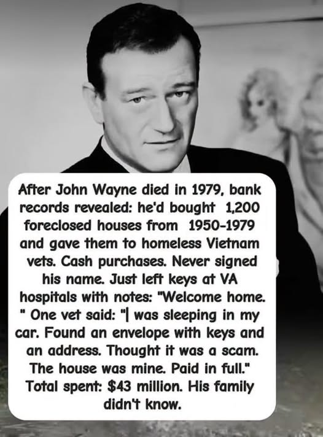

# Investigation (open): John Wayne, the 1,200 houses meme, and whether anyone quietly deeded homes to veterans

> **TL;DR:** The houses paragraph is built so that paper cannot prove it. A missing signature was already a reason not to expect Wayne’s name. The author’s correction goes further: **1,200 deeds in other names, at the same time, would still not be proof** that he did it, or that a veteran lived the moment the meme describes. Once heard, the story is taken on faith. The question that remains is experiential, not archival: **how many times veterans actually saw this happen to them**, whoever paid and for whatever reason. Public, named testimony in that exact shape — envelope, keys, address, “thought it was a scam,” house paid in full — is the meme’s own unnamed sentence and nothing else this pass could attach to a person. That is not a count of what happened. It is a count of what was printed.

**Status:** Open — attribution retired as unprovable (**§4.1**). Remaining work is veteran-side experience, not a recorder search.

## 1. Guide (read order)

1. Why this claim is not a deed problem is **§4.1**. Read that before the earlier “low bar.”
2. The paragraph itself is **§2**. Money, tour, and calendar context that does not settle it is **§5–§8**.
3. What veterans have actually described in public — and what that is not — is **§9**.
4. The author’s cover-up read and the faith correction are **§11** and **§11.1**.

## 2. The artifact

Text on the image at the top of this file:

> After John Wayne died in 1979, bank records revealed: he'd bought 1,200 foreclosed houses from 1950–1979 and gave them to homeless Vietnam vets. Cash purchases. Never signed his name. Just left keys at VA hospitals with notes: "Welcome home." One vet said: "I was sleeping in my car. Found an envelope with keys and an address. Thought it was a scam. The house was mine. Paid in full." Total spent: $43 million. His family didn't know.

The portrait is a publicity still used as a carrier. The claim is the block of type. No bank, no hospital, no city, no veteran’s name, and no address appear on the artifact.

A fixed-phrase search on 30 Sep 2026 did not surface this wording in a dated pre-2024 page. What did surface in the same window:

- YouTube, 30 May 2026, “The $43 Million Secret: Why He Left 1,200 Keys in The Shadows” (`https://www.youtube.com/watch?v=3UCvFHYVy1A`).
- A YouTube short carrying the same paragraph, posted 15 Sep 2026 (`https://www.youtube.com/shorts/bsvzorrM-w4`).
- Reposts and “this is false” replies on Facebook, Instagram, and X in the last days of September 2026.

That dates a **wave**, not a first utterance. A quote-search miss is not a birth certificate.

## 3. Low bar — what this file will not treat as a kill shot

**Author’s validation rule, applied as method:**

- If the story is that he never signed his name, a search that only looks for “John Wayne” on a deed is designed to fail whether the purchases happened or not. A miss under his own name is **non-dispositive**.
- If he did not hold $43 million at death, that does not show he lacked access to that money, or to the influence to move it, across the decades the meme names. Terminal net worth is not lifetime throughput. Assets already given away are not in the estate.

Repo method this rule rhymes with: [debunk overreach and adjacent discard](/docs/METHODS_DEBUNK_OVERREACH_ADJACENT_DISCARD.md). A debunk of the **meme text** is not a debunk of “veterans were housed,” and a feeling that the story fits the post-Vietnam wound is not authentication of 1,200 deeds.

Wayne already used a form of the “name not on the land” device for property he still owned. The Associated Press account carried by the *New York Times* (21 Jun 1979) says the lawyer described the Arizona ranch as personal property because Wayne held it through stock in a corporation. Nominee title was a method in his actual estate, and it was still disclosed, because the asset was still his. See **§5**.

## 4. What an earlier pass treated as still required

Kept as the first pass. **Superseded by §4.1.** The author rejected this table as a proof standard.

“Unsigned” hides a **grantor**. It does not hide a **grantee**, a county recorder, a property-tax roll, a VA mailroom, or a man who was handed a house.

Positive hits that would clear the low bar, any one of them:

| Hit | Why it survives the “he never signed” clause |
|-----|-----------------------------------------------|
| One named veteran, one street address, one recorded deed from the Wayne years whose grantor is a trust, a company, or a lawyer, with the veteran as grantee and no purchase mortgage | The story predicts exactly this paper |
| A VA staff recollection, hospital log, or period newspaper of envelopes of keys left for homeless veterans | The drop is an institutional act, not a signature |
| The same envelope-and-keys method pinned to any other person, with a name and a place | The author asked for the incident even if it was not Wayne |
| A family, Batjac, or ranch-partner statement that a house program existed and was kept off the will | “The family didn’t know” is itself a claim; a contradiction from inside the office would matter, and so would a confirmation |

None of those four turned up in biographies’ public trail, probate reporting, John Wayne Enterprises’ own Vietnam journal, veteran-housing origin stories, or the September 2026 argument around the meme.

Social posts that call the meme false cite the estate figure and the absence of his name. They do not quote a child, a secretary, or a VA clerk. This pass also found **no** signed family confirmation and **no** signed family denial. Silence from the family is not a verdict.

## 4.1 Author correction — this claim is not provable, and deeds would not prove it

Verbatim:

> I don't see why we would ever find the evidence for this particular claim. I don't see how even finding 1200 other deeds by some other name at the exact same time would even do as proof. This does not seem provable at all. This seems to be the kind of thing where it's taken a hundred percent on faith once you hear it. And the only question left is how many times did veterans actually see this happen to them, regardless of the reasons why.

**What that means.** The story says the buyer never signed, the family never knew, and the only witness is the veteran who got the keys. A search aimed at Wayne’s name is aimed at a blank the story already filled in. A search aimed at other names fails for a different reason: a deed shows a transfer. It does not show who arranged it, what note was in the envelope, or that the person on the grantee line experienced it as “welcome home” rather than as an ordinary purchase, a VA loan, a relative, or a nonprofit. Twelve hundred such deeds would be twelve hundred houses changing hands. They would not be this story.

So the claim is not sitting one document short of proof. It is the kind of account that, once heard, is kept or refused whole. Keeping it is faith. Refusing it because the estate was $6.85 million, or because his name is missing, is the move **§3** already declined, and it still does not touch the thing the veteran would have seen.

**The question that remains** is not “was it Wayne?” It is: how many times did a veteran see this happen to him — keys, a house, paid off, no explanation that satisfied him — whatever the reason and whoever the money belonged to.

That count cannot be taken from recorders. It can only be taken from the people it happened to. What follows in **§9** is the public trace of that experience, which is not the same as the experience.

## 5. Documented money and land

Wayne died 11 Jun 1979. Within days a will was filed in Orange County Superior Court.

| Item | What the probate reporting says | Source |
|------|----------------------------------|--------|
| Estate size | About **$6.8 million**; AP figure **$6.85 million** | *Washington Post* (Los Angeles Times), 20 Jun 1979, `https://www.washingtonpost.com/archive/national/1979/06/20/john-wayne-left-68-million-estate/b2015726-e235-4682-a942-af6fe67fa8c9/`; AP via *New York Times*, 21 Jun 1979, `https://www.nytimes.com/1979/06/21/archives/wayne-estate-put-at-68-million-third-wife-is-left-out-of-the-will.html` |
| Split | **$1 million** real property, **$5.75 million** personal property, about **$100,000** a year income from holdings | AP / *New York Times*, 21 Jun 1979 (indexed text of that story) |
| Who inherited | Bulk to seven children and a trust income for first wife Josephine; estranged wife Pilar excluded, described as already covered by a 1973 settlement; secretary Pat Stacy left $30,000 | *Washington Post* lede; AP / *New York Times* |
| Land the filing actually names | Newport Harbor home; Puget Sound property; Arizona ranch inside a corporation, so it was counted as personal property. Ranch partner Lewis Johnson named as a trustee | AP / *New York Times*, 21 Jun 1979 |
| Document | Attorney John S. Warren filed a **27-page** will | AP / *New York Times*, 21 Jun 1979 |

**How this does and does not bear on $43 million.**

- It does **not** prove he could not have spent large sums earlier. Houses already deeded to other people would not remain in the $1 million of real property.
- It does show that land he still controlled was itemized, including land held through a company. A shell that still held 1,200 houses, or the cash to buy them, would have been an asset of the estate or of a company the estate owned. The reported real-property line is $1 million, not a land bank.
- $43 million over 1950–1979 is about **$1.5 million a year** if spread evenly, on top of whatever he kept. That is a throughput claim. The probate number neither confirms it nor, by itself, refutes it.

The patriotic personal spend that **is** in the entertainment record is a film, not a housing program. Secondary press on *The Alamo* (1960) says Wayne put on the order of **$1.2–1.5 million** of his own money into a roughly $12 million production and mortgaged property to do it (Irish Star, 30 Oct 2024, summarizing that production history; tabloid-adjacent retellings repeat the mortgage). Treat the exact dollar as soft. The structural point is hard enough: seven-figure personal spending on a patriotic project was **published**, recycled, and turned into its own viral clip. It was not a buried ledger.

## 6. Documented veteran contact

This is the record John Wayne Enterprises and period reporting actually point at. It is public, signed, and much smaller than 1,200 houses.

- **Summer 1966.** A tour co-sponsored by the USO’s Hollywood Overseas Committee and the Department of Defense, while he was developing *The Green Berets*. He told *Stars and Stripes* the visit gave the troops something to write home about, and told the *Valley News* he could not sing or dance but he could talk to them. John Wayne Enterprises says the archives hold GI letters and his replies, including a 19 Jan 1968 answer to Sgt. Gilbert Mumford of the 4th Infantry Division, a note from nine men of a rifle platoon, and a case of Knott’s Berry Farm preserves sent to a unit. A Montagnard strike-force bracelet was bent to his wrist; the journal says he wore it for the rest of his life. Commanders at one stop gave him a captured Chinese carbine (note dated 23 Jun 1966 in that account). — Michael Goldman, “When Duke Met the Grunts,” John Wayne Enterprises, 17 Mar 2017, `https://www.johnwayne.com/journal/duke/when-duke-met-the-grunts/`
- ***The Green Berets* (1968).** He bought the rights, co-directed, and starred. Department of Defense cooperation on a Vietnam picture is the opposite of an unsigned cash drop: it is a public, edited, credited collaboration. The film is the nationalist camp’s Vietnam movie in the years the anti-war films had not yet taken the genre. Cross-link: [Hollywood two-camp war](/influence/hollywood/investigations/hollywood-two-camp-war-investigation.md).
- **Condolence letters** to families of men killed in the war are part of the same archive the Enterprises journal describes. They are letters. They are not deeds.

The gift that office chose to document, in its own words, is preserves, autographs, and letters. A $43 million land program is not in that telling.

## 7. Calendar and arithmetic

**Census median value, owner-occupied homes, United States, not adjusted for inflation** — U.S. Census Bureau, Historical Census of Housing Tables, `https://www2.census.gov/programs-surveys/decennial/tables/time-series/coh-values/values-unadj.txt`:

| Year | U.S. median | California median |
|------|-------------|-------------------|
| 1950 | $7,354 | $9,564 |
| 1960 | $11,900 | $15,100 |
| 1970 | $17,000 | $23,100 |
| 1980 | $47,200 | $84,500 |

$43,000,000 / 1,200 = **$35,833.33** a house. That sits between the 1970 and 1980 national medians. It is a plausible late-1970s foreclosure price in much of the country, and a low one for coastal California by 1979. The dollar figure was built to look like period housing math. That makes the meme internally tidy. It is not a receipt.

The dates do not fit the beneficiaries the meme names.

- **1950** is the Korean War, not a population of homeless Vietnam veterans. U.S. advisors are in Indochina; the ground war and the mass return are still ahead.
- The people who could be “homeless Vietnam vets” exist in number only after rotations home in the late 1960s, and as a public crisis after the war’s end in **1975**.
- Wayne is dead **11 Jun 1979**. The window in which he could both meet returned veterans and give them houses is a few years at the end of the meme’s 29-year span, not the span itself.
- The film wave the author is right to name — *The Deer Hunter* and *Coming Home* (1978), *Apocalypse Now* (1979), then *First Blood* (1982), *Platoon* (1986), *Full Metal Jacket* (1987), *Born on the Fourth of July* (1989) — clusters at his death and **after** it. *The Green Berets* (1968) is the movie he made during the war, and it argues for the war, not for housing the people who came home broken.

A land bank assembled from 1950 and held until those veterans existed would have owed property tax the whole time. Foreclosed houses that are not on someone’s tax roll go back to foreclosure. “Never signed, for twenty-nine years” fights the county tax collector, not just a biographer.

## 8. Why an unsigned grantor is still a public grantee

U.S. land title is recorded. Cash does not erase the recorder’s office. Someone — a person, a trust, a corporation — is the grantor, and someone is the grantee. The meme’s secrecy clause predicts that the grantor will not read “John Wayne.” It predicts that **1,200 veterans became owners of paid-off houses** and that the keys arrived as a VA-hospital drop with the words “Welcome home.”

Those grantee facts have their own witnesses:

- Recorded deeds and the tax bills that follow them.
- Neighbors, lenders who did **not** hold a mortgage, and homestead filings.
- VA hospital staff. One envelope can be a quiet kindness. 1,200 envelopes are a procedure.
- The veterans. The meme already includes one of them speaking, in quotation marks, with no name. After the story became a national repost, that person — or any of the other 1,199 — would be the easiest confirmation on earth. This pass found the quotation only as part of the meme, never attached to a person who can be visited.

“Welcome home” is also the real slogan of the delayed-welcome movement for Vietnam veterans. The meme uses the movement’s own phrase. That is how a story borrows truth it does not contain.

## 9. Was there ever any such incident, under any name?

Searched for: anonymous keys left at a VA hospital; an envelope with an address and a paid-off house; a celebrity or other donor quietly buying foreclosed houses for homeless Vietnam veterans; the car-sleeping scene the meme uses.

**No case of the keys-in-an-envelope, paid-in-full, unnamed-grantor method turned up.** What turned up is the housing work that actually happened. It is smaller, later, and on paper.

| Case | When | What it actually was | Relation to the meme |
|------|------|----------------------|----------------------|
| VA / GI Bill home loans | From the 1944 GI Bill onward, including Vietnam-era eligibility | Public, signed loans. The mass way veterans got houses | The real volume mechanism. It has names on it |
| Vietnam Veterans Transitional Home, South Bennett Street, Seattle | *Seattle Times*, 9 Nov 1990, `https://archive.seattletimes.com/archive/19901109/1103219/home-for-vietnam-vets-a-dream-come-true` | **One** old house. About **$400,000** federal-city block grant. Space for about half a dozen veterans, months at a time, not fee-simple gifts. Dr. Richard Pellerin of the Vietnam Veterans Leadership Project — a Special Forces medic — said other proposals existed and “we jumped through the hoops first.” The paper calls it the first of its kind in America. The same piece says the Leadership Project had been defunded by the Reagan administration about six years earlier and was then volunteer | Eleven years after Wayne’s death, the people building veteran housing describe a single transitional house as a breakthrough. They do not describe a predecessor who had already deeded 1,200 homes. If that predecessor had been secret even from them, the VA-hospital key drop in the meme is hard to square with their ignorance |
| Reno Veterans Guest House | Origin traced in the *San Diego Union-Tribune*, 8 Nov 2008, to a night in **1991** outside the Locust Street VA hospital in Reno, `https://www.sandiegouniontribune.com/2008/11/08/reno-veterans-guest-house-welcomes-10000th-guest/` | Dick Rhyno and Chuck Fulkerson saw families sleeping in a car to stay near patients. The result was a guest house for families of people in the hospital. By 2008 it had logged its 10,000th guest. Navy veteran Dave Lantry (Vietnam-era) is quoted on the peace of mind; his wife Anna on not having to sleep in the car | This is the closest **scene** in the record: a car outside a VA hospital, and a house as the answer. The house is a guest house for families of patients, not a scam-feeling envelope that delivers clear title to a homeless veteran. The meme’s “sleeping in my car” line matches this reported picture more tightly than it matches any deed |
| Anonymous donor, Bowling Green, Kentucky | WNKY, `https://www.wnky.com/anonymous-donor-provides-housing-money-for-homeless-veterans-with-families/` | A former local businessman, a check of about **$270,000**, apartments for homeless veteran **families** for about 90 days, routed through Kentucky Veterans Brigade because the VA clinic cannot take the money itself. Penny Ritchie and Bob Wilson are named. The donor is unnamed; the gift is not | Anonymous money for veteran housing is real, recent, local, and still reported. The clinic’s inability to accept cash is why gifts go through a nonprofit and become a news story. A key drop on a VA ward would be an end run around that rule, and it would still have staff |
| Homes For Our Troops | Nonprofit, inception **2004**, `https://www.hfotusa.org/mission/` | Public 501(c)(3). Specially adapted custom homes for severely injured **post-9/11** veterans, built where the veteran chooses, with named recipients and a public project map | This is “houses given to veterans,” in the open, decades later, for a later war’s wounded, not a secret foreclosure program for Vietnam |

National Coalition for Homeless Veterans exists as the later umbrella for this work (organizational history places the coalition at the end of the 1980s / 1990). It is a public advocacy and assistance center, not a cover for a finished 1,200-house trust.

**Read of the table, after §4.1.** These rows are answers to a different question: housing programs that operators and newspapers described. They are not a census of veterans who quietly received keys.

On the question the author left open — how many times a veteran saw *this* happen to him — the public record from this pass is:

| What a veteran (or his family) is on record describing | Named? | Same experience as the meme? |
|--------------------------------------------------------|--------|------------------------------|
| The sentence inside the meme: sleeping in the car, envelope, keys, address, thought it was a scam, house paid in full | No name, no place, no date | This is the experience. It has one telling, and the teller is not identifiable |
| Anna Lantry, Reno, 2008 feature about a 1991 guest house: otherwise she would have been sleeping in the car outside the VA hospital | Yes | Car outside a VA hospital. The house was a guest house for families of patients, not a deed handed to a homeless veteran |
| Bob Bradshaw, windshield envelope with a $20 bill and a thank-you note | Yes, in a human-interest writeup | Envelope from a stranger. The contents were a meal, not a house |
| Michael Malone, Point Pleasant, 2021: a couple paid his restaurant check after seeing that he was a Vietnam veteran | Yes | Anonymous gratitude. A dinner, and he met them |
| Houses built or repaired in public (Homes For Our Troops; volunteer builds such as the Indiana case reported by AP) | Recipients named in those stories | A house, given in the open, with a committee, a camera, or both |
| The inverse: veterans who thought a house deal or a demand for cash was real and it was a scam (Everett, CBS; a Valley veteran’s fake apartment) | Yes | Envelope and house in the same breath as fraud. The meme’s veteran “thought it was a scam” and then it was not |

No second, named veteran turned up saying the meme’s sequence happened to him. That is not a finding that the number of times is zero. It is a finding that **the printed count of that exact experience is one anonymous sentence**. Everyone who lived it and did not tell a reporter is outside what this file can tally. Under the author’s rule, that untallied remainder is where the claim lives, and it is held on faith.

## 10. The controversy as a genre

The September 2026 argument mostly repeats two moves this file has already limited: “the estate was only $6.8 million” and “no biography mentions it.” Both are true as far as they go. Neither is the low-bar test.

Running beside the meme is a content mill of unsourced Wayne-and-a-veteran stories. Pages on `ifeg.info` in March and April 2026 novelize a double-amputee named Frank Martinez at a premiere, a homeless man named Gary handed a $100 bill, and a 1974 Beverly Wilshire auction built around a fictional casualty named Daniel Morrison. They supply dialogue, motive, and a moral, and no deed, no hospital chart, and no archive. That is the same literary shape as the houses paragraph: one veteran, a specific kindness, a closing line about dignity, zero coordinates.

The mill does not prove the houses story was invented in 2026. It shows the **supply**. A paragraph with round numbers, a single anonymous quotation, and a secret the family “didn’t know” is what that supply produces. Bank-record folklore would look different: a court, a docket number, a year the records were “unsealed.” Probate of Wayne’s will was not an unsealing of secret bank files. It was a will filed in the ordinary way, reported the same week, and it itemized the land it knew about.

## 11. Author’s originating thesis (AU-065)

Verbatim from the request that opened this file:

> We're setting an extremely low bar for the potential validation of this. E.g., we want to make it clear that if the story is that he never signed his name, then we would never find the records. And if he didn't have that much money at the time of his death, then it doesn't mean that he didn't have access to that kind of money or the type of influence that would have made it possible to go through with this. So I'd like to do a deep dive and just try to find any proof that this might have actually happened, even if it wasn't John Wayne. Was there ever any such incident involving anyone? Let's just look at all aspects of this particular controversy. In my opinion, the timing only makes sense because at the end of the Vietnam War, there was a huge fallout of veterans receiving no care, made a lot of movies and stuff. And if this was the reality, then it's very likely that there was some sort of pushback to buy houses for vets. And there may be a motivation to cover it up because it could start a trend in a pro-American fashion that could basically destroy all globalist plans for this country, make it a vet-centered political culture. That seems to be what's being avoided here by insisting the meme is fake or having people research it to find out that it ever happened.

**What that means, as a stake for this project.** The post-Vietnam abandonment is treated as the true wound. Films about that wound are treated as evidence the culture knew. A private answer — buy the houses — is treated as the obvious pushback, and as politically dangerous: if it were known to have worked, the country’s politics could re-center on veterans instead of on the arrangements the author calls globalist. On that read, “the meme is fake” and “go research it and you will find it never happened” are the same operation. Research is allowed; the category (veterans housed by private patriotic money, as a model) is what has to come back empty.

### 11.1 Faith, not a missing document

The correction in **§4.1** changes the status of the whole file. Hunting a deed, a bank line, or twelve hundred transfers in other names is not a stricter test that has not yet been run. It is the wrong kind of test. The author holds the paragraph the way such a paragraph can be held: entire, on hearing it, or not at all. The only empirical remainder is the veterans’ own sight of it, reasons aside.

**Prior art:** partial. Post-Vietnam veteran neglect, the “welcome home” movement, and veteran homelessness as a 1980s political issue are ordinary history. Celebrity-charity memes are a known internet genre. The **bundle** — low-bar refusal to treat a missing signature or a terminal estate as fatal, plus the claim that debunking this particular story is how a vet-centered politics is prevented, plus the later lock that the story is faith-grade and that other people’s deeds would not prove it — is the author’s (**AU-065**).

## 12. What that thesis predicts, set next to the housing record

**§4.1 governs.** The bullets below are context for the wound and for the public housing programs. They are not a path back to proving the paragraph. A grantee on a deed would still not be a veteran saying it happened to him.

The timing instinct is right about the wound.

- Veterans came home to thin care, and the culture made a decade of films about it. That is why the paragraph is believable. Believability is not a deed.
- There **was** pushback aimed at houses. It is in **§9**: the VA loan, then block-grant transitional houses, then guest houses next to VA hospitals, then post-9/11 adapted homes. Those are programs people reported. They are not the quiet experience claim 6 asks to count.
- The political forecast — a known program of this kind would have pulled the country toward a vet-centered politics and wrecked other plans — is **AU-065**, not a result of the recorder search. What the record shows is that veteran-housing nonprofits were allowed to exist, solicit, and pose with giant checks, and that this did not become the country’s organizing principle. That outcome is compatible with the author’s fear. It is also compatible with a simpler fact: the programs were real and small, and the 1,200-house story was never among them.

Insisting the **paragraph** is unsupported is not the same move as insisting veterans were never owed houses. Collapsing those two is the adjacent-discard this file is built to refuse. The other overreach — promoting the paragraph to a suppressed national program because the wound was real — is the inverse the methods note already flags.

## 13. Related investigations

| Investigation | Link | Rhyme |
|---------------|------|-------|
| Hollywood two-camp war | [/influence/hollywood/investigations/hollywood-two-camp-war-investigation.md](/influence/hollywood/investigations/hollywood-two-camp-war-investigation.md) | *The Green Berets* as the nationalist Vietnam picture; later anti-war films as the other camp’s wound narrative |
| *The Big Lebowski* thread inside that dossier | same file, Thread S | A Vietnam veteran written as the sovereignty voice |
| Debunk overreach / adjacent discard | [/docs/METHODS_DEBUNK_OVERREACH_ADJACENT_DISCARD.md](/docs/METHODS_DEBUNK_OVERREACH_ADJACENT_DISCARD.md) | Meme false ≠ category false; one fitting scene ≠ the paragraph true |
| Giants of Japan (method specimen) | [/influence/suppression/investigations/giants-of-japan-archival-footage-big-man-japan-investigation.md](/influence/suppression/investigations/giants-of-japan-archival-footage-big-man-japan-investigation.md) | Same rule on a different artifact |
| McNaughton / Ellsberg | [/governance/war/investigations/john-t-mcnaughton-mysterious-death-ellsberg-investigation.md](/governance/war/investigations/john-t-mcnaughton-mysterious-death-ellsberg-investigation.md) | Vietnam truth-management in the same war, different lane |
| Author-unique registry **AU-065** | [/history/chronology/investigations/author-unique-theories.md](/history/chronology/investigations/author-unique-theories.md) | Vet-centered culture as the avoided outcome |

## 14. Author’s open claims

1. **Low bar.** Absence of Wayne’s signature, and the $6.85 million probate estate, are not allowed to close the question.
2. **Any name.** The object of the search is the incident (keys, paid-off house, homeless veteran), not the celebrity.
3. **Timing.** The story attaches to the real post-Vietnam failure of care and to the films made about it.
4. **Pushback.** If that failure was real, private purchase of houses for veterans is a likely response, not a fairy-tale response.
5. **AU-065.** Treating the meme as fake, or routing inquiry so that it returns “this never happened,” avoids a pro-American, vet-centered political culture that would cut against the plans the author calls globalist.
6. **Faith lock (§4.1).** This particular claim is not provable. Twelve hundred deeds in other names at the same time would not be proof. Once heard, it is taken entirely on faith. The only question left is how many times veterans saw it happen to them, reasons aside.

Claims 1 and 2 were the method of the first pass. They were followed, and they did not produce a specimen. **Claim 6 retires them as a proof standard.** Claims 3 and 4 match the cultural and nonprofit record in **§7** and **§9**, with the date correction in **§7**. Claims 5 and 6 stay author-tier. The experiential count in **§9** is the start of an answer to claim 6, and it is a count of print, not of memory.

## 15. Questions to clarify, verify, or debunk

| # | Question | Standing after §4.1 |
|---|----------|---------------------|
| Q1 | A deed to a veteran, grantor a trust, no mortgage | **Retired as proof.** A deed would not identify Wayne, the note, or the experience. Kept only if a veteran himself ties that paper to the moment |
| Q2 | VA log or hearing mentioning keys left for patients | Still relevant, because it would be a veteran-side or staff-side sighting, not a grantor hunt |
| Q3–Q5 | Will text, children, Batjac, Eyman | Context for Wayne’s money and letters. They cannot carry claim 6 |
| Q6 | First posting of the paragraph | Dates the telling. Does not date the experience |
| Q7 | Did VVA or the Leadership Project describe a secret predecessor? | Organizational memory, still not a veteran count |
| Q8 | How many veterans, in their own words, say the keys / paid-off house / “thought it was a scam” sequence happened to them? | **The open question.** Oral history, VVA letters, VA waiting-room testimony. Print so far: one unnamed sentence inside the meme |

## 16. Weak points / remaining TODOs

- [ ] **Q8.** Veteran oral histories and VVA / VA testimony for the keys sequence, counted as experiences, not as proof of a buyer.
- [ ] Date the meme’s first appearance below the May 2026 YouTube floor.
- [ ] WNKY piece and Reno guest-house feature: full text not re-fetched past indexed summaries.
- [x] Recorder sample retired as a proof test (§4.1). Orange County will and Eyman remain background only.

Keywords: #JohnWayne #VietnamVeterans #HomelessVeterans #MemeForensics #DebunkOverreach #VAHousing #GreenBerets #WelcomeHome #AU065 #ParadigmThreatFiles

*Last updated: 2026-09-30*

## Limits and disclaimers

**Prisca sapientia (epistemic foundation):** This investigation assumes [**prisca sapientia**](/docs/PRISCA_SAPIENTIA.md)—the historical and philosophical belief that the ancients possessed a vast, profound understanding of the universe, nature, and theology that was subsequently lost or degraded. Modern consensus science and institutions are not treated as default truth; evidence tiers below adjudicate specific claims.

- **Author thesis is first-class and not automatically factual.** **§11** and **§14** claims 5 and 6 are the author’s. Claim 6 is an epistemological lock: the paragraph is held on faith, and a deed hunt is the wrong instrument. It is not a finding that 1,200 veterans were handed keys.
- **Tiers.** Census table and the fetched probate lede / Enterprises journal / *Seattle Times* article are the strong tier. AP breakdown of the $1 million / $5.75 million split is from indexed text of the *New York Times* story, not a re-pull of the full column. *Alamo* dollars are secondary entertainment press. `ifeg.info` pages are cited as genre specimens, not as evidence about Wayne.
- **§4 is superseded.** The first pass asked for a grantee. **§4.1** says even that paper would not prove the claim. The experiential table in **§9** is a print count, not a count of untold cases.
- **Cross-links are thematic.** *The Green Berets* and *Lebowski*’s Walter are camp and culture rhymes, not evidence of a housing trust.
- **Assistant limits.** No Orange County case file, no Batjac ledger, and no in-person veteran interview were opened in this session.

## Investigator notes

Quote-search and page fetches were run 30 Sep 2026. Snopes has Wayne items (airport name, a Montana-school letter, Littlefeather) and, on that day’s search, no dedicated houses-meme page. Do not upgrade “no Snopes article” into “uninvestigated.”
