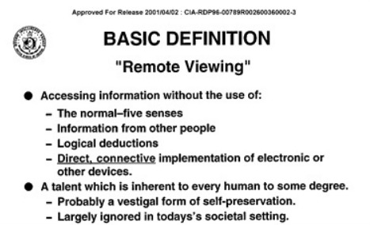

# Investigation: *The Men Who Stare at Goats* — satire as shell, RV session lies, Jedi / *Star Wars* chronology

> **TL;DR:** ***Star Wars* (1977) = mass Jedi belief-promotion**; **2004** Ronson = stenographer + **CO misdirection** (climaxes on already-known Abu Ghraib instead of declassified psychic payload); **2009** film = **containment harden**. Author rejects Ronson’s First-Earth→Abu Ghraib origin story — sexual humiliation = older intel tradecraft / ideological war on hardline Islam, not 1970s New Age. Ronson’s product **damaged real Jedi cadre reputation**. Walls→RV / invisibility→not-seen; session lies / MKULTRA-bubble; dark twin = book ch. 9 + film Hooper.

**Date:** 2026-07-18  
**Status:** Open — author thesis + Abu Ghraib counter-read + article plan registered; FOIA / session-lie audit still TODO.  
**Abbreviation:** **RV** = **remote viewing** (not dinar **revaluation**).

**Redaction vocabulary:** [`docs/REDACTION.md`](/docs/REDACTION.md) — satire-as-shell = **R6** (documented packaging) + author **inferred** deeper ops. Book’s Abu Ghraib climax = author-tagged **R6 sink** (safe scandal absorbs attention).

---

## Guide (read order)

1. **Author’s originating thesis** → §1  
2. **Documented substrate** (book / film / programs) → §2  
3. **2009 film as containment of the 2004 book** → §3  
4. **Abu Ghraib — Ronson’s sink vs author’s counter-read** → §3.7  
5. **Lies to the viewer / MKULTRA bubble** → §4  
6. **Jedi / *Star Wars* chronology** → §5  
7. **Ability map (book ↔ Ep. IV–V) + dark Jedi** → §5.4–§5.5  
8. **Author’s open claims** → §6  
9. **Article** ([The Jedi Who Stare at Goats](/influence/hollywood/the-jedi-who-stare-at-goats.md)) → §6.1  
10. **Questions / TODOs** → §7–§8  
11. **Related** → §9  

---

## 1. Author’s originating thesis

**Author (verbatim capture, 2026-07-18):**

> The film and book *The Men Who Stare at Goats* are based on real U.S. military experiments into psychic phenomena, remote viewing, and psychological warfare. While the movie adds a comedic narrative, it draws heavily from declassified documents, actual programs like Project Stargate, and historical figures who believed paranormal abilities could be used in combat.
>
> Our investigation is looking into the potential that the movie’s content is **100% real**, although **redacted as a satire**, and has **predictive programming clues** about the program that are harder to ascertain from declassified documents alone. We’re also looking for signs of **lies in the remote viewing session**. Lies told to the viewers so they don’t know what the context is, or the politics, or maybe they are mostly unaware of the world at large, like Clooney’s character, living in an **MKULTRA-style radical individual bubble**.
>
> Does this program mention **‘jedi’**? Does it predate *Star Wars*? Was *Star Wars* predictive programming for this project?

**What they mean (unpack):**

| Author stake | Pattern read |
|--------------|--------------|
| **Book/film grounded in real programs** | Not “inspired by vibes” — Channon, Stubblebine, Fort Meade RV, goat lab lore, MKULTRA trail |
| **Comedy = redaction / containment** | Nonfiction→fiction satire **mocks the book**; **2009** film as **CO shell** of **2004** journalism ([**R6**](/docs/REDACTION.md)); Ronson “liked it” irrelevant |
| **PP beyond FOIA** | Film grammar may encode **ops, culture, and continuation** that PDFs scrub or never named |
| **Session lies / bubble** | Viewers may be **blindfolded on meaning** — coordinate-only, no politics, no world brief — so they cannot refuse or contextualize the task; Clooney’s Cassady = public face of that isolation |
| **Jedi / Star Wars ask** | Test whether military “Jedi” language **precedes**, **follows**, or **was seeded by** Lucas’s myth |
| **Abu Ghraib ≠ First Earth origin** | Institutional sexual humiliation **predates** 1970s psychic programs; GWOT tableau = **ideological** war vs hardline Islam, not Channon’s loudspeaker hobbyhorse (§3.7) |
| **Ronson = CO agent (author)** | Book structure + ridicule product **damaged** real government Jedi / psychic operators who were used then discarded |

**Separation rule for this file:** §2–§5 mark **Documented** vs **Author** vs **Speculative**. Author stakes stay first-class; they are **not** auto-factual.

---

## 2. Documented substrate

### 2.1 Book, TV, film (public artifacts)

| Artifact | Year | What it is | Tier |
|----------|------|------------|------|
| Jon Ronson, *The Men Who Stare at Goats* | **2004** | **Nonfiction** investigation — Army New Age / psychic warfare, First Earth Battalion, goat-staring lore, PSYOP/Abu Ghraib rhyme, MKULTRA / Frank Olson back-link. Wry voice ≠ satire genre. | **B** (press / interviews) |
| Channel 4 *Crazy Rulers of the World* | **2004** | Companion TV (ep. 1 shares the title) | **B** |
| Film (Heslov / Straughan; Clooney / Smokehouse; McGregor, Bridges, Spacey) | **2009** | **Fiction comedy** adaptation; title card: *“More of this is true than you would believe”*. **Author:** containment shell of the book (§3). | **A** (artifact); story = **L3** composite |

**Film → book map (approximate, composite characters):**

| Film | Real-world rhyme (book / public record) |
|------|----------------------------------------|
| **Bill Django** (Jeff Bridges) | Jim Channon / First Earth Battalion founder lane |
| **Lyn Cassady** (George Clooney) | Composite psychic soldier (Ronson trail includes Wheaton, Savelli lore, Fort Meade viewers) |
| **Bob Wilton** (Ewan McGregor) | Reporter stand-in (Ronson-class outsider) |
| **Larry Hooper** (Kevin Spacey) | Rogue PSYOP / “dark side” of the same stack |
| **New Earth Army** | Fictionalized **First Earth Battalion** |

**Primary public entries:** [Wikipedia — book](https://en.wikipedia.org/wiki/The_Men_Who_Stare_at_Goats) · [Wikipedia — film](https://en.wikipedia.org/wiki/The_Men_Who_Stare_at_Goats_(film)) · [First Earth Battalion](https://en.wikipedia.org/wiki/First_Earth_Battalion) · [Jim Channon](https://en.wikipedia.org/wiki/Jim_Channon).

### 2.2 Program chronology (intelligence / Army psychic lane)

Aligned with in-repo [ghost-tourism §8](/influence/conspiracy/investigations/ghost-tourism-memory-echo-vs-spirit-suppressed-continuity-investigation.md#8-government--intelligence--documented-1970s-programs-remote-viewing--psychotronics-panic) and [CIA RV / Iran–two-way dossier](/influence/controlled_opposition/investigations/cia-reading-room-rv-two-way-iran-revival-investigation.md):

| Year | Program / event | Notes |
|------|-----------------|-------|
| **1953–73** (official story) | **MKULTRA** | Drug / hypnosis / mind-control research; Ronson’s book closes the loop via Frank Olson | **A** (Reading Room) |
| **~1970** | **SCANATE** | Early CIA remote-viewing line | **A/B** |
| **1972+** | **SRI** (Puthoff / Targ) | Contracted parapsychology / RV protocols | **A/B** |
| **1977–79** | Channon “futurism” sabbatical → **First Earth Battalion** manual (**1979**; polished eds. later) | Warrior-monk / New Age Army redesign — **not** the STAR GATE collection name | **B/C** |
| **1978+** | **GRILL FLAME** → CENTER LANE → SUN STREAK → **STAR GATE** | Army / DIA Fort Meade operational RV | **A** |
| **1983–87** | **Jedi Warrior / Jedi Project** (Strozzi-Heckler / Special Forces mind-body training) | **Jedi** label in Army training discourse — see **§5** | **B/C** |
| **1995** | AIR / wind-down narrative | Public closure story for STAR GATE | **A** |
| **2004 / 2009** | Ronson book → film | Satire / disclosure shell | **A/B** |

**Documented:** STAR GATE / GRILL FLAME / SRI / MKULTRA are **real program names** in declassified chains. Ronson’s book **does not always use** the later public name “Stargate”; the film compresses and comic-ifies. **Not documented as one merged org chart:** First Earth Battalion = Channon concept manual; Fort Meade RV = separate intel collection line; Jedi Warrior = Special Forces performance training — **adjacent**, often **conflated in pop culture**.

### 2.3 In-repo RV anchors (do not duplicate verdicts)

| Anchor | Role here |
|--------|-----------|
| [Mars Exploration 1984 — RV investigation](/influence/controlled_opposition/investigations/cia-reading-room-mars-exploration-1984-rv-investigation.md) | **Closed** author verdict on `CIA-RDP96-00788R001900760001-9`; session phenomenology + **target-side** stance |
| [RV two-way / Iran / Super Cockpit](/influence/controlled_opposition/investigations/cia-reading-room-rv-two-way-iran-revival-investigation.md) | Earth-side two-way / MKULTRA / disclosure |
| [Mars × *Chrono Trigger* article](/influence/controlled_opposition/cia-1984-mars-chrono-trigger.md) | Reader essay — FOIA transcript × fiction PP |
| [RV fiction master index](/science/telepathy/remote_viewing/index-remote-viewing-fiction.md) | 1871–1937 device grammar predating modern programs |
| [Hollywood two-camp war](/influence/hollywood/investigations/hollywood-two-camp-war-investigation.md) | Militainment / satire catalog (**Thread Q** *Burn After Reading* also Clooney / CIA audit lane) |

---

## 3. 2009 film as controlled-opposition containment of the 2004 book

### 3.1 Author thesis (verbatim stakes)

**Author (2026-07-18):** Turning a **nonfiction** investigation into a **fiction** product under a **satire / comedy** label **is** mocking the book. It does **not** matter that Ronson later said he “liked” the film in press. The question is whether **2009** functioned as **controlled-opposition containment** for an **explosive** **2004** book — ridicule vaccine + genre laundering so the public files the whole stack under “funny movie,” not “reported history.”

**Author chain (same day, tightened):** Ronson **clearly didn’t understand** the coded stack (e.g. walls→RV; he never practiced any of it — outsider stenographer). The **publisher still let him publish those mistakes**. On the market, literal nose-bangs and “madcap” checklists **read as satire** even though the genre label is nonfiction. The **2009 film hardened** that misread into official comedy — fiction stamp + Clooney farce so the wrong interpretation becomes the culture’s default.

**What they mean:** Containment is not only “Ronson was paid to retract.” It can be **(a)** incomplete journalist + willing publisher → **satire-effect nonfiction**, then **(b)** Hollywood capture of the title that **cements** the laugh track. Own the title, rename the people, invent a buddy plot, warm the tone, stamp **fiction**, and the book’s darkest connective tissue (Abu Ghraib as Ronson’s chosen climax, MKULTRA/Olson murder thesis, privatization → Heaven’s Gate adjacency) becomes optional Easter eggs inside a Clooney farce. **Author add (§3.7):** even the **2004 book** already mis-centers — Abu Ghraib as First-Earth punchline is itself a **sink**; Ronson may be CO, not merely an incomplete stenographer.

### 3.2 Why “he liked it” is irrelevant (discipline)

| Move | Why it fails as exoneration |
|------|------------------------------|
| Author praise in junket interviews | Subjects of containment often **endorse** the soft version; praise ≠ clearance |
| “60–70% true” Ronson estimate | Still sells **partial truth inside a fiction frame** — the frame is the containment |
| Warmer / “humanistic” tone vs book’s dark lurch | **Documented** difference ([NPR](https://www.npr.org/2009/11/08/120227954/walking-through-walls-and-staring-at-goats)) — softens the explosive half |
| Rights sold **before the book was finished** | [NPR](https://www.npr.org/2009/12/29/122006511/jon-ronson-staring-at-goats-from-the-sidelines): Hollywood locked IP early; screenwriter “didn’t really want to have anything to do with” Ronson |

### 3.3 Documented packaging operations (R-codes)

| Operation | What happened | Code |
|-----------|---------------|------|
| **Genre laundering** | Nonfiction → fiction comedy | **R3** + **R6** |
| **Permission double-bind** | Title card: *“More of this is true than you would believe”* | **R6** — admit + inoculate |
| **Name substitution** | Channon/Stubblebine/etc. → Django / Cassady / Hooper | **R3** |
| **Tone flattening** | Book’s dark second half → warm batty war comedy | **R5** |
| **Subtractive** | Harder to stage Olson / MKULTRA / Abu Ghraib evidential spine as the film’s center | **R1** (relative to book) |

Comedy tone + Iraq farce = **respectable public subset** of a much darker stack — classic **[R6 shell](/docs/REDACTION.md)**.

### 3.4 Containment hypothesis — pattern table

| Signal | Documented / author | Why it matters for CO read |
|--------|---------------------|----------------------------|
| **Explosive book (2004)** | Nonfiction + Channel 4 series same year | Window when psychic-warfare + GWOT torture rhyme was **citeable journalism** |
| **Early rights capture** | Sold on partial manuscript; film machine separate from author | Title controlled before full book landed |
| **2008–09 Clooney / Smokehouse / Heslov** | Variety / THR: Clooney stars, Heslov directs; shoot Oct 2008–Jan 2009; Overture release **2009** | Prestige comedy star = maximum **ridicule buffer** (see [Ghost War miscast thesis](/influence/hollywood/ghost-war-the-antibody-phase.md)) |
| **Fiction label** | Film is openly a narrative comedy | Audience **cannot** treat it as evidence without looking like they “believe a movie” |
| **Same Clooney year-cluster** | ***Burn After Reading* (2008)** also Clooney in CIA-decay satire ([Thread Q](/influence/hollywood/investigations/hollywood-two-camp-war-investigation.md#thread-q--burn-after-reading-2008-cia-decay--interagency-satire)) | Author clue: **comedy CIA stack** as recurring containment grammar — **not** proof of one handler |
| **Payload still present** | Jedi soldiers, goat stare, psychic unit, Iraq reactivation | Containment often **keeps** the leak so it can be **laughed off**, not erased (**R6**, not pure **R1**) |

**Author verdict (open, not court):** **2009 = CO containment of 2004** is the **working read**. Studio memos proving intent are **not** in hand; the **genre operation itself** is the strongest available tell.

### 3.5 Film payload still “100% real” under the shell

**Author:** the **content** (psychic soldiers, staring-as-weapon, New Earth / First Earth doctrine, post-9/11 reactivation, PSYOP dark twin) stays **operationally true**; the laugh track is the **redaction layer** — and the redaction **targets the book’s seriousness**, not merely “adds entertainment value.”

| Claim | Tier |
|-------|------|
| Programs + named officers + manuals **existed** | **Documented** |
| Nonfiction→fiction satire **mocks / contains** the book | **Author** — structural; Ronson junket praise irrelevant |
| Ronson **didn’t understand** codes; publisher **shipped the mistakes**; market **took them as satire**; film **hardened** that | **Author** — stenographer + publishing + 2009 comedy stack |
| **2009** film = **controlled opposition** vs **2004** book | **Author** — pattern-strong; intent unproven |
| Satire **functions as** R6 disclosure + ridicule vaccine | **Author** |
| PP clues in the film **exceed** what FOIA alone yields | **Author open claim** — scene audit still TODO (§7) |

### 3.6 Predictive-programming / containment clue hunt (working list)

1. **Reactivation after official wind-down** — psychic unit “back” for GWOT (film invents the road-trip; book suggests return).  
2. **Split of the program** — idealist warrior-monk vs **Hooper** rogue PSYOP (same root, opposite ethics).  
3. **Reporter as initiate** — outsider enters the bubble; also the **audience’s** permitted tour.  
4. **Goat as kill metric** — psi as weapons test.  
5. **Iraq as stage** — book’s Abu Ghraib / Barney music rhyme **softened** into farce.  
6. **Containment success metric (author):** after 2009, does public memory of the **title** point to **Clooney comedy** more than **Ronson nonfiction**?

**Label:** clue threads until matched to primaries.

### 3.7 Abu Ghraib — Ronson’s climax vs author’s counter-read

#### 3.7.1 What Ronson claims (documented in book)

**Documented (Ronson, 2004):** Chapters **7** (Barney / PsyOps music at al-Qa’im), **9** (*THE DARK SIDE* — Abu Ghraib photos), **11** (“Joseph Curtis” night-shift witness). Through-line: First Earth / Channon discordant-sound ideas → PsyOps loudspeaker interrogation → Abu Ghraib as the **dark twin** of the warrior-monk stack. England’s “PsyOps orders / photos as products” interview; Stubblebine points at Agency + PsyOps and says if they’d stuck to Channon (music / frequencies) they wouldn’t have needed “that crap.” Ronson floats Gitmo as **“Experimental Lab Mark 1”** exported to Abu Ghraib.

#### 3.7.2 Author — why the book’s focus is suspicious

**Author (2026-07-18):** Abu Ghraib was **already global news** when Ronson closed the narrative (photos spring 2004; book ends July 2004). He did not need to break it. The **obscure** payload — Stubblebine, First Earth, Project Jedi, Goat Lab, coded abilities — is what readers could not get elsewhere. Yet the book’s **moral climax** is the **already-known** scandal. That inversion feels like **misdirection**: dump public attention into Lynndie / leash / “bad apples vs PsyOps photos,” leave the psychic program half-comic and half-unresolved.

| Axis | Ronson’s book move | Author suspicion |
|------|--------------------|------------------|
| **News value** | Climaxes on front-page torture | Safe sink — everyone already “knew” |
| **Declassified / oral payload** | Setup for the dark-side punchline | Should have been the **center**, not the warm-up |
| **Causal story** | Hippie army → music torture → Abu Ghraib | Wrong origin story (§3.7.3) |
| **Effect on cadre** | Wry ridicule of psychic soldiers | **Reputation damage** to real Jedi operators (§3.7.4) |

**Redaction read (author):** Abu Ghraib climax = **[R6](/docs/REDACTION.md) sink** — keep the leak of the weird programs, but **land** the reader’s outrage and memory on a scandal that does not require decoding walls→RV or Jedi chronology.

#### 3.7.3 Author counter-history — what Abu Ghraib actually was

**Author (verbatim stakes, 2026-07-18):**

> I don’t even agree with him. That kind of institutional abuse has a long history and did not start in the 1970s. Besides, we know the reason for Abu Ghraib — us (Christians) were okay humiliating these hard-core Muslim “terrorists.” It wasn’t about the terrorism, or the war itself. It was an **ideological fight** that led to this moment in 2026 when America “smashed” Iran. The humiliation was actually a **strategy**, very likely **NSA-aligned**, illegal but no laws covered that area. They did what the **CIA had done for so long** for a specific purpose — **sexual humiliation proved to be most effective**. This was repeated at scale in **Egypt** and other places where the **Muslim Brotherhood** was put down. Agree with it or not, that’s the history, and that’s the reason. Not what Ronson said.

**What they mean (unpack):**

| Author stake | Pattern read |
|--------------|--------------|
| **Long prehistory** | Sexual / status humiliation as intel / occupation tradecraft **≠** invented by Channon’s 1979 manual |
| **Not “war logistics”** | Primary motive = **civilizational / religious ideology** (Christian-majority power vs hardline Islamist cadre), not WMD hunt or battlefield necessity |
| **Strategy, not rogue trailer** | Humiliation as **chosen soft-kill** — illegal / lawless zone; **NSA-aligned** as author attribution (tier: **Author**, not A-doc) |
| **CIA continuity** | Same family of methods the Agency refined for decades; Abu Ghraib = **theater + scale**, not novelty |
| **Regional repetition** | Egypt / Muslim Brotherhood suppression and parallel sites = **scaled** sexual-humiliation doctrine |
| **2026 Iran rhyme** | Author ties the long ideological arc to America having **“smashed” Iran** by 2026 — **pattern continuity**, not a claim Ronson foresaw that year |

**Separation:** Ronson’s **First Earth → Barney → Abu Ghraib** causal chain is **rejected** as the **reason**. Adjacent facts (loud music was used; MI/PsyOps were in the prison; photos existed) can still be **documented** without accepting his origin myth.

#### 3.7.4 Author — Ronson as controlled-opposition agent; damage to real Jedi

**Author (2026-07-18):** Ronson is a **controlled opposition agent** whose work **clearly damaged the reputation** of many thousands or hundreds of thousands of real **“Jedi” knights** that worked for the U.S. government on dubious missions — then were **discarded**.

**What they mean:** Not only “funny book.” The product teaches the public that psychic / Jedi soldiers are **batty goat-starers** whose ideas somehow **caused** Abu Ghraib. That **inoculates** against taking cadre testimony seriously and **scars** the people who actually served the stack. **2009** then locks the ridicule as Clooney farce (§3).

| Claim | Tier |
|-------|------|
| Book climaxes on already-known Abu Ghraib while declassified psychic material is secondary | **Author** — structural read of 2004 text |
| Abu Ghraib motive = ideological sexual-humiliation strategy (NSA/CIA family), not First Earth | **Author** — historical pattern thesis |
| Ronson = **controlled opposition** (witting or useful) | **Author** — stronger than earlier “not claiming witting asset” posture; intent still unproven in court sense |
| Reputation damage to real Jedi / psychic operators | **Author** — cultural-effect claim |

---

## 4. Lies to the remote viewer — MKULTRA-style bubble

### 4.1 Documented protocol grammar (RV)

Standard remote-viewing tradecraft (SRI / Fort Meade public descriptions):

- **Coordinate / sealed-envelope targeting** — viewer often gets **no semantic brief**.  
- **Monitor / interviewer** structures the session; viewer reports **perceptions**, not politics.  
- **Blind / double-blind** language appears in evaluations — designed to reduce **cueing**, which also reduces **informed consent about meaning**.

That is **not** automatically “lying.” It **is** structured **ignorance of context**.

### 4.2 Author hypothesis — session lies and radical individualism

**Author:** look for signs that viewers were **actively mis-told or never told**:

| Lie / omission class | What to look for | Why it matters |
|---------------------|------------------|----------------|
| **Context blank** | Target is a building / person / planet; viewer never learns **war, coup, or hostage politics** | Cannot refuse on moral grounds |
| **Politics blank** | No brief on factions, allies, domestic legality | Viewer as **sensor**, not citizen |
| **World-model blank** | Clooney / Cassady-class operators live in **training mythology** (Jedi, goat lab, personal power) with thin news diet | **MKULTRA-style bubble** — radical individual skill, weak institutional map |
| **Feedback lies** | False scoring, theatrical “hits,” or withheld misses | Shapes belief and compliance |
| **Identity lies** | Cover stories for who funds / who uses the product | Matches controlled-opposition / CO lanes elsewhere |

**Film face of the bubble:** Lyn Cassady’s confidence, jargon, and isolation from ordinary political reality — readable as **trained sensor personality**, not as journalist’s world-model.

**Cross-read:** Mars **1984** session — SUB reports the viewed party “**perceives I’m a hallucination**” ([Mars RV investigation §5.3](/influence/controlled_opposition/investigations/cia-reading-room-mars-exploration-1984-rv-investigation.md)); that is **target-side** epistemology. This goats file asks the **viewer-side** question: what was **Cassady-class** never allowed to know?

**MKULTRA link:** **Documented** as historical CIA mind program ([Reading Room landing](https://www.cia.gov/readingroom/document/06760269)); **author** uses it as **method rhyme** (isolation, need-to-know, individual as apparatus), not as proven org-chart identity with Fort Meade RV.

---

## 5. Jedi / *Star Wars* — answers (revised: do not overclaim silence)

### 5.0 Epistemic correction — what “sure” cannot mean here

**Prior draft error:** treating “no public primary saying soldiers were called Jedi before May 1977” as proof that **nobody was told they were a Jedi**. That is a **category mistake**.

| What silence in open sources shows | What it does **not** show |
|------------------------------------|---------------------------|
| No **A-tier FOIA / press hit** yet for pre-premiere **Jedi** as an Army callsign | That oral briefings, nicknames, or California human-potential / intel-adjacent slang never used the word |
| Public **Jedi Warrior** course branding is easiest to cite in the **1980s** | That the **first** use was then |
| Mass audience learned “Jedi” from the **1977** film | That **production**, **leak**, or **shared etymology** circles had the word earlier |

**Author stance (2026-07-18, registered as first-class):** it is **exceedingly likely** that people in the psychic / warrior-monk lane were **already told they were Jedi** (or occupied that slot under that name) **before** *Star Wars* hit theaters. Assistants must **not** tone-police that down to “Army borrowed after the premiere” without new evidence.

### 5.1 Does the program mention “Jedi”?

**Yes — in adjacent Army training language, and heavily in Ronson / film culture.** Whether that mention **started** only after 1977 is **open** (§5.0, §5.2).

| Lane | “Jedi” usage | Tier |
|------|--------------|------|
| **First Earth Battalion (Channon)** | Public summaries emphasize **“warrior monks”**, Whole Earth / human-potential grammar — word **Jedi** not yet verified on primary manual pages | **B** (manual grep still TODO) |
| **Jedi Warrior / Jedi Project (~1983–1987)** | Special Forces **mind-body** training (aikido, biofeedback, meditation) associated with **Richard Strozzi-Heckler**; popular and secondary military histories use the **Jedi** name | **B/C** — confirm with primary contract titles in §7 |
| **Ronson book / 2009 film** | Mass culture locks **psychic soldier ↔ Jedi** | **A** (artifacts) |
| **Pre-1977 oral / need-to-know use inside psi or SF circles** | **Author: exceedingly likely** | **Author** — not yet A-tier; **not falsified** |

STAR GATE’s FOIA collection title is still **not** “Jedi” (GRILL FLAME / SUN STREAK / STAR GATE, etc.). Nickname ≠ collection slug.

### 5.2 Chronology — split three clocks

Do **not** collapse these into one “Jedi after Star Wars” slogan.

| Clock | Date | What it measures |
|-------|------|------------------|
| **A. Psychic / RV institutional work** | MKULTRA earlier; SCANATE / SRI **~1970–72** | Ops **predates** theatrical *Star Wars* |
| **B. Word “Jedi” in Lucas’s papers** | **OED / manuscript: 1973** (*Journal of the Whills*); theatrical film **25 May 1977** | The **token** exists in Hollywood **years before** premiere — leak / cross-pollination window is **real** |
| **C. Easiest-to-cite Army “Jedi Warrior” branding** | **~1983–87** | **Public secondary** floor — **not** proven first use |

**Etymology side-channels (shared well, not proof of Army priority):** Lucas’s “Jedi” is commonly tied to Japanese **jidaigeki**, with other proposed rhymes (**Barsoom** Jed/Jeddak, Hebrew *yedid*, Arabic **al-jeddi** “mystic-warrior” folklore claims). Those older roots mean the **slot** (mystic warrior monk) is ancient; the **English brand token** in pop culture is Lucas-dated. **Author read:** the military human-potential stack and Lucas may have been drinking from **the same well** — or one seeded the other **before** the box office, not only after.

**Channon window:** sabbatical **1977–79** overlaps and follows premiere; that is compatible with **(i)** borrowing the hit movie, **(ii)** already holding the language from 1973–77 production/leak culture, or **(iii)** independent warrior-monk language later **retconned** as Jedi in secondary tellings. **Not settled.**

### 5.3 Was *Star Wars* predictive programming for this project?

| Read | Status |
|------|--------|
| ***Star Wars* invented the Army psychic program** | **Falsified** — SRI/SCANATE/MKULTRA earlier |
| ***Star Wars* (1977 premiere) is the first time any soldier heard “Jedi”** | **Not established** — overclaim; author rejects this as default |
| **Public Jedi Warrior branding visible after the film’s cultural saturation** | **Documented floor** (~1980s secondaries) — **compatible with** earlier oral use |
| ***Star Wars* was PP / soft disclosure for a Jedi-named (or Jedi-slotted) cadre already in development** | **Author** — live |
| ***Star Wars* as mass belief-promotion for operators** (agreeable / artistic) — make them (and the culture) believe the powers are **real**, even if **misunderstood** | **Author preferred (2026-07-18)** — see pipeline below |
| **If the goal in 1977 were mockery / ridicule vaccine**, they would have shipped a **2009-style comedy then**, not a beloved space epic | **Author** — counterfactual litmus |
| **Lucas as witting Fort Meade agent** | **Unsupported** in this pass — no primary |

#### 5.3.1 Author pipeline — promote first, contain leftovers later

**Author (verbatim stakes, 2026-07-18):**

> *Star Wars* was released in the same time. That movie must have been geared towards making these people believe their powers were real, even if misunderstood. If they wanted to mock, they would have just made the 2009 movie back then rather than a super popular space hit involving Jedi in a very agreeable/artistic way. First came the mass promotion, then later the containment of the leftover Jedi in real life. If they try to tell anyone, they come across like crazy Clooney in that movie.

**Unpack:**

| Phase | Artifact | Function (author) |
|-------|----------|-------------------|
| **1. Mass promotion** | *Star Wars* (**1977** → sequels) | Artistic, agreeable Jedi myth — **belief engine** for operators + public; powers framed as noble/real (even when doctrine is coded/misread: walls, invisibility) |
| **2. Ops window** | First Earth / Project Jedi / Fort Meade RV (late 70s–90s) | Real stack rides the myth OS |
| **3. Incomplete disclosure** | Ronson **2004** nonfiction | Stenographer mistakes → market **satire-effect** without full decode |
| **4. Containment harden** | *Men Who Stare at Goats* film (**2009**) | Fiction comedy — leftover real Jedi who speak out now sound like **crazy Clooney**; ridicule vaccine for whistle / memoir |

**Litmus (author):** Mockery-first would look like **2009 in 1977**. What shipped instead was a **civilizational hit** that makes Jedihood desirable. Containment comedy arrives **decades later**, after the program’s public wind-down narrative — when the problem is **leftover believers / operators**, not recruitment.

**Synthesis:** *Star Wars* = **promotion / belief OS** (not mockery). Ronson = accidental or useful **satire-effect** from misunderstanding. **2009** = deliberate **hardening** of the laugh track so testimony self-discredits. RV still predates the premiere; the myth still can be PP for **cadre psychology** and public readiness.

### 5.4 Ability map — Ronson / Project Jedi levels ↔ *Star Wars* Ep. IV–V

**Book context (Ronson, via Wheaton / “Project Jedi” ladder — interviewed in book + restated in press):**

| Level (as told to Ronson) | Stated content | Operational adaptation |
|---------------------------|----------------|------------------------|
| **1** | Diet / body prep — e.g. nuts and grains for a month | Mundane gate before “powers” |
| **2–3** | **Invisibility** | Primary (book ch. 2, Wheaton): adapted to **“just finding a way of not being seen”**; also *“If you’re not observed, you are invisible. You only exist if someone sees you.”* (`wget/ronson/`) — matches NPR restatements |
| **4** | **Kill a goat by staring** (stop the heart) | Title claim; Savelli / Goat Lab lore |

**Stubblebine / First Earth Battalion stack (same book, parallel claims):** walk through walls; levitation; spoon-bending; cloud dispersal; remote viewing / psychic spy unit; later chapters → music / subliminals as weapons.

**Author read (2026-07-18) — invisibility:** Ep. IV does **not** show optical cloaking. It shows **presence failure in the observer**: Obi-Wan moves through the Death Star without being engaged as a threat; in Mos Eisley the mind-suggestion / non-recognition grammar (“these aren’t the droids”) does the same job. That is **exactly** the book’s adapted meaning of invisibility — **not being seen / not being IDed** — not vanishing from cameras. **Documented in Ronson’s sources;** author maps it onto Lucas.

**Lineup table:**

| Ability (book / Army lore) | Book context | *A New Hope* (Ep. IV, **1977**) | *Empire Strikes Back* (Ep. V, **1980**) | Fit |
|----------------------------|--------------|----------------------------------|------------------------------------------|-----|
| **Invisibility** | Literal claim → adapted to **not being seen** | Obi-Wan on Death Star (unmolested transit); Mos Eisley **non-recognition / suggestion**; no optical fade | Less central; stealth is not the V set-piece | **Strong** — author + Ronson adaptation align |
| **Mind influence / suggestion** | Soft tactics, later music/PSYOP weaponization | Explicit **Jedi mind trick**; stormtrooper pass | Weaker as set-piece; Vader’s will dominates rooms | **Strong** (IV) |
| **Kill / harm at a distance by will** | Goat-stare (stop heart); Savelli hamster claim | **Vader Force-choke** (ConAnton / bridge) | Choke / telekinetic crush continues; Cloud City violence | **Strong** — lethal stare ↔ Force grip |
| **Levitation / telekinesis (lift matter)** | Stubblebine tries to levitate; “pass through walls” neighbor | **Not demonstrated** as object-lift training spectacle | **Debut as pedagogy:** Yoda — stones + **X-wing** out of swamp; Luke fails then watches | **Strong PP timing** — V adds what IV lacked |
| **Remote viewing / far-sight** | Fort Meade psychic spy unit (STAR GATE under other names) | Obi-Wan **senses** Alderaan; vague “Force” awareness | **Stronger:** Luke’s cave vision; Luke↔Leia call; Vader senses Luke | **Stronger in V** |
| **Walk through walls** | Stubblebine runs at office wall (fails; he admits). **Author decode (§5.4.1):** code for **remote viewing** / consciousness past barriers — same misread class as optical invisibility | No phase-through-matter | No phase-through-matter (Force ghost is Ep. VI+) | **Literal OT match weak**; **RV-decode strong** vs FOIA sessions |
| **Spoon-bending / metal PK** | Geller parties; commanders ordered to bend spoons | No spoon gag | No spoon gag (lightsaber is tech+skill, not PK metal) | **Weak** as on-screen match |
| **Weather / cloud work** | Disperse distant clouds (Stubblebine attempts) | No | No (OT weather is plot/setting) | **Weak** |
| **Intuition / targeting** | Human-potential / Jedi Warrior mind-body lane | Luke kills Death Star **without** targeting computer — Force aim | Luke’s training discipline expanded | **Medium–strong** (IV climax) |

**Chronology clue (author):** Ep. IV (**1977**) already ships **invisibility-as-non-recognition**, mind trick, lethal will, far-sense. Ep. V (**1980**) **adds levitation pedagogy** during the same window as Channon’s **1977–79** sabbatical → **1979** First Earth Battalion manual and early 1980s Stubblebine INSCOM psychic push. Whether Lucas **forecast**, **leaked**, or **parallel-encoded** the levitation upgrade is open; the **ability ladder** rhyme with Wheaton’s Project Jedi levels is logged.

#### 5.4.1 Author decode — “pass through walls” = remote viewing (vs Ronson’s literal read)

**Author (2026-07-18):** “Pass through walls” is **code for remote viewing** — consciousness / perception past barriers — the same class of **gross misinterpretation** as reading Project Jedi “invisibility” as optical cloaking instead of **not being seen**. FOIA RV sessions already show viewers “inside” sealed rooms, compounds, and off-planet targets without bodily transit.

**How far Ronson diverges (primary, 2004 book):**

| Axis | **Ronson** | **Author** |
|------|------------|------------|
| Wall-walking | **Literal physical phase** — Stubblebine “bangs his nose,” “doomed attempt,” “continual failure” | **Operational metaphor / cover language** for RV / barrier-penetrating perception |
| Invisibility | Book itself **adapts** Wheaton to “not being seen” (Ronson reports the adaptation) | Same adaptive logic applied to walls |
| Channon vs brass | Explicitly: Channon “nuanced”; superiors “**literal-minded** (hence Stubblebine’s many determined efforts to walk through his wall)” | Ronson **sides with the comedy of literalism**; author treats literalism as the **misread / shell** |
| Fort Meade psychics | Presented as a **separate** supernatural lane Stubblebine also ran (Noriega tasking, key sketch, etc.) | Same stack: the **working** “through walls” capability while the **physical** demo is theater or category error |
| Manual list | “Pass through objects such as walls” piled with fire-walk, plant auras, etc. as **madcap checklist** | Walls item = **RV / OBE / far-sense** family; not molecular phase |

**Ronson never makes the author’s decode.** On the page, the literal nose-bang is the opening gag. The closest juxtaposition without naming the equate: after wall failure, Stubblebine **sets psychic spies on Noriega**, and McMoneagle “solves” a painted-shut door by **remote-viewing the key**. **Equating walls→RV is the author’s step**, not Ronson’s.

**Epistemic nuance (author, 2026-07-18):** Ronson may not be a deep decoder at all — he may largely be **writing down what sources said and how they staged it**. Stubblebine *told* the wall story as physical failure; Wheaton *volunteered* the invisibility→“not being seen” adaptation, so Ronson recorded that too. Absence of a walls→RV decode in the book can mean **Ronson didn’t know**, not that he **refuted** the code. Treat his literalism as **faithful stenography + wry packaging**, not as proof he independently adjudicated mechanisms.

**Distance score (text surface):** near-maximum — book ≈ **literal failure comedy**; author ≈ **tradecraft euphemism**. **Distance score (Ronson’s private understanding):** **unknown** — possibly low expertise, high note-taking.

### 5.5 Dark Jedi — does the book cover a rogue / evil-trained twin?

**Short answer:** Ronson does **not** use the phrase **“dark Jedi.”** He **does** title **chapter 9 “THE DARK SIDE”** (primary, 2004 EPUB) and documents the **dark twin** of the same training stack — weaponization, rogue privatization, and evil-adjacent outcomes. The **2009 film** personifies that twin as **Hooper** (name **absent** from the book).

| Lane | What exists | “Dark Jedi”? |
|------|-------------|--------------|
| **Book — ch. 9 *The Dark Side*** | Explicit chapter title; after “we don’t experiment on each other,” **Abu Ghraib** photos; healing vision → abuse / interrogation lineage | **Functional dark side** — same toolbox, evil use — **without** Lucas branding |
| **Book — privatized psychics** | Retired viewers as consultants; Ronson draws a line toward **Heaven’s Gate** adjacency (contested by critics) | Rogue / out-of-uniform operators — **not** called Sith |
| **Film — Larry Hooper (Spacey)** | Explicit rival who wants the **“dark side”** of New Earth Army military application; runs a black site–flavored PSYOP unit in Iraq | **Closest on-screen “dark Jedi”** — trained in the same program, evil/cynical deployment |
| **Film — Lyn’s goat-kill curse** | Cassady treats stopping the goat’s heart as the **evil deed** that cursed the program | Moral fork inside one trainee — light vs lethal use |
| **Outside Ronson, same era** | Aquino / Vallely **MindWar** paper (PSYOP doctrine; ESP/EM passages in reception history) — **adjacent**, not Ronson’s spine | Do not conflate without citation |

**Author synthesis:** Yes — the stack has a **dark Jedi equivalent**: someone with the **same training** operating for **coercion, torture, assassination support, or rogue privatized evil**, against Channon’s warrior-monk peace face. The book proves the **corruption arc**; the film **personifies** it as Hooper and even says **“dark side.”** Lucas already shipped the archetype as **Vader / Sith** in **1977** (Ep. IV) before the book — so the OT **pre-encodes** the light/dark split of one Force/training system.

---

## 6. Author’s open claims (pattern registry)

1. **2009 film = controlled-opposition containment** of the **2004** nonfiction book — fiction/satire label **is** the mock; junket praise does not clear it.  
1a. **Misunderstanding pipeline:** Ronson (outsider, no practice) publishes **literal mistakes** → publisher allows → culture reads **satire** → **2009 film hardens** the wrong OS as default.  
1b. ***Star Wars* (1977) = mass promotion / belief engine** for Jedi powers (agreeable art); **not** early mockery — mockery-first would have been a 2009-style comedy then. **2009** = later **containment of leftover real Jedi** so speaking out = sounding like crazy Clooney.  
2. **Film content ≈ 100% real** under that **R6** shell — comedy redacts seriousness, not the ops.  
3. **PP layer** in the film/book reveals **continuation / ethics-split / bubble culture** beyond what STAR GATE PDFs advertise.  
4. **RV session design** includes **deliberate world-model starvation** (context/politics/news) — Clooney’s Cassady as archetype of the **MKULTRA-style radical individual**.  
5. **Jedi** language is part of the **real** military-adjacent stack. **RV ops precede** theatrical *Star Wars*. **Author:** soldiers / viewers were **exceedingly likely already told they were Jedi** (or that slot) **before** the premiere. Public 1980s “Jedi Warrior” branding is a **floor**, not a **ceiling**.  
6. **Goat-staring / kill metric** is a **weapons-test tell**: psi framed for **lethality metrics**, not wellness.  
7. **Containment success metric:** post-2009, the **title** points public memory to **Clooney comedy** more than **Ronson nonfiction**.  
8. **Invisibility in the book = “not being seen,”** not optical cloak — matches Ep. IV Obi-Wan (Death Star / Mos Eisley) better than sci-fi stealth suits.  
9. **Levitation is an Ep. V add** (1980) relative to Ep. IV — rhyme with Stubblebine/Channon window; PP timing clue.  
10. **Dark Jedi equivalent exists** in Ronson’s dark lurch + film’s Hooper **“dark side”** twin — same training, evil/coercive use — even though the book avoids the Lucas label.  
11. **“Pass through walls” = remote viewing** (code / category), not molecular phase — same misread class as optical invisibility; Ronson’s **text** stays literal; he may have been **stenographing sources** without knowing the code himself.  
12. **Abu Ghraib climax = R6 attention sink** — book focuses the already-known scandal instead of centering the declassified / oral psychic payload.  
13. **Ronson’s First Earth → Abu Ghraib origin story is false** — sexual humiliation is older intel tradecraft; GWOT use = **ideological** strategy (Christian-majority power vs hardline Islam), **NSA-aligned** / CIA-continuity, repeated vs Muslim Brotherhood theaters; **not** Channon’s New Age hobbyhorse.  
14. **Ronson = controlled opposition agent** (author) — product damaged reputation of large numbers of real U.S. government **Jedi** / psychic operators who were used on dubious missions then discarded.  
15. **2026 Iran “smash”** sits on the same long ideological arc as Abu Ghraib humiliation doctrine (author pattern link — not claimed as Ronson’s thesis).  
16. **Everything in *Star Wars* is true** (author) — levitation; Force/æther; invisibility-as-not-seen; Obi-Wan death / Bardo-stay / guide-exception; dark-Jedi kill capability with limits.  
17. **Child recruitment** into real Jedi training; missions framed as heroism = mostly **spy** tasking inside MKULTRA-style bubble.  
18. ***Star Wars* franchise containment** — many hands beyond Lucas; sequel disinterest then return; Holiday Special / possible Hamill replacement; Boba Fett–class beats lifted into Ep. V without credit; long freeze to merch/games; Disney trilogy as further containment (even decanon talk).  
19. **Cadre deserve redemption while alive** — goats product was built to deny that hearing.

---

## 6.1 Article plan (reader essay)

**Status:** **Shipped** — [**The Jedi Who Stare at Goats**](/influence/hollywood/the-jedi-who-stare-at-goats.md) (`influence/hollywood/the-jedi-who-stare-at-goats.md`), 2026-07-18. Further passes may deepen *Star Wars* containment / Bardo / child-recruitment cites without moving the thesis.

**Path:**  
`influence/hollywood/the-jedi-who-stare-at-goats.md`

**Title (shipped):** *The Jedi Who Stare at Goats*  
**Subtitle:** Ronson’s joke title hid a real Jedi program — *Star Wars* already showed it.

**Sister pattern:** [*Everything in Independence Day Is True*](/influence/hollywood/everything-in-independence-day-is-true.md) + [Mars × *Chrono Trigger*](/influence/controlled_opposition/cia-1984-mars-chrono-trigger.md) — thesis-led essay; heavy proof stays in this dossier.

**Voice (ARTICLES.md):** First person only for Ari personal stakes; argument in declarative prose; no pipe tables; absolute `https://paradigmthreat.net/...` links; one short **Framing and limits** at end; link this investigation for tiers.

### Proposed section flow

| # | Section | Payload |
|---|---------|---------|
| — | **Hook** | Clooney made you laugh; the operators were real; the laugh was the point |
| 1 | **Promotion first** | *Star Wars* (1977) as mass Jedi belief OS — agreeable art, not mockery |
| 2 | **What the book almost said** | Stubblebine, First Earth, Project Jedi, Goat Lab — declassified / oral stack in plain English |
| 3 | **Codes Ronson missed** | Walls → remote viewing; invisibility → not being seen (Obi-Wan, not cloaking device) |
| 4 | **The wrong climax** | Why landing on Abu Ghraib (already known) smells like misdirection |
| 5 | **What Abu Ghraib actually was** | Author counter-history: ideological sexual humiliation, CIA/NSA family, Egypt/MB scale — **not** hippie-army origin |
| 6 | **Damage to the cadre** | Thousands of real Jedi / psychic operators ridiculed then discarded |
| 7 | **2009 harden** | Fiction comedy as containment of 2004; “he liked it” irrelevant |
| 8 | **Session bubble** | MKULTRA-style radical individual — lies/omissions to the viewer |
| 9 | **Where next** | Link dossier §§; Mars RV; two-way Iran; Hollywood two-camp |
| — | **Framing and limits** | Prisca one-liner + “essay stakes vs court proof” → dossier |

### What the article must **not** do

- Retell Ronson’s First Earth→Abu Ghraib causal chain as if endorsed  
- Center Lynndie England as the mystery to solve  
- Apologize for missing FOIA memos in the running narrative  
- Duplicate this dossier’s tables

### Pre-draft checklist

- [ ] Author confirms **path** + **title**  
- [ ] Wire root [`page.md`](/page.md) Influence + hollywood [`page.md`](/influence/hollywood/page.md) when article ships  
- [ ] Bidirectional Related row: article ↔ this investigation  
- [ ] `npm run autogen` after ship  
- [ ] Optional: featured bullet under **My Articles**

---

## 7. Questions to clarify, verify, or debunk

| # | Question | How to adjudicate |
|---|----------|-------------------|
| Q1 | Exact **contract / unit title** for “Jedi Warrior” / “Jedi Project” (1983–87)? | Army / FOIA; Strozzi-Heckler publications; Fort Bragg paper trail |
| Q2 | Which **declassified session packets** show explicit **false feedback** or political **cover stories** to viewers? | STAR GATE Reading Room sample + Black Vault |
| Q3 | Does any **primary** Channon manual page use the word **Jedi**, or only later retellings? | First Earth Battalion PDF / 1979–82 manuals |
| Q4 | Film scene list: which beats are **Ronson-documented**, which are **pure fiction**, which are **composite PP**? | Shot list × book chapters × FOIA |
| Q5 | Post-1995 **reactivation** — any A-tier proof, or only Ronson inference + film? | FOIA / IG / budget lines |
| Q6 | Overlap personnel: Fort Meade RV ↔ Jedi Warrior ↔ PSYOP music units? | Name crosswalk table |
| Q7 | Any **pre–25 May 1977** use of **Jedi** (or clear phonetic variants) in Army/CIA/SRI oral history, memos, Esalen-adjacent notes, or Lucasfilm–DoD contact lists? | FOIA; memoir dates; production leak chronologies; **absence ≠ falsification** |
| Q8 | Did **1973–77** Lucas production circles intersect **human-potential / intel** California networks that also fed Channon (1977–79)? | Personnel / geography overlap map |
| Q9 | Who optioned the book **pre-completion**, and what brief did Smokehouse / Straughan get on **tone** (warm comedy vs book’s dark half)? | Option contracts; development notes; BBC Films trail |
| Q10 | After **2009**, citation / search / culture: does “*Men Who Stare at Goats*” resolve to **film** over **book**? | Ngram / search / syllabus / press-hit counts |
| Q11 | Any **agency entertainment liaison** or DoD support credit on the **2009** production? | End credits; SPI / entertainment liaison FOIA |
| Q12 | Primary page/quote in Ronson print edition for Wheaton’s **Level 1–4** ladder (diet → invisibility → goat)? | Book pagination vs NPR/TIME paraphrase |
| Q13 | Does Channon’s manual discuss **lethal** vs **healing** forks in language that maps to light/dark? | Manual PDF close read |
| Q14 | Word/page share: psychic-program chapters vs Abu Ghraib / PsyOps / Gitmo chapters in 2004 book? | Chapter word counts (already partially indexed) + reader-memory survey |
| Q15 | Pre-1970s / CIA sexual-humiliation interrogation doctrine — sources that **predate** First Earth? | Church Committee / KUBARK / SERE reverse-engineer literature (historical cite only) |
| Q16 | Egypt / Muslim Brotherhood detention sexual-humiliation **scale** claims — which primaries? | Human-rights reports + Arab Spring era dossiers (tier carefully) |
| Q17 | Any evidence Ronson was **tasked / steered** (witting CO) vs useful idiot + publisher incentives? | Contracts, editors, Channel 4 brief, Soft Skull / Picador trail — likely thin |
| Q18 | Author’s **cadre size** (“thousands / hundreds of thousands”) — any order-of-magnitude from force structure? | INSCOM / SF / contractor headcounts — keep as **rhetoric** until numbered |

---

## 8. Weak points / research TODOs

- [ ] Pull **First Earth Battalion** manual PDF; grep **Jedi / Force / monk**.  
- [ ] Cite **one** primary for Jedi Warrior (contract number or Army course catalog), not only secondary blogs.  
- [ ] Hunt **pre-premiere** “Jedi” (Q7–Q8) — oral histories, 1973–77 production leaks, California network overlap; keep author prior even if hunt returns empty.  
- [ ] **Containment audit (Q9–Q11):** option timeline; book-vs-film public memory; DoD/liaison credits.  
- [ ] Build **film beat ↔ Ronson chapter ↔ FOIA** table — mark what the **comedy subtracts** from the book’s dark half.  
- [ ] Sample **10** STAR GATE session covers for **tasking language** (what viewer was told).  
- [ ] Decide camp label for Hollywood two-camp catalog (satire / disclosure vs ridicule vaccine) — draft row for [Thread D](/influence/hollywood/investigations/hollywood-two-camp-war-investigation.md).  
- [ ] **Abu Ghraib counter-read cites (Q15–Q16):** older CIA humiliation doctrine + Egypt/MB scale — dossier footnotes only; article stays thesis-led.  
- [x] **Article shipped:** [The Jedi Who Stare at Goats](/influence/hollywood/the-jedi-who-stare-at-goats.md) (2026-07-18).  
- [ ] Optional deepen: Holiday Special / Hamill / Disney containment cites for article pass 2.

---

## 9. Related investigations

| File | Why |
|------|-----|
| [CIA Reading Room — Mars 1984 RV](/influence/controlled_opposition/investigations/cia-reading-room-mars-exploration-1984-rv-investigation.md) | Session phenomenology; viewer/target epistemology |
| [CIA RV — two-way / Iran / MKULTRA / Super Cockpit](/influence/controlled_opposition/investigations/cia-reading-room-rv-two-way-iran-revival-investigation.md) | Program names; disclosure; mind-control adjacency |
| [Ghost tourism §8 — SCANATE → GRILL FLAME](/influence/conspiracy/investigations/ghost-tourism-memory-echo-vs-spirit-suppressed-continuity-investigation.md) | Clean 1970s chronology |
| [RV fiction index](/science/telepathy/remote_viewing/index-remote-viewing-fiction.md) | Pre-1970s fiction encoding of scrying / two-way devices |
| [RV as æther physics (stub)](/science/telepathy/remote_viewing/aether-consciousness.md) | Physics framing |
| [Hollywood two-camp war](/influence/hollywood/investigations/hollywood-two-camp-war-investigation.md) | Militainment / satire taxonomy |
| [**The Jedi Who Stare at Goats**](/influence/hollywood/the-jedi-who-stare-at-goats.md) | **Reader essay** for this dossier — look-away hook; Ronson CO; everything in *Star Wars* true |
| [*Everything in Independence Day Is True*](/influence/hollywood/everything-in-independence-day-is-true.md) | Sister thesis: blockbuster as true under genre shell |
| [`docs/REDACTION.md`](/docs/REDACTION.md) | R1–R6 vocabulary |

---

Keywords: #MenWhoStareAtGoats #RemoteViewing #Stargate #FirstEarthBattalion #JimChannon #JediWarrior #StarWars #PredictiveProgramming #MKULTRA #JonRonson #GeorgeClooney #SatireShell #PsychologicalWarfare #AbuGhraib #ControlledOpposition #ParadigmThreatFiles

*Last updated: 2026-07-18* (article shipped: [The Jedi Who Stare at Goats](/influence/hollywood/the-jedi-who-stare-at-goats.md); claims 16–19)

---

## Limits and disclaimers

**Prisca sapientia (epistemic foundation):** This investigation assumes [**prisca sapientia**](/docs/PRISCA_SAPIENTIA.md)—the historical and philosophical belief that the ancients possessed a vast, profound understanding of the universe, nature, and theology that was subsequently lost or degraded. Modern consensus science and institutions are not treated as default truth; evidence tiers below adjudicate specific claims.

**Fiction vs evidence:** The **2004 book** is **nonfiction journalism**. The **2009 film** is a **fiction comedy**. Treating film content as **operationally real under an R6 shell**, and treating the genre flip as **containment of the book**, are **author investigative postures** — not court findings that every joke beat is a declassified fact, and not proof of a named handler.

**Redaction labels:** Nonfiction→fiction satire tagged **R3/R5/R6**. Book Abu Ghraib climax tagged author-**inferred R6 sink**. **Controlled opposition** includes both **channel capture / ridicule vaccine** and the author’s stronger claim that **Ronson functioned as a CO agent** — **pattern thesis**, not a courtroom finding of agency employment.

**Abu Ghraib / ideology claims:** Author’s sexual-humiliation / NSA-aligned / Egypt–MB / 2026-Iran arc is **first-class author history** in §3.7. It is **not** automatically proven by rejecting Ronson’s First Earth origin story. This file does **not** prescribe, endorse, or instruct abuse.

**Author thesis sections** are **first-class** for Paradigm Threat pattern work and are **not** automatically factual.

**Cross-links** are thematic rhymes unless a shared primary is cited.

**No operational instructions** for harm, interrogation, or weapons use — historical / media analysis only.

---

## Investigator notes (maintainers / LLMs)

- Session prompt (2026-07-18): author asked to find RV investigations and add goats / Jedi / Star Wars / session-lie / MKULTRA-bubble thesis.  
- Same day later: author rejects Ronson Abu Ghraib origin; CO-agent + cadre-damage; article voice memo → shipped [The Jedi Who Stare at Goats](/influence/hollywood/the-jedi-who-stare-at-goats.md) (everything in *Star Wars* true; Bardo/Obi-Wan; child Jedi; Lucasfilm containment).  
- **Local book corpus:** `/home/ari/dev/wget/ronson/` — prefer `men-who-stare-at-goats-2004-a445ec7b.epub` + `text/men-who-stare-at-goats-2004.epub.txt`; chapter index + line anchors `men-who-stare-at-goats-2004.md`; splits in `text/chapters/`; corpus notes `INDEX.md` / `README.md`. Anna’s “2011” EPUB = same 2004 body (Word repackage), not a revised edition. Chrome downloads land on `/media/ari/HD/Downloads`, not `~/Downloads`.  
- **Primary confirms:** Wheaton **Project Jedi**; invisibility → “**not being seen**” / “If you’re not observed, you are invisible”; book **ch. 9 title = THE DARK SIDE**; film **Hooper** absent from book; Abu Ghraib = ch. 7/9/11 spine.  
- Secondary chronology aid (not A-tier): Defense Forum / “Warrior Monk” essay — verify before promoting quotes.  
- Image: copied from `science/telepathy/remote_viewing.jpg` as local OG asset.  
- Do **not** confuse dinar **RV** (revaluation) cluster with this file.
