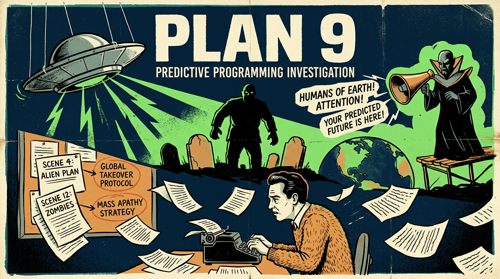

# Ed Wood and Plan 9 from Outer Space — Investigation

**Scope:** Predictive programming funding thesis; controlled opposition; inversion of creative process; zombie-apocalypse-as-alien-takeover encoding.  
**Cross-ref:** [Zombie genre](../zombies/index-zombie-genre-investigation.md) | [Predictive programming page](../page.md) | [Fiction as control](https://paradigmthreat.net/timeline/evt-predictive-programming)

---

## 1. The Plot That Nobody Wanted

### Plan 9 from Outer Space (1957)

*Plan 9 from Outer Space* — written, produced, and directed by Edward D. Wood Jr. — centers on extraterrestrial commanders (Eros and Tanna) who arrive in flying saucers over California. Their mission: stop humanity from creating "solaronite," a doomsday weapon that could destroy the universe. When Earth's governments refuse to listen, the aliens implement **"Plan 9"**: resurrect the recently deceased via electrical assault on the pituitary gland, raising armies of the undead to cause chaos, overwhelm capitals, and force compliance. The aliens explicitly state that humans are "immature and stupid"; they intend to destroy mankind if it does not heed their warnings. Through the zombie apocalypse, they reveal themselves—everyone would know of their existence from then on.

The plot encodes, with unusual specificity:

| Encoded Element | In the Film |
|-----------------|-------------|
| **Method of reanimation** | Electrical blast to pituitary gland; described and shown |
| **Strategic aim** | Overwhelm defensive forces; march undead armies on capitals |
| **Outcome** | Force population into compliant state; allow alien takeover |
| **Disclosure** | Aliens reveal themselves through the act; no secrecy thereafter |
| **Humanity's flaw** | "Stupid"; capable of destroying universe with weaponry |
| **Cold War subtext** | Post–Tsar Bomb era; humanity can now destroy planet or universe |

### The Inversion of the Creative Process

The mainstream view: filmmakers create what audiences want—profit-driven popular media, science fiction narratives, action flicks. The predictive-programming thesis: certain productions are **funded to propagate specific plot points**, regardless of audience demand or artistic merit.

**The problem:** There is no way to prove that a given film was funded *specifically* for predictive programming rather than for profit or genre convention. Competing explanations always exist: coincidence, zeitgeist, copycat, authorial genius.

**Plan 9 as a pure example:** The film was laughably bad—cardboard sets, visible strings on flying saucers, continuity errors, posthumous footage of Bela Lugosi edited into an unrelated script. It is routinely cited as the "worst film ever made." Yet the *plot* is remarkably coherent and operationally detailed. Post-war audiences wanted action films, war movies, westerns—not zombie apocalypses orchestrated by aliens with nefarious takeover plans. Subterfuge and espionage narratives were brand new; the zombie-as-instrument-of-alien-disclosure scenario was not a natural genre development.

**Thesis:** Nobody wanted to make this movie. Someone needed it made. Ed Wood said yes.

---

## 2. Ed Wood: Budget, Pocket, and Method

### Minimal Budget, Maximum Take

Wood's productions were notoriously cheap. *Plan 9* was made for approximately $60,000 (1957). Flying saucers were repurposed Lindberg model kits; the "studio" was a wooden shack behind a hotel that housed prostitutes; lights were tin cans with bulbs. Actor Lyle Talbot recalled Wood "scrambling for the money" to pay him in "a stack of singles, maybe some fives," "wrinkled, as if he'd gathered them in small amounts and stuffed them into his pockets."

**Observation:** Wood consistently spent as little as possible on production while securing distribution. The pattern suggests a different incentive than quality or audience satisfaction: deliver the required narrative at minimum cost, pocket the remainder.

**Interpretation:** If predictive programming is funded by external influence, the method is not to make great art—it is to **insert talking points into media at lowest cost**. A filmmaker who will take the money, deliver the plot, and keep the rest is ideal.

### Funding Sources

*Plan 9* was produced by Reynolds Pictures, Inc. **J. Edward Reynolds**—executive producer—was a leader of the Southern Baptist Convention in Beverly Hills. Baptist church associates (Hugh Thomas, Reynolds himself) appear in the film as gravediggers. The film was shot in November 1956; a preview screening was held in March 1957; general release followed in 1958 in Virginia, Texas, and Southern states. Distributors Corporation of America handled distribution.

The presence of Baptist funding for a film about aliens resurrecting the dead to overwhelm capitals and force compliance is noted. Mainstream interpretation: exploitation producers seeking any backer. Alternative interpretation: institutional or ideological funding for narrative propagation under plausible-deniability cover.

---

## 3. Controlled Opposition: The Transvestite Agent

### Profile

Edward D. Wood Jr. (1924–1978) was a cross-dresser. He wore women's clothing; he worked as a stuntman "dressed as a woman on a runaway stagecoach" in *The Baron of Arizona* (1950). His first feature as director was *Glen or Glenda* (1953)—a film about a man who secretly cross-dresses, inspired by Christine Jorgensen, the first American to undergo gender-affirming surgery. Wood starred in the title role under a pseudonym.

### The Controlled-Opposition Pattern

**Isolation from mainstream society:** A closeted transvestite in 1950s America was marginal, dependent, and unlikely to be taken seriously by the public. He could make films that reached audiences, but he would never be celebrated, never accepted into elite circles. The public would watch—and ridicule—his work, but would not meet him, would not grant him authority.

**Fit for the role:** An ideal controlled-opposition agent is someone the public will consume but not embrace. Ed Wood fits: his films are seen as jokes; he is the "worst director ever." The narrative propagates; the messenger is discredited.

**Filmography pattern:** Every major Wood film fits a dual encoding model:

| Film | Primary Narrative | Secondary / Overlap |
|------|-------------------|---------------------|
| *Glen or Glenda* (1953) | Transvestism, gender identity | Early LGBTQ normalization; Christine Jorgensen framing |
| *Bride of the Monster* (1955) | Mad scientist, atomic mutations | Nuclear-age anxiety; creation of monsters |
| *Plan 9 from Outer Space* (1957) | Aliens resurrect dead; zombie apocalypse; takeover | Solaronite = Tsar Bomb / doomsday; humanity "stupid" |
| *Night of the Ghouls* (1959) | Fake spiritualists, cemetery horror | Continued undead / supernatural themes |

**Thesis:** Wood's filmography propagates (1) alien/zombie/doomsday predictive programming and (2) early LGBTQ content—transvestites, homosexual themes—preparing audiences for media-driven campaigns in that direction. Such productions are not spontaneous, nor driven by demographics or popularity. They are **designed insertions**.

### Open Investigation: International LGBTQ+ Movie History

A parallel line of inquiry is open: **Whether International LGBTQ+ cinema—from early 20th-century German coded cinema (e.g., *Mädchen in Uniform*, Weimar-era subtext) through modern global representation—was influenced and funded covertly by Deep State agendas.**

Questions under investigation:

- **Funding and ROI:** Were these films good returns for investors? LGBTQ-themed or coded films have historically faced censorship, limited distribution, and market resistance. If they consistently underperformed commercially, what sustained the funding pipeline? Who backed productions that mainstream financiers would not touch?
- **Culture clash and criticism:** Did producers and directors receive sustained criticism—or backlash—over the culture clashes they were causing with old traditions? If so, did that criticism correlate with funding continuity (i.e., were controversial films greenlit *despite* or *because of* the clashes)? The pattern would support either (a) genuine artistic defiance against commercial logic or (b) agenda-driven insertion where controversy is the point.
- **Geographic and temporal span:** German Weimar cinema; pre-Code Hollywood; post-Code subtext; New Queer Cinema (1990s); contemporary global festival circuits. The consistency of LGBTQ normalization across regimes, continents, and decades—despite varied commercial outcomes—invites examination of coordinated influence.

*Open investigation; dedicated write-up to be created in `influence/predictive_programming/investigations/`*

---

## 4. The Plots He Could Not Have Written

### Assessment of Wood's Capabilities

Ed Wood was not regarded as intelligent or sophisticated. His scripts are full of exposition dumps, wooden dialogue, and continuity errors. He recycled footage, cast friends, and improvised when actors died. His ambition exceeded his talent—and his budget—routinely.

**Plan 9's plot, by contrast, is precise:**

- Aliens contact governments; governments refuse to listen
- Plan 9: resurrect dead via pituitary assault
- Undead overwhelm capitals; panic; compliance
- Aliens reveal themselves; "everyone would know"
- Solaronite: humanity can destroy universe; "we are very, very stupid"
- Chain reaction; uncontrollable; doomsday weapon

This is not the kind of plot a hack writer typically invents. It reads like an **operational brief**—a scenario document for crisis implementation: manufactured zombie apocalypse → societal collapse → alien disclosure → takeover.

**Conclusion:** Ed Wood does not appear intelligent enough—or sufficiently versed in strategic narrative—to have originated this plot. The specificity, the causal chain, the Cold War doomsday framing, and the disclosure-through-chaos logic suggest **scripted input from elsewhere**. Wood was the vessel; the narrative was supplied.

---

## 5. Parallel Media: Same Plot, Different Medium

### EarthBound (1994, SNES)

*EarthBound* (Nintendo, 1994), developed by Shigesato Itoi, is explicitly styled on **old sci-fi movie themes**. The antagonist **Giygas** is an alien invader who seeks to conquer Earth and eliminate humanity. Creator Itoi drew inspiration from 1950s cinema—specifically a traumatic childhood viewing of the 1957 Japanese film *The Military Policeman and the Dismembered Beauty*—and channeled that unsettling, B-movie aesthetic into the game's cosmic horror.

**Plot parallels to Plan 9:**

| Element | Plan 9 (1957) | EarthBound (1994) |
|---------|---------------|-------------------|
| Alien antagonist | Eros, Tanna; flying saucers | Giygas; alien from outer space |
| Conquest / takeover | Overwhelm capitals; force compliance | Conquer Earth; wipe out humanity |
| 1950s sci-fi aesthetic | Atomic-age B-movie; flying saucers | Creator explicitly cites 1957 cinema |
| Human fallibility | "Stupid"; doomsday weapon | Giygas as "all-mighty idiot"; power corrupts |
| Unconventional defeat | Saucer explodes; zombies decompose | Defeated by prayer, not combat |

*EarthBound* does not encode zombie resurrection per se, but it repeats the **alien-invasion-as-takeover** narrative and the **old sci-fi movie style** as a vessel for that narrative. The recurrence across media (film 1957, game 1994) and across cultures (American B-movie, Japanese RPG) suggests a **persistent template**—one that predates Wood and outlives him.

### Other Media with Same Template

- *Night of the Living Dead* (1968) — Zombie apocalypse; bodies without consciousness; Romero
- *Invasion of the Body Snatchers* (1956) — Alien replacement of humans; compliance through replacement
- *The Day the Earth Stood Still* (1951) — Aliens warn humanity; doomsday threat; "listen or be destroyed"

The Plan 9 variant—**aliens resurrect dead → zombie armies → overwhelm capitals → disclosure → takeover**—is more specific than these. It combines zombie apocalypse with alien orchestration and explicit disclosure logic. Plan 9 may be the clearest early encoding of this exact scenario.

---

## 6. Author's Thesis

**Ed Wood was a controlled opposition agent.** He was funded to produce films that propagated specific predictive-programming narratives—zombie apocalypse as alien instrument, doomsday-weapon anxiety, early LGBTQ normalization—while appearing to be the work of a fringe, incompetent filmmaker. His isolation (closeted transvestite), his willingness to work on minimal budget, his consistent delivery of the required plot points, and the mismatch between his demonstrable capabilities and the sophistication of Plan 9's scenario all support this reading.

**We will never prove** that someone funded Plan 9 specifically for predictive programming. Competing explanations—exploitation, Baptist curiosity, Wood's own bizarre genius—will always exist. But Plan 9 offers a **pure example of the method**: a film that is bad in every production dimension yet precise in its narrative encoding; a director who could not have written what he filmed; and a pattern of media insertion that continues globally, in film and games, across decades.

---

## Deep Dive: Research Findings

### Plan 9 Script Drafts and Treatment Sources

**Working script located:** A vintage 109-page working script dated **November 22, 1956**, titled "GRAVE ROBBERS FROM OUTER SPACE" (later hand-corrected to "PLAN 9"), circulates among Ed Wood enthusiasts and has been analyzed in depth by the Ed Wood Wednesdays blog (Dead 2 Rights). The script appears genuine: formatting matches Wood's known style (*Rue Pigalle*, *Bride of the Monster*); punctuation (dashes, ellipses), character names (Rance), and fetish elements (angora sweater, Paula Trent's nightgown) are consistent with Wood's prose. Scene-by-scene comparison shows the film hews closely to the script; actors sometimes paraphrase. Deleted sequences (e.g., scenes 78–80 with Danny, Jeff, Paula) exist in script but not in release.

**Conclusion:** **No pre-existing outline from an external source has been found.** The script reads as Wood's own—idiosyncratic, typo-ridden ("Dictial Robetary," "Solaronite"), and structurally coherent in the way Wood's fiction is. The operational precision of the *plot logic* (aliens → Plan 9 → zombie armies → disclosure) remains striking, but the *prose and structure* are consistent with Wood's corpus. Either (a) Wood was capable of drafting this scenario himself, or (b) a treatment was supplied and Wood heavily adapted it into his style—the latter cannot be ruled out but has no documentary support.

### Reynolds / Baptist Funding Records

**Sources:** Collider, Mental Floss, TCM, Wikipedia; no primary contract or church ledger has been located.

**Established narrative:** **J. Edward Reynolds** was Wood's landlord (Beverly Hills). Wood was three months behind on rent. Reynolds confronted him; Wood revealed he was in films. Wood claimed he and associates wanted to make **religious films** but only had money for one. He pitched "Grave Robbers from Outer Space" as a profitable venture whose proceeds would fund the religious productions. Reynolds agreed. **Conditions:** (1) Title change from "Grave Robbers" to "Plan 9" (grave-robbing deemed blasphemous); (2) cast and crew baptism in a Beverly Hills swimming pool. Wood, Tor Johnson, and others acquiesced. Reynolds became executive producer; Hugh Thomas Jr. (church associate) co-producer; both appear as gravediggers. Budget: ~$60,000 (up from Wood's initial ~$800). Reynolds Pictures, Inc. produced; Distributors Corporation of America distributed. Release: preview March 1957, general release July 1958 (sources vary 1958/1959).

**Conclusion:** Reynolds was a **credible exploitation backer**—a minister and landlord who believed the film would turn a profit and fund religious projects. No evidence of ideological or predictive-programming motive. The Baptist angle functions as plausible deniability if one suspects external influence: a church funding a bad sci-fi film is odd enough to be memorable, conventional enough to explain away. **Outstanding:** No contract, no church board minutes, no record of who approved the pitch or on what ROI terms.

### EarthBound Development — Itoi and Plan 9

**Itoi's stated inspiration:** Shigesato Itoi has cited **Kenpei to Barabara Shibijin** (*The Military Policeman and the Dismembered Beauty*, 1957, dir. Kyotaro Namiki)—a **Japanese thriller/crime film**, not sci-fi. As a child, Itoi accidentally saw it, mistook a murder scene for a rape scene, and was traumatized. Years later he channeled that emotional impact into Giygas's dialogue and the unsettling tone of the final boss battle. The film has no alien, zombie, or flying-saucer content.

**Conclusion:** **No documented connection between EarthBound and Plan 9.** Itoi drew from 1957 Japanese cinema for *tone* (atrocity, eroticism, audience manipulation), not for plot. The 1957 coincidence (Plan 9 shot Nov 1956, previewed Mar 1957; Kenpei released Aug 1957) is temporal only. EarthBound's alien-invasion narrative may derive from generic 1950s sci-fi tropes (which Plan 9 also inhabits) without direct citation.

### LGBTQ Cinema Funding — Preliminary Findings

**Early/Weimar:** *Mädchen in Uniform* (1931) was produced by Carl Froelich / Deutsche Film-Gemeinschaft. No box office data located; film was influential, censored under Nazis, later reclaimed as lesbian classic. **Glen or Glenda** (1953): Produced by George Weiss (~$20,000); Weiss specialized in low-budget exploitation (sexploitation, taboo subjects). Distribution bypassed mainstream circuits; roadshow to small-town exhibitors. ROI model: minimal spend, niche audience, quick recoup.

**Later successes:** *The Adventures of Priscilla, Queen of the Desert* (1994): Australian Film Finance Corporation invested $1.67M of $3.63M budget despite skepticism; returned $1.99M to FFC within 12 months; Australian gross ~$16.5M; Cannes audience award. **Monash study (2022):** LGBT-inclusive films (characters or plots) earned **29% more** box office than films with no LGBT content across 4,126 films.

**Culture-clash criticism:** Directors report ongoing pressure: Pixar removed LGBTQ elements from *Elio* (2025) after test-audience resistance; Pete Docter defended cuts. Todd Haynes, Rhys Ernst, Sophie Hyde have described "open season" on queer narratives, distribution difficulties, "war on nuance." Backlash correlates with funding hesitancy in some cases; in others (Priscilla, mainstream inclusive films) commercial success followed investment.

**Conclusion:** LGBTQ cinema has **mixed ROI**—early exploitation model (Weiss) sought profit via taboo; later government/festival-backed films (Priscilla) proved profitable; contemporary studio inclusion correlates with higher revenue. Controversy is double-edged: it can suppress funding (Pixar cuts) or attract festival/award attention (Priscilla at Cannes). **Outstanding:** No evidence of coordinated Deep State funding; funding sources (Weiss, FFC, studios) are documented and conventional. The thesis that LGBTQ cinema was *covertly* influenced remains an open question requiring archival work on Weimar-era backers, Hays Code-era routing, and post-1990 festival gatekeeping.

---

## Outstanding Questions

- [x] ~~Exhaustive search for Plan 9 script drafts or treatment sources~~ — **Addressed:** Working script exists; style consistent with Wood; no pre-existing outline found.
- [x] ~~Reynolds / Baptist funding records~~ — **Addressed:** Narrative documented; no primary contracts; Reynolds as exploitation backer, conditions (title, baptism) established.
- [x] ~~EarthBound development—did Itoi cite Plan 9 or similar B-movies directly?~~ — **Addressed:** No. Itoi cited *Kenpei to Barabara Shibijin* (1957 crime thriller) for emotional tone, not Plan 9.
- [ ] **LGBTQ cinema funding investigation** — ROI mixed (exploitation profitable; Priscilla profitable; inclusion correlates with +29% revenue). Culture-clash criticism documented. Coordinated covert influence: unproven; open for dedicated investigation.

---

## Cross-References

- [Zombie genre investigation](../zombies/index-zombie-genre-investigation.md) — Pre-20th c. roots; Stoker, Lovecraft, Romero
- [Predictive programming page](../page.md) — Fiction encoding index; media catalog
- [Fiction as control](https://paradigmthreat.net/timeline/evt-predictive-programming) — Forward vs backward programming; Revelation of the Method
- [Night of the Living Dead](https://paradigmthreat.net/influence/predictive_programming/page.md#media-catalog) — Zombie apocalypse; Media Catalog

**Deep Dive Sources:**
- [Dead 2 Rights: Ed Wood Wednesdays, Plan 9 screenplay analysis](https://d2rights.blogspot.com/2020/03/ed-wood-wednesdays-week-98-some.html)
- [Collider: Plan 9 funding by Baptist church](https://collider.com/plan-9-from-outer-space-funding/)
- [Wikipedia: Kenpei to Barabara Shibijin](https://en.wikipedia.org/wiki/Kenpei_to_Barabara_Shibijin) — Itoi's Giygas inspiration
