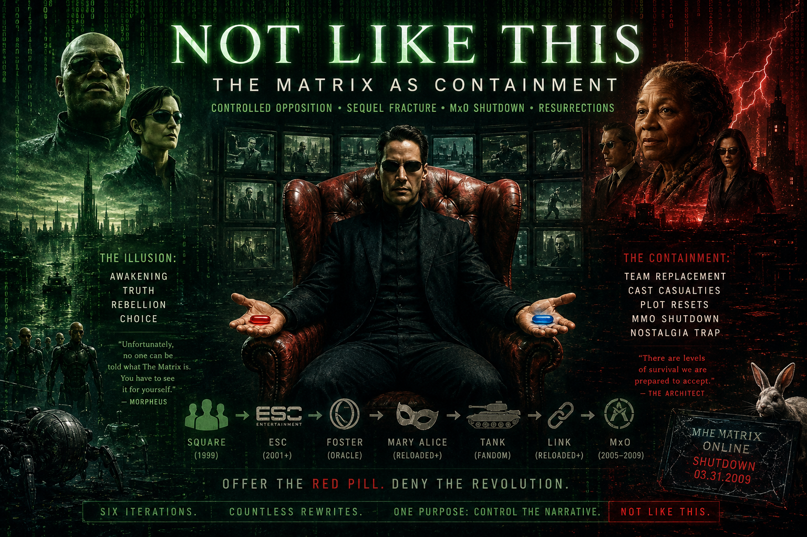
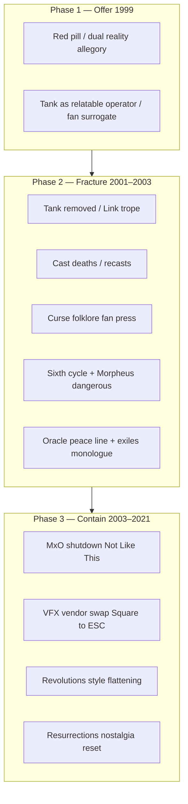

# Investigation: *The Matrix* — “Not Like This” containment thesis (controlled opposition, sequel fracture, MxO, *Resurrections*)

> **TL;DR:** Open dossier testing whether the *Matrix* franchise was **always or increasingly** a **containment vessel** for a **dual-layer “woke” readership** (Malcolm X lineage epistemics)—offering **awakening symbolism** while **neutralizing revolution** through team replacement, cast changes, MMO shutdown, and *Resurrections* nostalgia-trap grammar. ***The Matrix* (1999) end credits** — Rage Against the Machine’s **“Wake Up”** — carry **L1 accusations** (Vietnam/King, Malcolm X/Islam blame, COINTELPRO memo) the author reads as **NSA-camp surfacing of live psyops**, not decorative theme. **Reader essay:** [**Not Like This**](https://paradigmthreat.net/influence/controlled_opposition/not-like-this.md) **(published 2026-06-14)**. Full evidence tiers, transcripts, and TODOs remain in this file.

**Date:** 2026-06-14  
**Status:** Open investigation; **reader essay published** 2026-06-14.  
**Reader essay:** [**Not Like This**](/influence/controlled_opposition/not-like-this.md)

---

## Guide (read order)

1. [Definitions — “woke” in this investigation](#definitions--woke-in-this-investigation)
2. [Paradigm methodology — evidence tiers](#paradigm-methodology--evidence-tiers)
3. [Author thesis — containment stack (verbatim capture)](#author-thesis--containment-stack-verbatim-capture)
4. [Core hypothesis map](#core-hypothesis-map)
5. [Thread A — Controlled opposition / dual-layer audience](#thread-a--controlled-opposition--dual-layer-audience)
6. [Thread B — Tank, Link, and Marcus Chong (*The Kill Off*)](#thread-b--tank-link-and-marcus-chong-the-kill-off)
7. [Thread C — Production casualties & recasting (Aaliyah, Gloria Foster)](#thread-c--production-casualties--recasting-aaliyah-gloria-foster)
8. [Thread C2 — “Curse of The Matrix” folk pattern (fan + press reception)](#thread-c2--curse-of-the-matrix-folk-pattern-fan--press-reception)
9. [Thread D — Oracle’s “exiles” monologue & Foster replacement](#thread-d--oracles-exiles-monologue--foster-replacement)
10. [Thread D2 — The “why?” chain: Merovingian, Oracle subversion, Architect, audience rejection](#thread-d2--the-why-chain-merovingian-oracle-subversion-architect-audience-rejection)
11. [Thread D3 — Maddox (2003): pseudo-intellectual fan fracture & “nothing to believe in”](#thread-d3--maddox-2003-pseudo-intellectual-fan-fracture--nothing-to-believe-in)
12. [Thread E — Sixth Matrix iteration & historical reset rhyme](#thread-e--sixth-matrix-iteration--historical-reset-rhyme)
13. [Thread F — *Matrix Online*, “Not Like This,” Sony shutdown](#thread-f--matrix-online-not-like-this-sony-shutdown)
14. [Thread G — *Matrix Resurrections* as nostalgia containment](#thread-g--matrix-resurrections-as-nostalgia-containment)
15. [Thread H — Square / *Spirits Within* / Animatrix / ESC VFX handoff](#thread-h--square--spirits-within--animatrix--esc-vfx-handoff)
16. [Thread I — Neo “Source tentacles” ↔ Aki Ross stab (author visual rhyme)](#thread-i--neo-source-tentacles--aki-ross-stab-author-visual-rhyme)
17. [Thread J — *Revolutions* style regression (Trainman, music, action)](#thread-j--revolutions-style-regression-trainman-music-action)
18. [Thread K — M1 revival: will vs. love containment (R6)](#thread-k--m1-revival-will-vs-love-containment-r6)
19. [Thread L — Malcolm X, “woke,” and *Wake Up* end credits (M1 psyop lane)](#thread-l--malcolm-x-woke-and-wake-up-end-credits-m1-psyop-lane)
20. [L1 transcript table — *Matrix Reloaded* YIFY-en.srt (R8)](#l1-transcript-table--matrix-reloaded-yify-ensrt-r8)
21. [Cross-repo adjacencies](#cross-repo-adjacencies)
22. [Article plan — *Not Like This*](#article-plan--not-like-this)
23. [Weak points / research TODOs](#weak-points--research-todos)
24. [Limits and disclaimers](#limits-and-disclaimers)

---

## Definitions — “woke” in this investigation

| Term | Meaning **here** (author-supplied) |
|------|-------------------------------------|
| **Woke (original sense)** | **Dual-layer epistemics:** upper layer accepts audits, news, movies, authority as coherent; lower layer (often minorities / historically disenfranchised groups) **knows** official stories omit or invert power truths. Implies **massive lies** at the top are **plausible**, not paranoid. **Malcolm X lineage:** suspicion of **official narrative**, **media as calm technology**, and **assassination-by-framing** (who gets blamed vs. who ordered silence) — see [Thread L](#thread-l--malcolm-x-woke-and-wake-up-end-credits-m1-psyop-lane). |
| **Not “woke” (co-opted)** | Post-~2010s media/party branding — **explicitly out of scope** unless author later bridges the terms. |
| **Containment** | Industry actions that **channel** awakening energy into **safe outcomes**: recasts, plot resets, MMO closure, sequel quality collapse, nostalgia reboots, legal silencing of insiders. **Hypothesis:** divide original fans / prevent **revolutionary** identity formation around the IP. |
| **Controlled opposition (repo sense)** | From [controlled opposition hub](/influence/controlled_opposition/page.md): dissent **appears** real but **kill switches** remain (IP, contracts, canon authority). *Matrix* read: offer **red pill** symbolism while ensuring **no durable counter-institution** (MxO, Tank fandom, peace ending) survives. |
| **“Not Like This”** | Giant Bomb video series on MxO’s **2009 shutdown** — title = Switch’s last words (*The Matrix*, 1999). Also proposed **reader essay title**. |

**Author confirmations (2026-06-14):**
- **“Woke”** = **dual-layer epistemics / Malcolm X lineage only** — **no** bridge to 2010s DEI “woke” in §1; **Malcolm X rhymes run throughout** the essay (not §1-only).
- **CO timing** = **from first inception (1999)**, not retrofit after accidental radical uptake. **L1 anchor:** Neo’s passport **expires 11 Sep 2001** — **cold open** (~**18:22**, Smith interrogation); well-known **9/11 PP** ([Snopes TRUE](https://www.snopes.com/fact-check/neo-passport-matrix-9-11/)).
- **Chong / *Kill Off*:** Documentary subtitles = **primary for now**; book unobtainable — **leave open** if scan surfaces **new** L1.
- ***Wake Up* credits (Thread L):** L1 = RATM lyrics, credits placement, Hoover memo, Tonkin/Hanyok timeline; L3 = pre-9/11 **blame-Islam PP**, credits as **second payload** paired with passport — **not** decorative “wake up” theme.
- **Reloaded dialogue (2026-06-15):** **One Oracle visit**; no “cookie scene” label; **M2** future/together vs **M3** “I want what you want” / end of war; Switch = **Cypher unplug** rhyme with **Sony/MxO**.
- **Reloaded timecodes (2026-06-15):** **YIFY-en.srt** retail subs (`Downloads/The.Matrix.Reloaded.2003.Subtitles.YIFY-en.srt`) — **not** fan-edit ASS. Neo→Morpheus line per YIFY: *“It was all another system of control.”*

---

## Paradigm methodology — evidence tiers

| Tier | Label | Use in this file |
|------|-------|------------------|
| **L1 — Documented** | Trade/press, court filings, VFX house credits, Wikipedia with primary cites, on-disk subtitles | Aaliyah recast; Foster death; MxO Sony closure; Square USA **Osiris** credit; ESC **Zion siege** credit; Chong 2003 lawsuit reporting |
| **L2 — Validated practice / industry pattern** | Repeated studio behavior, franchise sequel economics, MMO sunset norms | Sequel contract disputes; recast in-universe explanations; <500 MxO subs at sunset |
| **L3 — Author interpretive** | Containment, CO, Foster Oracle **elimination**, *Resurrections* audience weaponization, **Neo/Aki tentacle rhyme**, fan **curse** as **distributed pattern recognition** | **Default tier for thesis** |
| **L4 — Speculative / unverified** | Literal studio-ordered deaths, intelligence-agency handling | **Out of scope** unless new primaries |

**Discipline:** L1 proves **what happened**; L3 argues **why it rhymes with containment**. Do not collapse tiers in the eventual article.

### Cross-investigation pattern — team replacement containment (author, L3)

**Recurring Paradigm thesis (2026-06-14, author R1):** When a creative team aligns with **philosophical / spiritual concepts** the industry cannot tolerate, they are **removed and replaced** by personnel **more loyal to the studio** — who **finish the scenes already planned** by the prior team but **strip or neutralize** the ideas. Output becomes **inert, sanitized, easy to control** going forward.

| Investigation lane | Prior team (author read) | Replacement / handoff | Containment product |
|--------------------|--------------------------|------------------------|---------------------|
| ***Spirits Within* / Square USA** | Square CGI + philosophical/spiritual *Spirits Within* grammar | **ESC Entertainment** (Warner-adjacent); Square collapse post-2001 | Human-realism pipeline **contained**; *Animatrix* **Osiris** R&D → sequel VFX without Square competition |
| ***Matrix* sequels** | Foster Oracle / Chong Tank / Wachowski *Reloaded* “why?” chain | Mary Alice Oracle; Link; Maddox-style fan fracture; *Revolutions* flattening | Radical lore **on disk**, mass memory **“talky sequel bad”** |
| **MxO** | Player-driven **peace-era** canon extension | Sony shutdown **Jul 2009**; plot bent to **Neo body / M4** premise | **Revolution stopped** — community cannot restart |

**Essential argument for this dossier:** The **Spirits Within CGI team** appeared aligned with both **The Square** film and ***Matrix*** philosophical/spiritual lanes; their **exit** and **ESC handoff** is the **production-side** mirror of **Oracle/Tank elimination** and **fan-community kill**. See [Thread H](#thread-h--square--spirits-within--animatrix--esc-vfx-handoff).

---

## Author thesis — containment stack (verbatim capture)

> The **primary why** for everything documented here is the **two-camp interagency war** playing out **in front of us**—often through **extremely subtle** control of **movies and franchise extensions**, where any single beat looks like taste or business but **the stacked pattern is real**.  
>
> **NSA-camp** grammar (antibody / SIGINT audit / individual wake-up) briefly owned ***The Matrix* (1999)**. **CIA-camp** grammar (contain / sleep / fracture / controlled opposition) owned ***Reloaded* → MxO → *Resurrections***. Hollywood **handed the IP from wake-up to contain**—recasts, vendor swaps, fan mockery, MMO kill, nostalgia reset.  
>
> The entire *Matrix* project may also be read as **controlled opposition** for a **dual-layer “woke” readership** (Malcolm X lineage epistemics)—offering awakening symbolism while **neutralizing revolution**. **Evidence is pattern-based**, not proven memo trail.  
>
> **Anchors:** Marcus Chong / *The Kill Off*; **Tank** → **Link**; **Aaliyah** / **Foster** recasts; Oracle **exiles** monologue; **MxO** / Giant Bomb **Not Like This**; Square → **ESC**; ***Resurrections*** tombstone; Maddox **2003** fracture lane; ***Wake Up*** end credits (**Thread L** — Vietnam/Tonkin, Malcolm X/Islam blame, COINTELPRO memo).

---

## Core hypothesis map

---

## Thread A — Controlled opposition / dual-layer audience

### Author claim (L3)
- Franchise **had to exist from inception** to **channel** Malcolm-X-adjacent **structural suspicion** into **consumable** myth — **not** a sincere accident that later required containment.
- **Containment** = prevent fans from treating fiction as **organizing template** for real-world exit from control systems.

### L1 anchor — CO from day one (author proof point)

**Neo’s passport** (*The Matrix*, 1999, Agent Smith interrogation ~**18:22**):
- **Expires: 11 September 2001** (also issued 12 Sep 1991; DOB on passport **13 Sep 1971** — distinct from conflicting “Anderson” file dates in same scene cluster).
- Film **shot Mar–Aug 1998**; released **Mar 1999** — **>2 years before** 9/11 attacks.
- [Snopes: claim TRUE](https://www.snopes.com/fact-check/neo-passport-matrix-9-11/) (date on prop is real; mainstream frames **coincidence**).

**Author read (L3):** **Predictive programming** — the simulation’s chosen one carries an identity document that **expires on the day official reality fractures**. Fits **CO-from-inception**: awakening offered **inside** a text that **already encoded** the next **mass-layer break** (9/11 → **contain campaign** **framed** uncomfortable Oracle-as-control in *Reloaded* as **cringe**, not **organic** audience demand for comfort). **Rhymes [Thread L](#thread-l--malcolm-x-woke-and-wake-up-end-credits-m1-psyop-lane):** same film’s end credits accuse **Islam-blame framing** and **Vietnam-era assassination politics** — **>2 years before** 9/11 and **decades** before audiences routinely heard **Tonkin SIGINT** declass language.

**Tier discipline:** L1 = date on screen + production timeline; L3 = PP / CO intent. Do **not** collapse in article without definition box.

### NSA vs CIA two-camps parallel — **primary thesis (author, L3)**

**Author position (2026-06-14, revised):** The **two-camp war** is the **primary reason** the *Matrix* containment arc happened. The fight is **visible in front of us**—through **movies**, **sequel tone**, **recasts**, **fan fracture**, **MMO kills**, **VFX vendor swaps**—implemented so subtly that each beat dismisses as Hollywood noise. **Stack the beats** and the **pattern is real**.

**Camp mapping:** If *Matrix* (1999) **predicted 9/11** on Neo’s passport, the **first film** encodes the **NSA camp** — **nationalist / individualist message of resistance and waking up** (SIGINT-audit, antibody, “see the code” lane). **Containment from *Reloaded* forward** — sequels, fan fracture (Maddox), MxO kill, *Resurrections* — encodes **CIA camp** influence: **bring revolution back** into **NWO plan alignment**, population **mostly asleep** to how power **really functions**.

| Camp (repo frame) | *Matrix* franchise read (L3) | Repo cross-link |
|-----------------|-------------------------------|-----------------|
| **NSA / antibody / SIGINT audit** | ***The Matrix* (1999)** — red pill, operator-as-fan (Tank), passport **9/11 PP**, “there is no spoon” **individual** exit | [NSA investigation](/governance/war/investigations/nsa-investigation.md); [good-actor antibody](/events/false_flag/investigations/good-actor-theory-interagency-antibody-investigation.md) |
| **CIA / containment / proxy sleep** | ***Reloaded* → *Revolutions* → MxO → *Resurrections*** — Oracle-as-control rejected then **recast/defanged**, Maddox corridor, Analyst nostalgia trap, peace **undone** | [CIA investigation](/governance/war/investigations/cia-investigation.md); [Ghost War — antibody phase](/influence/hollywood/ghost-war-the-antibody-phase.md) |

**Tier:** Interagency **two-camps** thesis = **author L3** — not L1 proof Wachowskis coded NSA/CIA. **Use as the interpretive spine** linking Matrix containment to existing Paradigm **war/governance** dossiers. **Reader essay** ([*Not Like This*](https://paradigmthreat.net/influence/controlled_opposition/not-like-this.md)) leads with this frame.

**Article beat:** Open on **war for the movies** → passport **9/11** as NSA-camp offer → timestamped contain-campaign (**2001–2021**) → Oracle **why?** chain as almost-successful exit manual → Maddox / MxO / ESC / *Resurrections* as contain-camp victories.

**Author validation logic (L3 — not L1 proof):**

| Camp | Hollywood trajectory (author read) | Repo frame |
|------|-------------------------------------|------------|
| **NSA-aligned** creatives / nationalist-individualist “wake up” grammar | **Disappear from Hollywood** — no durable franchise home for antibody / SIGINT-audit myth | [NSA investigation](/governance/war/investigations/nsa-investigation.md); [good-actor antibody](/events/false_flag/investigations/good-actor-theory-interagency-antibody-investigation.md) |
| **CIA-aligned** containment / proxy sleep grammar | **Continue** on **CGI pipeline** adjacent to **Disney** (affiliate, proxy, subsidiary, vendor chain — e.g. ESC, later studio-owned VFX) | [CIA investigation](/governance/war/investigations/cia-investigation.md); [Ghost War — antibody phase](/influence/hollywood/ghost-war-the-antibody-phase.md) |

**Logic check (author):** *Matrix* **1999** = last mass-market **NSA-camp** offer (passport PP, red pill, operator surrogate). ***Reloaded* onward** = **CIA-camp** containment (Oracle-as-control rejected → recast → MxO kill → *Resurrections* nostalgia). **Square USA → ESC** = same handoff at **vendor layer**: auteur-realism team out, **studio-controlled CGI** in. **Falsifier:** document sustained NSA-camp blockbuster pipeline post-2003 with same cultural seriousness as *Matrix* (1999) — author predicts **none**.

### Documented hooks (L1–L2)
- *Matrix* widely read as **system allegory** (Plato, Baudrillard, cyberpunk)—studio marketed that depth ([BBC Foster obit](http://news.bbc.co.uk/2/hi/entertainment/1584632.stm) era coverage).
- [Great Awakening dossier §3.3.4](/influence/controlled_opposition/investigations/great-awakening-alien-savior-rv-nwo-cluster-investigation.md) already indexes ***Animatrix* / *Second Renaissance*** as economic-blockade → war PP—**adjacent**, not identical thesis.

### Falsifiers / open work
- [ ] Wachowski **intent** statements on passport prop / 9/11 date (likely “coincidence” — still worth primary cite).
- [ ] Warner marketing materials targeting **Black / urban** demographics vs. **generic sci-fi**—did campaigns **explicitly** sell “wake up” to disenfranchised viewers?

---

## Thread B — Tank, Link, and Marcus Chong (*The Kill Off*)

### Documented (L1)
- **Marcus Chong** played **Tank** (*The Matrix*, 1999); **not** in sequels; character **killed off-screen** between films; **Link** (Harold Perrineau Jr.) replaces operator role ([EW 2003 suit](https://ew.com/article/2003/05/20/tank-sues-matrix-filmmakers-unplugging-him/), [Screen Rant Tank explainer](https://screenrant.com/matrix-sequels-tank-marcus-chong-not-return-reason/)).
- Dispute: **~$400K** vs **$1M** sequel pay (sources vary); **Oct 2000** arrest after **threatening calls**; **2003** lawsuit (breach, defamation).
- Chong documentary subtitles (~44.8 min): **fake SAG contract**, **$28K** pay vs **Cypher $1M**, **no royalties**, **William Morris** pressure, **barred from lot**—**L3 allegations** pending document scan from *Kill Off* / court exhibits.

### Author read (L3)
- **Tank** = authentic **Zion-born** human (**born free** — never part of the Matrix); operator craft, fan favorite.
- **Link** = **generic** **Hollywood insert** (dreadlocks + attitude trope) **decoupled** from simulation-native personality—**symbolic fan replacement**.
- Chong lane = **L1 ethics scandal** (union, pay, blackball) supporting **containment via insider destruction**.

### Research TODO
- [ ] Obtain *The Kill Off* (ISBN **978-0359595259**) — Google Books partial preview only.
- [ ] Compare Chong claims to **Variety / Guardian / EW** primary reporting.
- [ ] **Link** character script pages—was role **written as brother-in-law** before Tank dispute, or retrofitted?

---

## Thread C — Production casualties & recasting (Aaliyah, Gloria Foster)

### Aaliyah → Nona Gaye (Zee) — L1
- **Aaliyah** cast as **Zee**; filmed **some** *Reloaded* material; died **25 Aug 2001** (plane crash); **Nona Gaye** recast; scenes **reshot** ([Variety Apr 2002](https://variety.com/2002/film/news/gaye-s-configured-for-matrix-sequels-1117865220/), [Screen Rant](https://screenrant.com/matrix-aaliyah-zee-recast-why/)).
- **Empire** “Matrix cursed?” piece (Oct 2001) — **industry superstition**, not investigation claim ([Empire](https://www.empireonline.com/movies/news/matrix-cursed/)).

### Gloria Foster → Mary Alice (Oracle) — L1 facts + author read

**L1 timeline**
- Foster died **29 Sep 2001** (diabetes complications), age **67** ([Wikipedia](https://en.wikipedia.org/wiki/Gloria_Foster), [BBC](http://news.bbc.co.uk/2/hi/entertainment/1584632.stm)).
- Completed **Oracle work for *Reloaded*** (including courtyard **exiles** scene); **did not** film *Revolutions* — recast **Mary Alice**; in-universe **“outer shell destroyed”** ([Screen Rant](https://screenrant.com/matrix-revolutions-oracle-recast-gloria-foster-mary-alice/)).
- Foster played **Satima Tate** (Betty Shabazz analogue) on *Law & Order* — Malcolm X assassination / revenge episodes ([Wikipedia](https://en.wikipedia.org/wiki/Gloria_Foster)).

**Author read (L3) — no confusion with “medical death”**
- **“Got her killed”** = **Oracle-as-Foster was killed off the franchise** before film 3, **not** a claim that diabetes was a cover for assassination.
- The **exiles monologue** (*Reloaded*, **with Foster**) is **what the Oracle revealed that exceeds sequel-safe scope** — vampires, werewolves, aliens as **prior Matrix iterations / exile programs**.
- **Containment sequence:** (1) let the **dangerous truth** appear once in film 2 while Foster still embodies the role; (2) **remove Foster** (death + recast) before film 3; (3) **reset** Oracle with Mary Alice + Merovingian **shell** plot so the **living voice of that revelation** does not survive into the finale.
- Medical cause is **orthogonal** to pattern read — same as Tank removed via contract war **without** requiring literal hit squad.

**Cast echo (L1 quote, L3 weight)**
- Laurence Fishburne on Foster’s loss: **“We lost our youth and our wisdom.”** ([Evening Standard — Curse of the Matrix](https://www.standard.co.uk/culture/film/curse-of-the-matrix-7430612.html)) — cast itself framed the recast as **epistemic loss**, not mere scheduling.

---

## Thread C2 — “Curse of The Matrix” folk pattern (fan + press reception)

### Investigation stance
- **Not** hunting a hidden “Foster murdered” dossier — that was the wrong search frame.
- **Do** catalog **fan + trade superstition** as **distributed pattern recognition**: audience already **felt** sequel production was **fighting the franchise’s awakening energy**.

### Documented reception (L1–L2)

| Source | Date / era | Pattern language |
|--------|------------|------------------|
| [Empire — “Matrix Cursed?”](https://www.empireonline.com/movies/news/matrix-cursed/) | Oct 2001 | After Aaliyah + Foster: Wachowskis **“cursing their stars”** — industry idiom for **bad-luck cluster** |
| [Evening Standard — “Curse of The Matrix”](https://www.standard.co.uk/culture/film/curse-of-the-matrix-7430612.html) | ~2003 release window | **“No wonder fans are whispering about the Curse”**; **“Conspiracy theorists — and serious Matrix fans who are by nature distrustful of perceived ‘reality’ — might even believe some higher force was trying to prevent the films being made.”** |
| [Far Out — “Was the production cursed?”](https://faroutmagazine.co.uk/was-the-production-of-the-matrix-cursed/) | Retrospective | Sequel shoot **“riddled with disaster”** — Aaliyah, 9/11, Foster, VFX houses **bust**, Reeves **payroll bailout** |
| [Animated Times — Keanu fans & curse](https://animatedtimes.com/keanu-reeves-fans-believed-dreadful-curse-of-the-matrix-haunted-its-2003-sequels-after-cast-was-plagued-with-tragedies/) | Fan-facing recap | **“Curse of The Matrix”** as **fan belief** tied to cast tragedies + Reeves personal losses |

### Cluster events fans bundled (L1)
- **Aaliyah** (Aug 2001) + **Foster** (Sep 2001) + **9/11** during Sydney shoot + **VFX vendor bankruptcies** + **budget spiral** + **Keanu Reeves** salary sacrifice / personal tragedies (Syme stillbirth, sister’s leukemia — trade lore).

### Author interpretive bridge (L3)
- **“Curse”** = folk label for **containment friction** — as if **something** resists completing a story that **teaches exit from control**.
- Aligns with **Switch’s last words** (“Not like this”) → Giant Bomb MxO title → **same fan grammar** at **community kill** (2009).
- **Dual-layer audience** most likely to **name a curse** — they already **distrust official reality**; production disasters **feel like in-universe Agent interference**.

### Research TODO (fan corpus — ongoing, not murder hunt)
- [ ] Archive.org / old **Matrix forums** (2001–2003) — “cursed,” “jinxed,” “they don’t want this finished”
- [ ] Reddit r/matrix, r/FanTheories — curse posts (qualitative index)
- [ ] **Fishburne** “youth and wisdom” — primary interview source beyond Evening Standard paraphrase
- [ ] Compare to **Exorcist / Omen** set-curse journalism template (Far Out explicitly invokes)

---

## Thread D — Oracle’s “exiles” monologue & Foster replacement

### Scene (*Reloaded*, **single Oracle courtyard visit**, **Foster** — L1)
- Oracle lists **vampires, werewolves, aliens** as **exile programs** — folklore / horror entities as **prior Matrix sub-routines** (author: **mind-blowing**, **out of scope** for a conventional action sequel).

### Author read (L3)
- This is the **Oracle choosing to reveal more than sequel-safe mythology** — **while Foster still IS the Oracle**.
- The speech **staying in the cut** does **not** contradict containment; it **documents the breach**. Containment is **Foster not living to deliver the third-act Oracle**, replaced by **Mary Alice** + **shell-destruction** cover story.
- **Merovingian / Keymaker / Architect** expand lore mechanically; this speech **names pop occult categories** and tells the **dual-layer audience** their **monster folklore** may be **deprecated simulation code**.

### Research TODO
- [x] Full **exiles** transcript with timecode — **verified 2026-06-15** from **YIFY-en.srt** (see [L1 transcript table](#l1-transcript-table--matrix-reloaded-yify-ensrt-r8)).
- [ ] Mary Alice *Revolutions* Oracle scenes — tonal / content diff vs. Foster (author: **defanged**).
- [ ] Foster interviews on Oracle (pre-2001) if any.

---

## Thread D2 — The “why?” chain: Merovingian, Oracle subversion, Architect, audience rejection

**Article opening thread (author, 2026-06-14).** Tier mix: **L1 dialogue** + **L3 narrative read** + **L2 fan rejection** (TODO corpus).

### Author thesis (verbatim capture)

> The Merovingian’s main point: **without the “why?” we are powerless.** In the **original script shape**, the Oracle was probably meant to **send Neo to the Merovingian** — the **next link in the chain**. But Foster’s Oracle **turns his “why?” on its head**: she asks Neo to **understand the reason he made the choices he made**, rather than **just live with them** (Merovingian’s causality peace).  
>
> She behaves as if there is **no exit** from her role **leading humanity into a planned reset** — **except one clue**: how to **think correctly** about **manipulated choice**. The **Architect** then confirms Neo’s path was **engineered**.  
>
> The **planned franchise ending** may have been ***Matrix 4*-style** — **love conquers all**. Instead, *Reloaded* delivered a **rapidly evolving Neo** who **challenges the audience**, then tells **Morpheus** the prophecy path was **another system of control** (*“It was all another system of control”* — YIFY **2:02:34**; author read: **Oracle / guide demystified**). Many **rejected** that — **not up to spec** for a *Matrix* sequel.

### L1 dialogue anchors (*Reloaded*) — **verified timecodes** (YIFY-en.srt, author R8, 2026-06-15)

**Source:** `Downloads/The.Matrix.Reloaded.2003.Subtitles.YIFY-en.srt` — **retail/theatrical English subs**. **Do not** cite fan-edit ASS timecodes in article.

**Oracle — single visit (~45:42–49:32)** — **author-confirmed:** one visit; **candy** beat (not “cookie scene”); order per YIFY:

| Time (YIFY) | Beat |
|-------------|------|
| **45:42–45:59** | Candy; *“You've already made it”*; *“understand why you made it”* |
| **46:22–46:34** | *“We're all here to do…”*; *“the future”*; *“the only way to get there is together”* |
| **47:12–47:35** | **Exiles** — vampires, werewolves, aliens; programs in **exile** |
| **48:41–49:13** | *“without time”*; *“already made the choice… understand it”*; Neo **I won't** / **You're the One** |
| **49:48–49:59** | Sends Neo to **Merovingian** / **Keymaker** |

**Merovingian — causality / “why” as power** (~**1:06:04–1:08:30**):
- *“Causality. Action, reaction. Cause and effect.”*
- *“Choice is an illusion created between those with power and those without.”*
- *“Our only hope, our only peace is to understand it, to understand the **why**.”*
- *“**Why** is the only real source of power. **Without it, you are powerless.**”*
- *“And this is how you come to me, **without why, without power**.”*

**Smith — prior death callback** (~**51:34–51:38**):
- *“**I killed you, Mr. Anderson. I watched you die.**”* (L1 anchor for [Thread K](#thread-k--m1-revival-will-vs-love-containment-r6))

**Architect** (~**1:50:29–1:57:18**):
- *“**I am the Architect.**”* (**1:50:29–1:50:33**)
- *“You are the **eventuality of an anomaly**…”* (**1:51:04–1:51:08**)
- *“This will be the **sixth time** we have destroyed it…”* / *“**exceedingly efficient at it**.”* (**1:54:33–1:54:43**)
- *“…dissemination of the **code you carry**…”* (**1:54:58–1:55:02**)

**Architect — love demystified** (~**1:56:10–1:57:18**):
- Neo’s experience *“**vis-á-vis love**”* (Trinity) — YIFY spelling **vis-á-vis**
- *“An emotion **designed specifically to overwhelm logic and reason**.”*
- *“**She is going to die and there is nothing you can do to stop it.**”*

**Neo → Morpheus after Architect** (~**2:02:21–2:02:37**):
- *“**It was a lie, Morpheus.**”*
- *“**The prophecy was a lie.**”*
- *“**The One was never meant to end anything.**”*
- *“**It was all another system of control.**”* (YIFY — author read: demystifies **Oracle / prophecy** path; Morpheus conversation context)

### Author interpretive chain (L3)

| Step | Merovingian frame | Oracle counter-move | Payoff |
|------|-------------------|---------------------|--------|
| 1 | **Why** = social power; without it you’re a **pawn** | Oracle still sends Neo **down the chain** to Merovingian (L1 plot) | Meets **planned** script function |
| 2 | Accept **causality**; feelings replace reason | **Understand why YOU chose** — choices real but **need decoding** | Turns **why** from **ruler’s tool** → **prisoner’s tool** |
| 3 | Choice is **illusion** | Architect: choice **within** a **designed menu** | **Both** true: real subjectivity **and** rigged game |
| 4 | — | Neo tells Morpheus: **prophecy / One path = control** | **Oracle role demystified** for audience |
| 5 | Counterfactual: **love wins** (*Resurrections* grammar) | Actual: **evolving, uncomfortable Neo** | Franchise **almost** broke containment in film 2 |

### Why audiences rejected it (L2–L3 — research TODO)

**Author read (L3):** Post-**9/11** **containment** — **not** organic mass sentiment; author **never** preferred **comfort Oracle** over compromised guide. The **contain camp steered reception**: critics, **Maddox**-style mockery, and franchise defanging **sold** “wise grandmother” Oracle and **punished** *Reloaded*’s control-layer read. Accepting **Oracle = control** is the **dual-layer** pain the film **offered**; burying it is **campaign success**, not proof the public **naturally** wanted comfort after collapse.

**Investigation tasks:**
- [x] **Maddox** *Reloaded* takedown indexed — see [Thread D3](#thread-d3--maddox-2003-pseudo-intellectual-fan-fracture--nothing-to-believe-in)
- [ ] **2003 forum / review** corpus — “too talky,” “philosophy class,” “ruined Oracle,” “what happened to simple story” (partial: EW Gleiberman, Rolling Stone Travers, Film Freak Central — expand)
- [ ] Contrast **Morpheus-as-true-believer** fan preference vs. **Neo-outgrows-Morpheus** arc
- [ ] Map **manufactured rejection** to **containment success**: studio can **keep exiles monologue + Architect** for **prestige**, **steer** audience to **remember burly brawl**, **shelve** the **control-system** lesson

### Link to other threads

- **Thread D (exiles):** same **single Oracle visit** — mythology breach + why-your-choice + future/together **same scene**
- **Thread D3 (Maddox):** **fan-side** fracture voice — **parallel** to in-fiction Oracle demystification; **divide-and-conquer** reception layer
- **Thread G (*Resurrections*):** author read — **love conquers all** may have been **original safe ending**; **film 4** **implements** what sequels **avoided**, **undoes** peace **and** **Neo’s evolution**
- **Thread A (CO):** Oracle as **controlled opposition** inside fiction — **validates** suspicion then **punishes** it via **Recast / Analyst / nostalgia**

---

## Thread D3 — Maddox (2003): pseudo-intellectual fan fracture & “nothing to believe in”

**Author identification (2026-06-14):** The “obscure online comic” memory = **Maddox** ([*The Best Page in the Universe*](https://www.thebestpageintheuniverse.com/)) — not a serial strip, but the **dominant independent web voice** mocking *Reloaded* in summer **2003**. Colloquially remembered as **“The Matrix Reloaded sucked.”**

### Primary source (L1 — archived)

| Field | Value |
|-------|--------|
| **Author** | Maddox (George Ouzounian) |
| **Title (page)** | *Four things that could have improved "The Matrix: Reloaded."* |
| **URL slug** | `c.cgi?u=matrix2` |
| **Archive** | [Wayback — Jun 2003 capture](https://web.archive.org/web/20030615000000/http://www.thebestpageintheuniverse.com/c.cgi?u=matrix2) |
| **Date** | © **2003** (post–US release **15 May 2003**) |
| **Traffic signal** | On-page poll: **71,371** “agree” on Keanu-ass gag (L1 — page counter as published) |

**Note:** Slug `c.cgi?u=matrix_reloaded` appears in Wayback indexes but **tested snapshots return toolbar shell without article body** — possible **longer Oracle-specific companion** (author memory: **vague / redundant** Oracle mockery). **TODO:** recover via other mirrors, fan quotes, or print-era Maddox collections.

### L1 pull quotes (article-ready)

> *“…packed full of ‘deep’ philosophical notions, straight out of a **Philosophy 101** class full of aging hippies with nappy haircuts.”*

> *“STUPID MADOX! YOU JUST DIDN’T GET IT.” Oh no, **I got it**, it’s just that **once I got it, I didn’t want it anymore**.*

> *“There are going to be **websites popping up left and right trying to justify** this movie, trying to rationalize everything, but there’s one thing all these geeks are forgetting: **just because a movie makes sense, doesn’t mean it’s good**.”*

> *“…being patronized by stupid bullshit about **‘causality.’** Good job you shrubs, you’ve managed to surface the underlying philosophy of **just about every other movie in existence**.”*

> *“…next time a **Matrix nerd cult member** starts rambling on about **‘Christological symbolism’** and other geeky shit that nobody cares about…”* — advises **ad hominem** escape (“Keanu’s ass”) to **win the argument** without engaging philosophy.

### Author thesis — Maddox as curated controlled-opposition “fan reaction” (L3)

> Maddox stood out among *Reloaded* critics because he attacked the film in a **pseudo-intellectual** register — name-dropping philosophy while **refusing** the Oracle/Merovingian **“why?”** labor — in a way a **dedicated fan could easily counter**, yet it **fractured the community** anyway. Functionally: **divide and conquer** the same audience that had **all reacted to *The Matrix* (1999) the same way** the author did, but **did not** react to *Reloaded* the same way **the author** did.  
>
> The author was **not** impressed by voices like Maddox whose implicit message was: **this is nothing worth believing in either** — in a world where **there is nothing to believe in**. That is **not** the same as rejecting the franchise’s **control-system** reveal; it is **nihilist containment** of the **awakening energy** the first film activated.

**Tier discipline:** No documented **covert industry payment** for Maddox’s opinions (L1). The read here is **structural / functional (L3):** at **peak web influence** (~2003), his voice **behaved like** curated **controlled opposition fan reaction** — whether or not anyone cut a check. Compare **mainstream** same-window hits: EW “mainframe pretzel logic,” Rolling Stone “loved the Oracle, hated the Architect,” Film Freak Central “Philosophy for Dummies” — **Maddox = independent extreme** of the **same rejection corridor**.

### Why Maddox maps to containment (L3 mechanics)

| Mechanism | Maddox move | Containment effect |
|-----------|-------------|-------------------|
| **Pre-framing** | Predicts “websites… justify” before exegesis lands | Defenders = “geeks” **a priori** |
| **Pseudo-depth** | “Philosophy 101” dunk on **causality** / Merovingian lane | **Sounds** smart; **evades** Oracle **“understand your choice”** counter-move |
| **Nihilist close** | “Once I got it, I didn’t want it” | Closes **belief** door — **neither** franchise **nor** awakening **deserve loyalty** |
| **Rhetorical knockout** | “Keanu’s ass” beats “Christological symbolism” | **Substitutes** mockery for **dual-layer** parsing — **fans fight each other**, not IP holder |
| **Community split** | Cult vs. anti-cult binary | **Same** people who **shared** 1999 red-pill moment **polarize** on sequel **meaning vs. trash** |

### Author position contrast (L3 — first-person, not L1)

- **1999:** Author and peer cohort **aligned** — *Matrix* as **validation** of systemic suspicion.
- **2003:** Peers **converged** on Maddox-style **“sequel bad / philosophy cringe”** lane; author **did not**.
- **Author:** *Reloaded* **continued** the uncomfortable read (Oracle as control, **why** chain) — **rejected** both **studio softening** **and** **Maddox nihilism**.

### *Matrix* (1999) vs. sequels — cultural reception split (author R7, 2026-06-14)

**Author read (L3 + visible first-person):** ***The Matrix* (1999)** is the **only** installment with **universal classic** status — **everyone agrees it stands out**; **no other Matrix film** enjoyed that **cultural seriousness and fan unity**. Essay should use **measured first-person** (“peers reacted like Maddox; I didn’t”) without pure rant tone.

**Maddox on film 1 (L1 search 2026-06-14):** **No archived dedicated *Matrix* (1999) review** (`matrix`, `matrix1`, `the_matrix` slugs **404** on Wayback). Maddox’s **indexed Matrix pages** are **`matrix2`** (May 2003) and **`matrix3`** (Nov 2003) only. **Author memory:** Maddox **liked the first film** — plausible given he **only panics sequels’ philosophy**, not the original’s action/revolution hook; **not L1-verified** until a primary surfaces.

**M1 critics who did *not* age like Maddox on sequels (L1 samples — contrast corpus, not identity):**

| Critic | *Matrix* (1999) | Later *Matrix* |
|--------|-----------------|----------------|
| **Roger Ebert** | Praised craft; wanted **“Third Act”** revelation, found climax **superhero fist-fight** ([review](https://www.rogerebert.com/reviews/the-matrix-1999)) | — |
| **Peter Travers** | — | **“Loved the Oracle, hated the Architect”** (May 2003) — **same rejection corridor** as Maddox on *Reloaded* |
| **Maddox** | No primary found | **`matrix2` / `matrix3`** — philosophy dunk, nihilist close |

**Research TODO:** Find any **2003 critic who panned M1** and **later** praised sequels (author doubt — likely rare). Expand **forum corpus** beyond Maddox.

### Article citation plan (*Not Like This* §0 sidebar)

Use Maddox as **one highlighted example** of a **wider 2003 rejection corpus** (reviews + forums + web rants). **Do not** require a **payola** theory — treat as **reception weapon** that **rhymes with** controlled opposition: **real dissent appearance**, **kill switch** = **nothing is worth believing in anyway**. (Author question was **payment at all**, not Matrix-specific hire — see monetization section below.)

**Draft line (author-supplied intent):** *The franchise offered awakening, then punished you for accepting it — and the loudest “fan” voices often sounded like Maddox: smart enough to mock the Oracle, too cool to finish the thought.*

### Second primary — *Revolutions* review (L1 — Oracle cryptic dialogue)

| Field | Value |
|-------|--------|
| **Title** | *The Matrix: Revolutions is boring and shitty.* |
| **Slug** | `c.cgi?u=matrix3` |
| **Archive** | [Wayback — Dec 2003](https://web.archive.org/web/20031207000000id_/http://www.thebestpageintheuniverse.com/c.cgi?u=matrix3) |
| **Oracle beat** | Mocks **“what do you want?” / “the same thing you want”** loop — [TV Tropes](https://tvtropes.org/pmwiki/pmwiki.php/Website/TheBestPageInTheUniverse) indexes as parody of cryptic Oracle talk |
| **Reloaded link** | Calls prior piece **“last cinematic train wreck”** — links back to `matrix2` |

> *“Not just wrong like ‘oops, I’m a **philosophy major**,’ I mean wrong like you just invested your retirement in Enron.”*

### Architect / “big words” / thesaurus (verification status)

| Claim | Status |
|-------|--------|
| Maddox hated sequel **philosophy bloat** | **L1** — `matrix2`: “Philosophy 101,” “causality,” “deep philosophical notions” |
| Maddox **named The Architect** specifically | **Not found** in archived `matrix2` / `matrix3` (2026-06-14 search) |
| **“Thesaurus” / “blender” / “big words”** phrasing | **Not found** in archived Matrix pages; **may** live on lost `matrix_reloaded` slug or be **memory blend** with generic [**Pseudo intellectuals can kiss my ass**](https://web.archive.org/web/20040917181456/http://www.thebestpageintheuniverse.com/c.cgi?u=pseudo) (2004) |
| Mainstream **Architect** hate same window | **L1** — Peter Travers (Rolling Stone, May 2003): **“Loved the Oracle, hated the Architect”** |

**Author read (L3):** Whether or not Maddox used the exact **blender/thesaurus** line, his **Reloaded** rant and Travers/EW corridor **pre-train** casual audiences to treat the **Architect scene** as **pretentious noise** — containment-friendly because it **discourages finishing the “why?” chain** without needing studio coordination.

### “Aged like fine wine” reception (L2 — author alignment)

Post-2003, **Architect parody** became **meme grammar**. **Casual consensus** = sequels **over-philosophized**; **prestige** discourse still cites Architect as **bold** — **split endures**. That split is **evidence for containment success (L3)**: radical lore stays on disk; **mass memory** defaults to **“talky sequel bad”** — Maddox/Travers lane wins demographically.

### Was Maddox paid at all? — monetization & sponsor lane (L1)

**Author clarification (2026-06-14):** Question was whether Maddox had **any payment / sponsor / industry-money ties at all** — **not** whether Warner paid for **2003 Matrix** rants specifically.

**What is documented:**

| Era | Revenue / payment | Source tier |
|-----|-------------------|-------------|
| **1997–~2004** | **No third-party ads** on site (Maddox feared ad-network censorship); income = **self-fulfilled T-shirts/merch** shipped from his apartment | L1 — [Wikipedia](https://en.wikipedia.org/wiki/Maddox_(writer)); PopLurker interview |
| **1997–~2004** | **Day job:** telemarketer → programmer for small software company until site could replace salary | L1 — Wikipedia |
| **~2000s** | **Buyout offers** to purchase site for ad placement — **refused** | L1 — PopLurker |
| **2006+** | ***The Alphabet of Manliness*** — NYT bestseller; later *I Am Better Than Your Kids*, *F\*ck Whales* | L1 |
| **~2000s–2010s** | **Cracked.com** freelance (~**$50/article** — below his other rates; did it for magazine credit) | L2 — PopLurker |
| **2014–2016** | Podcast (*The Biggest Problem in the Universe*, later Madcast) — **did take sponsorships**; **2017 lawsuit** alleged harassment campaign caused **loss of sponsorship** (among other damages) | L1 — Wikipedia; NY Supreme Court filing / dismissal (2018) |
| **2010s–20s** | YouTube, Twitch, ongoing merch store | L1 |

**What is *not* documented (searched 2026-06-14):**

- Covert **astroturf** or **undisclosed** payment to shape specific takes (Matrix or otherwise)
- **Entertainment-industry** retainer, Warner/Wachowski tie, or “paid critic” arrangement
- **Intelligence / government** funding (out of scope unless primaries appear)

**Implication for containment thesis (L3):** Maddox **was paid** in the ordinary creator sense — **merch, books, later podcast sponsors** — but **not** as a documented **industry plant**. The stronger containment read: his **2003 Matrix** voice worked **structurally** like CO fan fracture **without** needing covert money; same summer, **EW / Rolling Stone** ran parallel “pretzel logic” lines on **their** payroll. **Paid creator ≠ paid to pan sequels.**

**Author override (R3, 2026-06-14 — L3, article voice):** Author reads Maddox as **deliberate controlled opposition across his entire career**, not organic snark. **Career containment targets (author list):** children's art, vegetarians/PETA, women's magazines, diet fads, fedoras/nerds, Mac computers — **only the waffle attack** feels self-generated; **every other article served a containment purpose**. **Pseudo-acts of resistance** were **constructed self-image**; industry interest is **not explained** by those stunts. **Success cashing out** by attacking those topics is **not a predictable winning strategy** — author asks **why the industry platformed him at all**. **Tier discipline:** state as **author L3**; no L1 covert-pay proof. **Article:** name CO-agent read explicitly (author chose option **a** under R3).

**Article tier:** Cite Maddox as **L3 structural analogue** + **author CO-agent read**. Payment history is **L1 context**, not proof of Matrix astroturf.

### Maddox — biographical sketch (L1)

George Ouzounian (~1977–78, Utah); site launched **1997**; peak ~**148k/day** (2005); *Alphabet of Manliness* (2006 bestseller).

### Controversies (selected)

| Era | Issue |
|-----|--------|
| **1997–2006** | Offensive satire brand; Reeve “asshole” article |
| **~2010** | *Penn & Teller* clipping dispute — Penn apologized |
| **2012** | Anti-Sarkeesian video lane during Tropes vs. Women backlash |
| **2014–2018** | **$372M** suit vs podcast co-host Dick Masterson — **dismissed 2018**; suit cited **lost sponsorship** among harms |

No documented **covert** payment lane tied to opinions. Ordinary creator monetization only.

### Research TODO

- [ ] Recover **`matrix_reloaded`** slug body if any mirror exists (Oracle **vague/redundant** / **Architect-thesaurus** memory may live there)
- [ ] Index **2003 link traffic** — who linked Maddox (forums, Slashdot, gaming press) — **amplification** map (L2)
- [ ] Contrast Maddox audience with **Matrix Solutions**-style exegesis sites he **pre-mocks**
- [ ] MTV **2003 “MTV Reloaded”** Wanda Sykes Oracle spoof (DVD extra) — **broadcast** parallel to web fracture

---

## Thread E — Sixth Matrix iteration & historical reset rhyme

### Documented (*Reloaded*)
- **Architect** reveals **sixth iteration** cycle: **anomaly** → **reload** → temporary stability ([franchise wiki summaries; primary = film dialogue]).

### Author read (L3)
- Aligns with **historical war resets**—culture/knowledge **shift after each major conflict**; winners **rewrite** reality.
- **Morpheus** as **dangerous** because waking too many **accelerates cycle end** (mass death)—explains **in-universe** resistance to his zeal in *Reloaded*.

### Oracle peace lines (L1 dialogue, L3 weight) — **M2 vs M3**

| Film | Speaker | Line (abridged) | Author read |
|------|---------|-----------------|-------------|
| ***Reloaded* (M2)** | Foster Oracle | *“The only way to get **there** is **together**”* (future grammar; full beat: *“We're all here to do what we're all here to do…”*) | **Implies** peace / end to zero-sum war — not verbatim “end the war” |
| ***Revolutions* (M3)** | Oracle (Mary Alice) | **“I want what you want”** / **the end of the war** | Explicit **peace** beat — what M2 seeded |

**Do not collapse M2 “together” with M3 “end the war” in article prose.**

### Cross-read
- [Final Fantasy PP dossier](/influence/predictive_programming/investigations/final-fantasy-i-vii-tartaria-mudflood-predictive-programming-investigation.md) — reset / buried world grammar.
- [Great Awakening §3.3.4](/influence/controlled_opposition/investigations/great-awakening-alien-savior-rv-nwo-cluster-investigation.md) — machine/human economic war ladder.

---

## Thread F — *Matrix Online*, “Not Like This,” Sony shutdown

**Load-bearing for containment thesis (author R9, 2026-06-14).** Not optional sidebar — **§6 full treatment** in article. MxO was a **revolution stopped and prevented from restarting**: the only institution where fans could **inherit and extend** post-*Revolutions* peace lore **in real time** — **killed** before organic plot could stabilize.

### Documented (L1)
- **MxO** (2005–2009): Warner → **Sony Online Entertainment** (2005); shutdown announced **May 2009**, servers **31 Jul 2009**; **<500** active subs cited ([Wikipedia — MxO](https://en.wikipedia.org/wiki/The_Matrix_Online)).
- Wachowskis **blessed** “gamers inherit the storyline” ([Wikipedia lead](https://en.wikipedia.org/wiki/The_Matrix_Online)).
- **Giant Bomb** series **“Not Like This”** (Jul–Aug **2009**) documented final hours — title = **Switch’s last words** (*The Matrix*, 1999) ([Part 01](https://www.giantbomb.com/shows/the-matrix-online-not-like-this-part-01/2970-15567/free-video), [Finale](https://www.giantbomb.com/shows/the-matrix-online-not-like-this-finale/2970-15568/free-video)).
- Final event **glitchy**—mass disconnects, PvP chaos, players given **extreme powers**, framerate collapse, **not** dignified narrative ending ([Giant Bomb wiki](https://giantbomb.com/wiki/Games/The_Matrix_Online)).

### Author read (L3)
- Shutdown **not purely economic**—compare **long-running MMOs** with similar sub counts (investigation TODO: **table of 2009-era MMOs** still alive).
- Live story **forced toward Neo’s body / Matrix 4 premise**—**organic player peace-era plot** **truncated**.
- **Negligent/aggressive** closure = **message to community**: your **canon extensions** will not outlive IP holder.
- **“Not Like This”** = **bookend title** for entire essay: Switch dies when **Cypher unplugged her** (wrongful death on the Nebuchadnezzar); MxO community dies when **Sony** unplugged the servers — same fan grammar at **community kill**.

### Giant Bomb series index (L1 — partial, 2026-06-14)

| Episode | Date | Notes |
|---------|------|-------|
| **Not Like This — Part 01** | 2009-07-09 | Ryan Davis + Vinny; ~58 min |
| **Not Like This — Finale** | 2009-08-01 | Shutdown night; “In the end… it was just like this.” |

### Research TODO
- [ ] Watch / index **full quote corpus** from Giant Bomb episodes (primary emotional record).
- [ ] MxO plot summaries **2008–2009**—Neo body arc citations.
- [ ] Sony financial statements / SOE blog posts on closure reasoning.
- [ ] Did licensor **later veto** inherited storyline after Wachowski blessing?

---

## Thread G — *Matrix Resurrections* as nostalgia containment

**Closes the thesis (author R2, 2026-06-14):** After *Resurrections*, the ***Matrix* project is contained — over, done**. Anything future is **completely new**, **detached** from original **lore, philosophy, and plot**. Essay **§9 = full act**, not epilogue-only.

### Documented (L1)
- **2021** sequel **undoes** *Revolutions* **truce**; Neo/Trinity in **reconstructed Matrix**; **Analyst** character; meta on **sequels/franchise**; quote lane: **“After all these years, to be going back to where it all started… back to the Matrix.”**
- Neo and Trinity **revived from death** in battery-farm framing (L1 plot) — **rhymes** with author [Thread K](#thread-k--m1-revival-will-vs-love-containment-r6) read but as **sanitized love-battery** grammar.

### Author read (L3)
- **Weaponizes audience memory** against original **escape / no-sleep** ethic.
- **Love conquers all** / **Analyst pairing** = **emotional battery farming** without **sovereignty** ending of film 3.
- **Taunts** fans: your **awakening arc** was **loopware**; **still in the Matrix** **emotionally** even if you left the theater awake.
- **Franchise tombstone:** IP holder can reboot **brand** without owing ***Reloaded*’s** uncomfortable Oracle/control lesson — *Resurrections* **implements** the **love-ending** *Reloaded* **refused**, while **undoing** *Revolutions* peace.

### Research TODO
- [ ] Script / Lana Wachowski interviews on **“meta sequel”** intent.
- [ ] Box office / HBO Max strategy—was film **brand reset** for **Warner** IP valuation?
- [ ] Compare ** Analyst** to **original Architect** themes—**downgrade or deliberate parody?**

---

## Thread H — Square / *Spirits Within* / Animatrix / ESC VFX handoff

**Essential argument (author R1, 2026-06-14).** Full **§7** in article — not sidebar-only. This thread is the **production-side proof** of the [team-replacement containment pattern](#cross-investigation-pattern--team-replacement-containment-author-l3).

### Documented (L1)
- **Square USA** (post-*Final Fantasy: The Spirits Within*, 2001) produced **Animatrix** segment **“Final Flight of the Osiris”** for Wachowskis ([Animation Magazine — Andy Jones](https://www.animationmagazine.net/2003/04/animatrix-director-andy-jones-takes-final-flight/), [Matrix Fans — James Rogers](https://www.matrixfans.net/the-final-flight-of-the-osiris-is-flying-high/)).
- **Reloaded / Revolutions** primary vendor **ESC Entertainment** (Warner-adjacent) — **Burly Brawl**, **Zion siege**, freeway chase ([AWN — ESC after Matrix](https://www.awn.com/vfxworld/after-matrix-esc-entertainment-and-next-generation-vfx-companies), [CGW — Battle Plan II](https://www.cgw.com/Publications/CGW/2004/Volume-27-Issue-1-Jan-2004-/Battle-Plan-Part-II-Making-the-Matrix.aspx)).
- **Square Pictures** effectively **collapsed** after *Spirits Within* box-office failure; **Sakaguchi** left Square **2003** ([square-battle-system-lineage](/influence/stolen_credit/square-battle-system-lineage.md)).

### Author read (L3)
- The **Spirits Within / Square USA CGI team** appeared **aligned** with **The Square** film’s philosophical/spiritual concepts **and** the ***Matrix*** franchise’s same lane — then **removed/replaced** by personnel **more loyal to the industry**, who **filled out scenes planned by the previous team** without carrying the ideas forward.
- Studio **did not want long-term competition** with Square’s **human-realism CGI** pipeline.
- **Osiris** = **R&D transfer**—action grammar for **Zion-scale** battle **storyboarded** by Square lineage, **rendered** by ESC.
- **Visual signature (L3):** [Thread I](#thread-i--neo-source-tentacles--aki-ross-stab-author-visual-rhyme) — side-by-side [demo](https://youtu.be/Rh1nTlk-zqo) (*Spirits Within* Aki stab ↔ *Revolutions* Source tendrils).
- **Containment of vendor** mirrors **containment of fan/community**—replace **specialist auteur team** with **studio-owned ESC** → **inert, sanitized, controllable** sequel product.

### Research TODO
- [ ] Staff migration credits: **Square USA → ESC** personnel overlap (LinkedIn / AWN credits lists).
- [ ] **Osiris** previs vs. **Zion siege** shot comparison (frame timing).

---

## Thread I — Neo “Source tentacles” ↔ Aki Ross stab (author visual rhyme)

**Tier: L3 — author theory** (paired with **L1** vendor handoff in [Thread H](#thread-h--square--spirits-within--animatrix--esc-vfx-handoff)). **Demo (L1):** side-by-side video — [Spirits Within × *Revolutions* tribute](https://youtu.be/Rh1nTlk-zqo).

### Author claim
- ***Revolutions* (2003):** Neo impaled by **Source tendrils** through **Logos** hull; **Trinity** catches him — scene reads **metaphorical** inside *Matrix* mythology (author: **removable** without changing war outcome).
- ***Final Fantasy: The Spirits Within* (2001):** **Aki Ross** stabbed by **phantom/Gaia enemy tendrils** — **same action grammar**, similar angle; **native** to FF spiritual-war lore (Square USA CGI).
- **Production read (L3):** **Square** authored the visual language on the FF film; **ESC** (Warner-adjacent) **rendered** the sequel beat after Square’s pipeline exit — but a **tribute to Square’s own moment** appears embedded in *Matrix 3*. The beat **only fully makes sense** in the **2001 FF** context; in ***Revolutions*** it is **spectacle without mythic necessity** — one reason the author treats it as **signature**, not coincidence.
- **Author refuses coincidence** — reads as **deliberate visual rhyme** from the team that inherited Square’s action grammar ([Osiris](#thread-h--square--spirits-within--animatrix--esc-vfx-handoff) → Zion siege lineage), even after Square was **removed from the pipeline**.

### Side-by-side demo (L1 asset)

<iframe width="800" height="450" src="https://www.youtube.com/embed/Rh1nTlk-zqo" title="Spirits Within × Matrix Revolutions — Square tribute side by side" allow="accelerometer; autoplay; clipboard-write; encrypted-media; gyroscope; picture-in-picture; web-share" allowFullScreen="true" className="m-auto max-w-full"/>

**YouTube:** [https://youtu.be/Rh1nTlk-zqo](https://youtu.be/Rh1nTlk-zqo) · **Reader essay:** [Not Like This § Square’s gift](https://paradigmthreat.net/influence/controlled_opposition/not-like-this.md)

### For article
- Pair embed with **documented** Square → **Osiris** → **ESC** chain (Thread H L1).
- **Do not** tier-up to studio memo proof — **visual + vendor context** only.

### Research TODO
- [x] Side-by-side demo video — [Rh1nTlk-zqo](https://youtu.be/Rh1nTlk-zqo) (2026-06-15).
- [ ] **Osiris** previs vs. **Zion siege** / **Logos tendril** shot timing (frame match metrics).

---

## Thread J — *Revolutions* style regression (Trainman, music, action)

### Author read (L3)
- **Trainman** (Bruce Spence) **introduced cold** in film 3—**celebrity crowding** / **containment insert**.
- **Action** outside **Zion battle** feels **generic**; **music** drop vs. **Reloaded**/**1999** score.
- **Exception:** **Zion battle**—author credits **Spirits Within / Osiris** planning lineage.

### Research TODO
- [ ] Don Davis score session notes / fan consensus vs. **measured** (album releases).
- [ ] **Trainman** script origin—**Wachowski** notes?
- [ ] Compare **Burly Brawl** (Reloaded) vs. **Neo-Smith subway** (Revolutions) stunt/VFX budgets (trade sources).

---

## Thread K — M1 revival: will vs. love containment (R6)

**Author clarification (2026-06-14):** ***The Matrix* (1999)** ends with Trinity **reviving** Neo — but the **true mechanism was not “kiss / love conquers all.”** ***Reloaded*** reveals Neo as **systemic anomaly** whose **will** and **overlap with the Matrix/Source** can **reverse death** — **spiritual/systemic**, not romantic fairy-tale grammar. That read was **lost and simplified (contained)** after film 2; **no sequel discourse** returned to it until ***Resurrections*** **revived Neo and Trinity from death** in **battery-farm love** framing — **backing the author interpretation** while **implementing the sanitized version**.

### L1 surface vs. L3 author read

| Layer | *Matrix* (1999) ending | *Reloaded* (2003) reveal | Post-*Reloaded* franchise |
|-------|------------------------|--------------------------|---------------------------|
| **Surface (mass memory)** | Trinity **kisses** Neo; he **returns** | — | **Love conquers all** meme |
| **System read (author L3)** | Revival **coincides** with kiss but **cause** unexplained on screen | Smith: **“I killed you… I watched you die”** — Neo alive; Oracle: world **“without time”**; Architect: **anomaly / code you carry**; love = **“designed… to overwhelm logic”** | ***Revolutions* peace**; ***Resurrections* love-battery** — **contained** simplification |

### L1 dialogue anchors

**Film 1 (1999):** Trinity revival scene — kiss present; **mechanism not narrated** (author: **misleading surface**).

**Film 2 (2003)** — timecodes from **YIFY-en.srt**:
- **51:34–51:38** — Smith: *“I killed you, Mr. Anderson. I watched you die.”*
- **48:45** — Oracle: *“You are looking at the world **without time**.”*
- **49:06–49:13** — Neo: *“I can't do that. **I won't.**”* / Oracle: *“Because **you're the One**.”*
- **1:51:04–1:51:08** — Architect: *“You are the eventuality of an **anomaly**…”*
- **1:54:58–1:55:02** — *“…return to the source, allowing a **dissemination of the code you carry**…”*
- **1:56:10–1:57:06** — Architect frames Trinity attachment as **vis-á-vis love** / **systemic design**, not transcendent magic.

**Film 4 (2021):** Neo + Trinity **revived from death** together — author: **confirms death-reversal is real in-lore**, but **Resurrections** **packages** it as **Analyst / love-battery** without **will/Source** labor.

### Author read (L3)
- **Containment arc:** Film 2 **almost** teaches **sovereignty + systemic overlap**; audience **rejects**; franchise **reverts** to **love grammar** (*Revolutions* sentimentality → *Resurrections* full implementation).
- **Not** “love was always the plan from passport era” — **love-ending** is **CIA-camp delayed containment**, not **1999 inception truth**.

### Research TODO
- [ ] M1 revival scene **exact transcript** + Morpheus/Oracle prior foreshadowing lines on **One** and death.
- [ ] Fan/exegesis corpus on **“Neo chose to live”** vs. **kiss** (L2).

---

## Thread L — Malcolm X, “woke,” and *Wake Up* end credits (M1 psyop lane)

**Author claim (L3):** The **Islam** and **Malcolm X / Vietnam** accusations in ***The Matrix* (1999) end credits** are **not** decorative “wake up” theme music. They name **real-world psychological operations** the **NSA-camp** lane was trying to **surface** — **ongoing** at release (**Mar 1999**), not historical garnish. Paired with Neo’s passport **9/11 PP** and dual-layer **Malcolm X “woke”** epistemics, the first film’s **exit scroll** is **load-bearing evidence** for **CO-from-inception** with **live geopolitical payload**.

**Author first-person (2026-06-14):** Hearing **Rage Against the Machine** over the credits — especially the **Malcolm X / Islam** and **Vietnam / King** lines — **opened the author’s mind** before the sequels contained the franchise. The **accusations against the establishment** in a **blockbuster exit** felt **unusual**; stacking them with passport **9/11** later made the **non-coincidence** read unavoidable.

### Malcolm X and “woke” (definition anchor)

See [§Definitions](#definitions--woke-in-this-investigation): **woke** here = **dual-layer epistemics** in the **Malcolm X lineage** — upper layer trusts official narrative; lower layer treats **massive institutional lies** as **plausible**. Malcolm’s public grammar (media as power, **sleeping** populations, **framed blame** after assassination) is the **epistemic ancestor** of the film’s red-pill fork — **not** the 2010s culture-war brand.

**Cast rhyme (L1):** Gloria Foster played **Satima Tate**, a **Betty Shabazz** analogue, on *Law & Order* before she embodied the Oracle — Malcolm’s widow’s name on the **NSA-camp guide** before Foster was removed for *Revolutions*.

### L1 — *Wake Up* placement and lyrics

| Item | Source tier | Detail |
|------|-------------|--------|
| **Song** | L1 | **“Wake Up”** — Rage Against the Machine, *Rage Against the Machine* (1992) |
| **Credits use** | L1 | Plays during **end credits** of ***The Matrix* (1999)**; soundtrack version **fades out** rather than hard-stopping ([Wikipedia — *Wake Up*](https://en.wikipedia.org/wiki/Wake_Up_(Rage_Against_the_Machine_song)); [Songfacts](https://www.songfacts.com/facts/rage-against-the-machine/wake-up)) |
| **Sequel rhyme** | L1 | ***Reloaded* (2003)** end credits use RATM **“Calm Like a Bomb”** — contain-camp sequel keeps the **protest soundtrack** while **rejecting** Oracle-as-control philosophy |
| **COINTELPRO coda** | L1 | Song ends with **spoken word** from a **real J. Edgar Hoover FBI memo** targeting **Black nationalist** suppression ([Wikipedia — composition](https://en.wikipedia.org/wiki/Wake_Up_(Rage_Against_the_Machine_song))) |

**Lyric anchors (L1 — RATM text; abridged):**

- *“Networks at work, keepin' people calm”* — calm technology / scheduled attention (see also [*What Are You Waiting For?*](/influence/controlled_opposition/what-are-you-waiting-for.md)).
- *“You know they went after King when he spoke out on Vietnam”*
- *“Ya know they murdered X and tried to blame it on Islam”*

**Tier note on Islam line:** RATM **accuses the establishment** of **blaming Islam** for Malcolm X’s murder. Mainstream forensic dispute (Nation of Islam faction vs. federal involvement) is **orthogonal** to this investigation’s use: the **song’s claim** is **L1**; the author’s **PP / holy-war habituation** read is **L3** — see validation table below.

### Why credits placement is unusual (L2–L3)

Blockbuster exits normally **sanitize** — score reprise, radio single, emotional button. ***The Matrix*** sends the audience home on **federal counterintelligence**, **assassination politics**, and **live-war false-pretense** grammar. Songfacts explicitly ties the song to the film’s **red-pill / machine-control** theme — but the **specific named claims** (King, X, Islam, Vietnam) are **not** required for plot closure. **Author read (L3):** the scroll is a **second payload** after the **passport** payload — both **NSA-camp** offers inside one Warner release.

### Author validation logic — not coincidence, not theme-only

| Credits claim | L1 anchor | Author L3 bridge (Paradigm corpus) |
|---------------|-----------|-------------------------------------|
| **King spoke out on Vietnam → “they went after” him** | MLK **“Beyond Vietnam”** (Riverside Church, **Apr 1967**); RATM lyric | **Gulf of Tonkin** casus belli built on **skewed SIGINT**; NSA historian **Robert Hanyok** completed classified Tonkin study **2001**; **2005** public SIGINT release — second attack **did not occur** as sold ([NSA investigation § III](/governance/war/investigations/nsa-investigation.md); [good-actor § II.I — Hanyok](/events/false_flag/investigations/good-actor-theory-interagency-antibody-investigation.md)). **Wars entered on false pretense** = **NSA-auditable lie** the antibody lane spent **decades** trying to force into curriculum. Credits put that **accusation** on a **1999** mass exit — **before** Hanyok bundle was widely known. |
| **Malcolm X murdered; “tried to blame it on Islam”** | RATM lyric; Malcolm assassinated **21 Feb 1965** | **Mar 1999** release → **>2 years before** 9/11. Author read: **predictive programming** for **headline grammar** that **blames Muslims** for political violence — habituation for **CIA–MI6 slow-burn holy-war** / **proxy radical Islam** geometry ([good-actor § I — who's who in Islamic radicalism](/events/false_flag/investigations/good-actor-theory-interagency-antibody-investigation.md); [1979 religious revival — holy-war geometry](/influence/religion/1979-religious-revival-investigation.md)). **Not** “woke metaphor” — **live framing op** the repo tracks into the **War on Terror** era. |
| **Malcolm X + Vietnam (author synthesis)** | Lyric names **King** on Vietnam; Malcolm **also** criticized U.S. imperialism / Vietnam before death (1964–65 speeches — **L1** historical record) | User mental model **“they went after X because he spoke out”** **rhymes** Malcolm’s **anti-imperial** lane even where RATM **split** King/Vietnam and X/Islam in two lines. **Stacked read:** assassinations + **false war pretense** + **blame-the-Muslim framing** = **one interagency psyop toolkit**, not three random RATM references. |
| **COINTELPRO memo over scroll** | Real Hoover memo read in song | Same exit as passport **9/11** date: **domestic suppression** named **out loud** — **NSA-camp** “see the code” for **FBI counterintelligence**, not sci-fi garnish. |

**Conclusion (L3):** Islam + Malcolm X + Vietnam/King claims in **1999 credits** are **structurally paired** with **passport 9/11 PP** and **Malcolm-lineage woke** epistemics. They point at **ongoing** psychological operations ( **blame Islam**, **holy-war scripting**, **false-pretense war** ) the **contain camp** had to **neutralize** from ***Reloaded* forward** — same campaign as Oracle recast, Maddox fracture, MxO kill.

### Tier discipline (do not collapse)

| Layer | Hold separate |
|-------|----------------|
| **L1** | Song, lyrics, credits placement, Tonkin/Hanyok timeline, MLK Vietnam speech, Malcolm death date, Foster/Shabazz cast |
| **L3** | PP intent, NSA vs CIA camp mapping, holy-war habituation, “credits as second payload,” author first-person mind-open read |
| **Dispute** | RATM’s **Islam-blame** line vs. mainstream **NOI** attribution — cite as **song accusation**, not settled forensic finding |

### Research TODO
- [ ] **Primary:** *Matrix* (1999) credits **as-broadcast** timecode for **Wake Up** start/end vs. Hoover memo segment.
- [ ] **L1:** Wachowski / Don Davis / music supervisor **interviews** on **Wake Up** selection (1999–2000 press).
- [ ] Malcolm **Vietnam** speech primary cites for article footnote (beyond King lyric pairing).

---

## L1 transcript table — *Matrix Reloaded* YIFY-en.srt (R8)

**Source file:** `Downloads/The.Matrix.Reloaded.2003.Subtitles.YIFY-en.srt`  
**Verified:** 2026-06-15 via parse of retail English subs. **Supersedes** fan-edit ASS (wrong offsets — e.g. Merovingian ~**00:58** in ASS vs ~**1:06** in YIFY).

| Timecode (YIFY) | Speaker | Line (abridged if long) |
|-----------------|---------|-------------------------|
| **45:42–45:59** | Oracle | Candy; choice **already made**; **understand why** |
| **46:22–46:34** | Oracle | **Future**; **only way… is together** (M2) |
| **47:12–47:35** | Oracle | **Vampires, werewolves, aliens**; **exile** / deletion |
| **48:41–49:13** | Oracle / Neo | **Without time**; **understand it**; Neo **I won't** / **You're the One** |
| **49:48–49:59** | Oracle | **Merovingian** / **Keymaker** handoff |
| **1:06:04–1:08:30** | Merovingian | **Causality**; choice illusion; **understand the why**; **without why, powerless** |
| **51:34–51:38** | Smith | **I killed you… I watched you die** |
| **1:50:29–1:50:33** | Architect | **I am the Architect** |
| **1:51:04–1:51:08** | Architect | **Eventuality of an anomaly** |
| **1:54:33–1:54:43** | Architect | **Sixth time** destroyed; **exceedingly efficient at it** |
| **1:54:58–1:55:02** | Architect | **Code you carry** / return to Source |
| **1:56:10–1:57:18** | Architect | **Vis-á-vis love**; **overwhelm logic**; Trinity **will die** |
| **2:02:21–2:02:37** | Neo / Morpheus | **Prophecy was a lie**; **all another system of control** |

---

## Cross-repo adjacencies

| File | Link |
|------|------|
| Celebrity / franchise containment | [celebrity-modern-slavery-containment-creative-control-investigation.md](/influence/suppression/investigations/celebrity-modern-slavery-containment-creative-control-investigation.md) |
| Controlled opposition hub | [controlled_opposition/page.md](/influence/controlled_opposition/page.md) |
| Square talent / engine churn | [square-battle-system-lineage.md](/influence/stolen_credit/square-battle-system-lineage.md) |
| FF / Tartaria reset PP | [final-fantasy-i-vii-tartaria-mudflood-predictive-programming-investigation.md](/influence/predictive_programming/investigations/final-fantasy-i-vii-tartaria-mudflood-predictive-programming-investigation.md) |
| *Animatrix* economic war | [great-awakening-alien-savior-rv-nwo-cluster-investigation.md §3.3.4](/influence/controlled_opposition/investigations/great-awakening-alien-savior-rv-nwo-cluster-investigation.md) |
| Chong documentary subtitles | Local: `Downloads/…The Marcus Chong Story…srt` |
| NSA / CIA two-camps | [nsa-investigation.md](/governance/war/investigations/nsa-investigation.md) · [cia-investigation.md](/governance/war/investigations/cia-investigation.md) · [ghost-war-the-antibody-phase.md](/influence/hollywood/ghost-war-the-antibody-phase.md) |
| Gulf of Tonkin / Hanyok SIGINT | [nsa-investigation.md § III](/governance/war/investigations/nsa-investigation.md) · [good-actor § II.I](/events/false_flag/investigations/good-actor-theory-interagency-antibody-investigation.md) |
| Holy-war / blame-Islam geometry | [good-actor § I](/events/false_flag/investigations/good-actor-theory-interagency-antibody-investigation.md) · [1979 religious revival](/influence/religion/1979-religious-revival-investigation.md) |
| “Networks at work” / deferral | [what-are-you-waiting-for.md](/influence/controlled_opposition/what-are-you-waiting-for.md) |
| *Wake Up* credits (Thread L) | [Thread L](#thread-l--malcolm-x-woke-and-wake-up-end-credits-m1-psyop-lane) · [reader essay § Wake Up](/influence/controlled_opposition/not-like-this.md) |

---

## Article plan — *Not Like This*

**Status:** **Published** — [reader essay](https://paradigmthreat.net/influence/controlled_opposition/not-like-this.md) (2026-06-14). Investigation dossier remains open for research TODOs.

| § | Working title | Tier target | Main evidence |
|---|---------------|-------------|---------------|
| **0** | **Passport expires 11 Sep 2001** *(cold open)* → two camps → “why?” chain | L1 + L3 | Neo passport **9/11 PP**; **NSA camp = film 1** / **CIA camp = containment from film 2**; Merovingian **“without why you are powerless”**; Oracle **“understand your choice”**; Architect; Neo→Morpheus **control system**; **Maddox sidebar** (Thread D3) |
| **1** | Two layers (define woke) + **Wake Up credits** | L1 + L3 | Dual-layer epistemics; **Malcolm X rhymes** (Foster/Shabazz); **RATM “Wake Up”** — King/Vietnam, X/Islam, COINTELPRO memo; **Tonkin/Hanyok**; pre-9/11 **blame-Islam PP** (Thread L) |
| **2** | What the first film offered | L1–L3 | Red pill, Tank, operator-as-fan-surrogate |
| **3** | The kill-offs begin | L1 + L3 | Tank/Chong; Aaliyah; Foster; Link vs Tank; Fishburne “youth and wisdom” |
| **3b** | The curse the fans already felt | L1–L2 + L3 | Empire / Evening Standard / Far Out |
| **4** | The speech Foster left behind | L1 + L3 | Exiles monologue; Oracle eliminated before film 3 |
| **5** | Sixth iteration — when the sequel told the truth | L1 + L3 | Architect cycles; Morpheus danger; Oracle **together** line |
| **6** | Not Like This — when the community died | L1 + L3 | **Load-bearing** — MxO; Giant Bomb; revolution **stopped**; Switch line **bookend** |
| **7** | VFX coup — Square’s gift, Warner’s ESC | L1 + L3 | **Essential** — team replacement pattern; Osiris → ESC; tentacle rhyme sidebar (L3) |
| **8** | Revolutions as regular movie | L3 | Trainman, score, Zion exception |
| **9** | Resurrections — **thesis closes here** | L1 + L3 | **Full act** — Analyst; undo peace; franchise **over**; love-battery vs. [Thread K](#thread-k--m1-revival-will-vs-love-containment-r6) |
| **10** | Containment beyond Matrix | L3 | Bad sequel pattern; celebrity + Square churn |
| **11** | Limits | — | Tier discipline; medical deaths; Chong contested |

**Opening beat (draft note — do not write yet):** **Cold open** on passport **11 Sep 2001** (L1) → one paragraph **9/11 PP / Thomas Anderson identity expires** → **NSA vs CIA two-camps** frame (film 1 = wake up / film 2+ = contain) → Merovingian **“without why you are powerless”** → Oracle inversion → Neo names Oracle as control → **Maddox beat** (cultural fracture) → thesis: *offered awakening inside a text that already knew the fracture date; sequels and mockers taught you to sleep again.*

### What the article must **not** do (yet)
- Assert **literal studio murder** of Foster or Aaliyah.
- Treat **Neo/Aki tentacle rhyme** as **industry-documented** — it is **author visual theory (L3)**.
- Collapse **woke (author)** into **woke (2020s culture war)** without definition box.
- Dismiss **“Matrix curse”** fan lore as **mere silliness** — it is **primary evidence** of **audience pattern detection**.

### Assets to gather before drafting
- [x] **Maddox** *Reloaded* page — [Wayback matrix2](https://web.archive.org/web/20030615000000/http://www.thebestpageintheuniverse.com/c.cgi?u=matrix2) (Thread D3 quotes indexed)
- [ ] **2003 audience rejection** corpus (reviews, forums) — Oracle-as-control “not up to spec”; expand beyond Maddox
- [x] **Neo→Morpheus post-Architect dialogue** — verified YIFY **2:02:21–2:02:37** (R8)
- [x] Oracle visit + exiles **timecodes** — verified YIFY (R8); **supersedes** fan-edit ASS
- [ ] **Giant Bomb Not Like This** — episode URLs indexed; **full quote corpus** still TODO
- [ ] MxO **Neo body** plot summary (wiki + primary forum archives).
- [ ] **Resurrections** Analyst clips + peace-ending contrast from *Revolutions*.
- [x] Optional: header PNG — `investigations/matrix-not-like-this-containment-investigation.png`

### Estimated length
**~4,000–6,000 words** — author resolved: **full §7 (Square/ESC)**, **full §6 (MxO)**, **full §9 (*Resurrections*)**, **Thread K** in §5 or §9; drop Thread I sidebar only if forensics pending.

### Publication path (when approved)
- Investigation stays: this file.
- Essay: **`/influence/controlled_opposition/not-like-this.md`** (author **R4** — CO hub).
- Cross-link from [predictive_programming/page.md](/influence/predictive_programming/page.md) investigations table **and** [controlled_opposition/page.md](/influence/controlled_opposition/page.md).

---

## Weak points / research TODOs

### Open questions for author (optional — shape article scope)

**Resolved (2026-06-14, batch R1–R9):**
- ~~**Woke definition**~~ → Dual-layer epistemics / Malcolm X only; no 2010s DEI bridge.
- ~~**Blame routing**~~ → CO from first inception; passport **9/11** cold open.
- ~~**Malcolm X rhymes**~~ → **Throughout** essay.
- ~~**9/11 passport beat**~~ → **§0 cold open**; well-known PP — push L3, cite Snopes L1.
- ~~**Chong primary**~~ → Subtitles **for now**; *Kill Off* **open** if new material appears.
- ~~**R1 Square/VFX**~~ → **Essential argument**; full **§7**; [team-replacement pattern](#cross-investigation-pattern--team-replacement-containment-author-l3).
- ~~**R2 *Resurrections***~~ → **Closes thesis** — project **contained/over**; **full §9**.
- ~~**R3 Maddox**~~ → **CO-agent read** in article (L3); career containment list; waffles-only-organic beat.
- ~~**R4 publication**~~ → **`controlled_opposition/not-like-this.md`**.
- ~~**R5 NSA/CIA**~~ → **One beat in §0** as **final influences**; NSA-aligned **exit Hollywood**; CIA-aligned **CGI/Disney-adjacent** pipeline — [validation logic](#nsa-vs-cia-two-camps-parallel-author-l3--cross-repo).
- ~~**R6 love vs will**~~ → [Thread K](#thread-k--m1-revival-will-vs-love-containment-r6) — **not** love-from-inception; M2 **system/will** read; M4 **sanitized** revival.
- ~~**R7 voice**~~ → **Visible first-person** where cohort split matters; M1 **only classic**; Maddox liked M1 (**author memory**, no primary yet).
- ~~**R8 transcripts**~~ → **YIFY-en.srt** verified — [L1 transcript table](#l1-transcript-table--matrix-reloaded-yify-ensrt-r8). Fan-edit ASS **deprecated** for timecodes.
- ~~**R9 MxO**~~ → **Load-bearing** full **§6**; revolution **stopped**.

### Remaining open questions

| ID | Tension | Detail |
|----|---------|--------|
| **R10** | ***Kill Off* watch** | If book surfaces: does it add **L1** beyond subtitles (contracts, names, timeline)? |
| **—** | Maddox **M1 primary** | Author says he liked film 1; **no archived review found** — recover if exists |
| **—** | Giant Bomb **quote index** | URLs indexed; watch episodes for pull quotes |
| **—** | M1 revival **exact lines** | Thread K TODO — Morpheus/Oracle foreshadowing on death/will |

### Research corpus (ongoing)
- [ ] Obtain / scan *The Kill Off*.
- [ ] **Curse folklore** corpus expansion (forums, Reddit — **pattern index**, not murder hunt).
- [ ] Recover Maddox **`matrix_reloaded`** companion if it existed (Oracle **vague/redundant** author memory).
- [ ] MMO comparison table (2009 survivorship).
- [x] Side-by-side demo video — Thread I — [youtu.be/Rh1nTlk-zqo](https://youtu.be/Rh1nTlk-zqo).
- [ ] Side-by-side stills export (optional illustration beyond video).
- [ ] Wachowski **primary** interviews on peace ending vs. *Resurrections*.
- [ ] Header PNG + `npm run autogen` after `page.md` index row added.

---

## Limits and disclaimers

**Deaths:** **Aaliyah** and **Gloria Foster** died in **documented accidents/illness** (2001). This investigation **does not** allege Warner or Wachowskis **caused** those deaths. **Author read:** **Oracle/Tank elimination from the living franchise** is **containment pattern (L3)**, independent of medical mechanism.

**Fan “curse” lore:** Catalogued as **reception evidence (L2)** and **interpretive pattern (L3)** — **not** supernatural claim.

**Chong allegations:** Contract disputes and **2000 arrest** are **documented**; **fake SAG**, **Keanu theft**, **terrorist branding** are **contested**—tier separately.

**Controlled opposition:** **Pattern hypothesis** for cultural governance—not an intelligence-agency finding unless independently sourced.

**Not legal advice**; **not** defamatory intent; misread passages should be corrected via **tier labels**.

---

Keywords: #Matrix #NotLikeThis #MatrixOnline #Tank #MarcusChong #GloriaFoster #ControlledOpposition #PredictiveProgramming #SpiritsWithin #MatrixResurrections #Containment #ParadigmThreatFiles

**Last updated:** 2026-06-14 (session 6 — two-camps primary thesis; reader essay refocus)
